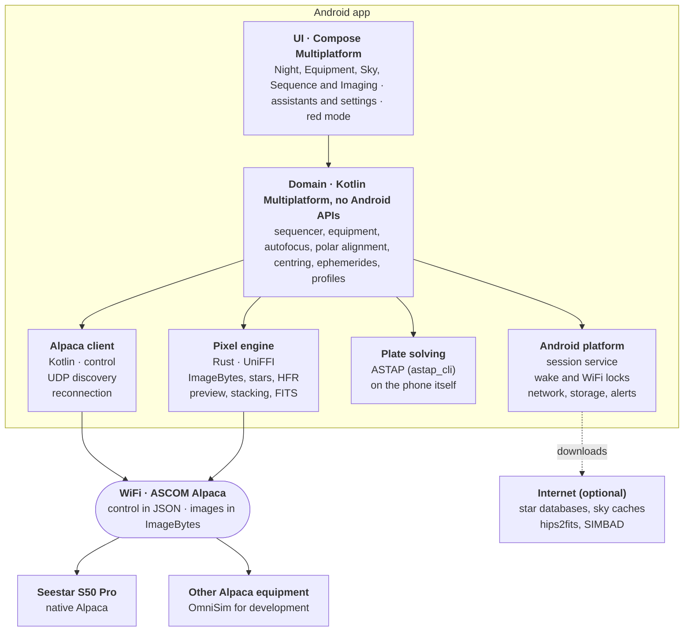

# Architecture

How Yacana is built, and why. Read this before changing anything large; for the look of the app, read the [style guide](docs/design/STYLE.md).

A decision here is reopened only with new data: a measurement, an external change or a new need. When one changes, this file changes with it.

## Overview



The Kotlin domain orchestrates; pixels live in a Rust engine and never go through Kotlin memory. The common code uses no Android APIs, so it is tested on the PC.

## Modules

| Module | What lives there |
| --- | --- |
| `app/` | The only Android application module: the activity, the session service, permissions, storage, the network and the solver's process |
| `shared/ui/` | Compose Multiplatform UI: every screen, the design system (`ui/design/`), the theme and red mode, the strings in ten languages |
| `shared/domain/` | Sequencer, equipment mediators, session guard, polar alignment, autofocus, centring, live stacking, planning and profiles |
| `shared/alpaca/` | The ASCOM Alpaca client: discovery, typed devices, ImageBytes |
| `shared/ports/` | Interfaces of the pixel engine, the plate solver and the platform |
| `shared/astronomy/` | Astronomy Engine's source, as its author writes it: the Sun and the Moon |
| `engine/` | The Rust pixel engine and its UniFFI bindings (`engine/android/` builds them for Android) |
| `solvers/astap/` | ASTAP's official Android build, run as a separate process |
| `catalog/` | The script that makes the object catalogue from OpenNGC |
| `tools/` | Scripts for development and CI |

`shared/ports`, `shared/domain` and `shared/alpaca` also have a `jvm()` target, so their tests run as plain JVM tests on the PC.

## Rules

1. **Dependencies in one direction:** UI → domain → ports. The engine, the solver and the platform are implementations behind the ports. The domain uses the Alpaca client directly: Alpaca is the only protocol, and interfaces for it would copy the whole ASCOM surface only to have one implementation.
2. **Pixels in native memory:** Kotlin handles image handles and small results (stars, HFR, a solution, a preview). There is no Java heap limit, and a 61 MP frame fits.
3. **A coarse engine API:** few calls that do a lot of work, no global state, tested with `cargo test` on the PC.
4. **Structured concurrency:** each step of a sequence is a cancellable coroutine with a timeout. A session supervisor, in the foreground service, owns the night.
5. **One-way flow:** each device and the session publish immutable state (`StateFlow`); the UI observes it and sends intents.
6. **Typed errors, a policy per step:** retry, skip or abort, as in N.I.N.A.
7. **Files:** profiles and sequences are versioned JSON (kotlinx.serialization). Each schema change adds a migration from version N to N+1 with a test on a stored old file; unknown keys are ignored, so a newer file still opens. The object catalogue is a read-only file inside the APK, and a session diary on disk lets a night resume after the app is closed.
8. **Network:** all Alpaca traffic, the engine's sockets included, is bound to the equipment's network even when it has no internet (Ktor with OkHttp in Kotlin, `android_setsocknetwork()` in Rust); downloads use the default network.
9. **Wiring by hand:** classes take their dependencies in their constructors, and the app builds them in one place. The compiler checks it, and nothing fails at night because of a missing binding.

### Main ports (sketch)

```kotlin
interface ImageEngine {                       // Rust via UniFFI
    suspend fun download(source: AlpacaImageSource): ImageHandle           // ImageBytes into native memory
    suspend fun analyze(image: ImageHandle, options: AnalysisOptions): ImageAnalysis
    suspend fun preview(image: ImageHandle, stretch: Stretch, region: Region, size: Size): Rgba8Image
    suspend fun save(image: ImageHandle, format: ImageFormat, headers: FitsHeaders, target: FileTarget)
}

interface PlateSolver {                       // ASTAP, a separate process
    suspend fun solve(image: ImageHandle, request: SolveRequest): SolveResult
}
```

## Android

Android is not made for an eight-hour task with the screen off. This is how the app handles it:

| Constraint | Solution |
| --- | --- |
| Android 15+ stops `dataSync` foreground services after 6 hours a day | A `connectedDevice` service, with a status notification and a stop button |
| Android 17+ asks for `ACCESS_LOCAL_NETWORK` for any local traffic, discovery included | Asked for in the first steps, saying what it is for |
| The CPU and the WiFi sleep with the screen off | A partial wake lock and a low-latency WifiLock while a session runs |
| Manufacturers that close apps in the background | An in-app guide to exclude Yacana from battery optimisation |
| The Seestar's WiFi has no internet, and Android sends traffic to mobile data | Sockets bound to that network; a `MulticastLock` for discovery |
| Alpaca is plain HTTP on the local network | A `networkSecurityConfig` that allows cleartext HTTP |
| Android 10+ does not run programs stored in the app's data | ASTAP ships inside the APK as a native library (`libastap_cli.so`) |
| Phones with 16 KB pages | Rust linked with 16 KB pages; `tools/check_16kb.py` checks every APK |
| Images, star databases and caches take gigabytes | Frames in a folder the user chooses (SAF); databases and caches in the app's storage, with space warnings; ZIPs read in place, never unzipped |
| No coverage in the field | Everything works offline: databases, caches and catalogue are downloaded beforehand or imported from a file |
| Night use | Red mode in every pixel, the app's own keypad, and no system keyboard at night |
| Screens of every size | Every screen works in portrait and in landscape; tablets use the phone's layout |

## Choices

**UI: Compose Multiplatform.** The official Android toolkit, with direct access to services, networks and storage. Flutter adds nothing for an Android-only app and is weak at number crunching; Avalonia's only advantage was reusing N.I.N.A.'s C#, at the cost of a second-hand integration on Android.

**A Rust engine.** Android limits the Java heap to some 256–512 MB, and a 61 MP frame takes 122 MB; native memory has no such limit. Rust uses NEON and every core, is tested on the PC with real FITS files and avoids C++'s memory bugs. Not everything is in Rust: the equipment and the sequencer are hundreds of methods that fit Kotlin's coroutines and Android better.

**Plate solving with ASTAP** on the phone, without internet: the well-known solver, MPL-2.0 like Yacana, with an official Android build. Its star databases are chosen per profile; D50 is the default for the Seestar, the densest that solves its frames within the time and space targets, with margin for poor nights.

**Navigation 3**, whose back stack the app reads and changes, so a night can resume after the process is killed.

**Ktor with the OkHttp engine** for HTTP: common Kotlin code, testable on the PC, with sockets that can be bound to a network.

**Charts and the image viewer are the app's own.** Charts are small Canvas composables drawn with the theme's colours, so red mode covers them; the viewer shows pixels the engine renders for the region on screen, so a full frame never becomes an Android bitmap.

**Toolchain:** Gradle with the version catalogue (`gradle/libs.versions.toml`), compileSdk and targetSdk 37, minSdk 29. ktlint (Android Studio's style, 140 columns), detekt and Android lint with warnings as errors; rustfmt and clippy with `-D warnings`.

## Quality

- **Tests on the PC:** the domain's and the Alpaca client's tests, the engine's `cargo test`, and flow tests that drive every screen of the app with Robolectric.
- **Reference screenshots:** every screen in dark and red, portrait and landscape, in `app/src/test/screenshots`, recorded and verified with Roborazzi. In red mode the test fails if a pixel has any green or blue. They are the visual reference of the app.
- **Texts:** `TranslationsTest` and `tools/check_translation.py` check the ten languages. With `YACANA_TEXTS=1`, the screenshot test renders every screen in each language instead and reports the texts that do not fit.
- **The same numbers as the references:** stars, HFR and stretch as N.I.N.A.; FWHM as Hocus Focus; the polar error as the Three Point Polar Alignment plugin; the ephemerides against JPL Horizons. `CONTRIBUTING.md` says how to check them.
- **Equipment:** integration tests against the ASCOM Alpaca simulators (OmniSim), and a replay camera that serves real frames.
- **Budgets:** the APK stays under 40 MB (`tools/check_apk_size.py`, in CI), and a cold start under 2 s (`tools/cold_start.py`). Coverage has floors per module that only go up (`tools/coverage_summary.py`).
- **Licences:** a test checks that *Settings › About › Open-source licences* names every library in the APK.
