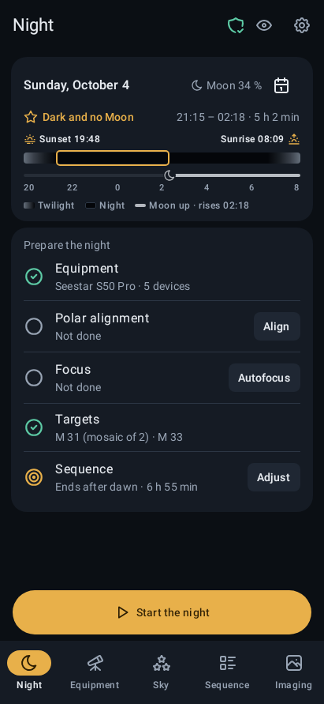
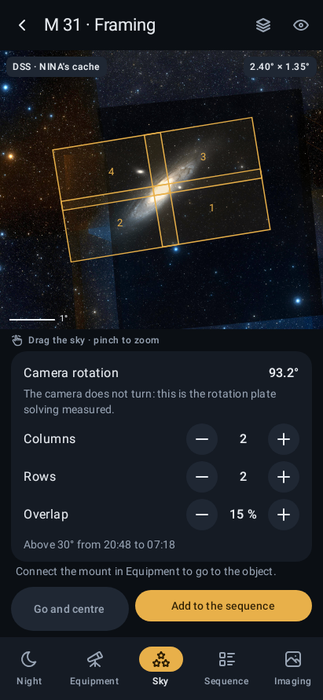
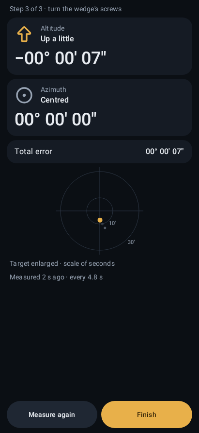
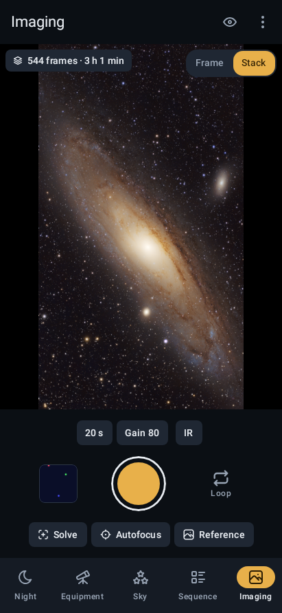

### The whole astrophotography night, run from an Android phone.

Plan, frame, polar-align, focus, capture and stack with any ASCOM Alpaca equipment. 
No PC, no cloud, and no signal needed in the field. Free and open source.

[**Download**](https://github.com/yacana-app/yacana/releases/latest) · [Features](#features) · [Install](#install) · [User manual](docs/manual/README.md) · [Documentation](#documentation) · [Contributing](#contributing)

 

Real sky: the framing is drawn on the photos of N.I.N.A.'s DSS cache, and M 31 is 544 frames of 20 s taken with a Seestar S50 Pro, processed afterwards.

---

*Yacana is the celestial llama of the Incas, a dark constellation in the Milky Way. Its eyes are Alpha and Beta Centauri.*

## Why Yacana

Yacana puts **the depth of a desktop imaging suite on the phone in your pocket, redesigned for a touch screen and a dark field.** It talks straight to your equipment over WiFi through ASCOM Alpaca, plans the night, runs it with the screen off, and tells you in the morning what happened. Its functional reference is N.I.N.A., the free imaging suite for Windows: Yacana follows its ways of working and ports some of its best tools, such as its polar alignment and its autofocus, so that the results match.

- 📱 **The phone is the observatory computer.** No laptop, no mini-PC, no extra box. Yacana finds your devices, drives them and runs the session by itself.
- 🏔️ **Made for dark sites.** The object catalogue, N.I.N.A.'s sky cache, plate solving and the ephemerides all live on the phone. Only the SIMBAD search and the close-up photos use the internet, and a night needs neither.
- 🔴 **Made for the dark.** A true red mode on every pixel, photos included, large touch targets, and no system keyboard at night.
- 🔓 **Open and vendor-neutral.** Any Alpaca mount, camera, focuser, filter wheel, switch, flat panel or safety monitor. The ZWO Seestar S50 Pro is the reference device and fills in its own profiles, for its telephoto and its wide-angle camera.

## Features

### 🌙 The night at a glance

- **Tonight's card:** astronomical darkness, the Moon, and sunset to sunrise on one timeline, with a calendar to look at any other night.
- **A preparation checklist** with no compulsory steps: equipment, polar alignment, focus, targets, and whether the plan fits before dawn.
- **While it runs:** the current frame, the progress, the end time against dawn, the quality of the last frame and what comes next.
- **In the morning:** a night summary (useful integration, frames kept and discarded, median HFR, frames per target and filter, incidents) and a readable diary of every event.

### 🗺️ The sky in your pocket

- **N.I.N.A.'s sky cache, offline:** the whole sky in 2,131 DSS colour photos of 5° (3.5 GB), downloaded once inside the app or imported from N.I.N.A., and read straight from its ZIP, with N.I.N.A.'s narrowband caches on top. DSS2 photos fill in online when you zoom in close.
- **13,371 deep-sky objects offline,** from OpenNGC (NGC, IC, Messier, Caldwell and more), searched in milliseconds.
- **More than 20 million objects online** through SIMBAD and CDS Sesame: any name, from the quasar TON 618 to the stars of a constellation, kept on the phone once found.
- **Sky Atlas:** tonight's best targets, filtered by type, size, magnitude, altitude, hours above the horizon, distance to the Moon and fit in the field, with altitude charts against your own horizon.
- **Framing and mosaics:** the camera's real field and rotation, measured by plate solving, over the sky photos; mosaics of any number of panels with adjustable overlap.
- **The mount on the map:** a live box shows where the telescope points, with "Go and centre", "Go only" and a pad to nudge it.

### ✨ Plate solving and centring

- **ASTAP on the phone:** 0.4 s to solve with a position hint and about 7 s blind (p95 on a Poco F5 Pro with real Seestar frames), within 0.03″ of ASTAP on a PC.
- **Six star databases,** from 0.3 MB to 1.2 GB, with the right one recommended for your field. Downloads resume, and databases can also be imported from a file.
- **Go to and centre:** solve, sync and slew again until the target is within 30″.

### 📐 Three-point polar alignment

- **A built-in port of N.I.N.A.'s Three Point Polar Alignment plugin,** tested against the plugin on 18 cases in both hemispheres and matching it within 0.4″.
- **Down to the arcsecond:** the error in degrees, minutes and seconds, a bullseye that zooms in as you get close, and a vibration when you reach your tolerance.

### 🎯 Autofocus

- **A port of N.I.N.A.'s autofocus,** with its five curve fittings (hyperbolic by default), backlash compensation and per-filter offsets.
- **Triggers** on temperature, filter change, HFR drift and time.
- **Star detection and HFR ported from N.I.N.A.,** with the same star counts and HFR on real frames, plus a Moffat FWHM as in Hocus Focus.

### 📋 Sequencer, simple and advanced

- **Simple editor:** the night on a timeline, targets with their exposures and rules, templates (one target all night, several targets, a mosaic, flats) and 50 levels of undo.
- **Advanced editor** in N.I.N.A.'s style: 16 instructions, sequential and **parallel** blocks, 6 triggers and 3 conditions (loops, time, altitude), and reusable block templates. Both editors share one model, so you can switch either way without losing anything.
- **Review the night** before you start: 12 kinds of warnings, such as a parked mount, a missing filter, or two parallel steps using the same device.
- **Dithering without a guide camera,** edits that apply while the sequence runs, and a trigger that takes new darks when the sensor's temperature changes.

### 🌌 Live stacking, calibrated

- **Off until you want it.** Each good light frame is aligned by its stars (shift, rotation and scale), added to its stack with 3-sigma rejection of satellites and planes, and colour-balanced on its own stars.
- **Calibrated as it goes,** with the night's master dark at the closest sensor temperature and the master flat of its filter, kept in your frames' folder as `FLATS/MasterFlat_IR.fits` for the next nights.
- **Saved as a linear 32-bit FITS** for processing, and as a JPG. On a real night of 555 frames, every frame went in, with round stars.

### 🧪 Flats, darks and bias

- **A flats assistant** with the phone itself as the light, face down on the telescope, or a flat panel: 30 s to lay the phone there, a beep as the flats start and another as they end, its screen all white at full brightness, and the exposure found by itself for 30,000 ADU ±5 %, 30 flats per filter.
- **Master flats you can reuse:** one per filter in the FLATS folder, a 32-bit FITS that Siril and PixInsight read too; a flat of yours put there counts the same.
- **Darks** at the start, at the end, or whenever the sensor's temperature changes by 2, 3 or 5 °C. On the Seestar, the filter wheel's Dark position stands in for a shutter.

### 🛡️ A session you can sleep through

- **Keeps the screen on** while Yacana is in front, so that the WiFi stays at full speed and joins the equipment again at once if it drops.
- **Runs with the screen off** as a foreground service. Measured: 8.5 hours overnight against a real Seestar, 503 full frames, no restart, no gap longer than 6 s, and 1.7 % of the battery per hour.
- **Reconnects on its own,** pauses safely while the link is down, and stops safely (parks, or stops tracking) if it does not come back, if the sequence fails, or if the phone's battery runs low.
- **Resumes after a crash or a reboot.** Frames are written atomically: 100 kills while saving left no broken file.
- **Progress on the lock screen** with a Stop button, and alerts that sound only when something needs you.

### 📁 Files you can trust

- **16-bit FITS with N.I.N.A.'s headers** (36 keywords) and the same pixels as the Seestar's own files, debayered by Siril exactly like them.
- **N.I.N.A.'s file name tokens,** a folder per night and target by default, saved anywhere: internal storage, an SD card or a USB drive.
- **Equipment profiles as JSON,** horizon files from N.I.N.A., and a log ZIP to share if something goes wrong.

### 🌍 Ten languages

English, Spanish, Catalan, Basque, Galician, German, French, Italian, and European and Brazilian Portuguese, following the phone or chosen in the app. The screens are checked to fit in all ten.

## Install

1. Open the [latest release](https://github.com/yacana-app/yacana/releases/latest) and download `yacana-<version>.apk` on a 64-bit ARM phone with Android 10 or later.
2. Open it. Android may ask to allow installing apps from your browser or file manager: allow it, then go back and install.
3. Open Yacana. Its first steps list the permissions and settings a night needs, each with what it is for and what to tap, so that Android never stops a session with the screen off.
4. Find your equipment; a Seestar fills in its own profile. At home, over WiFi, download the star database and N.I.N.A.'s sky cache, or import the cache's ZIP if you already have it.

Each new version installs over the previous one and keeps your profiles and settings. The [user manual](docs/manual/README.md) walks through every step.

## Equipment

Anything that speaks [ASCOM Alpaca](https://ascom-standards.org/About/Index.htm), found on the network by itself (IPv4 and IPv6) or added by IP and port: mount, camera, focuser, filter wheel, switches (such as dew heaters), flat panel and safety monitor. The ZWO Seestar S50 Pro on an equatorial wedge is the reference device; ZWO's app is still used to set it up, for example for firmware updates and EQ mode.

## Under the hood

| | |
| --- | --- |
| **App** | Kotlin Multiplatform and Compose Multiplatform, with Material 3 |
| **Pixel engine** | Rust, bound to Kotlin with UniFFI: downloads straight into native memory, debayering, stretching, star detection, PSF fitting and stacking |
| **Plate solving** | ASTAP's official command-line solver, inside the APK |
| **Ephemerides** | Astronomy Engine, checked against JPL Horizons within 40 s and 4″ |
| **Size** | About 8 MB, with 16 KB page alignment |
| **Quality** | About 500 Kotlin and 50 Rust tests: flow tests on every screen, 308 reference screenshots (dark and red, portrait and landscape), a check that red mode leaves no green or blue pixel, and tests against the ASCOM Alpaca simulator |

## Documentation

- **The user manual**, in the app's ten languages: [English](docs/manual/README.md) · [Español](docs/manual/es/README.md) · [Català](docs/manual/ca/README.md) · [Euskara](docs/manual/eu/README.md) · [Galego](docs/manual/gl/README.md) · [Deutsch](docs/manual/de/README.md) · [Français](docs/manual/fr/README.md) · [Italiano](docs/manual/it/README.md) · [Português (Portugal)](docs/manual/pt/README.md) · [Português (Brasil)](docs/manual/pt-BR/README.md). 39 chapters on every screen and feature, step by step, with the app's own screens in each language, from installing it to the summary in the morning, plus the Seestar, troubleshooting and a glossary.
- [`ARCHITECTURE.md`](ARCHITECTURE.md): how the app is built, and why.
- [`docs/design/STYLE.md`](docs/design/STYLE.md): the style guide, with [a kit](docs/design/kit.html) to draw new screens; download it and open it in a browser.
- [`docs/brand/`](docs/brand/): the logo and the sources of the app icons.
- [`CONTRIBUTING.md`](CONTRIBUTING.md): how to set up, build and test the project.

## Contributing

Yacana is a community project. Bug reports, reports from your own nights, translations and pull requests are welcome: start with [CONTRIBUTING.md](CONTRIBUTING.md) and the [code of conduct](CODE_OF_CONDUCT.md). Security problems go privately, as [SECURITY.md](SECURITY.md) says.

Yacana was developed in a private repository up to version 1.0.0, its first public release; this repository starts there.

## Acknowledgements

Yacana stands on open science and open source:

- [N.I.N.A.](https://nighttime-imaging.eu/), its functional reference, and the Three Point Polar Alignment plugin, ported under the MPL-2.0.
- [ASTAP](https://www.hnsky.org/astap.htm) by Han Kleijn, for plate solving.
- ESA's Gaia mission (ESA/Gaia/DPAC), whose data ASTAP's star databases are made from, under CC BY-NC 3.0 IGO.
- The Digitized Sky Survey (STScI), through N.I.N.A.'s framing cache and the CDS's hips2fits, and the Northern Sky Narrowband Survey (CC BY-NC-SA 4.0).
- [SIMBAD](https://simbad.cds.unistra.fr/simbad/) and Sesame, at the CDS in Strasbourg.
- [OpenNGC](https://github.com/mattiaverga/OpenNGC), under CC BY-SA 4.0.
- [Astronomy Engine](https://github.com/cosinekitty/astronomy) by Don Cross.
- [ASCOM](https://ascom-standards.org/) and its Alpaca simulators.
- [Tabler Icons](https://tabler.io/icons).

## License

[Mozilla Public License 2.0](LICENSE).

The object catalogue the app carries, `shared/ui/src/commonMain/composeResources/files/catalogue.tsv`, is made from OpenNGC by [`catalog/build.py`](catalog/build.py) and is distributed under [CC BY-SA 4.0](https://creativecommons.org/licenses/by-sa/4.0/), like OpenNGC. The licences of every library the app carries and of the data it uses, with their texts, are in *Settings › About › Open-source licences*.

Yacana is an independent project. It is not affiliated with ZWO, the ASCOM Initiative or the N.I.N.A. project, whose open-source work is its functional reference.
