

**User manual · version 1.0.0**

# The whole night, from your phone

Everything Yacana does and how to use it, screen by screen: from the first launch to the summary in the morning, with the real screens of the app.

`Android 10+ · ARM64` · `ASCOM Alpaca over WiFi` · `Works without internet` · `10 languages` · `MPL-2.0`

**English** · [Español](es/README.md) · [Català](ca/README.md) · [Euskara](eu/README.md) · [Galego](gl/README.md) · [Deutsch](de/README.md) · [Français](fr/README.md) · [Italiano](it/README.md) · [Português (Portugal)](pt/README.md) · [Português (Brasil)](pt-BR/README.md)

## Contents

**Getting started**

1. [Welcome to Yacana](#welcome)
2. [Install and update](#install)
3. [First steps](#first-steps)
4. [Finding your way](#tour)
5. [Your equipment profile](#profile)
6. [Ready for the field](#field)

**Equipment**

7. [Connecting your equipment](#equipment)
8. [The mount](#mount)
9. [Camera and filter wheel](#camera)
10. [The focuser](#focuser)
11. [Switches, flat panel, safety monitor](#accessories)

**Planning the night**

12. [Tonight at a glance](#night)
13. [The sky map](#sky-map)
14. [Sky Atlas and search](#atlas)
15. [An object's page](#object)
16. [Framing and mosaics](#framing)

**At the telescope**

17. [Polar alignment](#polar)
18. [Plate solving and centring](#solving)
19. [Autofocus](#autofocus)

**Capturing**

20. [Imaging](#imaging)
21. [History and frame quality](#history)
22. [Live stacking](#stacking)
23. [Flats, darks and bias](#calibration)

**Sequences**

24. [The Sequence section](#sequence)
25. [The simple editor](#simple)
26. [The advanced editor](#advanced)
27. [Running the night](#running)
28. [Alerts and safe stops](#safety)
29. [The morning after](#morning)

**Settings and files**

30. [Images and files](#files)
31. [Settings reference](#settings)
32. [Red mode and language](#display)
33. [Permissions and battery](#permissions)

**Reference**

34. [Using a Seestar S50 Pro](#seestar)
35. [What needs internet](#internet)
36. [Troubleshooting](#troubleshooting)
37. [For N.I.N.A. users](#for-nina-users)
38. [Glossary](#glossary)
39. [Privacy, licences, credits](#credits)

---

# Getting started

## 1. Welcome to Yacana

Yacana runs a whole astrophotography night from an Android phone. It talks straight to your equipment over WiFi through ASCOM Alpaca, plans the night, frames and centres the targets, polar-aligns the mount, focuses, captures, stacks, and keeps going with the screen off. In the morning it tells you what happened.

There is no laptop, mini-PC or cloud service in between: the phone is the observatory computer. Its functional reference is N.I.N.A., the free imaging suite for Windows. Yacana follows its ways of working and ports some of its tools, such as the three-point polar alignment, the autofocus and the star detection, so that the results match.

### What you need

- **A phone** with Android 10 or later and a 64-bit ARM processor, as almost every phone sold since 2019 has. The app is about 8 MB.
- **Equipment that speaks ASCOM Alpaca** over the network: a mount and a camera, and if you have them a focuser, a filter wheel, switches (such as a dew heater), a flat panel and a safety monitor. The ZWO Seestar S50 Pro has Alpaca built in and is the reference device.
- **WiFi between the phone and the equipment:** the equipment's own access point, or the same home network.
- **Free space for the offline data,** downloaded once at home: a star database for plate solving (about 900 MB for the recommended one) and, for the sky photos, N.I.N.A.'s sky cache (3.5 GB).

### What Yacana does

| Moment of the night | Where in the app | Chapter |
| --- | --- | --- |
| Check tonight's darkness and the Moon, and prepare with a checklist | Night | [12](#night) |
| Connect each device and drive it by hand | Equipment | [7–11](#equipment) |
| Find targets, see them on the sky, frame them, plan mosaics | Sky | [13–16](#sky-map) |
| Polar-align the mount to the arcsecond | Polar alignment assistant | [17](#polar) |
| Solve frames and centre the target | Imaging, Sky, Mount | [18](#solving) |
| Focus with a V-curve | Autofocus assistant | [19](#autofocus) |
| Take frames, check their quality, stack them live | Imaging | [20–22](#imaging) |
| Take flats, darks and bias | Flats assistant, sequence rules | [23](#calibration) |
| Plan the night and run it unattended | Sequence, Night | [24–28](#sequence) |
| Read the summary and the diary in the morning | Night | [29](#morning) |

### What it does not do

Yacana leaves out a few things on purpose. Know them before a night depends on them:

- **Guiding.** There is no guide camera and no PHD2. Dithering works without a guider, with short pulses or small mount moves.
- **USB devices and vendor drivers.** Everything goes through Alpaca over the network. INDI equipment works only through an Alpaca bridge.
- **Rotators, domes and meridian flips.** The camera's rotation is measured by plate solving and used as it is.
- **Planetarium links** (Stellarium, Cartes du Ciel) and N.I.N.A. plugins.
- **Tablet layouts.** The app runs on a tablet with the phone's layout.

### Your first night, in short

1. [Install the APK](#install) — From the project's releases page.
2. [Allow the permissions](#first-steps) — Local network, location, notifications, battery.
3. [Find your equipment](#equipment) — A Seestar fills in its own profile.
4. [Download the offline data at home](#field) — A star database and N.I.N.A.'s sky cache.
5. [Check tonight](#night) — Darkness, the Moon and the preparation list.
6. [Polar-align](#polar) — Three points, then turn the wedge's screws.
7. [Focus](#autofocus) — A V-curve with the focuser.
8. [Frame your targets](#framing) — Field, rotation and mosaics on the sky map.
9. [Plan the exposures](#simple) — Filters, frames and rules, before dawn.
10. [Start the night](#running) — Then put the phone away.

### How to read this manual

Each chapter shows the app's real screens with the steps that use them. Words in bold, such as **Go and centre**, are what the app shows on its buttons and rows. A button marked “hold”, such as **Park** *(hold)*, is pressed and held: anything that could cost you the night, such as parking, stopping or deleting, asks for a hold instead of a tap. The screens use a Seestar S50 Pro as the example; with other equipment they show its own devices and values.

The manual is also in the app's other nine languages: choose yours at the top.

## 2. Install and update

Yacana is installed from its APK file, published with every version on the project's releases page.

1. On the phone, open the [latest release](https://github.com/yacana-app/yacana/releases/latest) and download `yacana-<version>.apk`.
2. Open the downloaded file. The first time, Android asks to allow installing apps from your browser or file manager: allow it, go back, and tap **Install**.
3. Open Yacana. The first steps start by themselves ([chapter 3](#first-steps)).

### Updating

A new version installs over the previous one in the same way, and keeps your profiles, sequences, settings, star databases and sky caches. Every APK is signed with the same key, which is how Android knows it is an update of the same app.

### Uninstalling

Uninstalling removes the app with its profiles, settings, star databases and sky caches. Frames saved in a folder you chose with **Change folder** stay, but frames in the default folder, which is inside the app's own storage, are removed with it ([chapter 30](#files)). Copy them first, and export your profiles if you want to keep them ([chapter 5](#profile)).

## 3. First steps

The first time you open Yacana, three pages get it ready for a night: the permissions, your equipment, and the data for working without internet. They appear only until you finish them; everything they set can be changed later from Settings and Equipment.

### 1 · Before you start

Android stops apps that work with the screen off, so Yacana asks for a few permissions and settings first. Each row says what it is for. Tap its button and the row says what Android will show and what to tap there.

<table><tr>
<td valign="top" width="240">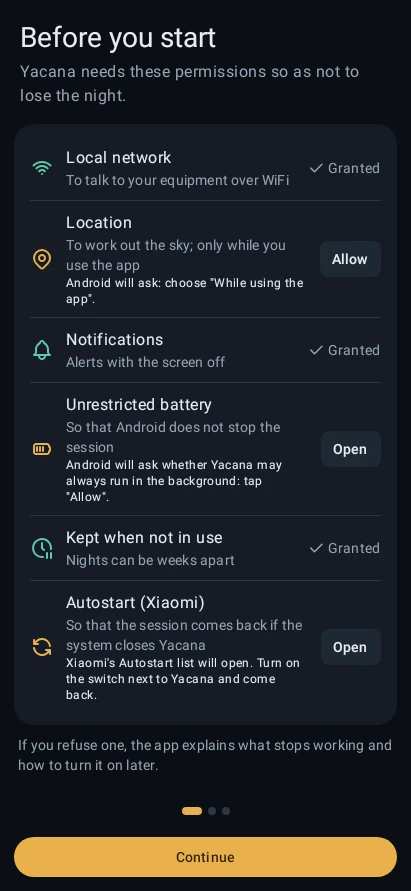 <b>Before you start.</b> Granted rows show a tick.</td>
</tr></table>

| Permission | What it is for | Without it |
| --- | --- | --- |
| **Local network** | Talking to your equipment over WiFi. Asked on Android 17 and later. | The app cannot find or control any Alpaca device. |
| **Location** | Working out the sky at your site, only while you use the app. Choose **While using the app**. | Type the site in the profile instead. |
| **Notifications** | The session and its alerts with the screen off. Asked on Android 13 and later. | You do not see the session or its alerts outside the app. |
| **Unrestricted battery** | So that Android does not stop the session. Tap **Allow** when Android asks. | The system may stop the session with the screen off. |
| **Kept when not in use** | Nights can be weeks apart. Turn off **Pause app activity if unused**. Android 11 and later. | Android may remove the app's permissions after a few months without use. |
| **Autostart (Xiaomi)** | On Xiaomi, Redmi and Poco phones, so that the session comes back if the system closes Yacana. Turn on the switch next to Yacana. | If the system closes Yacana at night, the session does not come back. |

If you refuse one, nothing breaks at once: the app explains what stops working and how to turn it on later, in *Settings › Permissions* ([chapter 33](#permissions)). Tap **Continue** to go on.

### 2 · Find your equipment

1. Turn the equipment on and connect the phone to its WiFi, or put both on your home WiFi.
2. Yacana searches the network for Alpaca devices by itself, on IPv4 and IPv6. Each server it finds shows as a card with its devices. **Search again** repeats the search.
3. On a Seestar, tap **Telephoto** or **Wide angle**: it loads the Seestar's profile for that camera, with its optics, field and recommended settings. You can make both and switch between them from the **Profile** card in Equipment. For other equipment, tap **Add**: the profile takes the first device of each kind on that server.

If a device is not found, for example on a network that blocks discovery, tap **Add by IP and port** and type its address, such as `192.168.1.10:32323`. If you already have a profile from another phone, **Import profile** loads it. **Not now** skips this page; you can find your equipment later in Equipment.

<table><tr>
<td valign="top" width="240">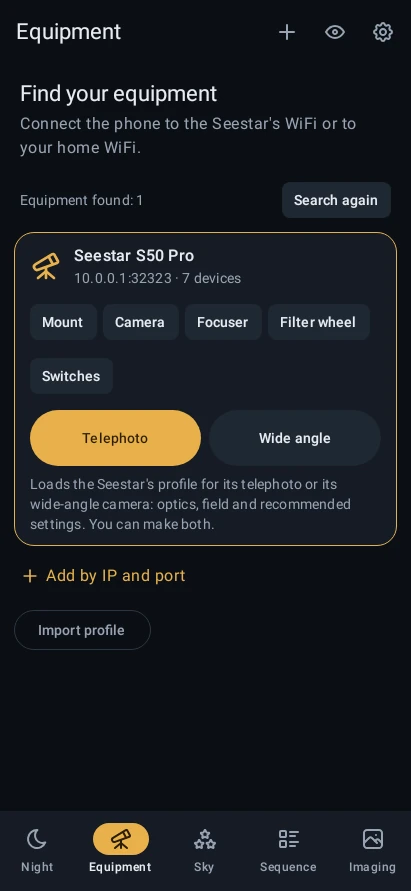 <b>Found on the WiFi.</b> A Seestar with its seven devices.</td>
</tr></table>

### 3 · Ready for the field

Yacana works without internet, but two things are too big to ship in the app. This page shows what is already on the phone and what to get while you still have WiFi:

- **Object catalogue** and **Ephemerides**: inside the app, nothing to do.
- **Star database**: the one recommended for your field, D50 for a Seestar. Tap **Download**.
- **NINA's sky cache**: the photos for the atlas and the framing. Tap **Import** if you already have its ZIP; to download it inside the app, use *Settings › Sky map* ([chapter 6](#field)).

Downloads carry on in the background. Tap **Start** to open the app.

<table><tr>
<td valign="top" width="240">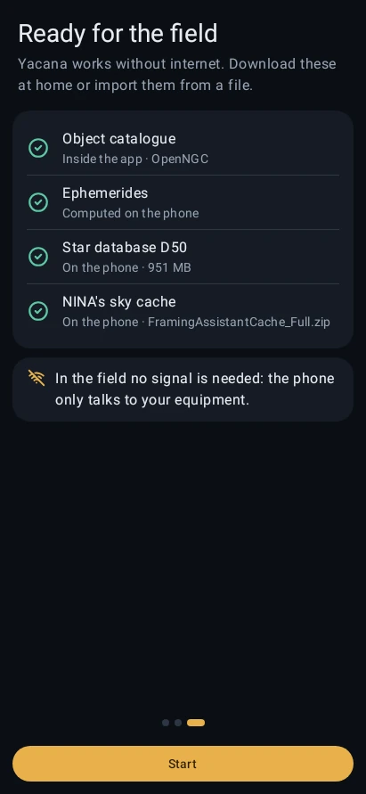 <b>Ready for the field.</b> Everything on the phone.</td>
</tr></table>

> [!TIP]
> **Good to know**
>
> The first steps cannot be opened again. Their parts live on: permissions in *Settings › Permissions*, the equipment search in Equipment, the star databases in *Settings › Plate solving*, and the sky caches in *Settings › Sky map*.

## 4. Finding your way

Yacana is arranged by the moments of the night rather than by device panels. At each moment it shows what you need and leaves the rest one tap away.

### The five sections

The bar at the bottom has five sections. With the phone in landscape it becomes a rail on the left. Tapping the section you are in takes you back to its first screen.

| Section | What for | Top bar |
| --- | --- | --- |
| **Night** | Tonight's darkness and Moon, the preparation checklist, the running session, the summary and the diary | Equipment status, red mode, Settings |
| **Equipment** | Profiles, connection and manual control of every device | Add device, red mode, Settings |
| **Sky** | Sky map, Sky Atlas, object pages and framing | Sky layers or Filters, red mode |
| **Sequence** | Tonight's plan, saved sequences, templates, the simple and advanced editors | — |
| **Imaging** | Manual capture, statistics, history, live stack and reference photo | Red mode, More options |

### Common controls

- **Settings:** The gear on Night and Equipment, or **Settings** at the end of Imaging's **More options**. Its search box finds any setting by part of its name.
- **Red mode:** The eye icon on Night, Equipment, Sky, Imaging, the object page, the framing and the assistants. It turns every pixel red ([chapter 32](#display)).
- **Equipment status:** On Night, a shield when the equipment is connected with no problems, or a warning triangle while the app reconnects or stops safely.
- **Back and close:** The arrow at the top left goes back. The assistants (polar alignment, autofocus and flats) show **✕** instead, which stops them.
- **Sheets:** Many options open in a sheet from the bottom of the screen. Swipe it down, or tap outside it, to close it.
- **Numbers:** Times, coordinates and frame counts are entered with frequent values and the app's own keypad, so that the system keyboard, which red mode cannot colour, never lights up at night.
- **Hold:** Risky buttons fill up while you press them and act after about a second: parking, stopping a sequence, deleting a profile, a cache, a database or a saved sequence. A short tap does nothing but remind you to hold.
- **States:** Every state is shown with an icon and words, never with colour alone, because in red mode green and amber look the same.

### The session bar

While a sequence runs or is paused, a bar on every screen except Night shows the target, the filter, the exposure and the frame, with its progress, like a music app's “now playing” bar. Tap it to see the session in Night; its button pauses or resumes the sequence.

### Notifications

While the equipment is connected, a notification shows the session, also on the lock screen: the target, the frame and the progress, or the frames saved. Tap it to open the app. Its **Disconnect** button stops the capture and disconnects the equipment. Alerts that need you, such as a lost link or a safe stop, sound; events such as an autofocus or the end of the sequence arrive silently. Each kind has its own notification channel (*Night session*, *Night alerts*, *Night events*), which you can adjust in Android's settings for the app.

<table><tr>
<td valign="top" width="330">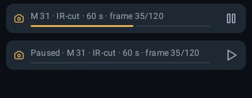 <b>The session bar</b>, running and paused.</td>
</tr></table>

## 5. Your equipment profile

A profile is one set of equipment and how you use it: its devices, optics, site, limits and options. Everything Yacana works out for you, such as the field, the plate solve's scale or the recommended star database, comes from it. Plate solving, autofocus, safety, file names and live stacking are kept per profile too.

Open it with *Settings › Profile and location*, or tap the **Profile** card in Equipment and then **Open the profile**. Profiles, devices and the profile's deletion change only while the equipment is disconnected.

### Name and optics

- **Name:** tap to edit it in place.
- **Focal length:** in millimetres, from 10 to 10,000, the telescope's with its reducer if it has one. It sets the plate solve's scale and the field the sky map draws.
- **Aperture:** the objective's diameter, from 5 to 2,000 mm. The focal ratio is shown beside it.
- **Camera sensor** and **Pixel size:** its pixels across and down (the height follows the width) and their size in µm, as the camera's specifications give them; a Seestar S50 Pro is 2160 × 3840 px of 2.9 µm. The camera fills them in when it connects; typed, the field is known without connecting anything, for the sky map and the framing.

Once the camera has connected, the card shows the scale and the field, such as *2.25″/px · field 1.35° × 2.40°*.

### Location

The site sets tonight's darkness, every altitude and the pole for polar alignment.

- **Use the phone's location** reads it from the phone as you turn it on, each time the app starts and when connecting; the first time, Android asks for the permission. If none comes, the row says why, and tapping it tries again. Off, you type it: latitude north or south (0 to 90°), longitude east or west (0 to 180°) and altitude in metres (0 to 9,000).
- **Send the time and the site to the mount** gives the mount the phone's UTC time and the site when connecting.

### Limits

- **Altitude limit**, 0 to 60°: no GoTo goes below it, nor below the horizon. A GoTo below it is refused and the mount does not move; a move with the pad stops by itself at the limit.
- **Horizon:** flat, or your own with trees and buildings. **Import** reads a N.I.N.A. horizon file: one point per line, azimuth and altitude in degrees, separated by spaces or tabs, with `#` for comments. **Make it flat** removes it. The object pages draw it on their altitude chart.

<table><tr>
<td valign="top" width="240">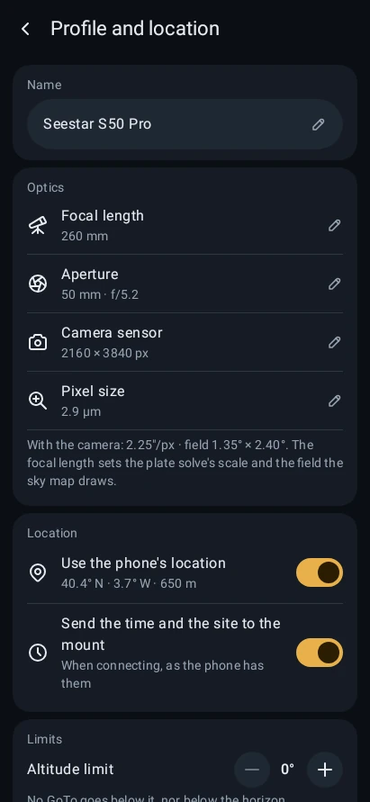 <b>Profile and location.</b> The Seestar's profile.</td>
<td valign="top" width="240">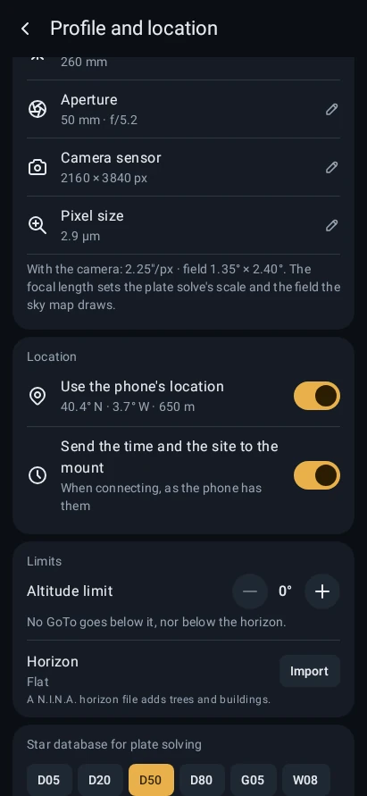 <b>Star database</b> for plate solving, chosen per profile.</td>
</tr></table>

### Star database

The buttons choose the profile's database for plate solving. The app says which one suits your field. If you choose one that is not on the phone, its size and a **Download** button appear: it comes into use when the download ends, and until then the previous one stays.

### More than one profile

- **Switch:** tap the **Profile** card in Equipment and choose another, or tap **Use** next to it under **Other profiles**.
- **New:** **New profile** under **Other profiles** searches the network; the equipment you choose becomes a new profile, in use.
- **Copy to another phone:** under **Profile copy**, **Export** saves the profile as a JSON file where you choose, and **Import** reads one and puts it in use. The file carries the site's location.
- **Delete:** **Delete profile** *(hold)*, at the end of the screen.

## 6. Ready for the field

In the field the phone only talks to your equipment. Before your first night, while you have WiFi at home, put two things on the phone: a star database for plate solving and the sky photos. Both can also be imported from a file, for example copied from a PC or from a memory card.

### Star databases

In *Settings › Plate solving*, under **Star database**. The app marks the one **recommended** for your field and shows the field's size. Several can be on the phone at once; the profile uses one, marked **In use**.

<table><tr>
<td valign="top" width="240">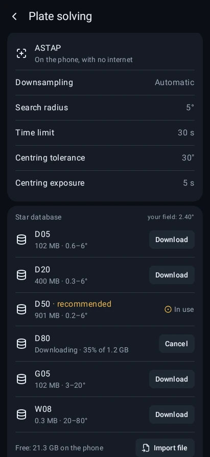 <b>The star databases.</b> D50 in use, D80 downloading.</td>
</tr></table>

| Database | Size | For fields of | Notes |
| --- | ---: | --- | --- |
| **D05** | 102 MB | 0.6° to 6° | The light option |
| **D20** | 400 MB | 0.3° to 6° |  |
| **D50** | 901 MB | 0.2° to 6° | Recommended for the Seestar |
| **D80** | 1.2 GB | 0.15° to 6° | The densest |
| **G05** | 102 MB | 3° to 20° | Wide fields, camera lenses |
| **W08** | 0.3 MB | 20° to 80° | Very wide fields |

- **Download** fetches it from ASTAP's site on WiFi only, even with the app closed, and resumes if it is interrupted. It is in use when it finishes. The free space on the phone is shown below the list.
- **Import file** installs it from ASTAP's own ZIP or `.deb` file, for example from a memory card.
- Hold an installed database to delete it with **Delete database** *(hold)*. The one in use cannot be deleted: put another in use first.
- **Try with the last frame** solves Imaging's last frame with the current settings, to check them.

### The sky photos: N.I.N.A.'s caches

The sky map, the Sky Atlas, the object pages, the framing and Imaging's reference all use the photos of N.I.N.A.'s framing caches. Yacana reads them as N.I.N.A. publishes them, straight from their ZIP without unpacking it, so a cache takes up as much as its ZIP and no more. Open *Settings › Sky map*, or the layers icon on the sky map.

- **Full cache (DSS):** the whole sky in 2,131 colour photos of 5° from the Digitized Sky Survey, 3.5 GB. This is the one to get.
- **NSNS with stars** (1.4 GB) and **NSNS without stars** (471 MB): the Northern Sky Narrowband Survey, hydrogen and oxygen emission down to about −17° of declination. They draw as a second layer.
- **Online photos:** the sharper photos the map fetches when you zoom in close with internet, kept on the phone.

<table><tr>
<td valign="top" width="240">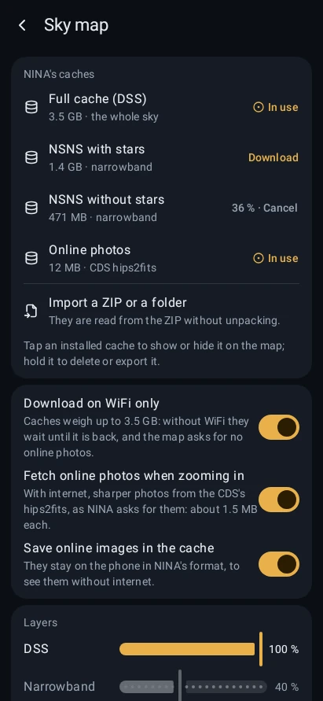 <b>Settings › Sky map.</b> The full cache in use, a narrowband one arriving.</td>
</tr></table>

#### Get a cache

- **Download** fetches it from N.I.N.A.'s site through Android's download manager. It resumes if interrupted and checks the free space first. With **Download on WiFi only** on (the default), it waits for WiFi.
- **Import a ZIP or a folder**: **Choose a ZIP** takes one of N.I.N.A.'s ZIPs, as those on its site; **Choose a folder** takes the cache folder N.I.N.A. has on a PC (`FramingAssistantCache`), copied to the phone or on a card. They are copied into the app.

#### Use it

- Tap an installed cache to show it on the map or hide it: **In use** or **Installed**.
- **Layers:** the opacity of the DSS layer (100 % by default) and of the narrowband one (40 %), to blend them.
- **Fetch online photos when zooming in** (on by default): with internet, zooming in on the map asks the CDS's hips2fits for sharper photos, as N.I.N.A. does, about 1.5 MB each. Turn it off to keep your mobile data for other things; with **Download on WiFi only** on, the map never fetches them on mobile data anyway.
- **Save online images in the cache**: when on, they stay on the phone in N.I.N.A.'s format, to see them again without internet.

#### Delete or export it

Hold an installed cache. The sheet says how much space it frees; **Delete cache** *(hold)* removes it. A folder cache, such as the online photos, also offers **Export ZIP**, to open it in N.I.N.A. on a PC.

<table><tr>
<td valign="top" width="240">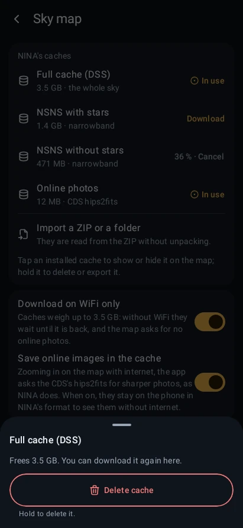 <b>Holding a cache.</b> What it frees, and the button to hold.</td>
</tr></table>

> [!TIP]
> **Credits**
>
> The photos are not part of the app: you download them from N.I.N.A.'s site or import them. The DSS is from the STScI, which allows N.I.N.A. to distribute it, and the NSNS is under CC BY-NC-SA 4.0. The map shows *DSS: STScI · NSNS: CC BY-NC-SA 4.0*.

---

# Equipment

## 7. Connecting your equipment

The Equipment section holds the profile in use, connects it, and gives you manual control of every device.

1. Check the **Profile** card: the profile's name and where its site comes from, such as *Location from GPS · 40.4° N · 3.7° W · 650 m*. Tap it to switch to another profile.
2. Tap **Connect**. The row says *Connecting…* and then how many devices answered, such as *5 of 5 connected*, or why one could not connect.
3. Each device has a row with its live state: the mount tracking and its altitude, the camera idle and its sensor's temperature, the focuser's position, the filter in place, the dew heater on. They refresh every second or two.
4. Tap a connected device to open its screen. **Disconnect all** ends the connection.

If the link drops, Yacana reconnects by itself. During a sequence it first pauses safely ([chapter 28](#safety)).

<table><tr>
<td valign="top" width="240">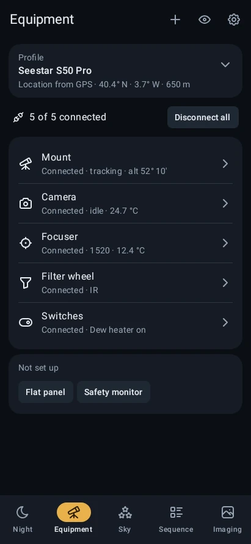 <b>Equipment.</b> Five devices connected; the flat panel and safety monitor not set up.</td>
</tr></table>

### Adding a device

The **+** at the top opens *Add device*, which searches the network again. Each server shows the devices your profile does not have yet, each with **Add**; **Add by IP and port** takes an address. The **Not set up** card at the end of the list has a button for each optional device, the flat panel and the safety monitor, which opens the same search. Devices are added only while the equipment is disconnected.

### Without a profile

If you skipped the first steps, Equipment starts with **Find your equipment**, the same search as in [chapter 3](#first-steps), and an **Import profile** button.

## 8. The mount

The mount's screen shows where it points and moves it by hand, with GoTo, sync, park and tracking.

### Where it points

The top card shows its state, such as *Tracking · sidereal*, *Slewing*, *Not tracking* or *Parked*, and its RA, Dec, altitude and azimuth. While it centres a target, the card shows the attempt and the current step, with **Stop**.

### Moving it by hand

Press and hold an arrow (N, S, E, W) to move the mount; it stops when you let go. The red button in the middle stops it at once. The buttons below set the speed: **1×**, **8×** (the default) or **64×** the sidereal rate, or **Max**, the mount's fastest. A move stops by itself at the profile's altitude limit.

### The buttons

- **Go to…:** Opens a sheet to type the RA and Dec with the app's keypad (see below).
- **Sync:** Tells the mount it points at the coordinates you type. With a solved frame, use Imaging's **Sync the mount** instead ([chapter 18](#solving)). Shown only if the mount can sync.
- **Park:** Hold it to send the mount to its rest position. A short tap only reminds you to hold. While the mount is parked, the button reads **Unpark**, and a tap unparks it.
- **Tracking:** Turns tracking on or off.
- **Polar alignment:** Opens the polar alignment assistant ([chapter 17](#polar)).

The **⋮** menu at the top holds the rest: the **Tracking rate** (sidereal, lunar, solar or King, those the mount supports), **Unpark** when it is parked, and **Find home** if the mount has it.

<table><tr>
<td valign="top" width="240">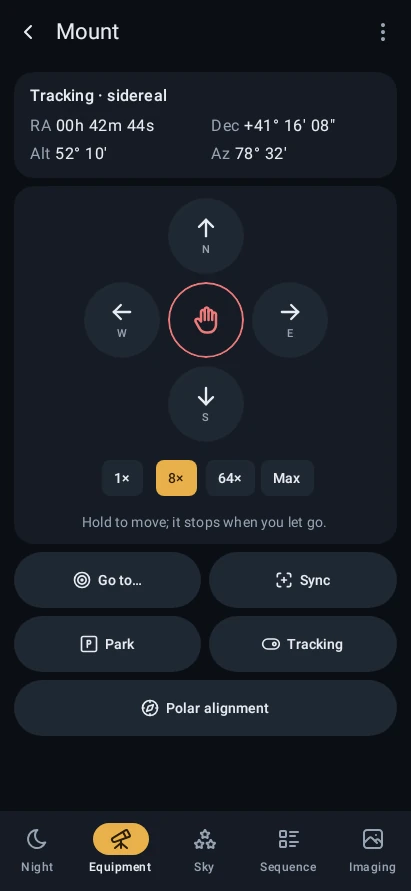 <b>Mount.</b> Hold an arrow to move; tap the speed.</td>
<td valign="top" width="240">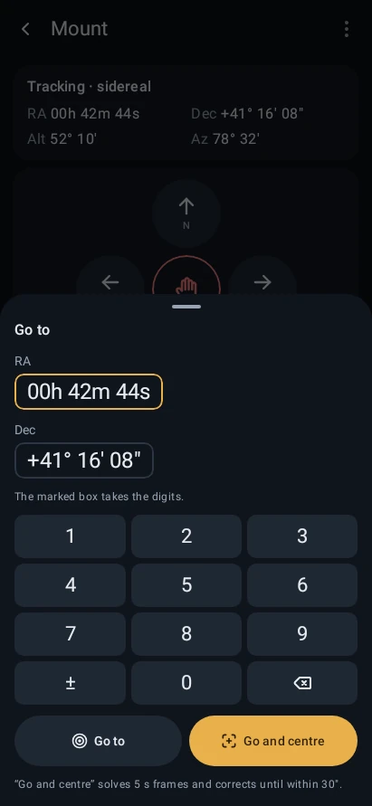 <b>Go to.</b> The marked box takes the digits.</td>
</tr></table>

### Go to coordinates

1. Tap **Go to…**. The sheet shows the mount's current RA and Dec.
2. Tap the RA or the Dec box to mark it, and type the digits on the keypad. **±** flips the declination's sign.
3. Tap **Go to** to slew there, or **Go and centre** to slew and then refine with plate solving until the target is within the tolerance (30″ by default).

> [!CAUTION]
> **Below the limit**
>
> A GoTo to a target below the profile's altitude limit, or below its horizon, is refused. The screen says where the target is and that the mount did not move. Wait for it to rise, or change the limit in the profile ([chapter 5](#profile)).

## 9. Camera and filter wheel

### Camera

The camera's screen shows its state, such as *Idle · −10 °C*, and what it reports: the sensor's size, the pixel size, the Bayer pattern, the gain and offset ranges, and the longest exposure. Frames are taken in Imaging; **Go to Imaging** takes you there ([chapter 20](#imaging)).

Yacana uses each camera as it describes itself over Alpaca: gain, offset, binning, region of interest and sensor temperature where the camera has them. Frames download straight into the phone's native memory while the next exposure starts, so even 61 MP cameras fit.

### Filter wheel

The filter wheel's screen lists its filters, with a tick on the one in place. Tap a filter to use it. In Imaging the filter is also a button under the frame.

A filter named **Dark**, as on the Seestar, is used as a shutter for darks and bias, so nothing needs covering. Without one, the app asks you to cover the telescope when it takes darks.

## 10. The focuser

- **Position** and **Temperature**, large, with the time and temperature of the last autofocus.
- **Move:** **−100**, **−10**, **+10** and **+100** steps, and **Go to position…**, which opens the keypad with the focuser's range. **Stop** appears while it moves.
- **Last curve:** the last autofocus's V-curve, with its best HFR and position.
- **Focus offset by filter**, with a filter wheel: tap a filter to set its offset in steps, relative to the others. On a filter change, the focuser moves by the difference between the new filter's offset and the old one's, so each filter stays in focus without a new autofocus.
- **Autofocus** runs the autofocus at once ([chapter 19](#autofocus)).

<table><tr>
<td valign="top" width="240">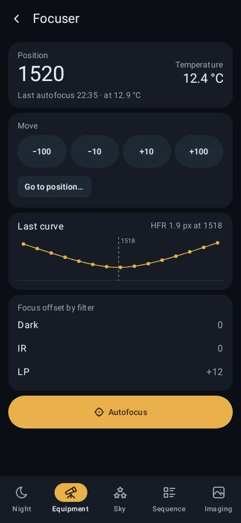 <b>Focuser.</b> The LP filter focuses 12 steps further out.</td>
</tr></table>

## 11. Switches, flat panel and safety monitor

### Switches

Each switch shows as the device declares it: a toggle for on and off, a slider with − and + for a value such as a heater's power (with its range and step; the value is sent when you let go), or a reading for read-only ones. The most common is a dew heater, which the sequence can turn on at the start and off at the end.

### Flat panel

For a flat panel with a cover (an Alpaca CoverCalibrator):

- **Cover:** its state, with **Open** and **Close**, and **Stop** while it moves. Open it for the night and close it for darks.
- **Light:** on or off, and its **Brightness** with a slider or − and +.

For flats, the flats assistant closes the cover, turns the light on and finds the exposure by itself ([chapter 23](#calibration)).

### Safety monitor

Shows **Safe** or **Unsafe**, read every second, for example from a cloud or rain sensor. The app shows it but does not act on it yet: if it turns **Unsafe**, stop the sequence from Night.

<table><tr>
<td valign="top" width="240">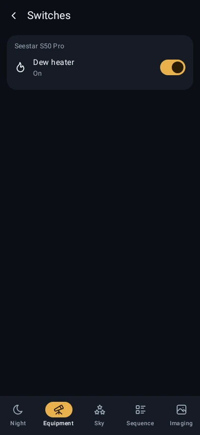 <b>Switches.</b> The Seestar's dew heater.</td>
<td valign="top" width="240">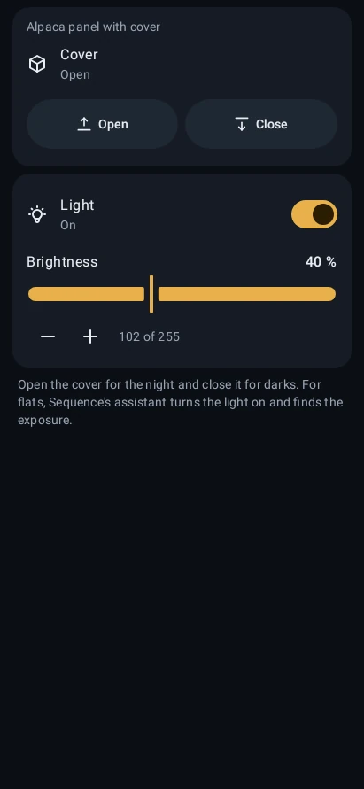 <b>Flat panel.</b> Cover open, light at 40 %.</td>
<td valign="top" width="240">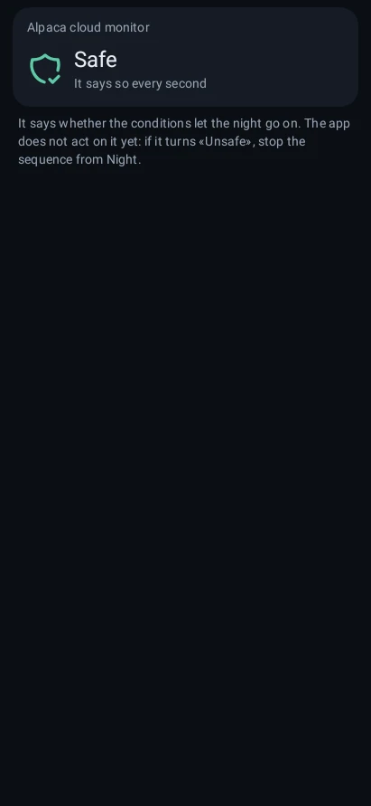 <b>Safety monitor.</b> Read every second.</td>
</tr></table>

---

# Planning the night

## 12. Tonight at a glance

Night is where the evening starts. It shows tonight's darkness and Moon, a checklist to prepare, the session while it runs, and the summary in the morning.

### Tonight's card

Worked out on the phone for the profile's site:

- The date and the Moon's illumination, such as *Moon 34 %*.
- The best dark window: *Dark and no Moon*, or *Dark, with the Moon up* when the Moon is up all through the astronomical night, with its start, end and length.
- Sunset and sunrise, and a timeline from evening to morning: twilight, astronomical night and the hours the Moon is up, with the best window outlined.

Near midsummer at high latitudes it may say *No astronomical night*: the Sun does not get 18° below the horizon. Without a site, the card says how to set one: allow the location in *Settings › Permissions* and turn on the phone's location, or type it in the profile.

### Another night

Tap the calendar icon to see any other night. The month grid marks tonight with an outline and the night you choose filled in; the arrows change the month. **Back to tonight** returns.

<table><tr>
<td valign="top" width="240">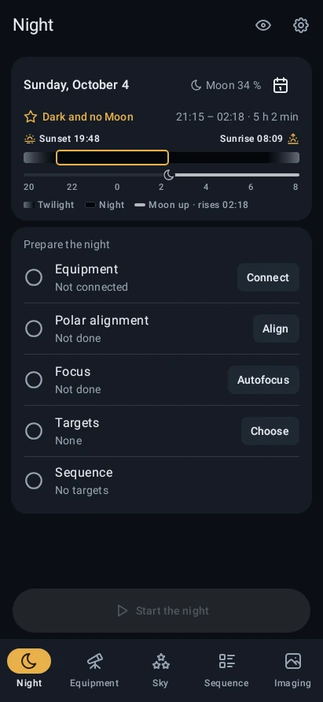 <b>Night.</b> 5 h 2 min of dark sky before the Moon rises.</td>
<td valign="top" width="240">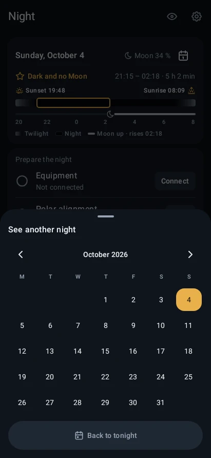 <b>See another night.</b></td>
</tr></table>

### Prepare the night

A checklist with no compulsory steps: do what your night needs, in any order. Each row shows its state and a button that takes you there.

| Row | Shows | Button |
| --- | --- | --- |
| **Equipment** | The profile and its devices once connected | **Connect** |
| **Polar alignment** | *Not done*, or the last total error and how long ago | **Align**, then **Refine** |
| **Focus** | *Not done*, or the last HFR and how long ago (with a focuser) | **Autofocus** |
| **Targets** | *None*, or tonight's targets | **Choose**, which opens Sky |
| **Sequence** | Whether the plan fits before dawn, and its length | **Adjust** when it does not fit |

When the equipment is connected and the plan has exposures, **Start the night** starts the sequence ([chapter 27](#running)). The row marks are icons as well as colours, so they read the same in red mode.

<table><tr>
<td valign="top" width="240">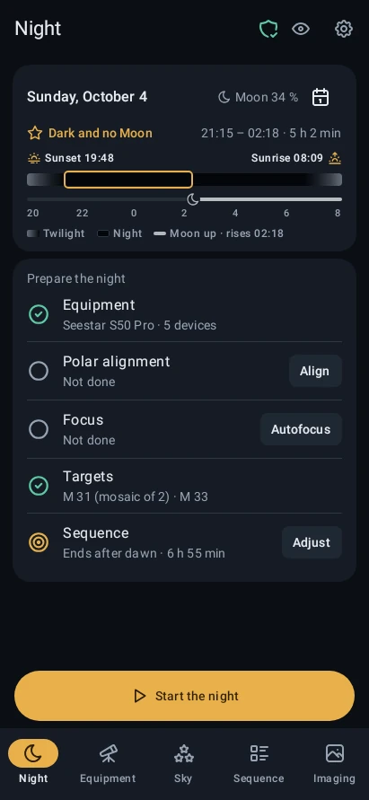 <b>Ready to start.</b> The plan ends after dawn: <i>Adjust</i> trims it.</td>
</tr></table>

## 13. The sky map

The Sky section opens on a map of the real sky, drawn from the photos of N.I.N.A.'s cache, without internet. The map stays where you left it, also after the app is closed. Drag it with one finger, pinch to zoom from a wide view down to less than your camera's field, and tap an object to select it.

The map is oriented as you see the sky from the profile's site at this moment, with the zenith up; without a site, north is up. A scale bar shows the size of a degree, and the coordinates of the centre are at the bottom right.

### What it shows

- **Photos:** the label at the top says where they come from, such as *DSS · NINA's cache*. With internet, zooming in fetches sharper photos of the area; a small wheel turns in the label while one arrives. Without a cache, the label says how to install one; tap it to open the sky map settings.
- **Your field:** a dashed box at the centre, the size of your camera's field, named after the profile.
- **Objects:** outlines and names of the catalogue's objects.
- **Horizon:** a clear line where the horizon of the profile's site is, following its own horizon if the profile has one, with **N**, **E**, **S** and **W** on it.

### Selecting an object

Tap an object: the map centres on it and a card shows its name, size, altitude and best time, with **Frame**. Tap the card for the object's page. Tap empty sky to deselect.

To frame an area with no object of the catalogue, centre it on the map, in your field's box, and tap **Frame here**, the gold round button under the zoom: the framing opens there, and the area joins the sequence named by its coordinates, such as *03h 47m +24° 07′*.

### Buttons

- **+ and −:** zoom in and out.
- **Frame here:** the gold one under them, frames the map's centre.
- **Layers** (top bar): the sky map settings, with the caches and the layers' opacity ([chapter 6](#field)).

<table><tr>
<td valign="top" width="240">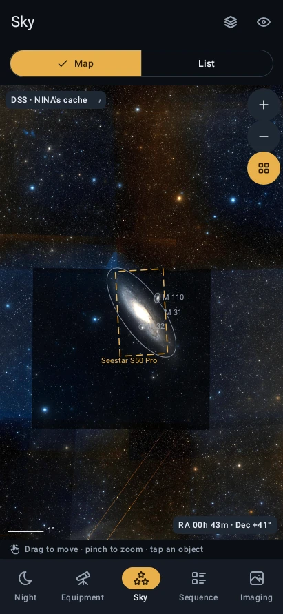 <b>The map.</b> M 31 on the DSS photos, with the Seestar's field.</td>
</tr></table>

### The mount on the map

With the mount connected, the map shows two boxes of your camera's field. They differ by their line, so they can be told apart in red mode too:

- **Framing:** dashed, at the centre of the map. It is where you want to go.
- **Telescope:** solid, where the telescope points now, moving as it is read every second.

Drag the map to put the target in the framing box, or tap an object to centre it, then:

- **Go and centre** takes the telescope to the framing and refines it with plate solving down to the profile's tolerance. A card shows each step and how far is left, with **Stop**, which stops the mount and the frame.
- **Go only** does the GoTo without centring.

When the mount is parked or not tracking, the **Telescope** label says so, and tapping it unparks the mount or turns tracking on.

<table><tr>
<td valign="top" width="240">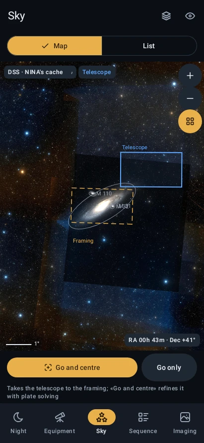 <b>Telescope and framing.</b> The solid box is where it points.</td>
<td valign="top" width="240">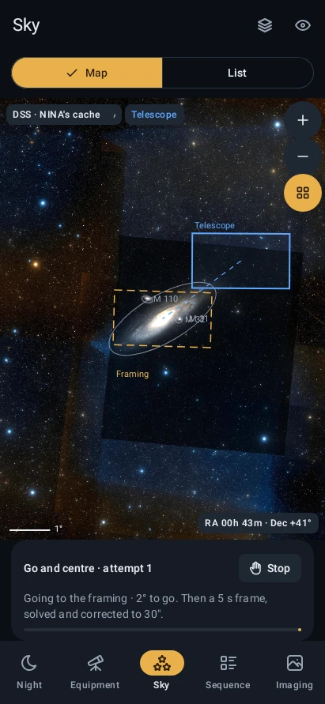 <b>Go and centre.</b> 2° to go, then a 5 s frame, solved and corrected.</td>
</tr></table>

## 14. Sky Atlas and search

Switch the Sky section to **List** for the Sky Atlas: 13,371 deep-sky objects from OpenNGC (NGC, IC, Messier, Caldwell and more) on the phone, each with its photo from the cache, ranked for tonight.

### Tonight's best

With **Tonight** on (the default), the list shows what is well placed tonight from the profile's site, sorted by its best time. Each row has a thumbnail, the name, the catalogue number and size, whether it *fits* your field or needs a *mosaic of N*, and a small altitude curve with its best time. Tap a row for the object's page.

Over the list, **Tonight** and **Favourites**, the objects you marked with the star on their page, turn on and off with a tap. Beside them shows each filter that is on, such as *Up to mag 8* or *From 1°*: its ✕ takes it off and its text opens the filters. The sliders icon shows how many are on, and the note how many objects are left and in what order. The filters and the place in the list stay when you open an object, change section or close the app.

<table><tr>
<td valign="top" width="240">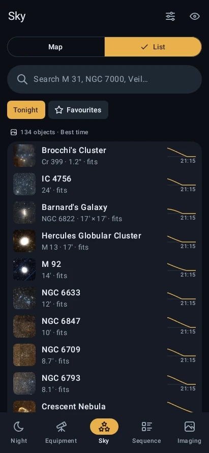 <b>Tonight.</b> Thumbnails from the cache, without internet.</td>
<td valign="top" width="240">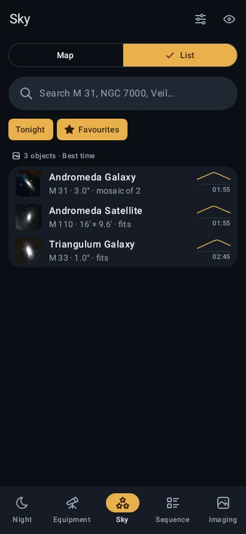 <b>Favourites.</b> M 31 needs a mosaic of 2.</td>
<td valign="top" width="240">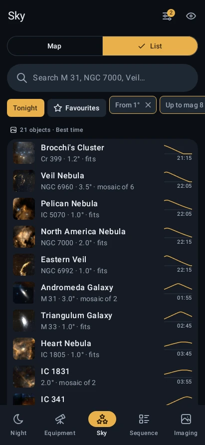 <b>Filters on.</b> Up to mag 8 and from 1°.</td>
</tr></table>

### Filters

The sliders icon at the top, or the text of a filter that is on, opens the filters. The list changes as you choose and the head says how many objects are left; **Reset** puts the filters back as they were at first, and **Done**, a swipe down, a tap outside or back close them. In landscape they open at the side, with the list beside them.

- **Sort by:** Best time (the default), Highest, Hours visible, Size or Brightness, each its natural way: the earliest, the highest, the longest above your altitude, the largest or the brightest first. The note above the list names the order.
- **Type:** Galaxies, nebulae, clusters, others.
- **Size:** Any, for your field (its size is shown), or from 15′, 30′ or 1°.
- **Magnitude:** Any, or up to 8, 10 or 12.
- **Only:** Favourites, and those that fit the field.
- **Tonight:** on (the default), only what is well placed tonight; the altitude and hours are those of tonight's dark night at the profile's location. Off, the three below do not count.
- **Above:** 20°, 30° or 45°.
- **For at least:** 1, 2 or 4 hours.
- **Away from the Moon:** Any, or at least 30°, 60° or 90°.

If nothing matches, the list says so, with **Reset** to start again.

<table><tr>
<td valign="top" width="240">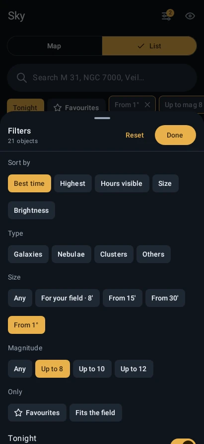 <b>Filters.</b></td>
</tr></table>

### Search

Type in the search box: a Messier, NGC, IC, Caldwell or Sharpless number, or a name, such as *M 31*, *NGC 7000* or *Veil*. Results appear as you type, in milliseconds, without internet. In red mode the search box opens the app's own keyboard, red like the rest, instead of the phone's; ⌄ or back hides it.

For anything else, the last row offers **Search «…» in SIMBAD**. With internet, it asks the CDS's SIMBAD, which knows more than 20 million objects, from the quasar TON 618 to the stars of a constellation. What it finds stays on the phone, to find it again offline. If there is no exact match, it lists the objects with similar names, the brightest first.

<table><tr>
<td valign="top" width="240">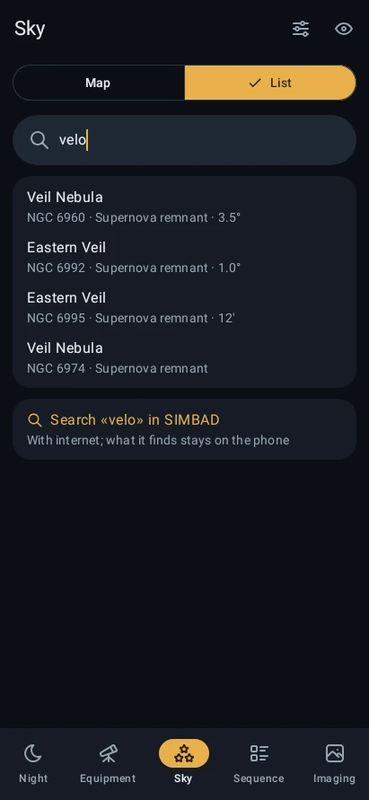 <b>Offline search.</b> “velo” finds the Veil.</td>
<td valign="top" width="240">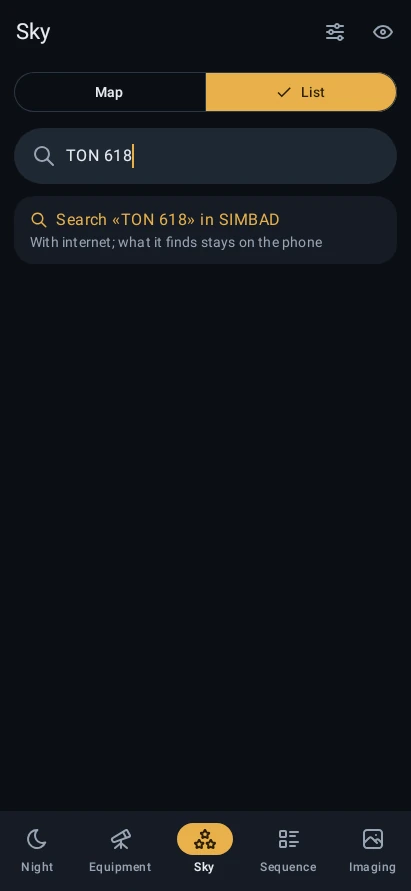 <b>Beyond the catalogue:</b> SIMBAD, with internet.</td>
</tr></table>

## 15. An object's page

Everything you need to decide on a target: its photo with your field over it, what it is, how high it gets tonight and how close the Moon is.

- **Photo:** from the cache, with your camera's field drawn on it. Tap it, or its **Map** chip, to see the object framed on the sky map; only the map moves, not the telescope.
- **About:** name, type, magnitude and size; its other names and designations, as *Also Triangulum Pinwheel · NGC 598*; *Fits the field* or *Mosaic of N panels*; and the Moon's distance and phase, such as *Moon 87° away · 34 %*.
- **Altitude tonight:** the object's curve from dusk to dawn, with twilight shaded at both ends, the 30° line, your own horizon dashed if the profile has one, and a line for now. Below it, the hours it is above 30° and its highest point, or that it stays low or does not rise.

The star at the top marks it as a favourite. **Frame** opens the framing ([chapter 16](#framing)). **Go and centre**, with the mount connected, takes the telescope there and centres it, on the mount's screen.

<table><tr>
<td valign="top" width="240">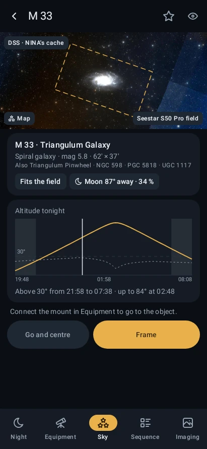 <b>M 33.</b> Fits the Seestar's field; the dashed line is the site's horizon.</td>
<td valign="top" width="240">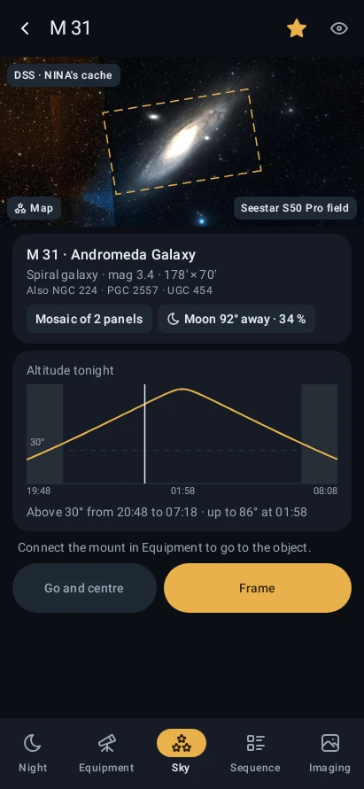 <b>M 31.</b> A favourite that needs a mosaic of 2 panels.</td>
</tr></table>

## 16. Framing and mosaics

Framing shows how the photo will turn out: your camera's real field over the sky, which you drag until the composition is right, and mosaics for targets larger than the field.

1. Open it with **Frame** on an object's page or on the map's object card.
2. Drag the sky to place the target in the field; pinch to zoom. The field's size is shown at the top right.
3. For a mosaic, set **Columns** and **Rows** with − and +, and the **Overlap** between panels, from 5 to 50 % (15 % by default). The panels are numbered in the order they will be taken.
4. Check the line below: the hours it is above 30° tonight.
5. Tap **Add to the sequence**. The app confirms that the target is in tonight's sequence, with **Choose another target** and **See tonight's**.

A new target comes with 60 frames of 60 s through the first filter that is not the dark one, dithering every 3 frames; adjust them in the editor ([chapter 25](#simple)). After the **One target all night** template, the target fills the night until dawn instead.

**Go and centre**, with the mount connected, takes the telescope to the framing.

<table><tr>
<td valign="top" width="240">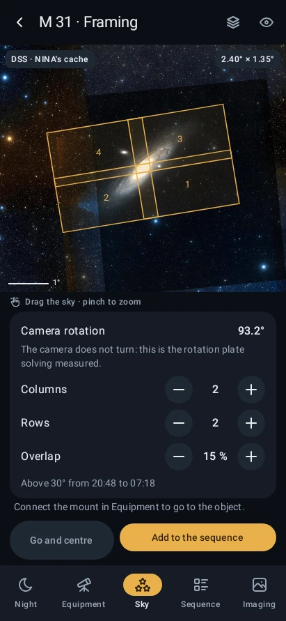 <b>M 31 · Framing.</b> A 2 × 2 mosaic, rotated as the camera is.</td>
</tr></table>

### The camera's rotation

Without a rotator, the camera does not turn, so the framing does not rotate the field by hand: **Camera rotation** is the angle plate solving measured, and the field and panels are drawn with it. Until the first solve it is 0°, or 93.2° for a Seestar in EQ mode. Solve a frame in Imaging once the camera is mounted, and the framing matches it ([chapter 18](#solving)).

> [!TIP]
> **Needs the field**
>
> Framing needs the profile's field: its focal length and its camera's sensor (*Settings › Profile and location › Optics*), typed or kept from the camera's last connection. Nothing needs to be connected; the screen has a button to the profile.

---

# At the telescope

## 17. Three-point polar alignment

The polar alignment assistant measures how far the mount's axis is from the celestial pole and then guides you, live, while you turn the wedge's screws. It is a port of N.I.N.A.'s Three Point Polar Alignment plugin and gives the same result within 0.4″ on the same measurements.

It works with any mount that can turn its right ascension axis on command. It needs the mount and the camera connected, a star database on the phone and the profile's site, which sets where the pole is.

### Open the assistant

Tap **Align** on the **Polar alignment** row of the Night checklist (**Refine** once it has been measured), or **Polar alignment** on the mount's screen. The assistant fills the screen and keeps it on while it runs; the **✕** at the top left stops it and goes back.

### Before starting

The first page explains what will happen and where to point: a clear area of sky, away from the pole and the horizon, in the direction the axis will turn. It shows four options; each one is kept in the profile.

- **Turn between points:** How far the RA axis turns between the three frames, and which way: 10°, 15°, 20° or 30°, to the west or to the east. 15° to the west is the default. Leave room for the turn so the mount meets no obstacle.
- **Exposure:** 1, 2, 3 or 5 s, binned 1×1 or 2×2, with Imaging's gain. Short frames refresh the error sooner while you turn the screws. 1 s at 2×2 is the default.
- **Tolerance:** Off, 0.5′, 1′, 2′ or 5′. When the total error goes under it, the phone vibrates. It never hides the arrows. Off by default, as in the plugin.
- **Solve only with a hint:** For refining an alignment that is already close: the three points are solved only near where the mount points, never blind.

<table><tr>
<td valign="top" width="240">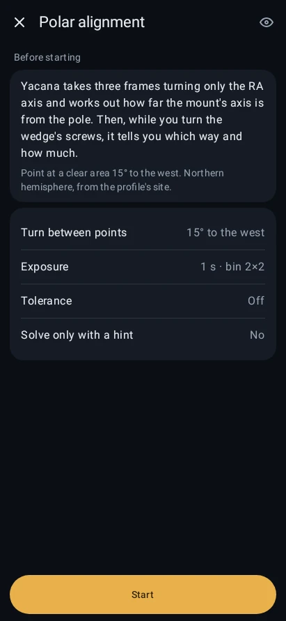 <b>Before starting.</b> The options, with the Seestar's defaults.</td>
</tr></table>

### Measure the three points

1. Point the telescope at a clear area as the first page says, and tap **Start**.
2. Yacana takes the first frame and solves it, turns the RA axis, takes and solves the second, turns again and takes the third. Each point shows *Turning the RA axis…*, *Taking the frame*, *Solving with ASTAP*, and then how long the solve took.
3. **Don't touch the mount while it measures.** The three centres trace a circle whose middle is the mount's real axis. Its distance to the pole, corrected for precession, nutation and refraction at your site and time, is the error.

If a point does not solve, the assistant says which and why, and offers **Start again**.

<table><tr>
<td valign="top" width="240">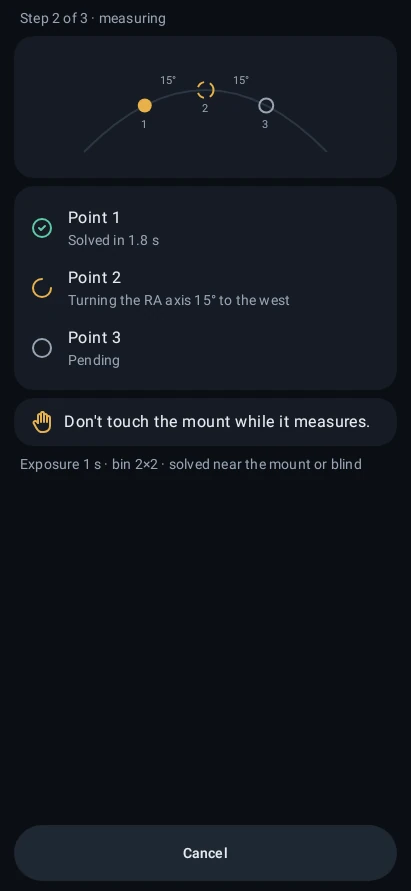 <b>Measuring.</b> Point 1 solved in 1.8 s, the axis turning to point 2.</td>
</tr></table>

### Turn the wedge's screws

Now the assistant keeps taking frames, solves each near the last position, and refreshes the error every few seconds. Each axis has its own card:

- **Altitude:** an arrow and *Up* or *Down*, or *a little* when close.
- **Azimuth:** an arrow and *Turn to the west* or *to the east*, or *a little* when close.
- The signed error in degrees, minutes and seconds, large enough to read from a metre away, and the **Total error** below.

Turn one screw at a time and watch its number fall. Below them, a target shows the pole's position with rings at 30″, 1′ and 5′. When you get close, it enlarges itself to the *scale of seconds*, with rings at 10″ and 30″, so you can fine-tune second by second.

**Nothing is called good too early.** An axis keeps its arrow until its error, rounded to the second, is 00° 00′ 00″; then it shows *Centred*. There is no green tick at a threshold: you decide when it is good enough. If you set a tolerance, the phone vibrates when the total goes under it, and the arrows stay.

If the latest frame did not solve, the screen says so and keeps trying. **Measure again** repeats the three points from where the mount is, for example after a big correction. **Finish** closes the assistant, and the Night checklist shows the result and when it was measured.

<table><tr>
<td valign="top" width="240">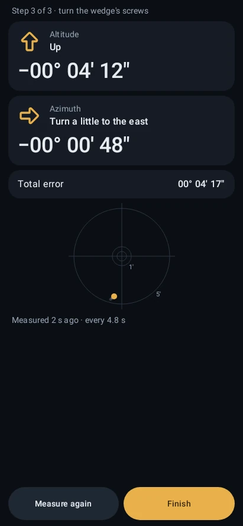 <b>Minutes off.</b> Up, and a little to the east.</td>
<td valign="top" width="240">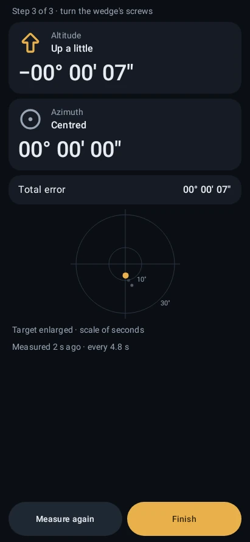 <b>Seconds off.</b> The target enlarged; azimuth centred.</td>
</tr></table>

<table><tr>
<td valign="top" width="470">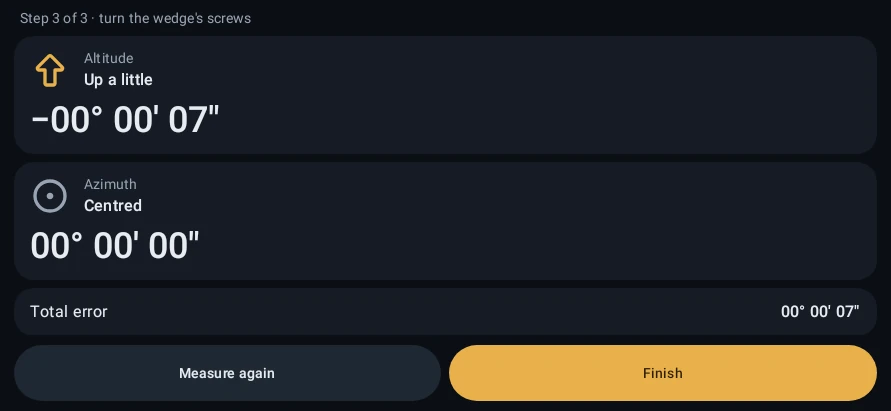 <b>In landscape</b>, the cards use the width; the numbers stay large.</td>
</tr></table>

> [!TIP]
> **Seestar**
>
> On a wedge, the altitude is set with the wedge's tilt and the azimuth by turning its base. The Seestar's Alpaca can turn its RA axis, which is all the assistant needs.

## 18. Plate solving and centring

Plate solving works out where a frame points, its scale and its rotation, from the pattern of its stars. Yacana runs ASTAP, the well-known solver, on the phone itself, without internet: about 0.4 s with the mount's position as a hint and about 7 s blind on a mid-range phone with Seestar frames.

### Solve a frame

In Imaging, take a frame and tap **Solve**. Yacana first searches near where the mount says it points, and then blind if needed. The result shows:

- **RA and Dec** of the frame's centre, in J2000;
- the camera's **rotation**;
- the **scale** in arcseconds per pixel and the field in degrees;
- how long it took, whether it was near the mount or blind, and the star database used.

Tap **Sync the mount** to tell the mount it points there, so that its next GoTos land closer. The solved rotation becomes the camera's rotation for framing and mosaics ([chapter 16](#framing)).

### Go and centre

**Go and centre** appears wherever you can send the telescope somewhere: on the sky map, on an object's page, on the framing screen and in the mount's **Go to…** sheet. It slews the mount, takes a frame with the centring exposure, solves it, corrects the mount and repeats until the frame's centre is within the tolerance, 30″ by default. Its progress shows each step, how far the last frame was and the attempt; **Stop** stops the mount and the frame. Centring frames are not saved.

<table><tr>
<td valign="top" width="240">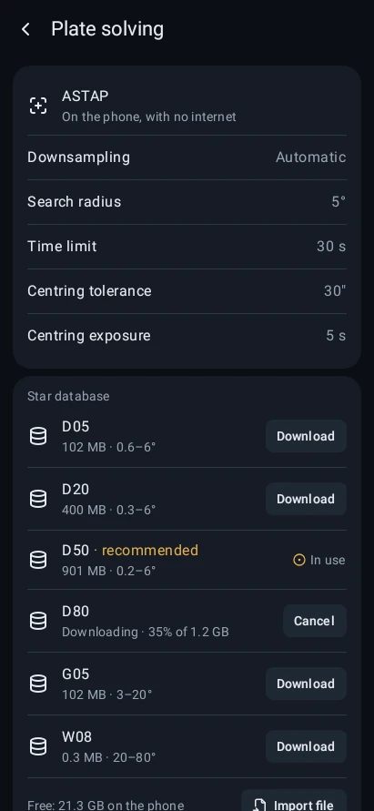 <b>Settings › Plate solving.</b> ASTAP's options and the star databases.</td>
</tr></table>

### Plate solving settings

In *Settings › Plate solving*, kept in each profile:

| Setting | Default | What it does |
| --- | --- | --- |
| **Downsampling** | Automatic | ASTAP bins the frame before looking for stars. Automatic picks the factor from the frame's size. |
| **Search radius** | 5° | How far around the mount's position to search, from 1 to 180°. Without a solution there, it searches the whole sky. |
| **Time limit** | 30 s | For a solve near the mount and then blind, from 5 to 600 s. |
| **Centring tolerance** | 30″ | Centring stops when the frame's centre is this close to the target, from 5 to 600″. |
| **Centring exposure** | 5 s | The frames centring solves, with Imaging's gain; from 1 to 60 s. They are not saved. |

The star databases are on the same screen; [chapter 6](#field) explains how to choose, download and import them.

> [!TIP]
> **When a frame does not solve**
>
> Check that the frame has stars, that the profile's focal length is right (ASTAP looks for that scale), and that the database suits your field. Clouds, dew or a frame far out of focus are the usual causes.

## 19. Autofocus

Autofocus moves the focuser through focus, measures the stars' HFR at each point and fits a V-curve to find the best position. It is a port of N.I.N.A.'s autofocus, with its five curve fittings, backlash compensation and focus offsets per filter.

It needs an absolute focuser (one that goes to step positions) and a camera, pointed at a field with stars. Open it with **Autofocus** on the Night checklist, on the focuser's screen or in Imaging: the run starts at once, with the options of *Settings › Autofocus*.

### How a run goes

1. The focuser goes a number of steps out, then takes a point at each step in: a frame, its stars and their HFR.
2. It adds points until there are as many on each side of the best one as it started with. The chart fills in as it goes, with the current point, its exposure and filter.
3. After the last point, it fits the curve, moves the focuser to the best focus and checks it. The result shows the position, the HFR, the temperature, the fitting's R², and where the focuser was before.

Tap **Finish** to close it. **Cancel** during a run puts the focuser back where it was. If the run fails, the screen says why, the focuser goes back, and **Try again** starts it again.

The result is kept: the focuser's screen shows the last autofocus and its curve, the Night checklist shows the HFR and how long ago, and the diary records it.

<table><tr>
<td valign="top" width="240">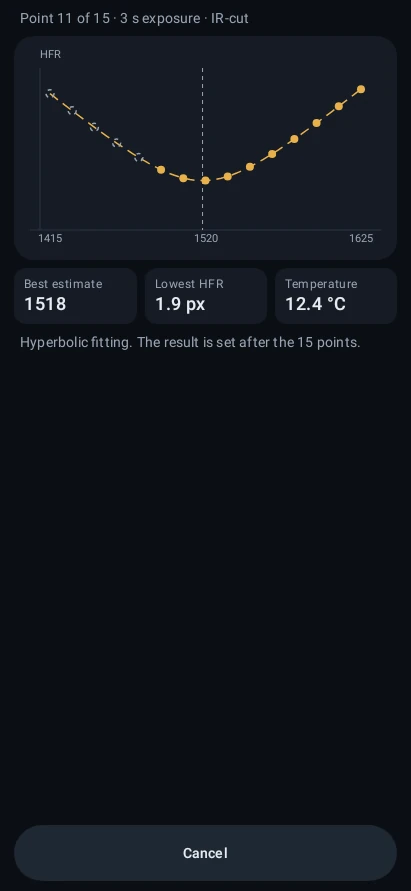 <b>Running.</b> Point 11 of 15, a 3 s exposure with the IR-cut filter.</td>
<td valign="top" width="240">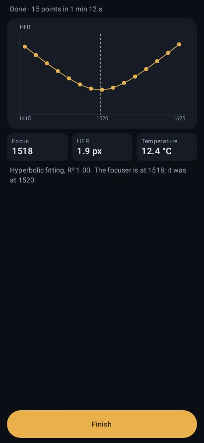 <b>Done.</b> 15 points in 1 min 12 s; the focuser moved from 1520 to 1518.</td>
</tr></table>

### Autofocus settings

In *Settings › Autofocus*, kept in each profile, with N.I.N.A.'s defaults:

- **Step:** Focuser steps between points (50; 15 for the Seestar). Too small and the curve stays flat; too big and there are few points near focus.
- **Points:** How many points it takes: it starts half of them out (9 points, 4 on each side; 15 for the Seestar).
- **Exposure:** 1 to 8 s, binned 1×1 or 2×2, with Imaging's gain. Not saved. 4 s (3 s for the Seestar).
- **Frames per point:** 1, 2 or 3. More frames average out the seeing and take longer.
- **Fitting:** How the best focus is found from the points: trend line, parabolic, trend and parabolic, hyperbolic (default), or trend and hyperbolic.
- **Backlash in, out:** Steps the focuser loses when it changes direction; it overshoots by this much and comes back.
- **Minimum R²:** How well the curve must fit (0.7). With none, the result is kept unless it is 15 % worse than before.
- **Attempts:** How many times it starts again if a run fails (1).
- **Wait after moving:** Seconds the focuser rests after each move before the frame (0).

<table><tr>
<td valign="top" width="240">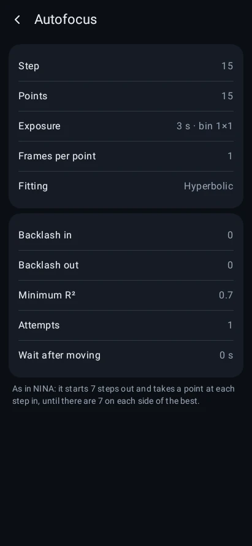 <b>Settings › Autofocus.</b> The Seestar's values.</td>
</tr></table>

### When it fails

| The app says | What to do |
| --- | --- |
| **The HFR did not change enough on either side** | Use a bigger step. |
| **The curve explains too little of the points** | Seeing or clouds spoilt the points: more frames per point, a longer exposure, or try later. |
| **The best focus falls outside the points measured** | Start closer to focus: move the focuser by hand, then run it again. |
| **At the best focus the HFR is worse than before** | The result was not kept and the focuser went back. Check the conditions and try again. |
| **This focuser has no positions to go to** | Autofocus needs an absolute focuser. |

### Automatic refocusing during the night

In a sequence, the autofocus rules start a run before a light frame when the temperature changes, the filter changes, the HFR worsens, or after a time. They are set in the simple editor's rules ([chapter 25](#simple)) or as triggers in the advanced editor ([chapter 26](#advanced)). If a run fails during the night, the focuser goes back and the rules wait for the next exposures.

Focus offsets per filter are set on the focuser's screen ([chapter 10](#focuser)): on a filter change the focuser moves by the difference.

---

# Capturing

## 20. Imaging

Imaging takes frames by hand: single frames to check the focus and framing, or a loop that saves every frame. Each frame appears about a second after it downloads, stretched, with its stars counted and measured.

### Take a frame

1. Set the exposure, gain, binning and filter with the buttons under the frame (below).
2. Tap the round button. The screen shows *Exposing · 12 of 20 s*, then *Downloading the frame…*. Tap it again during the exposure to abort.
3. The frame shows with its **HFR** and its number of **stars** at the top left. Tap them for the last frame's details.

**Loop** takes frames one after another and saves them all, as N.I.N.A.'s Loop does; it becomes **Stop**, which ends after the frame in progress. Single frames are saved only if **Save single frames (loops always save)** is on in the options. If a frame fails while the equipment does not answer, or the link is lost, the loop waits and goes on with the next frame once the equipment answers again.

### The frame's settings

- **Exposure:** 10, 20, 30, 60 or 300 s, those the camera allows, or **Other** on the keypad, within the camera's range.
- **Gain:** On the keypad, within the camera's range, or the camera's named gains. It starts at 200 where the camera takes it, as the Seestar's own app takes its frames, and the sequence's frames without a gain of their own take this one.
- **Binning:** 1×1, 2×2… only if the camera bins.
- **Filter:** With a filter wheel: the filter in place, and the others to change to. Frames to solve, centre, align or focus never go through **Dark**: the wheel moves to IR first. Through Dark, the frame shows no HFR or stars, which would be noise.

<table><tr>
<td valign="top" width="240">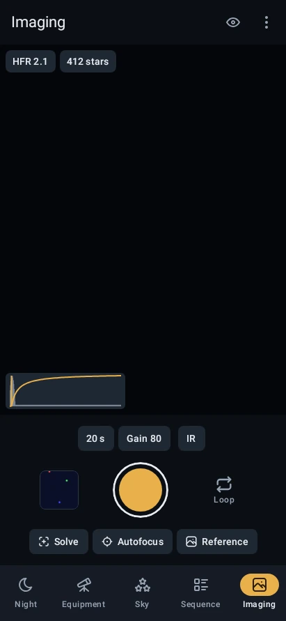 <b>Imaging.</b> HFR 2.1 px and 412 stars.</td>
</tr></table>

### Looking at the frame

- **Zoom:** pinch, and drag to move around. Double-tap switches between the whole frame and 1:1 pixels.
- **Histogram:** at the bottom left, with the stretch curve.
- **Last frame:** tap the HFR and stars at the top left for the histogram, the mean, median and deviation in ADU, the HFR with its spread, the FWHM in pixels and in arcseconds (a Moffat profile, as in Hocus Focus), and where the frame was saved.

### Capture options

The **⋮** at the top opens them:

- **Frame type:** Light, dark, flat or bias. It goes into the file name and the FITS header.
- **Target, for the file name:** The name of the folder and files, such as *M 31*. Without one, frames are named *Snapshot*.
- **Save single frames:** Loops always save.
- **Dither loops of lights every:** *Off*, *3* (as it starts), *5* or *10* frames. Between frames the mount gets a small nudge, as N.I.N.A.'s direct guider gives it: the field moves a few pixels (5 by default) around where the loop began, so that the sensor's pattern does not build up into streaks in the stack. Darks, flats and bias are never dithered.
- **Offset:** If the camera has one.
- **Automatic stretch:** On by default, as N.I.N.A.'s. Off, two sliders set the **Shadows** and the **Midtones**.
- **Mark the stars:** Draws a box and the HFR on the brightest stars, as N.I.N.A. does; **How many**, from 10 to 500.
- **Live stack:** **Stack the light frames live** and **Balance the stack's colour** ([chapter 22](#stacking)).
- **Settings:** The app's settings.

<table><tr>
<td valign="top" width="240">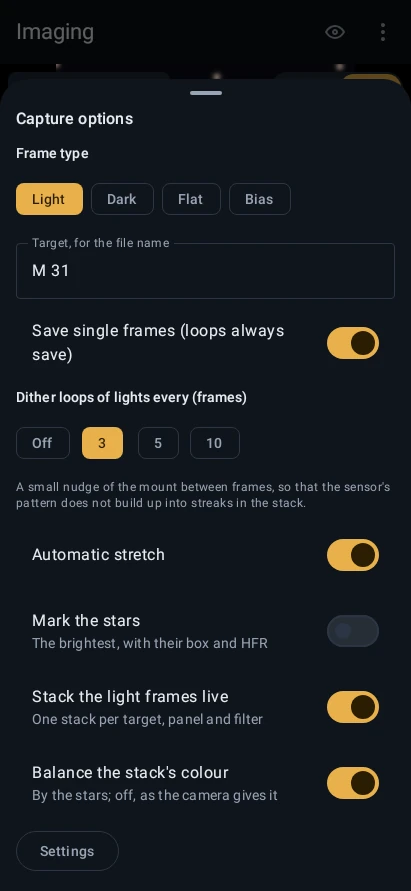 <b>Capture options.</b></td>
</tr></table>

### The buttons under the frame

- **Solve:** Solves the last frame with ASTAP and shows where it points, with **Sync the mount** ([chapter 18](#solving)).
- **Autofocus:** With a focuser, runs the autofocus ([chapter 19](#autofocus)).
- **Reference:** Puts the cache's photo of the same field over the frame, with its rotation, scale and zoom, so you can compare them: is that faint smudge the galaxy? If the frame is not solved, it solves it first. Tap it again to go back to the frame.
- **The thumbnail:** Left of the round button: opens the session's history ([chapter 21](#history)).

<table><tr>
<td valign="top" width="240">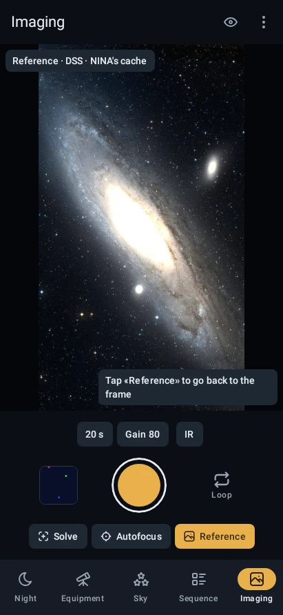 <b>Reference.</b> The cache's photo of the frame's field.</td>
</tr></table>

<table><tr>
<td valign="top" width="470">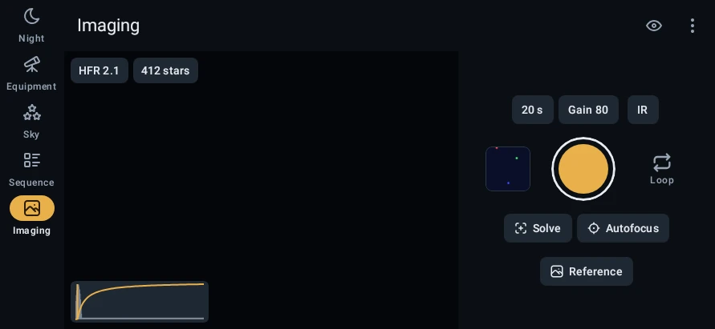 <b>In landscape</b> the frame takes the width and the controls move to the side.</td>
</tr></table>

## 21. History and frame quality

The history lists every frame saved this session with its quality, and marks the ones spoilt by clouds or light, so that they are left out of the stack.

- **The chart:** each frame's HFR as a line and its stars as bars, with **AF** where an autofocus ran.
- **The list,** newest first: number, time, filter and exposure, HFR and stars.
- **Discarded frames** have far fewer stars or a much brighter background than the session's median, and say why: *clouds*, *few stars* or *bright background*. They stay saved on disk; only the stack and the summary leave them out.

The filter icon at the top shows only the discarded frames. Open the history from the thumbnail next to Imaging's round button.

<table><tr>
<td valign="top" width="240">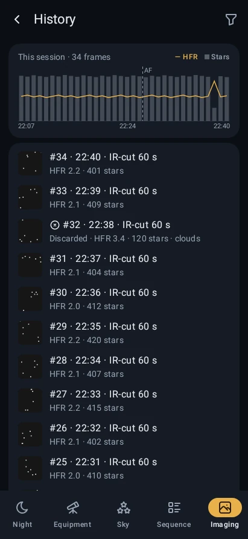 <b>History.</b> Frame 32 discarded: clouds.</td>
</tr></table>

## 22. Live stacking

Live stacking adds each good light frame to a running stack while the night goes on, so you watch the target grow out of the noise. It is off until you want it, because it uses memory and battery.

### Turn it on

In Imaging's options, turn on **Stack the light frames live**. From then on every light frame that is saved goes into the stack, from a loop, a sequence or a single frame. The frames are still saved one by one, as always.

Flats are collected even with live stacking off: once a filter's set is complete they become its master flat, saved as `FLATS/MasterFlat_IR.fits` (one per filter) in your frames' folder for the next nights, a 32-bit FITS that Siril and PixInsight read too. A flat of yours put there with that name counts the same. Darks too are kept for the stack even if live stacking is turned on after them, as when a sequence starts with its darks.

### How it stacks

- **One stack per target, panel and filter,** and per exposure, gain and binning. A frame of another kind saves the stack before it and starts its own.
- **Aligned by the stars:** shift, rotation and scale, on the stack's first frame.
- **Satellites and planes removed** with 3-sigma rejection.
- **Calibrated as it goes:** with the night's master dark of the same exposure, gain, offset and binning at the closest sensor temperature, and the master flat of its filter in the FLATS folder.
- **Colour balanced on its own stars,** with **Balance the stack's colour** on; off, as the camera gives it.
- **Discarded frames are left out,** and so are frames whose stars do not match.

<table><tr>
<td valign="top" width="240">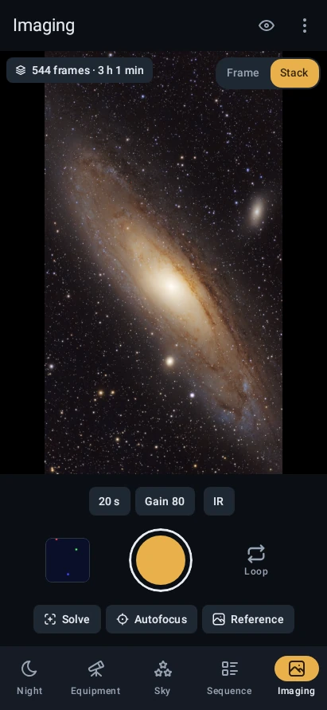 <b>The stack.</b> M 31 from 544 frames of 20 s with a Seestar, processed afterwards.</td>
</tr></table>

### A mosaic

In a mosaic the sequence takes each panel whole, then the next, and each panel has its own stack, calibrated with its darks and flats. With **Stack**, Imaging shows the whole mosaic as it is built: each panel where it goes in the sky, as its centring solved it, its background matched to its neighbours' where they overlap and the seams blended, and one stretch and one colour balance for all. The panel being stacked is outlined in gold and grows with each frame; those still to come are dashed. It is a view at a quarter of the size, or smaller for a large mosaic so that it fits in the phone's memory, and it is kept as a JPG, such as *2026-10-14/M 31/STACK/…_STACK_MOSAIC.jpg*, after each panel and as the sequence ends. The full mosaic is made from the panels' stacks, in Siril or PixInsight.

<table><tr>
<td valign="top" width="240">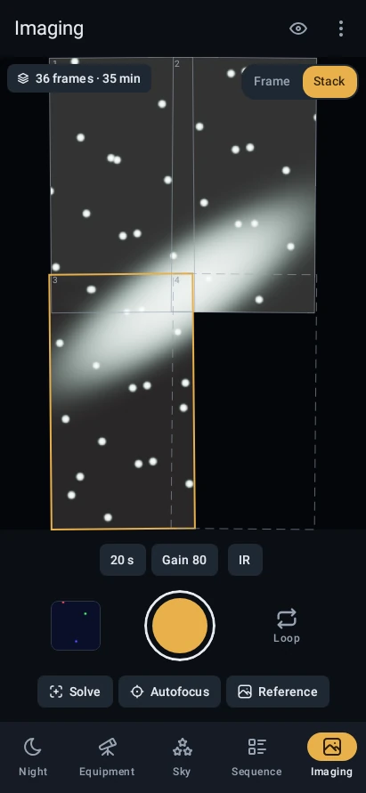 <b>A mosaic.</b> The third panel of four, growing.</td>
</tr></table>

### Watching it

When a stack exists, a **Frame** | **Stack** switch at the top right of Imaging swaps between the last frame and the stack. Tap the stack's label, such as *544 frames · 3 h 1 min*, for its sheet:

- **Stacked:** Frames in it, of those that came.
- **Discarded:** How many were left out, and why.
- **Time:** Total integration and the frames.
- **Alignment:** By the stars, and how much the last one turned.
- **Colour:** Balanced on the stars, or as the camera gives it.
- **Dark** and **Flat:** the dark and the master flat in use, such as *MasterFlat_IR.fits of October 11*, or which are missing.

In Night, while a sequence runs with the stack on, the last frame's card shows the stack; tap it to open it in Imaging.

### Saving it

The stack saves itself every 10 minutes while it grows, and when the loop or the sequence ends: a linear 32-bit FITS for processing, and a JPG as the screen shows it, in the frames' folder with `STACK` as its type. **Save** saves it now. If the app is closed, the stack goes on with the next frame of the same target and filter.

**Take 10 darks of 20 s** (with the frames' exposure) takes darks for the stack now. With a dark filter it is automatic; without one, the app asks you to cover the telescope first. **Hold to start again** empties the stack.

<table><tr>
<td valign="top" width="240">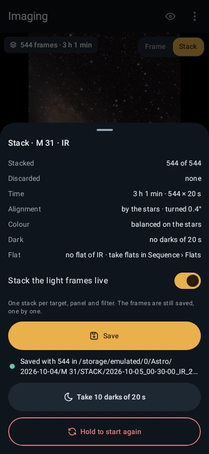 <b>The stack's sheet.</b> No darks or flat yet for this filter.</td>
</tr></table>

## 23. Flats, darks and bias

Calibration frames remove what the sensor and the optics add. Yacana takes flats with an assistant and darks and bias with the sequence's rules, and the live stack uses them all.

### The flats assistant

Open it with the **Flats** template in Sequence. It works out the exposure by itself and takes each filter's flats at a target brightness. The light is this phone, or the flat panel if one is connected.

1. Check the **Target ADU**, 30,000 ± 5 % by default, with the camera's maximum shown. Set the **Panel brightness** if you use one.
2. Choose **Frames per filter** (20, 30 or 50) and the **Filters**.
3. Tap **Start the flats**. With this phone as the light, you then have 30 s to lay it face down on the telescope, its screen over the lens, with a sheet of white paper in between. A beep starts the flats and the screen turns white at full brightness, also in red mode; another beep ends them. To pause them, double-tap the white screen; **Resume** leaves another 30 s.
4. Each filter shows *finding the exposure…*, then its exposure and how many are done, with the last frame's mean in ADU. **Pause** and **Hold to stop** are at the bottom. At the end, behind the Seestar's Dark filter, it takes 10 bias: their level goes into each master flat, so that the live stack divides by it even without darks.

If there is too much light even at the shortest exposure, or too little at the longest, the assistant stops and says what to change: more or less paper over this phone's screen, or the panel's brightness.

<table><tr>
<td valign="top" width="240">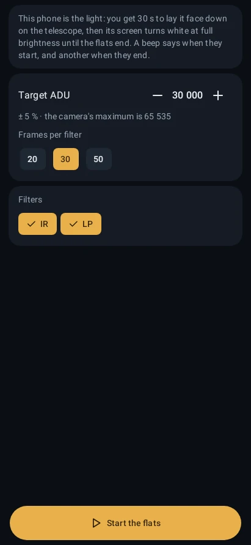 <b>Setting up.</b> This phone as the light, two filters.</td>
<td valign="top" width="240">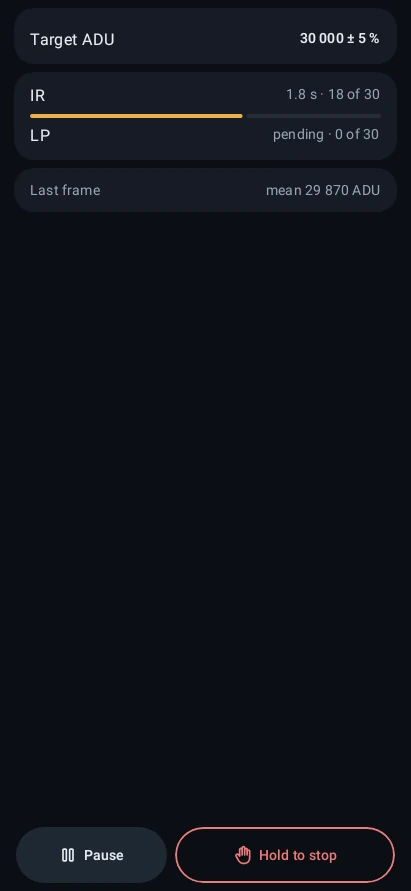 <b>Running.</b> The IR flats at 1.8 s, mean 29,870 ADU.</td>
</tr></table>

### Darks and bias in the sequence

In the simple editor, the **Darks** button under **Rules** sets when darks are taken, with the exposure, gain and binning of each light frame and the dark filter:

- **At the start** of the night.
- **If the sensor's temperature changes** by 2, 3 or 5 °C, for the live stack to use the set of the closest temperature.
- **At the end, with the bias** (on by default).
- **Frames each time:** 5, 10 or 20. The sheet says how long each set takes with no light frames.

Without a dark filter, darks at the start or by temperature are not possible; at the end, the app asks you to cover the telescope. The darks and bias of the start and the end go to the target's folder, next to LIGHT: those of the start to the first target's, those of the end to the last one's.

<table><tr>
<td valign="top" width="240"> <b>Darks.</b> 10 frames of 60 s take about 11 min.</td>
</tr></table>

### By hand

In Imaging, set the **Frame type** to dark, flat or bias in the options and capture as usual: the frames go to their own folder by type.

---

# Sequences

## 24. The Sequence section

A sequence is the night's plan: which targets, with which exposures, and what to do around them. Yacana has two editors on the same plan: a simple one that puts the night on a timeline, and an advanced one with N.I.N.A.'s containers, triggers and conditions. You can switch between them without losing anything.

- **Tonight:** The plan the night will run, with its targets and times. Tap it to open the editor. While it runs, it says so.
- **Saved:** Your saved sequences, with their targets and length. Tap one to load it as tonight's plan; **Undo** brings back the plan you had. Press a row for a moment to delete it with **Hold to delete**. To save tonight's plan, use the editor's **⋮** menu.
- **Templates:** Starting points for a new plan (below).
- **New:** An empty plan, in the editor.

### Templates

- **One target all night:** starts an empty plan and opens Sky. The target you add next fills the night until dawn.
- **Several targets** and **Mosaic:** start an empty plan and open Sky, to frame the targets or the mosaic.
- **Flats:** opens the flats assistant ([chapter 23](#calibration)).

What was there before a template comes back with **Undo**.

<table><tr>
<td valign="top" width="240"> <b>Sequence.</b> Tonight, saved sequences and templates.</td>
</tr></table>

## 25. The simple editor

The simple editor shows tonight's plan as a timeline and a card per target. It warns, with an icon and words, when the plan does not fit before dawn.

### Adding targets

Targets come from Sky: frame one and tap **Add to the sequence** ([chapter 16](#framing)). **Add a target** at the end of the list takes you there. A mosaic arrives as one target with its panels.

### Tonight's plan

The timeline shows each target from its start to its end, and the dawn. If the plan runs past astronomical dawn, it says which target would end when, and that target's end time turns to the warning colour. **Undo** undoes the last change, up to 50 changes back.

### A target's card

- Its name, when it ends, and the bin icon to remove it.
- For a mosaic, its number of panels; the exposures apply to each panel.
- One row per filter and exposure, such as *IR · 60 s × 45 per panel*, with frames done and total. Tap a row to change it; **Exposures** adds another filter.

<table><tr>
<td valign="top" width="240"> <b>Tonight.</b> M 33 would end at 07:25, after dawn.</td>
<td valign="top" width="240"> <b>Exposures.</b> The keypad shows how long, and until when.</td>
</tr></table>

### Exposures

The sheet sets one row of a target's exposures: the **Filter**, the **Time** (10, 30, 60 or 120 s, or **Other**), and the **Number of frames** on the keypad. As you type, it shows how long they take and until when, or that they would end after dawn. **Save** keeps it; **Remove these exposures** deletes the row when the target has more than one.

### Rules

The **Rules** card lists what the night does besides the frames. A new plan comes with:

- **Unpark at the start**, and **Dew heater on** if the equipment has a heater switch.
- **Centre on arrival:** each target, and each panel of a mosaic, is centred with plate solving before its frames.
- **Dither every 3 frames**, without a guider.
- **Autofocus if ΔT > 1 °C**, with a focuser.
- **Darks and bias at the end**: 10 of each, for each exposure, gain, offset and binning of the lights.
- **Park at the end**, and the heater off.

Two buttons below change them:

- **Autofocus:** Before each light frame, an autofocus runs if any of these holds, as N.I.N.A.'s triggers:
  - **When the temperature changes** by 0.5, 1, 2 or 5 °C;
  - **On a filter change;**
  - **When the HFR worsens** by 5, 10 or 20 %;
  - **Every so often:** 15, 30, 60 or 120 min, or another time.

  If an autofocus fails, they wait for the next exposures.
- **Darks:** At the start, when the sensor's temperature changes, at the end with the bias, and how many each time ([chapter 23](#calibration)).

For other rules, such as dithering every other number of frames, recentring when the target drifts, waiting for a target to rise or repeating until a time, open the plan in the advanced editor.

### Save and start

The **⋮** menu has **Save in my sequences**. **Start**, at the bottom, starts the night once the equipment is connected; while it runs, the button becomes **Hold to stop**. You can still edit the plan while it runs: the changes apply to what is still to come.

<table><tr>
<td valign="top" width="240"> <b>Autofocus rules.</b></td>
</tr></table>

## 26. The advanced editor

The advanced editor is N.I.N.A.'s advanced sequencer turned into a touch list: containers you enter, instructions, triggers and conditions, reordered by dragging, with undo and a review of the night before it starts.

Open it with **Advanced** at the top of the simple editor. It opens tonight's plan whole. If you add what the simple editor cannot show, such as a condition or a parallel container, tonight is edited only in the advanced editor from then on: the simple editor shows **Tonight is edited in Advanced** with **Open in Advanced** and the list of targets.

### The night's structure

- **Night,** the top level, with the **triggers for the whole night**, and three areas:
- **Start:** what happens first, before the targets, such as unparking or cooling the camera. What points at a target does not go here.
- **Targets:** one after another, in this order. Each target holds its instructions.
- **End:** after the targets: darks, parking and switching off.

Breadcrumbs at the top show where you are, such as *Night › Targets › M 33*. Each level's card says how it runs: once, or repeated by its conditions, which are checked after each instruction.

<table><tr>
<td valign="top" width="240"> <b>Night.</b> An autofocus trigger and the three areas.</td>
<td valign="top" width="240"> <b>A target.</b> Repeated until 02:00.</td>
</tr></table>

### Working with items

- **Enter** a container by tapping it; tap an instruction to change its settings.
- **Add** with the button at the bottom, **Add to …**, which opens the catalogue. **Condition** and **Trigger** on the level's card open it at that kind.
- **Reorder** by dragging an item's grip, or with its **⋮** menu.
- **The ⋮ menu** of an item: *Enter*, *Change the target*, *Rename*, *Settings*, *Move up*, *Move down*, *Move to…*, *Duplicate*, *Save as a template* and *Delete*.
- **Undo** is at the top.

While the night runs, finished items are marked done and the running one is highlighted. Both are locked; the rest can still be changed.

### The catalogue

The catalogue has a search box and buttons by kind: camera, mount, focus, filters, utility, containers, triggers, conditions and templates. What cannot go where you are is greyed out, with the reason, such as *Only inside a Target*.

<table><tr>
<td valign="top" width="240"> <b>The catalogue.</b> What points at a target is greyed out in Start.</td>
</tr></table>

| Kind | Item | What it does |
| --- | --- | --- |
| **Camera** | Exposures | Lights, darks or bias: filter, time, number of frames and dither |
| **Camera** | Cool camera · Warm camera | To a temperature little by little, or slowly back before switching it off |
| **Mount** | Unpark · Park | Leaves or goes back to its rest position |
| **Mount** | Go to and centre | GoTo the target and plate solving, within 1′; only inside a Target |
| **Mount** | Go to the target | GoTo the target without centring; only inside a Target |
| **Mount** | Stop tracking | The mount stays still |
| **Focus** | Autofocus · Move the focuser | A V-curve run, or to a position |
| **Filters** | Change filter | The wheel puts another filter |
| **Utility** | Set a switch | Such as the dew heater, on or off |
| **Utility** | Wait until a time · Wait a while · Wait until it rises | Goes on at a time of tonight, after some minutes, or when the target reaches an altitude |
| **Utility** | Note | A note in the night's diary |
| **Container** | Target | A target from Sky, with its framing; it comes with “Go to and centre” |
| **Container** | Sequential · Parallel | Its instructions one after another, or at once, such as waiting for a time while the camera cools |
| **Trigger** | Autofocus if the temperature changes · every so often · when the filter changes · if the HFR grows | An autofocus before the next frame when its condition holds |
| **Trigger** | Recentre if it drifts | Solves and corrects when the target drifts more than 0.5′ to 5′ |
| **Trigger** | Darks if the temperature changes | Darks with the dark filter when the sensor changes 2, 3 or 5 °C, for the live stack |
| **Condition** | Repeat N times · Repeat until a time · Repeat while it is high | Repeats the whole container |
| **Template** | Target with autofocus · your own | A target from Sky with go to and centre, autofocus and exposures; or any block you saved as a template |

### Review the night

The editor checks the plan as you build it. When something would go wrong tonight, a badge at the top counts the warnings; tap it for **Review the night**, and tap a warning to go to it. Warnings never stop you from saving or starting. They include:

- an instruction that needs a target outside a Target, or lights with no target;
- a park before frames, focus or a GoTo with no *Unpark* before it;
- lights with no *Go to and centre* before them, or with tracking stopped;
- a filter the wheel does not have, or cooling a camera that does not cool;
- darks taken while the camera warms up;
- two parallel items using the same device at once.

### Going back to the simple plan

The simple editor's card, or the advanced editor's **⋮** menu, has **Hold to go back to the simple plan**. It removes what only the advanced editor knows and keeps the targets with their exposures. The same menu has **Save in My sequences**.

<table><tr>
<td valign="top" width="240"> <b>Edited in Advanced.</b> The simple editor shows the targets.</td>
</tr></table>

> [!NOTE]
> **For N.I.N.A. users**
>
> The advanced editor follows N.I.N.A.'s sequencer: the same kinds of containers, triggers and conditions, run in the same order. N.I.N.A.'s own sequence files are not imported, and instructions that depend on Windows or on guiding are not there.

## 27. Running the night

Start the night from Night's **Start the night** or the editor's **Start**. From then on the session runs inside a foreground service: you can turn the screen off and put the phone away.

### Night while it runs

Everything you need fits on one screen without scrolling:

- **The target:** its name, panel and filter, and its altitude with an arrow for rising or setting.
- **The frame:** a ring with the seconds left, *Frame 35 of 120*, the filter and the gain.
- **Progress:** the sequence's percentage and when it ends, against astronomical dawn.
- **Last frame:** its thumbnail, whether it was good or discarded, its HFR and stars, and the night's HFR curve. With live stacking on, it shows the stack: tap it to open it in Imaging.
- **Next:** what comes, such as the next autofocus, the change to the next target, and the park, with their times.

**Pause** stops at once, leaving out the frame in progress, and tracking goes on; it becomes **Resume**, which carries on from the same instruction with the frames it already took. **Hold to stop** ends the sequence.

<table><tr>
<td valign="top" width="240"> <b>Running.</b> Ends 06:56, after the 06:44 dawn.</td>
<td valign="top" width="240"> <b>With live stacking,</b> the stack in the card.</td>
</tr></table>

### Elsewhere in the app

The session bar on every other screen shows the frame and lets you pause ([chapter 4](#tour)), and the notification shows the progress on the lock screen. The sequence and Imaging share the camera: stop a loop in Imaging before starting the night.

### With the screen off

Yacana keeps the phone's processor and WiFi awake while the session runs, and binds the equipment's traffic to its WiFi even if it has no internet. In the reference test it ran 8.5 hours overnight against a Seestar, 503 full frames, with no restart and no gap longer than 6 s, using 1.7 % of the battery per hour. Grant the battery permissions first ([chapter 33](#permissions)).

While Yacana is on the screen, the screen stays on and the phone does not lock. With the screen on, Android keeps the WiFi at full speed and, if it drops, joins the equipment's WiFi again within seconds; with the screen off, it may not join it until you turn the screen on. Press the power button to turn it off as usual: the session goes on. For a whole night with the screen on, use red mode at low brightness and a power bank.

### If the app or the phone restarts

If Android closes the app or the phone reboots, the session picks up again by itself, within a minute; after a reboot, once you unlock the phone for the first time. At most the frame in progress is lost; frames already saved are never damaged, because each is written to a temporary file and renamed. The diary records *The app closed and resumed the sequence*.

## 28. Alerts and safe stops

An unattended night ends well or stops safely. Every alert says what happened, what the app is doing and what you can do.

### When the link is lost

If the equipment stops answering, the sequence goes into a **safe pause**: the exposure stops and tracking stays on. The alert, in Night and as a notification with sound, shows the attempts and the time left before a safe stop. The app retries every 10 s.

- **Retry now** tries again at once.
- **Details** opens Equipment.
- **Hold to stop** ends the sequence.

Check that the phone is still on the equipment's WiFi and that the equipment has power. When the link comes back, the sequence goes on, and the diary records how long it was lost.

### Safe stop

A safe stop ends the session when:

- the link does not come back in the time set (2 min by default);
- the sequence fails in a way it cannot recover from;
- the phone's battery goes below the level set (20 % by default), and always below 10 %, unless it is charging.

The exposure stops and the mount parks or stops tracking, as the profile says. If the link was lost, that happens as soon as it is back. The alert then says what was done; **Got it** closes it.

<table><tr>
<td valign="top" width="240"> <b>Safe pause.</b> A safe stop in 1 min 18 s if the link does not come back.</td>
<td valign="top" width="240"> <b>Safe stop.</b> The mount parked.</td>
</tr></table>

### Safety settings

In *Settings › Safety*, per profile:

- **Safe stop:** **Parks the mount** or **Stops tracking**. The Seestar comes with parking, which folds its arm.
- **If the link is lost:** How long the safe pause waits: 1, 2, 5 or 10 min.
- **Phone's low battery:** 15, 20 or 30 %. Below 10 % it always stops; never while charging.

<table><tr>
<td valign="top" width="240"> <b>Settings › Safety.</b></td>
</tr></table>

## 29. The morning after

When the sequence ends, Night shows the night's summary until you close it.

- How it ended and when: finished, stopped by hand, a safe stop or a failure, and whether the mount parked.
- **Useful integration:** the exposure time of the frames kept.
- **Frames** and **Discarded**, and the **Median HFR**.
- **By target:** frames and exposure per target and filter.
- **Incidents:** reconnections, extra autofocus runs, frames with clouds, with their times.

**View diary** opens the night's diary. **Export** saves a ZIP of the app's log, with the profile and the versions, to keep or attach to a bug report. The **✕** closes the summary.

### The night diary

A readable list of what happened, separate from the technical log: each event with its time and why, such as *Extra autofocus · The temperature changed 1.3 °C*, *M 31 Panel 1 centred · 8″ off · 2 attempts* or *Link back · 51 s · 5 attempts*. Its icon at the top saves the same ZIP as **Export**.

<table><tr>
<td valign="top" width="240"> <b>Summary.</b> 34 frames, one with clouds.</td>
<td valign="top" width="240"> <b>Night diary.</b></td>
</tr></table>

Your frames and stacks are in the frames' folder, one folder per night and target ([chapter 30](#files)). To copy them, connect the phone to a computer with a USB cable and choose file transfer on the phone; the folder shows like any other on the phone's storage.

---

# Settings and files

## 30. Images and files

Yacana saves every frame as a 16-bit FITS file with N.I.N.A.'s headers, which opens in Siril, PixInsight and every astronomy program, in a folder per night and target.

### The folder

In *Settings › Images and files*, **Folder** shows where frames go. By default it is the app's own folder, `Android/data/app.yacana/files/Yacana` on the phone's storage, which Android removes if you uninstall the app.

**Change folder** opens Android's folder picker: choose or create a folder on the phone's storage (such as `Astro`), an SD card or a USB drive. Yacana keeps the right to write there across restarts. Choose one before your first night, so that your frames are easy to find and survive a reinstall.

### File names

The name of each frame comes from a pattern with N.I.N.A.'s tokens. A slash makes a folder. Tap a token to add it; the screen shows what the next frame will be called. **Back to the default** restores:

`$$DATEMINUS12$$/$$TARGETNAME$$/$$IMAGETYPE$$/$$DATETIME$$_$$FILTER$$_$$EXPOSURETIME$$s_$$FRAMENR$$`

which gives, for example, `2026-10-04/M 31/LIGHT/2026-10-05_00-30-00_LP_20.00s_0001.fits`: a folder for the night, one for the target and one for the frame type.

<table><tr>
<td valign="top" width="240"> <b>Settings › Images and files.</b></td>
</tr></table>

| Token | Becomes | Example |
| --- | --- | --- |
| **`DATEMINUS12`** | The night's date: the date 12 hours earlier, so frames after midnight keep the evening's date | `2026-10-04` |
| **`DATE`** | The local date | `2026-10-05` |
| **`DATETIME`** | The local date and time | `2026-10-05_00-30-00` |
| **`TIME`** | The local time | `00-30-00` |
| **`TARGETNAME`** | The target, or *Snapshot* without one | `M 31` |
| **`IMAGETYPE`** | The frame type | `LIGHT`, `DARK`, `FLAT`, `BIAS` |
| **`FILTER`** | The filter, or *NoFilter* | `LP` |
| **`EXPOSURETIME`** | The exposure in seconds | `20.00` |
| **`FRAMENR`** | The session's frame number, 4 digits | `0001` |
| **`GAIN`, `OFFSET`** | The camera's gain and offset | `80` |
| **`BINNING`** | The binning | `1x1` |
| **`SENSORTEMP`** | The sensor's temperature | `-10.0` |

### What is in each file

- **Frames:** 16-bit FITS with the same pixels as the Seestar's own files, and N.I.N.A.'s header keywords: the frame type, exposure, gain, offset, binning and sensor temperature; the filter; the target and its coordinates, with its altitude and azimuth; the telescope, camera, focal length and pixel size; the focuser's position and temperature; the site; the Bayer pattern and its offsets, so that Siril debayers them correctly.
- **Live stacks:** the same path with `STACK` as type and number: a linear 32-bit FITS, with the number of frames and the total exposure in its header, and a JPG as the screen shows it, saved over as the stack grows.
- **Safety:** each file is written under a temporary name and renamed when complete, so a crash or a power cut never leaves a broken frame.

The night's diary and the app's log are kept inside the app; export them as a ZIP from the summary or from *Settings › Export the log*.

## 31. Settings reference

Settings opens from the gear on Night and Equipment, or with **Settings** in Imaging's options. The search box at the top finds any setting by part of its name, inside every screen, with or without accents.

Each option says what it does. The settings marked *per profile* are kept in the equipment profile, so that each set of equipment has its own.

<table><tr>
<td valign="top" width="240"> <b>Settings.</b></td>
</tr></table>

| Row | What it holds | Chapter |
| --- | --- | --- |
| **Profile and location** | Name, optics, site, limits, horizon, star database, other profiles, export and import | [5](#profile) |
| **Images and files** | The folder, and the file name pattern (per profile) | [30](#files) |
| **Plate solving** | ASTAP's options, centring, and the star databases (per profile) | [18](#solving), [6](#field) |
| **Autofocus** | Step, points, exposure, fitting, backlash, R², attempts (per profile) | [19](#autofocus) |
| **Safety** | Safe stop, the wait when the link is lost, low battery (per profile) | [28](#safety) |
| **Sky map** | N.I.N.A.'s caches, WiFi only, online photos and layers | [6](#field) |
| **Display** | Red night mode and its brightness | [32](#display) |
| **Language** | The app's language | [32](#display) |
| **Permissions** | What each permission is for, and its state | [33](#permissions) |
| **Export the log** | Saves a ZIP of the last 14 days of the log | [36](#troubleshooting) |
| **About** | The version, the pixel engine and the licences | [39](#credits) |

Live stacking and its colour balance are set in Imaging's options, and kept per profile too.

## 32. Red mode and language

### Red night mode

Red light keeps your eyes adapted to the dark. Red mode draws every pixel of the app in pure red on black, photos and frames included, and no pixel has any green or blue: this is checked on every screen.

- Turn it on with the eye icon at the top of Night, Equipment, Sky, Imaging, the object pages, the framing and the assistants, or with **Red night mode** in *Settings › Display*.
- The system bars hide; swipe from the edge to see them for a moment.
- The app sets its own screen brightness, which can go below the system's minimum: **Brightness in red mode**, from 1 to 100 %, 10 % by default.
- The app remembers it, and opens in red if you left it in red.

Android's own dialogs and the system keyboard cannot be made red. That is why numbers are entered with the app's own keypad at night. The green dot Android lights at the top while an app reads the location cannot be made red either. Yacana reads it only as it starts, as you turn on **Use the phone's location** and when connecting, never when reconnecting, so the dot shows for a few seconds.

<table><tr>
<td valign="top" width="240"> <b>Night in red.</b></td>
<td valign="top" width="240"> <b>The sky in red.</b> The photos too.</td>
</tr></table>

### Language

Yacana speaks English, Spanish, Catalan, Basque, Galician, German, French, Italian, and the Portuguese of Portugal and of Brazil. In *Settings › Language*, **Same as the system** follows the phone, or English if the phone's language is not one of these; or choose one. It changes at once. On Android 13 and later you can also choose it in the system's settings for the app. Dates and numbers follow the language, with a decimal comma in all but English.

<table><tr>
<td valign="top" width="240"> <b>Settings › Language.</b></td>
<td valign="top" width="240"> <b>Settings › Display.</b></td>
</tr></table>

## 33. Permissions and battery

Android is not designed for an eight-hour task with the screen off. The permissions in *Settings › Permissions* are what let Yacana run the night anyway.

The screen is the same as the first steps' ([chapter 3](#first-steps)): each row says what it is for, what stops working without it, and shows **Allow**, **Open** or a tick when granted. Rows that do not apply to your phone are not shown: the local network before Android 17, notifications before Android 13, keeping the app when unused before Android 11, and autostart on phones other than Xiaomi, Redmi and Poco.

### If Android no longer asks

After you refuse a permission twice, Android stops asking. The row then says so: open Yacana's settings in Android, open Permissions, turn it on and come back.

### Battery savers

- **Unrestricted battery** is the most important for a night. Without it the system may stop the session with the screen off.
- Some makers add their own savers on top of Android's. On Xiaomi phones, **Autostart** lets the session come back if the system closes the app. On other brands, look in the phone's battery settings for Yacana and allow it to run in the background.
- On Xiaomi phones, the battery saver in Yacana's app info should read **No restrictions**: **Unrestricted battery** sets it. Lock Yacana in Recents too (hold its card and tap the padlock), so that clearing them does not close it.
- Battery saver modes can stop background work: leave them off during a session.

### What the app never needs

Yacana needs no account, no access to your photos, contacts or files beyond the folders you pick, and no location in the background.

---

# Reference

## 34. Using a Seestar S50 Pro

The ZWO Seestar S50 Pro has ASCOM Alpaca in its firmware, so Yacana controls it directly over its WiFi. It is the reference device: every feature was built and measured against it, and it fills in its own profile.

### Before the first night

1. **Set it up with ZWO's app.** Yacana does not replace it for the device's own setup: activating it, updating its firmware, switching it to equatorial mode and configuring its WiFi are done in ZWO's app.
2. **Put it on an equatorial wedge, in EQ mode.** On a wedge it tracks on one axis and allows long exposures without field rotation. Its alt-azimuth mode is not a target of this app.
3. **Join its WiFi, or put both on your home WiFi.** Both of its network modes work: its own access point, where it answers at `10.0.0.1`, port `32323`, and station mode on your router. An 8.5-hour night ran in access-point mode and 2 hours in station mode without long drops.
4. **Find it in Yacana** and tap **Telephoto** ([chapter 3](#first-steps)). The Seestar's profile loads by itself; **Wide angle** makes the one for its wide-angle camera, below.

### What its profile sets

| Item | Value | Why |
| --- | --- | --- |
| **Optics** | 260 mm focal length, 50 mm aperture, f/5.2 | Its 4-element apochromatic refractor |
| **Sensor** | 2160 × 3840 px, 2.9 µm, colour (GRBG Bayer) | The telephoto camera, saved in portrait as the ZWO app does |
| **Scale and field** | 2.25″ per pixel · 2.40° × 1.35° | Measured with ASTAP on real frames |
| **Camera rotation** | 93.2° until the first plate solve measures it | An S50 Pro in EQ mode, its long side nearly north to south |
| **Star database** | D50 | Solves its frames with margin for poorer nights; D05 is the light option |
| **Autofocus** | 15 steps between points, 3 s frames | Its focuser runs from 0 to 2,600 steps |
| **Safe stop** | **Parks the mount** | Parking folds its arm |
| **Devices used** | Mount, telephoto camera and its focuser, filter wheel, switches | The wide-angle camera and its focuser have their own profile, below |

### Its wide-angle camera

**Wide angle** on the Seestar's card, in the first steps or in **New profile**, makes a second profile, *Seestar S50 Pro wide angle*, for its wide-angle camera: a whole stretch of sky, for the Milky Way and nightscapes. Its exposures last up to 60 s.

| Item | Value | Why |
| --- | --- | --- |
| **Optics** | 5.95 mm focal length, 3.4 mm aperture, f/1.75 | Its published lens, 63° across the diagonal |
| **Field** | About 33° × 59°, 55″ per pixel | Its 2160 × 3840 px sensor of 1.6 µm |
| **Star database** | W08, under 1 MB | ASTAP's for fields of 20° to 80°: download it in *Settings › Plate solving* |
| **Autofocus** | 10 steps between points, 15 points, 3 s frames | Its focuser runs from 0 to 1,023 steps: starting values, to adjust under the sky |
| **Devices used** | Mount, wide-angle camera and its focuser, switches | The filter wheel sits in front of the telephoto lens only |

### Good to know

- **Darks without covering it.** Its filter wheel has a **Dark** position, which Yacana uses as a shutter: darks and bias are taken with nothing on the telescope.
- **The dew heater is on or off.** It shows as a switch in *Equipment › Switches*. Its Alpaca server (1.3.1-1) does not allow setting its power.
- **No binning.** Its camera does not bin, so a 2×2 setting, such as the polar alignment's, is taken at full size. A frame is about 8.3 MP, 16 MB at 16 bits, downloaded in 1.7 to 2.3 s over its WiFi.
- **No meridian flip.** On a wedge it behaves as a single-arm fork. Keep targets away from where the arm could meet the wedge, near the pole and the zenith.
- **Filter changes can be slow.** Some users report that a change takes long to show; the app's waits allow for it.
- **Power.** For a long night, run the Seestar and the phone on external power, above all with the heater on.
- **Its own app at the same time.** Running ZWO's app on another phone while Yacana drives the Seestar was not tested; close it during a session.

The tests were done with firmware 9.31 and Alpaca server 1.3.1-1.

## 35. What needs internet

A night needs no internet at all. In the field the phone only talks to your equipment, and everything the night uses lives on the phone.

| Feature | Without internet | With internet |
| --- | --- | --- |
| **Object catalogue** | 13,371 deep-sky objects from OpenNGC, inside the app | Same |
| **Ephemerides** | Sun, Moon and twilights computed on the phone | Same |
| **Plate solving** | ASTAP on the phone, with a star database on the phone | Same |
| **Sky photos** | From N.I.N.A.'s caches on the phone | Sharper photos of the area when you zoom in close, from the CDS's hips2fits |
| **Search** | Messier, NGC, IC, Caldwell, Sharpless and common names | Also SIMBAD: any object it knows, kept on the phone once found |
| **Star databases and sky caches** | Imported from a file or a card | Downloaded inside the app, on WiFi only by default |

When the phone is on the equipment's WiFi, which has no internet, Yacana keeps all equipment traffic on that network, so Android does not send it over mobile data. Downloads you start use the phone's normal connection.

## 36. Troubleshooting

Every alert in Yacana says what happened, what the app is doing and what you can do. This chapter collects the usual causes behind them.

### Connecting

- **No Alpaca equipment answered:** The phone and the equipment are not on the same WiFi, or the equipment is still starting. Join its network, wait a minute and tap **Search again**. If your network blocks discovery, use **Add by IP and port** with the address the device shows, such as `10.0.0.1:32323` for a Seestar in its own access point.
- **Nothing is found at all:** Check that **Local network** is granted in *Settings › Permissions*. Without it Android blocks every discovery and every command.
- **Could not connect:** The device answered the search but refused the connection. Check that no other program holds it, restart it, and connect again.
- **Disconnect to change the profile:** Profiles, devices and the profile's deletion can be changed only while nothing is connected. Tap **Disconnect all** first.

### During the night

- **No link with the equipment:** The WiFi dropped or the equipment lost power. The sequence waits in a safe pause and the app retries every 10 s; if the link does not come back within the time set in *Settings › Safety*, it stops safely as soon as it is back. Check the phone is still on the equipment's WiFi and that the equipment has battery ([chapter 28](#safety)).
- **The session stopped with the screen off:** Android closed the app to save battery. Grant **Unrestricted battery**, **Kept when not in use** and, on Xiaomi phones, **Autostart** in *Settings › Permissions* ([chapter 33](#permissions)).
- **It does not fit before dawn:** The plan ends after astronomical dawn. Lower a target's number of frames, or remove a target, until the warning goes ([chapter 25](#simple)).
- **The target is below the limit:** The GoTo would go below the profile's altitude limit or its horizon, and the mount did not move. Wait for the target to rise, or check the limit in the profile.

### Plate solving and centring

- **No solution with the database:** The frame has too few stars (clouds, dew, a short exposure, bad focus) or the profile's focal length is wrong, so ASTAP looks for the wrong scale. Check the focal length in *Settings › Profile and location › Optics*, focus, and try a longer exposure.
- **The star database is not on the phone:** Download or import it in *Settings › Plate solving* ([chapter 6](#field)).
- **Not centred after several attempts:** The mount does not land close enough. Sync it once with a solved frame, then centre again; check that tracking is on and that the mount does not slip.

### Polar alignment and autofocus

- **This mount cannot turn its RA axis by itself:** The three-point alignment needs a mount that can move one axis on command (MoveAxis). Without it, align the mount another way.
- **The profile has no site:** The pole's position depends on the site and time. Turn on **Use the phone's location** in the profile, or type the site in.
- **The HFR did not change enough on either side:** The autofocus step is too small for your optics. Raise **Step** in *Settings › Autofocus*.
- **The curve explains too little of the points:** The seeing or clouds spoilt the points. Try again, use more frames per point, or a longer exposure.
- **The best focus falls outside the points:** The focuser started too far from focus. Bring it close by hand in *Equipment › Focuser* and run it again.
- **This focuser has no positions to go to:** Autofocus needs an absolute focuser, one that reports and goes to step positions.

### When you need help

Tap *Settings › Export the log* and choose where to save the file. It is a ZIP with the last 14 days of the app's log, the profile in use, and the versions of the app, Android and the phone, ready to attach to a bug report on the project's issue tracker. Nothing is sent by itself. The night summary's **Export** and the diary's export icon save the same ZIP.

## 37. For N.I.N.A. users

If you know N.I.N.A., you already know most of Yacana. It keeps N.I.N.A.'s concepts and many of its algorithms, laid out for a touch screen and the dark.

| In N.I.N.A. | In Yacana |
| --- | --- |
| **Equipment tab** | Equipment section: profile, connection and manual control of each device |
| **Sky Atlas and Framing Assistant** | Sky section: map, list, object pages and framing |
| **Framing cache (FramingAssistantCache)** | The same caches, read straight from their ZIP; the online photos can be exported back to N.I.N.A. |
| **Imaging tab** | Imaging section: capture, statistics, history and the cache's reference photo |
| **Simple and Advanced Sequencer** | Simple and advanced editors on one model: you can switch both ways without losing anything |
| **Three Point Polar Alignment plugin** | Built-in polar alignment assistant, ported from the plugin |
| **Autofocus, Hocus Focus's FWHM** | Built-in autofocus with the same five fittings, and a Moffat FWHM |
| **Flat Wizard** | Flats assistant |
| **Options** | Settings, with a search box |
| **File pattern tokens** | The same tokens, such as `$$TARGETNAME$$` |
| **Horizon file** | The same file, imported in the profile |
| **FITS headers** | The same 36 keywords |

### Differences worth knowing

- **No guiding.** Dithering is done without a guider, as N.I.N.A.'s direct guider does.
- **Night-first layout.** A Night section, which N.I.N.A. does not have, prepares the night with a checklist, follows the session at a glance and gives a summary and a readable diary in the morning.
- **N.I.N.A. sequences are not imported,** and plugins do not run. Build the sequence in the simple or advanced editor; its instructions, triggers and conditions follow N.I.N.A.'s.
- **Live stacking is built in,** calibrated with the night's darks and the filter's flat.
- **Caches go both ways.** N.I.N.A.'s caches, as a ZIP or as the `FramingAssistantCache` folder from your PC, are imported in *Settings › Sky map*. The online photos Yacana saves are in N.I.N.A.'s format too: hold **Online photos** there and tap **Export ZIP**, unzip it on the PC and pick its folder in N.I.N.A.'s *Options › General › Sky Survey Cache Directory*.

## 38. Glossary

- **ADU:** Analog-to-digital units: the raw brightness value of a pixel. Flats aim for about half the camera's maximum.
- **Alpaca (ASCOM Alpaca):** The open network standard for astronomy equipment. Devices answer simple web requests over WiFi or Ethernet, and a search on the network finds them.
- **Astronomical night:** The time when the Sun is more than 18° below the horizon: the sky is fully dark. Twilight is before and after it.
- **ASTAP:** The plate solver Yacana runs on the phone, by Han Kleijn, with its star databases.
- **Bayer pattern:** The arrangement of colour filters on a colour sensor, such as GRBG. Debayering turns it into a colour image.
- **Bias:** A frame of the shortest exposure with no light, which records the sensor's base level.
- **Binning:** Adding pixels together, 2×2 for example, for faster, more sensitive and smaller frames.
- **Centring:** Taking a frame, solving it, correcting the mount and repeating until the target is within the tolerance.
- **Condition:** In the advanced editor, what makes a container repeat: a number of times, until a time, or while the target is high.
- **Container:** A block of instructions. Sequential containers run them one after another; parallel ones run them at once.
- **Dark:** A frame with the same exposure, gain and temperature as the lights, with no light, which records the sensor's thermal signal.
- **Dec, RA:** Declination and right ascension: the sky's latitude and longitude. Yacana shows them in degrees, minutes and seconds, and hours, minutes and seconds.
- **Dither:** A small random move of the mount between frames, so that sensor defects do not line up when the frames are stacked.
- **DSS:** The Digitized Sky Survey, the photographic survey of the whole sky behind N.I.N.A.'s full cache.
- **FITS:** The standard file format of astronomy. Yacana saves 16-bit FITS frames and 32-bit FITS stacks.
- **Flat:** A frame of an even light source, which records vignetting and dust so that they can be removed.
- **Framing:** Placing the camera's field on the sky to see how the photo will turn out.
- **FWHM:** Full width at half maximum: a star's size, from a Moffat profile, in pixels or arcseconds.
- **GoTo:** A slew of the mount to given coordinates.
- **HFR:** Half-flux radius: the radius that holds half of a star's light, in pixels. Smaller is sharper; it is what autofocus minimises.
- **hips2fits:** The CDS service that cuts sky images of any area. N.I.N.A. and Yacana use it for online photos.
- **Light frame:** A frame of the target itself.
- **Live stacking:** Adding each new light frame to a running stack, aligned by its stars, while the night goes on.
- **Mosaic:** A target larger than the field, covered by several panels that overlap.
- **NSNS:** The Northern Sky Narrowband Survey, whose caches add hydrogen and oxygen emission to the map.
- **Park:** Sending the mount to its rest position and stopping it. A Seestar folds its arm.
- **Plate solving:** Working out where a frame points, its scale and its rotation, from the pattern of its stars.
- **R²:** How well the autofocus curve fits its points, from 0 to 1.
- **Safe pause:** The sequence's wait while the link with the equipment is lost: exposure stopped, tracking on.
- **Safe stop:** The end of a session on a serious failure: the exposure stops and the mount parks or stops tracking.
- **SIMBAD, Sesame:** The CDS's database of more than 20 million objects and its name resolver, used for online search.
- **Star database:** ASTAP's catalogue of star positions. Denser databases solve smaller fields.
- **Sync:** Telling the mount where it really points, from a solved frame, so that later GoTos land closer.
- **TPPA:** Three-point polar alignment: three solved frames turning the RA axis give the mount's real axis and its error against the pole.
- **Tracking rate:** The speed the mount follows the sky at: sidereal for stars, lunar, solar, or King, which allows for refraction.
- **Trigger:** In a sequence, something that runs when a condition is met, such as an autofocus when the temperature changes.
- **Wedge:** An equatorial wedge: it tilts an alt-azimuth mount so that one axis points at the celestial pole.

## 39. Privacy, licences and credits

### Privacy

Yacana has no account, no advertising, no analytics and no telemetry. Nothing leaves the phone except what you start yourself: the downloads of star databases and sky caches, the online photos and SIMBAD searches, and the log ZIP if you decide to share it. Your location is used only to work out the sky, only while you use the app, and stays in the profile on the phone. A profile you export carries the site's location, so share it with care.

### Licence

Yacana is free and open source under the [Mozilla Public License 2.0](https://mozilla.org/MPL/2.0/). It is an independent project, not affiliated with ZWO, the ASCOM Initiative or the N.I.N.A. project.

### Built on

*Settings › About* lists the licences of what the app includes or ports:

| Work | Used for | Licence |
| --- | --- | --- |
| **ASTAP, by Han Kleijn** | Plate solving, on the phone | MPL-2.0 |
| **N.I.N.A.** | Star detection, HFR and stretch, ported | MPL-2.0 |
| **Three Point Polar Alignment plugin** | The polar alignment, ported | MPL-2.0 |
| **Hocus Focus plugin** | The FWHM, ported | MPL-2.0 |
| **Astronomy Engine, by Don Cross** | Ephemerides | MIT |
| **ERFA** | Refraction | BSD-3-Clause |
| **OpenNGC** | The object catalogue | CC BY-SA 4.0 |
| **SIMBAD and Sesame, CDS Strasbourg** | Online search | CDS |
| **jpeg-encoder** | The stack's JPG; based in part on the work of the Independent JPEG Group | MIT · IJG |
| **Tabler Icons** | Icons | MIT |

At the end of *Settings › About*, **Open-source licences** lists everything the app carries, from Android's and Kotlin's libraries to the engine's Rust ones, and the data it uses, each with the whole text of its licence. The object catalogue, made from OpenNGC, shares its CC BY-SA 4.0 licence.

### Sky data

The sky photos are not part of the app. You download them from N.I.N.A.'s site or import them: the Digitized Sky Survey (STScI), which the STScI allows N.I.N.A. to distribute, and the Northern Sky Narrowband Survey, under CC BY-NC-SA 4.0. The map shows their credits: *DSS: STScI · NSNS: CC BY-NC-SA 4.0*. Online photos come from the CDS's hips2fits. ASTAP's star databases, downloaded or imported in the same way, are made from the data of ESA's Gaia mission (ESA/Gaia/DPAC), under CC BY-NC 3.0 IGO.

*Yacana is the celestial llama of the Incas, a dark constellation in the Milky Way. Its eyes are Alpha and Beta Centauri.*

---

Yacana user manual, for version 1.0.0. The screens are the app's own reference screenshots; the sky photos in them are from N.I.N.A.'s DSS cache, and the stack of M 31 is 544 frames of 20 s taken with a Seestar S50 Pro and processed afterwards.

Found something that is wrong or missing? Open an issue on the [project's issue tracker](https://github.com/yacana-app/yacana/issues).
