

**Manual d'usuari · versió 1.0.4**

# Tota la nit, des del teu mòbil

Tot el que fa Yacana i com fer-lo servir, pantalla a pantalla: des del primer inici fins al resum del matí, amb les pantalles reals de l'app.

`Android 10+ · ARM64` · `ASCOM Alpaca per WiFi` · `Funciona sense internet` · `10 idiomes` · `MPL-2.0`

[English](../README.md) · [Español](../es/README.md) · **Català** · [Euskara](../eu/README.md) · [Galego](../gl/README.md) · [Deutsch](../de/README.md) · [Français](../fr/README.md) · [Italiano](../it/README.md) · [Português (Portugal)](../pt/README.md) · [Português (Brasil)](../pt-BR/README.md)

## Índex

**Per començar**

1. [Benvinguda a Yacana](#welcome)
2. [Instal·lació i actualització](#install)
3. [Primers passos](#first-steps)
4. [Com orientar-te](#tour)
5. [El teu perfil d'equip](#profile)
6. [A punt per al camp](#field)

**Equip**

7. [Connectar el teu equip](#equipment)
8. [La muntura](#mount)
9. [Càmera i roda de filtres](#camera)
10. [L'enfocador](#focuser)
11. [Interruptors, panell de flats, monitor de seguretat](#accessories)

**Planificar la nit**

12. [Aquesta nit d'un cop d'ull](#night)
13. [El mapa del cel](#sky-map)
14. [Sky Atlas i cerca](#atlas)
15. [La fitxa d'un objecte](#object)
16. [Enquadrament i mosaics](#framing)

**Al telescopi**

17. [Alineació polar](#polar)
18. [Plate solving i centratge](#solving)
19. [Autoenfocament](#autofocus)

**Captura**

20. [Imatge](#imaging)
21. [Historial i qualitat de les preses](#history)
22. [Apilat en directe](#stacking)
23. [Flats, darks i bias](#calibration)

**Seqüències**

24. [La secció Seqüència](#sequence)
25. [L'editor simple](#simple)
26. [L'editor avançat](#advanced)
27. [La nit en marxa](#running)
28. [Avisos i aturades segures](#safety)
29. [L'endemà al matí](#morning)

**Configuració i fitxers**

30. [Imatges i fitxers](#files)
31. [Referència de la configuració](#settings)
32. [Mode vermell i idioma](#display)
33. [Permisos i bateria](#permissions)

**Referència**

34. [Fer servir un Seestar S50 Pro](#seestar)
35. [Què necessita internet](#internet)
36. [Resolució de problemes](#troubleshooting)
37. [Per a usuaris de N.I.N.A.](#for-nina-users)
38. [Glossari](#glossary)
39. [Privadesa, llicències, crèdits](#credits)

---

# Per començar

## 1. Benvinguda a Yacana

Yacana porta tota una nit d'astrofotografia des d'un mòbil Android. Parla directament amb el teu equip per WiFi a través d'ASCOM Alpaca, planifica la nit, enquadra i centra els objectius, fa l'alineació polar de la muntura, enfoca, captura, apila i continua amb la pantalla apagada. Al matí t'explica què ha passat.

No hi ha cap portàtil, miniordinador ni servei al núvol entremig: el mòbil és l'ordinador de l'observatori. La seva referència funcional és N.I.N.A., el programa gratuït d'astrofotografia per a Windows. Yacana segueix les seves maneres de treballar i n'adapta algunes eines, com ara l'alineació polar de tres punts, l'autoenfocament i la detecció d'estrelles, perquè els resultats coincideixin.

### Què et cal

- **Un mòbil** amb Android 10 o posterior i un processador ARM de 64 bits, com gairebé tots els mòbils venuts des del 2019. L'app ocupa uns 8 MB.
- **Un equip que parli ASCOM Alpaca** per la xarxa: una muntura i una càmera i, si en tens, un enfocador, una roda de filtres, interruptors (com ara un escalfador antirosada), un panell de flats i un monitor de seguretat. El ZWO Seestar S50 Pro porta Alpaca integrat i és el dispositiu de referència.
- **WiFi entre el mòbil i l'equip:** el punt d'accés del mateix equip, o la mateixa xarxa de casa.
- **Espai lliure per a les dades sense connexió,** que es baixen un sol cop a casa: una base d'estrelles per al plate solving (uns 900 MB la recomanada) i, per a les fotos del cel, la memòria cau del cel de N.I.N.A. (3,5 GB).

### Què fa Yacana

| Moment de la nit | On és a l'app | Capítol |
| --- | --- | --- |
| Comprovar la foscor i la Lluna d'aquesta nit, i preparar-te amb una llista | Nit | [12](#night) |
| Connectar cada dispositiu i controlar-lo a mà | Equip | [7–11](#equipment) |
| Trobar objectius, veure'ls al cel, enquadrar-los, planificar mosaics | Cel | [13–16](#sky-map) |
| Fer l'alineació polar de la muntura amb precisió de segons d'arc | Assistent d'alineació polar | [17](#polar) |
| Resoldre preses i centrar l'objectiu | Imatge, Cel, Muntura | [18](#solving) |
| Enfocar amb una corba en V | Assistent d'autoenfocament | [19](#autofocus) |
| Fer preses, comprovar-ne la qualitat, apilar-les en directe | Imatge | [20–22](#imaging) |
| Fer flats, darks i bias | Assistent de flats, regles de la seqüència | [23](#calibration) |
| Planificar la nit i executar-la sense vigilància | Seqüència, Nit | [24–28](#sequence) |
| Llegir el resum i el diari al matí | Nit | [29](#morning) |

### Què no fa

Yacana deixa fora unes quantes coses expressament. Coneix-les abans que una nit en depengui:

- **Guiatge.** No hi ha càmera de guiatge ni PHD2. El dithering funciona sense guiador, amb polsos curts o petits moviments de la muntura.
- **Dispositius USB i controladors dels fabricants.** Tot passa per Alpaca a través de la xarxa. Els equips INDI només funcionen a través d'un pont Alpaca.
- **Rotadors, cúpules i girs de meridià.** La rotació de la càmera es mesura amb el plate solving i es fa servir tal com és.
- **Enllaços amb planetaris** (Stellarium, Cartes du Ciel) i connectors de N.I.N.A.
- **Disposicions per a tauleta.** L'app funciona en una tauleta amb la disposició del mòbil.

### La teva primera nit, en resum

1. [Instal·la l'APK](#install) — Des de la pàgina de versions del projecte.
2. [Concedeix els permisos](#first-steps) — Xarxa local, ubicació, notificacions, bateria.
3. [Cerca el teu equip](#equipment) — Un Seestar omple el seu propi perfil.
4. [Baixa les dades sense connexió a casa](#field) — Una base d'estrelles i la memòria cau del cel de N.I.N.A.
5. [Comprova aquesta nit](#night) — La foscor, la Lluna i la llista de preparació.
6. [Fes l'alineació polar](#polar) — Tres punts i després gira els cargols de la falca.
7. [Enfoca](#autofocus) — Una corba en V amb l'enfocador.
8. [Enquadra els teus objectius](#framing) — Camp, rotació i mosaics al mapa del cel.
9. [Planifica les exposicions](#simple) — Filtres, preses i regles, abans de l'alba.
10. [Comença la nit](#running) — Després, guarda el mòbil.

### Com llegir aquest manual

Cada capítol mostra les pantalles reals de l'app amb els passos que les fan servir. Les paraules en negreta, com ara **Vés i centra**, són el que l'app mostra als seus botons i files. Un botó marcat amb «mantén», com ara **Aparca** *(mantén)*, s'ha de mantenir premut: tot el que et podria fer perdre la nit, com ara aparcar, aturar o esborrar, demana mantenir premut en lloc d'un toc. Les pantalles fan servir un Seestar S50 Pro com a exemple; amb un altre equip mostren els seus propis dispositius i valors.

El manual també és en els altres nou idiomes de l'app: tria el teu a dalt de tot.

## 2. Instal·lació i actualització

Yacana s'instal·la des del seu fitxer APK, publicat amb cada versió a la pàgina de versions del projecte.

1. Al mòbil, obre la [darrera versió](https://github.com/yacana-app/yacana/releases/latest) i baixa `yacana-<version>.apk`.
2. Obre el fitxer baixat. La primera vegada, Android demana permís per instal·lar apps des del navegador o el gestor de fitxers: permet-ho, torna enrere i toca **Instal·la**.
3. Obre Yacana. Els primers passos comencen sols ([capítol 3](#first-steps)).

### Actualitzar

Una versió nova s'instal·la damunt de l'anterior de la mateixa manera, i conserva els teus perfils, seqüències, configuració, bases d'estrelles i memòries cau del cel. Cada APK està signat amb la mateixa clau; així és com Android sap que és una actualització de la mateixa app.

### Desinstal·lar

Desinstal·lar l'app l'esborra amb els seus perfils, configuració, bases d'estrelles i memòries cau del cel. Les preses desades en una carpeta que hagis triat amb **Canvia la carpeta** es queden, però les de la carpeta predeterminada, que és dins de l'emmagatzematge propi de l'app, s'esborren amb ella ([capítol 30](#files)). Copia-les abans, i exporta els teus perfils si els vols conservar ([capítol 5](#profile)).

## 3. Primers passos

La primera vegada que obres Yacana, tres pàgines la preparen per a una nit: els permisos, el teu equip i les dades per treballar sense internet. Només apareixen fins que les acabes; tot el que configuren es pot canviar després des de Configuració i Equip.

### 1 · Abans de començar

Android atura les apps que funcionen amb la pantalla apagada, així que Yacana primer demana uns quants permisos i ajustos. Cada fila diu per a què serveix. Toca el seu botó i la fila et diu què mostrarà Android i què hi has de tocar.

<table><tr>
<td valign="top" width="240">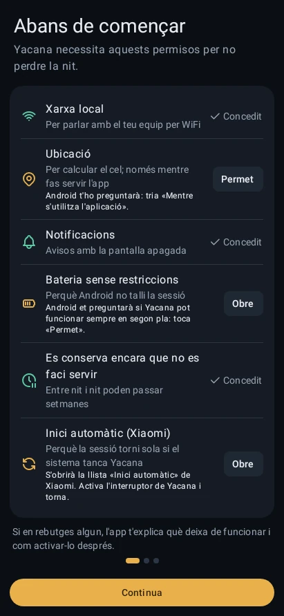 <b>Abans de començar.</b> Les files concedides mostren una marca.</td>
</tr></table>

| Permís | Per a què serveix | Sense ell |
| --- | --- | --- |
| **Xarxa local** | Parlar amb el teu equip per WiFi. Es demana a Android 17 i posteriors. | L'app no pot trobar ni controlar cap dispositiu Alpaca. |
| **Ubicació** | Calcular el cel al teu lloc, només mentre fas servir l'app. Tria **Mentre s'utilitza l'aplicació**. | Escriu el lloc al perfil. |
| **Notificacions** | La sessió i els seus avisos amb la pantalla apagada. Es demana a Android 13 i posteriors. | No veus la sessió ni els seus avisos fora de l'app. |
| **Bateria sense restriccions** | Perquè Android no talli la sessió. Toca **Permet** quan Android t'ho pregunti. | El sistema pot tallar la sessió amb la pantalla apagada. |
| **Es conserva encara que no es faci servir** | Entre nit i nit poden passar setmanes. Desactiva **Posa en pausa l'activitat de l'aplicació si no s'utilitza**. Android 11 i posteriors. | Android pot treure els permisos de l'app després d'uns mesos sense fer-la servir. |
| **Inici automàtic (Xiaomi)** | Als mòbils Xiaomi, Redmi i Poco, perquè la sessió torni sola si el sistema tanca Yacana. Activa l'interruptor de Yacana. | Si el sistema tanca Yacana a la nit, la sessió no torna sola. |

Si en rebutges algun, no es trenca res de cop: l'app explica què deixa de funcionar i com activar-lo després, a *Configuració › Permisos* ([capítol 33](#permissions)). Toca **Continua** per seguir.

### 2 · Cerca el teu equip

1. Engega l'equip i connecta el mòbil a la seva WiFi, o posa'ls tots dos a la WiFi de casa.
2. Yacana cerca sola dispositius Alpaca a la xarxa, en IPv4 i IPv6. Cada servidor que troba apareix com una targeta amb els seus dispositius. **Torna a cercar** repeteix la cerca.
3. En un Seestar, toca **Teleobjectiu** o **Gran angular**: carrega el perfil del Seestar per a aquella càmera, amb la seva òptica, el camp i els ajustos recomanats. Pots crear tots dos i canviar d'un a l'altre des de la targeta **Perfil** a Equip. Per a un altre equip, toca **Afegeix**: el perfil agafa el primer dispositiu de cada tipus d'aquell servidor.

Si no es troba un dispositiu, per exemple en una xarxa que bloqueja la detecció, toca **Afegeix per IP i port** i escriu la seva adreça, com ara `192.168.1.10:32323`. Si ja tens un perfil d'un altre mòbil, **Importa un perfil** el carrega. **Ara no** se salta aquesta pàgina; pots cercar el teu equip més tard a Equip.

<table><tr>
<td valign="top" width="240">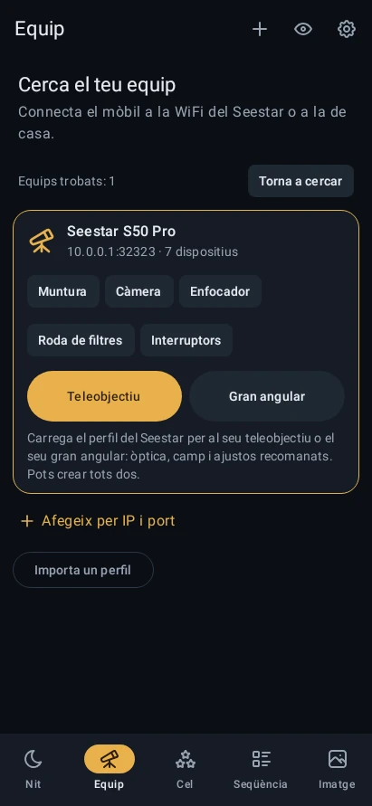 <b>Trobat a la WiFi.</b> Un Seestar amb els seus set dispositius.</td>
</tr></table>

### 3 · A punt per al camp

Yacana funciona sense internet, però hi ha dues coses massa grans per incloure-les a l'app. Aquesta pàgina mostra què ja és al mòbil i què cal aconseguir mentre encara tens WiFi:

- **Catàleg d'objectes** i **Efemèrides**: inclosos a l'app, no cal fer res.
- **Base d'estrelles**: la recomanada per al teu camp, la D50 per a un Seestar. Toca **Baixa**.
- **Memòria cau del cel de NINA**: les fotos per a l'atles i l'enquadrament. Toca **Importa** si ja en tens el ZIP; per baixar-la des de l'app, fes servir *Configuració › Mapa del cel* ([capítol 6](#field)).

Les baixades continuen en segon pla. Toca **Comença** per obrir l'app.

<table><tr>
<td valign="top" width="240">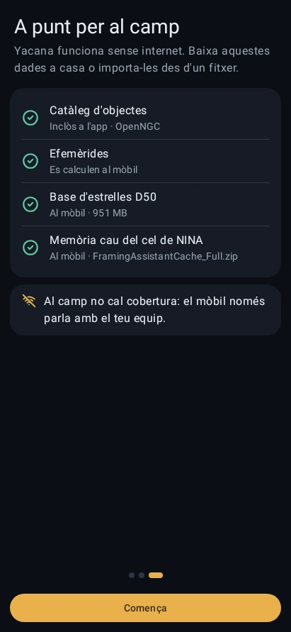 <b>A punt per al camp.</b> Tot al mòbil.</td>
</tr></table>

> [!TIP]
> **Convé saber-ho**
>
> Els primers passos no es poden tornar a obrir. Les seves parts continuen disponibles: els permisos a *Configuració › Permisos*, la cerca d'equips a Equip, les bases d'estrelles a *Configuració › Plate solving* i les memòries cau del cel a *Configuració › Mapa del cel*.

## 4. Com orientar-te

Yacana s'organitza pels moments de la nit i no pels panells de cada dispositiu. A cada moment mostra el que necessites i deixa la resta a un toc.

### Les cinc seccions

La barra inferior té cinc seccions. Amb el mòbil en horitzontal es converteix en una barra lateral a l'esquerra. Si toques la secció on ja ets, tornes a la seva primera pantalla.

| Secció | Per a què | Barra superior |
| --- | --- | --- |
| **Nit** | La foscor i la Lluna d'aquesta nit, la llista de preparació, la sessió en curs, el resum i el diari | Estat de l'equip, mode vermell, Configuració |
| **Equip** | Perfils, connexió i control manual de cada dispositiu | Afegeix un dispositiu, mode vermell, Configuració |
| **Cel** | Mapa del cel, Sky Atlas, fitxes d'objectes i enquadrament | Capes del cel o Filtres, mode vermell |
| **Seqüència** | Pla d'aquesta nit, seqüències desades, plantilles, els editors simple i avançat | — |
| **Imatge** | Captura manual, estadístiques, historial, apilat en directe i foto de referència | Mode vermell, Més opcions |

### Controls comuns

- **Configuració:** L'engranatge de Nit i Equip, o **Configuració** al final de **Més opcions** d'Imatge. El seu quadre de cerca troba qualsevol ajust per una part del nom.
- **Mode vermell:** La icona de l'ull a Nit, Equip, Cel, Imatge, la fitxa de l'objecte, l'enquadrament i els assistents. Torna vermell cada píxel ([capítol 32](#display)).
- **Estat de l'equip:** A Nit, un escut quan l'equip està connectat sense problemes, o un triangle d'avís mentre l'app es reconnecta o s'atura de manera segura.
- **Enrere i tancar:** La fletxa de dalt a l'esquerra torna enrere. Els assistents (alineació polar, autoenfocament i flats) mostren **✕** en lloc seu, que els atura.
- **Fulls:** Moltes opcions s'obren en un full que puja des de la part inferior de la pantalla. Llisca'l cap avall, o toca fora, per tancar-lo.
- **Números:** Les hores, les coordenades i els nombres de preses s'introdueixen amb valors freqüents i amb el teclat numèric propi de l'app, perquè el teclat del sistema, que el mode vermell no pot acolorir, no s'encengui mai de nit.
- **Mantenir premut:** Els botons arriscats s'omplen mentre els prems i actuen al cap d'un segon, aproximadament: aparcar, aturar una seqüència, esborrar un perfil, una memòria cau, una base o una seqüència desada. Un toc curt no fa res, només et recorda que l'has de mantenir premut.
- **Estats:** Cada estat es mostra amb una icona i paraules, mai només amb el color, perquè en mode vermell el verd i l'ambre es veuen iguals.

### La barra de sessió

Mentre una seqüència està en marxa o en pausa, una barra a totes les pantalles excepte Nit mostra l'objectiu, el filtre, l'exposició i la presa, amb el seu progrés, com la barra «Ara sona» d'una app de música. Toca-la per veure la sessió a Nit; el seu botó posa en pausa o reprèn la seqüència.

### Notificacions

Mentre l'equip està connectat, una notificació mostra la sessió, també a la pantalla de bloqueig: l'objectiu, la presa i el progrés, o les preses desades. Toca-la per obrir l'app. El seu botó **Desconnecta** atura la captura i desconnecta l'equip. Els avisos que et necessiten, com ara una connexió perduda o una aturada segura, sonen; els esdeveniments com un autoenfocament o el final de la seqüència arriben en silenci. Cada tipus té el seu propi canal de notificacions (*Sessió de la nit*, *Alertes de la nit*, *Esdeveniments de la nit*), que pots ajustar a la configuració d'Android per a l'app.

<table><tr>
<td valign="top" width="330">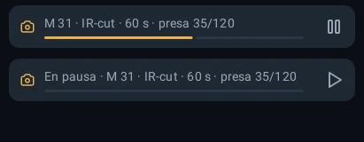 <b>La barra de sessió</b>, en marxa i en pausa.</td>
</tr></table>

## 5. El teu perfil d'equip

Un perfil és un conjunt d'equip i la manera com el fas servir: els seus dispositius, l'òptica, el lloc, els límits i les opcions. Tot el que Yacana calcula per a tu, com ara el camp, l'escala del plate solving o la base d'estrelles recomanada, en surt. El plate solving, l'autoenfocament, la seguretat, els noms de fitxer i l'apilat en directe també es guarden per perfil.

Obre'l amb *Configuració › Perfil i ubicació*, o toca la targeta **Perfil** a Equip i després **Obre el perfil**. Els perfils, els dispositius i l'esborrat del perfil només es poden canviar amb l'equip desconnectat.

### Nom i òptica

- **Nom:** toca'l per editar-lo allà mateix.
- **Distància focal:** en mil·límetres, de 10 a 10.000, la del telescopi amb el reductor si en porta. Fixa l'escala del plate solving i el camp que dibuixa el mapa del cel.
- **Obertura:** el diàmetre de l'objectiu, de 5 a 2.000 mm. La relació focal es mostra al costat.
- **Sensor de la càmera** i **Mida del píxel:** els seus píxels d'amplada i d'alçada (l'alçada es demana després de l'amplada) i la seva mida en µm, com donen les especificacions de la càmera; un Seestar S50 Pro té 2160 × 3840 px de 2,9 µm. La càmera els omple en connectar-se; escrits, el camp es coneix sense connectar res, per al mapa del cel i l'enquadrament.

Quan la càmera s'ha connectat, la targeta mostra l'escala i el camp, com ara *2,25″/px · camp 1,35° × 2,40°*.

### Ubicació

El lloc determina la foscor d'aquesta nit, cada altura i el pol per a l'alineació polar.

- **Fer servir la ubicació del mòbil** la llegeix del mòbil en activar-la, cada cop que s'obre l'app i en connectar; el primer cop, Android demana el permís. Si no arriba, la fila diu per què, i en tocar-la ho torna a provar. Si està desactivat, l'escrius tu: latitud nord o sud (de 0 a 90°), longitud est o oest (de 0 a 180°) i altitud en metres (de 0 a 9.000).
- **Enviar l'hora i el lloc a la muntura** dona a la muntura l'hora UTC del mòbil i el lloc en connectar.

### Límits

- **Límit d'altura**, de 0 a 60°: cap GoTo baixa d'aquí, ni de l'horitzó. Un GoTo per sota es rebutja i la muntura no es mou; un moviment amb la creueta s'atura sol al límit.
- **Horitzó:** pla, o el teu propi amb arbres i edificis. **Importa** llegeix un fitxer d'horitzó de N.I.N.A.: un punt per línia, azimut i altura en graus, separats per espais o tabuladors, amb `#` per als comentaris. **Deixa'l pla** l'elimina. Les fitxes dels objectes el dibuixen al seu gràfic d'altura.

<table><tr>
<td valign="top" width="240">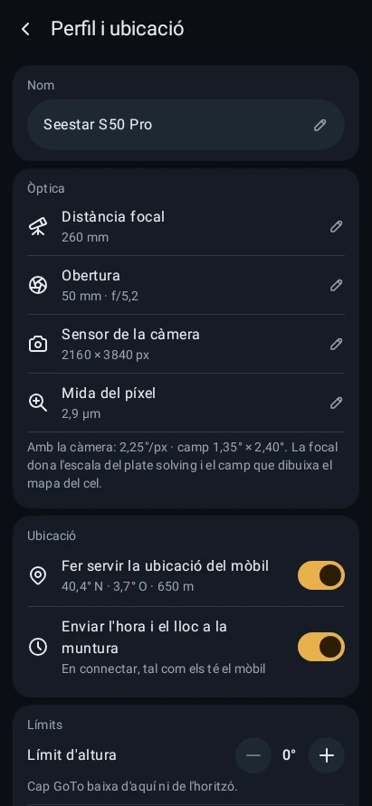 <b>Perfil i ubicació.</b> El perfil del Seestar.</td>
<td valign="top" width="240">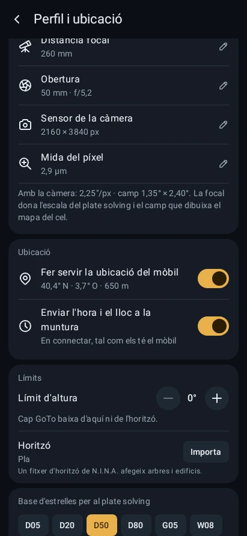 <b>Base d'estrelles</b> per al plate solving, triada per perfil.</td>
</tr></table>

### Base d'estrelles

Els botons trien la base del perfil per al plate solving. L'app et diu quina va bé per al teu camp. Si en tries una que no és al mòbil, apareixen la seva mida i un botó **Baixa**: passa a estar en ús quan acaba la baixada, i fins aleshores es manté l'anterior.

### Més d'un perfil

- **Canviar:** toca la targeta **Perfil** a Equip i tria'n un altre, o toca **Usa** al seu costat a **Altres perfils**.
- **Nou:** **Perfil nou** a **Altres perfils** cerca a la xarxa; l'equip que triïs es converteix en un perfil nou, en ús.
- **Copiar a un altre mòbil:** a **Còpia del perfil**, **Exporta** desa el perfil com a fitxer JSON on triïs, i **Importa** en llegeix un i el posa en ús. El fitxer porta la ubicació del lloc.
- **Esborrar:** **Esborra el perfil** *(mantén)*, al final de la pantalla.

## 6. A punt per al camp

Al camp el mòbil només parla amb el teu equip. Abans de la primera nit, mentre tens WiFi a casa, posa dues coses al mòbil: una base d'estrelles per al plate solving i les fotos del cel. Totes dues també es poden importar des d'un fitxer, per exemple copiades d'un PC o d'una targeta de memòria.

### Bases d'estrelles

A *Configuració › Plate solving*, a **Base d'estrelles**. L'app marca la **recomanada** per al teu camp i mostra la mida del camp. N'hi pot haver diverses al mòbil alhora; el perfil en fa servir una, marcada **En ús**.

<table><tr>
<td valign="top" width="240">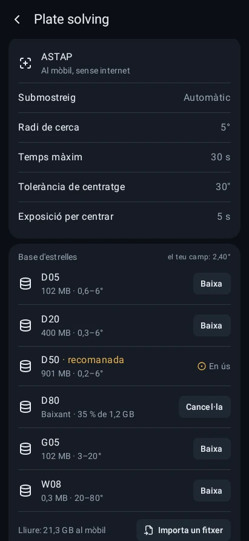 <b>Les bases d'estrelles.</b> D50 en ús, D80 baixant-se.</td>
</tr></table>

| Base | Mida | Per a camps de | Notes |
| --- | ---: | --- | --- |
| **D05** | 102 MB | 0,6° a 6° | L'opció lleugera |
| **D20** | 400 MB | 0,3° a 6° |  |
| **D50** | 901 MB | 0,2° a 6° | Recomanada per al Seestar |
| **D80** | 1,2 GB | 0,15° a 6° | La més densa |
| **G05** | 102 MB | 3° a 20° | Camps amplis, objectius de càmera |
| **W08** | 0,3 MB | 20° a 80° | Camps molt amplis |

- **Baixa** la baixa del web d'ASTAP només amb WiFi, encara que l'app estigui tancada, i continua si s'interromp. Passa a estar en ús quan acaba. L'espai lliure del mòbil es mostra sota la llista.
- **Importa un fitxer** la instal·la des del ZIP o el fitxer `.deb` del mateix ASTAP, per exemple des d'una targeta de memòria.
- Mantén premuda una base instal·lada per esborrar-la amb **Esborra la base** *(mantén)*. La que està en ús no es pot esborrar: primer posa'n una altra en ús.
- **Prova amb l'última presa** resol l'última presa d'Imatge amb la configuració actual, per comprovar-la.

### Les fotos del cel: les memòries cau de N.I.N.A.

El mapa del cel, el Sky Atlas, les fitxes d'objectes, l'enquadrament i la referència d'Imatge fan servir les fotos de les memòries cau d'enquadrament de N.I.N.A. Yacana les llegeix tal com les publica N.I.N.A., directament del ZIP sense descomprimir-lo, així que una memòria cau ocupa el mateix que el seu ZIP i res més. Obre *Configuració › Mapa del cel*, o la icona de capes del mapa del cel.

- **Memòria cau completa (DSS):** tot el cel en 2.131 fotos en color de 5° del Digitized Sky Survey, 3,5 GB. És la que cal tenir.
- **NSNS amb estrelles** (1,4 GB) i **NSNS sense estrelles** (471 MB): el Northern Sky Narrowband Survey, emissió d'hidrogen i oxigen fins a uns −17° de declinació. Es dibuixen com una segona capa.
- **Fotos en línia:** les fotos amb més detall que el mapa baixa quan l'apropes molt amb internet, i que es guarden al mòbil.

<table><tr>
<td valign="top" width="240">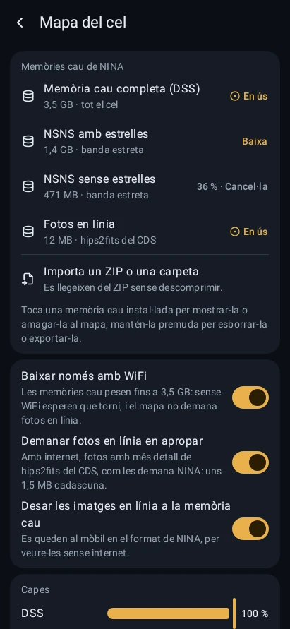 <b>Configuració › Mapa del cel.</b> La memòria cau completa en ús, i una de banda estreta arribant.</td>
</tr></table>

#### Aconseguir una memòria cau

- **Baixa** la baixa del web de N.I.N.A. amb el gestor de baixades d'Android. Continua si s'interromp i primer comprova l'espai lliure. Amb **Baixar només amb WiFi** activat (el valor predeterminat), espera que hi hagi WiFi.
- **Importa un ZIP o una carpeta**: **Tria un ZIP** agafa un dels ZIP de N.I.N.A., com els del seu web; **Tria una carpeta** agafa la carpeta de la memòria cau que N.I.N.A. té en un PC (`FramingAssistantCache`), copiada al mòbil o en una targeta. Es copien a l'app.

#### Fer-la servir

- Toca una memòria cau instal·lada per mostrar-la al mapa o amagar-la: **En ús** o **Instal·lada**.
- **Capes:** l'opacitat de la capa DSS (100 % per defecte) i de la de banda estreta (40 %), per barrejar-les.
- **Demanar fotos en línia en apropar** (activat per defecte): amb internet, en apropar el mapa es demanen fotos amb més detall a hips2fits del CDS, com fa N.I.N.A., d'uns 1,5 MB cadascuna. Desactiva-ho per reservar les dades mòbils per a altres coses; amb **Baixar només amb WiFi** activat, el mapa tampoc no les demana amb dades mòbils.
- **Desar les imatges en línia a la memòria cau**: si està activat, es queden al mòbil en el format de N.I.N.A., per tornar-les a veure sense internet.

#### Esborrar-la o exportar-la

Mantén premuda una memòria cau instal·lada. El full diu quant espai allibera; **Esborra la memòria cau** *(mantén)* l'elimina. Una memòria cau de carpeta, com les fotos en línia, també ofereix **Exporta en ZIP**, per obrir-la a N.I.N.A. en un PC.

<table><tr>
<td valign="top" width="240">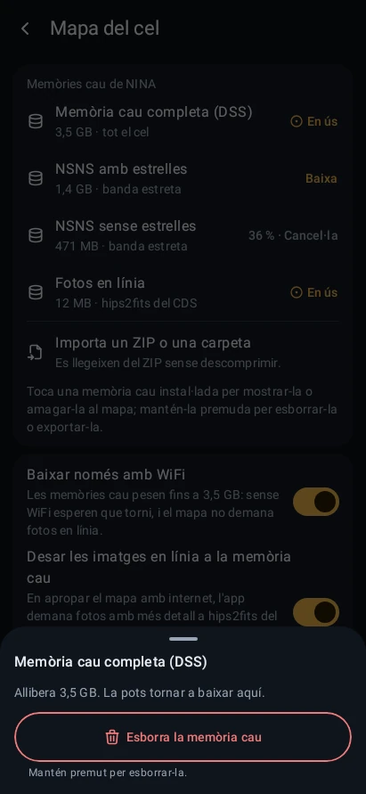 <b>Mantenint premuda una memòria cau.</b> El que allibera, i el botó que cal mantenir premut.</td>
</tr></table>

> [!TIP]
> **Crèdits**
>
> Les fotos no formen part de l'app: les baixes del web de N.I.N.A. o les importes. El DSS és de l'STScI, que permet que N.I.N.A. el distribueixi, i el NSNS té llicència CC BY-NC-SA 4.0. El mapa mostra *DSS: STScI · NSNS: CC BY-NC-SA 4.0*.

---

# Equip

## 7. Connectar el teu equip

La secció Equip conté el perfil en ús, el connecta i et dona control manual de cada dispositiu.

1. Comprova la targeta **Perfil**: el nom del perfil i d'on surt el seu lloc, com ara *Ubicació per GPS · 40,4° N · 3,7° O · 650 m*. Toca-la per canviar a un altre perfil.
2. Toca **Connecta**. La fila diu *Connectant…* i després quants dispositius han respost, com ara *5 de 5 connectats*, o per què un no s'ha pogut connectar.
3. Cada dispositiu té una fila amb el seu estat en directe: la muntura fent seguiment i la seva altura, la càmera en repòs i la temperatura del sensor, la posició de l'enfocador, el filtre posat, l'escalfador antirosada encès. S'actualitzen cada un o dos segons.
4. Toca un dispositiu connectat per obrir-ne la pantalla. **Desconnecta-ho tot** acaba la connexió.

Si la connexió cau, Yacana es torna a connectar sola. Durant una seqüència, primer fa una pausa segura ([capítol 28](#safety)).

<table><tr>
<td valign="top" width="240">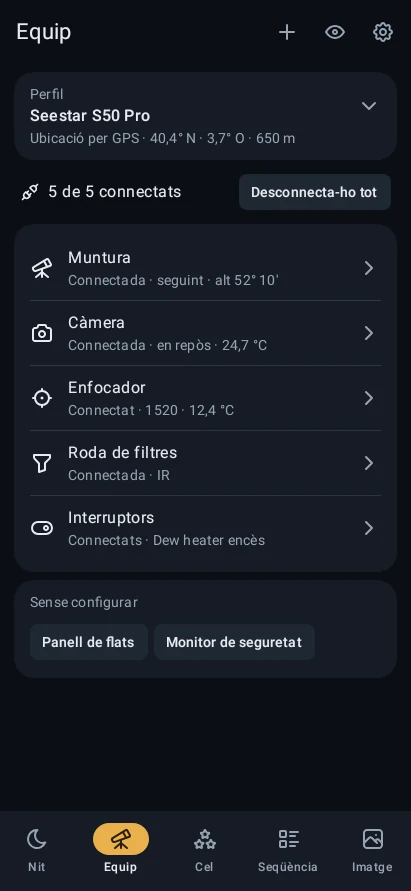 <b>Equip.</b> Cinc dispositius connectats; el panell de flats i el monitor de seguretat sense configurar.</td>
</tr></table>

### Afegir un dispositiu

El **+** de dalt obre *Afegeix un dispositiu*, que torna a cercar a la xarxa. Cada servidor mostra els dispositius que el teu perfil encara no té, cadascun amb **Afegeix**; **Afegeix per IP i port** accepta una adreça. La targeta **Sense configurar** al final de la llista té un botó per a cada dispositiu opcional, el panell de flats i el monitor de seguretat, que obre la mateixa cerca. Els dispositius només s'afegeixen amb l'equip desconnectat.

### Sense perfil

Si t'has saltat els primers passos, Equip comença amb **Cerca el teu equip**, la mateixa cerca que al [capítol 3](#first-steps), i un botó **Importa un perfil**.

## 8. La muntura

La pantalla de la muntura mostra on apunta i la mou a mà, amb GoTo, sincronització, aparcament i seguiment.

### On apunta

La targeta de dalt mostra el seu estat, com ara *Seguint · sideral*, *En moviment*, *Sense seguiment* o *Aparcada*, i la seva AR, Dec, altura i azimut. Mentre centra un objectiu, la targeta mostra l'intent i el pas actual, amb **Atura**.

### Moure-la a mà

Mantén premuda una fletxa (N, S, E, O) per moure la muntura; s'atura quan la deixes anar. El botó vermell del mig l'atura a l'instant. Els botons de sota fixen la velocitat: **1×**, **8×** (el valor predeterminat) o **64×** la velocitat sideral, o **Màx**, la més ràpida de la muntura. Un moviment s'atura sol al límit d'altura del perfil.

### Els botons

- **Vés a…:** Obre un full per escriure l'AR i la Dec amb el teclat numèric de l'app (més avall).
- **Sincronitza:** Li diu a la muntura que apunta a les coordenades que escrius. Amb una presa resolta, fes servir **Sincronitza la muntura** d'Imatge ([capítol 18](#solving)). Només es mostra si la muntura pot sincronitzar.
- **Aparca:** Mantén-lo premut per enviar la muntura a la seva posició de repòs. Un toc curt només et recorda que l'has de mantenir premut. Amb la muntura aparcada, el botó diu **Desaparca**, i un toc la desaparca.
- **Seguiment:** Activa o desactiva el seguiment.
- **Alineació polar:** Obre l'assistent d'alineació polar ([capítol 17](#polar)).

El menú **⋮** de dalt conté la resta: la **Velocitat de seguiment** (sideral, lunar, solar o King, les que admeti la muntura), **Desaparca** quan està aparcada, i **Vés a casa** si la muntura en té.

<table><tr>
<td valign="top" width="240">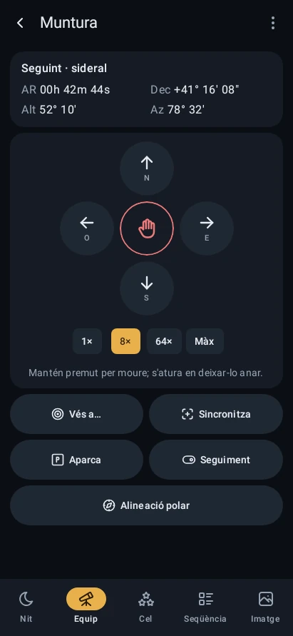 <b>Muntura.</b> Mantén premuda una fletxa per moure-la; toca la velocitat.</td>
<td valign="top" width="240">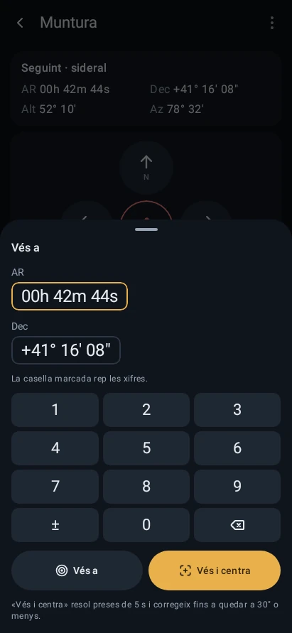 <b>Vés a.</b> La casella marcada rep les xifres.</td>
</tr></table>

### Anar a unes coordenades

1. Toca **Vés a…**. El full mostra l'AR i la Dec actuals de la muntura.
2. Toca la casella de l'AR o de la Dec per marcar-la, i escriu les xifres al teclat numèric. **±** canvia el signe de la declinació.
3. Toca **Vés a** per anar-hi, o **Vés i centra** per anar-hi i després afinar amb plate solving fins que l'objectiu estigui dins de la tolerància (30″ per defecte).

> [!CAUTION]
> **Per sota del límit**
>
> Un GoTo a un objectiu per sota del límit d'altura del perfil, o per sota del seu horitzó, es rebutja. La pantalla diu on és l'objectiu i que la muntura no s'ha mogut. Espera que pugi, o canvia el límit al perfil ([capítol 5](#profile)).

## 9. Càmera i roda de filtres

### Càmera

La pantalla de la càmera mostra el seu estat, com ara *En repòs · −10 °C*, i el que informa: la mida del sensor, la mida del píxel, el patró Bayer, els rangs de guany i offset, i l'exposició més llarga. Les preses es fan a Imatge; **Vés a Imatge** t'hi porta ([capítol 20](#imaging)).

Yacana fa servir cada càmera tal com es descriu ella mateixa per Alpaca: guany, offset, binning, regió d'interès i temperatura del sensor quan la càmera en té. Les preses es baixen directament a la memòria nativa del mòbil mentre comença l'exposició següent, així que fins i tot hi caben càmeres de 61 MP.

### Roda de filtres

La pantalla de la roda de filtres llista els seus filtres, amb una marca al que està posat. Toca un filtre per posar-lo. A Imatge el filtre també és un botó sota la presa.

Un filtre anomenat **Dark**, com al Seestar, es fa servir com a obturador per als darks i els bias, així que no cal tapar res. Si no n'hi ha, l'app et demana que tapis el telescopi quan fa darks.

## 10. L'enfocador

- **Posició** i **Temperatura**, en gran, amb l'hora i la temperatura de l'últim autoenfocament.
- **Mou:** **−100**, **−10**, **+10** i **+100** passos, i **Vés a la posició…**, que obre el teclat numèric amb el rang de l'enfocador. **Atura** apareix mentre es mou.
- **Última corba:** la corba en V de l'últim autoenfocament, amb el seu millor HFR i la posició.
- **Desplaçament per filtre**, amb una roda de filtres: toca un filtre per fixar-ne el desplaçament en passos, respecte als altres. En canviar de filtre, l'enfocador es mou la diferència entre el desplaçament del filtre nou i el de l'anterior, perquè cada filtre quedi enfocat sense un autoenfocament nou.
- **Autoenfocament** executa l'autoenfocament a l'instant ([capítol 19](#autofocus)).

<table><tr>
<td valign="top" width="240">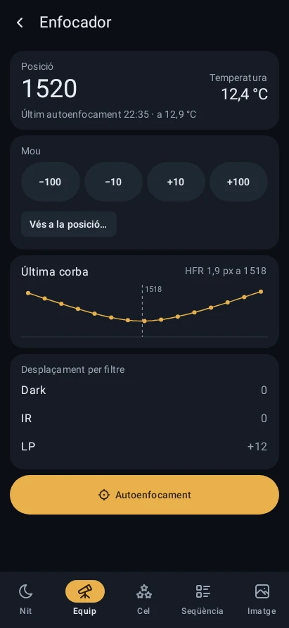 <b>Enfocador.</b> El filtre LP enfoca 12 passos més enfora.</td>
</tr></table>

## 11. Interruptors, panell de flats i monitor de seguretat

### Interruptors

Cada interruptor es mostra tal com el declara el dispositiu: un commutador per a encès i apagat, un control lliscant amb − i + per a un valor com la potència d'un escalfador (amb el seu rang i pas; el valor s'envia quan el deixes anar), o una lectura per als que són només de lectura. El més habitual és un escalfador antirosada, que la seqüència pot encendre al principi i apagar al final.

### Panell de flats

Per a un panell de flats amb tapa (un CoverCalibrator d'Alpaca):

- **Tapa:** el seu estat, amb **Obre** i **Tanca**, i **Atura** mentre es mou. Obre-la per a la nit i tanca-la per als darks.
- **Llum:** encesa o apagada, i la seva **Brillantor** amb un control lliscant o amb − i +.

Per als flats, l'assistent de flats tanca la tapa, encén la llum i troba l'exposició sol ([capítol 23](#calibration)).

### Monitor de seguretat

Mostra **Segur** o **No segur**, llegit cada segon, per exemple d'un sensor de núvols o de pluja. L'app ho mostra però encara no hi actua: si passa a **No segur**, atura la seqüència des de Nit.

<table><tr>
<td valign="top" width="240">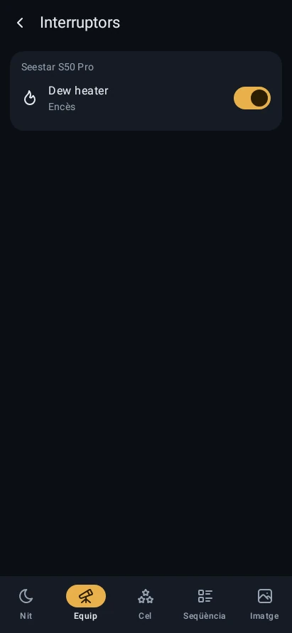 <b>Interruptors.</b> L'escalfador antirosada del Seestar.</td>
<td valign="top" width="240">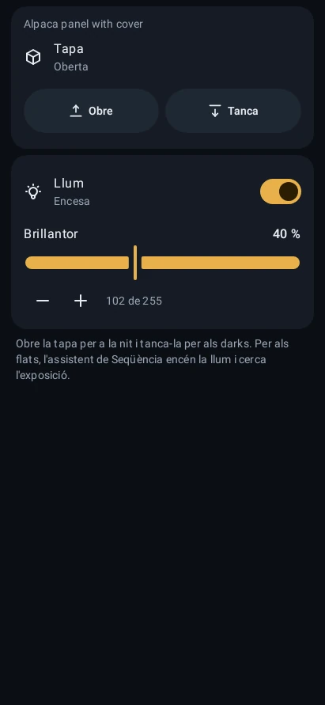 <b>Panell de flats.</b> Tapa oberta, llum al 40 %.</td>
<td valign="top" width="240">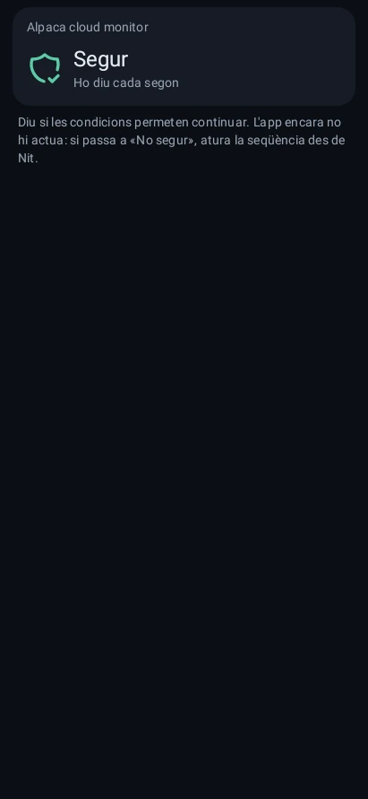 <b>Monitor de seguretat.</b> Llegit cada segon.</td>
</tr></table>

---

# Planificar la nit

## 12. Aquesta nit d'un cop d'ull

Nit és on comença el vespre. Mostra la foscor i la Lluna d'aquesta nit, una llista per preparar-te, la sessió mentre està en marxa i el resum al matí.

### La targeta d'aquesta nit

Calculada al mòbil per al lloc del perfil:

- La data i la il·luminació de la Lluna, com ara *Lluna 34 %*.
- La millor finestra fosca: *Fosc i sense Lluna*, o *Fosc, amb la Lluna sortida* quan la Lluna és a dalt durant tota la nit astronòmica, amb el seu inici, final i durada.
- La posta i la sortida del sol, i una línia de temps del vespre al matí: el crepuscle, la nit astronòmica i les hores que la Lluna és a dalt, amb la millor finestra remarcada.

Prop del solstici d'estiu a latituds altes pot dir *Sense nit astronòmica*: el Sol no baixa 18° sota l'horitzó. Sense lloc, la targeta diu com posar-ne un: permet la ubicació a *Configuració › Permisos* i activa la del mòbil, o escriu-lo al perfil.

### Una altra nit

Toca la icona del calendari per veure qualsevol altra nit. La graella del mes marca aquesta nit amb un contorn i la nit que triïs, emplenada; les fletxes canvien de mes. **Tornar a aquesta nit** hi torna.

<table><tr>
<td valign="top" width="240">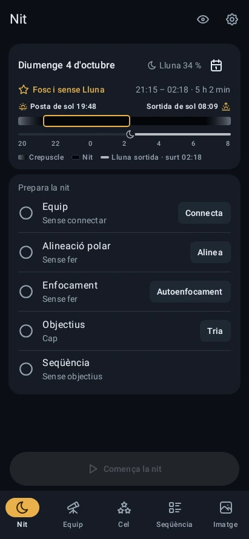 <b>Nit.</b> 5 h 2 min de cel fosc abans que surti la Lluna.</td>
<td valign="top" width="240">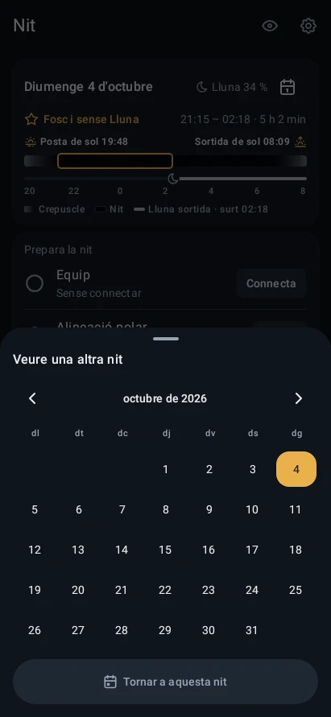 <b>Veure una altra nit.</b></td>
</tr></table>

### Prepara la nit

Una llista sense passos obligatoris: fes el que necessiti la teva nit, en qualsevol ordre. Cada fila mostra el seu estat i un botó que t'hi porta.

| Fila | Mostra | Botó |
| --- | --- | --- |
| **Equip** | El perfil i els seus dispositius un cop connectats | **Connecta** |
| **Alineació polar** | *Sense fer*, o l'últim error total i fa quant | **Alinea**, després **Afina** |
| **Enfocament** | *Sense fer*, o l'últim HFR i fa quant (amb un enfocador) | **Autoenfocament** |
| **Objectius** | *Cap*, o els objectius d'aquesta nit | **Tria**, que obre Cel |
| **Seqüència** | Si el pla hi cap abans de l'alba, i la seva durada | **Ajusta** quan no hi cap |

Quan l'equip està connectat i el pla té exposicions, **Comença la nit** inicia la seqüència ([capítol 27](#running)). Les marques de les files són icones a més de colors, així que es llegeixen igual en mode vermell.

<table><tr>
<td valign="top" width="240">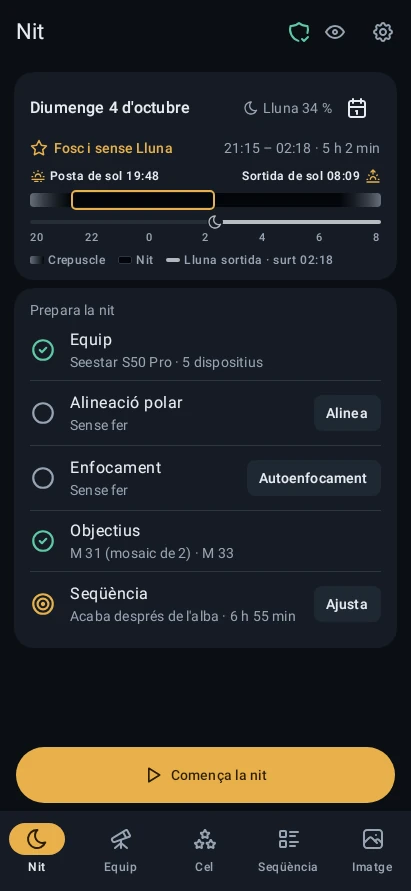 <b>A punt per començar.</b> El pla acaba després de l'alba: <i>Ajusta</i> el retalla.</td>
</tr></table>

## 13. El mapa del cel

La secció Cel s'obre amb un mapa del cel real, dibuixat amb les fotos de la memòria cau de N.I.N.A., sense internet. El mapa es queda on el vas deixar, també després de tancar l'app. Arrossega'l amb un dit, pessiga per apropar des d'una vista àmplia fins a menys del camp de la teva càmera, i toca un objecte per seleccionar-lo.

El mapa està orientat tal com veus el cel des del lloc del perfil en aquest moment, amb el zenit a dalt; sense lloc, el nord és a dalt. Una barra d'escala mostra la mida d'un grau, i les coordenades del centre són a baix a la dreta.

### Què mostra

- **Fotos:** l'etiqueta de dalt diu d'on surten, com ara *DSS · memòria cau de NINA*. Amb internet, en apropar es baixen fotos amb més detall de la zona; mentre n'arriba una, gira una rodeta a l'etiqueta. Sense memòria cau, l'etiqueta diu com instal·lar-ne una; toca-la per obrir la configuració del mapa del cel.
- **El teu camp:** un requadre discontinu al centre, de la mida del camp de la teva càmera, amb el nom del perfil.
- **Objectes:** contorns i noms dels objectes del catàleg.
- **Horitzó:** una línia clara on és l'horitzó de la ubicació del perfil, que segueix el seu propi horitzó si el perfil en té un, amb **N**, **E**, **S** i **O** a sobre.

### Seleccionar un objecte

Toca un objecte: el mapa s'hi centra i una targeta en mostra el nom, la mida, l'altura i la millor hora, amb **Enquadra**. Toca la targeta per anar a la fitxa de l'objecte. Toca el cel buit per deseleccionar-lo.

Per enquadrar una àrea sense cap objecte del catàleg, centra-la al mapa, dins del requadre del teu camp, i toca **Enquadra aquí**, el botó rodó daurat sota el zoom: l'enquadrament s'obre allà, i l'àrea entra a la seqüència amb les seves coordenades com a nom, com ara *03h 47m +24° 07′*.

### Botons

- **+ i −:** apropar i allunyar.
- **Enquadra aquí:** el daurat, a sota, enquadra el centre del mapa.
- **Capes** (barra superior): la configuració del mapa del cel, amb les memòries cau i l'opacitat de les capes ([capítol 6](#field)).

<table><tr>
<td valign="top" width="240">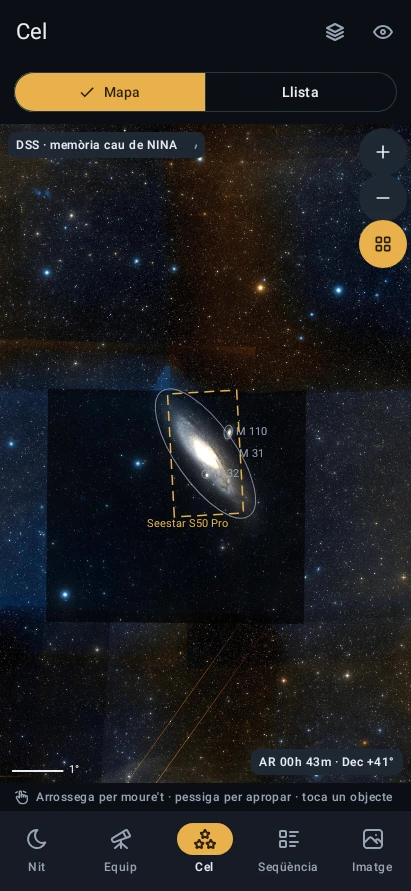 <b>El mapa.</b> M 31 sobre les fotos DSS, amb el camp del Seestar.</td>
</tr></table>

### La muntura al mapa

Amb la muntura connectada, el mapa mostra dos requadres del camp de la teva càmera. Es diferencien per la línia, així que també es distingeixen en mode vermell:

- **Enquadrament:** discontinu, al centre del mapa. És on vols anar.
- **Telescopi:** continu, on apunta ara el telescopi, i es mou a mesura que es llegeix cada segon.

Arrossega el mapa per posar l'objectiu dins del requadre d'enquadrament, o toca un objecte per centrar-lo, i després:

- **Vés i centra** porta el telescopi a l'enquadrament i l'afina amb plate solving fins a la tolerància del perfil. Una targeta mostra cada pas i quant en falta, amb **Atura**, que atura la muntura i la presa.
- **Només vés** fa el GoTo sense centrar.

Quan la muntura està aparcada o sense seguiment, l'etiqueta **Telescopi** ho diu, i si la toques desaparca la muntura o n'activa el seguiment.

<table><tr>
<td valign="top" width="240">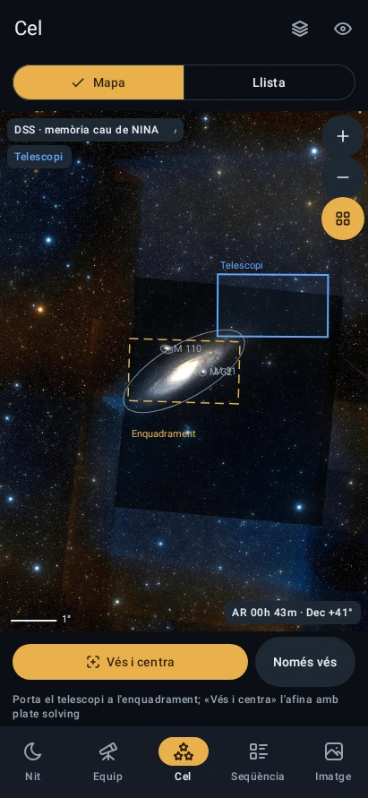 <b>Telescopi i enquadrament.</b> El requadre continu és on apunta.</td>
<td valign="top" width="240">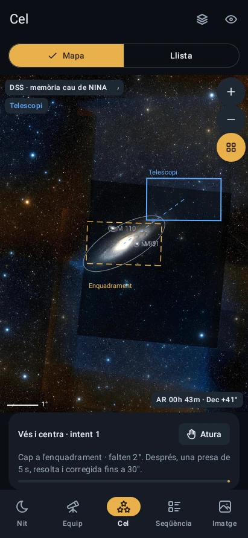 <b>Vés i centra.</b> Falten 2°, i després una presa de 5 s, resolta i corregida.</td>
</tr></table>

## 14. Sky Atlas i cerca

Canvia la secció Cel a **Llista** per obrir el Sky Atlas: 13.371 objectes de cel profund d'OpenNGC (NGC, IC, Messier, Caldwell i més) al mòbil, cadascun amb la seva foto de la memòria cau, ordenats per a aquesta nit.

### El millor d'aquesta nit

Amb **Aquesta nit** activat (el valor predeterminat), la llista mostra el que està ben situat aquesta nit des del lloc del perfil, ordenat per la seva millor hora. Cada fila té una miniatura, el nom, el número de catàleg i la mida, si *hi cap* al teu camp o necessita un *mosaic de N*, i una petita corba d'altura amb la seva millor hora. Toca una fila per anar a la fitxa de l'objecte.

Sobre la llista, **Aquesta nit** i **Preferits**, els objectes que vas marcar amb l'estrella a la seva fitxa, s'activen i es desactiven amb un toc. Al costat apareix cada filtre actiu, com ara *Fins a mag 8* o *Des de 1°*: la seva ✕ el treu i el seu text obre els filtres. La icona dels controls lliscants diu quants n'hi ha, i la nota quants objectes queden i en quin ordre. Els filtres i el lloc de la llista es mantenen en obrir un objecte, en canviar de secció i en tancar l'app.

<table><tr>
<td valign="top" width="240">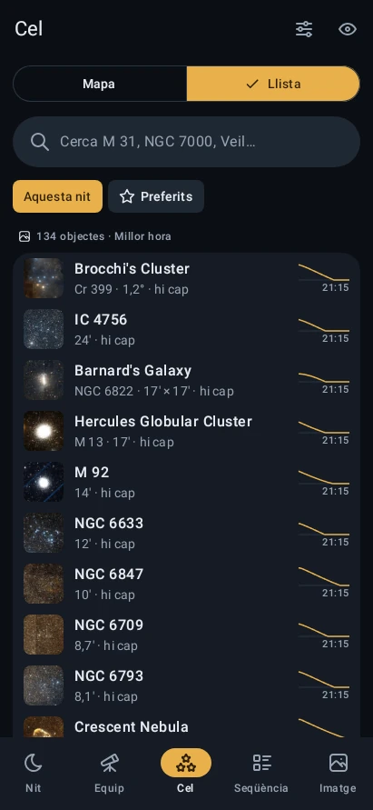 <b>Aquesta nit.</b> Miniatures de la memòria cau, sense internet.</td>
<td valign="top" width="240">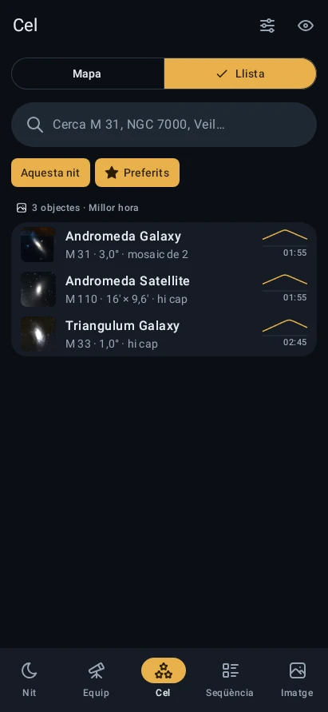 <b>Preferits.</b> M 31 necessita un mosaic de 2.</td>
<td valign="top" width="240">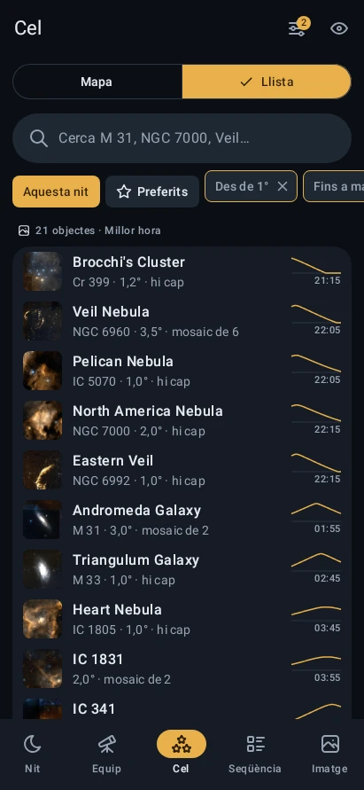 <b>Filtres actius.</b> Fins a mag 8 i des de 1°.</td>
</tr></table>

### Filtres

La icona dels controls lliscants de dalt, o el text d'un filtre actiu, obre els filtres. La llista canvia mentre tries i la capçalera diu quants objectes queden; **Restableix** els deixa com al principi, i **Fet**, lliscar cap avall, tocar fora o enrere els tanquen. En horitzontal s'obren al costat, amb la llista a la vista.

- **Ordena per:** Millor hora (per defecte), Altura màxima, Hores visibles, Mida o Brillantor, cadascun en el seu sentit natural: primer el més d'hora, el que més puja, el que passa més temps sobre la teva altura, el més gran o el més brillant. La nota sobre la llista diu l'ordre.
- **Tipus:** Galàxies, nebuloses, cúmuls, altres.
- **Mida:** Qualsevol, per al teu camp (se'n mostra la mida), o des de 15′, 30′ o 1°.
- **Magnitud:** Qualsevol, o fins a 8, 10 o 12.
- **Només:** Preferits, i els que caben al camp.
- **Aquesta nit:** activat (per defecte), només el que està ben situat aquesta nit; l'altura i les hores són les de la nit fosca d'aquesta nit a la ubicació del perfil. Desactivat, els tres següents no compten.
- **Per sobre de:** 20°, 30° o 45°.
- **Durant almenys:** 1, 2 o 4 hores.
- **Lluny de la Lluna:** Qualsevol, o com a mínim 30°, 60° o 90°.

Si no hi coincideix res, la llista ho diu, amb **Restableix** per tornar a començar.

<table><tr>
<td valign="top" width="240">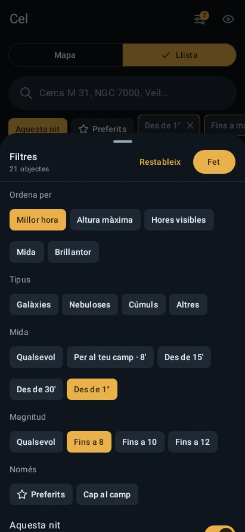 <b>Filtres.</b></td>
</tr></table>

### Cerca

Escriu al quadre de cerca: un número Messier, NGC, IC, Caldwell o Sharpless, o un nom, com ara *M 31*, *NGC 7000* o *Veil*. Els resultats apareixen mentre escrius, en mil·lisegons, sense internet. En mode vermell, el quadre de cerca obre el teclat propi de l'app, vermell com tota la resta, en lloc del del mòbil; ⌄ o enrere l'amaguen.

Per a qualsevol altra cosa, l'última fila ofereix **Cerca «…» a SIMBAD**. Amb internet, consulta SIMBAD del CDS, que coneix més de 20 milions d'objectes, des del quàsar TON 618 fins a les estrelles d'una constel·lació. El que troba es queda al mòbil, per tornar-ho a trobar sense connexió. Si no hi ha cap coincidència exacta, llista els objectes amb noms semblants, els més brillants primer.

<table><tr>
<td valign="top" width="240">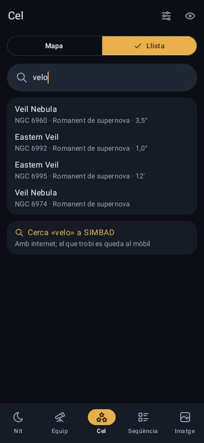 <b>Cerca sense connexió.</b> «velo» troba la nebulosa del Vel.</td>
<td valign="top" width="240">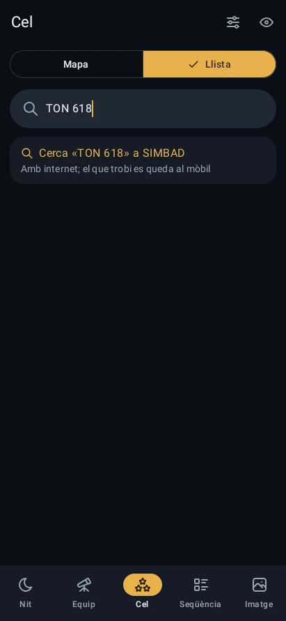 <b>Més enllà del catàleg:</b> SIMBAD, amb internet.</td>
</tr></table>

## 15. La fitxa d'un objecte

Tot el que necessites per decidir-te per un objectiu: la seva foto amb el teu camp a sobre, què és, quina altura assoleix aquesta nit i a quina distància és la Lluna.

- **Foto:** de la memòria cau, amb el camp de la teva càmera dibuixat a sobre. Toca-la, o el seu botó **Mapa**, per veure l'objecte enquadrat al mapa del cel; només es mou el mapa, no el telescopi.
- **Sobre l'objecte:** nom, tipus, magnitud i mida; els seus altres noms i designacions, com ara *També Triangulum Galaxy · Triangulum Pinwheel · NGC 598*; *Cap al camp* o *Mosaic de N panells*; i la distància i la fase de la Lluna, com ara *Lluna a 87° · 34 %*.
- **Altura aquesta nit:** la corba de l'objecte del capvespre a l'alba, amb el crepuscle ombrejat als dos extrems, la línia de 30°, el teu horitzó propi en discontinu si el perfil en té, i una línia per a l'hora actual. A sota, les hores que és per sobre de 30° i el seu punt més alt, o que es queda baix o que no surt.

L'estrella de dalt el marca com a preferit. **Enquadra** obre l'enquadrament ([capítol 16](#framing)). **Vés i centra**, amb la muntura connectada, hi porta el telescopi i el centra, a la pantalla de la muntura.

<table><tr>
<td valign="top" width="240">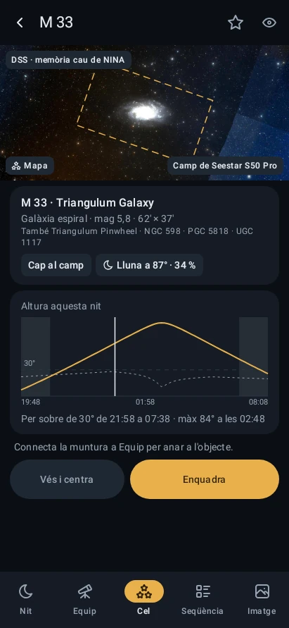 <b>M 33.</b> Cap al camp del Seestar; la línia discontínua és l'horitzó del lloc.</td>
<td valign="top" width="240">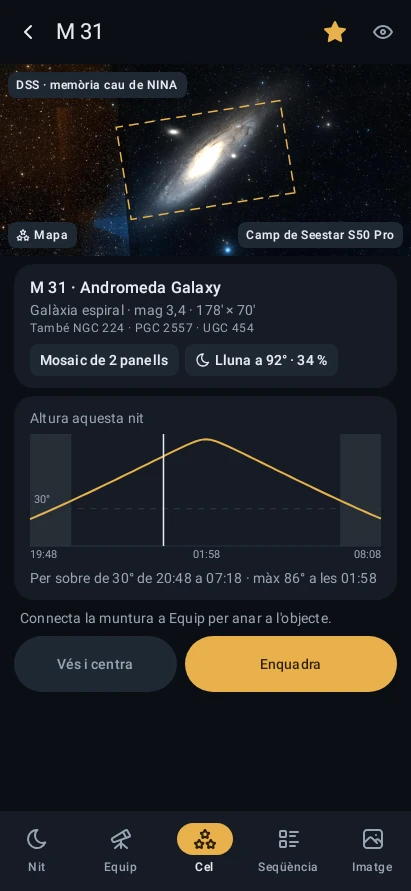 <b>M 31.</b> Un preferit que necessita un mosaic de 2 panells.</td>
</tr></table>

## 16. Enquadrament i mosaics

L'enquadrament mostra com quedarà la foto: el camp real de la teva càmera sobre el cel, que arrossegues fins que la composició és la bona, i mosaics per als objectius més grans que el camp.

1. Obre'l amb **Enquadra** a la fitxa d'un objecte o a la targeta de l'objecte al mapa.
2. Arrossega el cel per situar l'objectiu dins del camp; pessiga per apropar. La mida del camp es mostra a dalt a la dreta.
3. Per a un mosaic, fixa les **Columnes** i les **Files** amb − i +, i el **Solapament** entre panells, del 5 al 50 % (15 % per defecte). Els panells estan numerats en l'ordre en què es faran.
4. Comprova la línia de sota: les hores que és per sobre de 30° aquesta nit.
5. Toca **Afegeix a la seqüència**. L'app confirma que l'objectiu és a la seqüència d'aquesta nit, amb **Tria un altre objectiu** i **Mostra la d'aquesta nit**.

Un objectiu nou arriba amb 60 preses de 60 s amb el primer filtre que no sigui el fosc, amb dithering cada 3 preses; ajusta-les a l'editor ([capítol 25](#simple)). Després de la plantilla **Un objectiu tota la nit**, l'objectiu omple en canvi la nit fins a l'alba.

**Vés i centra**, amb la muntura connectada, porta el telescopi a l'enquadrament.

<table><tr>
<td valign="top" width="240">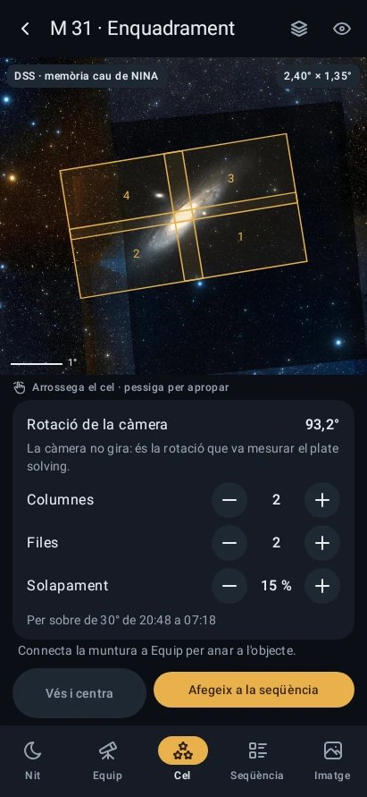 <b>M 31 · Enquadrament.</b> Un mosaic de 2 × 2, girat com la càmera.</td>
</tr></table>

### La rotació de la càmera

Sense rotador, la càmera no gira, així que l'enquadrament no fa girar el camp a mà: **Rotació de la càmera** és l'angle que ha mesurat el plate solving, i el camp i els panells es dibuixen amb aquest angle. Fins al primer plate solving és 0°, o 93,2° per a un Seestar en mode EQ. Resol una presa a Imatge un cop muntada la càmera, i l'enquadrament hi coincidirà ([capítol 18](#solving)).

> [!TIP]
> **Cal el camp**
>
> Per enquadrar cal el camp del perfil: la distància focal i el sensor de la càmera (*Configuració › Perfil i ubicació › Òptica*), escrits o desats de l'última connexió de la càmera. No cal connectar res; la pantalla té un botó al perfil.

---

# Al telescopi

## 17. Alineació polar de tres punts

L'assistent d'alineació polar mesura quant s'aparta l'eix de la muntura del pol celeste i després et guia, en directe, mentre gires els cargols de la falca. És una adaptació del connector Three Point Polar Alignment de N.I.N.A. i, amb les mateixes mesures, dona el mateix resultat amb una diferència màxima de 0,4″.

Funciona amb qualsevol muntura que pugui girar l'eix d'ascensió recta per ordre. Necessita la muntura i la càmera connectades, una base d'estrelles al mòbil i el lloc del perfil, que determina on és el pol.

### Obrir l'assistent

Toca **Alinea** a la fila **Alineació polar** de la llista de Nit (**Afina** un cop s'ha mesurat), o **Alineació polar** a la pantalla de la muntura. L'assistent ocupa tota la pantalla i la manté encesa mentre funciona; la **✕** de dalt a l'esquerra l'atura i torna enrere.

### Abans de començar

La primera pàgina explica què passarà i cap a on apuntar: una zona de cel sense obstacles, lluny del pol i de l'horitzó, en la direcció en què girarà l'eix. Mostra quatre opcions; cadascuna es guarda al perfil.

- **Gir entre punts:** Quant gira l'eix d'AR entre les tres preses, i cap a on: 10°, 15°, 20° o 30°, cap a l'oest o cap a l'est. 15° cap a l'oest és el valor predeterminat. Deixa espai per al gir perquè la muntura no topi amb cap obstacle.
- **Exposició:** 1, 2, 3 o 5 s, amb binning 1×1 o 2×2, amb el guany d'Imatge. Les preses curtes actualitzen l'error abans mentre gires els cargols. 1 s a 2×2 és el valor predeterminat.
- **Tolerància:** Desactivada, 0,5′, 1′, 2′ o 5′. Quan l'error total en baixa, el mòbil vibra. Mai amaga les fletxes. Desactivada per defecte, com al connector.
- **Resoldre només amb pista:** Per afinar una alineació que ja és a prop: els tres punts només es resolen a prop d'on apunta la muntura, mai a cegues.

<table><tr>
<td valign="top" width="240">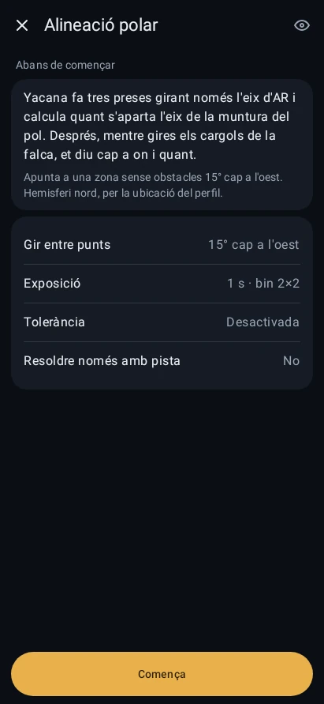 <b>Abans de començar.</b> Les opcions, amb els valors predeterminats del Seestar.</td>
</tr></table>

### Mesurar els tres punts

1. Apunta el telescopi a una zona sense obstacles com diu la primera pàgina, i toca **Comença**.
2. Yacana fa la primera presa i la resol, gira l'eix d'AR, fa i resol la segona, torna a girar i fa la tercera. Cada punt mostra *Girant l'eix d'AR…*, *Fent la presa*, *Resolent amb ASTAP*, i després quant ha trigat la resolució.
3. **No toquis la muntura mentre mesura.** Els tres centres tracen un cercle el centre del qual és l'eix real de la muntura. La seva distància al pol, corregida per precessió, nutació i refracció al teu lloc i a la teva hora, és l'error.

Si un punt no es resol, l'assistent diu quin i per què, i ofereix **Torna a començar**.

<table><tr>
<td valign="top" width="240">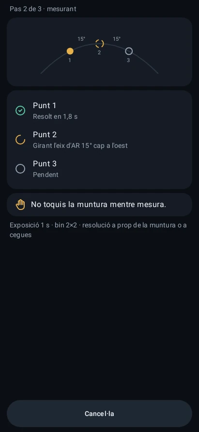 <b>Mesurant.</b> Punt 1 resolt en 1,8 s, l'eix girant cap al punt 2.</td>
</tr></table>

### Girar els cargols de la falca

Ara l'assistent continua fent preses, resol cadascuna a prop de l'última posició i actualitza l'error cada pocs segons. Cada eix té la seva pròpia targeta:

- **Altura:** una fletxa i *Puja* o *Baixa*, o *una mica* quan és a prop.
- **Azimut:** una fletxa i *Gira cap a l'oest* o *cap a l'est*, o *una mica* quan és a prop.
- L'error amb signe en graus, minuts i segons, prou gran per llegir-lo a un metre de distància, i l'**Error total** a sota.

Gira un cargol cada vegada i mira com baixa el seu número. A sota, una diana mostra la posició del pol amb anells a 30″, 1′ i 5′. Quan t'hi acostes, s'amplia sola a l'*escala de segons*, amb anells a 10″ i 30″, perquè puguis afinar segon a segon.

**No es dona res per bo abans d'hora.** Un eix manté la seva fletxa fins que el seu error, arrodonit al segon, és 00° 00′ 00″; llavors mostra *Centrat*. No hi ha cap marca verda en arribar a un llindar: decideixes tu quan ja és prou bo. Si fixes una tolerància, el mòbil vibra quan el total en baixa, i les fletxes es queden.

Si l'última presa no s'ha resolt, la pantalla ho diu i continua intentant-ho. **Torna a mesurar** repeteix els tres punts des d'on és la muntura, per exemple després d'una correcció gran. **Acaba** tanca l'assistent, i la llista de Nit mostra el resultat i quan es va mesurar.

<table><tr>
<td valign="top" width="240">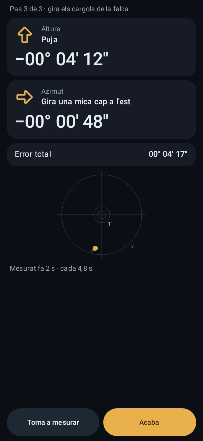 <b>Minuts de desviació.</b> Puja, i una mica cap a l'est.</td>
<td valign="top" width="240">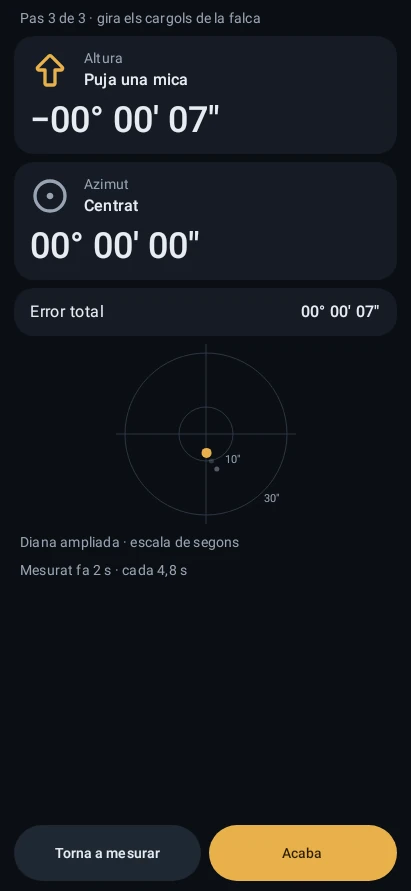 <b>Segons de desviació.</b> La diana ampliada; azimut centrat.</td>
</tr></table>

<table><tr>
<td valign="top" width="470">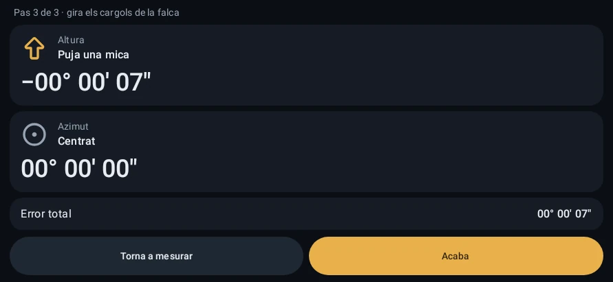 <b>En horitzontal</b>, les targetes aprofiten l'amplada; els números continuen sent grans.</td>
</tr></table>

> [!TIP]
> **Seestar**
>
> En una falca, l'altura s'ajusta amb la inclinació de la falca i l'azimut girant-ne la base. L'Alpaca del Seestar pot girar l'eix d'AR, que és tot el que necessita l'assistent.

## 18. Plate solving i centratge

El plate solving calcula on apunta una presa, la seva escala i la seva rotació a partir del patró de les seves estrelles. Yacana executa ASTAP, el conegut programa de resolució, al mateix mòbil, sense internet: uns 0,4 s amb la posició de la muntura com a pista i uns 7 s a cegues en un mòbil de gamma mitjana amb preses del Seestar.

### Resoldre una presa

A Imatge, fes una presa i toca **Resol**. Yacana primer cerca a prop d'on la muntura diu que apunta, i després a cegues si cal. El resultat mostra:

- **AR i Dec** del centre de la presa, en J2000;
- la **rotació** de la càmera;
- l'**escala** en segons d'arc per píxel i el camp en graus;
- quant ha trigat, si ha estat a prop de la muntura o a cegues, i la base d'estrelles utilitzada.

Toca **Sincronitza la muntura** per dir-li a la muntura que apunta allà, perquè els GoTo següents arribin més a prop. La rotació resolta passa a ser la rotació de la càmera per a l'enquadrament i els mosaics ([capítol 16](#framing)).

### Vés i centra

**Vés i centra** apareix allà on pots enviar el telescopi a algun lloc: al mapa del cel, a la fitxa d'un objecte, a la pantalla d'enquadrament i al full **Vés a…** de la muntura. Mou la muntura, fa una presa amb l'exposició de centratge, la resol, corregeix la muntura i repeteix fins que el centre de la presa és dins de la tolerància, 30″ per defecte. El seu progrés mostra cada pas, a quina distància era l'última presa i l'intent; **Atura** atura la muntura i la presa. Les preses de centratge no es desen.

<table><tr>
<td valign="top" width="240">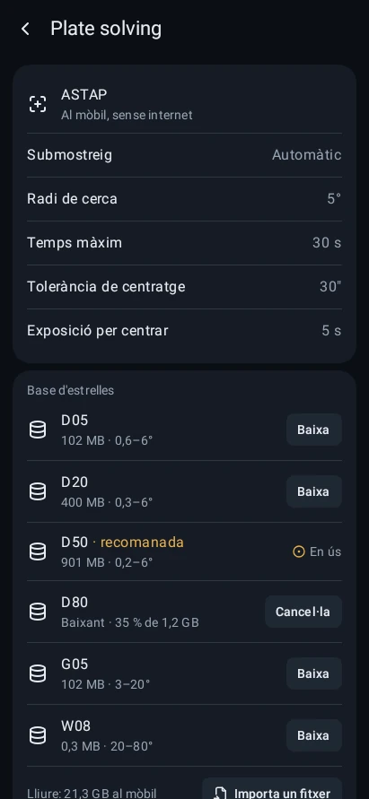 <b>Configuració › Plate solving.</b> Les opcions d'ASTAP i les bases d'estrelles.</td>
</tr></table>

### Configuració del plate solving

A *Configuració › Plate solving*, guardada a cada perfil:

| Ajust | Per defecte | Què fa |
| --- | --- | --- |
| **Submostreig** | Automàtic | ASTAP agrupa els píxels de la presa abans de cercar estrelles. En automàtic tria el factor segons la mida de la presa. |
| **Radi de cerca** | 5° | Fins a quina distància al voltant de la posició de la muntura cerca, d'1 a 180°. Si no hi troba solució, cerca a tot el cel. |
| **Temps màxim** | 30 s | Per resoldre a prop de la muntura i després a cegues, de 5 a 600 s. |
| **Tolerància de centratge** | 30″ | El centratge acaba quan el centre de la presa és així de prop de l'objectiu, de 5 a 600″. |
| **Exposició per centrar** | 5 s | Les preses que resol el centratge, amb el guany d'Imatge; d'1 a 60 s. No es desen. |

Les bases d'estrelles són a la mateixa pantalla; el [capítol 6](#field) explica com triar-les, baixar-les i importar-les.

> [!TIP]
> **Quan una presa no es resol**
>
> Comprova que la presa tingui estrelles, que la distància focal del perfil sigui correcta (ASTAP cerca aquesta escala) i que la base sigui adequada per al teu camp. Els núvols, la rosada o una presa molt desenfocada en són les causes habituals.

## 19. Autoenfocament

L'autoenfocament mou l'enfocador a través del focus, mesura l'HFR de les estrelles a cada punt i ajusta una corba en V per trobar la millor posició. És una adaptació de l'autoenfocament de N.I.N.A., amb els seus cinc ajustos de corba, la compensació del backlash i els desplaçaments d'enfocament per filtre.

Necessita un enfocador absolut (un que vagi a posicions en passos) i una càmera, apuntant a un camp amb estrelles. Obre'l amb **Autoenfocament** a la llista de Nit, a la pantalla de l'enfocador o a Imatge: l'execució comença a l'instant, amb les opcions de *Configuració › Autoenfocament*.

### Com va una execució

1. L'enfocador es desplaça uns quants passos cap a fora i després pren un punt a cada pas cap a dins: una presa, les seves estrelles i el seu HFR.
2. Afegeix punts fins que n'hi ha tants a cada costat del millor com al principi. El gràfic es va omplint, amb el punt actual, la seva exposició i el filtre.
3. Després de l'últim punt, ajusta la corba, porta l'enfocador al millor enfocament i el comprova. El resultat mostra la posició, l'HFR, la temperatura, l'R² de l'ajust i on era l'enfocador abans.

Toca **Acaba** per tancar-lo. **Cancel·la** durant una execució torna l'enfocador on era. Si l'execució falla, la pantalla diu per què, l'enfocador torna enrere i **Torna-ho a provar** la torna a començar.

El resultat es guarda: la pantalla de l'enfocador mostra l'últim autoenfocament i la seva corba, la llista de Nit mostra l'HFR i fa quant, i el diari ho registra.

<table><tr>
<td valign="top" width="240">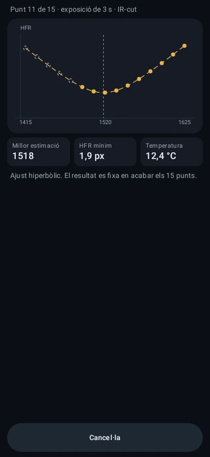 <b>En marxa.</b> Punt 11 de 15, una exposició de 3 s amb el filtre IR-cut.</td>
<td valign="top" width="240">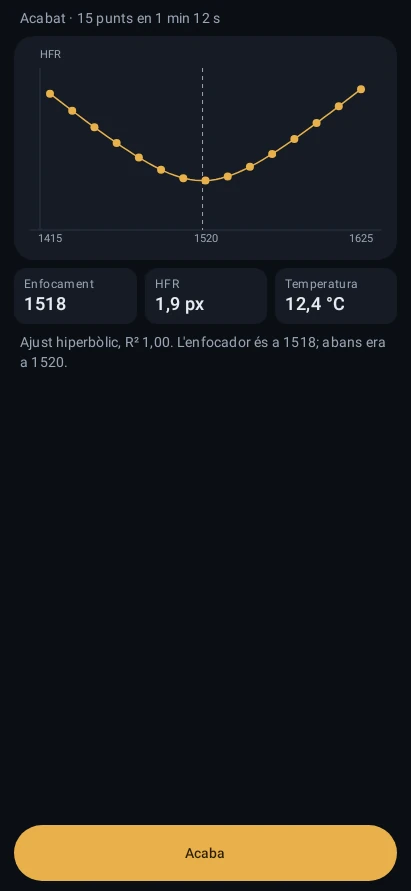 <b>Acabat.</b> 15 punts en 1 min 12 s; l'enfocador ha passat de 1520 a 1518.</td>
</tr></table>

### Configuració de l'autoenfocament

A *Configuració › Autoenfocament*, guardada a cada perfil, amb els valors predeterminats de N.I.N.A.:

- **Pas:** Passos de l'enfocador entre punts (50; 15 per al Seestar). Massa petit i la corba surt plana; massa gran i hi ha pocs punts a prop del focus.
- **Punts:** Quants punts pren: comença amb la meitat cap a fora (9 punts, 4 a cada costat; 15 per al Seestar).
- **Exposició:** D'1 a 8 s, amb binning 1×1 o 2×2, amb el guany d'Imatge. No es desen. 4 s (3 s per al Seestar).
- **Preses per punt:** 1, 2 o 3. Més preses fan la mitjana del seeing i triguen més.
- **Ajust:** Com es troba el millor enfocament a partir dels punts: per tendències, parabòlic, tendències i paràbola, hiperbòlic (predeterminat), o tendències i hipèrbola.
- **Backlash cap a dins, cap a fora:** Passos que perd l'enfocador quan canvia de sentit; es passa aquests passos i torna.
- **R² mínim:** Com s'ha d'ajustar la corba (0,7). Sense mínim, el resultat es manté tret que sigui un 15 % pitjor que abans.
- **Intents:** Quantes vegades torna a començar si una execució falla (1).
- **Espera després de moure:** Segons que reposa l'enfocador després de cada moviment abans de la presa (0).

<table><tr>
<td valign="top" width="240">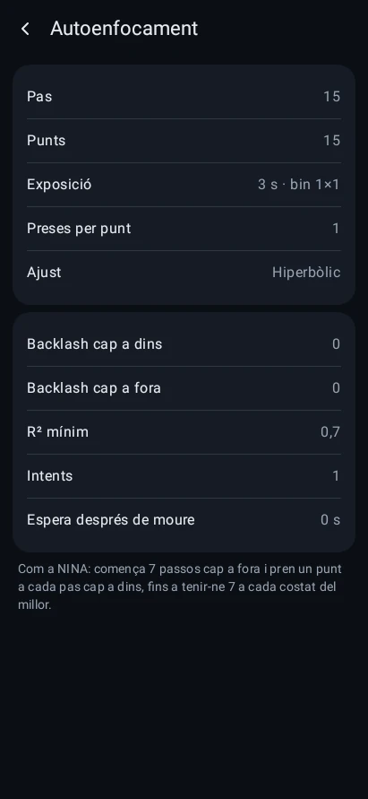 <b>Configuració › Autoenfocament.</b> Els valors del Seestar.</td>
</tr></table>

### Quan falla

| L'app diu | Què cal fer |
| --- | --- |
| **L'HFR no ha canviat prou a cap costat** | Fes servir un pas més gran. |
| **La corba explica poc els punts** | El seeing o els núvols han espatllat els punts: més preses per punt, una exposició més llarga, o prova-ho més tard. |
| **El millor enfocament cau fora dels punts mesurats** | Comença més a prop del focus: mou l'enfocador a mà i torna a executar-lo. |
| **Al millor enfocament l'HFR és pitjor que abans** | El resultat no s'ha guardat i l'enfocador ha tornat enrere. Comprova les condicions i torna-ho a provar. |
| **Aquest enfocador no té posicions on anar** | L'autoenfocament necessita un enfocador absolut. |

### Reenfocament automàtic durant la nit

En una seqüència, les regles d'autoenfocament inicien una execució abans d'una presa de llum quan canvia la temperatura, canvia el filtre, empitjora l'HFR, o al cap d'un temps. Es configuren a les regles de l'editor simple ([capítol 25](#simple)) o com a disparadors a l'editor avançat ([capítol 26](#advanced)). Si una execució falla durant la nit, l'enfocador torna enrere i les regles esperen les exposicions següents.

Els desplaçaments d'enfocament per filtre es fixen a la pantalla de l'enfocador ([capítol 10](#focuser)): en canviar de filtre, l'enfocador es mou la diferència.

---

# Captura

## 20. Imatge

Imatge fa preses a mà: preses soltes per comprovar l'enfocament i l'enquadrament, o un bucle que desa cada presa. Cada presa apareix aproximadament un segon després de baixar-se, estirada, amb les estrelles comptades i mesurades.

### Fer una presa

1. Fixa l'exposició, el guany, el binning i el filtre amb els botons de sota la presa (més avall).
2. Toca el botó rodó. La pantalla mostra *Exposant · 12 de 20 s* i després *Baixant la presa…*. Torna'l a tocar durant l'exposició per avortar-la.
3. La presa es mostra amb el seu **HFR** i el seu nombre d'**estrelles** a dalt a l'esquerra. Toca'ls per veure els detalls de l'última presa.

**Bucle** fa preses una rere l'altra i les desa totes, com el Loop de N.I.N.A.; es converteix en **Atura**, que acaba després de la presa en curs. Les preses soltes només es desen si **Desar les preses soltes (el bucle sempre desa)** està activat a les opcions. Si una presa falla mentre l'equip no respon, o es perd la connexió, el bucle espera i continua amb la presa següent tan bon punt l'equip torna a respondre.

### Els ajustos de la presa

- **Exposició:** 10, 20, 30, 60 o 300 s, les que permeti la càmera, o **Una altra** amb el teclat numèric, dins del rang de la càmera.
- **Guany:** Amb el teclat numèric, dins del rang de la càmera, o els guanys amb nom de la càmera. És el guany del perfil, el mateix que a *Configuració › Càmera*: es desa, i el fan servir totes les preses, també les de la seqüència, els flats, els darks i els bias. Comença a 200, com fa l'app del mateix Seestar. Després de canviar-lo, fes darks i bias nous amb el nou guany; els flats mestres continuen servint.
- **Binning:** 1×1, 2×2… només si la càmera fa binning.
- **Filtre:** Amb una roda de filtres: el filtre posat i els altres als quals pots canviar. Les preses per resoldre, centrar, alinear o enfocar no passen mai per **Dark**: abans la roda passa a IR. Amb Dark, la presa no mostra HFR ni estrelles, que serien soroll.

<table><tr>
<td valign="top" width="240">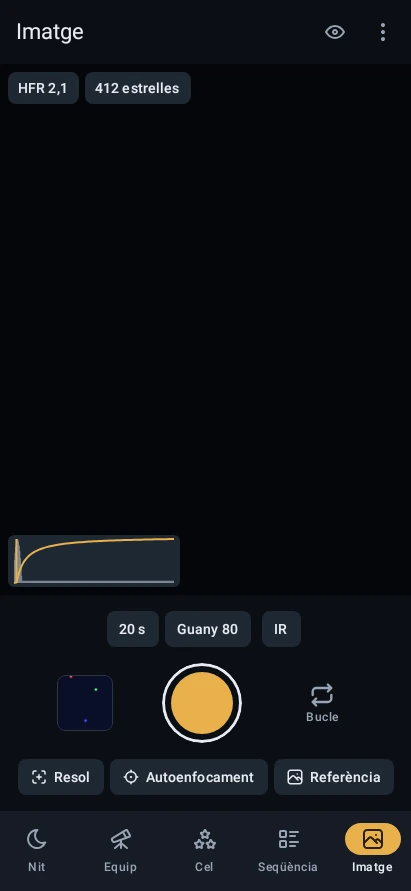 <b>Imatge.</b> HFR 2,1 px i 412 estrelles.</td>
</tr></table>

### Mirar la presa

- **Zoom:** pessiga, i arrossega per moure't. Un doble toc alterna entre la presa sencera i els píxels 1:1.
- **Histograma:** a baix a l'esquerra, amb la corba d'estirament.
- **Última presa:** toca l'HFR i les estrelles de dalt a l'esquerra per veure l'histograma, la mitjana, la mediana i la desviació en ADU, l'HFR amb la seva dispersió, el FWHM en píxels i en segons d'arc (un perfil de Moffat, com a Hocus Focus) i on s'ha desat la presa.

### Opcions de captura

El **⋮** de dalt les obre:

- **Tipus de presa:** Light, dark, flat o bias. Va al nom del fitxer i a la capçalera FITS.
- **Objectiu, per al nom del fitxer:** El nom de la carpeta i dels fitxers, com ara *M 31*. Sense objectiu, les preses s'anomenen *Snapshot*.
- **Desar les preses soltes:** El bucle sempre desa.
- **Dithering en bucles de lights, cada:** *No*, *3* (d'inici), *5* o *10* preses. Entre preses la muntura rep una petita empenta, com la dona el guiatge directe de N.I.N.A.: el camp es mou uns quants píxels (5 per defecte) al voltant d'on va començar el bucle, perquè el patró del sensor no s'acumuli en ratlles a l'apilat. Els darks, flats i bias no fan mai dithering. Amb un Seestar, els polsos de guiatge del qual no van on s'envien, salta en canvi amb petits GoTo entre els 9 punts d'una graella separats 27″; després de cada volta la graella es desplaça 9″, per a 81 posicions en total.
- **Offset:** Si la càmera en té.
- **Estirament automàtic:** Activat per defecte, com el de N.I.N.A. Si està desactivat, dos controls lliscants fixen les **Ombres** i els **Tons mitjans**.
- **Marcar les estrelles:** Dibuixa un requadre i l'HFR a les estrelles més brillants, com fa N.I.N.A.; **Quantes**, de 10 a 500.
- **Apilat en directe:** **Apilar en directe les preses de llum** i **Equilibrar el color de l'apilat** ([capítol 22](#stacking)).
- **Configuració:** La configuració de l'app.

<table><tr>
<td valign="top" width="240">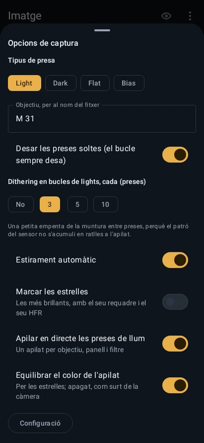 <b>Opcions de captura.</b></td>
</tr></table>

### Els botons de sota la presa

- **Resol:** Resol l'última presa amb ASTAP i mostra on apunta, amb **Sincronitza la muntura** ([capítol 18](#solving)).
- **Autoenfocament:** Amb un enfocador, executa l'autoenfocament ([capítol 19](#autofocus)).
- **Referència:** Posa la foto de la memòria cau del mateix camp sobre la presa, amb la seva rotació, escala i zoom, perquè les puguis comparar: aquella taca tènue és la galàxia? Si la presa no està resolta, primer la resol. Torna'l a tocar per tornar a la presa.
- **La miniatura:** A l'esquerra del botó rodó: obre l'historial de la sessió ([capítol 21](#history)).

<table><tr>
<td valign="top" width="240">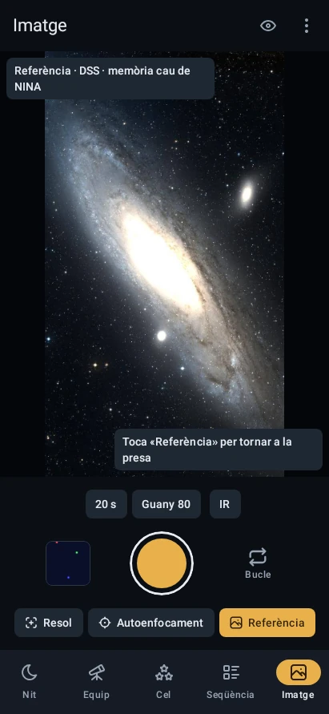 <b>Referència.</b> La foto de la memòria cau del camp de la presa.</td>
</tr></table>

<table><tr>
<td valign="top" width="470">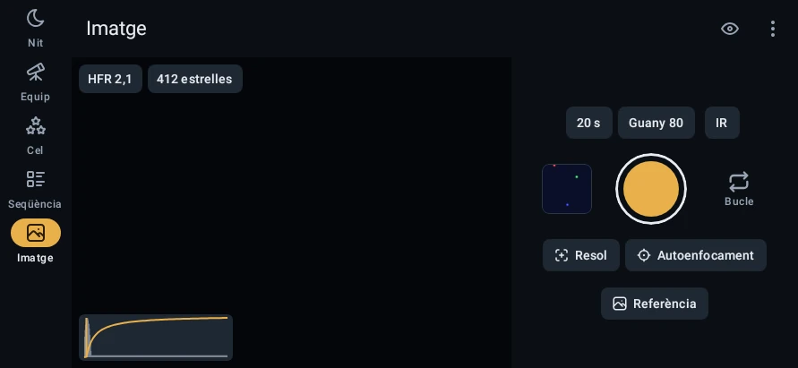 <b>En horitzontal</b> la presa ocupa l'amplada i els controls passen al costat.</td>
</tr></table>

## 21. Historial i qualitat de les preses

L'historial llista cada presa desada en aquesta sessió amb la seva qualitat, i marca les que han espatllat els núvols o la llum, perquè quedin fora de l'apilat.

- **El gràfic:** l'HFR de cada presa com a línia i les seves estrelles com a barres, amb **AF** on s'ha fet un autoenfocament.
- **La llista,** les més noves primer: número, hora, filtre i exposició, HFR i estrelles.
- **Les preses descartades** tenen moltes menys estrelles o un fons molt més brillant que la mediana de la sessió, i diuen per què: *núvols*, *poques estrelles* o *fons brillant*. Continuen desades al disc; només l'apilat i el resum les deixen fora.

La icona del filtre de dalt mostra només les preses descartades. Obre l'historial des de la miniatura que hi ha al costat del botó rodó d'Imatge.

<table><tr>
<td valign="top" width="240">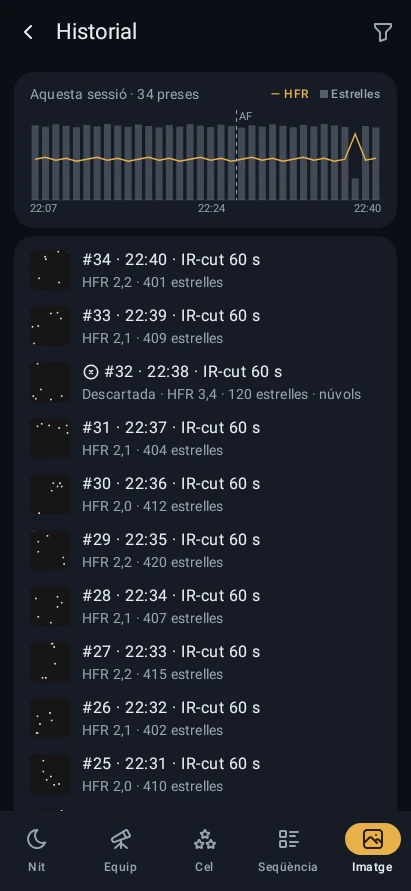 <b>Historial.</b> Presa 32 descartada: núvols.</td>
</tr></table>

## 22. Apilat en directe

L'apilat en directe afegeix cada presa de llum bona a un apilat que creix mentre avança la nit, així que veus com l'objectiu surt del soroll. Està desactivat fins que el vulguis, perquè consumeix memòria i bateria.

### Activar-lo

A les opcions d'Imatge, activa **Apilar en directe les preses de llum**. A partir d'aleshores, cada presa de llum que es desa entra a l'apilat, sigui d'un bucle, d'una seqüència o una presa solta. Les preses es continuen desant una a una, com sempre.

Els flats es recullen fins i tot amb l'apilat en directe desactivat: quan la tanda d'un filtre és completa, es converteixen en el seu flat mestre, que es desa com a `FLATS/MasterFlat_IR.fits` (un per filtre) a la carpeta de les teves preses per a les nits següents, un FITS de 32 bits que també llegeixen Siril i PixInsight. Un flat teu posat allà amb aquest nom també val. També els darks es guarden per a l'apilat encara que l'activis després de fer-los, com quan una seqüència comença amb els seus darks.

### Com apila

- **Un apilat per objectiu, panell i filtre,** i per exposició, guany i binning. Una presa d'un altre tipus desa l'apilat anterior i en comença un de propi.
- **Alineat per les estrelles:** desplaçament, rotació i escala, respecte a la primera presa de l'apilat.
- **Satèl·lits i avions eliminats** amb un rebuig de 3 sigma.
- **Calibrat sobre la marxa:** amb el dark mestre de la nit de la mateixa exposició, guany, offset i binning a la temperatura de sensor més propera, i el flat mestre del seu filtre de la carpeta FLATS.
- **Color equilibrat amb les seves pròpies estrelles,** amb **Equilibrar el color de l'apilat** activat; desactivat, tal com surt de la càmera.
- **Les preses descartades queden fora,** i també les preses les estrelles de les quals no coincideixen.

<table><tr>
<td valign="top" width="240">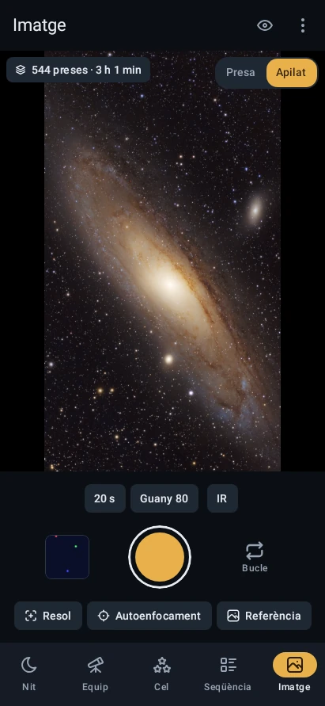 <b>L'apilat.</b> M 31 a partir de 544 preses de 20 s amb un Seestar, processat després.</td>
</tr></table>

### Un mosaic

En un mosaic la seqüència fa cada panell sencer i després el següent, i cada panell té el seu propi apilat, calibrat amb els seus darks i els seus flats. Amb **Apilat**, Imatge mostra el mosaic sencer mentre es construeix: cada panell al seu lloc del cel, segons la resolució del seu centrat, amb el fons igualat al dels seus veïns on se solapen i les unions foses, i un sol estirat i un sol balanç de color per a tot. El panell que s'està apilant porta la vora daurada i creix amb cada presa; els que falten, en discontinu. És una vista a un quart de la mida, o més petita en un mosaic gran perquè càpiga a la memòria del mòbil, i es desa com a JPG, com ara *2026-10-14/M 31/STACK/…_STACK_MOSAIC.jpg*, després de cada panell i en acabar la seqüència. El mosaic final es munta amb els apilats dels panells a Siril o PixInsight.

<table><tr>
<td valign="top" width="240">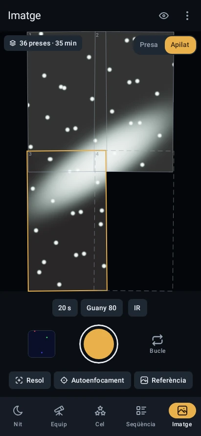 <b>Un mosaic.</b> El tercer panell de quatre, creixent.</td>
</tr></table>

### Seguir-lo

Quan hi ha un apilat, un commutador **Presa** | **Apilat** a dalt a la dreta d'Imatge alterna entre l'última presa i l'apilat. Toca l'etiqueta de l'apilat, com ara *544 preses · 3 h 1 min*, per obrir-ne el full:

- **Apilades:** Les preses que conté, de les que han arribat.
- **Descartades:** Quantes s'han deixat fora, i per què.
- **Temps:** La integració total i les preses.
- **Alineació:** Per les estrelles, i quant ha girat l'última.
- **Color:** Equilibrat per les estrelles, o com surt de la càmera.
- **Dark** i **Flat:** el dark i el flat mestre en ús, com ara *MasterFlat_IR.fits del dia 11 octubre*, o quins falten.

A Nit, mentre una seqüència està en marxa amb l'apilat activat, la targeta de l'última presa mostra l'apilat; toca-la per obrir-lo a Imatge.

### Desar-lo

L'apilat es desa sol cada 10 minuts mentre creix, i quan s'acaba el bucle o la seqüència: un FITS lineal de 32 bits per processar-lo, i un JPG tal com el mostra la pantalla, a la carpeta de les preses amb `STACK` com a tipus. **Desa** el desa ara. Si es tanca l'app, l'apilat continua amb la presa següent del mateix objectiu i filtre.

**Fer 10 darks de 20 s** (amb l'exposició de les preses) fa ara darks per a l'apilat. Amb un filtre fosc és automàtic; sense, l'app et demana que primer tapis el telescopi. **Mantén per tornar a començar** buida l'apilat.

<table><tr>
<td valign="top" width="240">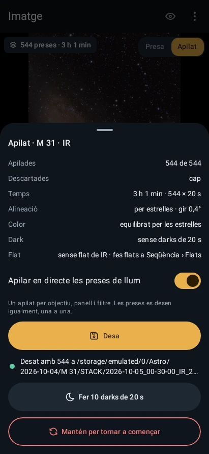 <b>El full de l'apilat.</b> Encara no hi ha darks ni flat per a aquest filtre.</td>
</tr></table>

## 23. Flats, darks i bias

Les preses de calibratge eliminen el que hi afegeixen el sensor i l'òptica. Yacana fa els flats amb un assistent, i els darks i els bias amb les regles de la seqüència, i l'apilat en directe els fa servir tots.

### L'assistent de flats

Obre'l amb la plantilla **Flats** a Seqüència. Calcula sol l'exposició i fa els flats de cada filtre a una brillantor objectiu. La llum és aquest mòbil, o el panell de flats si n'hi ha un de connectat.

1. Comprova l'**ADU objectiu**, 30.000 ± 5 % per defecte, amb el màxim de la càmera indicat. Fixa la **Brillantor del panell** si en fas servir un.
2. Tria les **Preses per filtre** (20, 30 o 50) i els **Filtres**. El **Guany** de sota és el del perfil, que fan servir els flats i els seus bias; es canvia a *Configuració › Càmera* o a Imatge.
3. Toca **Comença els flats**. Amb aquest mòbil com a llum, tens 30 s per posar-lo de cara avall sobre el telescopi, amb la pantalla tapant la lent i un full de paper blanc entremig. Un xiulet comença els flats i la pantalla es posa blanca a tota brillantor, també en mode vermell; un altre xiulet els acaba. Per posar-los en pausa, toca dos cops la pantalla blanca; **Continua** deixa uns altres 30 s.
4. Cada filtre mostra *cercant el temps…*, després la seva exposició i quantes se n'han fet, amb la mitjana de l'última presa en ADU. **Pausa** i **Mantén premut per aturar** són a baix. En acabar, amb el filtre Dark del Seestar, fa 10 bias: el seu nivell queda a cada flat mestre, perquè l'apilat en directe hi divideixi encara que no hi hagi darks.

Si hi ha massa llum fins i tot amb l'exposició més curta, o massa poca amb la més llarga, l'assistent s'atura i diu què cal canviar: més o menys paper sobre la pantalla del mòbil, o la brillantor del panell.

<table><tr>
<td valign="top" width="240">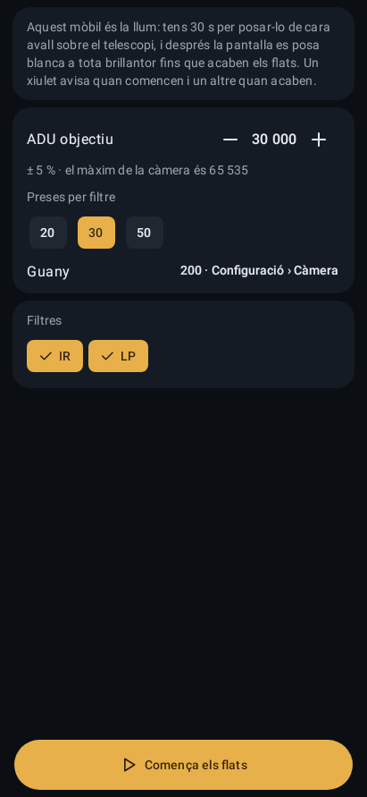 <b>Preparació.</b> Aquest mòbil com a llum, dos filtres.</td>
<td valign="top" width="240">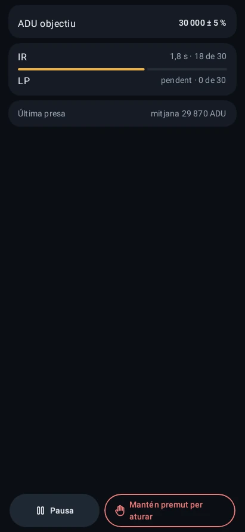 <b>En marxa.</b> Els flats IR a 1,8 s, mitjana 29.870 ADU.</td>
</tr></table>

### Darks i bias a la seqüència

A l'editor simple, el botó **Darks** de **Regles** fixa quan es fan els darks, amb l'exposició, el guany i el binning de cada presa de llum i el filtre fosc:

- **En començar** la nit.
- **Si la temperatura del sensor canvia** 2, 3 o 5 °C, perquè l'apilat en directe faci servir la tanda de la temperatura més propera.
- **En acabar, amb el bias** (activat per defecte).
- **Preses per tanda:** 5, 10 o 20. El full diu quant triga cada tanda sense preses de llum.

Sense filtre fosc, no es poden fer darks en començar ni per temperatura; al final, l'app et demana que tapis el telescopi. Els darks i els bias de l'inici i del final van a la carpeta de l'objectiu, al costat de LIGHT: els de l'inici, a la del primer objectiu; els del final, a la de l'últim.

<table><tr>
<td valign="top" width="240"> <b>Darks.</b> 10 preses de 60 s triguen uns 11 min.</td>
</tr></table>

### A mà

A Imatge, fixa el **Tipus de presa** a dark, flat o bias a les opcions i captura com sempre: les preses van a la seva pròpia carpeta per tipus.

---

# Seqüències

## 24. La secció Seqüència

Una seqüència és el pla de la nit: quins objectius, amb quines exposicions i què cal fer al seu voltant. Yacana té dos editors per al mateix pla: un de simple que posa la nit en una línia de temps, i un d'avançat amb els contenidors, disparadors i condicions de N.I.N.A. Pots canviar d'un a l'altre sense perdre res.

- **Aquesta nit:** El pla que executarà la nit, amb els seus objectius i hores. Toca'l per obrir l'editor. Mentre està en marxa, ho indica.
- **Desades:** Les teves seqüències desades, amb els seus objectius i la seva durada. Toca'n una per carregar-la com a pla d'aquesta nit; **Desfés** recupera el pla que tenies. Mantén premuda una fila un moment per esborrar-la amb **Mantén premut per esborrar**. Per desar el pla d'aquesta nit, fes servir el menú **⋮** de l'editor.
- **Plantilles:** Punts de partida per a un pla nou (més avall).
- **Nova:** Un pla buit, a l'editor.

### Plantilles

- **Un objectiu tota la nit:** comença un pla buit i obre Cel. L'objectiu que afegeixis després omple la nit fins a l'alba.
- **Diversos objectius** i **Mosaic:** comencen un pla buit i obren Cel, per enquadrar els objectius o el mosaic.
- **Flats:** obre l'assistent de flats ([capítol 23](#calibration)).

El que hi havia abans d'una plantilla torna amb **Desfés**.

<table><tr>
<td valign="top" width="240"> <b>Seqüència.</b> Aquesta nit, seqüències desades i plantilles.</td>
</tr></table>

## 25. L'editor simple

L'editor simple mostra el pla d'aquesta nit com una línia de temps i una targeta per objectiu. Avisa, amb una icona i paraules, quan el pla no hi cap abans de l'alba.

### Afegir objectius

Els objectius venen de Cel: enquadra'n un i toca **Afegeix a la seqüència** ([capítol 16](#framing)). **Afegeix un objectiu**, al final de la llista, t'hi porta. Un mosaic arriba com un sol objectiu amb els seus panells.

### Pla d'aquesta nit

La línia de temps mostra cada objectiu des del seu inici fins al seu final, i l'alba. Si el pla s'allarga més enllà de l'alba astronòmica, diu quin objectiu acabaria i a quina hora, i l'hora final d'aquest objectiu passa al color d'avís. **Desfés** desfà l'últim canvi, fins a 50 canvis enrere. Els temps surten del que va trigar el teu equip la darrera nit: cada presa a més de la seva exposició, cada dithering, cada autoenfocament i cada centratge. Es compten els autoenfocaments cada tants minuts i en canviar de filtre; els de temperatura o HFR no es poden preveure.

### La targeta d'un objectiu

- El seu nom, quan acaba i la icona de la paperera per treure'l.
- Per a un mosaic, el seu nombre de panells; les exposicions s'apliquen a cada panell.
- Una fila per filtre i exposició, com ara *IR · 60 s × 45 per panell*, amb les preses fetes i el total. Toca una fila per canviar-la; **Exposicions** afegeix un altre filtre.

<table><tr>
<td valign="top" width="240"> <b>Aquesta nit.</b> M 33 acabaria a les 07:25, després de l'alba.</td>
<td valign="top" width="240"> <b>Exposicions.</b> El teclat numèric mostra quant duren i fins a quina hora.</td>
</tr></table>

### Exposicions

El full fixa una fila de les exposicions d'un objectiu: el **Filtre**, el **Temps** (10, 30, 60 o 120 s, o **Una altra**) i el **Nombre de preses** amb el teclat numèric. Mentre escrius, mostra quant triguen i fins a quina hora, o que acabarien després de l'alba. **Desa** la guarda; **Treu aquestes exposicions** esborra la fila quan l'objectiu en té més d'una.

### Regles

La targeta **Regles** llista el que fa la nit a més de les preses. Un pla nou porta:

- **Desaparcar en començar**, i **Escalfador encès** si l'equip té un interruptor d'escalfador.
- **Centrar en arribar:** cada objectiu, i cada panell d'un mosaic, es centra amb plate solving abans de les seves preses.
- **Dithering cada 3 preses**, sense guiador.
- **Autoenfocament si ΔT > 1 °C**, amb un enfocador.
- **Recentrar si es desvia > 1′:** abans de cada presa de llum es resol l'anterior; si el camp s'ha desviat més d'1′ de l'objectiu, es torna a centrar. Substitueix el guiatge.
- **Darks i bias al final**: 10 de cada, per a cada exposició, guany, offset i binning de les preses de llum.
- **Aparcar al final**, i l'escalfador apagat.

Els botons de sota les canvien:

- **Autoenfocament:** Abans de cada presa de llum, es fa un autoenfocament si se'n compleix alguna d'aquestes, com els disparadors de N.I.N.A.:
  - **Si la temperatura canvia** 0,5; 1; 2 o 5 °C;
  - **En canviar de filtre;**
  - **Si l'HFR empitjora** un 5, 10 o 20 %;
  - **Cada cert temps:** 15, 30, 60 o 120 min, o un altre temps.

  Si un autoenfocament falla, esperen les exposicions següents.
- **Darks:** En començar, quan canvia la temperatura del sensor, en acabar amb el bias, i quantes cada vegada ([capítol 23](#calibration)).
- **Recentratge:** activat o no, i quant es pot desviar el camp: 1′, 2′, 5′ o 10′, cadascun també en píxels de la càmera connectada. Mai no recentra per menys de 20 px, el que pot moure un dithering; amb una càmera gran angular això és més que qualsevol opció, i el full ho avisa. Amb una bona alineació polar recentra una o dues vegades per hora.
- **Dithering:** activat o no, i cada 1, 3, 5 o 10 preses, per a les preses de llum de tots els objectius. Cada dithering espera que la muntura s'estabilitzi. Amb un Seestar, o una muntura sense polsos de guiatge, cada dithering parteix de la resolució de l'última presa i va a l'objectiu més el seu punt de la graella, així que també desfà la deriva, com fa la mateixa app del Seestar.
- **Escalfador**, si l'equip connectat en té un: encès o no durant la nit, i la seva potència si es pot regular. Gasta bateria: apaga'l les nits seques i temperades.

Per a altres regles, com esperar que pugi un objectiu o repetir fins a una hora, obre el pla a l'editor avançat.

### Desar i començar

El menú **⋮** té **Desa a les meves seqüències**. **Comença**, a baix, inicia la nit un cop l'equip està connectat; mentre està en marxa, el botó es converteix en **Mantén premut per aturar**. Pots continuar editant el pla mentre està en marxa: els canvis s'apliquen al que encara ha de venir.

<table><tr>
<td valign="top" width="240"> <b>Regles d'autoenfocament.</b></td>
<td valign="top" width="240"> <b>Recentratge.</b> A menys d'1′ de l'objectiu.</td>
<td valign="top" width="240"> <b>Dithering.</b> Cada 3 preses.</td>
</tr></table>

## 26. L'editor avançat

L'editor avançat és el seqüenciador avançat de N.I.N.A. convertit en una llista tàctil: contenidors on entres, instruccions, disparadors i condicions, que reordenes arrossegant-los, amb desfer i una revisió de la nit abans que comenci.

Obre'l amb **Avançat** a dalt de l'editor simple. Obre el pla d'aquesta nit sencer. Si hi afegeixes el que l'editor simple no pot mostrar, com ara una condició o un contenidor paral·lel, a partir d'aleshores aquesta nit només s'edita a l'editor avançat: l'editor simple mostra **Aquesta nit s'edita a Avançat** amb **Obre a Avançat** i la llista d'objectius.

### L'estructura de la nit

- **Nit,** el nivell superior, amb els **disparadors per a tota la nit**, i tres àrees:
- **Inici:** el que passa primer, abans dels objectius, com ara desaparcar o refredar la càmera. El que apunta a un objectiu no va aquí.
- **Objectius:** un rere l'altre, en aquest ordre. Cada objectiu conté les seves instruccions.
- **Final:** després dels objectius: darks, aparcar i apagar.

La ruta de navegació de dalt mostra on ets, com ara *Nit › Objectius › M 33*. La targeta de cada nivell diu com s'executa: un cop, o repetit per les seves condicions, que es comproven després de cada instrucció.

<table><tr>
<td valign="top" width="240"> <b>Nit.</b> Un disparador d'autoenfocament i les tres àrees.</td>
<td valign="top" width="240"> <b>Un objectiu.</b> Repetit fins a les 02:00.</td>
</tr></table>

### Treballar amb els elements

- **Entra** en un contenidor tocant-lo; toca una instrucció per canviar-ne els ajustos.
- **Afegeix** amb el botó de baix, **Afegeix a …**, que obre el catàleg. **Condició** i **Disparador**, a la targeta del nivell, l'obren en aquest tipus.
- **Reordena** arrossegant l'agafador d'un element, o amb el seu menú **⋮**.
- **El menú ⋮** d'un element: *Entra*, *Canvia l'objectiu*, *Canvia el nom*, *Ajustos*, *Puja*, *Baixa*, *Mou a…*, *Duplica*, *Desa com a plantilla* i *Elimina*.
- **Desfés** és a dalt.

Mentre la nit està en marxa, els elements acabats es marquen com a fets i el que s'està executant es ressalta. Tots dos estan bloquejats; la resta encara es pot canviar.

### El catàleg

El catàleg té un quadre de cerca i botons per tipus: càmera, muntura, enfocament, filtres, utilitat, contenidors, disparadors, condicions i plantilles. El que no pot anar on ets apareix en gris, amb el motiu, com ara *Només dins d'un Objectiu*.

<table><tr>
<td valign="top" width="240"> <b>El catàleg.</b> El que apunta a un objectiu apareix en gris a Inici.</td>
</tr></table>

| Tipus | Element | Què fa |
| --- | --- | --- |
| **Càmera** | Exposicions | Preses de llum, darks o bias: filtre, temps, nombre de preses i dithering |
| **Càmera** | Refredar la càmera · Escalfar la càmera | Fins a una temperatura a poc a poc, o lentament de tornada abans d'apagar-la |
| **Muntura** | Desaparcar · Aparcar | Surt de la posició de repòs o hi torna |
| **Muntura** | Anar i centrar | GoTo a l'objectiu i plate solving, fins a 1′; només dins d'un Objectiu |
| **Muntura** | Anar a l'objectiu | GoTo a l'objectiu sense centrar; només dins d'un Objectiu |
| **Muntura** | Aturar el seguiment | La muntura es queda quieta |
| **Enfocament** | Autoenfocament · Moure l'enfocador | Una execució amb corba en V, o a una posició |
| **Filtres** | Canviar de filtre | La roda posa un altre filtre |
| **Utilitat** | Ajustar un interruptor | Com ara l'escalfador antirosada, encès o apagat |
| **Utilitat** | Esperar fins a una hora · Esperar una estona · Esperar que pugi | Continua a una hora d'aquesta nit, al cap d'uns minuts, o quan l'objectiu arriba a una altura |
| **Utilitat** | Nota | Una nota al diari de la nit |
| **Contenidor** | Objectiu | Un objectiu de Cel, amb el seu enquadrament; ve amb «Anar i centrar» |
| **Contenidor** | Seqüencial · Paral·lel | Les seves instruccions una rere l'altra, o alhora, com ara esperar fins a una hora mentre la càmera es refreda |
| **Disparador** | Autoenfocament si canvia la temperatura · cada cert temps · en canviar de filtre · si puja l'HFR | Un autoenfocament abans de la presa següent quan es compleix la seva condició |
| **Disparador** | Recentrar si es desvia | Resol i corregeix quan l'objectiu es desvia més d'1′ a 10′ (20 px com a mínim) |
| **Disparador** | Darks si canvia la temperatura | Darks amb el filtre fosc quan el sensor canvia 2, 3 o 5 °C, per a l'apilat en directe |
| **Condició** | Repetir N vegades · Repetir fins a una hora · Repetir mentre sigui alt | Repeteix tot el contenidor |
| **Plantilla** | Objectiu amb autoenfocament · les teves | Un objectiu de Cel amb anar i centrar, autoenfocament i exposicions; o qualsevol bloc que hagis desat com a plantilla |

### Revisar la nit

L'editor comprova el pla mentre el construeixes. Quan alguna cosa sortiria malament aquesta nit, una insígnia a dalt compta els avisos; toca-la per obrir **Revisa la nit**, i toca un avís per anar-hi. Els avisos mai impedeixen desar ni començar. Inclouen:

- una instrucció que necessita un objectiu fora d'un Objectiu, o preses de llum sense objectiu;
- un aparcament abans de preses, d'enfocament o d'un GoTo sense cap *Desaparcar* abans;
- preses de llum sense cap *Anar i centrar* abans, o amb el seguiment aturat;
- un filtre que la roda no té, o refredar una càmera que no es refreda;
- darks fets mentre la càmera s'escalfa;
- dos elements paral·lels que fan servir el mateix dispositiu alhora.

### Tornar al pla simple

La targeta de l'editor simple, o el menú **⋮** de l'editor avançat, té **Mantén premut per tornar al pla simple**. Treu el que només sap l'editor avançat i conserva els objectius amb les seves exposicions. El mateix menú té **Desa a Les meves seqüències**.

<table><tr>
<td valign="top" width="240"> <b>Editat a Avançat.</b> L'editor simple mostra els objectius.</td>
</tr></table>

> [!NOTE]
> **Per a usuaris de N.I.N.A.**
>
> L'editor avançat segueix el seqüenciador de N.I.N.A.: els mateixos tipus de contenidors, disparadors i condicions, executats en el mateix ordre. Els fitxers de seqüència de N.I.N.A. no s'importen, i les instruccions que depenen de Windows o del guiatge no hi són.

## 27. La nit en marxa

Comença la nit amb **Comença la nit** de Nit o amb **Comença** de l'editor. A partir d'aleshores la sessió s'executa dins d'un servei en primer pla: pots apagar la pantalla i guardar el mòbil.

### Nit mentre està en marxa

Tot el que necessites cap en una sola pantalla sense desplaçar-te:

- **L'objectiu:** el seu nom, panell i filtre, i la seva altura amb una fletxa que indica si puja o baixa.
- **La presa:** un anell amb els segons que queden, *Presa 35 de 120*, el filtre i el guany.
- **Progrés:** el percentatge de la seqüència i quan acaba, comparat amb l'alba astronòmica. Després d'unes quantes preses, segueix el que estan trigant els passos d'aquesta nit.
- **Última presa:** la seva miniatura, si ha estat bona o descartada, el seu HFR i les estrelles, i la corba d'HFR de la nit. Amb l'apilat en directe activat, mostra l'apilat: toca'l per obrir-lo a Imatge.
- **Següent:** el que ve, com ara el proper autoenfocament, el canvi al següent objectiu i l'aparcament, amb les seves hores.

**Pausa** ho atura a l'instant, deixant fora la presa en curs, i el seguiment continua; es converteix en **Continua**, que reprèn des de la mateixa instrucció amb les preses que ja havia fet. **Mantén premut per aturar** acaba la seqüència.

<table><tr>
<td valign="top" width="240"> <b>En marxa.</b> Acaba a les 06:56, després de l'alba de les 06:44.</td>
<td valign="top" width="240"> <b>Amb l'apilat en directe,</b> l'apilat a la targeta.</td>
</tr></table>

### A la resta de l'app

La barra de sessió de totes les altres pantalles mostra la presa i et permet posar en pausa ([capítol 4](#tour)), i la notificació mostra el progrés a la pantalla de bloqueig. La seqüència i Imatge comparteixen la càmera: atura qualsevol bucle a Imatge abans de començar la nit.

### Amb la pantalla apagada

Yacana manté desperts el processador i la WiFi del mòbil mentre la sessió està en marxa, i lliga el trànsit de l'equip a la seva WiFi encara que no tingui internet. A la prova de referència va funcionar 8,5 hores durant la nit amb un Seestar, 503 preses completes, sense cap reinici ni cap buit de més de 6 s, i va consumir l'1,7 % de la bateria per hora. Concedeix primer els permisos de bateria ([capítol 33](#permissions)).

Mentre Yacana és a la pantalla, la pantalla continua encesa i el mòbil no es bloqueja. Amb la pantalla encesa, Android manté la WiFi a tota velocitat i, si cau, torna a connectar-se a la WiFi de l'equip en segons; amb la pantalla apagada, pot no fer-ho fins que l'encenguis. Prem el botó d'engegada per apagar-la com sempre: la sessió continua. Per a una nit sencera amb la pantalla encesa, fes servir el mode vermell amb poca brillantor i una bateria externa.

### Si l'app o el mòbil es reinicien

Si Android tanca l'app o el mòbil es reinicia, la sessió es reprèn sola en menys d'un minut; després d'un reinici, quan desbloqueges el mòbil per primera vegada. Com a molt es perd la presa en curs; les preses ja desades no es fan malbé mai, perquè cadascuna s'escriu en un fitxer temporal i es reanomena. El diari registra *L'app es va tancar i va reprendre la seqüència*.

## 28. Avisos i aturades segures

Una nit sense vigilància acaba bé o s'atura de manera segura. Cada avís diu què ha passat, què fa l'app i què pots fer tu.

### Quan es perd la connexió

Si l'equip deixa de respondre, la seqüència entra en **pausa segura**: l'exposició s'atura i el seguiment continua actiu. L'avís, a Nit i com a notificació amb so, mostra els intents i el temps que queda abans d'una aturada segura. L'app ho torna a provar cada 10 s.

- **Reintenta ara** ho torna a provar a l'instant.
- **Detalls** obre Equip.
- **Mantén premut per aturar** acaba la seqüència.

Comprova que el mòbil continua a la WiFi de l'equip i que l'equip té alimentació. Quan la connexió torna, la seqüència continua, i el diari registra quant de temps s'ha perdut.

### Aturada segura

Una aturada segura acaba la sessió quan:

- la connexió no torna dins del temps fixat (2 min per defecte);
- la seqüència falla d'una manera de la qual no es pot recuperar;
- la bateria del mòbil baixa del nivell fixat (20 % per defecte), i sempre per sota del 10 %, tret que s'estigui carregant.

L'exposició s'atura i la muntura s'aparca o atura el seguiment, segons digui el perfil. Si s'havia perdut la connexió, això passa tan bon punt torna. Després, l'avís diu què s'ha fet; **Entesos** el tanca.

<table><tr>
<td valign="top" width="240"> <b>Pausa segura.</b> Una aturada segura d'aquí a 1 min 18 s si la connexió no torna.</td>
<td valign="top" width="240"> <b>Aturada segura.</b> La muntura aparcada.</td>
</tr></table>

### Configuració de seguretat

A *Configuració › Seguretat*, per perfil:

- **Aturada segura:** **Aparca la muntura** o **Atura el seguiment**. El Seestar ve amb l'aparcament, que plega el seu braç.
- **Si es perd la connexió:** Quant espera la pausa segura: 1, 2, 5 o 10 min.
- **Bateria baixa del mòbil:** 15, 20 o 30 %. Per sota del 10 % sempre s'atura; mai mentre carrega.

<table><tr>
<td valign="top" width="240"> <b>Configuració › Seguretat.</b></td>
</tr></table>

## 29. L'endemà al matí

Quan s'acaba la seqüència, Nit mostra el resum de la nit fins que el tanques.

- Com ha acabat i quan: acabada, aturada a mà, una aturada segura o una fallada, i si la muntura s'ha aparcat.
- **Integració útil:** el temps d'exposició de les preses conservades.
- **Preses** i **Descartades**, i l'**HFR medià**.
- **Per objectiu:** preses i exposició per objectiu i filtre.
- **Incidències:** reconnexions, autoenfocaments extra, preses amb núvols, amb les seves hores.

**Mostra el diari** obre el diari de la nit. **Exporta** desa un ZIP del registre de l'app, amb el perfil i les versions, per guardar-lo o adjuntar-lo a un informe d'error. La **✕** tanca el resum.

### El diari de la nit

Una llista llegible del que ha passat, separada del registre tècnic: cada esdeveniment amb la seva hora i el motiu, com ara *Autoenfocament extra · La temperatura ha canviat 1,3 °C*, *M 31 Panell 1 centrat · a 8″ · 2 intents* o *Connexió recuperada · 51 s · 5 intents*. La seva icona de dalt desa el mateix ZIP que **Exporta**.

<table><tr>
<td valign="top" width="240"> <b>Resum.</b> 34 preses, una amb núvols.</td>
<td valign="top" width="240"> <b>Diari de la nit.</b></td>
</tr></table>

Les teves preses i apilats són a la carpeta de les preses, una carpeta per nit i objectiu ([capítol 30](#files)). Per copiar-los, connecta el mòbil a un ordinador amb un cable USB i tria la transferència de fitxers al mòbil; la carpeta es veu com qualsevol altra de l'emmagatzematge del mòbil.

---

# Configuració i fitxers

## 30. Imatges i fitxers

Yacana desa cada presa com a fitxer FITS de 16 bits amb les capçaleres de N.I.N.A., que s'obre a Siril, PixInsight i qualsevol programa d'astronomia, en una carpeta per nit i objectiu.

### La carpeta

A *Configuració › Imatges i fitxers*, **Carpeta** mostra on van les preses. Per defecte és la carpeta pròpia de l'app, `Android/data/app.yacana/files/Yacana` a l'emmagatzematge del mòbil, que Android esborra si desinstal·les l'app.

**Canvia la carpeta** obre el selector de carpetes d'Android: tria o crea una carpeta a l'emmagatzematge del mòbil (com ara `Astro`), una targeta SD o una unitat USB. Yacana conserva el permís per escriure-hi després de cada reinici. Tria'n una abans de la primera nit, perquè les teves preses siguin fàcils de trobar i sobrevisquin a una reinstal·lació.

### Noms de fitxer

El nom de cada presa surt d'un patró amb les etiquetes de N.I.N.A. Una barra crea una carpeta. Toca una etiqueta per afegir-la; la pantalla mostra com es dirà la propera presa. **Torna al predeterminat** restaura:

`$$DATEMINUS12$$/$$TARGETNAME$$/$$IMAGETYPE$$/$$DATETIME$$_$$FILTER$$_$$EXPOSURETIME$$s_$$FRAMENR$$`

que dona, per exemple, `2026-10-04/M 31/LIGHT/2026-10-05_00-30-00_LP_20.00s_0001.fits`: una carpeta per a la nit, una per a l'objectiu i una per al tipus de presa.

<table><tr>
<td valign="top" width="240"> <b>Configuració › Imatges i fitxers.</b></td>
</tr></table>

| Etiqueta | Es converteix en | Exemple |
| --- | --- | --- |
| **`DATEMINUS12`** | La data de la nit: la data de 12 hores abans, perquè les preses de després de mitjanit conservin la data del vespre | `2026-10-04` |
| **`DATE`** | La data local | `2026-10-05` |
| **`DATETIME`** | La data i l'hora locals | `2026-10-05_00-30-00` |
| **`TIME`** | L'hora local | `00-30-00` |
| **`TARGETNAME`** | L'objectiu, o *Snapshot* si no n'hi ha | `M 31` |
| **`IMAGETYPE`** | El tipus de presa | `LIGHT`, `DARK`, `FLAT`, `BIAS` |
| **`FILTER`** | El filtre, o *NoFilter* | `LP` |
| **`EXPOSURETIME`** | L'exposició en segons | `20.00` |
| **`FRAMENR`** | El número de presa de la sessió, de 4 xifres | `0001` |
| **`GAIN`, `OFFSET`** | El guany i l'offset de la càmera | `80` |
| **`BINNING`** | El binning | `1x1` |
| **`SENSORTEMP`** | La temperatura del sensor | `-10.0` |

### Què hi ha a cada fitxer

- **Preses:** FITS de 16 bits amb els mateixos píxels que els fitxers del mateix Seestar, i les paraules clau de capçalera de N.I.N.A.: el tipus de presa, l'exposició, el guany, l'offset, el binning i la temperatura del sensor; el filtre; l'objectiu i les seves coordenades, amb la seva altura i azimut; el telescopi, la càmera, la distància focal i la mida del píxel; la posició i la temperatura de l'enfocador; el lloc; el patró Bayer i els seus desplaçaments, perquè Siril en faci el debayering correctament.
- **Apilats en directe:** la mateixa ruta amb `STACK` com a tipus i número: un FITS lineal de 32 bits, amb el nombre de preses i l'exposició total a la capçalera, i un JPG tal com el mostra la pantalla, que se sobreescriu a mesura que l'apilat creix.
- **Seguretat:** cada fitxer s'escriu amb un nom temporal i es reanomena quan és complet, així que una fallada o un tall de corrent mai deixen una presa trencada.

El diari de la nit i el registre de l'app es guarden dins de l'app; exporta'ls com a ZIP des del resum o des de *Configuració › Exportar el registre*.

## 31. Referència de la configuració

La configuració s'obre des de l'engranatge de Nit i Equip, o amb **Configuració** a les opcions d'Imatge. El quadre de cerca de dalt troba qualsevol ajust per una part del nom, dins de totes les pantalles, amb accents o sense.

Cada opció diu què fa. Els ajustos marcats *per perfil* es guarden al perfil d'equip, perquè cada conjunt d'equip tingui els seus.

<table><tr>
<td valign="top" width="240"> <b>Configuració.</b></td>
<td valign="top" width="240"> <b>Càmera.</b> Un guany per a totes les preses.</td>
</tr></table>

| Fila | Què conté | Capítol |
| --- | --- | --- |
| **Perfil i ubicació** | Nom, òptica, lloc, límits, horitzó, base d'estrelles, altres perfils, exportació i importació | [5](#profile) |
| **Imatges i fitxers** | La carpeta i el patró de noms de fitxer (per perfil) | [30](#files) |
| **Càmera** | El guany que fan servir totes les preses (per perfil) | [20](#imaging) |
| **Plate solving** | Les opcions d'ASTAP, el centratge i les bases d'estrelles (per perfil) | [18](#solving), [6](#field) |
| **Autoenfocament** | Pas, punts, exposició, ajust, backlash, R², intents (per perfil) | [19](#autofocus) |
| **Seguretat** | Aturada segura, l'espera quan es perd la connexió, bateria baixa (per perfil) | [28](#safety) |
| **Mapa del cel** | Les memòries cau de N.I.N.A., només amb WiFi, fotos en línia i capes | [6](#field) |
| **Pantalla** | Mode vermell nocturn i la seva brillantor | [32](#display) |
| **Idioma** | L'idioma de l'app | [32](#display) |
| **Permisos** | Per a què serveix cada permís, i el seu estat | [33](#permissions) |
| **Exportar el registre** | Desa un ZIP dels últims 14 dies del registre | [36](#troubleshooting) |
| **Quant a** | La versió, el motor de píxels i les llicències | [39](#credits) |

L'apilat en directe i el seu equilibri de color es configuren a les opcions d'Imatge, i també es guarden per perfil.

## 32. Mode vermell i idioma

### Mode vermell nocturn

La llum vermella manté els teus ulls adaptats a la foscor. El mode vermell dibuixa cada píxel de l'app en vermell pur sobre negre, fotos i preses incloses, i cap píxel té gens de verd ni de blau: es comprova a cada pantalla.

- Activa'l amb la icona de l'ull de dalt de Nit, Equip, Cel, Imatge, les fitxes dels objectes, l'enquadrament i els assistents, o amb **Mode vermell nocturn** a *Configuració › Pantalla*.
- Les barres del sistema s'amaguen; llisca des de la vora per veure-les un moment.
- L'app fixa la seva pròpia brillantor de pantalla, que pot baixar del mínim del sistema: **Brillantor en mode vermell**, de l'1 al 100 %, 10 % per defecte.
- L'app ho recorda, i s'obre en vermell si la vas deixar en vermell.

Els diàlegs propis d'Android i el teclat del sistema no es poden tornar vermells. Per això, de nit els números s'introdueixen amb el teclat numèric propi de l'app. Tampoc es pot tornar vermell el punt verd que Android encén a dalt mentre una app llegeix la ubicació. Yacana només la llegeix en obrir-se, en activar **Fer servir la ubicació del mòbil** i en connectar, mai en reconnectar, així que el punt es veu uns segons.

<table><tr>
<td valign="top" width="240"> <b>Nit en vermell.</b></td>
<td valign="top" width="240"> <b>El cel en vermell.</b> Les fotos també.</td>
</tr></table>

### Idioma

Yacana parla anglès, castellà, català, basc, gallec, alemany, francès, italià, i el portuguès de Portugal i el del Brasil. A *Configuració › Idioma*, **Com el sistema** segueix el mòbil, o l'anglès si l'idioma del mòbil no és cap d'aquests; o en pots triar un. Canvia a l'instant. A Android 13 i posteriors també el pots triar a la configuració del sistema per a l'app. Les dates i els números segueixen l'idioma, amb coma decimal en tots excepte l'anglès.

<table><tr>
<td valign="top" width="240"> <b>Configuració › Idioma.</b></td>
<td valign="top" width="240"> <b>Configuració › Pantalla.</b></td>
</tr></table>

## 33. Permisos i bateria

Android no està pensat per a una tasca de vuit hores amb la pantalla apagada. Els permisos de *Configuració › Permisos* són els que permeten a Yacana portar la nit igualment.

La pantalla és la mateixa que la dels primers passos ([capítol 3](#first-steps)): cada fila diu per a què serveix, què deixa de funcionar sense ell, i mostra **Permet**, **Obre** o una marca quan està concedit. Les files que no s'apliquen al teu mòbil no es mostren: la xarxa local abans d'Android 17, les notificacions abans d'Android 13, conservar l'app quan no es fa servir abans d'Android 11, i l'inici automàtic en mòbils que no siguin Xiaomi, Redmi o Poco.

### Si Android ja no ho pregunta

Després que rebutgis un permís dues vegades, Android deixa de preguntar-ho. Aleshores la fila ho diu: obre la configuració de Yacana a Android, entra a Permisos, activa'l i torna.

### Estalvi de bateria

- **Bateria sense restriccions** és el més important per a una nit. Sense ell el sistema pot tallar la sessió amb la pantalla apagada.
- Alguns fabricants afegeixen els seus propis estalviadors a més dels d'Android. Als mòbils Xiaomi, **Inici automàtic** permet que la sessió torni si el sistema tanca l'app. En altres marques, cerca Yacana a la configuració de bateria del mòbil i permet-li funcionar en segon pla.
- Als mòbils Xiaomi, l'estalvi de bateria de la informació de Yacana ha de dir **Sense restriccions**: ho posa **Bateria sense restriccions**. Bloqueja també Yacana a Recents (mantén premuda la seva targeta i toca el cadenat), perquè en esborrar-les no es tanqui.
- Els modes d'estalvi de bateria poden aturar el treball en segon pla: deixa'ls desactivats durant una sessió.

### El que l'app no necessita mai

Yacana no necessita cap compte, ni accés a les teves fotos, contactes o fitxers més enllà de les carpetes que triïs, ni la ubicació en segon pla.

---

# Referència

## 34. Fer servir un Seestar S50 Pro

El ZWO Seestar S50 Pro porta ASCOM Alpaca al firmware, així que Yacana el controla directament per la seva WiFi. És el dispositiu de referència: totes les funcions s'han construït i mesurat amb ell, i omple el seu propi perfil.

### Abans de la primera nit

1. **Configura'l amb l'app de ZWO.** Yacana no la substitueix per a la configuració del mateix dispositiu: activar-lo, actualitzar-ne el firmware, passar-lo al mode equatorial i configurar-ne la WiFi es fa amb l'app de ZWO.
2. **Posa'l en una falca equatorial, en mode EQ.** En una falca fa el seguiment en un sol eix i permet exposicions llargues sense rotació de camp. El seu mode altazimutal no és un objectiu d'aquesta app.
3. **Connecta't a la seva WiFi, o posa'ls tots dos a la WiFi de casa.** Tots dos modes de xarxa funcionen: el seu propi punt d'accés, on respon a `10.0.0.1`, port `32323`, i el mode estació al teu encaminador. Una nit de 8,5 hores va funcionar en mode punt d'accés i una de 2 hores en mode estació sense talls llargs.
4. **Cerca'l a Yacana** i toca **Teleobjectiu** ([capítol 3](#first-steps)). El perfil del Seestar es carrega sol; **Gran angular** crea el de la seva càmera gran angular, més avall.

### Què configura el seu perfil

| Element | Valor | Per què |
| --- | --- | --- |
| **Òptica** | 260 mm de distància focal, 50 mm d'obertura, f/5,2 | El seu refractor apocromàtic de 4 elements |
| **Sensor** | 2160 × 3840 px, 2,9 µm, color (Bayer GRBG) | La càmera teleobjectiu, desada en vertical com fa l'app de ZWO |
| **Escala i camp** | 2,25″ per píxel · 2,40° × 1,35° | Mesurats amb ASTAP sobre preses reals |
| **Rotació de la càmera** | 93,2° fins que el primer plate solving la mesura | Un S50 Pro en mode EQ, amb el costat llarg gairebé de nord a sud |
| **Base d'estrelles** | D50 | Resol les seves preses amb marge per a nits pitjors; la D05 és l'opció lleugera |
| **Autoenfocament** | 15 passos entre punts, preses de 3 s | El seu enfocador va de 0 a 2.600 passos |
| **Aturada segura** | **Aparca la muntura** | Aparcar-lo plega el seu braç |
| **Dispositius utilitzats** | Muntura, càmera teleobjectiu i el seu enfocador, roda de filtres, interruptors | La càmera gran angular i el seu enfocador tenen el seu propi perfil, més avall |

### La seva càmera gran angular

**Gran angular** a la targeta del Seestar, als primers passos o a **Perfil nou**, crea un segon perfil, *Seestar S50 Pro gran angular*, per a la seva càmera gran angular: tot un tros de cel, per a la Via Làctia i paisatges nocturns. Les seves exposicions duren fins a 60 s.

| Element | Valor | Per què |
| --- | --- | --- |
| **Òptica** | 5,95 mm de distància focal, 3,4 mm d'obertura, f/1,75 | El seu objectiu publicat, 63° en diagonal |
| **Camp** | Uns 33° × 59°, 55″ per píxel | El seu sensor de 2160 × 3840 px d'1,6 µm |
| **Base d'estrelles** | W08, menys d'1 MB | La d'ASTAP per a camps de 20° a 80°: descarrega-la a *Configuració › Plate solving* |
| **Autoenfocament** | 10 passos entre punts, 15 punts, preses de 3 s | El seu enfocador va de 0 a 1.023 passos: valors de partida, per ajustar sota el cel |
| **Dispositius utilitzats** | Muntura, càmera gran angular i el seu enfocador, interruptors | La roda de filtres només és davant del teleobjectiu |

### Convé saber-ho

- **Darks sense tapar-lo.** La seva roda de filtres té una posició **Dark**, que Yacana fa servir com a obturador: els darks i els bias es fan sense posar res al telescopi.
- **L'escalfador antirosada només s'encén o s'apaga.** Es mostra com un interruptor a *Equip › Interruptors*. El seu servidor Alpaca (1.3.1-1) no permet fixar-ne la potència.
- **Sense binning.** La seva càmera no fa binning, així que un ajust de 2×2, com el de l'alineació polar, es fa a mida completa. Una presa és d'uns 8,3 MP, 16 MB a 16 bits, i es baixa en 1,7 a 2,3 s per la seva WiFi.
- **Sense gir de meridià.** En una falca es comporta com una forquilla d'un sol braç. Mantén els objectius lluny d'on el braç podria topar amb la falca, a prop del pol i del zenit.
- **Els canvis de filtre poden ser lents.** Alguns usuaris diuen que un canvi triga a mostrar-se; les esperes de l'app ho tenen en compte.
- **Alimentació.** Per a una nit llarga, fes funcionar el Seestar i el mòbil amb alimentació externa, sobretot amb l'escalfador encès.
- **La seva pròpia app alhora.** No s'ha provat de fer servir l'app de ZWO en un altre mòbil mentre Yacana controla el Seestar; tanca-la durant una sessió.

Les proves es van fer amb el firmware 9.31 i el servidor Alpaca 1.3.1-1.

## 35. Què necessita internet

Una nit no necessita gens d'internet. Al camp el mòbil només parla amb el teu equip, i tot el que fa servir la nit és al mòbil.

| Funció | Sense internet | Amb internet |
| --- | --- | --- |
| **Catàleg d'objectes** | 13.371 objectes de cel profund d'OpenNGC, inclosos a l'app | Igual |
| **Efemèrides** | Sol, Lluna i crepuscles calculats al mòbil | Igual |
| **Plate solving** | ASTAP al mòbil, amb una base d'estrelles al mòbil | Igual |
| **Fotos del cel** | De les memòries cau de N.I.N.A. al mòbil | Fotos amb més detall de la zona quan apropes molt, d'hips2fits del CDS |
| **Cerca** | Messier, NGC, IC, Caldwell, Sharpless i noms comuns | També SIMBAD: qualsevol objecte que conegui, guardat al mòbil un cop trobat |
| **Bases d'estrelles i memòries cau del cel** | Importades des d'un fitxer o una targeta | Baixades des de l'app, per defecte només amb WiFi |

Quan el mòbil és a la WiFi de l'equip, que no té internet, Yacana manté tot el trànsit de l'equip en aquella xarxa, perquè Android no l'enviï per les dades mòbils. Les baixades que inicies fan servir la connexió normal del mòbil.

## 36. Resolució de problemes

Cada avís de Yacana diu què ha passat, què fa l'app i què pots fer tu. Aquest capítol recull les causes habituals que hi ha al darrere.

### Connexió

- **No ha respost cap equip Alpaca:** El mòbil i l'equip no són a la mateixa WiFi, o l'equip encara s'està engegant. Connecta't a la seva xarxa, espera un minut i toca **Torna a cercar**. Si la teva xarxa bloqueja la detecció, fes servir **Afegeix per IP i port** amb l'adreça que mostra el dispositiu, com ara `10.0.0.1:32323` per a un Seestar en el seu propi punt d'accés.
- **No es troba res de res:** Comprova que **Xarxa local** està concedit a *Configuració › Permisos*. Sense aquest permís, Android bloqueja tota detecció i tota ordre.
- **No s'ha pogut connectar:** El dispositiu ha respost a la cerca però ha rebutjat la connexió. Comprova que cap altre programa no l'estigui fent servir, reinicia'l i torna a connectar.
- **Desconnecta per canviar de perfil:** Els perfils, els dispositius i l'esborrat del perfil només es poden canviar quan no hi ha res connectat. Primer toca **Desconnecta-ho tot**.

### Durant la nit

- **Sense connexió amb l'equip:** La WiFi ha caigut o l'equip s'ha quedat sense alimentació. La seqüència espera en pausa segura i l'app ho torna a provar cada 10 s; si la connexió no torna dins del temps fixat a *Configuració › Seguretat*, s'atura de manera segura tan bon punt torna. Comprova que el mòbil continua a la WiFi de l'equip i que l'equip té bateria ([capítol 28](#safety)).
- **La sessió s'ha aturat amb la pantalla apagada:** Android ha tancat l'app per estalviar bateria. Concedeix **Bateria sense restriccions**, **Es conserva encara que no es faci servir** i, als mòbils Xiaomi, **Inici automàtic** a *Configuració › Permisos* ([capítol 33](#permissions)).
- **No hi cap abans de l'alba:** El pla acaba després de l'alba astronòmica. Redueix el nombre de preses d'un objectiu, o treu un objectiu, fins que desaparegui l'avís ([capítol 25](#simple)).
- **L'objectiu és per sota del límit:** El GoTo baixaria del límit d'altura del perfil o del seu horitzó, i la muntura no s'ha mogut. Espera que l'objectiu pugi, o comprova el límit al perfil.

### Plate solving i centratge

- **Sense solució amb la base:** La presa té massa poques estrelles (núvols, rosada, una exposició curta, un mal enfocament) o la distància focal del perfil és incorrecta, així que ASTAP cerca una escala equivocada. Comprova la distància focal a *Configuració › Perfil i ubicació › Òptica*, enfoca, i prova una exposició més llarga.
- **La base d'estrelles no és al mòbil:** Baixa-la o importa-la a *Configuració › Plate solving* ([capítol 6](#field)).
- **No s'ha centrat després de diversos intents:** La muntura no arriba prou a prop. Sincronitza-la un cop amb una presa resolta i torna a centrar; comprova que el seguiment està activat i que la muntura no rellisca.

### Alineació polar i autoenfocament

- **Aquesta muntura no pot girar sola l'eix d'AR:** L'alineació de tres punts necessita una muntura que pugui moure un eix per ordre (MoveAxis). Sense això, alinea la muntura d'una altra manera.
- **El perfil no té ubicació:** La posició del pol depèn del lloc i de l'hora. Activa **Fer servir la ubicació del mòbil** al perfil, o escriu-hi el lloc.
- **L'HFR no ha canviat prou a cap costat:** El pas de l'autoenfocament és massa petit per a la teva òptica. Augmenta el **Pas** a *Configuració › Autoenfocament*.
- **La corba explica poc els punts:** El seeing o els núvols han espatllat els punts. Torna-ho a provar, fes servir més preses per punt o una exposició més llarga.
- **El millor enfocament cau fora dels punts:** L'enfocador ha començat massa lluny del focus. Acosta'l a mà a *Equip › Enfocador* i torna a executar-lo.
- **Aquest enfocador no té posicions on anar:** L'autoenfocament necessita un enfocador absolut, un que informi de la seva posició i vagi a posicions en passos.

### Quan necessites ajuda

Toca *Configuració › Exportar el registre* i tria on desar el fitxer. És un ZIP amb els últims 14 dies del registre de l'app, el perfil en ús i les versions de l'app, d'Android i del mòbil, a punt per adjuntar-lo a un informe d'error al gestor d'incidències del projecte. No s'envia res sol. El botó **Exporta** del resum de la nit i la icona d'exportar del diari desen el mateix ZIP.

## 37. Per a usuaris de N.I.N.A.

Si coneixes N.I.N.A., ja coneixes la major part de Yacana. Conserva els conceptes de N.I.N.A. i molts dels seus algorismes, adaptats a una pantalla tàctil i a la foscor.

| A N.I.N.A. | A Yacana |
| --- | --- |
| **Pestanya Equipment** | Secció Equip: perfil, connexió i control manual de cada dispositiu |
| **Sky Atlas i Framing Assistant** | Secció Cel: mapa, llista, fitxes d'objectes i enquadrament |
| **Memòria cau d'enquadrament (FramingAssistantCache)** | Les mateixes memòries cau, llegides directament del seu ZIP; les fotos en línia es poden exportar de tornada a N.I.N.A. |
| **Pestanya Imaging** | Secció Imatge: captura, estadístiques, historial i la foto de referència de la memòria cau |
| **Simple i Advanced Sequencer** | Editors simple i avançat sobre un mateix model: pots canviar en tots dos sentits sense perdre res |
| **Connector Three Point Polar Alignment** | Assistent d'alineació polar integrat, adaptat del connector |
| **Autofocus, FWHM de Hocus Focus** | Autoenfocament integrat amb els mateixos cinc ajustos, i un FWHM de Moffat |
| **Flat Wizard** | Assistent de flats |
| **Options** | Configuració, amb un quadre de cerca |
| **Etiquetes del patró de fitxers** | Les mateixes etiquetes, com ara `$$TARGETNAME$$` |
| **Fitxer d'horitzó** | El mateix fitxer, importat al perfil |
| **Capçaleres FITS** | Les mateixes 36 paraules clau |

### Diferències que cal conèixer

- **Sense guiatge.** El dithering es fa sense guiador, com fa el Direct Guider de N.I.N.A.
- **Disposició centrada en la nit.** Una secció Nit, que N.I.N.A. no té, prepara la nit amb una llista, segueix la sessió d'un cop d'ull i dona un resum i un diari llegible al matí.
- **Les seqüències de N.I.N.A. no s'importen,** i els connectors no funcionen. Construeix la seqüència a l'editor simple o a l'avançat; les seves instruccions, disparadors i condicions segueixen els de N.I.N.A.
- **L'apilat en directe és integrat,** calibrat amb els darks de la nit i el flat del filtre.
- **Les memòries cau van en tots dos sentits.** Les memòries cau de N.I.N.A., com a ZIP o com la carpeta `FramingAssistantCache` del teu PC, s'importen a *Configuració › Mapa del cel*. Les fotos en línia que desa Yacana també són en el format de N.I.N.A.: mantén premut **Fotos en línia** allà i toca **Exporta en ZIP**, descomprimeix-lo al PC i tria la seva carpeta a *Options › General › Sky Survey Cache Directory* de N.I.N.A.

## 38. Glossari

- **ADU:** Unitats analogicodigitals: el valor de brillantor en brut d'un píxel. Els flats busquen aproximadament la meitat del màxim de la càmera.
- **Alpaca (ASCOM Alpaca):** L'estàndard obert de xarxa per a equips d'astronomia. Els dispositius responen a peticions web senzilles per WiFi o Ethernet, i una cerca a la xarxa els troba.
- **Aparcar:** Enviar la muntura a la seva posició de repòs i aturar-la. Un Seestar plega el braç.
- **Apilat en directe (live stacking):** Afegir cada presa de llum nova a un apilat que creix, alineada per les seves estrelles, mentre avança la nit.
- **ASTAP:** El programa de plate solving que Yacana executa al mòbil, de Han Kleijn, amb les seves bases d'estrelles.
- **Aturada segura:** El final d'una sessió davant d'una fallada greu: l'exposició s'atura i la muntura s'aparca o atura el seguiment.
- **Base d'estrelles:** El catàleg de posicions d'estrelles d'ASTAP. Les bases més denses resolen camps més petits.
- **Bias:** Una presa de l'exposició més curta sense llum, que registra el nivell base del sensor.
- **Binning:** Sumar píxels, per exemple 2×2, per obtenir preses més ràpides, més sensibles i més petites.
- **Centratge:** Fer una presa, resoldre-la, corregir la muntura i repetir fins que l'objectiu és dins de la tolerància.
- **Condició:** A l'editor avançat, el que fa que un contenidor es repeteixi: un nombre de vegades, fins a una hora, o mentre l'objectiu és alt.
- **Contenidor:** Un bloc d'instruccions. Els contenidors seqüencials les executen una rere l'altra; els paral·lels, alhora.
- **Dark:** Una presa amb la mateixa exposició, guany i temperatura que les preses de llum, sense llum, que registra el senyal tèrmic del sensor.
- **Dec, AR:** Declinació i ascensió recta: la latitud i la longitud del cel. Yacana les mostra en graus, minuts i segons, i en hores, minuts i segons.
- **Disparador (trigger):** En una seqüència, una cosa que s'executa quan es compleix una condició, com ara un autoenfocament quan canvia la temperatura.
- **Dithering:** Un petit moviment aleatori de la muntura entre preses, perquè els defectes del sensor no quedin alineats quan s'apilen les preses.
- **DSS:** El Digitized Sky Survey, el mostreig fotogràfic de tot el cel que hi ha darrere de la memòria cau completa de N.I.N.A.
- **Enquadrament (framing):** Situar el camp de la càmera sobre el cel per veure com quedarà la foto.
- **Falca (wedge):** Una falca equatorial: inclina una muntura altazimutal perquè un eix apunti al pol celeste.
- **FITS:** El format de fitxer estàndard de l'astronomia. Yacana desa les preses en FITS de 16 bits i els apilats en FITS de 32 bits.
- **Flat:** Una presa d'una font de llum uniforme, que registra el vinyetatge i la pols perquè es puguin eliminar.
- **FWHM:** Amplada a mitja altura (full width at half maximum): la mida d'una estrella, a partir d'un perfil de Moffat, en píxels o en segons d'arc.
- **GoTo:** Un desplaçament de la muntura fins a unes coordenades donades.
- **HFR:** Radi de mig flux (half-flux radius): el radi que conté la meitat de la llum d'una estrella, en píxels. Com més petit, més nítid; és el que minimitza l'autoenfocament.
- **hips2fits:** El servei del CDS que retalla imatges del cel de qualsevol zona. N.I.N.A. i Yacana el fan servir per a les fotos en línia.
- **Mosaic:** Un objectiu més gran que el camp, cobert per diversos panells que se solapen.
- **Nit astronòmica:** El temps en què el Sol és més de 18° sota l'horitzó: el cel és completament fosc. El crepuscle és abans i després.
- **NSNS:** El Northern Sky Narrowband Survey, les memòries cau del qual afegeixen al mapa l'emissió d'hidrogen i oxigen.
- **Patró Bayer:** La disposició dels filtres de color en un sensor de color, com ara GRBG. El debayering la converteix en una imatge en color.
- **Pausa segura:** L'espera de la seqüència mentre es perd la connexió amb l'equip: exposició aturada, seguiment actiu.
- **Plate solving:** Calcular on apunta una presa, la seva escala i la seva rotació a partir del patró de les seves estrelles.
- **Presa de llum (light frame):** Una presa del mateix objectiu.
- **R²:** Com s'ajusta la corba de l'autoenfocament als seus punts, de 0 a 1.
- **SIMBAD, Sesame:** La base de dades del CDS de més de 20 milions d'objectes i el seu resolutor de noms, que es fan servir per a la cerca en línia.
- **Sincronitzar:** Dir-li a la muntura on apunta realment, a partir d'una presa resolta, perquè els GoTo posteriors arribin més a prop.
- **TPPA:** Alineació polar de tres punts (three-point polar alignment): tres preses resoltes girant l'eix d'AR donen l'eix real de la muntura i el seu error respecte al pol.
- **Velocitat de seguiment:** La velocitat amb què la muntura segueix el cel: sideral per a les estrelles, lunar, solar, o King, que té en compte la refracció.

## 39. Privadesa, llicències i crèdits

### Privadesa

Yacana no té cap compte, ni publicitat, ni analítica ni telemetria. No surt res del mòbil excepte el que tu mateix inicies: les baixades de bases d'estrelles i de memòries cau del cel, les fotos en línia i les cerques a SIMBAD, i el ZIP del registre si decideixes compartir-lo. La teva ubicació només es fa servir per calcular el cel, només mentre fas servir l'app, i es queda al perfil, al mòbil. Un perfil que exportis porta la ubicació del lloc, així que comparteix-lo amb compte.

### Llicència

Yacana és lliure i de codi obert sota la [Mozilla Public License 2.0](https://mozilla.org/MPL/2.0/). És un projecte independent, sense cap vinculació amb ZWO, l'ASCOM Initiative ni el projecte N.I.N.A.

### Fet a partir de

*Configuració › Quant a* llista les llicències del que l'app inclou o adapta:

| Obra | Utilitzada per a | Llicència |
| --- | --- | --- |
| **ASTAP, de Han Kleijn** | Plate solving, al mòbil | MPL-2.0 |
| **N.I.N.A.** | Detecció d'estrelles, HFR i estirament, adaptats | MPL-2.0 |
| **Connector Three Point Polar Alignment** | L'alineació polar, adaptada | MPL-2.0 |
| **Connector Hocus Focus** | El FWHM, adaptat | MPL-2.0 |
| **Astronomy Engine, de Don Cross** | Efemèrides | MIT |
| **ERFA** | Refracció | BSD-3-Clause |
| **OpenNGC** | El catàleg d'objectes | CC BY-SA 4.0 |
| **SIMBAD i Sesame, CDS Estrasburg** | Cerca en línia | CDS |
| **jpeg-encoder** | El JPG de l'apilat; basat en part en el treball de l'Independent JPEG Group | MIT · IJG |
| **Tabler Icons** | Icones | MIT |

Al final de *Configuració › Quant a*, **Llicències de codi obert** mostra tot el que porta l'app, des de les biblioteques d'Android i Kotlin fins a les de Rust del motor, i les dades que fa servir, cadascun amb el text complet de la seva llicència. El catàleg d'objectes, fet a partir d'OpenNGC, en comparteix la llicència CC BY-SA 4.0.

### Dades del cel

Les fotos del cel no formen part de l'app. Les baixes del web de N.I.N.A. o les importes: el Digitized Sky Survey (STScI), que l'STScI permet que N.I.N.A. distribueixi, i el Northern Sky Narrowband Survey, sota CC BY-NC-SA 4.0. El mapa en mostra els crèdits: *DSS: STScI · NSNS: CC BY-NC-SA 4.0*. Les fotos en línia venen d'hips2fits del CDS. Les bases d'estrelles d'ASTAP, que també es baixen o s'importen, estan fetes amb les dades de la missió Gaia de l'ESA (ESA/Gaia/DPAC), sota CC BY-NC 3.0 IGO.

*Yacana és la llama celeste dels inques, una constel·lació fosca de la Via Làctia. Els seus ulls són Alfa i Beta Centauri.*

---

Manual d'usuari de Yacana, per a la versió 1.0.4. Les pantalles són les captures de referència de la mateixa app; les fotos del cel que s'hi veuen són de la memòria cau DSS de N.I.N.A., i l'apilat de M 31 són 544 preses de 20 s fetes amb un Seestar S50 Pro i processades després.

Has trobat alguna cosa incorrecta o que hi falta? Obre una incidència al [gestor d'incidències del projecte](https://github.com/yacana-app/yacana/issues).
