

**Benutzerhandbuch · Version 1.0.3**

# Die ganze Nacht, vom Handy aus

Alles, was Yacana kann, und wie du es nutzt, Bildschirm für Bildschirm: vom ersten Start bis zur Zusammenfassung am Morgen, mit den echten Bildschirmen der App.

`Android 10+ · ARM64` · `ASCOM Alpaca über WLAN` · `Funktioniert ohne Internet` · `10 Sprachen` · `MPL-2.0`

[English](../README.md) · [Español](../es/README.md) · [Català](../ca/README.md) · [Euskara](../eu/README.md) · [Galego](../gl/README.md) · **Deutsch** · [Français](../fr/README.md) · [Italiano](../it/README.md) · [Português (Portugal)](../pt/README.md) · [Português (Brasil)](../pt-BR/README.md)

## Inhalt

**Einstieg**

1. [Willkommen bei Yacana](#welcome)
2. [Installieren und aktualisieren](#install)
3. [Erste Schritte](#first-steps)
4. [Sich zurechtfinden](#tour)
5. [Dein Ausrüstungsprofil](#profile)
6. [Bereit für unterwegs](#field)

**Ausrüstung**

7. [Deine Ausrüstung verbinden](#equipment)
8. [Die Montierung](#mount)
9. [Kamera und Filterrad](#camera)
10. [Der Fokussierer](#focuser)
11. [Schalter, Flat-Panel, Sicherheitsmonitor](#accessories)

**Die Nacht planen**

12. [Heute Nacht auf einen Blick](#night)
13. [Die Himmelskarte](#sky-map)
14. [Sky Atlas und Suche](#atlas)
15. [Die Seite eines Objekts](#object)
16. [Bildausschnitt und Mosaike](#framing)

**Am Teleskop**

17. [Polausrichtung](#polar)
18. [Plate Solving und Zentrieren](#solving)
19. [Autofokus](#autofocus)

**Aufnehmen**

20. [Aufnahme](#imaging)
21. [Verlauf und Aufnahmequalität](#history)
22. [Live-Stacking](#stacking)
23. [Flats, Darks und Bias](#calibration)

**Sequenzen**

24. [Der Bereich Sequenz](#sequence)
25. [Der einfache Editor](#simple)
26. [Der erweiterte Editor](#advanced)
27. [Die Nacht ausführen](#running)
28. [Warnungen und sichere Stopps](#safety)
29. [Der Morgen danach](#morning)

**Einstellungen und Dateien**

30. [Bilder und Dateien](#files)
31. [Einstellungen im Überblick](#settings)
32. [Rotmodus und Sprache](#display)
33. [Berechtigungen und Akku](#permissions)

**Referenz**

34. [Mit einem Seestar S50 Pro](#seestar)
35. [Was Internet braucht](#internet)
36. [Fehlerbehebung](#troubleshooting)
37. [Für N.I.N.A.-Nutzer](#for-nina-users)
38. [Glossar](#glossary)
39. [Datenschutz, Lizenzen, Nachweise](#credits)

---

# Einstieg

## 1. Willkommen bei Yacana

Yacana führt eine ganze Astrofotografie-Nacht von einem Android-Handy aus. Es spricht über WLAN per ASCOM Alpaca direkt mit deiner Ausrüstung, plant die Nacht, legt den Bildausschnitt der Ziele fest und zentriert sie, richtet die Montierung auf den Pol aus, fokussiert, nimmt auf, stackt und arbeitet bei ausgeschaltetem Bildschirm weiter. Am Morgen sagt es dir, was passiert ist.

Dazwischen gibt es keinen Laptop, keinen Mini-PC und keinen Cloud-Dienst: Das Handy ist der Sternwartenrechner. Seine funktionale Referenz ist N.I.N.A., die freie Aufnahmesoftware für Windows. Yacana folgt ihren Arbeitsweisen und portiert einige ihrer Werkzeuge, etwa die Drei-Punkt-Polausrichtung, den Autofokus und die Sternerkennung, damit die Ergebnisse übereinstimmen.

### Was du brauchst

- **Ein Handy** mit Android 10 oder neuer und einem 64-Bit-ARM-Prozessor, wie ihn fast jedes seit 2019 verkaufte Handy hat. Die App ist etwa 8 MB groß.
- **Ausrüstung mit ASCOM Alpaca** über das Netzwerk: eine Montierung und eine Kamera und, falls vorhanden, ein Fokussierer, ein Filterrad, Schalter (etwa eine Tauheizung), ein Flat-Panel und ein Sicherheitsmonitor. Der ZWO Seestar S50 Pro hat Alpaca eingebaut und ist das Referenzgerät.
- **WLAN zwischen Handy und Ausrüstung:** der eigene Zugangspunkt der Ausrüstung oder dasselbe Heimnetz.
- **Freier Speicher für die Offline-Daten,** einmal zu Hause heruntergeladen: eine Sterndatenbank für das Plate Solving (etwa 900 MB für die empfohlene) und, für die Himmelsfotos, der Himmels-Cache von N.I.N.A. (3,5 GB).

### Was Yacana macht

| Moment der Nacht | Wo in der App | Kapitel |
| --- | --- | --- |
| Dunkelheit und Mond heute Nacht prüfen und mit einer Checkliste vorbereiten | Nacht | [12](#night) |
| Jedes Gerät verbinden und von Hand steuern | Ausrüstung | [7–11](#equipment) |
| Ziele finden, am Himmel sehen, den Bildausschnitt festlegen, Mosaike planen | Himmel | [13–16](#sky-map) |
| Die Montierung auf die Bogensekunde genau auf den Pol ausrichten | Assistent für die Polausrichtung | [17](#polar) |
| Aufnahmen lösen und das Ziel zentrieren | Aufnahme, Himmel, Montierung | [18](#solving) |
| Mit einer V-Kurve fokussieren | Autofokus-Assistent | [19](#autofocus) |
| Aufnahmen machen, ihre Qualität prüfen, sie live stacken | Aufnahme | [20–22](#imaging) |
| Flats, Darks und Bias aufnehmen | Flats-Assistent, Regeln der Sequenz | [23](#calibration) |
| Die Nacht planen und unbeaufsichtigt ablaufen lassen | Sequenz, Nacht | [24–28](#sequence) |
| Am Morgen die Zusammenfassung und das Tagebuch lesen | Nacht | [29](#morning) |

### Was es nicht macht

Auf einige Dinge verzichtet Yacana bewusst. Kenne sie, bevor eine Nacht davon abhängt:

- **Guiding.** Es gibt keine Guiding-Kamera und kein PHD2. Dithering funktioniert ohne Guider, mit kurzen Pulsen oder kleinen Bewegungen der Montierung.
- **USB-Geräte und Herstellertreiber.** Alles läuft über Alpaca im Netzwerk. INDI-Ausrüstung funktioniert nur über eine Alpaca-Brücke.
- **Rotatoren, Kuppeln und Meridian-Flips.** Die Rotation der Kamera wird per Plate Solving gemessen und so verwendet, wie sie ist.
- **Planetariumsanbindungen** (Stellarium, Cartes du Ciel) und N.I.N.A.-Plugins.
- **Tablet-Layouts.** Auf einem Tablet läuft die App mit dem Layout des Handys.

### Deine erste Nacht, kurz gefasst

1. [APK installieren](#install) — Von der Release-Seite des Projekts.
2. [Berechtigungen erlauben](#first-steps) — Lokales Netzwerk, Standort, Benachrichtigungen, Akku.
3. [Ausrüstung finden](#equipment) — Ein Seestar füllt sein Profil selbst aus.
4. [Offline-Daten zu Hause laden](#field) — Eine Sterndatenbank und der Himmels-Cache von N.I.N.A.
5. [Die Nacht prüfen](#night) — Dunkelheit, Mond und die Vorbereitungsliste.
6. [Polausrichtung](#polar) — Drei Punkte, dann an den Schrauben der Polhöhenwiege drehen.
7. [Fokussieren](#autofocus) — Eine V-Kurve mit dem Fokussierer.
8. [Bildausschnitt der Ziele festlegen](#framing) — Feld, Rotation und Mosaike auf der Himmelskarte.
9. [Belichtungen planen](#simple) — Filter, Aufnahmen und Regeln, vor der Morgendämmerung.
10. [Die Nacht starten](#running) — Dann das Handy weglegen.

### So liest du dieses Handbuch

Jedes Kapitel zeigt die echten Bildschirme der App mit den Schritten, die sie nutzen. Fett gesetzte Wörter wie **Anfahren und zentrieren** zeigt die App auf ihren Schaltflächen und Zeilen. Eine mit „halten“ markierte Schaltfläche wie **Parken** *(halten)* wird gedrückt gehalten: Alles, was dich die Nacht kosten könnte, etwa Parken, Stoppen oder Löschen, verlangt Gedrückthalten statt eines Tipps. Die Bildschirme zeigen als Beispiel einen Seestar S50 Pro; mit anderer Ausrüstung zeigen sie deren eigene Geräte und Werte.

Das Handbuch gibt es auch in den neun anderen Sprachen der App: Wähle deine oben aus.

## 2. Installieren und aktualisieren

Yacana wird aus seiner APK-Datei installiert, die mit jeder Version auf der Release-Seite des Projekts erscheint.

1. Öffne auf dem Handy das [neueste Release](https://github.com/yacana-app/yacana/releases/latest) und lade `yacana-<version>.apk` herunter.
2. Öffne die heruntergeladene Datei. Beim ersten Mal bittet Android darum, die Installation von Apps aus deinem Browser oder Dateimanager zu erlauben: Erlaube es, geh zurück und tippe auf **Installieren**.
3. Öffne Yacana. Die ersten Schritte starten von selbst ([Kapitel 3](#first-steps)).

### Aktualisieren

Eine neue Version wird auf die gleiche Weise über die vorherige installiert und behält deine Profile, Sequenzen, Einstellungen, Sterndatenbanken und Himmels-Caches. Jede APK ist mit demselben Schlüssel signiert; daran erkennt Android, dass es ein Update derselben App ist.

### Deinstallieren

Beim Deinstallieren wird die App mit ihren Profilen, Einstellungen, Sterndatenbanken und Himmels-Caches entfernt. Aufnahmen in einem Ordner, den du mit **Ordner ändern** gewählt hast, bleiben erhalten, aber Aufnahmen im Standardordner, der im eigenen Speicher der App liegt, werden mit entfernt ([Kapitel 30](#files)). Kopiere sie vorher und exportiere deine Profile, wenn du sie behalten willst ([Kapitel 5](#profile)).

## 3. Erste Schritte

Beim ersten Öffnen von Yacana machen es drei Seiten bereit für eine Nacht: die Berechtigungen, deine Ausrüstung und die Daten für die Arbeit ohne Internet. Sie erscheinen nur, bis du sie abgeschlossen hast; alles, was sie einstellen, lässt sich später unter Einstellungen und Ausrüstung ändern.

### 1 · Bevor du anfängst

Android beendet Apps, die bei ausgeschaltetem Bildschirm arbeiten, deshalb fragt Yacana zuerst nach einigen Berechtigungen und Einstellungen. Jede Zeile sagt, wofür sie da ist. Tippe auf ihre Schaltfläche, und die Zeile sagt dir, was Android anzeigen wird und worauf du dort tippst.

<table><tr>
<td valign="top" width="240">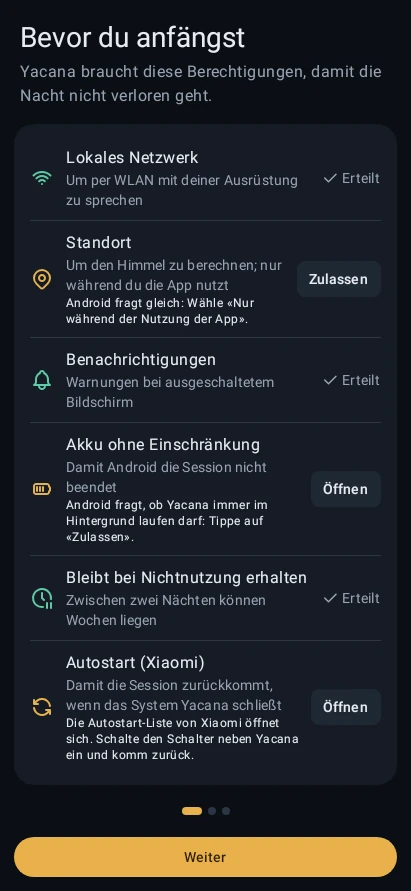 <b>Bevor du anfängst.</b> Erteilte Zeilen zeigen ein Häkchen.</td>
</tr></table>

| Berechtigung | Wofür | Ohne sie |
| --- | --- | --- |
| **Lokales Netzwerk** | Um per WLAN mit deiner Ausrüstung zu sprechen. Abgefragt ab Android 17. | Die App kann kein Alpaca-Gerät finden oder steuern. |
| **Standort** | Um den Himmel an deinem Standort zu berechnen, nur während du die App nutzt. Wähle **Nur während der Nutzung der App**. | Gib den Standort stattdessen im Profil ein. |
| **Benachrichtigungen** | Die Session und ihre Warnungen bei ausgeschaltetem Bildschirm. Abgefragt ab Android 13. | Du siehst die Session und ihre Warnungen außerhalb der App nicht. |
| **Akku ohne Einschränkung** | Damit Android die Session nicht beendet. Tippe auf **Zulassen**, wenn Android fragt. | Das System kann die Session bei ausgeschaltetem Bildschirm beenden. |
| **Bleibt bei Nichtnutzung erhalten** | Zwischen zwei Nächten können Wochen liegen. Schalte **App-Aktivität pausieren, wenn die App nicht verwendet wird** aus. Ab Android 11. | Android kann der App nach einigen Monaten ohne Nutzung die Berechtigungen entziehen. |
| **Autostart (Xiaomi)** | Auf Handys von Xiaomi, Redmi und Poco, damit die Session zurückkommt, wenn das System Yacana schließt. Schalte den Schalter neben Yacana ein. | Schließt das System Yacana in der Nacht, kommt die Session nicht zurück. |

Lehnst du eine ab, geht nicht sofort etwas kaputt: Die App erklärt, was nicht mehr geht und wie du sie später einschaltest, unter *Einstellungen › Berechtigungen* ([Kapitel 33](#permissions)). Tippe auf **Weiter**, um fortzufahren.

### 2 · Finde deine Ausrüstung

1. Schalte die Ausrüstung ein und verbinde das Handy mit ihrem WLAN, oder bring beide in dein WLAN zu Hause.
2. Yacana sucht im Netzwerk selbst nach Alpaca-Geräten, über IPv4 und IPv6. Jeder gefundene Server erscheint als Kachel mit seinen Geräten. **Erneut suchen** wiederholt die Suche.
3. Tippe bei einem Seestar auf **Teleobjektiv** oder **Weitwinkel**: Das lädt das Profil des Seestar für diese Kamera mit Optik, Feld und empfohlenen Einstellungen. Du kannst beide anlegen und über die Kachel **Profil** unter Ausrüstung zwischen ihnen wechseln. Bei anderer Ausrüstung tippe auf **Hinzufügen**: Das Profil übernimmt das erste Gerät jeder Art auf diesem Server.

Wird ein Gerät nicht gefunden, etwa in einem Netzwerk, das die Suche blockiert, tippe auf **Per IP und Port hinzufügen** und gib seine Adresse ein, z. B. `192.168.1.10:32323`. Hast du schon ein Profil von einem anderen Handy, lädt **Profil importieren** es. **Nicht jetzt** überspringt diese Seite; du kannst deine Ausrüstung später unter Ausrüstung finden.

<table><tr>
<td valign="top" width="240">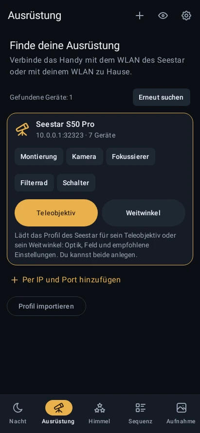 <b>Im WLAN gefunden.</b> Ein Seestar mit seinen sieben Geräten.</td>
</tr></table>

### 3 · Bereit für unterwegs

Yacana funktioniert ohne Internet, aber zwei Dinge sind zu groß, um sie mit der App auszuliefern. Diese Seite zeigt, was schon auf dem Handy ist und was du holen solltest, solange du noch WLAN hast:

- **Objektkatalog** und **Ephemeriden**: in der App enthalten, nichts zu tun.
- **Sterndatenbank**: die für dein Feld empfohlene, D50 für einen Seestar. Tippe auf **Laden**.
- **NINAs Himmels-Cache**: die Fotos für den Atlas und den Bildausschnitt. Tippe auf **Importieren**, wenn du sein ZIP schon hast; um ihn in der App herunterzuladen, nutze *Einstellungen › Himmelskarte* ([Kapitel 6](#field)).

Downloads laufen im Hintergrund weiter. Tippe auf **Starten**, um die App zu öffnen.

<table><tr>
<td valign="top" width="240">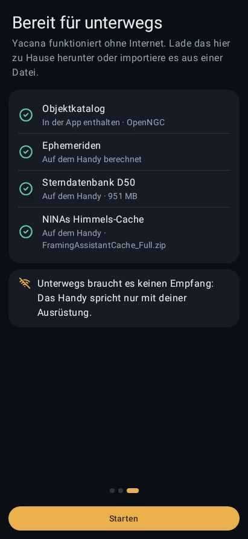 <b>Bereit für unterwegs.</b> Alles auf dem Handy.</td>
</tr></table>

> [!TIP]
> **Gut zu wissen**
>
> Die ersten Schritte lassen sich nicht erneut öffnen. Ihre Teile leben weiter: die Berechtigungen unter *Einstellungen › Berechtigungen*, die Gerätesuche unter Ausrüstung, die Sterndatenbanken unter *Einstellungen › Plate Solving* und die Himmels-Caches unter *Einstellungen › Himmelskarte*.

## 4. Sich zurechtfinden

Yacana ist nach den Momenten der Nacht aufgebaut statt nach Gerätefenstern. In jedem Moment zeigt es, was du brauchst, und lässt den Rest einen Tipp entfernt.

### Die fünf Bereiche

Die Leiste unten hat fünf Bereiche. Mit dem Handy im Querformat wird sie zu einer Leiste am linken Rand. Ein Tipp auf den Bereich, in dem du bist, bringt dich zu seinem ersten Bildschirm zurück.

| Bereich | Wofür | Obere Leiste |
| --- | --- | --- |
| **Nacht** | Dunkelheit und Mond heute Nacht, die Checkliste zur Vorbereitung, die laufende Session, die Zusammenfassung und das Tagebuch | Ausrüstungsstatus, Rotmodus, Einstellungen |
| **Ausrüstung** | Profile, Verbindung und manuelle Steuerung jedes Geräts | Gerät hinzufügen, Rotmodus, Einstellungen |
| **Himmel** | Himmelskarte, Sky Atlas, Objektseiten und Bildausschnitt | Himmelsebenen oder Filter, Rotmodus |
| **Sequenz** | Plan für heute Nacht, gespeicherte Sequenzen, Vorlagen, der einfache und der erweiterte Editor | — |
| **Aufnahme** | Manuelle Aufnahme, Statistik, Verlauf, Live-Stack und Referenzfoto | Rotmodus, Weitere Optionen |

### Gemeinsame Bedienelemente

- **Einstellungen:** Das Zahnrad unter Nacht und Ausrüstung, oder **Einstellungen** am Ende von **Weitere Optionen** unter Aufnahme. Ihr Suchfeld findet jede Einstellung über einen Teil ihres Namens.
- **Rotmodus:** Das Augensymbol unter Nacht, Ausrüstung, Himmel, Aufnahme, auf der Objektseite, im Bildausschnitt und in den Assistenten. Es färbt jedes Pixel rot ([Kapitel 32](#display)).
- **Ausrüstungsstatus:** Unter Nacht ein Schild, wenn die Ausrüstung ohne Probleme verbunden ist, oder ein Warndreieck, während die App sich neu verbindet oder sicher stoppt.
- **Zurück und Schließen:** Der Pfeil oben links geht zurück. Die Assistenten (Polausrichtung, Autofokus und Flats) zeigen stattdessen **✕**, was sie beendet.
- **Fenster:** Viele Optionen öffnen sich in einem Fenster vom unteren Bildschirmrand. Wische es nach unten oder tippe daneben, um es zu schließen.
- **Zahlen:** Zeiten, Koordinaten und Aufnahmezahlen gibst du über häufige Werte und das eigene Ziffernfeld der App ein, damit die Systemtastatur, die der Rotmodus nicht einfärben kann, nachts nie aufleuchtet.
- **Gedrückt halten:** Riskante Schaltflächen füllen sich, während du sie drückst, und lösen nach etwa einer Sekunde aus: Parken, eine Sequenz stoppen, ein Profil, einen Cache, eine Datenbank oder eine gespeicherte Sequenz löschen. Ein kurzer Tipp tut nichts, außer dich ans Gedrückthalten zu erinnern.
- **Zustände:** Jeder Zustand wird mit einem Symbol und Worten gezeigt, nie nur mit Farbe, weil im Rotmodus Grün und Orange gleich aussehen.

### Die Session-Leiste

Während eine Sequenz läuft oder pausiert ist, zeigt eine Leiste auf jedem Bildschirm außer Nacht das Ziel, den Filter, die Belichtung und die Aufnahme mit ihrem Fortschritt, wie die „Jetzt läuft“-Leiste einer Musik-App. Tippe darauf, um die Session unter Nacht zu sehen; ihre Schaltfläche pausiert die Sequenz oder setzt sie fort.

### Benachrichtigungen

Solange die Ausrüstung verbunden ist, zeigt eine Benachrichtigung die Session, auch auf dem Sperrbildschirm: das Ziel, die Aufnahme und den Fortschritt, oder die gespeicherten Aufnahmen. Tippe darauf, um die App zu öffnen. Ihre Schaltfläche **Trennen** stoppt die Aufnahme und trennt die Ausrüstung. Warnungen, die dich brauchen, etwa eine verlorene Verbindung oder ein sicherer Stopp, geben einen Ton aus; Ereignisse wie ein Autofokus oder das Ende der Sequenz kommen lautlos. Jede Art hat ihren eigenen Benachrichtigungskanal (*Nacht-Session*, *Warnungen der Nacht*, *Ereignisse der Nacht*), den du in den Android-Einstellungen der App anpassen kannst.

<table><tr>
<td valign="top" width="330">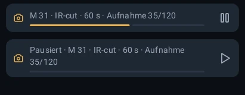 <b>Die Session-Leiste</b>, laufend und pausiert.</td>
</tr></table>

## 5. Dein Ausrüstungsprofil

Ein Profil ist ein Satz Ausrüstung und die Art, wie du sie nutzt: ihre Geräte, Optik, Standort, Grenzen und Optionen. Alles, was Yacana für dich berechnet, etwa das Feld, den Maßstab des Plate Solving oder die empfohlene Sterndatenbank, kommt daraus. Plate Solving, Autofokus, Sicherheit, Dateinamen und Live-Stacking werden ebenfalls je Profil gespeichert.

Öffne es über *Einstellungen › Profil und Standort*, oder tippe unter Ausrüstung auf die Kachel **Profil** und dann auf **Profil öffnen**. Profile und Geräte ändern und das Profil löschen geht nur, solange die Ausrüstung getrennt ist.

### Name und Optik

- **Name:** Tippe darauf, um ihn direkt zu bearbeiten.
- **Brennweite:** in Millimetern, von 10 bis 10.000, die des Teleskops, mit Reducer, falls vorhanden. Sie bestimmt den Maßstab des Plate Solving und das Feld, das die Himmelskarte zeichnet.
- **Öffnung:** der Durchmesser des Objektivs, von 5 bis 2.000 mm. Das Öffnungsverhältnis steht daneben.
- **Kamerasensor** und **Pixelgröße:** seine Pixel in Breite und Höhe (die Höhe folgt nach der Breite) und ihre Größe in µm, wie in den Daten der Kamera; ein Seestar S50 Pro hat 2160 × 3840 px zu 2,9 µm. Die Kamera trägt sie beim Verbinden ein; eingegeben ist das Feld ohne Verbindung bekannt, für die Himmelskarte und den Bildausschnitt.

Sobald die Kamera verbunden war, zeigt die Kachel den Maßstab und das Feld, etwa *2,25″/px · Feld 1,35° × 2,40°*.

### Standort

Der Standort bestimmt die Dunkelheit heute Nacht, jede Höhe und den Pol für die Polausrichtung.

- **Standort des Handys nutzen** liest ihn vom Handy, sobald du es einschaltest, bei jedem Start der App und beim Verbinden; beim ersten Mal fragt Android nach der Berechtigung. Kommt keiner, sagt die Zeile warum, und ein Tippen versucht es erneut. Ist es aus, gibst du ihn ein: Breite Nord oder Süd (0 bis 90°), Länge Ost oder West (0 bis 180°) und Höhe in Metern (0 bis 9.000).
- **Zeit und Standort an die Montierung senden** gibt der Montierung beim Verbinden die UTC-Zeit des Handys und den Standort.

### Grenzen

- **Höhengrenze**, 0 bis 60°: Kein GoTo geht darunter, auch nicht unter den Horizont. Ein GoTo darunter wird abgelehnt und die Montierung bewegt sich nicht; eine Bewegung mit dem Steuerkreuz stoppt an der Grenze von selbst.
- **Horizont:** flach, oder dein eigener mit Bäumen und Gebäuden. **Importieren** liest eine Horizontdatei von N.I.N.A.: ein Punkt pro Zeile, Azimut und Höhe in Grad, getrennt durch Leerzeichen oder Tabulatoren, mit `#` für Kommentare. **Flach machen** entfernt ihn. Die Objektseiten zeichnen ihn in ihr Höhendiagramm ein.

<table><tr>
<td valign="top" width="240">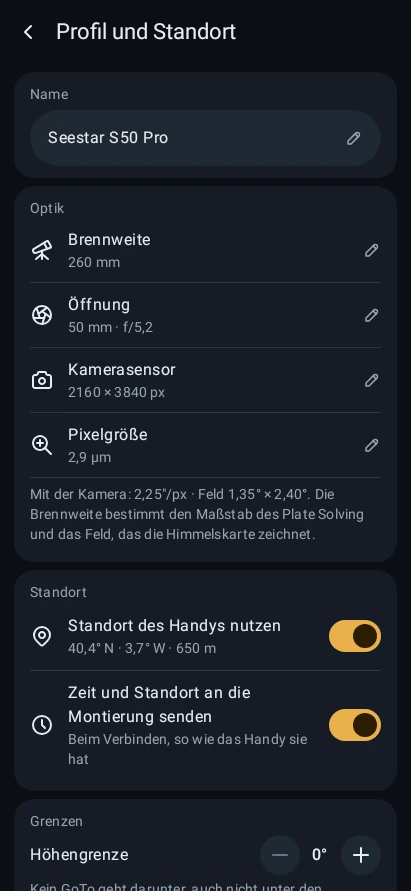 <b>Profil und Standort.</b> Das Profil des Seestar.</td>
<td valign="top" width="240">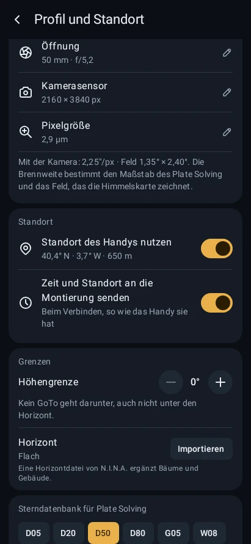 <b>Sterndatenbank</b> für das Plate Solving, je Profil gewählt.</td>
</tr></table>

### Sterndatenbank

Die Schaltflächen wählen die Datenbank des Profils für das Plate Solving. Die App sagt, welche zu deinem Feld passt. Wählst du eine, die nicht auf dem Handy ist, erscheinen ihre Größe und eine Schaltfläche **Laden**: Sie wird aktiv, wenn der Download endet, und bis dahin bleibt die vorherige.

### Mehr als ein Profil

- **Wechseln:** Tippe unter Ausrüstung auf die Kachel **Profil** und wähle ein anderes, oder tippe auf **Nutzen** neben einem Profil unter **Andere Profile**.
- **Neu:** **Neues Profil** unter **Andere Profile** durchsucht das Netzwerk; die Ausrüstung, die du wählst, wird ein neues, aktives Profil.
- **Auf ein anderes Handy kopieren:** Unter **Profilkopie** speichert **Exportieren** das Profil als JSON-Datei, wo du willst, und **Importieren** liest eine ein und aktiviert sie. Die Datei enthält den Standort.
- **Löschen:** **Profil löschen** *(halten)*, am Ende des Bildschirms.

## 6. Bereit für unterwegs

Unterwegs spricht das Handy nur mit deiner Ausrüstung. Bring vor deiner ersten Nacht, solange du zu Hause WLAN hast, zwei Dinge aufs Handy: eine Sterndatenbank für das Plate Solving und die Himmelsfotos. Beide lassen sich auch aus einer Datei importieren, etwa von einem PC kopiert oder von einer Speicherkarte.

### Sterndatenbanken

Unter *Einstellungen › Plate Solving*, im Abschnitt **Sterndatenbank**. Die App markiert die für dein Feld **empfohlene** und zeigt die Größe des Feldes. Mehrere können gleichzeitig auf dem Handy sein; das Profil nutzt eine, markiert mit **Aktiv**.

<table><tr>
<td valign="top" width="240">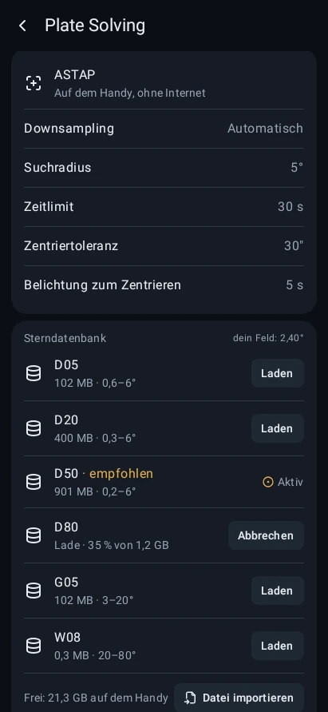 <b>Die Sterndatenbanken.</b> D50 aktiv, D80 wird geladen.</td>
</tr></table>

| Datenbank | Größe | Für Felder von | Hinweise |
| --- | ---: | --- | --- |
| **D05** | 102 MB | 0,6° bis 6° | Die leichte Option |
| **D20** | 400 MB | 0,3° bis 6° |  |
| **D50** | 901 MB | 0,2° bis 6° | Empfohlen für den Seestar |
| **D80** | 1,2 GB | 0,15° bis 6° | Die dichteste |
| **G05** | 102 MB | 3° bis 20° | Weite Felder, Kameraobjektive |
| **W08** | 0,3 MB | 20° bis 80° | Sehr weite Felder |

- **Laden** holt sie nur über WLAN von der ASTAP-Website, auch bei geschlossener App, und setzt fort, wenn der Download unterbrochen wird. Wenn er fertig ist, ist sie aktiv. Der freie Speicher auf dem Handy steht unter der Liste.
- **Datei importieren** installiert sie aus der eigenen ZIP- oder `.deb`-Datei von ASTAP, etwa von einer Speicherkarte.
- Halte eine installierte Datenbank gedrückt, um sie mit **Datenbank löschen** *(halten)* zu löschen. Die aktive lässt sich nicht löschen: Aktiviere zuerst eine andere.
- **Mit der letzten Aufnahme testen** löst die letzte Aufnahme aus dem Bereich Aufnahme mit den aktuellen Einstellungen, um sie zu prüfen.

### Die Himmelsfotos: die Caches von N.I.N.A.

Die Himmelskarte, der Sky Atlas, die Objektseiten, der Bildausschnitt und die Referenz unter Aufnahme nutzen alle die Fotos der Framing-Caches von N.I.N.A. Yacana liest sie so, wie N.I.N.A. sie veröffentlicht, direkt aus ihrem ZIP, ohne es zu entpacken; ein Cache belegt also genau so viel wie sein ZIP und nicht mehr. Öffne *Einstellungen › Himmelskarte* oder das Ebenensymbol auf der Himmelskarte.

- **Vollständiger Cache (DSS):** der ganze Himmel in 2.131 Farbfotos von 5° aus dem Digitized Sky Survey, 3,5 GB. Diesen solltest du holen.
- **NSNS mit Sternen** (1,4 GB) und **NSNS ohne Sterne** (471 MB): der Northern Sky Narrowband Survey, Wasserstoff- und Sauerstoffemission bis etwa −17° Deklination. Sie werden als zweite Ebene gezeichnet.
- **Online-Fotos:** die schärferen Fotos, die die Karte mit Internet holt, wenn du nah heranzoomst, auf dem Handy gespeichert.

<table><tr>
<td valign="top" width="240">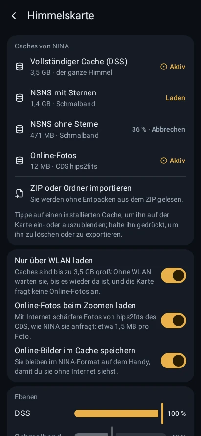 <b>Einstellungen › Himmelskarte.</b> Der vollständige Cache aktiv, ein Schmalband-Cache kommt gerade.</td>
</tr></table>

#### Einen Cache holen

- **Laden** holt ihn über den Download-Manager von Android von der Website von N.I.N.A. Er setzt nach Unterbrechungen fort und prüft vorher den freien Speicher. Mit **Nur über WLAN laden** an (Standard) wartet er auf WLAN.
- **ZIP oder Ordner importieren**: **ZIP wählen** nimmt eines der ZIPs von N.I.N.A., wie die auf seiner Website; **Ordner wählen** nimmt den Cache-Ordner, den N.I.N.A. auf einem PC hat (`FramingAssistantCache`), aufs Handy kopiert oder auf einer Speicherkarte. Sie werden in die App kopiert.

#### Ihn nutzen

- Tippe auf einen installierten Cache, um ihn auf der Karte zu zeigen oder auszublenden: **Aktiv** oder **Installiert**.
- **Ebenen:** die Deckkraft der DSS-Ebene (standardmäßig 100 %) und der Schmalband-Ebene (40 %), um sie zu mischen.
- **Online-Fotos beim Zoomen laden** (standardmäßig an): Mit Internet fragt die Karte beim Hineinzoomen hips2fits des CDS nach schärferen Fotos, wie N.I.N.A. es tut, je etwa 1,5 MB. Schalte es aus, um deine mobilen Daten für anderes aufzuheben; mit **Nur über WLAN laden** holt die Karte sie über mobile Daten ohnehin nicht.
- **Online-Bilder im Cache speichern**: Ist es an, bleiben sie im Format von N.I.N.A. auf dem Handy, damit du sie ohne Internet wieder siehst.

#### Löschen oder exportieren

Halte einen installierten Cache gedrückt. Das Fenster sagt, wie viel Platz er freigibt; **Cache löschen** *(halten)* entfernt ihn. Ein Ordner-Cache, etwa die Online-Fotos, bietet zusätzlich **ZIP exportieren**, um ihn in N.I.N.A. auf einem PC zu öffnen.

<table><tr>
<td valign="top" width="240">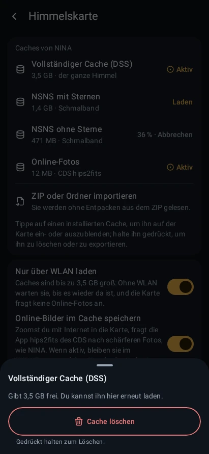 <b>Einen Cache gedrückt halten.</b> Was er freigibt, und die Schaltfläche zum Gedrückthalten.</td>
</tr></table>

> [!TIP]
> **Nachweise**
>
> Die Fotos sind nicht Teil der App: Du lädst sie von der Website von N.I.N.A. herunter oder importierst sie. Der DSS stammt vom STScI, das N.I.N.A. die Verbreitung erlaubt, und der NSNS steht unter CC BY-NC-SA 4.0. Die Karte zeigt *DSS: STScI · NSNS: CC BY-NC-SA 4.0*.

---

# Ausrüstung

## 7. Deine Ausrüstung verbinden

Der Bereich Ausrüstung enthält das aktive Profil, verbindet es und gibt dir die manuelle Steuerung jedes Geräts.

1. Prüfe die Kachel **Profil**: den Namen des Profils und woher sein Standort kommt, etwa *Standort per GPS · 40,4° N · 3,7° W · 650 m*. Tippe darauf, um zu einem anderen Profil zu wechseln.
2. Tippe auf **Verbinden**. Die Zeile zeigt *Verbinde…* und dann, wie viele Geräte geantwortet haben, etwa *5 von 5 verbunden*, oder warum sich eines nicht verbinden konnte.
3. Jedes Gerät hat eine Zeile mit seinem Live-Zustand: die Montierung mit Nachführung und ihrer Höhe, die Kamera bereit und die Temperatur ihres Sensors, die Position des Fokussierers, der eingesetzte Filter, die Tauheizung an. Sie aktualisieren sich alle ein bis zwei Sekunden.
4. Tippe auf ein verbundenes Gerät, um seinen Bildschirm zu öffnen. **Alle trennen** beendet die Verbindung.

Bricht die Verbindung ab, verbindet sich Yacana von selbst neu. Während einer Sequenz pausiert es zuerst sicher ([Kapitel 28](#safety)).

<table><tr>
<td valign="top" width="240">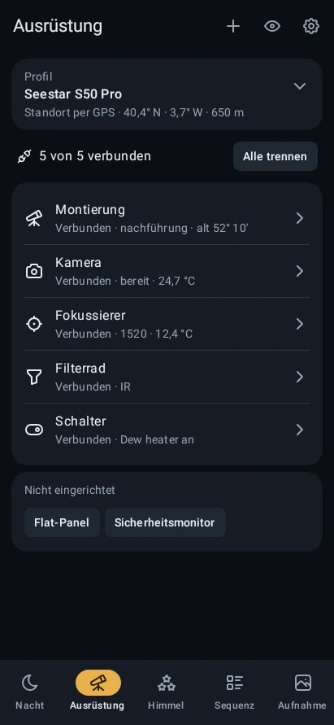 <b>Ausrüstung.</b> Fünf Geräte verbunden; Flat-Panel und Sicherheitsmonitor nicht eingerichtet.</td>
</tr></table>

### Ein Gerät hinzufügen

Das **+** oben öffnet *Gerät hinzufügen*, das das Netzwerk erneut durchsucht. Jeder Server zeigt die Geräte, die dein Profil noch nicht hat, jeweils mit **Hinzufügen**; **Per IP und Port hinzufügen** nimmt eine Adresse. Die Kachel **Nicht eingerichtet** am Ende der Liste hat eine Schaltfläche für jedes optionale Gerät, das Flat-Panel und den Sicherheitsmonitor, die dieselbe Suche öffnet. Geräte werden nur hinzugefügt, solange die Ausrüstung getrennt ist.

### Ohne Profil

Hast du die ersten Schritte übersprungen, beginnt Ausrüstung mit **Finde deine Ausrüstung**, derselben Suche wie in [Kapitel 3](#first-steps), und einer Schaltfläche **Profil importieren**.

## 8. Die Montierung

Der Bildschirm der Montierung zeigt, wohin sie zeigt, und bewegt sie von Hand, mit GoTo, Sync, Parken und Nachführung.

### Wohin sie zeigt

Die obere Kachel zeigt ihren Zustand, etwa *Nachführung · siderisch*, *Schwenkt*, *Keine Nachführung* oder *Geparkt*, und ihre RA, Dek, Höhe und Azimut. Während sie ein Ziel zentriert, zeigt die Kachel den Versuch und den aktuellen Schritt, mit **Stopp**.

### Von Hand bewegen

Halte einen Pfeil (N, S, O, W) gedrückt, um die Montierung zu bewegen; sie stoppt, wenn du loslässt. Die rote Taste in der Mitte stoppt sie sofort. Die Schaltflächen darunter stellen die Geschwindigkeit ein: **1×**, **8×** (Standard) oder **64×** die siderische Rate, oder **Max**, die schnellste der Montierung. Eine Bewegung stoppt an der Höhengrenze des Profils von selbst.

### Die Schaltflächen

- **GoTo…:** Öffnet ein Fenster, um RA und Dek mit dem Ziffernfeld der App einzugeben (siehe unten).
- **Sync:** Sagt der Montierung, dass sie auf die eingegebenen Koordinaten zeigt. Mit einer gelösten Aufnahme nutze stattdessen **Montierung synchronisieren** unter Aufnahme ([Kapitel 18](#solving)). Nur sichtbar, wenn die Montierung synchronisieren kann.
- **Parken:** Halte die Schaltfläche gedrückt, um die Montierung in ihre Parkposition zu schicken. Ein kurzer Tipp erinnert dich nur ans Gedrückthalten. Ist die Montierung geparkt, heißt die Schaltfläche **Entparken**, und ein Tippen entparkt sie.
- **Nachführung:** Schaltet die Nachführung ein oder aus.
- **Polausrichtung:** Öffnet den Assistenten für die Polausrichtung ([Kapitel 17](#polar)).

Das Menü **⋮** oben enthält den Rest: die **Nachführrate** (siderisch, lunar, solar oder King, soweit die Montierung sie unterstützt), **Entparken**, wenn sie geparkt ist, und **Home suchen**, wenn die Montierung es hat.

<table><tr>
<td valign="top" width="240">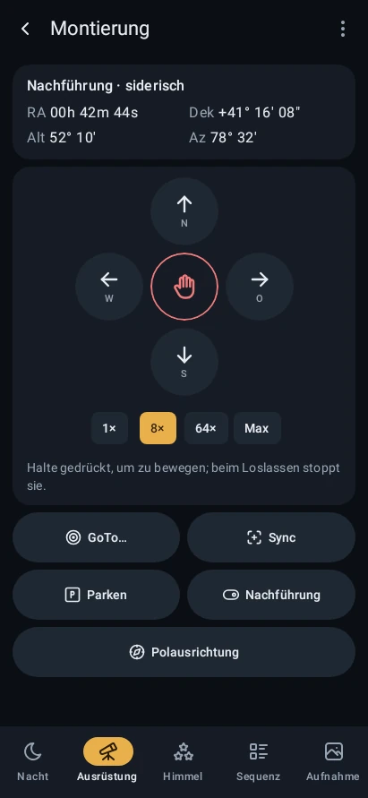 <b>Montierung.</b> Halte einen Pfeil gedrückt, um zu bewegen; tippe auf die Geschwindigkeit.</td>
<td valign="top" width="240">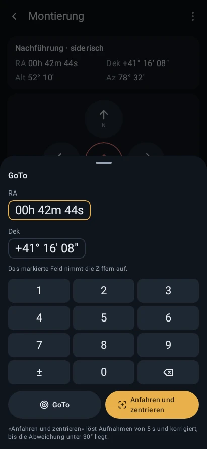 <b>GoTo.</b> Das markierte Feld nimmt die Ziffern auf.</td>
</tr></table>

### Koordinaten anfahren

1. Tippe auf **GoTo…**. Das Fenster zeigt die aktuelle RA und Dek der Montierung.
2. Tippe auf das Feld RA oder Dek, um es zu markieren, und gib die Ziffern auf dem Ziffernfeld ein. **±** kehrt das Vorzeichen der Deklination um.
3. Tippe auf **GoTo**, um dorthin zu schwenken, oder auf **Anfahren und zentrieren**, um zu schwenken und dann per Plate Solving zu verfeinern, bis das Ziel innerhalb der Toleranz liegt (standardmäßig 30″).

> [!CAUTION]
> **Unter der Grenze**
>
> Ein GoTo zu einem Ziel unter der Höhengrenze des Profils oder unter seinem Horizont wird abgelehnt. Der Bildschirm sagt, wo das Ziel steht und dass sich die Montierung nicht bewegt hat. Warte, bis es aufgeht, oder ändere die Grenze im Profil ([Kapitel 5](#profile)).

## 9. Kamera und Filterrad

### Kamera

Der Bildschirm der Kamera zeigt ihren Zustand, etwa *Bereit · −10 °C*, und was sie meldet: die Größe des Sensors, die Pixelgröße, das Bayer-Muster, die Bereiche für Gain und Offset und die längste Belichtung. Aufnahmen machst du unter Aufnahme; **Zur Aufnahme** bringt dich dorthin ([Kapitel 20](#imaging)).

Yacana nutzt jede Kamera so, wie sie sich über Alpaca beschreibt: Gain, Offset, Binning, Teilbereich (ROI) und Sensortemperatur, wo die Kamera sie hat. Aufnahmen werden direkt in den nativen Speicher des Handys geladen, während die nächste Belichtung startet, sodass auch Kameras mit 61 MP passen.

### Filterrad

Der Bildschirm des Filterrads listet seine Filter, mit einem Häkchen am eingesetzten. Tippe auf einen Filter, um ihn zu nutzen. Unter Aufnahme ist der Filter auch eine Schaltfläche unter der Aufnahme.

Ein Filter namens **Dark**, wie beim Seestar, wird als Verschluss für Darks und Bias genutzt, sodass nichts abgedeckt werden muss. Ohne ihn bittet dich die App, das Teleskop abzudecken, wenn sie Darks aufnimmt.

## 10. Der Fokussierer

- **Position** und **Temperatur**, groß, mit Zeit und Temperatur des letzten Autofokus.
- **Bewegen:** **−100**, **−10**, **+10** und **+100** Schritte, und **Position anfahren…**, das das Ziffernfeld mit dem Bereich des Fokussierers öffnet. **Stopp** erscheint, während er sich bewegt.
- **Letzte Kurve:** die V-Kurve des letzten Autofokus, mit ihrem besten HFR und ihrer Position.
- **Fokus-Offset je Filter**, mit einem Filterrad: Tippe auf einen Filter, um seinen Offset in Schritten festzulegen, relativ zu den anderen. Bei einem Filterwechsel fährt der Fokussierer die Differenz zwischen dem Offset des neuen und dem des alten Filters, sodass jeder Filter ohne neuen Autofokus scharf bleibt.
- **Autofokus** startet sofort den Autofokus ([Kapitel 19](#autofocus)).

<table><tr>
<td valign="top" width="240">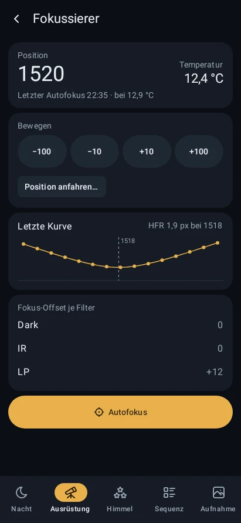 <b>Fokussierer.</b> Der LP-Filter fokussiert 12 Schritte weiter außen.</td>
</tr></table>

## 11. Schalter, Flat-Panel und Sicherheitsmonitor

### Schalter

Jeder Schalter erscheint so, wie das Gerät ihn deklariert: ein Umschalter für an und aus, ein Schieberegler mit − und + für einen Wert wie die Leistung einer Heizung (mit Bereich und Schrittweite; der Wert wird beim Loslassen gesendet), oder eine Anzeige für reine Lesewerte. Am häufigsten ist eine Tauheizung, die die Sequenz am Anfang ein- und am Ende ausschalten kann.

### Flat-Panel

Für ein Flat-Panel mit Abdeckung (ein Alpaca-CoverCalibrator):

- **Abdeckung:** ihr Zustand, mit **Öffnen** und **Schließen**, und **Stopp**, während sie sich bewegt. Öffne sie für die Nacht und schließe sie für Darks.
- **Licht:** an oder aus, und seine **Helligkeit** mit einem Schieberegler oder − und +.

Für Flats schließt der Flats-Assistent die Abdeckung, schaltet das Licht ein und findet die Belichtung selbst ([Kapitel 23](#calibration)).

### Sicherheitsmonitor

Zeigt **Sicher** oder **Unsicher**, jede Sekunde gelesen, etwa von einem Wolken- oder Regensensor. Die App zeigt es an, reagiert aber noch nicht darauf: Wird er **Unsicher**, stoppe die Sequenz unter Nacht.

<table><tr>
<td valign="top" width="240">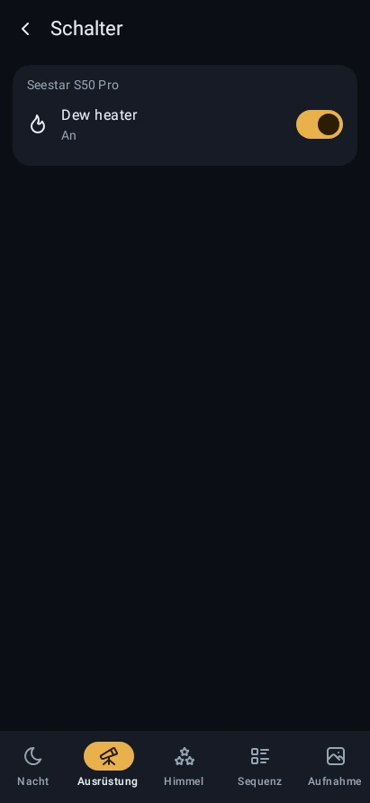 <b>Schalter.</b> Die Tauheizung des Seestar.</td>
<td valign="top" width="240">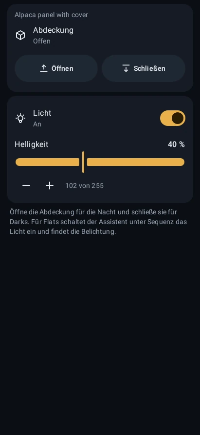 <b>Flat-Panel.</b> Abdeckung offen, Licht auf 40 %.</td>
<td valign="top" width="240">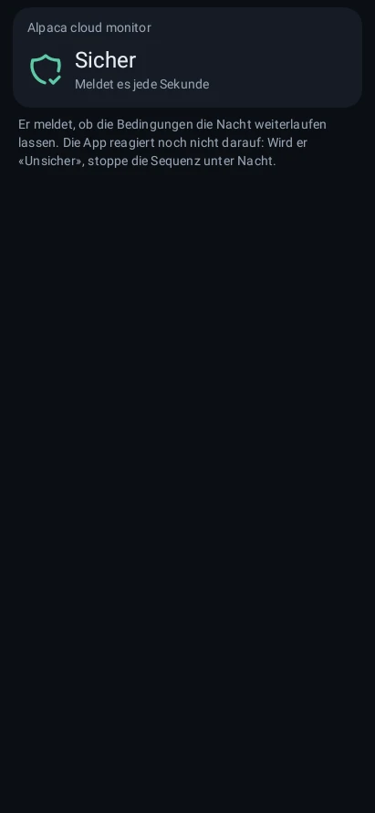 <b>Sicherheitsmonitor.</b> Jede Sekunde gelesen.</td>
</tr></table>

---

# Die Nacht planen

## 12. Heute Nacht auf einen Blick

Unter Nacht beginnt der Abend. Der Bereich zeigt die Dunkelheit und den Mond heute Nacht, eine Checkliste zur Vorbereitung, die Session, während sie läuft, und am Morgen die Zusammenfassung.

### Die Kachel für heute Nacht

Auf dem Handy für den Standort des Profils berechnet:

- Das Datum und die Beleuchtung des Mondes, etwa *Mond 34 %*.
- Das beste dunkle Zeitfenster: *Dunkel und ohne Mond*, oder *Dunkel, mit Mond am Himmel*, wenn der Mond die ganze astronomische Nacht über am Himmel steht, mit Beginn, Ende und Dauer.
- Sonnenuntergang und Sonnenaufgang sowie eine Zeitleiste vom Abend bis zum Morgen: Dämmerung, astronomische Nacht und die Stunden, in denen der Mond am Himmel steht, mit dem besten Zeitfenster umrandet.

Um die Sommersonnenwende kann in hohen Breiten *Keine astronomische Nacht* erscheinen: Die Sonne sinkt nicht 18° unter den Horizont. Ohne Standort sagt die Kachel, wie du einen festlegst: Erlaube den Standort unter *Einstellungen › Berechtigungen* und schalte den Standort des Handys ein, oder gib ihn im Profil ein.

### Eine andere Nacht

Tippe auf das Kalendersymbol, um eine beliebige andere Nacht zu sehen. Das Monatsraster markiert heute Nacht mit einem Rahmen und die gewählte Nacht ausgefüllt; die Pfeile wechseln den Monat. **Zurück zu heute Nacht** kehrt zurück.

<table><tr>
<td valign="top" width="240">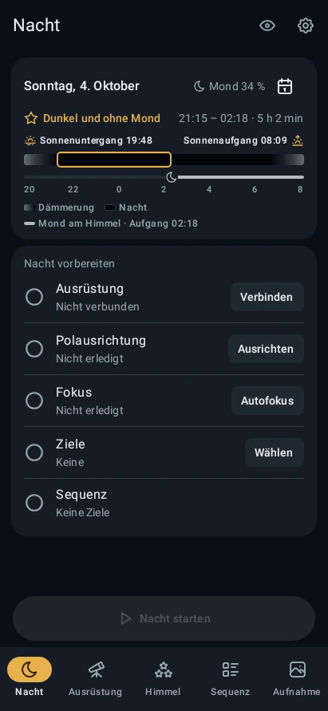 <b>Nacht.</b> 5 h 2 min dunkler Himmel, bevor der Mond aufgeht.</td>
<td valign="top" width="240">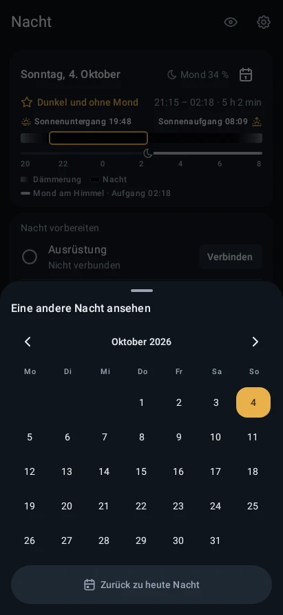 <b>Eine andere Nacht ansehen.</b></td>
</tr></table>

### Nacht vorbereiten

Eine Checkliste ohne Pflichtschritte: Mach, was deine Nacht braucht, in beliebiger Reihenfolge. Jede Zeile zeigt ihren Zustand und eine Schaltfläche, die dich dorthin bringt.

| Zeile | Zeigt | Schaltfläche |
| --- | --- | --- |
| **Ausrüstung** | Das Profil und seine Geräte, sobald verbunden | **Verbinden** |
| **Polausrichtung** | *Nicht erledigt* oder der letzte Gesamtfehler und wie lange es her ist | **Ausrichten**, danach **Verfeinern** |
| **Fokus** | *Nicht erledigt* oder der letzte HFR und wie lange es her ist (mit einem Fokussierer) | **Autofokus** |
| **Ziele** | *Keine* oder die Ziele für heute Nacht | **Wählen**, das Himmel öffnet |
| **Sequenz** | Ob der Plan vor die Morgendämmerung passt, und seine Dauer | **Anpassen**, wenn er nicht passt |

Wenn die Ausrüstung verbunden ist und der Plan Belichtungen hat, startet **Nacht starten** die Sequenz ([Kapitel 27](#running)). Die Markierungen der Zeilen sind Symbole und Farben zugleich, sodass sie im Rotmodus genauso lesbar sind.

<table><tr>
<td valign="top" width="240">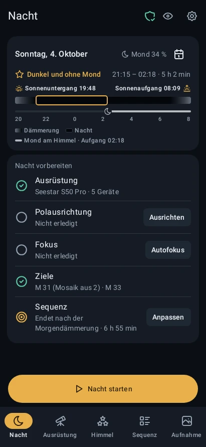 <b>Startbereit.</b> Der Plan endet nach der Morgendämmerung: <i>Anpassen</i> kürzt ihn.</td>
</tr></table>

## 13. Die Himmelskarte

Der Bereich Himmel öffnet sich mit einer Karte des echten Himmels, gezeichnet aus den Fotos des Caches von N.I.N.A., ohne Internet. Die Karte bleibt, wo du sie verlassen hast, auch nachdem die App geschlossen wurde. Ziehe sie mit einem Finger, zoome durch Spreizen von einer weiten Ansicht bis unter das Feld deiner Kamera und tippe auf ein Objekt, um es auszuwählen.

Die Karte ist so ausgerichtet, wie du den Himmel in diesem Moment vom Standort des Profils aus siehst, mit dem Zenit oben; ohne Standort ist Norden oben. Ein Maßstabsbalken zeigt die Größe eines Grades, und die Koordinaten der Mitte stehen unten rechts.

### Was sie zeigt

- **Fotos:** Die Beschriftung oben sagt, woher sie kommen, etwa *DSS · NINAs Cache*. Mit Internet holt das Hineinzoomen schärfere Fotos des Bereichs; solange eines lädt, dreht sich ein kleines Rad in der Beschriftung. Ohne Cache sagt die Beschriftung, wie du einen installierst; tippe darauf, um die Einstellungen der Himmelskarte zu öffnen.
- **Dein Feld:** ein gestrichelter Rahmen in der Mitte, so groß wie das Feld deiner Kamera, benannt nach dem Profil.
- **Objekte:** Umrisse und Namen der Objekte des Katalogs.
- **Horizont:** eine deutliche Linie, wo der Horizont am Standort des Profils liegt; hat das Profil einen eigenen Horizont, folgt sie ihm. Darauf stehen **N**, **O**, **S** und **W**.

### Ein Objekt auswählen

Tippe auf ein Objekt: Die Karte zentriert sich darauf, und eine Kachel zeigt Name, Größe, Höhe und beste Zeit, mit **Ausschnitt**. Tippe auf die Kachel für die Seite des Objekts. Tippe auf leeren Himmel, um die Auswahl aufzuheben.

Um einen Bereich ohne Katalogobjekt einzurahmen, zentriere ihn auf der Karte im Rahmen deines Feldes und tippe auf **Ausschnitt hier**, die runde goldene Taste unter dem Zoom: Der Bildausschnitt öffnet sich dort, und der Bereich kommt mit seinen Koordinaten als Namen in die Sequenz, etwa *03h 47m +24° 07′*.

### Schaltflächen

- **+ und −:** hinein- und herauszoomen.
- **Ausschnitt hier:** die goldene darunter rahmt die Mitte der Karte ein.
- **Ebenen** (obere Leiste): die Einstellungen der Himmelskarte, mit den Caches und der Deckkraft der Ebenen ([Kapitel 6](#field)).

<table><tr>
<td valign="top" width="240">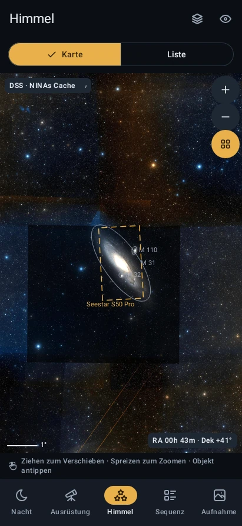 <b>Die Karte.</b> M 31 auf den DSS-Fotos, mit dem Feld des Seestar.</td>
</tr></table>

### Die Montierung auf der Karte

Mit verbundener Montierung zeigt die Karte zwei Rahmen in der Größe des Kamerafelds. Sie unterscheiden sich durch ihre Linie, sodass sie auch im Rotmodus auseinanderzuhalten sind:

- **Ausschnitt:** gestrichelt, in der Mitte der Karte. Dorthin willst du.
- **Teleskop:** durchgezogen, dort, wohin das Teleskop gerade zeigt; er bewegt sich mit, da er jede Sekunde gelesen wird.

Ziehe die Karte, um das Ziel in den Ausschnitt-Rahmen zu bringen, oder tippe auf ein Objekt, um es zu zentrieren, dann:

- **Anfahren und zentrieren** bringt das Teleskop zum Ausschnitt und verfeinert per Plate Solving bis zur Toleranz des Profils. Eine Kachel zeigt jeden Schritt und wie weit es noch ist, mit **Stopp**, das die Montierung und die Aufnahme stoppt.
- **Nur anfahren** macht das GoTo ohne Zentrieren.

Ist die Montierung geparkt oder ohne Nachführung, sagt das die Beschriftung **Teleskop**, und ein Tipp darauf entparkt die Montierung oder schaltet die Nachführung ein.

<table><tr>
<td valign="top" width="240">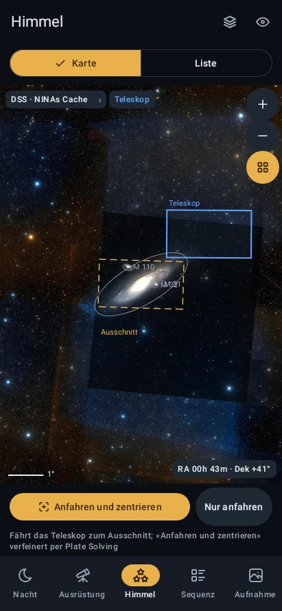 <b>Teleskop und Ausschnitt.</b> Der durchgezogene Rahmen zeigt, wohin es zeigt.</td>
<td valign="top" width="240">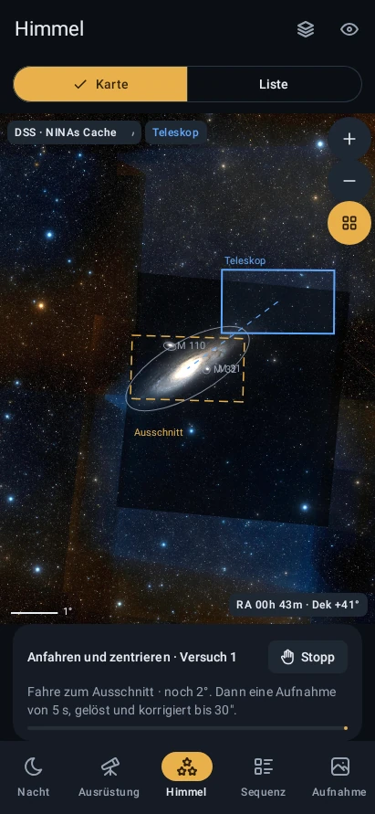 <b>Anfahren und zentrieren.</b> Noch 2°, dann eine Aufnahme von 5 s, gelöst und korrigiert.</td>
</tr></table>

## 14. Sky Atlas und Suche

Schalte den Bereich Himmel auf **Liste** für den Sky Atlas: 13.371 Deep-Sky-Objekte aus OpenNGC (NGC, IC, Messier, Caldwell und mehr) auf dem Handy, jedes mit seinem Foto aus dem Cache, gereiht für heute Nacht.

### Das Beste heute Nacht

Mit **Heute Nacht** an (Standard) zeigt die Liste, was heute Nacht vom Standort des Profils aus gut steht, sortiert nach seiner besten Zeit. Jede Zeile hat ein Miniaturbild, den Namen, Katalognummer und Größe, ob es in dein Feld *passt* oder ein *Mosaik aus N* braucht, und eine kleine Höhenkurve mit seiner besten Zeit. Tippe auf eine Zeile für die Seite des Objekts.

Über der Liste schalten **Heute Nacht** und **Favoriten**, die Objekte, die du auf ihrer Seite mit dem Stern markiert hast, mit einem Tippen ein und aus. Daneben steht jeder eingeschaltete Filter, etwa *Bis mag 8* oder *Ab 1°*: Sein ✕ nimmt ihn weg, sein Text öffnet die Filter. Das Reglersymbol zeigt, wie viele es sind, und die Notiz, wie viele Objekte bleiben und in welcher Reihenfolge. Die Filter und die Stelle in der Liste bleiben, wenn du ein Objekt öffnest, den Bereich wechselst oder die App schließt.

<table><tr>
<td valign="top" width="240">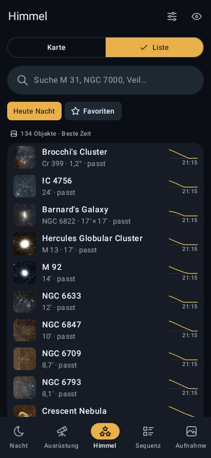 <b>Heute Nacht.</b> Miniaturbilder aus dem Cache, ohne Internet.</td>
<td valign="top" width="240">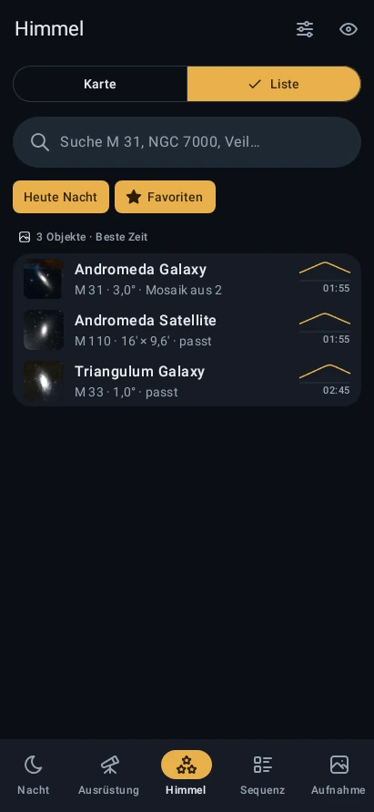 <b>Favoriten.</b> M 31 braucht ein Mosaik aus 2.</td>
<td valign="top" width="240">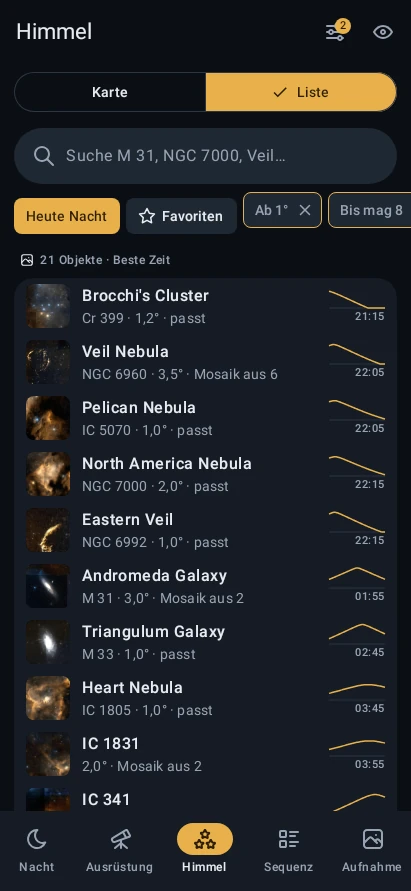 <b>Filter an.</b> Bis mag 8 und ab 1°.</td>
</tr></table>

### Filter

Das Reglersymbol oben oder der Text eines eingeschalteten Filters öffnet die Filter. Die Liste ändert sich, während du wählst, und der Kopf sagt, wie viele Objekte bleiben; **Zurücksetzen** stellt die Filter wie am Anfang ein, und **Fertig**, nach unten wischen, außerhalb tippen oder Zurück schließen sie. Im Querformat öffnen sie sich seitlich, mit der Liste daneben.

- **Sortieren nach:** Beste Zeit (Standard), Größte Höhe, Sichtbare Stunden, Größe oder Helligkeit, jeweils in natürlicher Richtung: zuerst das früheste, das höchste, das am längsten über deiner Höhe, das größte oder das hellste. Der Hinweis über der Liste nennt die Reihenfolge.
- **Typ:** Galaxien, Nebel, Sternhaufen, Andere.
- **Größe:** Beliebig, für dein Feld (seine Größe wird angezeigt), oder ab 15′, 30′ oder 1°.
- **Helligkeit:** Beliebig, oder bis 8, 10 oder 12.
- **Nur:** Favoriten und die, die ins Feld passen.
- **Heute Nacht:** an (Standard), nur was heute Nacht gut steht; Höhe und Stunden sind die der dunklen Nacht am Standort des Profils. Aus, zählen die drei folgenden nicht.
- **Über:** 20°, 30° oder 45°.
- **Für mindestens:** 1, 2 oder 4 Stunden.
- **Fern vom Mond:** Beliebig, oder mindestens 30°, 60° oder 90°.

Passt nichts, sagt die Liste das, mit **Zurücksetzen**, um neu anzufangen.

<table><tr>
<td valign="top" width="240">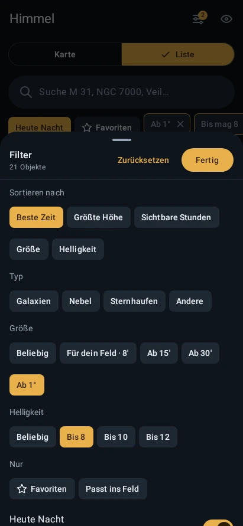 <b>Filter.</b></td>
</tr></table>

### Suche

Tippe ins Suchfeld: eine Messier-, NGC-, IC-, Caldwell- oder Sharpless-Nummer oder einen Namen, etwa *M 31*, *NGC 7000* oder *Veil*. Ergebnisse erscheinen beim Tippen, in Millisekunden, ohne Internet. Im Rotmodus öffnet das Suchfeld die eigene Tastatur der App, rot wie alles andere, statt der des Handys; ⌄ oder Zurück blendet sie aus.

Für alles andere bietet die letzte Zeile **«…» in SIMBAD suchen**. Mit Internet fragt sie SIMBAD des CDS, das mehr als 20 Millionen Objekte kennt, vom Quasar TON 618 bis zu den Sternen eines Sternbilds. Was es findet, bleibt auf dem Handy, damit du es offline wiederfindest. Gibt es keinen exakten Treffer, listet es die Objekte mit ähnlichen Namen auf, die hellsten zuerst.

<table><tr>
<td valign="top" width="240">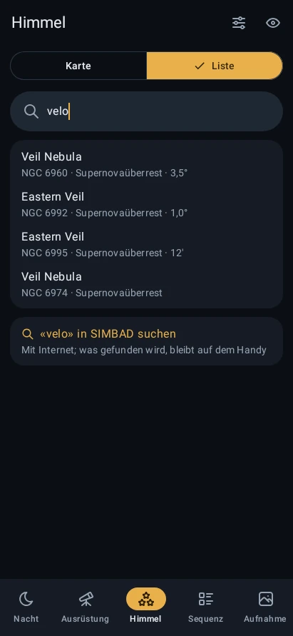 <b>Offline-Suche.</b> „velo“ findet den Schleiernebel.</td>
<td valign="top" width="240">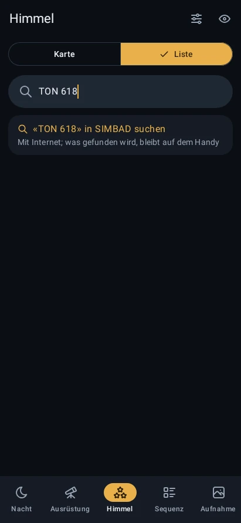 <b>Über den Katalog hinaus:</b> SIMBAD, mit Internet.</td>
</tr></table>

## 15. Die Seite eines Objekts

Alles, was du brauchst, um dich für ein Ziel zu entscheiden: sein Foto mit deinem Feld darüber, was es ist, wie hoch es heute Nacht steigt und wie nah der Mond ist.

- **Foto:** aus dem Cache, mit dem Feld deiner Kamera eingezeichnet. Tippe darauf oder auf ihren Knopf **Karte**, um das Objekt gerahmt auf der Himmelskarte zu sehen; nur die Karte bewegt sich, nicht das Teleskop.
- **Info:** Name, Typ, Helligkeit und Größe; seine anderen Namen und Bezeichnungen, etwa *Auch Triangulum Galaxy · Triangulum Pinwheel · NGC 598*; *Passt ins Feld* oder *Mosaik aus N Panels*; und Abstand und Phase des Mondes, etwa *Mond 87° entfernt · 34 %*.
- **Höhe heute Nacht:** die Kurve des Objekts von der Abend- bis zur Morgendämmerung, mit schattierter Dämmerung an beiden Enden, der 30°-Linie, deinem eigenen Horizont gestrichelt, falls das Profil einen hat, und einer Linie für jetzt. Darunter die Stunden, die es über 30° steht, und sein höchster Punkt, oder dass es tief bleibt oder nicht aufgeht.

Der Stern oben markiert es als Favorit. **Ausschnitt** öffnet den Bildausschnitt ([Kapitel 16](#framing)). **Anfahren und zentrieren** bringt bei verbundener Montierung das Teleskop dorthin und zentriert es, auf dem Bildschirm der Montierung.

<table><tr>
<td valign="top" width="240">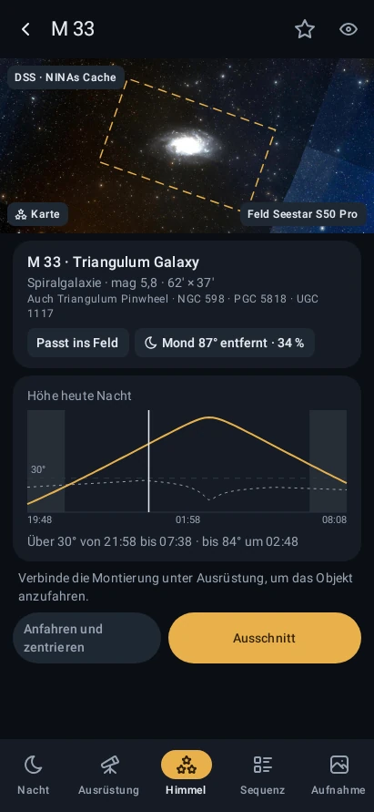 <b>M 33.</b> Passt ins Feld des Seestar; die gestrichelte Linie ist der Horizont des Standorts.</td>
<td valign="top" width="240">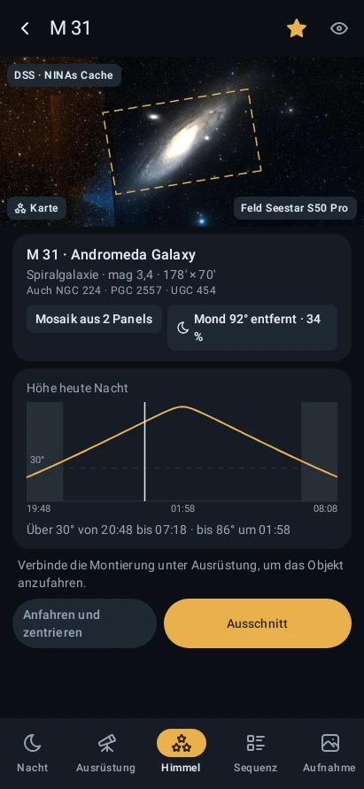 <b>M 31.</b> Ein Favorit, der ein Mosaik aus 2 Panels braucht.</td>
</tr></table>

## 16. Bildausschnitt und Mosaike

Der Bildausschnitt zeigt, wie das Foto wird: das echte Feld deiner Kamera über dem Himmel, das du ziehst, bis die Komposition stimmt, und Mosaike für Ziele, die größer als das Feld sind.

1. Öffne ihn mit **Ausschnitt** auf der Seite eines Objekts oder auf der Objektkachel der Karte.
2. Ziehe den Himmel, um das Ziel ins Feld zu setzen; spreize zum Zoomen. Die Größe des Feldes steht oben rechts.
3. Für ein Mosaik stelle **Spalten** und **Zeilen** mit − und + ein, und die **Überlappung** zwischen den Panels, von 5 bis 50 % (standardmäßig 15 %). Die Panels sind in der Reihenfolge nummeriert, in der sie aufgenommen werden.
4. Prüfe die Zeile darunter: die Stunden, die es heute Nacht über 30° steht.
5. Tippe auf **Zur Sequenz hinzufügen**. Die App bestätigt, dass das Ziel in der Sequenz für heute Nacht ist, mit **Anderes Ziel wählen** und **Heute Nacht ansehen**.

Ein neues Ziel kommt mit 60 Aufnahmen zu 60 s durch den ersten Filter, der nicht der Dunkelfilter ist, mit Dithering alle 3 Aufnahmen; passe sie im Editor an ([Kapitel 25](#simple)). Nach der Vorlage **Ein Ziel die ganze Nacht** füllt das Ziel stattdessen die Nacht bis zur Morgendämmerung.

**Anfahren und zentrieren** bringt bei verbundener Montierung das Teleskop zum Ausschnitt.

<table><tr>
<td valign="top" width="240">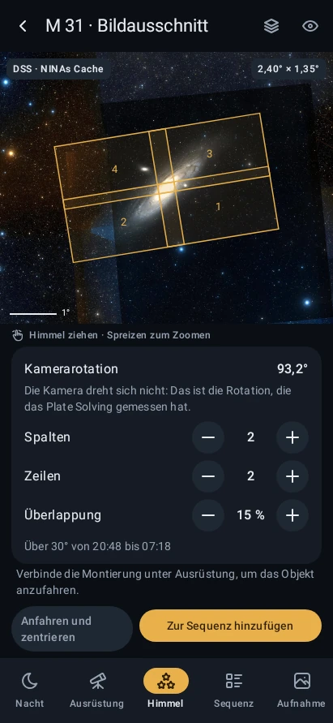 <b>M 31 · Bildausschnitt.</b> Ein 2 × 2-Mosaik, gedreht wie die Kamera.</td>
</tr></table>

### Die Rotation der Kamera

Ohne Rotator dreht sich die Kamera nicht, daher dreht der Bildausschnitt das Feld nicht von Hand: **Kamerarotation** ist der Winkel, den das Plate Solving gemessen hat, und Feld und Panels werden damit gezeichnet. Bis zum ersten Plate Solving sind es 0°, oder 93,2° für einen Seestar im EQ-Modus. Löse eine Aufnahme unter Aufnahme, sobald die Kamera montiert ist, und der Bildausschnitt passt dazu ([Kapitel 18](#solving)).

> [!TIP]
> **Braucht das Feld**
>
> Der Bildausschnitt braucht das Feld des Profils: seine Brennweite und den Sensor seiner Kamera (*Einstellungen › Profil und Standort › Optik*), eingegeben oder von der letzten Verbindung der Kamera behalten. Nichts muss verbunden sein; der Bildschirm hat einen Knopf zum Profil.

---

# Am Teleskop

## 17. Drei-Punkt-Polausrichtung

Der Assistent für die Polausrichtung misst, wie weit die Achse der Montierung vom Himmelspol entfernt ist, und führt dich dann live, während du an den Schrauben der Polhöhenwiege drehst. Er ist eine Portierung des Plugins Three Point Polar Alignment von N.I.N.A. und liefert bei denselben Messungen dasselbe Ergebnis bis auf 0,4″.

Er funktioniert mit jeder Montierung, die ihre Rektaszensionsachse auf Befehl drehen kann. Er braucht die verbundene Montierung und Kamera, eine Sterndatenbank auf dem Handy und den Standort des Profils, der festlegt, wo der Pol ist.

### Den Assistenten öffnen

Tippe auf **Ausrichten** in der Zeile **Polausrichtung** der Checkliste unter Nacht (**Verfeinern**, sobald gemessen wurde), oder auf **Polausrichtung** auf dem Bildschirm der Montierung. Der Assistent füllt den Bildschirm und hält ihn an, solange er läuft; das **✕** oben links beendet ihn und geht zurück.

### Vor dem Start

Die erste Seite erklärt, was passieren wird und wohin du zeigen sollst: auf einen freien Himmelsbereich, fern vom Pol und vom Horizont, in der Richtung, in die sich die Achse drehen wird. Sie zeigt vier Optionen; jede wird im Profil gespeichert.

- **Drehung zwischen Punkten:** Wie weit sich die RA-Achse zwischen den drei Aufnahmen dreht und in welche Richtung: 10°, 15°, 20° oder 30°, nach Westen oder nach Osten. 15° nach Westen ist der Standard. Lass Platz für die Drehung, damit die Montierung auf kein Hindernis trifft.
- **Belichtung:** 1, 2, 3 oder 5 s, mit Binning 1×1 oder 2×2, mit dem Gain aus Aufnahme. Kurze Aufnahmen aktualisieren den Fehler schneller, während du an den Schrauben drehst. 1 s bei 2×2 ist der Standard.
- **Toleranz:** Aus, 0,5′, 1′, 2′ oder 5′. Sinkt der Gesamtfehler darunter, vibriert das Handy. Die Pfeile blendet sie nie aus. Standardmäßig aus, wie im Plugin.
- **Nur mit Hinweis lösen:** Zum Verfeinern einer Ausrichtung, die schon nah ist: Die drei Punkte werden nur nahe der Position der Montierung gelöst, nie blind.

<table><tr>
<td valign="top" width="240">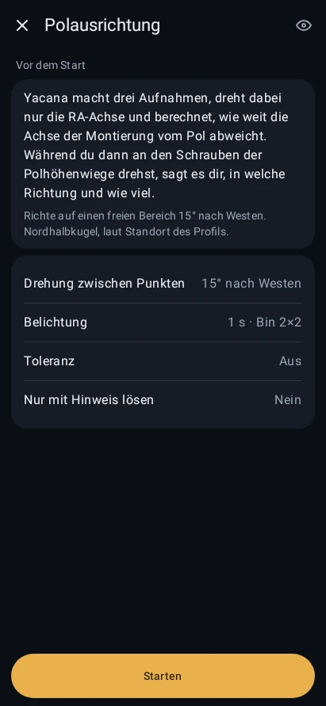 <b>Vor dem Start.</b> Die Optionen, mit den Standardwerten des Seestar.</td>
</tr></table>

### Die drei Punkte messen

1. Richte das Teleskop wie auf der ersten Seite beschrieben auf einen freien Bereich und tippe auf **Starten**.
2. Yacana macht die erste Aufnahme und löst sie, dreht die RA-Achse, macht und löst die zweite, dreht erneut und macht die dritte. Jeder Punkt zeigt *Drehe die RA-Achse…*, *Mache die Aufnahme*, *Löse mit ASTAP* und dann, wie lange das Lösen gedauert hat.
3. **Berühre die Montierung nicht, während sie misst.** Die drei Mittelpunkte beschreiben einen Kreis, dessen Mitte die wahre Achse der Montierung ist. Ihr Abstand zum Pol, korrigiert um Präzession, Nutation und Refraktion an deinem Standort und zu deiner Zeit, ist der Fehler.

Wird ein Punkt nicht gelöst, sagt der Assistent, welcher und warum, und bietet **Neu starten** an.

<table><tr>
<td valign="top" width="240">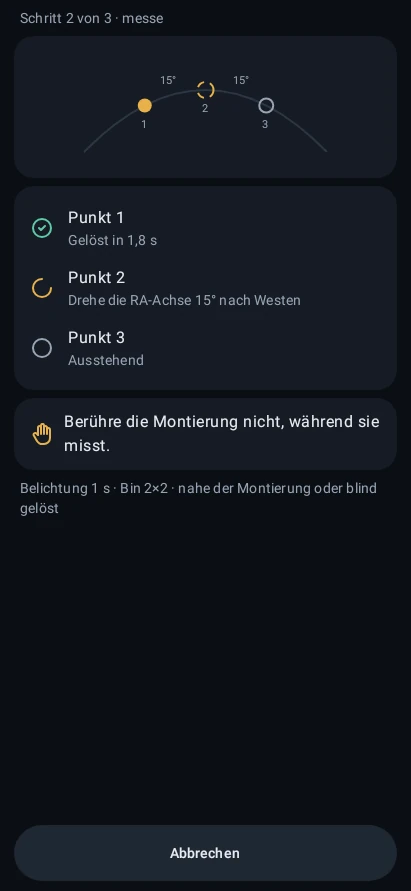 <b>Messen.</b> Punkt 1 in 1,8 s gelöst, die Achse dreht sich zu Punkt 2.</td>
</tr></table>

### An den Schrauben der Polhöhenwiege drehen

Jetzt macht der Assistent laufend Aufnahmen, löst jede nahe der letzten Position und aktualisiert den Fehler alle paar Sekunden. Jede Achse hat ihre eigene Kachel:

- **Höhe:** ein Pfeil und *Hoch* oder *Runter*, nahe am Ziel mit einem *Etwas* davor.
- **Azimut:** ein Pfeil und *Nach Westen drehen* oder *Nach Osten drehen*, nahe am Ziel mit einem *Etwas* davor.
- Der Fehler mit Vorzeichen in Grad, Minuten und Sekunden, groß genug, um ihn aus einem Meter Entfernung zu lesen, und darunter der **Gesamtfehler**.

Dreh immer nur eine Schraube und sieh zu, wie ihre Zahl sinkt. Darunter zeigt eine Zielscheibe die Position des Pols mit Ringen bei 30″, 1′ und 5′. Wenn du nah herankommst, vergrößert sie sich auf die *Skala in Sekunden*, mit Ringen bei 10″ und 30″, sodass du Sekunde für Sekunde feinjustieren kannst.

**Nichts wird zu früh für gut erklärt.** Eine Achse behält ihren Pfeil, bis ihr Fehler, auf die Sekunde gerundet, 00° 00′ 00″ beträgt; dann zeigt sie *Zentriert*. Es gibt kein grünes Häkchen ab einem Schwellenwert: Du entscheidest, wann es gut genug ist. Hast du eine Toleranz eingestellt, vibriert das Handy, wenn der Gesamtfehler darunter sinkt, und die Pfeile bleiben.

Wurde die letzte Aufnahme nicht gelöst, sagt der Bildschirm das und versucht es weiter. **Erneut messen** wiederholt die drei Punkte ab der aktuellen Position der Montierung, etwa nach einer großen Korrektur. **Beenden** schließt den Assistenten, und die Checkliste unter Nacht zeigt das Ergebnis und wann es gemessen wurde.

<table><tr>
<td valign="top" width="240">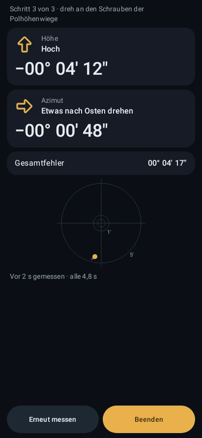 <b>Minuten daneben.</b> Hoch, und etwas nach Osten.</td>
<td valign="top" width="240">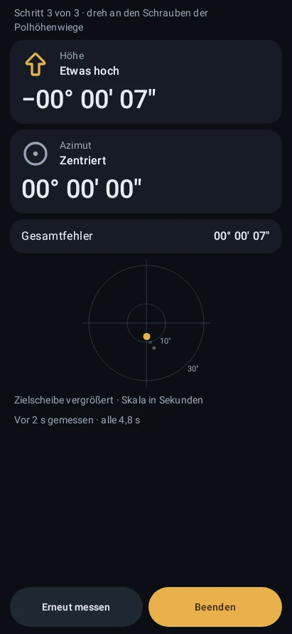 <b>Sekunden daneben.</b> Die Zielscheibe vergrößert; Azimut zentriert.</td>
</tr></table>

<table><tr>
<td valign="top" width="470">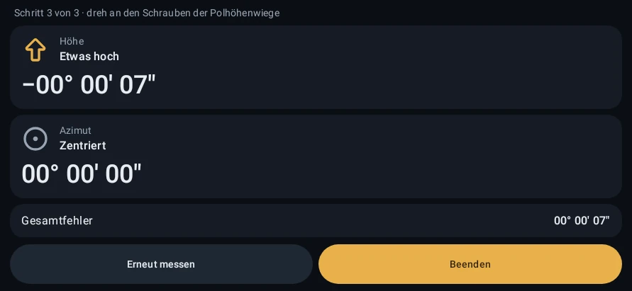 <b>Im Querformat</b> nutzen die Kacheln die Breite; die Zahlen bleiben groß.</td>
</tr></table>

> [!TIP]
> **Seestar**
>
> Auf einer Polhöhenwiege stellst du die Höhe über die Neigung der Wiege ein und den Azimut durch Drehen ihrer Basis. Das Alpaca des Seestar kann seine RA-Achse drehen, und mehr braucht der Assistent nicht.

## 18. Plate Solving und Zentrieren

Plate Solving bestimmt aus dem Muster der Sterne, wohin eine Aufnahme zeigt, ihren Maßstab und ihre Rotation. Yacana führt ASTAP, den bekannten Solver, auf dem Handy selbst aus, ohne Internet: etwa 0,4 s mit der Position der Montierung als Hinweis und etwa 7 s blind auf einem Mittelklasse-Handy mit Aufnahmen des Seestar.

### Eine Aufnahme lösen

Mach unter Aufnahme eine Aufnahme und tippe auf **Lösen**. Yacana sucht zuerst nahe der Position, die die Montierung meldet, und dann, falls nötig, blind. Das Ergebnis zeigt:

- **RA und Dek** der Bildmitte, in J2000;
- die **Rotation** der Kamera;
- den **Maßstab** in Bogensekunden pro Pixel und das Feld in Grad;
- wie lange es gedauert hat, ob nahe der Montierung oder blind, und die verwendete Sterndatenbank.

Tippe auf **Montierung synchronisieren**, um der Montierung zu sagen, dass sie dorthin zeigt, damit ihre nächsten GoTos genauer treffen. Die gelöste Rotation wird zur Kamerarotation für Bildausschnitt und Mosaike ([Kapitel 16](#framing)).

### Anfahren und zentrieren

**Anfahren und zentrieren** erscheint überall, wo du das Teleskop irgendwohin schicken kannst: auf der Himmelskarte, auf der Seite eines Objekts, auf dem Bildschirm des Bildausschnitts und im Fenster **GoTo…** der Montierung. Es schwenkt die Montierung, macht eine Aufnahme mit der Belichtung zum Zentrieren, löst sie, korrigiert die Montierung und wiederholt das, bis die Bildmitte innerhalb der Toleranz liegt, standardmäßig 30″. Der Fortschritt zeigt jeden Schritt, wie weit die letzte Aufnahme entfernt war, und den Versuch; **Stopp** stoppt die Montierung und die Aufnahme. Aufnahmen zum Zentrieren werden nicht gespeichert.

<table><tr>
<td valign="top" width="240">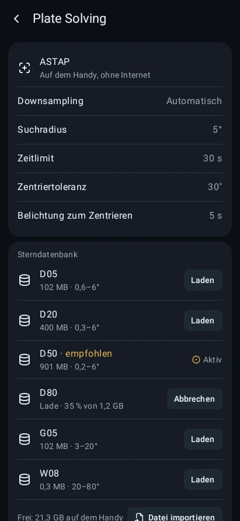 <b>Einstellungen › Plate Solving.</b> Die Optionen von ASTAP und die Sterndatenbanken.</td>
</tr></table>

### Einstellungen für das Plate Solving

Unter *Einstellungen › Plate Solving*, in jedem Profil gespeichert:

| Einstellung | Standard | Was sie macht |
| --- | --- | --- |
| **Downsampling** | Automatisch | ASTAP fasst vor der Sternsuche Pixel zusammen. Automatisch wählt den Faktor nach der Größe der Aufnahme. |
| **Suchradius** | 5° | Wie weit um die Position der Montierung gesucht wird, von 1 bis 180°. Ohne Lösung dort sucht es den ganzen Himmel ab. |
| **Zeitlimit** | 30 s | Für eine Lösung nahe der Montierung und danach blind, von 5 bis 600 s. |
| **Zentriertoleranz** | 30″ | Das Zentrieren endet, wenn die Bildmitte so nah am Ziel ist, von 5 bis 600″. |
| **Belichtung zum Zentrieren** | 5 s | Die Aufnahmen, die das Zentrieren löst, mit dem Gain aus Aufnahme; von 1 bis 60 s. Sie werden nicht gespeichert. |

Die Sterndatenbanken sind auf demselben Bildschirm; [Kapitel 6](#field) erklärt, wie du sie wählst, lädst und importierst.

> [!TIP]
> **Wenn eine Aufnahme nicht gelöst wird**
>
> Prüfe, ob die Aufnahme Sterne hat, ob die Brennweite des Profils stimmt (ASTAP sucht nach diesem Maßstab) und ob die Datenbank zu deinem Feld passt. Wolken, Tau oder eine stark unscharfe Aufnahme sind die üblichen Ursachen.

## 19. Autofokus

Der Autofokus fährt den Fokussierer durch den Fokus, misst an jedem Punkt den HFR der Sterne und legt eine V-Kurve an, um die beste Position zu finden. Er ist eine Portierung des Autofokus von N.I.N.A., mit seinen fünf Kurvenanpassungen, Umkehrspielkompensation und Fokus-Offsets je Filter.

Er braucht einen absoluten Fokussierer (einen, der Schrittpositionen anfährt) und eine Kamera, gerichtet auf ein Feld mit Sternen. Öffne ihn mit **Autofokus** in der Checkliste unter Nacht, auf dem Bildschirm des Fokussierers oder unter Aufnahme: Der Durchgang startet sofort, mit den Optionen aus *Einstellungen › Autofokus*.

### So läuft ein Durchgang

1. Der Fokussierer fährt eine Anzahl Schritte nach außen und nimmt dann bei jedem Schritt nach innen einen Punkt auf: eine Aufnahme, ihre Sterne und deren HFR.
2. Er fügt Punkte hinzu, bis auf jeder Seite des besten so viele liegen, wie er zu Beginn hatte. Das Diagramm füllt sich dabei, mit dem aktuellen Punkt, seiner Belichtung und seinem Filter.
3. Nach dem letzten Punkt legt er die Kurve an, fährt den Fokussierer in den besten Fokus und prüft ihn. Das Ergebnis zeigt die Position, den HFR, die Temperatur, das R² der Anpassung und wo der Fokussierer vorher war.

Tippe auf **Beenden**, um ihn zu schließen. **Abbrechen** während eines Durchgangs bringt den Fokussierer dorthin zurück, wo er war. Schlägt der Durchgang fehl, sagt der Bildschirm warum, der Fokussierer fährt zurück und **Erneut versuchen** startet ihn erneut.

Das Ergebnis bleibt erhalten: Der Bildschirm des Fokussierers zeigt den letzten Autofokus und seine Kurve, die Checkliste unter Nacht zeigt den HFR und wie lange es her ist, und das Tagebuch hält ihn fest.

<table><tr>
<td valign="top" width="240">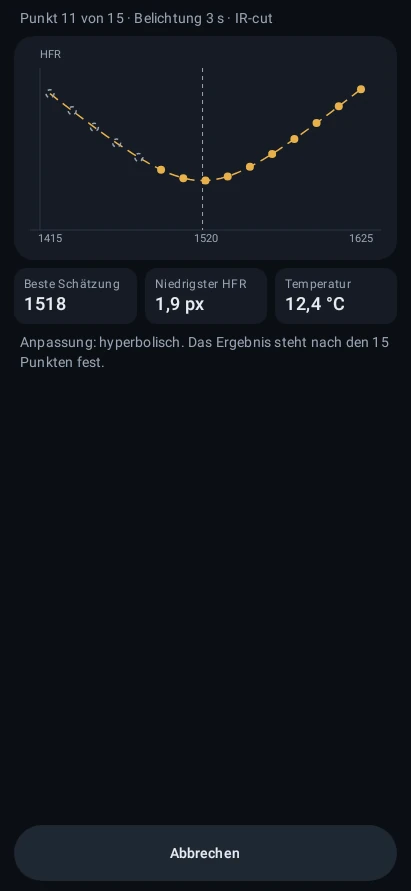 <b>Läuft.</b> Punkt 11 von 15, eine Belichtung von 3 s mit dem IR-Cut-Filter.</td>
<td valign="top" width="240">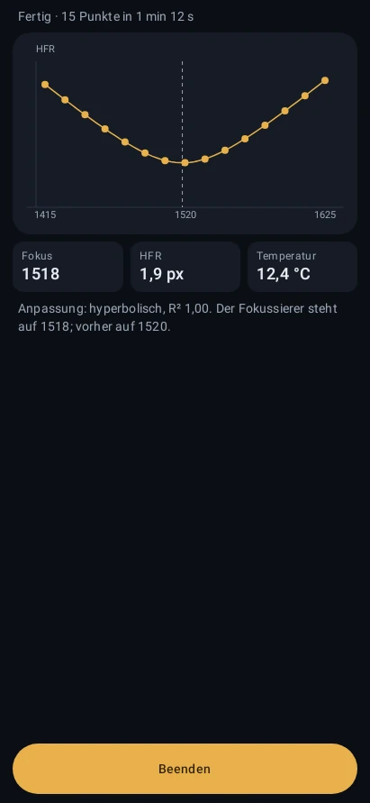 <b>Fertig.</b> 15 Punkte in 1 min 12 s; der Fokussierer fuhr von 1520 auf 1518.</td>
</tr></table>

### Autofokus-Einstellungen

Unter *Einstellungen › Autofokus*, in jedem Profil gespeichert, mit den Standardwerten von N.I.N.A.:

- **Schrittweite:** Fokussiererschritte zwischen den Punkten (50; 15 für den Seestar). Zu klein, und die Kurve bleibt flach; zu groß, und es gibt wenige Punkte nahe dem Fokus.
- **Punkte:** Wie viele Punkte er aufnimmt: Er beginnt mit der Hälfte davon außen (9 Punkte, 4 auf jeder Seite; 15 für den Seestar).
- **Belichtung:** 1 bis 8 s, mit Binning 1×1 oder 2×2, mit dem Gain aus Aufnahme. Nicht gespeichert. 4 s (3 s für den Seestar).
- **Aufnahmen pro Punkt:** 1, 2 oder 3. Mehr Aufnahmen mitteln das Seeing heraus und dauern länger.
- **Anpassung:** Wie der beste Fokus aus den Punkten bestimmt wird: Trendlinie, parabolisch, Trend und parabolisch, hyperbolisch (Standard) oder Trend und hyperbolisch.
- **Umkehrspiel innen, außen:** Schritte, die der Fokussierer beim Richtungswechsel verliert; er fährt um so viel darüber hinaus und kommt zurück.
- **Minimales R²:** Wie gut die Kurve passen muss (0,7). Ohne Minimum bleibt das Ergebnis, außer es ist 15 % schlechter als vorher.
- **Versuche:** Wie oft er neu startet, wenn ein Durchgang fehlschlägt (1).
- **Warten nach Bewegung:** Sekunden, die der Fokussierer nach jeder Bewegung vor der Aufnahme ruht (0).

<table><tr>
<td valign="top" width="240">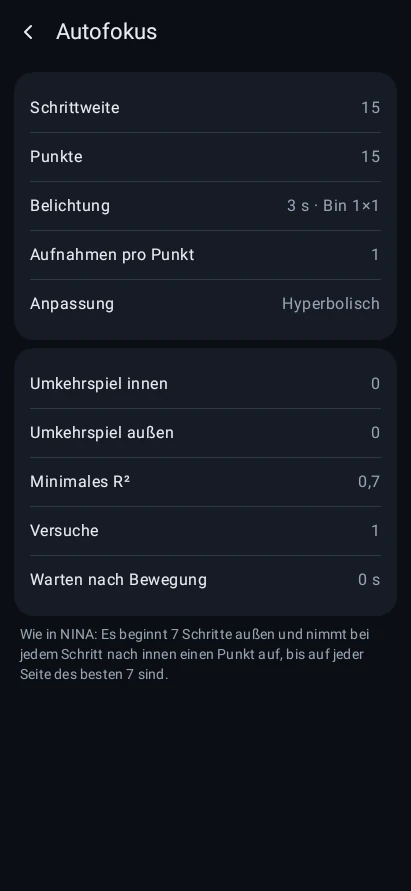 <b>Einstellungen › Autofokus.</b> Die Werte des Seestar.</td>
</tr></table>

### Wenn er fehlschlägt

| Die App sagt | Was tun |
| --- | --- |
| **Der HFR hat sich auf keiner Seite genug geändert** | Nimm eine größere Schrittweite. |
| **Die Kurve erklärt die Punkte zu schlecht** | Seeing oder Wolken haben die Punkte verdorben: mehr Aufnahmen pro Punkt, eine längere Belichtung, oder versuche es später. |
| **Der beste Fokus liegt außerhalb der gemessenen Punkte** | Beginne näher am Fokus: Bewege den Fokussierer von Hand und starte ihn dann erneut. |
| **Im besten Fokus ist der HFR schlechter als davor** | Das Ergebnis wurde nicht übernommen und der Fokussierer fuhr zurück. Prüfe die Bedingungen und versuche es erneut. |
| **Dieser Fokussierer hat keine Positionen zum Anfahren** | Der Autofokus braucht einen absoluten Fokussierer. |

### Automatisches Nachfokussieren während der Nacht

In einer Sequenz starten die Autofokus-Regeln einen Durchgang vor einer Light-Aufnahme, wenn sich die Temperatur ändert, der Filter wechselt, der HFR schlechter wird oder nach einer gewissen Zeit. Sie werden in den Regeln des einfachen Editors ([Kapitel 25](#simple)) oder als Trigger im erweiterten Editor ([Kapitel 26](#advanced)) eingestellt. Schlägt ein Durchgang in der Nacht fehl, fährt der Fokussierer zurück und die Regeln warten auf die nächsten Belichtungen.

Fokus-Offsets je Filter stellst du auf dem Bildschirm des Fokussierers ein ([Kapitel 10](#focuser)): Bei einem Filterwechsel fährt der Fokussierer die Differenz.

---

# Aufnehmen

## 20. Aufnahme

Unter Aufnahme machst du Aufnahmen von Hand: Einzelaufnahmen, um Fokus und Bildausschnitt zu prüfen, oder eine Schleife, die jede Aufnahme speichert. Jede Aufnahme erscheint etwa eine Sekunde nach dem Download, gestretcht, mit gezählten und vermessenen Sternen.

### Eine Aufnahme machen

1. Stelle Belichtung, Gain, Binning und Filter mit den Schaltflächen unter der Aufnahme ein (siehe unten).
2. Tippe auf die runde Schaltfläche. Der Bildschirm zeigt *Belichte · 12 von 20 s*, dann *Lade die Aufnahme…*. Tippe während der Belichtung erneut darauf, um abzubrechen.
3. Die Aufnahme erscheint mit ihrem **HFR** und ihrer Anzahl **Sterne** oben links. Tippe darauf für die Details der letzten Aufnahme.

**Schleife** macht Aufnahmen nacheinander und speichert sie alle, wie Loop in N.I.N.A.; daraus wird **Stopp**, das nach der laufenden Aufnahme endet. Einzelaufnahmen werden nur gespeichert, wenn **Einzelaufnahmen speichern (Schleifen speichern immer)** in den Optionen an ist. Scheitert eine Aufnahme, während die Ausrüstung nicht antwortet oder die Verbindung verloren ist, wartet die Schleife und macht mit der nächsten Aufnahme weiter, sobald die Ausrüstung wieder antwortet.

### Die Einstellungen der Aufnahme

- **Belichtung:** 10, 20, 30, 60 oder 300 s, soweit die Kamera sie erlaubt, oder **Andere** auf dem Ziffernfeld, innerhalb des Bereichs der Kamera.
- **Gain:** Auf dem Ziffernfeld, innerhalb des Bereichs der Kamera, oder die benannten Gain-Werte der Kamera. Er beginnt bei 200, wenn die Kamera es zulässt, wie bei der App des Seestar selbst, und Aufnahmen der Sequenz ohne eigenen Gain nehmen diesen.
- **Binning:** 1×1, 2×2… nur wenn die Kamera Binning beherrscht.
- **Filter:** Mit einem Filterrad: der eingesetzte Filter und die anderen zum Wechseln. Aufnahmen zum Lösen, Zentrieren, Ausrichten oder Fokussieren gehen nie durch **Dark**: Das Rad wechselt vorher zu IR. Durch Dark zeigt die Aufnahme weder HFR noch Sterne, die nur Rauschen wären.

<table><tr>
<td valign="top" width="240">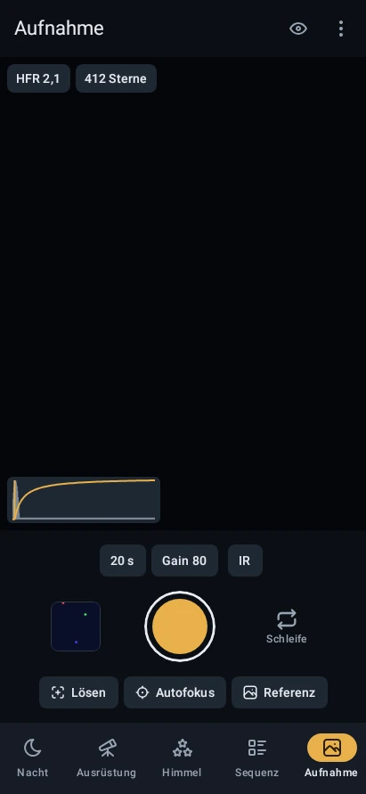 <b>Aufnahme.</b> HFR 2,1 px und 412 Sterne.</td>
</tr></table>

### Die Aufnahme betrachten

- **Zoom:** Spreize die Finger und ziehe, um dich zu bewegen. Doppeltippen wechselt zwischen der ganzen Aufnahme und Pixeln 1:1.
- **Histogramm:** unten links, mit der Stretch-Kurve.
- **Letzte Aufnahme:** Tippe oben links auf HFR und Sterne für das Histogramm, Mittel, Median und Abweichung in ADU, den HFR mit seiner Streuung, die FWHM in Pixeln und in Bogensekunden (ein Moffat-Profil, wie in Hocus Focus) und den Speicherort der Aufnahme.

### Aufnahmeoptionen

Das **⋮** oben öffnet sie:

- **Aufnahmetyp:** Light, Dark, Flat oder Bias. Er kommt in den Dateinamen und den FITS-Header.
- **Ziel, für den Dateinamen:** Der Name des Ordners und der Dateien, etwa *M 31*. Ohne Ziel heißen Aufnahmen *Snapshot*.
- **Einzelaufnahmen speichern:** Schleifen speichern immer.
- **Dithering in Light-Schleifen, alle:** *Aus*, *3* (zu Beginn), *5* oder *10* Aufnahmen. Zwischen den Aufnahmen bekommt die Montierung einen kleinen Stoß, wie ihn der Direct Guider von N.I.N.A. gibt: Das Feld bewegt sich um einige Pixel (standardmäßig 5) um die Stelle, an der die Schleife begann, damit sich das Muster des Sensors im Stack nicht zu Streifen aufbaut. Darks, Flats und Bias werden nie gedithert. Bei einem Seestar, dessen Guiding-Impulse nicht dorthin gehen, wohin sie geschickt werden, springt sie stattdessen mit kleinen GoTos zwischen den 9 Punkten eines Rasters im Abstand von 27″; nach jeder Runde verschiebt sich das Raster um 9″, für insgesamt 81 Stellen.
- **Offset:** Wenn die Kamera einen hat.
- **Auto-Stretch:** Standardmäßig an, wie bei N.I.N.A. Ist er aus, stellen zwei Schieberegler die **Schatten** und die **Mitteltöne** ein.
- **Sterne markieren:** Zeichnet einen Rahmen und den HFR an die hellsten Sterne, wie N.I.N.A.; **Wie viele**, von 10 bis 500.
- **Live-Stack:** **Lights live stacken** und **Farbe des Stacks abgleichen** ([Kapitel 22](#stacking)).
- **Einstellungen:** Die Einstellungen der App.

<table><tr>
<td valign="top" width="240">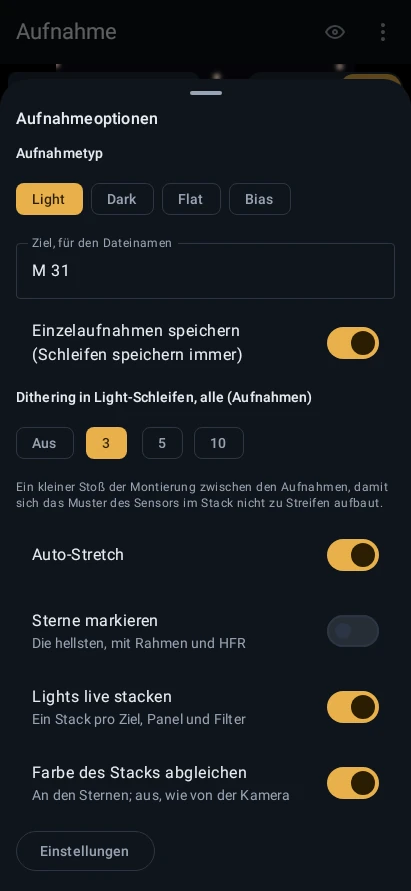 <b>Aufnahmeoptionen.</b></td>
</tr></table>

### Die Schaltflächen unter der Aufnahme

- **Lösen:** Löst die letzte Aufnahme mit ASTAP und zeigt, wohin sie zeigt, mit **Montierung synchronisieren** ([Kapitel 18](#solving)).
- **Autofokus:** Startet mit einem Fokussierer den Autofokus ([Kapitel 19](#autofocus)).
- **Referenz:** Legt das Foto des Caches vom selben Feld über die Aufnahme, mit ihrer Rotation, ihrem Maßstab und Zoom, damit du sie vergleichen kannst: Ist dieser schwache Fleck die Galaxie? Ist die Aufnahme nicht gelöst, wird sie zuerst gelöst. Tippe erneut darauf, um zur Aufnahme zurückzukehren.
- **Das Miniaturbild:** Links der runden Schaltfläche: öffnet den Verlauf der Session ([Kapitel 21](#history)).

<table><tr>
<td valign="top" width="240">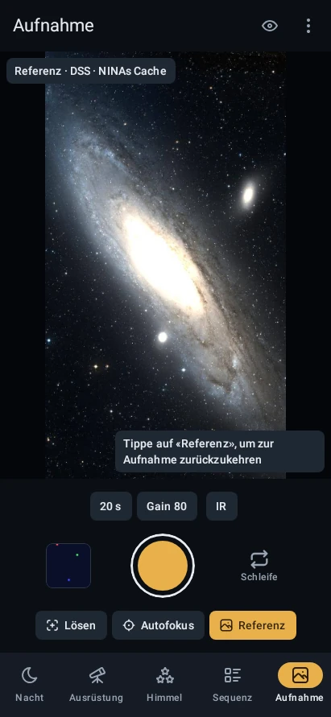 <b>Referenz.</b> Das Foto des Caches vom Feld der Aufnahme.</td>
</tr></table>

<table><tr>
<td valign="top" width="470">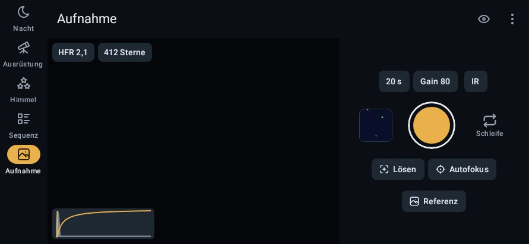 <b>Im Querformat</b> nimmt die Aufnahme die Breite ein und die Bedienelemente wandern zur Seite.</td>
</tr></table>

## 21. Verlauf und Aufnahmequalität

Der Verlauf listet jede in dieser Session gespeicherte Aufnahme mit ihrer Qualität und markiert die durch Wolken oder Licht verdorbenen, damit sie aus dem Stack herausbleiben.

- **Das Diagramm:** der HFR jeder Aufnahme als Linie und ihre Sterne als Balken, mit **AF**, wo ein Autofokus lief.
- **Die Liste,** neueste zuerst: Nummer, Uhrzeit, Filter und Belichtung, HFR und Sterne.
- **Verworfene Aufnahmen** haben deutlich weniger Sterne oder einen viel helleren Hintergrund als der Median der Session und sagen warum: *Wolken*, *wenige Sterne* oder *heller Hintergrund*. Sie bleiben gespeichert; nur der Stack und die Zusammenfassung lassen sie weg.

Das Filtersymbol oben zeigt nur die verworfenen Aufnahmen. Öffne den Verlauf über das Miniaturbild neben der runden Schaltfläche unter Aufnahme.

<table><tr>
<td valign="top" width="240">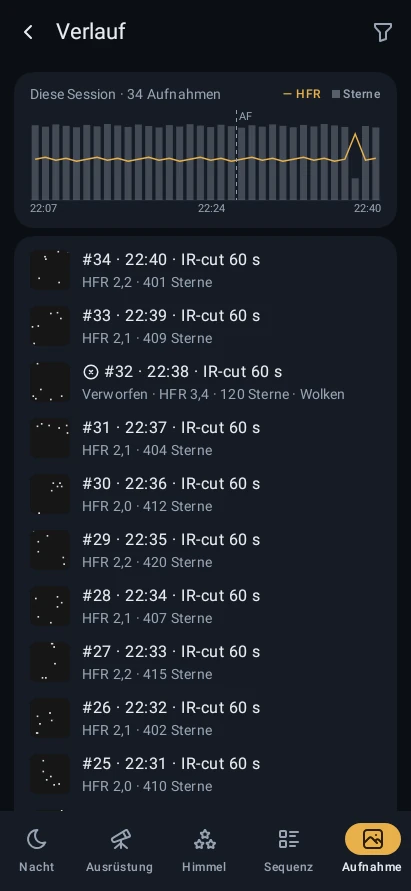 <b>Verlauf.</b> Aufnahme 32 verworfen: Wolken.</td>
</tr></table>

## 22. Live-Stacking

Live-Stacking fügt jede gute Light-Aufnahme einem laufenden Stack hinzu, während die Nacht weitergeht, sodass du das Ziel aus dem Rauschen wachsen siehst. Es ist aus, bis du es willst, weil es Speicher und Akku braucht.

### Einschalten

Schalte in den Optionen unter Aufnahme **Lights live stacken** ein. Ab dann kommt jede gespeicherte Light-Aufnahme in den Stack, aus einer Schleife, einer Sequenz oder als Einzelaufnahme. Die Aufnahmen werden weiterhin einzeln gespeichert, wie immer.

Flats werden auch bei ausgeschaltetem Live-Stacking gesammelt: Sobald die Serie eines Filters komplett ist, werden sie zu seinem Master-Flat, das als `FLATS/MasterFlat_IR.fits` (eines pro Filter) im Ordner deiner Aufnahmen für die nächsten Nächte bleibt, ein 32-Bit-FITS, das auch Siril und PixInsight lesen. Ein eigenes Flat, das du dort mit diesem Namen ablegst, zählt genauso. Auch Darks werden für den Stack behalten, selbst wenn du das Live-Stacking erst danach einschaltest, etwa wenn eine Sequenz mit ihren Darks beginnt.

### So wird gestackt

- **Ein Stack pro Ziel, Panel und Filter,** und pro Belichtung, Gain und Binning. Eine Aufnahme anderer Art speichert den vorherigen Stack und beginnt einen eigenen.
- **Über die Sterne ausgerichtet:** Verschiebung, Rotation und Maßstab, auf die erste Aufnahme des Stacks.
- **Satelliten und Flugzeuge entfernt** durch 3-Sigma-Ausschluss.
- **Fortlaufend kalibriert:** mit dem Master-Dark der Nacht mit derselben Belichtung, Gain, Offset und Binning bei der nächstliegenden Sensortemperatur, und mit dem Master-Flat seines Filters aus dem Ordner FLATS.
- **Farbe an den eigenen Sternen abgeglichen,** mit **Farbe des Stacks abgleichen** an; ist es aus, so, wie die Kamera sie liefert.
- **Verworfene Aufnahmen bleiben draußen,** ebenso Aufnahmen, deren Sterne nicht passen.

<table><tr>
<td valign="top" width="240">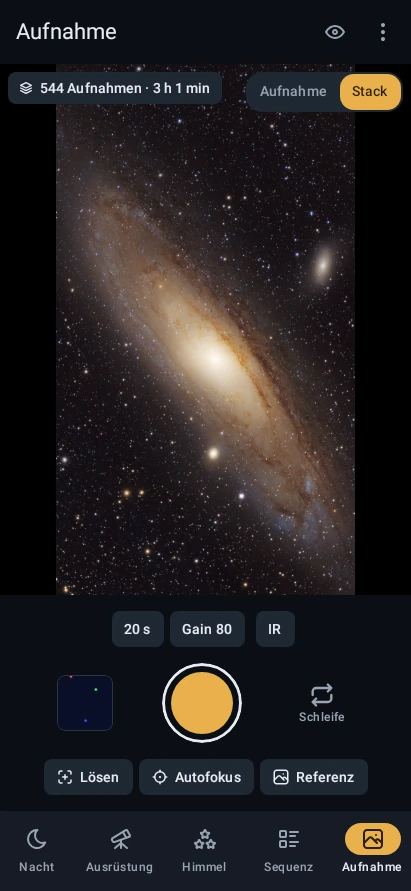 <b>Der Stack.</b> M 31 aus 544 Aufnahmen zu 20 s mit einem Seestar, nachträglich bearbeitet.</td>
</tr></table>

### Ein Mosaik

In einem Mosaik nimmt die Sequenz jedes Panel ganz auf, dann das nächste, und jedes Panel hat seinen eigenen Stack, kalibriert mit seinen Darks und Flats. Mit **Stack** zeigt Aufnahme das ganze Mosaik, während es entsteht: jedes Panel an seiner Stelle am Himmel, wie seine Zentrierung es gelöst hat, sein Hintergrund dort, wo es sich mit den Nachbarn überlappt, an deren angeglichen und die Nähte verblendet, und eine Streckung und ein Farbabgleich für alles. Das Panel, das gerade gestackt wird, ist golden umrandet und wächst mit jeder Aufnahme; die noch fehlenden sind gestrichelt. Es ist eine Ansicht in einem Viertel der Größe, bei einem großen Mosaik kleiner, damit es in den Speicher des Handys passt, und wird als JPG gespeichert, etwa *2026-10-14/M 31/STACK/…_STACK_MOSAIC.jpg*, nach jedem Panel und am Ende der Sequenz. Das fertige Mosaik setzt du aus den Stacks der Panels in Siril oder PixInsight zusammen.

<table><tr>
<td valign="top" width="240">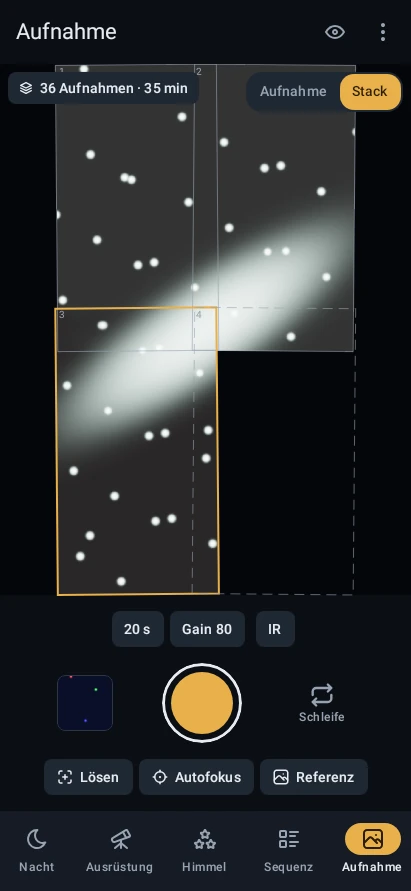 <b>Ein Mosaik.</b> Das dritte von vier Panels, im Wachsen.</td>
</tr></table>

### Zusehen

Sobald ein Stack existiert, wechselt ein Umschalter **Aufnahme** | **Stack** oben rechts unter Aufnahme zwischen der letzten Aufnahme und dem Stack. Tippe auf die Beschriftung des Stacks, etwa *544 Aufnahmen · 3 h 1 min*, für sein Fenster:

- **Gestackt:** Aufnahmen darin, von denen, die ankamen.
- **Verworfen:** Wie viele herausgelassen wurden und warum.
- **Zeit:** Gesamtintegration und die Aufnahmen.
- **Ausrichtung:** Über die Sterne, und wie stark sich die letzte gedreht hat.
- **Farbe:** An den Sternen abgeglichen, oder wie von der Kamera.
- **Dark** und **Flat:** das aktive Dark und Master-Flat, etwa *MasterFlat_IR.fits vom 11. Oktober*, oder welche fehlen.

Unter Nacht zeigt die Kachel der letzten Aufnahme den Stack, während eine Sequenz mit eingeschaltetem Stack läuft; tippe darauf, um ihn unter Aufnahme zu öffnen.

### Speichern

Der Stack speichert sich alle 10 Minuten selbst, während er wächst, und wenn die Schleife oder die Sequenz endet: ein lineares 32-Bit-FITS für die Bearbeitung und ein JPG, wie es der Bildschirm zeigt, im Ordner der Aufnahmen mit `STACK` als Typ. **Speichern** speichert ihn sofort. Wird die App geschlossen, macht der Stack mit der nächsten Aufnahme desselben Ziels und Filters weiter.

**10 Darks mit 20 s aufnehmen** (mit der Belichtung der Aufnahmen) nimmt jetzt Darks für den Stack auf. Mit einem Dunkelfilter geht das automatisch; ohne bittet dich die App, zuerst das Teleskop abzudecken. **Halten, um neu zu beginnen** leert den Stack.

<table><tr>
<td valign="top" width="240">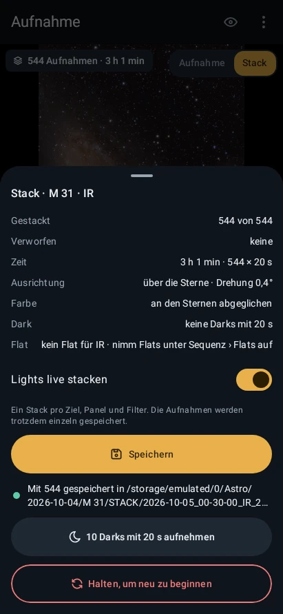 <b>Das Fenster des Stacks.</b> Noch keine Darks und kein Flat für diesen Filter.</td>
</tr></table>

## 23. Flats, Darks und Bias

Kalibrieraufnahmen entfernen, was Sensor und Optik hinzufügen. Yacana nimmt Flats mit einem Assistenten auf und Darks und Bias mit den Regeln der Sequenz, und der Live-Stack nutzt sie alle.

### Der Flats-Assistent

Öffne ihn mit der Vorlage **Flats** unter Sequenz. Er bestimmt die Belichtung selbst und nimmt die Flats jedes Filters bei einer Zielhelligkeit auf. Das Licht ist dieses Handy, oder das Flat-Panel, wenn eines verbunden ist.

1. Prüfe die **Ziel-ADU**, standardmäßig 30.000 ± 5 %, mit dem angezeigten Maximum der Kamera. Stelle die **Panel-Helligkeit** ein, wenn du eines nutzt.
2. Wähle **Aufnahmen pro Filter** (20, 30 oder 50) und die **Filter**.
3. Tippe auf **Flats starten**. Mit diesem Handy als Licht hast du dann 30 s, um es mit dem Bildschirm nach unten auf das Teleskop zu legen, sodass er das Objektiv bedeckt, mit einem Blatt weißem Papier dazwischen. Ein Piepton startet die Flats, und der Bildschirm wird bei voller Helligkeit weiß, auch im Rotmodus; ein weiterer Piepton beendet sie. Zum Pausieren tippe zweimal auf den weißen Bildschirm; **Fortsetzen** lässt wieder 30 s.
4. Jeder Filter zeigt *suche die Belichtung…*, dann seine Belichtung und wie viele fertig sind, mit dem Mittelwert der letzten Aufnahme in ADU. **Pause** und **Gedrückt halten zum Stoppen** sind unten. Am Ende nimmt er hinter dem Dark-Filter des Seestar 10 Bias auf: Ihr Niveau kommt in jedes Master-Flat, damit das Live-Stacking auch ohne Darks dadurch teilt.

Ist selbst bei der kürzesten Belichtung zu viel Licht da oder bei der längsten zu wenig, stoppt der Assistent und sagt, was zu ändern ist: mehr oder weniger Papier auf dem Bildschirm des Handys, oder die Helligkeit des Panels.

<table><tr>
<td valign="top" width="240">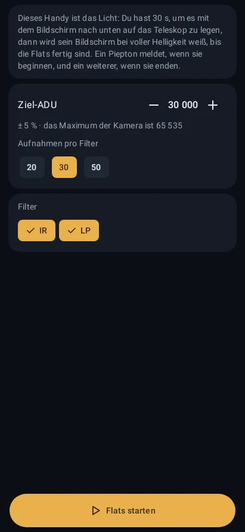 <b>Einrichten.</b> Dieses Handy als Licht, zwei Filter.</td>
<td valign="top" width="240">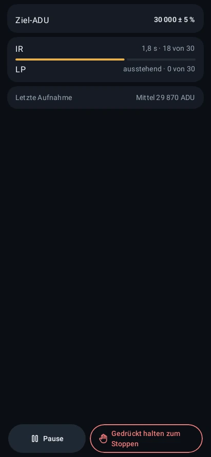 <b>Läuft.</b> Die IR-Flats bei 1,8 s, Mittel 29.870 ADU.</td>
</tr></table>

### Darks und Bias in der Sequenz

Im einfachen Editor legt die Schaltfläche **Darks** unter **Regeln** fest, wann Darks aufgenommen werden, mit Belichtung, Gain und Binning jeder Light-Aufnahme und dem Dunkelfilter:

- **Am Anfang** der Nacht.
- **Wenn sich die Sensortemperatur ändert**, um 2, 3 oder 5 °C, damit der Live-Stack die Serie mit der nächstliegenden Temperatur nutzt.
- **Am Ende, mit dem Bias** (standardmäßig an).
- **Aufnahmen pro Serie:** 5, 10 oder 20. Das Fenster sagt, wie lange jede Serie ohne Lights dauert.

Ohne Dunkelfilter sind Darks am Anfang oder nach Temperatur nicht möglich; am Ende bittet dich die App, das Teleskop abzudecken. Die Darks und Bias vom Anfang und vom Ende kommen in den Ordner des Ziels, neben LIGHT: die vom Anfang in den des ersten Ziels, die vom Ende in den des letzten.

<table><tr>
<td valign="top" width="240"> <b>Darks.</b> 10 Aufnahmen zu 60 s dauern etwa 11 min.</td>
</tr></table>

### Von Hand

Stelle unter Aufnahme in den Optionen den **Aufnahmetyp** auf Dark, Flat oder Bias und nimm wie gewohnt auf: Die Aufnahmen kommen nach Typ in ihren eigenen Ordner.

---

# Sequenzen

## 24. Der Bereich Sequenz

Eine Sequenz ist der Plan der Nacht: welche Ziele, mit welchen Belichtungen und was drumherum geschieht. Yacana hat zwei Editoren für denselben Plan: einen einfachen, der die Nacht auf eine Zeitleiste legt, und einen erweiterten mit den Containern, Triggern und Bedingungen von N.I.N.A. Du kannst zwischen ihnen wechseln, ohne etwas zu verlieren.

- **Heute Nacht:** Der Plan, den die Nacht ausführen wird, mit seinen Zielen und Zeiten. Tippe darauf, um den Editor zu öffnen. Während er läuft, steht das dort.
- **Gespeichert:** Deine gespeicherten Sequenzen, mit ihren Zielen und ihrer Dauer. Tippe auf eine, um sie als Plan für heute Nacht zu laden; **Rückgängig** holt den Plan zurück, den du hattest. Drücke eine Zeile einen Moment lang, um sie mit **Gedrückt halten zum Löschen** zu löschen. Um den Plan für heute Nacht zu speichern, nutze das Menü **⋮** des Editors.
- **Vorlagen:** Ausgangspunkte für einen neuen Plan (siehe unten).
- **Neu:** Ein leerer Plan, im Editor.

### Vorlagen

- **Ein Ziel die ganze Nacht:** startet einen leeren Plan und öffnet Himmel. Das Ziel, das du als Nächstes hinzufügst, füllt die Nacht bis zur Morgendämmerung.
- **Mehrere Ziele** und **Mosaik:** starten einen leeren Plan und öffnen Himmel, um den Bildausschnitt der Ziele oder des Mosaiks festzulegen.
- **Flats:** öffnet den Flats-Assistenten ([Kapitel 23](#calibration)).

Was vor einer Vorlage da war, kommt mit **Rückgängig** zurück.

<table><tr>
<td valign="top" width="240"> <b>Sequenz.</b> Heute Nacht, gespeicherte Sequenzen und Vorlagen.</td>
</tr></table>

## 25. Der einfache Editor

Der einfache Editor zeigt den Plan für heute Nacht als Zeitleiste und eine Kachel pro Ziel. Er warnt mit einem Symbol und Worten, wenn der Plan nicht vor die Morgendämmerung passt.

### Ziele hinzufügen

Ziele kommen aus Himmel: Lege den Bildausschnitt für eines fest und tippe auf **Zur Sequenz hinzufügen** ([Kapitel 16](#framing)). **Ziel hinzufügen** am Ende der Liste bringt dich dorthin. Ein Mosaik kommt als ein Ziel mit seinen Panels.

### Plan für heute Nacht

Die Zeitleiste zeigt jedes Ziel von seinem Beginn bis zu seinem Ende und die Morgendämmerung. Läuft der Plan über die astronomische Morgendämmerung hinaus, sagt sie, welches Ziel wann enden würde, und die Endzeit dieses Ziels nimmt die Warnfarbe an. **Rückgängig** macht die letzte Änderung rückgängig, bis zu 50 Änderungen zurück. Die Zeiten stammen aus dem, was deine Ausrüstung in ihrer letzten Nacht brauchte: jede Aufnahme über ihre Belichtung hinaus, jedes Dithering, jeder Autofokus und jedes Zentrieren. Autofokus alle so viele Minuten und beim Filterwechsel wird mitgezählt; der nach Temperatur oder HFR lässt sich nicht vorhersehen.

### Die Kachel eines Ziels

- Sein Name, wann es endet, und das Papierkorbsymbol, um es zu entfernen.
- Bei einem Mosaik die Anzahl seiner Panels; die Belichtungen gelten für jedes Panel.
- Eine Zeile pro Filter und Belichtung, etwa *IR · 60 s × 45 pro Panel*, mit erledigten und gesamten Aufnahmen. Tippe auf eine Zeile, um sie zu ändern; **Belichtungen** fügt einen weiteren Filter hinzu.

<table><tr>
<td valign="top" width="240"> <b>Heute Nacht.</b> M 33 würde um 07:25 enden, nach der Morgendämmerung.</td>
<td valign="top" width="240"> <b>Belichtungen.</b> Das Ziffernfeld zeigt, wie lange und bis wann.</td>
</tr></table>

### Belichtungen

Das Fenster legt eine Zeile der Belichtungen eines Ziels fest: den **Filter**, die **Zeit** (10, 30, 60 oder 120 s, oder **Andere**) und die **Anzahl Aufnahmen** auf dem Ziffernfeld. Während du tippst, zeigt es, wie lange sie dauern und bis wann, oder dass sie nach der Morgendämmerung enden würden. **Speichern** übernimmt sie; **Diese Belichtungen entfernen** löscht die Zeile, wenn das Ziel mehr als eine hat.

### Regeln

Die Kachel **Regeln** listet, was die Nacht außer den Aufnahmen tut. Ein neuer Plan kommt mit:

- **Zu Beginn entparken**, und **Tauheizung an**, wenn die Ausrüstung einen Heizungsschalter hat.
- **Bei Ankunft zentrieren:** Jedes Ziel und jedes Panel eines Mosaiks wird vor seinen Aufnahmen per Plate Solving zentriert.
- **Dithering alle 3 Aufnahmen**, ohne Guider.
- **Autofokus bei ΔT > 1 °C**, mit einem Fokussierer.
- **Neu zentrieren bei Drift > 1′:** Vor jeder Light-Aufnahme wird die vorige gelöst; ist das Feld mehr als 1′ vom Ziel abgedriftet, wird es neu zentriert. Es ersetzt die Nachführkontrolle.
- **Darks und Bias am Ende**: je 10, für jede Belichtung, jedes Gain, jeden Offset und jedes Binning der Lights.
- **Am Ende parken**, und die Heizung aus.

Die Schaltflächen darunter ändern sie:

- **Autofokus:** Vor jeder Light-Aufnahme läuft ein Autofokus, wenn eines davon zutrifft, wie die Trigger von N.I.N.A.:
  - **Wenn sich die Temperatur ändert**, um 0,5 °C, 1 °C, 2 °C oder 5 °C;
  - **Bei Filterwechsel;**
  - **Wenn der HFR schlechter wird**, um 5, 10 oder 20 %;
  - **Regelmäßig:** 15, 30, 60 oder 120 min, oder eine andere Zeit.

  Schlägt ein Autofokus fehl, warten sie auf die nächsten Belichtungen.
- **Darks:** Am Anfang, wenn sich die Sensortemperatur ändert, am Ende mit dem Bias, und wie viele jedes Mal ([Kapitel 23](#calibration)).
- **Neu zentrieren:** an oder aus, und wie weit das Feld driften darf: 1′, 2′, 5′ oder 10′, jeweils auch in Pixeln der verbundenen Kamera. Unter 20 px, etwa so viel, wie ein Dithering bewegt, zentriert es nie neu; bei einer Weitwinkelkamera ist das mehr als jede Auswahl, und das Blatt sagt es. Mit guter Polausrichtung zentriert es ein- oder zweimal pro Stunde neu.
- **Dithering:** an oder aus, und alle 1, 3, 5 oder 10 Aufnahmen, für die Lights aller Ziele. Jedes Dithering wartet, bis die Montierung zur Ruhe kommt. Bei einem Seestar oder einer Montierung ohne Guiding-Impulse geht jedes Dithering von der Plate-Solve-Lösung der letzten Aufnahme aus und fährt zum Ziel plus seinem Rasterpunkt, macht also auch die Drift rückgängig, wie es die eigene App des Seestar tut.
- **Tauheizung**, wenn die verbundene Ausrüstung eine hat: an oder aus während der Nacht, und ihre Leistung, wenn sie regelbar ist. Sie verbraucht Akku: In trockenen, milden Nächten ausschalten.

Für andere Regeln, etwa auf das Aufgehen eines Ziels warten oder bis zu einer Uhrzeit wiederholen, öffne den Plan im erweiterten Editor.

### Speichern und starten

Das Menü **⋮** hat **In meinen Sequenzen speichern**. **Starten** unten startet die Nacht, sobald die Ausrüstung verbunden ist; während sie läuft, wird die Schaltfläche zu **Gedrückt halten zum Stoppen**. Du kannst den Plan auch während des Laufs bearbeiten: Die Änderungen gelten für das, was noch kommt.

<table><tr>
<td valign="top" width="240"> <b>Autofokus-Regeln.</b></td>
<td valign="top" width="240"> <b>Neu zentrieren.</b> Innerhalb von 1′ vom Ziel.</td>
<td valign="top" width="240"> <b>Dithering.</b> Alle 3 Aufnahmen.</td>
</tr></table>

## 26. Der erweiterte Editor

Der erweiterte Editor ist der erweiterte Sequenzer von N.I.N.A. als Touch-Liste: Container, die du öffnest, Anweisungen, Trigger und Bedingungen, umsortiert durch Ziehen, mit Rückgängig und einer Prüfung der Nacht, bevor sie beginnt.

Öffne ihn mit **Erweitert** oben im einfachen Editor. Er öffnet den Plan für heute Nacht komplett. Fügst du hinzu, was der einfache Editor nicht zeigen kann, etwa eine Bedingung oder einen parallelen Container, wird heute Nacht ab dann nur noch im erweiterten Editor bearbeitet: Der einfache Editor zeigt **Heute Nacht wird unter Erweitert bearbeitet** mit **In Erweitert öffnen** und der Liste der Ziele.

### Der Aufbau der Nacht

- **Nacht,** die oberste Ebene, mit den **Triggern für die ganze Nacht** und drei Bereichen:
- **Start:** was zuerst passiert, vor den Zielen, etwa Entparken oder das Kühlen der Kamera. Was auf ein Ziel zeigt, gehört nicht hierher.
- **Ziele:** eines nach dem anderen, in dieser Reihenfolge. Jedes Ziel enthält seine Anweisungen.
- **Ende:** nach den Zielen: Darks, Parken und Ausschalten.

Eine Pfadleiste oben zeigt, wo du bist, etwa *Nacht › Ziele › M 33*. Die Kachel jeder Ebene sagt, wie sie läuft: einmal oder wiederholt durch ihre Bedingungen, die nach jeder Anweisung geprüft werden.

<table><tr>
<td valign="top" width="240"> <b>Nacht.</b> Ein Autofokus-Trigger und die drei Bereiche.</td>
<td valign="top" width="240"> <b>Ein Ziel.</b> Wiederholt bis 02:00.</td>
</tr></table>

### Mit Elementen arbeiten

- **Öffne** einen Container, indem du darauf tippst; tippe auf eine Anweisung, um ihre Einstellungen zu ändern.
- **Hinzufügen** mit der Schaltfläche unten, **Zu … hinzufügen**, die den Katalog öffnet. **Bedingung** und **Trigger** auf der Kachel der Ebene öffnen ihn bei dieser Art.
- **Umsortieren** durch Ziehen am Griff eines Elements oder über sein Menü **⋮**.
- **Das Menü ⋮** eines Elements: *Öffnen*, *Ziel ändern*, *Umbenennen*, *Einstellungen*, *Nach oben*, *Nach unten*, *Verschieben nach…*, *Duplizieren*, *Als Vorlage speichern* und *Löschen*.
- **Rückgängig** ist oben.

Während die Nacht läuft, werden erledigte Elemente als fertig markiert und das laufende hervorgehoben. Beide sind gesperrt; der Rest lässt sich weiter ändern.

### Der Katalog

Der Katalog hat ein Suchfeld und Schaltflächen nach Art: Kamera, Montierung, Fokus, Filter, Werkzeuge, Container, Trigger, Bedingungen und Vorlagen. Was dort, wo du bist, nicht hingehört, ist ausgegraut, mit dem Grund, etwa *Nur innerhalb eines Ziels*.

<table><tr>
<td valign="top" width="240"> <b>Der Katalog.</b> Was auf ein Ziel zeigt, ist unter Start ausgegraut.</td>
</tr></table>

| Art | Element | Was es macht |
| --- | --- | --- |
| **Kamera** | Belichtungen | Lights, Darks oder Bias: Filter, Zeit, Anzahl Aufnahmen und Dithering |
| **Kamera** | Kamera kühlen · Kamera aufwärmen | Nach und nach auf eine Temperatur, oder langsam zurück vor dem Ausschalten |
| **Montierung** | Entparken · Parken | Verlässt die Parkposition oder fährt in sie zurück |
| **Montierung** | Anfahren und zentrieren | GoTo zum Ziel und Plate Solving, bis auf 1′; nur innerhalb eines Ziels |
| **Montierung** | Ziel anfahren | GoTo zum Ziel ohne Zentrieren; nur innerhalb eines Ziels |
| **Montierung** | Nachführung stoppen | Die Montierung bleibt stehen |
| **Fokus** | Autofokus · Fokussierer bewegen | Ein Durchgang mit V-Kurve, oder auf eine Position |
| **Filter** | Filter wechseln | Das Rad setzt einen anderen Filter ein |
| **Werkzeuge** | Schalter setzen | Etwa die Tauheizung, an oder aus |
| **Werkzeuge** | Bis Uhrzeit warten · Eine Weile warten · Auf Höhe warten | Geht zu einer Uhrzeit heute Nacht weiter, nach einigen Minuten oder wenn das Ziel eine Höhe erreicht |
| **Werkzeuge** | Notiz | Eine Notiz im Tagebuch der Nacht |
| **Container** | Ziel | Ein Ziel aus Himmel, mit seinem Bildausschnitt; kommt mit «Anfahren und zentrieren» |
| **Container** | Sequenziell · Parallel | Seine Anweisungen eine nach der anderen oder gleichzeitig, etwa auf eine Uhrzeit warten, während die Kamera kühlt |
| **Trigger** | Autofokus bei Temperaturänderung · regelmäßig · bei Filterwechsel · wenn der HFR steigt | Ein Autofokus vor der nächsten Aufnahme, wenn seine Bedingung zutrifft |
| **Trigger** | Neu zentrieren bei Drift | Löst und korrigiert, wenn das Ziel um mehr als 1′ bis 10′ (mindestens 20 px) driftet |
| **Trigger** | Darks bei Temperaturänderung | Darks mit dem Dunkelfilter, wenn sich der Sensor um 2, 3 oder 5 °C ändert, für den Live-Stack |
| **Bedingung** | N-mal wiederholen · Bis Uhrzeit wiederholen · Wiederholen, solange hoch | Wiederholt den ganzen Container |
| **Vorlage** | Ziel mit Autofokus · deine eigenen | Ein Ziel aus Himmel mit Anfahren und Zentrieren, Autofokus und Belichtungen; oder jeder Block, den du als Vorlage gespeichert hast |

### Die Nacht prüfen

Der Editor prüft den Plan, während du ihn baust. Wenn heute Nacht etwas schiefgehen würde, zählt ein Badge oben die Warnungen; tippe darauf für **Nacht prüfen** und tippe auf eine Warnung, um zu ihr zu gelangen. Warnungen hindern dich nie am Speichern oder Starten. Dazu gehören:

- eine Anweisung, die ein Ziel braucht, außerhalb eines Ziels, oder Lights ohne Ziel;
- ein Parken vor Aufnahmen, Fokus oder einem GoTo ohne *Entparken* davor;
- Lights ohne *Anfahren und zentrieren* davor oder mit gestoppter Nachführung;
- ein Filter, den das Rad nicht hat, oder das Kühlen einer Kamera, die nicht kühlt;
- Darks, aufgenommen, während sich die Kamera aufwärmt;
- zwei parallele Elemente, die gleichzeitig dasselbe Gerät nutzen.

### Zurück zum einfachen Plan

Die Kachel des einfachen Editors oder das Menü **⋮** des erweiterten Editors hat **Gedrückt halten für den einfachen Plan**. Es entfernt, was nur der erweiterte Editor kennt, und behält die Ziele mit ihren Belichtungen. Dasselbe Menü hat **In Meine Sequenzen speichern**.

<table><tr>
<td valign="top" width="240"> <b>Unter Erweitert bearbeitet.</b> Der einfache Editor zeigt die Ziele.</td>
</tr></table>

> [!NOTE]
> **Für N.I.N.A.-Nutzer**
>
> Der erweiterte Editor folgt dem Sequenzer von N.I.N.A.: dieselben Arten von Containern, Triggern und Bedingungen, ausgeführt in derselben Reihenfolge. Die eigenen Sequenzdateien von N.I.N.A. werden nicht importiert, und Anweisungen, die von Windows oder vom Guiding abhängen, gibt es nicht.

## 27. Die Nacht ausführen

Starte die Nacht mit **Nacht starten** unter Nacht oder mit **Starten** im Editor. Ab dann läuft die Session in einem Vordergrunddienst: Du kannst den Bildschirm ausschalten und das Handy weglegen.

### Nacht, während sie läuft

Alles, was du brauchst, passt ohne Scrollen auf einen Bildschirm:

- **Das Ziel:** sein Name, Panel und Filter, und seine Höhe mit einem Pfeil für Auf- oder Untergang.
- **Die Aufnahme:** ein Ring mit den verbleibenden Sekunden, *Aufnahme 35 von 120*, der Filter und das Gain.
- **Fortschritt:** der Prozentsatz der Sequenz und wann sie endet, gemessen an der astronomischen Morgendämmerung. Nach ein paar Aufnahmen folgt es dem, was die Schritte heute Nacht brauchen.
- **Letzte Aufnahme:** ihr Miniaturbild, ob sie gut oder verworfen war, ihr HFR und ihre Sterne, und die HFR-Kurve der Nacht. Bei eingeschaltetem Live-Stacking zeigt sie den Stack: Tippe darauf, um ihn unter Aufnahme zu öffnen.
- **Nächstes:** was kommt, etwa der nächste Autofokus, der Wechsel zum nächsten Ziel und das Parken, mit ihren Uhrzeiten.

**Pause** stoppt sofort, verwirft die laufende Aufnahme, und die Nachführung läuft weiter; daraus wird **Fortsetzen**, das bei derselben Anweisung mit den schon gemachten Aufnahmen weitermacht. **Gedrückt halten zum Stoppen** beendet die Sequenz.

<table><tr>
<td valign="top" width="240"> <b>Läuft.</b> Endet um 06:56, nach der Morgendämmerung um 06:44.</td>
<td valign="top" width="240"> <b>Mit Live-Stacking</b> der Stack in der Kachel.</td>
</tr></table>

### Anderswo in der App

Die Session-Leiste auf jedem anderen Bildschirm zeigt die Aufnahme und lässt dich pausieren ([Kapitel 4](#tour)), und die Benachrichtigung zeigt den Fortschritt auf dem Sperrbildschirm. Die Sequenz und der Bereich Aufnahme teilen sich die Kamera: Stoppe eine Schleife unter Aufnahme, bevor du die Nacht startest.

### Bei ausgeschaltetem Bildschirm

Yacana hält Prozessor und WLAN des Handys wach, solange die Session läuft, und bindet den Verkehr der Ausrüstung an ihr WLAN, auch wenn es kein Internet hat. Im Referenztest lief es 8,5 Stunden über Nacht mit einem Seestar, 503 volle Aufnahmen, ohne Neustart und ohne Lücke über 6 s, bei 1,7 % Akku pro Stunde. Erteile vorher die Akku-Berechtigungen ([Kapitel 33](#permissions)).

Solange Yacana auf dem Bildschirm ist, bleibt der Bildschirm an und das Handy sperrt sich nicht. Bei eingeschaltetem Bildschirm hält Android das WLAN auf voller Geschwindigkeit und verbindet sich nach einem Abbruch in Sekunden wieder mit dem WLAN der Ausrüstung; bei ausgeschaltetem Bildschirm tut es das unter Umständen erst, wenn du ihn einschaltest. Drücke wie gewohnt die Ein-/Aus-Taste, um ihn auszuschalten: Die Session läuft weiter. Für eine ganze Nacht mit eingeschaltetem Bildschirm nutze den Rotmodus bei geringer Helligkeit und eine Powerbank.

### Wenn App oder Handy neu starten

Schließt Android die App oder startet das Handy neu, nimmt die Session sich innerhalb einer Minute selbst wieder auf; nach einem Neustart, sobald du das Handy zum ersten Mal entsperrst. Höchstens die laufende Aufnahme geht verloren; schon gespeicherte Aufnahmen werden nie beschädigt, weil jede in eine temporäre Datei geschrieben und dann umbenannt wird. Das Tagebuch hält *Die App wurde geschlossen und hat die Sequenz fortgesetzt* fest.

## 28. Warnungen und sichere Stopps

Eine unbeaufsichtigte Nacht endet gut oder stoppt sicher. Jede Warnung sagt, was passiert ist, was die App tut und was du tun kannst.

### Wenn die Verbindung verloren geht

Antwortet die Ausrüstung nicht mehr, geht die Sequenz in eine **sichere Pause**: Die Belichtung stoppt und die Nachführung bleibt an. Die Warnung, unter Nacht und als Benachrichtigung mit Ton, zeigt die Versuche und die verbleibende Zeit bis zu einem sicheren Stopp. Die App versucht es alle 10 s erneut.

- **Jetzt erneut versuchen** versucht es sofort erneut.
- **Details** öffnet Ausrüstung.
- **Gedrückt halten zum Stoppen** beendet die Sequenz.

Prüfe, ob das Handy noch im WLAN der Ausrüstung ist und ob die Ausrüstung Strom hat. Kommt die Verbindung zurück, geht die Sequenz weiter, und das Tagebuch hält fest, wie lange sie weg war.

### Sicherer Stopp

Ein sicherer Stopp beendet die Session, wenn:

- die Verbindung nicht in der eingestellten Zeit zurückkommt (standardmäßig 2 min);
- die Sequenz auf eine Weise fehlschlägt, von der sie sich nicht erholen kann;
- der Akku des Handys unter den eingestellten Stand fällt (standardmäßig 20 %), und immer unter 10 %, außer es lädt.

Die Belichtung stoppt und die Montierung parkt oder stoppt die Nachführung, wie das Profil es vorgibt. War die Verbindung verloren, geschieht das, sobald sie zurück ist. Die Warnung sagt dann, was getan wurde; **Verstanden** schließt sie.

<table><tr>
<td valign="top" width="240"> <b>Sichere Pause.</b> Ein sicherer Stopp in 1 min 18 s, wenn die Verbindung nicht zurückkommt.</td>
<td valign="top" width="240"> <b>Sicherer Stopp.</b> Die Montierung geparkt.</td>
</tr></table>

### Sicherheitseinstellungen

Unter *Einstellungen › Sicherheit*, je Profil:

- **Sicherer Stopp:** **Parkt die Montierung** oder **Stoppt die Nachführung**. Der Seestar kommt mit Parken, das seinen Arm einklappt.
- **Bei Verbindungsverlust:** Wie lange die sichere Pause wartet: 1, 2, 5 oder 10 min.
- **Akku des Handys schwach:** 15, 20 oder 30 %. Unter 10 % stoppt es immer; nie beim Laden.

<table><tr>
<td valign="top" width="240"> <b>Einstellungen › Sicherheit.</b></td>
</tr></table>

## 29. Der Morgen danach

Wenn die Sequenz endet, zeigt Nacht die Zusammenfassung der Nacht, bis du sie schließt.

- Wie und wann sie endete: beendet, von Hand gestoppt, ein sicherer Stopp oder ein Fehler, und ob die Montierung geparkt hat.
- **Nutzbare Integration:** die Belichtungszeit der behaltenen Aufnahmen.
- **Aufnahmen** und **Verworfen**, und der **Median-HFR**.
- **Nach Ziel:** Aufnahmen und Belichtung pro Ziel und Filter.
- **Vorfälle:** Neuverbindungen, zusätzliche Autofokus-Durchgänge, Aufnahmen mit Wolken, mit ihren Uhrzeiten.

**Tagebuch ansehen** öffnet das Tagebuch der Nacht. **Exportieren** speichert ein ZIP des App-Protokolls, mit dem Profil und den Versionen, zum Aufbewahren oder zum Anhängen an einen Fehlerbericht. Das **✕** schließt die Zusammenfassung.

### Das Tagebuch der Nacht

Eine lesbare Liste dessen, was passiert ist, getrennt vom technischen Protokoll: jedes Ereignis mit Uhrzeit und Grund, etwa *Zusätzlicher Autofokus · Die Temperatur hat sich um 1,3 °C geändert*, *M 31 Panel 1 zentriert · 8″ Abweichung · 2 Versuche* oder *Verbindung wieder da · 51 s · 5 Versuche*. Sein Symbol oben speichert dasselbe ZIP wie **Exportieren**.

<table><tr>
<td valign="top" width="240"> <b>Zusammenfassung.</b> 34 Aufnahmen, eine mit Wolken.</td>
<td valign="top" width="240"> <b>Tagebuch der Nacht.</b></td>
</tr></table>

Deine Aufnahmen und Stacks liegen im Ordner der Aufnahmen, ein Ordner pro Nacht und Ziel ([Kapitel 30](#files)). Um sie zu kopieren, verbinde das Handy per USB-Kabel mit einem Computer und wähle auf dem Handy Dateiübertragung; der Ordner erscheint wie jeder andere im Speicher des Handys.

---

# Einstellungen und Dateien

## 30. Bilder und Dateien

Yacana speichert jede Aufnahme als 16-Bit-FITS-Datei mit den Headern von N.I.N.A., die sich in Siril, PixInsight und jedem Astronomieprogramm öffnen lässt, in einem Ordner pro Nacht und Ziel.

### Der Ordner

Unter *Einstellungen › Bilder und Dateien* zeigt **Ordner**, wohin die Aufnahmen gehen. Standardmäßig ist es der eigene Ordner der App, `Android/data/app.yacana/files/Yacana` im Speicher des Handys, den Android entfernt, wenn du die App deinstallierst.

**Ordner ändern** öffnet die Ordnerauswahl von Android: Wähle oder erstelle einen Ordner im Speicher des Handys (etwa `Astro`), auf einer SD-Karte oder einem USB-Laufwerk. Yacana behält das Schreibrecht dort über Neustarts hinweg. Wähle einen vor deiner ersten Nacht, damit deine Aufnahmen leicht zu finden sind und eine Neuinstallation überstehen.

### Dateinamen

Der Name jeder Aufnahme entsteht aus einem Muster mit den Bausteinen von N.I.N.A. Ein Schrägstrich erzeugt einen Ordner. Tippe auf einen Baustein, um ihn einzufügen; der Bildschirm zeigt, wie die nächste Aufnahme heißen wird. **Zurück zum Standard** stellt wieder her:

`$$DATEMINUS12$$/$$TARGETNAME$$/$$IMAGETYPE$$/$$DATETIME$$_$$FILTER$$_$$EXPOSURETIME$$s_$$FRAMENR$$`

was zum Beispiel `2026-10-04/M 31/LIGHT/2026-10-05_00-30-00_LP_20.00s_0001.fits` ergibt: ein Ordner für die Nacht, einer für das Ziel und einer für den Aufnahmetyp.

<table><tr>
<td valign="top" width="240"> <b>Einstellungen › Bilder und Dateien.</b></td>
</tr></table>

| Baustein | Wird zu | Beispiel |
| --- | --- | --- |
| **`DATEMINUS12`** | Das Datum der Nacht: das Datum 12 Stunden früher, sodass Aufnahmen nach Mitternacht das Datum des Abends behalten | `2026-10-04` |
| **`DATE`** | Das lokale Datum | `2026-10-05` |
| **`DATETIME`** | Lokales Datum und Uhrzeit | `2026-10-05_00-30-00` |
| **`TIME`** | Die lokale Uhrzeit | `00-30-00` |
| **`TARGETNAME`** | Das Ziel, oder *Snapshot* ohne Ziel | `M 31` |
| **`IMAGETYPE`** | Der Aufnahmetyp | `LIGHT`, `DARK`, `FLAT`, `BIAS` |
| **`FILTER`** | Der Filter, oder *NoFilter* | `LP` |
| **`EXPOSURETIME`** | Die Belichtung in Sekunden | `20.00` |
| **`FRAMENR`** | Die Aufnahmenummer der Session, 4 Stellen | `0001` |
| **`GAIN`, `OFFSET`** | Gain und Offset der Kamera | `80` |
| **`BINNING`** | Das Binning | `1x1` |
| **`SENSORTEMP`** | Die Sensortemperatur | `-10.0` |

### Was in jeder Datei steckt

- **Aufnahmen:** 16-Bit-FITS mit denselben Pixeln wie die eigenen Dateien des Seestar und den Header-Schlüsselwörtern von N.I.N.A.: Aufnahmetyp, Belichtung, Gain, Offset, Binning und Sensortemperatur; der Filter; das Ziel und seine Koordinaten, mit Höhe und Azimut; Teleskop, Kamera, Brennweite und Pixelgröße; Position und Temperatur des Fokussierers; der Standort; das Bayer-Muster und seine Offsets, damit Siril sie korrekt debayert.
- **Live-Stacks:** derselbe Pfad mit `STACK` als Typ und Nummer: ein lineares 32-Bit-FITS, mit der Zahl der Aufnahmen und der Gesamtbelichtung im Header, und ein JPG, wie es der Bildschirm zeigt, das beim Wachsen des Stacks überschrieben wird.
- **Sicherheit:** Jede Datei wird unter einem temporären Namen geschrieben und umbenannt, wenn sie komplett ist, sodass ein Absturz oder ein Stromausfall nie eine kaputte Aufnahme hinterlässt.

Das Tagebuch der Nacht und das Protokoll der App werden in der App aufbewahrt; exportiere sie als ZIP aus der Zusammenfassung oder über *Einstellungen › Protokoll exportieren*.

## 31. Einstellungen im Überblick

Einstellungen öffnest du über das Zahnrad unter Nacht und Ausrüstung oder mit **Einstellungen** in den Optionen unter Aufnahme. Das Suchfeld oben findet jede Einstellung über einen Teil ihres Namens, in jedem Bildschirm, mit oder ohne Akzente.

Jede Option sagt, was sie tut. Die mit *je Profil* markierten Einstellungen werden im Ausrüstungsprofil gespeichert, sodass jede Ausrüstung ihre eigenen hat.

<table><tr>
<td valign="top" width="240"> <b>Einstellungen.</b></td>
</tr></table>

| Zeile | Was sie enthält | Kapitel |
| --- | --- | --- |
| **Profil und Standort** | Name, Optik, Standort, Grenzen, Horizont, Sterndatenbank, andere Profile, Export und Import | [5](#profile) |
| **Bilder und Dateien** | Der Ordner und das Dateinamensmuster (je Profil) | [30](#files) |
| **Plate Solving** | Die Optionen von ASTAP, das Zentrieren und die Sterndatenbanken (je Profil) | [18](#solving), [6](#field) |
| **Autofokus** | Schrittweite, Punkte, Belichtung, Anpassung, Umkehrspiel, R², Versuche (je Profil) | [19](#autofocus) |
| **Sicherheit** | Sicherer Stopp, die Wartezeit bei Verbindungsverlust, schwacher Akku (je Profil) | [28](#safety) |
| **Himmelskarte** | Die Caches von N.I.N.A., nur über WLAN, Online-Fotos und Ebenen | [6](#field) |
| **Anzeige** | Roter Nachtmodus und seine Helligkeit | [32](#display) |
| **Sprache** | Die Sprache der App | [32](#display) |
| **Berechtigungen** | Wofür jede Berechtigung da ist, und ihr Zustand | [33](#permissions) |
| **Protokoll exportieren** | Speichert ein ZIP der letzten 14 Tage des Protokolls | [36](#troubleshooting) |
| **Über** | Die Version, die Pixel-Engine und die Lizenzen | [39](#credits) |

Live-Stacking und sein Farbabgleich werden in den Optionen unter Aufnahme eingestellt und ebenfalls je Profil gespeichert.

## 32. Rotmodus und Sprache

### Roter Nachtmodus

Rotes Licht erhält die Dunkeladaption deiner Augen. Der Rotmodus zeichnet jedes Pixel der App in reinem Rot auf Schwarz, Fotos und Aufnahmen eingeschlossen, und kein Pixel hat einen Grün- oder Blauanteil: Das wird auf jedem Bildschirm geprüft.

- Schalte ihn mit dem Augensymbol oben unter Nacht, Ausrüstung, Himmel, Aufnahme, auf den Objektseiten, im Bildausschnitt und in den Assistenten ein, oder mit **Roter Nachtmodus** unter *Einstellungen › Anzeige*.
- Die Systemleisten werden ausgeblendet; wische vom Rand, um sie kurz zu sehen.
- Die App stellt ihre eigene Bildschirmhelligkeit ein, die unter das Minimum des Systems gehen kann: **Helligkeit im Rotmodus**, von 1 bis 100 %, standardmäßig 10 %.
- Die App merkt ihn sich und öffnet sich in Rot, wenn du sie in Rot verlassen hast.

Die eigenen Dialoge von Android und die Systemtastatur lassen sich nicht rot färben. Deshalb gibst du Zahlen nachts mit dem eigenen Ziffernfeld der App ein. Auch der grüne Punkt, den Android oben einschaltet, während eine App den Standort liest, lässt sich nicht rot färben. Yacana liest ihn nur beim Start, beim Einschalten von **Standort des Handys nutzen** und beim Verbinden, nie beim erneuten Verbinden, sodass der Punkt nur wenige Sekunden zu sehen ist.

<table><tr>
<td valign="top" width="240"> <b>Nacht in Rot.</b></td>
<td valign="top" width="240"> <b>Der Himmel in Rot.</b> Auch die Fotos.</td>
</tr></table>

### Sprache

Yacana spricht Englisch, Spanisch, Katalanisch, Baskisch, Galicisch, Deutsch, Französisch, Italienisch sowie das Portugiesisch Portugals und Brasiliens. Unter *Einstellungen › Sprache* folgt **Wie das System** dem Handy, oder Englisch, wenn die Sprache des Handys keine davon ist; oder wähle eine. Sie ändert sich sofort. Ab Android 13 kannst du sie auch in den Systemeinstellungen der App wählen. Datum und Zahlen folgen der Sprache, mit Dezimalkomma in allen außer Englisch.

<table><tr>
<td valign="top" width="240"> <b>Einstellungen › Sprache.</b></td>
<td valign="top" width="240"> <b>Einstellungen › Anzeige.</b></td>
</tr></table>

## 33. Berechtigungen und Akku

Android ist nicht für eine achtstündige Aufgabe bei ausgeschaltetem Bildschirm gemacht. Die Berechtigungen unter *Einstellungen › Berechtigungen* sind es, die Yacana die Nacht trotzdem durchführen lassen.

Der Bildschirm ist derselbe wie in den ersten Schritten ([Kapitel 3](#first-steps)): Jede Zeile sagt, wofür sie da ist, was ohne sie nicht mehr geht, und zeigt **Zulassen**, **Öffnen** oder ein Häkchen, wenn erteilt. Zeilen, die für dein Handy nicht gelten, werden nicht angezeigt: das lokale Netzwerk vor Android 17, Benachrichtigungen vor Android 13, das Behalten der App bei Nichtnutzung vor Android 11 und Autostart auf anderen Handys als Xiaomi, Redmi und Poco.

### Wenn Android nicht mehr fragt

Nachdem du eine Berechtigung zweimal abgelehnt hast, fragt Android nicht mehr. Die Zeile sagt das dann: Öffne die Einstellungen von Yacana in Android, öffne Berechtigungen, schalte sie ein und komm zurück.

### Akkusparer

- **Akku ohne Einschränkung** ist für eine Nacht am wichtigsten. Ohne diese Berechtigung kann das System die Session bei ausgeschaltetem Bildschirm beenden.
- Manche Hersteller fügen eigene Akkusparer zu denen von Android hinzu. Auf Xiaomi-Handys lässt **Autostart** die Session zurückkommen, wenn das System die App schließt. Suche bei anderen Marken in den Akkueinstellungen des Handys nach Yacana und erlaube der App, im Hintergrund zu laufen.
- Auf Xiaomi-Handys sollte der Akkusparer in Yacanas App-Info **Keine Einschränkungen** zeigen: **Akku ohne Einschränkung** stellt das ein. Sperre Yacana außerdem in den letzten Apps (Karte gedrückt halten und auf das Schloss tippen), damit das Leeren der Liste sie nicht schließt.
- Energiesparmodi können Hintergrundarbeit stoppen: Lass sie während einer Session aus.

### Was die App nie braucht

Yacana braucht kein Konto, keinen Zugriff auf deine Fotos, Kontakte oder Dateien außer den Ordnern, die du wählst, und keinen Standort im Hintergrund.

---

# Referenz

## 34. Mit einem Seestar S50 Pro

Der ZWO Seestar S50 Pro hat ASCOM Alpaca in seiner Firmware, daher steuert Yacana ihn direkt über sein WLAN. Er ist das Referenzgerät: Jede Funktion wurde mit ihm gebaut und gemessen, und er füllt sein eigenes Profil aus.

### Vor der ersten Nacht

1. **Richte ihn mit der App von ZWO ein.** Für die Einrichtung des Geräts selbst ersetzt Yacana sie nicht: Aktivieren, Firmware aktualisieren, Umschalten in den äquatorialen Modus und WLAN-Konfiguration machst du in der App von ZWO.
2. **Stell ihn auf eine Polhöhenwiege, im EQ-Modus.** Auf einer Polhöhenwiege führt er auf einer Achse nach und erlaubt lange Belichtungen ohne Bildfeldrotation. Sein azimutaler Modus ist kein Ziel dieser App.
3. **Verbinde dich mit seinem WLAN oder bring beide in dein WLAN zu Hause.** Beide Netzwerkmodi funktionieren: sein eigener Zugangspunkt, an dem er unter `10.0.0.1`, Port `32323`, antwortet, und der Stationsmodus an deinem Router. Eine Nacht von 8,5 Stunden lief im Zugangspunkt-Modus und 2 Stunden im Stationsmodus ohne lange Ausfälle.
4. **Finde ihn in Yacana** und tippe auf **Teleobjektiv** ([Kapitel 3](#first-steps)). Das Profil des Seestar lädt sich von selbst; **Weitwinkel** legt das für seine Weitwinkelkamera an, siehe unten.

### Was sein Profil einstellt

| Element | Wert | Warum |
| --- | --- | --- |
| **Optik** | 260 mm Brennweite, 50 mm Öffnung, f/5,2 | Sein apochromatischer Refraktor mit 4 Linsen |
| **Sensor** | 2160 × 3840 px, 2,9 µm, Farbe (Bayer GRBG) | Die Telekamera, im Hochformat gespeichert wie in der App von ZWO |
| **Maßstab und Feld** | 2,25″ pro Pixel · 2,40° × 1,35° | Mit ASTAP an echten Aufnahmen gemessen |
| **Kamerarotation** | 93,2°, bis das erste Plate Solving sie misst | Ein S50 Pro im EQ-Modus, seine lange Seite fast von Nord nach Süd |
| **Sterndatenbank** | D50 | Löst seine Aufnahmen mit Reserve für schlechtere Nächte; D05 ist die leichte Option |
| **Autofokus** | 15 Schritte zwischen den Punkten, Aufnahmen von 3 s | Sein Fokussierer reicht von 0 bis 2.600 Schritten |
| **Sicherer Stopp** | **Parkt die Montierung** | Parken klappt seinen Arm ein |
| **Genutzte Geräte** | Montierung, Telekamera und ihr Fokussierer, Filterrad, Schalter | Die Weitwinkelkamera und ihr Fokussierer haben ein eigenes Profil, siehe unten |

### Seine Weitwinkelkamera

**Weitwinkel** auf der Karte des Seestar, in den ersten Schritten oder unter **Neues Profil**, legt ein zweites Profil an, *Seestar S50 Pro Weitwinkel*, für seine Weitwinkelkamera: ein ganzes Stück Himmel, für die Milchstraße und Nachtlandschaften. Ihre Belichtungen dauern bis zu 60 s.

| Element | Wert | Warum |
| --- | --- | --- |
| **Optik** | 5,95 mm Brennweite, 3,4 mm Öffnung, f/1,75 | Sein veröffentlichtes Objektiv, 63° in der Diagonale |
| **Feld** | Etwa 33° × 59°, 55″ pro Pixel | Sein Sensor mit 2160 × 3840 px zu 1,6 µm |
| **Sterndatenbank** | W08, unter 1 MB | Die von ASTAP für Felder von 20° bis 80°: Lade sie unter *Einstellungen › Plate Solving* herunter |
| **Autofokus** | 10 Schritte zwischen den Punkten, 15 Punkte, Aufnahmen von 3 s | Sein Fokussierer reicht von 0 bis 1.023 Schritten: Startwerte, unter dem Himmel anzupassen |
| **Genutzte Geräte** | Montierung, Weitwinkelkamera und ihr Fokussierer, Schalter | Das Filterrad sitzt nur vor dem Teleobjektiv |

### Gut zu wissen

- **Darks ohne Abdecken.** Sein Filterrad hat eine Position **Dark**, die Yacana als Verschluss nutzt: Darks und Bias werden aufgenommen, ohne dass etwas auf dem Teleskop liegt.
- **Die Tauheizung ist an oder aus.** Sie erscheint als Schalter unter *Ausrüstung › Schalter*. Sein Alpaca-Server (1.3.1-1) erlaubt nicht, ihre Leistung einzustellen.
- **Kein Binning.** Seine Kamera beherrscht kein Binning, daher wird eine 2×2-Einstellung, etwa die der Polausrichtung, in voller Größe aufgenommen. Eine Aufnahme hat etwa 8,3 MP, 16 MB bei 16 Bit, und lädt in 1,7 bis 2,3 s über sein WLAN.
- **Kein Meridian-Flip.** Auf einer Polhöhenwiege verhält er sich wie eine einarmige Gabel. Halte Ziele fern von Stellen, an denen der Arm die Wiege treffen könnte, nahe dem Pol und dem Zenit.
- **Filterwechsel können langsam sein.** Manche Nutzer berichten, dass ein Wechsel lange braucht, bis er angezeigt wird; die Wartezeiten der App berücksichtigen das.
- **Strom.** Betreibe den Seestar und das Handy für eine lange Nacht mit externer Stromversorgung, vor allem mit eingeschalteter Heizung.
- **Seine eigene App gleichzeitig.** Die App von ZWO auf einem anderen Handy laufen zu lassen, während Yacana den Seestar steuert, wurde nicht getestet; schließe sie während einer Session.

Die Tests liefen mit Firmware 9.31 und Alpaca-Server 1.3.1-1.

## 35. Was Internet braucht

Eine Nacht braucht überhaupt kein Internet. Unterwegs spricht das Handy nur mit deiner Ausrüstung, und alles, was die Nacht nutzt, liegt auf dem Handy.

| Funktion | Ohne Internet | Mit Internet |
| --- | --- | --- |
| **Objektkatalog** | 13.371 Deep-Sky-Objekte aus OpenNGC, in der App enthalten | Gleich |
| **Ephemeriden** | Sonne, Mond und Dämmerungen, auf dem Handy berechnet | Gleich |
| **Plate Solving** | ASTAP auf dem Handy, mit einer Sterndatenbank auf dem Handy | Gleich |
| **Himmelsfotos** | Aus den Caches von N.I.N.A. auf dem Handy | Schärfere Fotos des Bereichs, wenn du nah heranzoomst, von hips2fits des CDS |
| **Suche** | Messier, NGC, IC, Caldwell, Sharpless und gängige Namen | Auch SIMBAD: jedes Objekt, das es kennt, nach dem Finden auf dem Handy gespeichert |
| **Sterndatenbanken und Himmels-Caches** | Aus einer Datei oder von einer Speicherkarte importiert | In der App heruntergeladen, standardmäßig nur über WLAN |

Ist das Handy im WLAN der Ausrüstung, das kein Internet hat, hält Yacana den gesamten Verkehr der Ausrüstung in diesem Netzwerk, damit Android ihn nicht über mobile Daten schickt. Downloads, die du startest, nutzen die normale Verbindung des Handys.

## 36. Fehlerbehebung

Jede Warnung in Yacana sagt, was passiert ist, was die App tut und was du tun kannst. Dieses Kapitel sammelt die üblichen Ursachen dahinter.

### Verbinden

- **Kein Alpaca-Gerät hat geantwortet:** Handy und Ausrüstung sind nicht im selben WLAN, oder die Ausrüstung startet noch. Verbinde dich mit ihrem Netzwerk, warte eine Minute und tippe auf **Erneut suchen**. Blockiert dein Netzwerk die Suche, nutze **Per IP und Port hinzufügen** mit der Adresse, die das Gerät anzeigt, etwa `10.0.0.1:32323` für einen Seestar in seinem eigenen Zugangspunkt.
- **Gar nichts wird gefunden:** Prüfe, ob **Lokales Netzwerk** unter *Einstellungen › Berechtigungen* erteilt ist. Ohne diese Berechtigung blockiert Android jede Suche und jeden Befehl.
- **Verbindung fehlgeschlagen:** Das Gerät hat auf die Suche geantwortet, aber die Verbindung abgelehnt. Prüfe, dass kein anderes Programm es belegt, starte es neu und verbinde erneut.
- **Trenne die Verbindung, um das Profil zu wechseln:** Profile und Geräte ändern und das Profil löschen geht nur, solange nichts verbunden ist. Tippe zuerst auf **Alle trennen**.

### Während der Nacht

- **Keine Verbindung zur Ausrüstung:** Das WLAN ist abgebrochen oder die Ausrüstung hat keinen Strom mehr. Die Sequenz wartet in einer sicheren Pause, und die App versucht es alle 10 s erneut; kommt die Verbindung nicht innerhalb der unter *Einstellungen › Sicherheit* eingestellten Zeit zurück, stoppt sie sicher, sobald die Verbindung wieder da ist. Prüfe, ob das Handy noch im WLAN der Ausrüstung ist und ob die Ausrüstung Akku hat ([Kapitel 28](#safety)).
- **Die Session stoppte bei ausgeschaltetem Bildschirm:** Android hat die App geschlossen, um Akku zu sparen. Erteile **Akku ohne Einschränkung**, **Bleibt bei Nichtnutzung erhalten** und, auf Xiaomi-Handys, **Autostart** unter *Einstellungen › Berechtigungen* ([Kapitel 33](#permissions)).
- **Passt nicht vor die Morgendämmerung:** Der Plan endet nach der astronomischen Morgendämmerung. Senke die Anzahl Aufnahmen eines Ziels oder entferne ein Ziel, bis die Warnung verschwindet ([Kapitel 25](#simple)).
- **Das Ziel steht unter der Grenze:** Das GoTo würde unter die Höhengrenze des Profils oder unter seinen Horizont gehen, und die Montierung hat sich nicht bewegt. Warte, bis das Ziel aufgeht, oder prüfe die Grenze im Profil.

### Plate Solving und Zentrieren

- **Keine Lösung mit der Datenbank:** Die Aufnahme hat zu wenige Sterne (Wolken, Tau, eine kurze Belichtung, schlechter Fokus) oder die Brennweite des Profils ist falsch, sodass ASTAP nach dem falschen Maßstab sucht. Prüfe die Brennweite unter *Einstellungen › Profil und Standort › Optik*, fokussiere und versuche eine längere Belichtung.
- **Die Sterndatenbank ist nicht auf dem Handy:** Lade oder importiere sie unter *Einstellungen › Plate Solving* ([Kapitel 6](#field)).
- **Nach mehreren Versuchen nicht zentriert:** Die Montierung trifft nicht nah genug. Synchronisiere sie einmal mit einer gelösten Aufnahme und zentriere dann erneut; prüfe, ob die Nachführung an ist und die Montierung nicht rutscht.

### Polausrichtung und Autofokus

- **Diese Montierung kann ihre RA-Achse nicht selbst drehen:** Die Drei-Punkt-Ausrichtung braucht eine Montierung, die eine Achse auf Befehl bewegen kann (MoveAxis). Ohne das richte die Montierung auf andere Weise aus.
- **Das Profil hat keinen Standort:** Die Position des Pols hängt von Standort und Zeit ab. Schalte **Standort des Handys nutzen** im Profil ein, oder gib den Standort ein.
- **Der HFR hat sich auf keiner Seite genug geändert:** Die Schrittweite des Autofokus ist für deine Optik zu klein. Erhöhe **Schrittweite** unter *Einstellungen › Autofokus*.
- **Die Kurve erklärt die Punkte zu schlecht:** Seeing oder Wolken haben die Punkte verdorben. Versuche es erneut, nutze mehr Aufnahmen pro Punkt oder eine längere Belichtung.
- **Der beste Fokus liegt außerhalb der Punkte:** Der Fokussierer startete zu weit vom Fokus entfernt. Bring ihn unter *Ausrüstung › Fokussierer* von Hand nah heran und starte erneut.
- **Dieser Fokussierer hat keine Positionen zum Anfahren:** Der Autofokus braucht einen absoluten Fokussierer, einen, der Schrittpositionen meldet und anfährt.

### Wenn du Hilfe brauchst

Tippe auf *Einstellungen › Protokoll exportieren* und wähle, wo die Datei gespeichert wird. Es ist ein ZIP mit den letzten 14 Tagen des App-Protokolls, dem aktiven Profil und den Versionen von App, Android und Handy, bereit zum Anhängen an einen Fehlerbericht im Issue-Tracker des Projekts. Nichts wird von selbst gesendet. **Exportieren** in der Zusammenfassung der Nacht und das Exportsymbol des Tagebuchs speichern dasselbe ZIP.

## 37. Für N.I.N.A.-Nutzer

Wenn du N.I.N.A. kennst, kennst du schon das meiste von Yacana. Es übernimmt die Konzepte von N.I.N.A. und viele seiner Algorithmen, aufbereitet für einen Touchscreen und die Dunkelheit.

| In N.I.N.A. | In Yacana |
| --- | --- |
| **Tab Ausrüstung** | Bereich Ausrüstung: Profil, Verbindung und manuelle Steuerung jedes Geräts |
| **Sky Atlas und Framing Assistant** | Bereich Himmel: Karte, Liste, Objektseiten und Bildausschnitt |
| **Framing-Cache (FramingAssistantCache)** | Dieselben Caches, direkt aus ihrem ZIP gelesen; die Online-Fotos lassen sich zurück nach N.I.N.A. exportieren |
| **Tab Aufnahme** | Bereich Aufnahme: Aufnahme, Statistik, Verlauf und das Referenzfoto des Caches |
| **Einfacher und erweiterter Sequenzer** | Einfacher und erweiterter Editor auf einem Modell: Du kannst in beide Richtungen wechseln, ohne etwas zu verlieren |
| **Plugin Three Point Polar Alignment** | Eingebauter Assistent für die Polausrichtung, aus dem Plugin portiert |
| **Autofokus, FWHM von Hocus Focus** | Eingebauter Autofokus mit denselben fünf Anpassungen und einer Moffat-FWHM |
| **Flat Wizard** | Flats-Assistent |
| **Optionen** | Einstellungen, mit Suchfeld |
| **Bausteine für Dateimuster** | Dieselben Bausteine, etwa `$$TARGETNAME$$` |
| **Horizontdatei** | Dieselbe Datei, im Profil importiert |
| **FITS-Header** | Dieselben 36 Schlüsselwörter |

### Unterschiede, die man kennen sollte

- **Kein Guiding.** Dithering geschieht ohne Guider, wie beim Direct Guider von N.I.N.A.
- **Auf die Nacht ausgerichtetes Layout.** Ein Bereich Nacht, den N.I.N.A. nicht hat, bereitet die Nacht mit einer Checkliste vor, verfolgt die Session auf einen Blick und liefert am Morgen eine Zusammenfassung und ein lesbares Tagebuch.
- **N.I.N.A.-Sequenzen werden nicht importiert,** und Plugins laufen nicht. Baue die Sequenz im einfachen oder erweiterten Editor; ihre Anweisungen, Trigger und Bedingungen folgen denen von N.I.N.A.
- **Live-Stacking ist eingebaut,** kalibriert mit den Darks der Nacht und dem Flat des Filters.
- **Caches gehen in beide Richtungen.** Die Caches von N.I.N.A., als ZIP oder als Ordner `FramingAssistantCache` von deinem PC, werden unter *Einstellungen › Himmelskarte* importiert. Die Online-Fotos, die Yacana speichert, sind ebenfalls im Format von N.I.N.A.: Halte dort **Online-Fotos** gedrückt und tippe auf **ZIP exportieren**, entpacke es am PC und wähle seinen Ordner in N.I.N.A. unter *Optionen › Allgemein › Sky Survey Cache Directory*.

## 38. Glossar

- **ADU:** Analog-Digital-Einheiten: der rohe Helligkeitswert eines Pixels. Flats zielen auf etwa die Hälfte des Maximums der Kamera.
- **Alpaca (ASCOM Alpaca):** Der offene Netzwerkstandard für Astronomie-Ausrüstung. Geräte beantworten einfache Webanfragen über WLAN oder Ethernet, und eine Suche im Netzwerk findet sie.
- **ASTAP:** Der Plate Solver, den Yacana auf dem Handy ausführt, von Han Kleijn, mit seinen Sterndatenbanken.
- **Astronomische Nacht:** Die Zeit, in der die Sonne mehr als 18° unter dem Horizont steht: Der Himmel ist völlig dunkel. Davor und danach ist Dämmerung.
- **Bayer-Muster:** Die Anordnung der Farbfilter auf einem Farbsensor, etwa GRBG. Das Debayering macht daraus ein Farbbild.
- **Bedingung:** Im erweiterten Editor das, was einen Container wiederholen lässt: eine Anzahl Male, bis zu einer Uhrzeit oder solange das Ziel hoch steht.
- **Bias:** Eine Aufnahme mit der kürzesten Belichtung ohne Licht, die den Grundpegel des Sensors aufzeichnet.
- **Bildausschnitt (Framing):** Das Feld der Kamera am Himmel platzieren, um zu sehen, wie das Foto wird.
- **Binning:** Pixel zusammenfassen, etwa 2×2, für schnellere, empfindlichere und kleinere Aufnahmen.
- **Container:** Ein Block von Anweisungen. Sequenzielle Container führen sie nacheinander aus, parallele gleichzeitig.
- **Dark:** Eine Aufnahme mit derselben Belichtung, demselben Gain und derselben Temperatur wie die Lights, ohne Licht, die das thermische Signal des Sensors aufzeichnet.
- **Dek, RA:** Deklination und Rektaszension: Breite und Länge am Himmel. Yacana zeigt sie in Grad, Minuten und Sekunden bzw. in Stunden, Minuten und Sekunden.
- **Dithering:** Eine kleine zufällige Bewegung der Montierung zwischen Aufnahmen, damit sich Sensorfehler beim Stacken nicht überlagern.
- **DSS:** Der Digitized Sky Survey, die fotografische Durchmusterung des ganzen Himmels hinter dem vollständigen Cache von N.I.N.A.
- **FITS:** Das Standard-Dateiformat der Astronomie. Yacana speichert Aufnahmen als 16-Bit-FITS und Stacks als 32-Bit-FITS.
- **Flat:** Eine Aufnahme einer gleichmäßigen Lichtquelle, die Vignettierung und Staub aufzeichnet, damit sie sich entfernen lassen.
- **FWHM:** Halbwertsbreite (Full Width at Half Maximum): die Größe eines Sterns, aus einem Moffat-Profil, in Pixeln oder Bogensekunden.
- **GoTo:** Ein Schwenk der Montierung zu bestimmten Koordinaten.
- **HFR:** Halbflussradius (Half-Flux Radius): der Radius, der die Hälfte des Lichts eines Sterns enthält, in Pixeln. Kleiner ist schärfer; der Autofokus minimiert ihn.
- **hips2fits:** Der Dienst des CDS, der Himmelsbilder beliebiger Bereiche ausschneidet. N.I.N.A. und Yacana nutzen ihn für Online-Fotos.
- **Light-Aufnahme (light frame):** Eine Aufnahme des Ziels selbst.
- **Live-Stacking:** Jede neue Light-Aufnahme, über ihre Sterne ausgerichtet, einem laufenden Stack hinzufügen, während die Nacht weitergeht.
- **Mosaik:** Ein Ziel, das größer als das Feld ist, abgedeckt durch mehrere sich überlappende Panels.
- **Nachführrate:** Die Geschwindigkeit, mit der die Montierung dem Himmel folgt: siderisch für Sterne, lunar, solar oder King, das die Refraktion berücksichtigt.
- **NSNS:** Der Northern Sky Narrowband Survey, dessen Caches der Karte Wasserstoff- und Sauerstoffemission hinzufügen.
- **Parken:** Die Montierung in ihre Parkposition schicken und anhalten. Ein Seestar klappt seinen Arm ein.
- **Plate Solving:** Aus dem Muster der Sterne bestimmen, wohin eine Aufnahme zeigt, ihren Maßstab und ihre Rotation.
- **Polhöhenwiege (wedge):** Eine äquatoriale Wiege: Sie neigt eine azimutale Montierung so, dass eine Achse auf den Himmelspol zeigt.
- **R²:** Wie gut die Autofokus-Kurve zu ihren Punkten passt, von 0 bis 1.
- **Sichere Pause:** Das Warten der Sequenz, während die Verbindung zur Ausrüstung verloren ist: Belichtung gestoppt, Nachführung an.
- **Sicherer Stopp:** Das Ende einer Session bei einem schweren Fehler: Die Belichtung stoppt und die Montierung parkt oder stoppt die Nachführung.
- **SIMBAD, Sesame:** Die Datenbank des CDS mit mehr als 20 Millionen Objekten und ihr Namensauflöser, genutzt für die Online-Suche.
- **Sterndatenbank:** Der Katalog der Sternpositionen von ASTAP. Dichtere Datenbanken lösen kleinere Felder.
- **Sync:** Der Montierung anhand einer gelösten Aufnahme sagen, wohin sie wirklich zeigt, damit spätere GoTos genauer treffen.
- **TPPA:** Drei-Punkt-Polausrichtung (Three Point Polar Alignment): Drei gelöste Aufnahmen bei gedrehter RA-Achse ergeben die wahre Achse der Montierung und ihren Fehler gegenüber dem Pol.
- **Trigger:** In einer Sequenz etwas, das ausgelöst wird, wenn eine Bedingung erfüllt ist, etwa ein Autofokus, wenn sich die Temperatur ändert.
- **Zentrieren:** Eine Aufnahme machen, sie lösen, die Montierung korrigieren und das wiederholen, bis das Ziel innerhalb der Toleranz liegt.

## 39. Datenschutz, Lizenzen und Nachweise

### Datenschutz

Yacana hat kein Konto, keine Werbung, keine Analyse und keine Telemetrie. Nichts verlässt das Handy außer dem, was du selbst startest: die Downloads von Sterndatenbanken und Himmels-Caches, die Online-Fotos und SIMBAD-Suchen, und das Protokoll-ZIP, wenn du es teilen willst. Dein Standort wird nur zur Berechnung des Himmels genutzt, nur während du die App nutzt, und bleibt im Profil auf dem Handy. Ein exportiertes Profil enthält den Standort, teile es also mit Bedacht.

### Lizenz

Yacana ist freie Open-Source-Software unter der [Mozilla Public License 2.0](https://mozilla.org/MPL/2.0/). Es ist ein unabhängiges Projekt, nicht verbunden mit ZWO, der ASCOM Initiative oder dem N.I.N.A.-Projekt.

### Aufgebaut auf

*Einstellungen › Über* listet die Lizenzen dessen, was die App enthält oder portiert:

| Werk | Genutzt für | Lizenz |
| --- | --- | --- |
| **ASTAP, von Han Kleijn** | Plate Solving, auf dem Handy | MPL-2.0 |
| **N.I.N.A.** | Sternerkennung, HFR und Stretch, portiert | MPL-2.0 |
| **Plugin Three Point Polar Alignment** | Die Polausrichtung, portiert | MPL-2.0 |
| **Plugin Hocus Focus** | Die FWHM, portiert | MPL-2.0 |
| **Astronomy Engine, von Don Cross** | Ephemeriden | MIT |
| **ERFA** | Refraktion | BSD-3-Clause |
| **OpenNGC** | Der Objektkatalog | CC BY-SA 4.0 |
| **SIMBAD und Sesame, CDS Strasbourg** | Online-Suche | CDS |
| **jpeg-encoder** | Das JPG des Stacks; teilweise auf der Arbeit der Independent JPEG Group beruhend | MIT · IJG |
| **Tabler Icons** | Symbole | MIT |

Am Ende von *Einstellungen › Über* zeigt **Open-Source-Lizenzen** alles, was die App enthält, von den Bibliotheken von Android und Kotlin bis zu den Rust-Bibliotheken der Engine, und die Daten, die sie nutzt, jeweils mit dem vollständigen Text seiner Lizenz. Der Objektkatalog ist aus OpenNGC erstellt und steht wie dieses unter CC BY-SA 4.0.

### Himmelsdaten

Die Himmelsfotos sind nicht Teil der App. Du lädst sie von der Website von N.I.N.A. herunter oder importierst sie: den Digitized Sky Survey (STScI), dessen Verbreitung durch N.I.N.A. das STScI erlaubt, und den Northern Sky Narrowband Survey, unter CC BY-NC-SA 4.0. Die Karte zeigt ihre Nachweise: *DSS: STScI · NSNS: CC BY-NC-SA 4.0*. Online-Fotos kommen von hips2fits des CDS. Die Sterndatenbanken von ASTAP, die ebenso heruntergeladen oder importiert werden, sind aus den Daten der Gaia-Mission der ESA erstellt (ESA/Gaia/DPAC), unter CC BY-NC 3.0 IGO.

*Yacana ist das himmlische Lama der Inka, ein Dunkelsternbild in der Milchstraße. Seine Augen sind Alpha und Beta Centauri.*

---

Benutzerhandbuch für Yacana, für Version 1.0.3. Die Bildschirme sind die eigenen Referenz-Screenshots der App; die Himmelsfotos darin stammen aus dem DSS-Cache von N.I.N.A., und der Stack von M 31 besteht aus 544 Aufnahmen zu 20 s, aufgenommen mit einem Seestar S50 Pro und nachträglich bearbeitet.

Ist etwas falsch oder fehlt etwas? Eröffne ein Issue im [Issue-Tracker des Projekts](https://github.com/yacana-app/yacana/issues).
