

**Manual de usuario · versión 1.0.3**

# Toda la noche, desde tu móvil

Todo lo que hace Yacana y cómo usarlo, pantalla a pantalla: desde el primer arranque hasta el resumen de la mañana, con las pantallas reales de la app.

`Android 10+ · ARM64` · `ASCOM Alpaca por WiFi` · `Funciona sin internet` · `10 idiomas` · `MPL-2.0`

[English](../README.md) · **Español** · [Català](../ca/README.md) · [Euskara](../eu/README.md) · [Galego](../gl/README.md) · [Deutsch](../de/README.md) · [Français](../fr/README.md) · [Italiano](../it/README.md) · [Português (Portugal)](../pt/README.md) · [Português (Brasil)](../pt-BR/README.md)

## Índice

**Para empezar**

1. [Te damos la bienvenida a Yacana](#welcome)
2. [Instalar y actualizar](#install)
3. [Primeros pasos](#first-steps)
4. [Orientarse en la app](#tour)
5. [Tu perfil de equipo](#profile)
6. [Listo para el campo](#field)

**Equipo**

7. [Conectar tu equipo](#equipment)
8. [La montura](#mount)
9. [Cámara y rueda de filtros](#camera)
10. [El enfocador](#focuser)
11. [Interruptores, panel de flats, monitor de seguridad](#accessories)

**Planificar la noche**

12. [Esta noche de un vistazo](#night)
13. [El mapa del cielo](#sky-map)
14. [Sky Atlas y búsqueda](#atlas)
15. [La ficha de un objeto](#object)
16. [Encuadre y mosaicos](#framing)

**En el telescopio**

17. [Alineación polar](#polar)
18. [Plate solving y centrado](#solving)
19. [Autoenfoque](#autofocus)

**Captura**

20. [Imagen](#imaging)
21. [Historial y calidad de las tomas](#history)
22. [Apilado en vivo](#stacking)
23. [Flats, darks y bias](#calibration)

**Secuencias**

24. [La sección Secuencia](#sequence)
25. [El editor simple](#simple)
26. [El editor avanzado](#advanced)
27. [La noche en marcha](#running)
28. [Avisos y paradas seguras](#safety)
29. [La mañana siguiente](#morning)

**Ajustes y archivos**

30. [Imágenes y archivos](#files)
31. [Referencia de ajustes](#settings)
32. [Modo rojo e idioma](#display)
33. [Permisos y batería](#permissions)

**Referencia**

34. [Usar un Seestar S50 Pro](#seestar)
35. [Qué necesita internet](#internet)
36. [Solución de problemas](#troubleshooting)
37. [Para usuarios de N.I.N.A.](#for-nina-users)
38. [Glosario](#glossary)
39. [Privacidad, licencias, créditos](#credits)

---

# Para empezar

## 1. Te damos la bienvenida a Yacana

Yacana lleva una noche entera de astrofotografía desde un móvil Android. Habla directamente con tu equipo por WiFi mediante ASCOM Alpaca, planifica la noche, encuadra y centra los objetivos, hace la alineación polar de la montura, enfoca, captura, apila y sigue funcionando con la pantalla apagada. Por la mañana te cuenta qué ha pasado.

No hay portátil, mini-PC ni servicio en la nube de por medio: el móvil es el ordenador del observatorio. Su referencia funcional es N.I.N.A., la suite de captura gratuita para Windows. Yacana sigue su forma de trabajar y porta algunas de sus herramientas, como la alineación polar de tres puntos, el autoenfoque y la detección de estrellas, para que los resultados coincidan.

### Qué necesitas

- **Un móvil** con Android 10 o posterior y un procesador ARM de 64 bits, como casi todos los móviles vendidos desde 2019. La app ocupa unos 8 MB.
- **Equipo que hable ASCOM Alpaca** por la red: una montura y una cámara y, si los tienes, un enfocador, una rueda de filtros, interruptores (como un calentador antivaho), un panel de flats y un monitor de seguridad. El ZWO Seestar S50 Pro lleva Alpaca integrado y es el dispositivo de referencia.
- **WiFi entre el móvil y el equipo:** el punto de acceso del propio equipo, o la misma red de casa.
- **Espacio libre para los datos sin conexión,** descargados una vez en casa: una base de estrellas para el plate solving (unos 900 MB la recomendada) y, para las fotos del cielo, la caché del cielo de N.I.N.A. (3,5 GB).

### Qué hace Yacana

| Momento de la noche | Dónde en la app | Capítulo |
| --- | --- | --- |
| Comprobar la oscuridad y la Luna de esta noche, y prepararla con una lista | Noche | [12](#night) |
| Conectar cada dispositivo y manejarlo a mano | Equipo | [7–11](#equipment) |
| Buscar objetivos, verlos en el cielo, encuadrarlos, planificar mosaicos | Cielo | [13–16](#sky-map) |
| Hacer la alineación polar de la montura al segundo de arco | Asistente de alineación polar | [17](#polar) |
| Resolver tomas y centrar el objetivo | Imagen, Cielo, Montura | [18](#solving) |
| Enfocar con una curva en V | Asistente de autoenfoque | [19](#autofocus) |
| Hacer tomas, comprobar su calidad, apilarlas en vivo | Imagen | [20–22](#imaging) |
| Hacer flats, darks y bias | Asistente de flats, reglas de la secuencia | [23](#calibration) |
| Planificar la noche y ejecutarla sin vigilancia | Secuencia, Noche | [24–28](#sequence) |
| Leer el resumen y el diario por la mañana | Noche | [29](#morning) |

### Qué no hace

Yacana deja fuera algunas cosas a propósito. Conócelas antes de que una noche dependa de ellas:

- **Guiado.** No hay cámara guía ni PHD2. El dither funciona sin guiado, con pulsos cortos o pequeños movimientos de la montura.
- **Dispositivos USB y drivers de fabricante.** Todo pasa por Alpaca a través de la red. Los equipos INDI solo funcionan mediante un puente Alpaca.
- **Rotadores, cúpulas y cambios de meridiano.** La rotación de la cámara se mide con plate solving y se usa tal cual.
- **Enlaces con planetarios** (Stellarium, Cartes du Ciel) y plugins de N.I.N.A.
- **Diseños para tablet.** La app funciona en una tablet con el diseño del móvil.

### Tu primera noche, en resumen

1. [Instala el APK](#install) — Desde la página de versiones del proyecto.
2. [Concede los permisos](#first-steps) — Red local, ubicación, notificaciones, batería.
3. [Busca tu equipo](#equipment) — Un Seestar rellena su propio perfil.
4. [Descarga los datos sin conexión en casa](#field) — Una base de estrellas y la caché del cielo de N.I.N.A.
5. [Comprueba esta noche](#night) — La oscuridad, la Luna y la lista de preparación.
6. [Haz la alineación polar](#polar) — Tres puntos, y luego gira los tornillos de la cuña.
7. [Enfoca](#autofocus) — Una curva en V con el enfocador.
8. [Encuadra tus objetivos](#framing) — Campo, rotación y mosaicos en el mapa del cielo.
9. [Planifica las exposiciones](#simple) — Filtros, tomas y reglas, antes del amanecer.
10. [Empieza la noche](#running) — Y luego guarda el móvil.

### Cómo leer este manual

Cada capítulo muestra las pantallas reales de la app con los pasos que las usan. Las palabras en negrita, como **Ir y centrar**, son lo que la app muestra en sus botones y filas. Un botón marcado con «mantén», como **Aparcar** *(mantén)*, se mantiene pulsado: todo lo que podría costarte la noche, como aparcar, parar o borrar, pide mantener pulsado en lugar de un toque. Las pantallas usan un Seestar S50 Pro como ejemplo; con otro equipo muestran sus propios dispositivos y valores.

El manual también está en los otros nueve idiomas de la app: elige el tuyo arriba.

## 2. Instalar y actualizar

Yacana se instala desde su archivo APK, publicado con cada versión en la página de versiones del proyecto.

1. En el móvil, abre la [última versión](https://github.com/yacana-app/yacana/releases/latest) y descarga `yacana-<version>.apk`.
2. Abre el archivo descargado. La primera vez, Android pide permitir la instalación de apps desde tu navegador o gestor de archivos: permítela, vuelve atrás y toca **Instalar**.
3. Abre Yacana. Los primeros pasos empiezan solos ([capítulo 3](#first-steps)).

### Actualizar

Una versión nueva se instala encima de la anterior del mismo modo, y conserva tus perfiles, secuencias, ajustes, bases de estrellas y cachés del cielo. Todos los APK están firmados con la misma clave, y así sabe Android que es una actualización de la misma app.

### Desinstalar

Al desinstalar se borra la app con sus perfiles, ajustes, bases de estrellas y cachés del cielo. Las tomas guardadas en una carpeta que elegiste con **Cambiar carpeta** se quedan, pero las de la carpeta por defecto, que está dentro del almacenamiento propio de la app, se borran con ella ([capítulo 30](#files)). Cópialas antes, y exporta tus perfiles si quieres conservarlos ([capítulo 5](#profile)).

## 3. Primeros pasos

La primera vez que abres Yacana, tres páginas la preparan para una noche: los permisos, tu equipo y los datos para trabajar sin internet. Solo aparecen hasta que las terminas; todo lo que ajustan se puede cambiar después desde Ajustes y Equipo.

### 1 · Antes de empezar

Android detiene las apps que funcionan con la pantalla apagada, así que Yacana pide antes algunos permisos y ajustes. Cada fila dice para qué sirve. Toca su botón y la fila te dice qué mostrará Android y qué tocar allí.

<table><tr>
<td valign="top" width="240">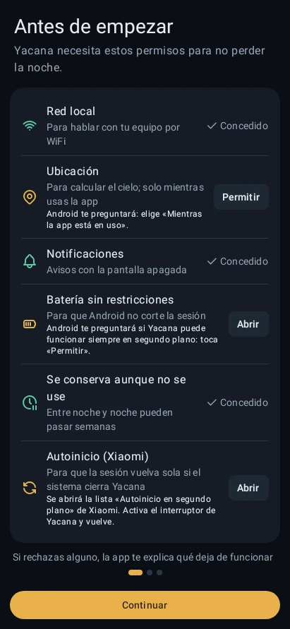 <b>Antes de empezar.</b> Las filas concedidas muestran una marca.</td>
</tr></table>

| Permiso | Para qué sirve | Sin él |
| --- | --- | --- |
| **Red local** | Hablar con tu equipo por WiFi. Se pide en Android 17 y posteriores. | La app no puede encontrar ni controlar ningún dispositivo Alpaca. |
| **Ubicación** | Calcular el cielo en tu sitio, solo mientras usas la app. Elige **Mientras la app está en uso**. | Escribe el sitio en el perfil. |
| **Notificaciones** | La sesión y sus avisos con la pantalla apagada. Se pide en Android 13 y posteriores. | No ves la sesión ni sus avisos fuera de la app. |
| **Batería sin restricciones** | Para que Android no corte la sesión. Toca **Permitir** cuando Android lo pregunte. | El sistema puede cortar la sesión con la pantalla apagada. |
| **Se conserva aunque no se use** | Entre noche y noche pueden pasar semanas. Desactiva **Pausar la actividad de la aplicación si no se utiliza**. Android 11 y posteriores. | Android puede quitarle los permisos a la app tras unos meses sin usarla. |
| **Autoinicio (Xiaomi)** | En móviles Xiaomi, Redmi y Poco, para que la sesión vuelva si el sistema cierra Yacana. Activa el interruptor de Yacana. | Si el sistema cierra Yacana por la noche, la sesión no vuelve. |

Si rechazas alguno, no se rompe nada de inmediato: la app explica qué deja de funcionar y cómo activarlo después, en *Ajustes › Permisos* ([capítulo 33](#permissions)). Toca **Continuar** para seguir.

### 2 · Busca tu equipo

1. Enciende el equipo y conecta el móvil a su WiFi, o pon ambos en la WiFi de casa.
2. Yacana busca por sí sola dispositivos Alpaca en la red, por IPv4 e IPv6. Cada servidor que encuentra aparece como una tarjeta con sus dispositivos. **Buscar otra vez** repite la búsqueda.
3. En un Seestar, toca **Teleobjetivo** o **Gran angular**: carga el perfil del Seestar para esa cámara, con su óptica, su campo y los ajustes recomendados. Puedes crear los dos y cambiar de uno a otro desde la tarjeta **Perfil** en Equipo. Para otro equipo, toca **Añadir**: el perfil toma el primer dispositivo de cada tipo de ese servidor.

Si no se encuentra un dispositivo, por ejemplo en una red que bloquea el descubrimiento, toca **Añadir por IP y puerto** y escribe su dirección, como `192.168.1.10:32323`. Si ya tienes un perfil de otro móvil, **Importar perfil** lo carga. **Ahora no** se salta esta página; puedes buscar tu equipo más tarde en Equipo.

<table><tr>
<td valign="top" width="240">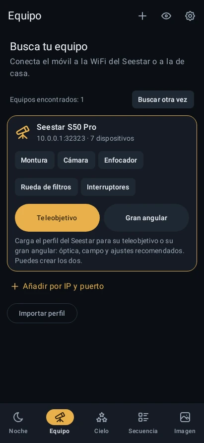 <b>Encontrado en la WiFi.</b> Un Seestar con sus siete dispositivos.</td>
</tr></table>

### 3 · Listo para el campo

Yacana funciona sin internet, pero hay dos cosas demasiado grandes para incluirlas en la app. Esta página muestra lo que ya está en el móvil y lo que conviene conseguir mientras aún tienes WiFi:

- **Catálogo de objetos** y **Efemérides**: incluidos en la app, no hay nada que hacer.
- **Base de estrellas**: la recomendada para tu campo, D50 para un Seestar. Toca **Descargar**.
- **Caché del cielo de NINA**: las fotos del atlas y del encuadre. Toca **Importar** si ya tienes su ZIP; para descargarla desde la app, usa *Ajustes › Mapa del cielo* ([capítulo 6](#field)).

Las descargas siguen en segundo plano. Toca **Empezar** para abrir la app.

<table><tr>
<td valign="top" width="240">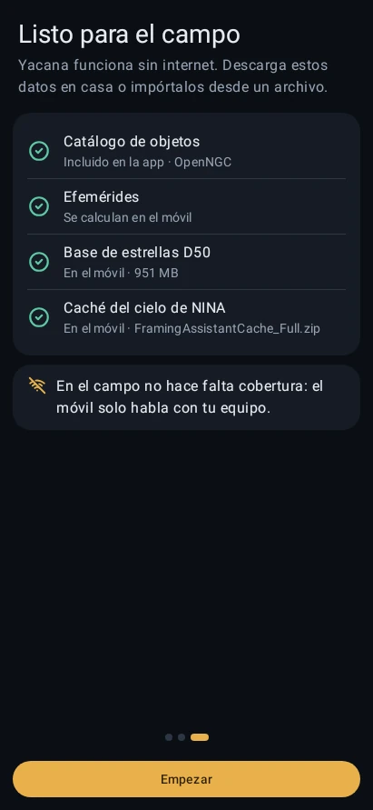 <b>Listo para el campo.</b> Todo en el móvil.</td>
</tr></table>

> [!TIP]
> **Conviene saber**
>
> Los primeros pasos no se pueden volver a abrir. Sus partes siguen disponibles: los permisos en *Ajustes › Permisos*, la búsqueda de equipo en Equipo, las bases de estrellas en *Ajustes › Plate solving* y las cachés del cielo en *Ajustes › Mapa del cielo*.

## 4. Orientarse en la app

Yacana se organiza por los momentos de la noche y no por paneles de dispositivos. En cada momento muestra lo que necesitas y deja el resto a un toque.

### Las cinco secciones

La barra inferior tiene cinco secciones. Con el móvil en horizontal se convierte en un riel a la izquierda. Al tocar la sección en la que estás, vuelves a su primera pantalla.

| Sección | Para qué | Barra superior |
| --- | --- | --- |
| **Noche** | La oscuridad y la Luna de esta noche, la lista de preparación, la sesión en curso, el resumen y el diario | Estado del equipo, modo rojo, Ajustes |
| **Equipo** | Perfiles, conexión y control manual de cada dispositivo | Añadir dispositivo, modo rojo, Ajustes |
| **Cielo** | Mapa del cielo, Sky Atlas, fichas de objetos y encuadre | Capas del cielo o Filtros, modo rojo |
| **Secuencia** | Plan de esta noche, secuencias guardadas, plantillas, los editores simple y avanzado | — |
| **Imagen** | Captura manual, estadísticas, historial, apilado en vivo y foto de referencia | Modo rojo, Más opciones |

### Controles comunes

- **Ajustes:** El engranaje de Noche y Equipo, o **Ajustes** al final de **Más opciones** de Imagen. Su buscador encuentra cualquier ajuste por parte de su nombre.
- **Modo rojo:** El icono del ojo en Noche, Equipo, Cielo, Imagen, la ficha del objeto, el encuadre y los asistentes. Vuelve rojo cada píxel ([capítulo 32](#display)).
- **Estado del equipo:** En Noche, un escudo cuando el equipo está conectado sin problemas, o un triángulo de aviso mientras la app reconecta o se detiene de forma segura.
- **Atrás y cerrar:** La flecha de arriba a la izquierda vuelve atrás. Los asistentes (alineación polar, autoenfoque y flats) muestran **✕** en su lugar, que los detiene.
- **Hojas:** Muchas opciones se abren en una hoja desde la parte inferior de la pantalla. Deslízala hacia abajo, o toca fuera de ella, para cerrarla.
- **Números:** Las horas, las coordenadas y los números de tomas se introducen con valores frecuentes y con el teclado numérico propio de la app, para que el teclado del sistema, que el modo rojo no puede colorear, nunca se encienda de noche.
- **Mantener pulsado:** Los botones arriesgados se llenan mientras los pulsas y actúan tras un segundo, más o menos: aparcar, parar una secuencia, borrar un perfil, una caché, una base o una secuencia guardada. Un toque corto no hace nada salvo recordarte que mantengas pulsado.
- **Estados:** Cada estado se muestra con un icono y palabras, nunca solo con color, porque en modo rojo el verde y el ámbar se ven iguales.

### La barra de sesión

Mientras una secuencia está en curso o en pausa, una barra en todas las pantallas excepto Noche muestra el objetivo, el filtro, la exposición y la toma, con su progreso, como la barra «Reproduciendo» de una app de música. Tócala para ver la sesión en Noche; su botón pausa o reanuda la secuencia.

### Notificaciones

Mientras el equipo está conectado, una notificación muestra la sesión, también en la pantalla de bloqueo: el objetivo, la toma y el progreso, o las tomas guardadas. Tócala para abrir la app. Su botón **Desconectar** detiene la captura y desconecta el equipo. Los avisos que te necesitan, como una conexión perdida o una parada segura, suenan; los sucesos como un autoenfoque o el final de la secuencia llegan en silencio. Cada tipo tiene su propio canal de notificaciones (*Sesión de la noche*, *Alertas de la noche*, *Sucesos de la noche*), que puedes ajustar en los ajustes de Android para la app.

<table><tr>
<td valign="top" width="330"> <b>La barra de sesión</b>, en curso y en pausa.</td>
</tr></table>

## 5. Tu perfil de equipo

Un perfil es un conjunto de equipo y la forma en que lo usas: sus dispositivos, óptica, ubicación, límites y opciones. Todo lo que Yacana calcula por ti, como el campo, la escala del plate solving o la base de estrellas recomendada, sale de él. El plate solving, el autoenfoque, la seguridad, los nombres de archivo y el apilado en vivo también se guardan por perfil.

Ábrelo con *Ajustes › Perfil y ubicación*, o toca la tarjeta **Perfil** en Equipo y luego **Abrir el perfil**. Los perfiles, los dispositivos y el borrado del perfil solo se cambian con el equipo desconectado.

### Nombre y óptica

- **Nombre:** tócalo para editarlo ahí mismo.
- **Distancia focal:** en milímetros, de 10 a 10.000, la del telescopio con su reductor si lo lleva. Da la escala del plate solving y el campo que dibuja el mapa del cielo.
- **Apertura:** el diámetro del objetivo, de 5 a 2000 mm. La relación focal se muestra al lado.
- **Sensor de la cámara** y **Tamaño de píxel:** sus píxeles a lo ancho y a lo alto (el alto se pide tras el ancho) y su tamaño en µm, como dan las especificaciones de la cámara; un Seestar S50 Pro tiene 2160 × 3840 px de 2,9 µm. La cámara los rellena al conectarse; escritos, el campo se conoce sin conectar nada, para el mapa del cielo y el encuadre.

Cuando la cámara se ha conectado, la tarjeta muestra la escala y el campo, como *2,25″/px · campo 1,35° × 2,40°*.

### Ubicación

El sitio determina la oscuridad de esta noche, todas las alturas y el polo para la alineación polar.

- **Usar la ubicación del móvil** la lee del móvil al activarla, cada vez que se abre la app y al conectar; la primera vez, Android pide el permiso. Si no llega, la fila dice por qué, y al tocarla lo vuelve a intentar. Desactivado, la escribes tú: latitud norte o sur (de 0 a 90°), longitud este u oeste (de 0 a 180°) y altitud en metros (de 0 a 9000).
- **Enviar la hora y el sitio a la montura** le da a la montura la hora UTC del móvil y el sitio al conectar.

### Límites

- **Límite de altura**, de 0 a 60°: ningún GoTo baja de él, ni del horizonte. Un GoTo por debajo se rechaza y la montura no se mueve; un movimiento con la cruceta se detiene solo en el límite.
- **Horizonte:** plano, o el tuyo con árboles y edificios. **Importar** lee un archivo de horizonte de N.I.N.A.: un punto por línea, azimut y altura en grados, separados por espacios o tabuladores, con `#` para los comentarios. **Dejarlo plano** lo quita. Las fichas de los objetos lo dibujan en su gráfica de altura.

<table><tr>
<td valign="top" width="240">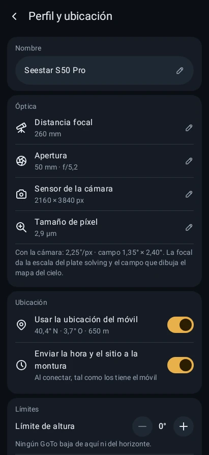 <b>Perfil y ubicación.</b> El perfil del Seestar.</td>
<td valign="top" width="240">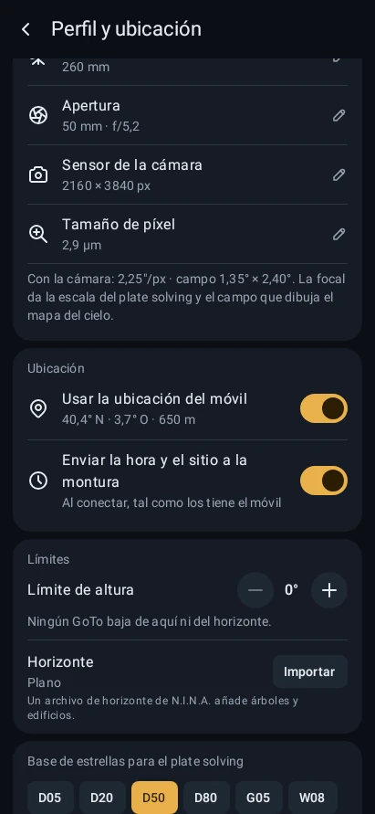 <b>Base de estrellas</b> para el plate solving, elegida por perfil.</td>
</tr></table>

### Base de estrellas

Los botones eligen la base del perfil para el plate solving. La app dice cuál conviene a tu campo. Si eliges una que no está en el móvil, aparecen su tamaño y un botón **Descargar**: pasa a usarse al terminar la descarga, y hasta entonces sigue la anterior.

### Más de un perfil

- **Cambiar:** toca la tarjeta **Perfil** en Equipo y elige otro, o toca **Usar** junto a él en **Otros perfiles**.
- **Nuevo:** **Nuevo perfil** en **Otros perfiles** busca en la red; el equipo que elijas pasa a ser un perfil nuevo, en uso.
- **Copiar a otro móvil:** en **Copia del perfil**, **Exportar** guarda el perfil como archivo JSON donde elijas, e **Importar** lee uno y lo pone en uso. El archivo lleva la ubicación del sitio.
- **Borrar:** **Borrar perfil** *(mantén)*, al final de la pantalla.

## 6. Listo para el campo

En el campo el móvil solo habla con tu equipo. Antes de tu primera noche, mientras tienes WiFi en casa, pon dos cosas en el móvil: una base de estrellas para el plate solving y las fotos del cielo. Las dos se pueden importar también desde un archivo, por ejemplo copiado desde un PC o desde una tarjeta de memoria.

### Bases de estrellas

En *Ajustes › Plate solving*, en **Base de estrellas**. La app marca la **recomendada** para tu campo y muestra el tamaño del campo. Puede haber varias en el móvil a la vez; el perfil usa una, marcada **En uso**.

<table><tr>
<td valign="top" width="240">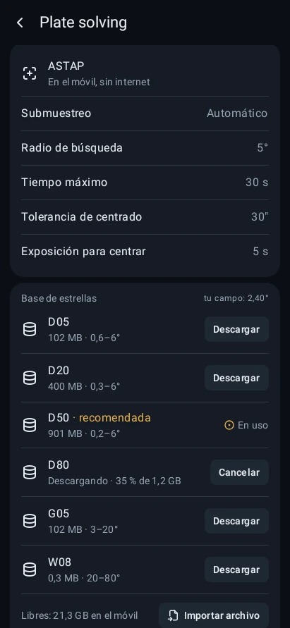 <b>Las bases de estrellas.</b> D50 en uso, D80 descargándose.</td>
</tr></table>

| Base | Tamaño | Para campos de | Notas |
| --- | ---: | --- | --- |
| **D05** | 102 MB | 0,6° a 6° | La opción ligera |
| **D20** | 400 MB | 0,3° a 6° |  |
| **D50** | 901 MB | 0,2° a 6° | Recomendada para el Seestar |
| **D80** | 1,2 GB | 0,15° a 6° | La más densa |
| **G05** | 102 MB | 3° a 20° | Campos amplios, objetivos fotográficos |
| **W08** | 0,3 MB | 20° a 80° | Campos muy amplios |

- **Descargar** la trae de la web de ASTAP solo con WiFi, aunque la app esté cerrada, y se reanuda si se interrumpe. Pasa a estar en uso al terminar. El espacio libre del móvil se muestra debajo de la lista.
- **Importar archivo** la instala desde el propio ZIP o archivo `.deb` de ASTAP, por ejemplo desde una tarjeta de memoria.
- Mantén pulsada una base instalada para borrarla con **Borrar base** *(mantén)*. La que está en uso no se puede borrar: pon antes otra en uso.
- **Probar con la última toma** resuelve la última toma de Imagen con los ajustes actuales, para comprobarlos.

### Las fotos del cielo: las cachés de N.I.N.A.

El mapa del cielo, el Sky Atlas, las fichas de objetos, el encuadre y la referencia de Imagen usan las fotos de las cachés de encuadre de N.I.N.A. Yacana las lee tal como N.I.N.A. las publica, directamente de su ZIP sin descomprimirlo, así que una caché ocupa lo mismo que su ZIP y nada más. Abre *Ajustes › Mapa del cielo*, o el icono de capas del mapa del cielo.

- **Caché completa (DSS):** todo el cielo en 2131 fotos en color de 5° del Digitized Sky Survey, 3,5 GB. Es la que conviene tener.
- **NSNS con estrellas** (1,4 GB) y **NSNS sin estrellas** (471 MB): el Northern Sky Narrowband Survey, emisión de hidrógeno y oxígeno hasta unos −17° de declinación. Se dibujan como una segunda capa.
- **Fotos online:** las fotos con más detalle que el mapa trae cuando acercas mucho con internet, guardadas en el móvil.

<table><tr>
<td valign="top" width="240">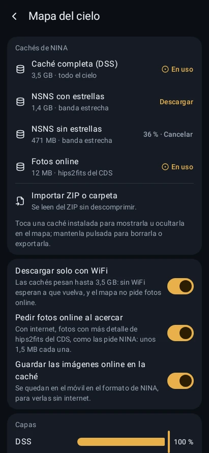 <b>Ajustes › Mapa del cielo.</b> La caché completa en uso, una de banda estrecha llegando.</td>
</tr></table>

#### Conseguir una caché

- **Descargar** la trae de la web de N.I.N.A. mediante el gestor de descargas de Android. Se reanuda si se interrumpe y antes comprueba el espacio libre. Con **Descargar solo con WiFi** activado (por defecto), espera a tener WiFi.
- **Importar ZIP o carpeta**: **Elegir un ZIP** toma uno de los ZIP de N.I.N.A., como los de su web; **Elegir una carpeta** toma la carpeta de la caché que N.I.N.A. tiene en un PC (`FramingAssistantCache`), copiada al móvil o en una tarjeta. Se copian a la app.

#### Usarla

- Toca una caché instalada para mostrarla en el mapa u ocultarla: **En uso** o **Instalada**.
- **Capas:** la opacidad de la capa DSS (100 % por defecto) y de la de banda estrecha (40 %), para mezclarlas.
- **Pedir fotos online al acercar** (activado por defecto): con internet, al acercar el mapa se piden fotos con más detalle a hips2fits del CDS, como hace N.I.N.A., de unos 1,5 MB cada una. Desactívalo para reservar los datos móviles para otras cosas; con **Descargar solo con WiFi** activado, el mapa tampoco las pide con datos móviles.
- **Guardar las imágenes online en la caché**: activado, se quedan en el móvil en el formato de N.I.N.A., para verlas otra vez sin internet.

#### Borrarla o exportarla

Mantén pulsada una caché instalada. La hoja dice cuánto espacio libera; **Borrar caché** *(mantén)* la quita. Una caché de carpeta, como las fotos online, ofrece también **Exportar ZIP**, para abrirla en N.I.N.A. en un PC.

<table><tr>
<td valign="top" width="240">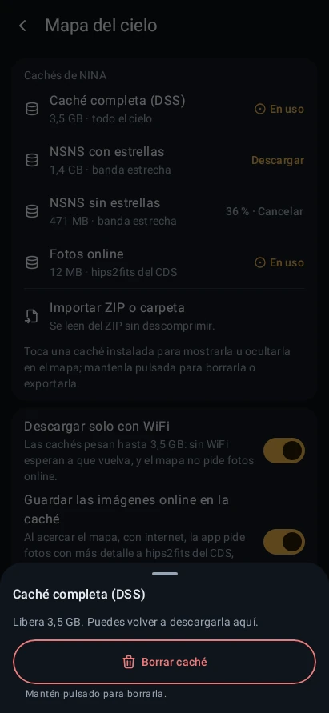 <b>Al mantener pulsada una caché.</b> Lo que libera, y el botón que hay que mantener pulsado.</td>
</tr></table>

> [!TIP]
> **Créditos**
>
> Las fotos no forman parte de la app: las descargas de la web de N.I.N.A. o las importas. El DSS es del STScI, que permite a N.I.N.A. distribuirlo, y el NSNS está bajo CC BY-NC-SA 4.0. El mapa muestra *DSS: STScI · NSNS: CC BY-NC-SA 4.0*.

---

# Equipo

## 7. Conectar tu equipo

La sección Equipo contiene el perfil en uso, lo conecta y te da control manual de cada dispositivo.

1. Comprueba la tarjeta **Perfil**: el nombre del perfil y de dónde sale su ubicación, como *Ubicación por GPS · 40,4° N · 3,7° O · 650 m*. Tócala para cambiar a otro perfil.
2. Toca **Conectar**. La fila dice *Conectando…* y luego cuántos dispositivos han respondido, como *5 de 5 conectados*, o por qué uno no ha podido conectarse.
3. Cada dispositivo tiene una fila con su estado en directo: la montura siguiendo y su altura, la cámara en reposo y la temperatura de su sensor, la posición del enfocador, el filtro puesto, el calentador antivaho encendido. Se actualizan cada uno o dos segundos.
4. Toca un dispositivo conectado para abrir su pantalla. **Desconectar todo** termina la conexión.

Si se cae la conexión, Yacana se reconecta sola. Durante una secuencia, primero hace una pausa segura ([capítulo 28](#safety)).

<table><tr>
<td valign="top" width="240">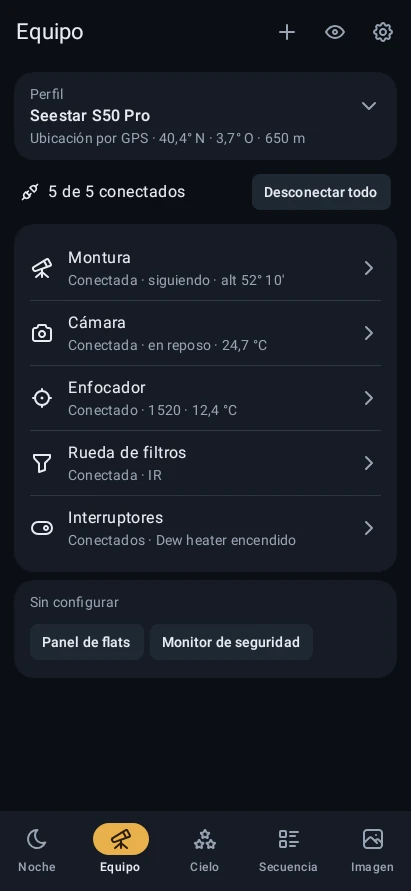 <b>Equipo.</b> Cinco dispositivos conectados; el panel de flats y el monitor de seguridad sin configurar.</td>
</tr></table>

### Añadir un dispositivo

El **+** de arriba abre *Añadir dispositivo*, que vuelve a buscar en la red. Cada servidor muestra los dispositivos que tu perfil aún no tiene, cada uno con **Añadir**; **Añadir por IP y puerto** admite una dirección. La tarjeta **Sin configurar**, al final de la lista, tiene un botón para cada dispositivo opcional, el panel de flats y el monitor de seguridad, que abre la misma búsqueda. Los dispositivos solo se añaden con el equipo desconectado.

### Sin perfil

Si te saltaste los primeros pasos, Equipo empieza con **Busca tu equipo**, la misma búsqueda que en el [capítulo 3](#first-steps), y un botón **Importar perfil**.

## 8. La montura

La pantalla de la montura muestra adónde apunta y la mueve a mano, con GoTo, sincronización, aparcado y seguimiento.

### Adónde apunta

La tarjeta de arriba muestra su estado, como *Siguiendo · sidéreo*, *Moviéndose*, *Sin seguimiento* o *Aparcada*, y su AR, Dec, altura y azimut. Mientras centra un objetivo, la tarjeta muestra el intento y el paso actual, con **Detener**.

### Moverla a mano

Mantén pulsada una flecha (N, S, E, O) para mover la montura; se para al soltarla. El botón rojo del centro la detiene al instante. Los botones de abajo ponen la velocidad: **1×**, **8×** (por defecto) o **64×** la sidérea, o **Máx**, la más rápida de la montura. Un movimiento se detiene solo en el límite de altura del perfil.

### Los botones

- **Ir a…:** Abre una hoja para escribir la AR y la Dec con el teclado numérico de la app (ver más abajo).
- **Sincronizar:** Le dice a la montura que apunta a las coordenadas que escribes. Con una toma resuelta, usa mejor **Sincronizar la montura** de Imagen ([capítulo 18](#solving)). Solo aparece si la montura puede sincronizar.
- **Aparcar:** Mantenlo pulsado para llevar la montura a su posición de reposo. Un toque corto solo te recuerda que lo mantengas pulsado. Con la montura aparcada, el botón dice **Desaparcar**, y un toque la desaparca.
- **Seguimiento:** Activa o desactiva el seguimiento.
- **Alineación polar:** Abre el asistente de alineación polar ([capítulo 17](#polar)).

El menú **⋮** de arriba contiene el resto: la **Velocidad de seguimiento** (sidérea, lunar, solar o King, las que admita la montura), **Desaparcar** cuando está aparcada, e **Ir a casa** si la montura lo tiene.

<table><tr>
<td valign="top" width="240">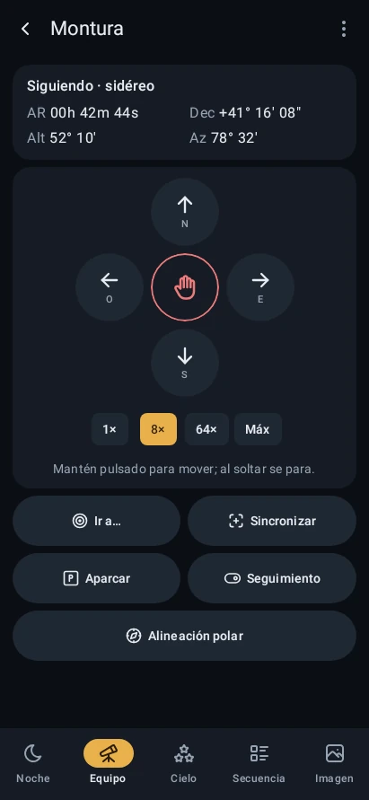 <b>Montura.</b> Mantén pulsada una flecha para mover; toca la velocidad.</td>
<td valign="top" width="240">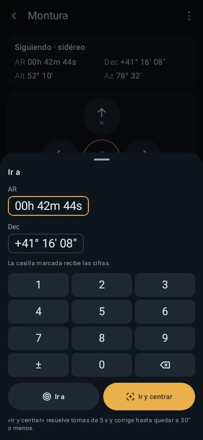 <b>Ir a.</b> La casilla marcada recibe las cifras.</td>
</tr></table>

### Ir a unas coordenadas

1. Toca **Ir a…**. La hoja muestra la AR y la Dec actuales de la montura.
2. Toca la casilla de AR o la de Dec para marcarla, y escribe las cifras en el teclado numérico. **±** cambia el signo de la declinación.
3. Toca **Ir a** para ir allí, o **Ir y centrar** para ir y luego afinar con plate solving hasta que el objetivo quede dentro de la tolerancia (30″ por defecto).

> [!CAUTION]
> **Por debajo del límite**
>
> Un GoTo a un objetivo por debajo del límite de altura del perfil, o por debajo de su horizonte, se rechaza. La pantalla dice dónde está el objetivo y que la montura no se ha movido. Espera a que suba, o cambia el límite en el perfil ([capítulo 5](#profile)).

## 9. Cámara y rueda de filtros

### Cámara

La pantalla de la cámara muestra su estado, como *En reposo · −10 °C*, y lo que informa: el tamaño del sensor, el tamaño de píxel, el patrón Bayer, los rangos de ganancia y de offset, y la exposición más larga. Las tomas se hacen en Imagen; **Ir a Imagen** te lleva allí ([capítulo 20](#imaging)).

Yacana usa cada cámara tal como se describe por Alpaca: ganancia, offset, binning, región de interés y temperatura del sensor, si la cámara los tiene. Las tomas se descargan directamente a la memoria nativa del móvil mientras empieza la siguiente exposición, así que caben incluso cámaras de 61 MP.

### Rueda de filtros

La pantalla de la rueda de filtros muestra la lista de sus filtros, con una marca en el que está puesto. Toca un filtro para ponerlo. En Imagen, el filtro también es un botón bajo la toma.

Un filtro llamado **Dark**, como en el Seestar, se usa como obturador para los darks y los bias, así que no hay que tapar nada. Si no lo hay, la app te pide tapar el telescopio cuando hace darks.

## 10. El enfocador

- **Posición** y **Temperatura**, en grande, con la hora y la temperatura del último autoenfoque.
- **Mover:** **−100**, **−10**, **+10** y **+100** pasos, e **Ir a posición…**, que abre el teclado numérico con el rango del enfocador. **Parar** aparece mientras se mueve.
- **Última curva:** la curva en V del último autoenfoque, con su mejor HFR y su posición.
- **Desplazamiento por filtro**, con una rueda de filtros: toca un filtro para fijar su desplazamiento en pasos, respecto a los demás. Al cambiar de filtro, el enfocador se mueve la diferencia entre el desplazamiento del filtro nuevo y el del anterior, así que cada filtro sigue enfocado sin un nuevo autoenfoque.
- **Autoenfoque** lanza el autoenfoque al momento ([capítulo 19](#autofocus)).

<table><tr>
<td valign="top" width="240">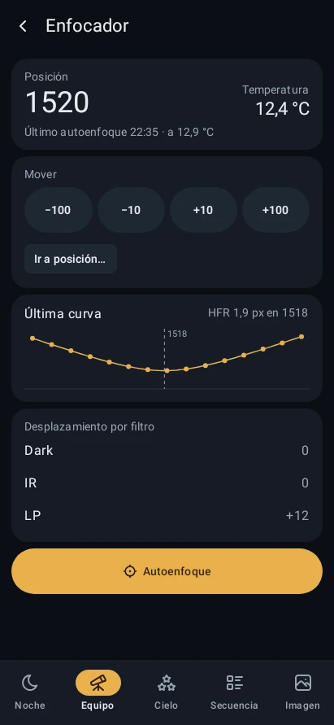 <b>Enfocador.</b> El filtro LP enfoca 12 pasos más afuera.</td>
</tr></table>

## 11. Interruptores, panel de flats y monitor de seguridad

### Interruptores

Cada interruptor aparece tal como lo declara el dispositivo: un conmutador para encendido y apagado, un deslizador con − y + para un valor como la potencia de un calentador (con su rango y su paso; el valor se envía al soltarlo), o una lectura para los de solo lectura. El más común es un calentador antivaho, que la secuencia puede encender al empezar y apagar al final.

### Panel de flats

Para un panel de flats con tapa (un CoverCalibrator de Alpaca):

- **Tapa:** su estado, con **Abrir** y **Cerrar**, y **Parar** mientras se mueve. Ábrela para la noche y ciérrala para los darks.
- **Luz:** encendida o apagada, y su **Brillo** con un deslizador o con − y +.

Para los flats, el asistente de flats cierra la tapa, enciende la luz y encuentra la exposición por sí solo ([capítulo 23](#calibration)).

### Monitor de seguridad

Muestra **Seguro** o **No seguro**, leído cada segundo, por ejemplo de un sensor de nubes o de lluvia. La app lo muestra pero todavía no actúa según él: si pasa a **No seguro**, para la secuencia desde Noche.

<table><tr>
<td valign="top" width="240">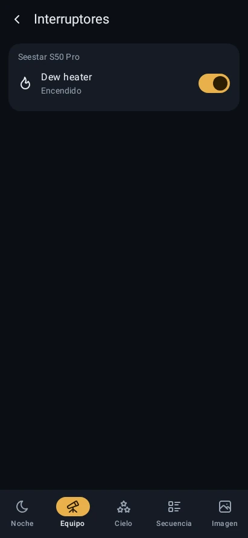 <b>Interruptores.</b> El calentador antivaho del Seestar.</td>
<td valign="top" width="240">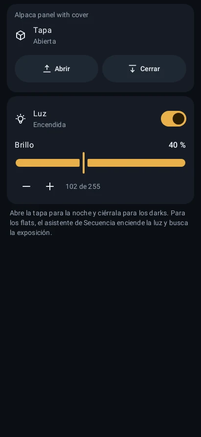 <b>Panel de flats.</b> Tapa abierta, luz al 40 %.</td>
<td valign="top" width="240">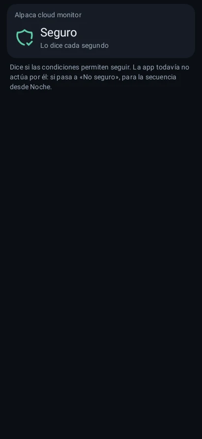 <b>Monitor de seguridad.</b> Leído cada segundo.</td>
</tr></table>

---

# Planificar la noche

## 12. Esta noche de un vistazo

Noche es donde empieza la velada. Muestra la oscuridad y la Luna de esta noche, una lista para prepararla, la sesión mientras está en curso y el resumen por la mañana.

### La tarjeta de esta noche

Calculada en el móvil para la ubicación del perfil:

- La fecha y la iluminación de la Luna, como *Luna 34 %*.
- La mejor ventana oscura: *Oscuro y sin Luna*, u *Oscuro, con la Luna arriba* cuando la Luna está arriba durante toda la noche astronómica, con su inicio, su fin y su duración.
- La puesta y la salida del Sol, y una línea de tiempo de la tarde a la mañana: el crepúsculo, la noche astronómica y las horas en que la Luna está arriba, con la mejor ventana resaltada.

Cerca del solsticio de verano, en latitudes altas, puede decir *Sin noche astronómica*: el Sol no baja 18° bajo el horizonte. Sin ubicación, la tarjeta dice cómo ponerla: permite la ubicación en *Ajustes › Permisos* y activa la del móvil, o escríbela en el perfil.

### Otra noche

Toca el icono del calendario para ver cualquier otra noche. La cuadrícula del mes marca esta noche con un contorno y la noche que elijas, rellena; las flechas cambian de mes. **Volver a esta noche** regresa.

<table><tr>
<td valign="top" width="240">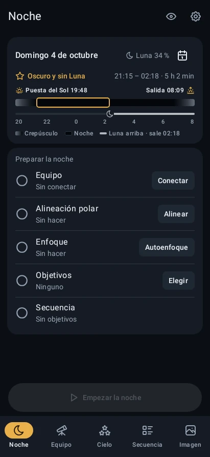 <b>Noche.</b> 5 h 2 min de cielo oscuro antes de que salga la Luna.</td>
<td valign="top" width="240">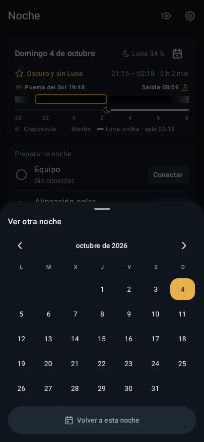 <b>Ver otra noche.</b></td>
</tr></table>

### Preparar la noche

Una lista sin pasos obligatorios: haz lo que necesite tu noche, en el orden que quieras. Cada fila muestra su estado y un botón que te lleva allí.

| Fila | Muestra | Botón |
| --- | --- | --- |
| **Equipo** | El perfil y sus dispositivos una vez conectados | **Conectar** |
| **Alineación polar** | *Sin hacer*, o el último error total y hace cuánto | **Alinear**, luego **Afinar** |
| **Enfoque** | *Sin hacer*, o el último HFR y hace cuánto (con un enfocador) | **Autoenfoque** |
| **Objetivos** | *Ninguno*, o los objetivos de esta noche | **Elegir**, que abre Cielo |
| **Secuencia** | Si el plan cabe antes del amanecer, y su duración | **Ajustar** cuando no cabe |

Cuando el equipo está conectado y el plan tiene exposiciones, **Empezar la noche** inicia la secuencia ([capítulo 27](#running)). Las marcas de las filas son iconos además de colores, así que se leen igual en modo rojo.

<table><tr>
<td valign="top" width="240">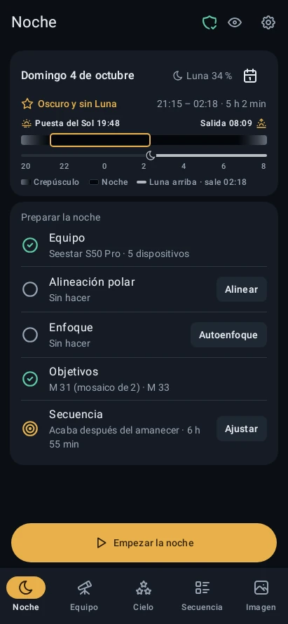 <b>Listo para empezar.</b> El plan acaba después del amanecer: <i>Ajustar</i> lo recorta.</td>
</tr></table>

## 13. El mapa del cielo

La sección Cielo se abre en un mapa del cielo real, dibujado con las fotos de la caché de N.I.N.A., sin internet. El mapa se queda donde lo dejaste, también después de cerrar la app. Arrástralo con un dedo, pellizca para pasar de una vista amplia a menos que el campo de tu cámara, y toca un objeto para seleccionarlo.

El mapa está orientado como ves el cielo desde la ubicación del perfil en este momento, con el cenit arriba; sin ubicación, el norte queda arriba. Una barra de escala muestra el tamaño de un grado, y las coordenadas del centro están abajo a la derecha.

### Qué muestra

- **Fotos:** la etiqueta de arriba dice de dónde vienen, como *DSS · caché de NINA*. Con internet, al acercar se traen fotos con más detalle de la zona; mientras llega una, gira una ruedita en la etiqueta. Sin caché, la etiqueta dice cómo instalar una; tócala para abrir los ajustes del mapa del cielo.
- **Tu campo:** un recuadro discontinuo en el centro, del tamaño del campo de tu cámara, con el nombre del perfil.
- **Objetos:** contornos y nombres de los objetos del catálogo.
- **Horizonte:** una línea clara donde está el horizonte de la ubicación del perfil, que sigue su propio horizonte si el perfil tiene uno, con **N**, **E**, **S** y **O** sobre ella.

### Seleccionar un objeto

Toca un objeto: el mapa se centra en él y una tarjeta muestra su nombre, tamaño, altura y mejor hora, con **Encuadrar**. Toca la tarjeta para ver la ficha del objeto. Toca cielo vacío para deseleccionar.

Para encuadrar un área sin objeto del catálogo, céntrala en el mapa, dentro del recuadro de tu campo, y toca **Encuadrar aquí**, el botón redondo dorado bajo el zoom: el encuadre se abre ahí, y el área entra en la secuencia con sus coordenadas como nombre, como *03h 47m +24° 07′*.

### Botones

- **+ y −:** acercar y alejar.
- **Encuadrar aquí:** el dorado, debajo, encuadra el centro del mapa.
- **Capas** (barra superior): los ajustes del mapa del cielo, con las cachés y la opacidad de las capas ([capítulo 6](#field)).

<table><tr>
<td valign="top" width="240">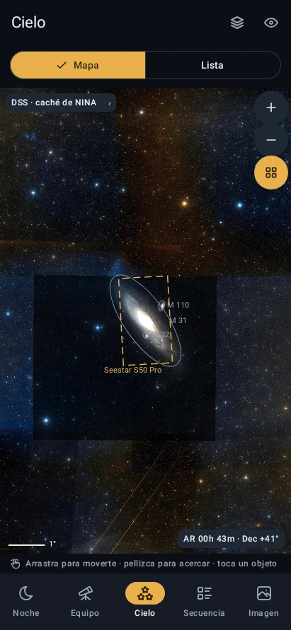 <b>El mapa.</b> M 31 sobre las fotos del DSS, con el campo del Seestar.</td>
</tr></table>

### La montura en el mapa

Con la montura conectada, el mapa muestra dos recuadros del campo de tu cámara. Se distinguen por su línea, así que se diferencian también en modo rojo:

- **Encuadre:** discontinuo, en el centro del mapa. Es adonde quieres ir.
- **Telescopio:** continuo, donde apunta ahora el telescopio; se mueve a medida que se lee, cada segundo.

Arrastra el mapa para poner el objetivo en el recuadro del encuadre, o toca un objeto para centrarlo, y luego:

- **Ir y centrar** lleva el telescopio al encuadre y lo afina con plate solving hasta la tolerancia del perfil. Una tarjeta muestra cada paso y cuánto falta, con **Detener**, que detiene la montura y la toma.
- **Solo ir** hace el GoTo sin centrar.

Cuando la montura está aparcada o sin seguimiento, la etiqueta **Telescopio** lo dice, y al tocarla se desaparca la montura o se activa el seguimiento.

<table><tr>
<td valign="top" width="240">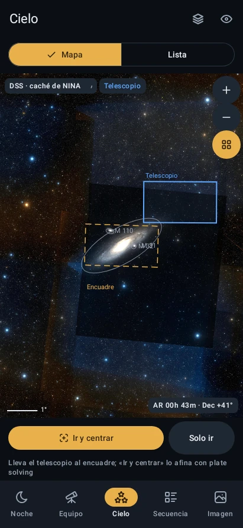 <b>Telescopio y encuadre.</b> El recuadro continuo es donde apunta.</td>
<td valign="top" width="240">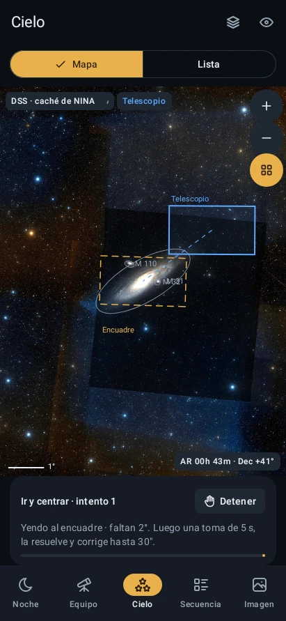 <b>Ir y centrar.</b> Faltan 2°; luego una toma de 5 s, resuelta y corregida.</td>
</tr></table>

## 14. Sky Atlas y búsqueda

Cambia la sección Cielo a **Lista** para ver el Sky Atlas: 13.371 objetos de cielo profundo de OpenNGC (NGC, IC, Messier, Caldwell y más) en el móvil, cada uno con su foto de la caché, ordenados para esta noche.

### Lo mejor de esta noche

Con **Esta noche** activado (por defecto), la lista muestra lo que está bien situado esta noche desde la ubicación del perfil, ordenado por su mejor hora. Cada fila tiene una miniatura, el nombre, el número de catálogo y el tamaño, si *cabe* en tu campo o necesita un *mosaico N*, y una pequeña curva de altura con su mejor hora. Toca una fila para ver la ficha del objeto.

Sobre la lista, **Esta noche** y **Favoritos**, los objetos que marcaste con la estrella en su ficha, se activan y desactivan con un toque. A su lado aparece cada filtro activo, como *Hasta mag 8* o *Desde 1°*: su ✕ lo quita y su texto abre los filtros. El icono de los deslizadores dice cuántos hay, y la nota cuántos objetos quedan y en qué orden. Los filtros y el sitio de la lista se mantienen al abrir un objeto, al cambiar de sección y al cerrar la app.

<table><tr>
<td valign="top" width="240">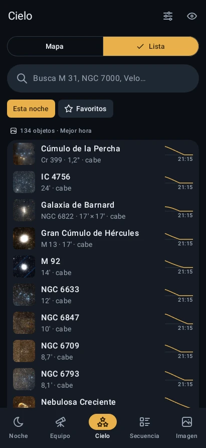 <b>Esta noche.</b> Miniaturas de la caché, sin internet.</td>
<td valign="top" width="240">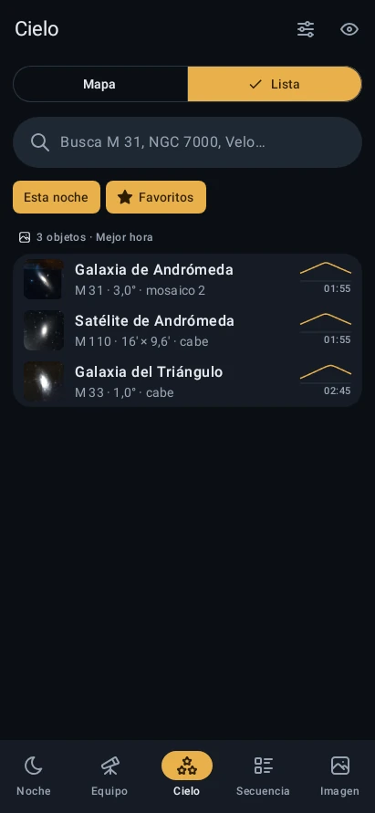 <b>Favoritos.</b> M 31 necesita un mosaico de 2.</td>
<td valign="top" width="240">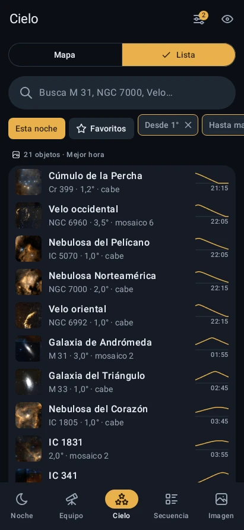 <b>Filtros activos.</b> Hasta mag 8 y desde 1°.</td>
</tr></table>

### Filtros

El icono de los deslizadores, arriba, o el texto de un filtro activo abre los filtros. La lista cambia mientras eliges y la cabecera dice cuántos objetos quedan; **Restablecer** los deja como al principio, y **Listo**, deslizar hacia abajo, tocar fuera o atrás los cierran. En horizontal se abren al lado, con la lista a la vista.

- **Ordenar por:** Mejor hora (por defecto), Altura máxima, Horas visibles, Tamaño o Brillo, cada uno en su sentido natural: primero el más temprano, el que más sube, el que más tiempo pasa sobre tu altura, el más grande o el más brillante. La nota sobre la lista dice el orden.
- **Tipo:** Galaxias, nebulosas, cúmulos, otros.
- **Tamaño:** Cualquiera, para tu campo (se muestra su tamaño), o desde 15′, 30′ o 1°.
- **Magnitud:** Cualquiera, o hasta 8, 10 o 12.
- **Solo:** Favoritos, y los que caben en el campo.
- **Esta noche:** activado (por defecto), solo lo que está bien situado esta noche; la altura y las horas son las de la noche cerrada de esta noche en la ubicación del perfil. Desactivado, los tres siguientes no cuentan.
- **Por encima de:** 20°, 30° o 45°.
- **Durante al menos:** 1, 2 o 4 horas.
- **Lejos de la Luna:** Cualquiera, o al menos 30°, 60° o 90°.

Si nada coincide, la lista lo dice, con **Restablecer** para volver a empezar.

<table><tr>
<td valign="top" width="240">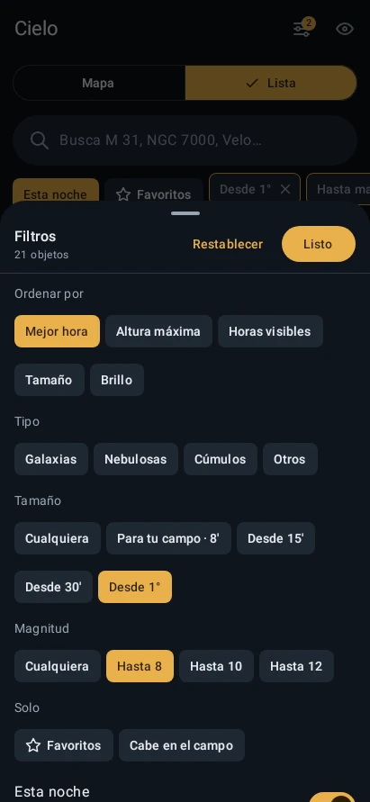 <b>Filtros.</b></td>
</tr></table>

### Búsqueda

Escribe en el buscador: un número Messier, NGC, IC, Caldwell o Sharpless, o un nombre, como *M 31*, *NGC 7000* o *Velo*. Los resultados aparecen mientras escribes, en milisegundos, sin internet. En modo rojo, el buscador abre el teclado propio de la app, rojo como todo, en lugar del del móvil; ⌄ o atrás lo ocultan.

Para todo lo demás, la última fila ofrece **Buscar «…» en SIMBAD**. Con internet, consulta SIMBAD del CDS, que conoce más de 20 millones de objetos, desde el cuásar TON 618 hasta las estrellas de una constelación. Lo que encuentra se queda en el móvil, para volver a encontrarlo sin conexión. Si no hay una coincidencia exacta, muestra los objetos con nombres parecidos, los más brillantes primero.

<table><tr>
<td valign="top" width="240">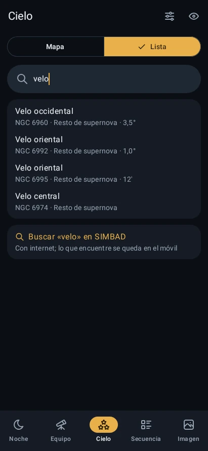 <b>Búsqueda sin conexión.</b> «velo» encuentra el Velo.</td>
<td valign="top" width="240">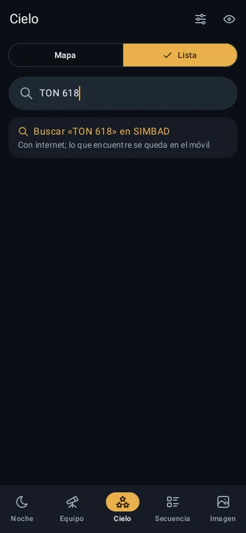 <b>Más allá del catálogo:</b> SIMBAD, con internet.</td>
</tr></table>

## 15. La ficha de un objeto

Todo lo que necesitas para decidirte por un objetivo: su foto con tu campo encima, qué es, cuánto sube esta noche y lo cerca que está la Luna.

- **Foto:** de la caché, con el campo de tu cámara dibujado encima. Tócala, o su botón **Mapa**, para ver el objeto encuadrado en el mapa del cielo; solo se mueve el mapa, no el telescopio.
- **Datos:** nombre, tipo, magnitud y tamaño; sus otros nombres y designaciones, como *También Triangulum Galaxy · Triangulum Pinwheel · NGC 598*; *Cabe en el campo* o *Mosaico de N paneles*; y la distancia y la fase de la Luna, como *Luna a 87° · 34 %*.
- **Altura esta noche:** la curva del objeto del anochecer al amanecer, con el crepúsculo sombreado en ambos extremos, la línea de 30°, tu propio horizonte en discontinua si el perfil tiene uno, y una línea para el momento actual. Debajo, las horas que está por encima de 30° y su punto más alto, o que se queda bajo o que no sale.

La estrella de arriba lo marca como favorito. **Encuadrar** abre el encuadre ([capítulo 16](#framing)). **Ir y centrar**, con la montura conectada, lleva allí el telescopio y lo centra, en la pantalla de la montura.

<table><tr>
<td valign="top" width="240">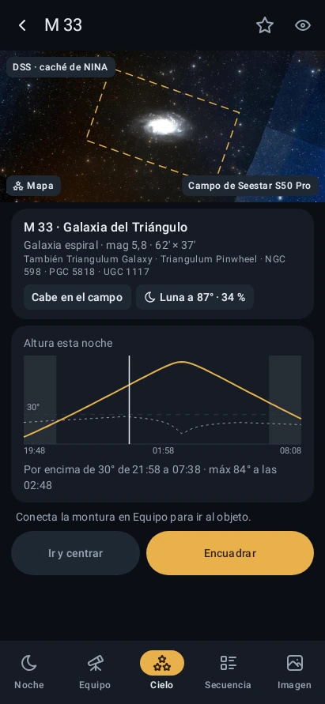 <b>M 33.</b> Cabe en el campo del Seestar; la línea discontinua es el horizonte del sitio.</td>
<td valign="top" width="240">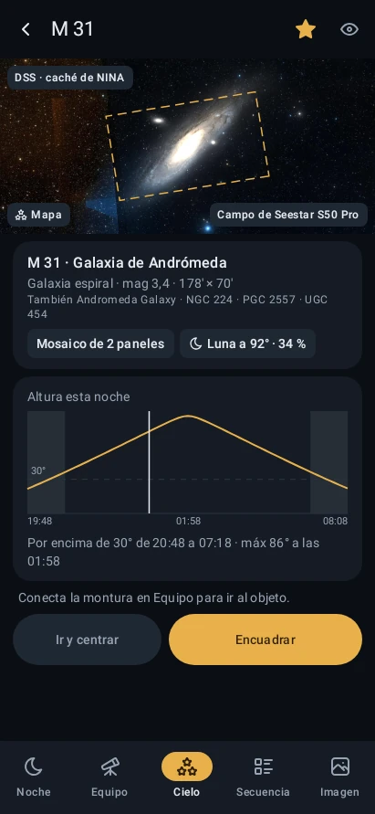 <b>M 31.</b> Un favorito que necesita un mosaico de 2 paneles.</td>
</tr></table>

## 16. Encuadre y mosaicos

El encuadre muestra cómo saldrá la foto: el campo real de tu cámara sobre el cielo, que arrastras hasta que la composición es la buena, y mosaicos para objetivos más grandes que el campo.

1. Ábrelo con **Encuadrar** en la ficha de un objeto o en la tarjeta del objeto del mapa.
2. Arrastra el cielo para colocar el objetivo en el campo; pellizca para acercar. El tamaño del campo se muestra arriba a la derecha.
3. Para un mosaico, ajusta las **Columnas** y las **Filas** con − y +, y el **Solape** entre paneles, del 5 al 50 % (15 % por defecto). Los paneles se numeran en el orden en que se harán.
4. Mira la línea de abajo: las horas que está por encima de 30° esta noche.
5. Toca **Añadir a la secuencia**. La app confirma que el objetivo está en la secuencia de esta noche, con **Elegir otro objetivo** y **Ver esta noche**.

Un objetivo nuevo llega con 60 tomas de 60 s con el primer filtro que no sea el oscuro, y dither cada 3 tomas; ajústalas en el editor ([capítulo 25](#simple)). Tras la plantilla **Un objetivo toda la noche**, en cambio, el objetivo llena la noche hasta el amanecer.

**Ir y centrar**, con la montura conectada, lleva el telescopio al encuadre.

<table><tr>
<td valign="top" width="240">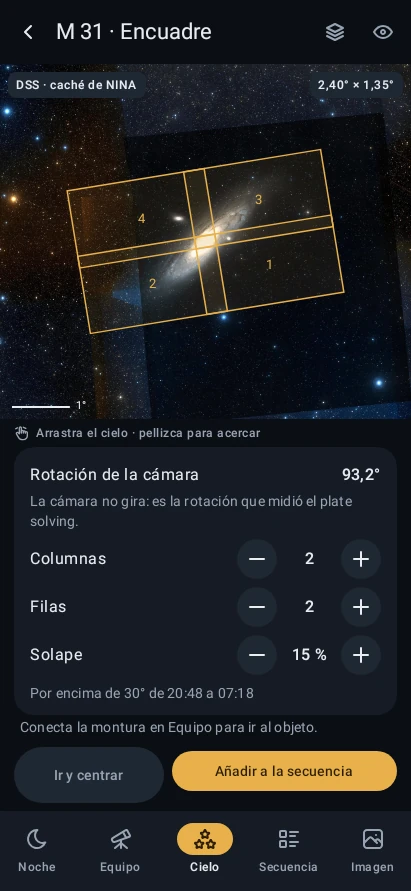 <b>M 31 · Encuadre.</b> Un mosaico de 2 × 2, girado como lo está la cámara.</td>
</tr></table>

### La rotación de la cámara

Sin rotador, la cámara no gira, así que el encuadre no gira el campo a mano: la **Rotación de la cámara** es el ángulo que midió el plate solving, y el campo y los paneles se dibujan con él. Hasta el primer plate solving es 0°, o 93,2° para un Seestar en modo EQ. Resuelve una toma en Imagen una vez montada la cámara, y el encuadre coincidirá con ella ([capítulo 18](#solving)).

> [!TIP]
> **Necesita el campo**
>
> Para encuadrar hace falta el campo del perfil: su distancia focal y el sensor de su cámara (*Ajustes › Perfil y ubicación › Óptica*), escritos o guardados de la última conexión de la cámara. No hace falta conectar nada; la pantalla tiene un botón al perfil.

---

# En el telescopio

## 17. Alineación polar de tres puntos

El asistente de alineación polar mide cuánto se aparta el eje de la montura del polo celeste y luego te guía, en directo, mientras giras los tornillos de la cuña. Es un port del plugin Three Point Polar Alignment de N.I.N.A. y, con las mismas medidas, da el mismo resultado con un margen de 0,4″.

Funciona con cualquier montura que pueda girar su eje de ascensión recta a una orden. Necesita la montura y la cámara conectadas, una base de estrellas en el móvil y la ubicación del perfil, que fija dónde está el polo.

### Abrir el asistente

Toca **Alinear** en la fila **Alineación polar** de la lista de Noche (**Afinar** cuando ya se ha medido), o **Alineación polar** en la pantalla de la montura. El asistente ocupa la pantalla y la mantiene encendida mientras funciona; la **✕** de arriba a la izquierda lo detiene y vuelve atrás.

### Antes de empezar

La primera página explica qué va a pasar y adónde apuntar: una zona despejada del cielo, lejos del polo y del horizonte, en la dirección en que girará el eje. Muestra cuatro opciones; cada una se guarda en el perfil.

- **Giro entre puntos:** Cuánto gira el eje de AR entre las tres tomas, y hacia dónde: 10°, 15°, 20° o 30°, hacia el oeste o hacia el este. Por defecto, 15° hacia el oeste. Deja sitio para el giro, para que la montura no choque con nada.
- **Exposición:** 1, 2, 3 o 5 s, con binning 1×1 o 2×2, con la ganancia de Imagen. Con tomas cortas el error se actualiza antes mientras giras los tornillos. Por defecto, 1 s a 2×2.
- **Tolerancia:** Desactivada, 0,5′, 1′, 2′ o 5′. Cuando el error total baja de ella, el móvil vibra. Nunca oculta las flechas. Desactivada por defecto, como en el plugin.
- **Resolver solo con pista:** Para afinar una alineación que ya está cerca: los tres puntos solo se resuelven cerca de donde apunta la montura, nunca a ciegas.

<table><tr>
<td valign="top" width="240">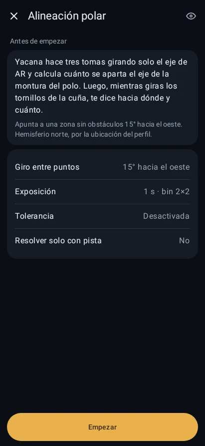 <b>Antes de empezar.</b> Las opciones, con los valores por defecto del Seestar.</td>
</tr></table>

### Medir los tres puntos

1. Apunta el telescopio a una zona despejada, como dice la primera página, y toca **Empezar**.
2. Yacana hace la primera toma y la resuelve, gira el eje de AR, hace y resuelve la segunda, vuelve a girar y hace la tercera. Cada punto muestra *Girando el eje de AR…*, *Haciendo la toma*, *Resolviendo con ASTAP* y luego cuánto tardó la resolución.
3. **No toques la montura mientras mide.** Los tres centros trazan un círculo cuyo centro es el eje real de la montura. Su distancia al polo, corregida por precesión, nutación y refracción para tu ubicación y tu hora, es el error.

Si un punto no se resuelve, el asistente dice cuál y por qué, y ofrece **Volver a empezar**.

<table><tr>
<td valign="top" width="240">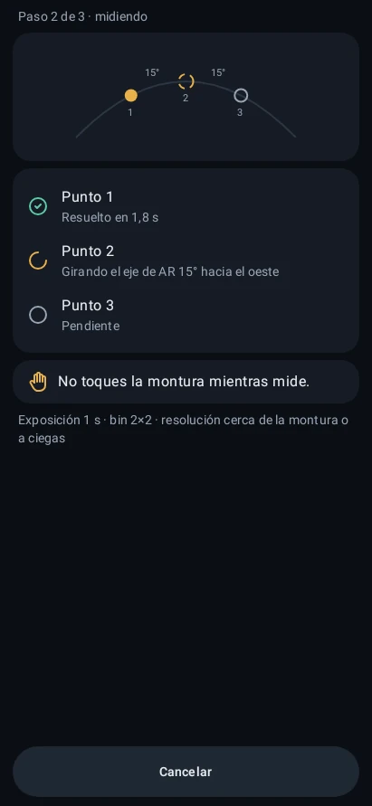 <b>Midiendo.</b> Punto 1 resuelto en 1,8 s, el eje girando hacia el punto 2.</td>
</tr></table>

### Girar los tornillos de la cuña

Ahora el asistente sigue haciendo tomas, resuelve cada una cerca de la última posición y actualiza el error cada pocos segundos. Cada eje tiene su propia tarjeta:

- **Altura:** una flecha y *Sube* o *Baja*, o *un poco* cuando está cerca.
- **Azimut:** una flecha y *Gira hacia el oeste* o *hacia el este*, o *un poco* cuando está cerca.
- El error con signo en grados, minutos y segundos, lo bastante grande para leerlo a un metro, y el **Error total** debajo.

Gira un tornillo cada vez y mira cómo baja su número. Debajo, una diana muestra la posición del polo con anillos a 30″, 1′ y 5′. Cuando te acercas, se amplía sola a la *escala de segundos*, con anillos a 10″ y 30″, para que afines segundo a segundo.

**Nada se da por bueno antes de tiempo.** Un eje mantiene su flecha hasta que su error, redondeado al segundo, es 00° 00′ 00″; entonces muestra *Centrado*. No hay una marca verde al pasar un umbral: tú decides cuándo es suficiente. Si pones una tolerancia, el móvil vibra cuando el total baja de ella, y las flechas siguen.

Si la última toma no se resolvió, la pantalla lo dice y sigue intentándolo. **Medir de nuevo** repite los tres puntos desde donde está la montura, por ejemplo tras una corrección grande. **Terminar** cierra el asistente, y la lista de Noche muestra el resultado y cuándo se midió.

<table><tr>
<td valign="top" width="240">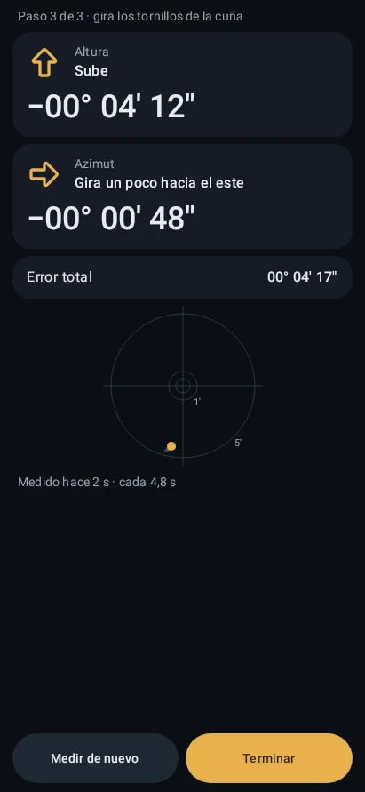 <b>Minutos de error.</b> Sube, y un poco hacia el este.</td>
<td valign="top" width="240">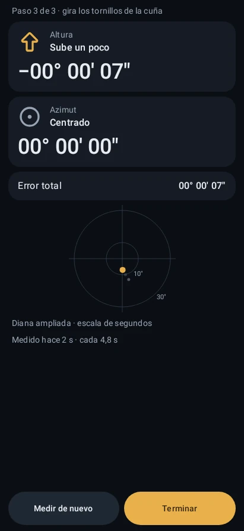 <b>Segundos de error.</b> La diana ampliada; azimut centrado.</td>
</tr></table>

<table><tr>
<td valign="top" width="470">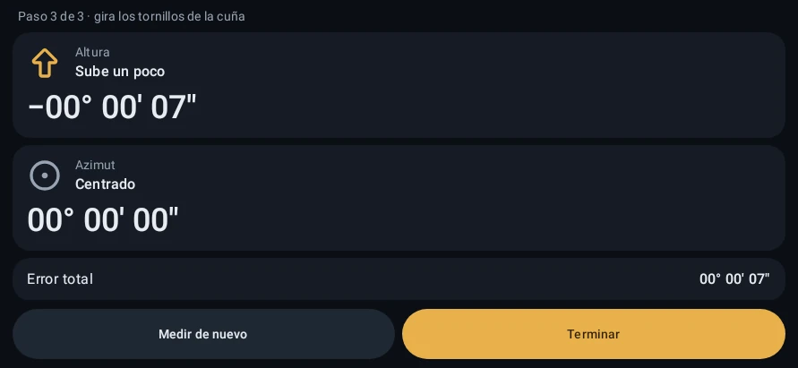 <b>En horizontal</b>, las tarjetas usan el ancho; los números siguen siendo grandes.</td>
</tr></table>

> [!TIP]
> **Seestar**
>
> En una cuña, la altura se ajusta con la inclinación de la cuña y el azimut girando su base. El Alpaca del Seestar puede girar su eje de AR, que es todo lo que necesita el asistente.

## 18. Plate solving y centrado

El plate solving calcula adónde apunta una toma, su escala y su rotación, a partir del patrón de sus estrellas. Yacana ejecuta ASTAP, el conocido solver, en el propio móvil, sin internet: unos 0,4 s con la posición de la montura como pista y unos 7 s a ciegas en un móvil de gama media con tomas del Seestar.

### Resolver una toma

En Imagen, haz una toma y toca **Resolver**. Yacana busca primero cerca de donde la montura dice que apunta, y luego a ciegas si hace falta. El resultado muestra:

- **AR y Dec** del centro de la toma, en J2000;
- la **rotación** de la cámara;
- la **escala** en segundos de arco por píxel y el campo en grados;
- cuánto tardó, si fue cerca de la montura o a ciegas, y la base de estrellas usada.

Toca **Sincronizar la montura** para decirle a la montura que apunta allí, y así sus siguientes GoTo llegarán más cerca. La rotación resuelta pasa a ser la rotación de la cámara para el encuadre y los mosaicos ([capítulo 16](#framing)).

### Ir y centrar

**Ir y centrar** aparece en todas partes donde puedes mandar el telescopio a algún sitio: en el mapa del cielo, en la ficha de un objeto, en la pantalla de encuadre y en la hoja **Ir a…** de la montura. Mueve la montura, hace una toma con la exposición de centrado, la resuelve, corrige la montura y repite hasta que el centro de la toma queda dentro de la tolerancia, 30″ por defecto. Su progreso muestra cada paso, a qué distancia quedó la última toma y el intento; **Detener** detiene la montura y la toma. Las tomas de centrado no se guardan.

<table><tr>
<td valign="top" width="240">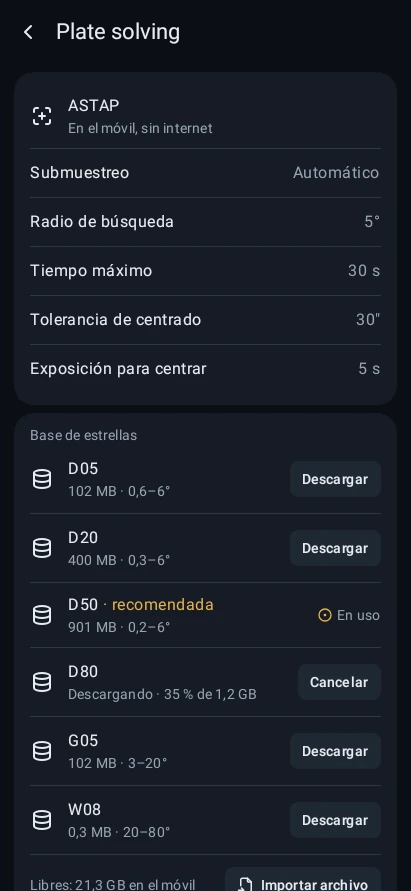 <b>Ajustes › Plate solving.</b> Las opciones de ASTAP y las bases de estrellas.</td>
</tr></table>

### Ajustes de plate solving

En *Ajustes › Plate solving*, guardados en cada perfil:

| Ajuste | Por defecto | Qué hace |
| --- | --- | --- |
| **Submuestreo** | Automático | ASTAP agrupa los píxeles de la toma antes de buscar estrellas. En automático elige el factor por el tamaño de la toma. |
| **Radio de búsqueda** | 5° | Cuánto buscar alrededor de la posición de la montura, de 1 a 180°. Si ahí no hay solución, busca en todo el cielo. |
| **Tiempo máximo** | 30 s | Para resolver cerca de la montura y luego a ciegas, de 5 a 600 s. |
| **Tolerancia de centrado** | 30″ | El centrado acaba cuando el centro de la toma está así de cerca del objetivo, de 5 a 600″. |
| **Exposición para centrar** | 5 s | Las tomas que resuelve el centrado, con la ganancia de Imagen; de 1 a 60 s. No se guardan. |

Las bases de estrellas están en la misma pantalla; el [capítulo 6](#field) explica cómo elegirlas, descargarlas e importarlas.

> [!TIP]
> **Cuando una toma no se resuelve**
>
> Comprueba que la toma tiene estrellas, que la distancia focal del perfil es la correcta (ASTAP busca esa escala) y que la base conviene a tu campo. Las nubes, el rocío o una toma muy desenfocada son las causas habituales.

## 19. Autoenfoque

El autoenfoque mueve el enfocador a través del foco, mide el HFR de las estrellas en cada punto y ajusta una curva en V para encontrar la mejor posición. Es un port del autoenfoque de N.I.N.A., con sus cinco ajustes de curva, la compensación de holgura y los desplazamientos de enfoque por filtro.

Necesita un enfocador absoluto (uno que va a posiciones en pasos) y una cámara, apuntando a un campo con estrellas. Ábrelo con **Autoenfoque** en la lista de Noche, en la pantalla del enfocador o en Imagen: la ejecución empieza al momento, con las opciones de *Ajustes › Autoenfoque*.

### Cómo va una ejecución

1. El enfocador sale unos cuantos pasos hacia fuera y luego toma un punto en cada paso hacia dentro: una toma, sus estrellas y su HFR.
2. Añade puntos hasta que haya tantos a cada lado del mejor como con los que empezó. La gráfica se va rellenando, con el punto actual, su exposición y su filtro.
3. Tras el último punto, ajusta la curva, lleva el enfocador al mejor enfoque y lo comprueba. El resultado muestra la posición, el HFR, la temperatura, el R² del ajuste y dónde estaba antes el enfocador.

Toca **Terminar** para cerrarlo. **Cancelar** durante una ejecución devuelve el enfocador a donde estaba. Si la ejecución falla, la pantalla dice por qué, el enfocador vuelve y **Volver a intentarlo** la empieza de nuevo.

El resultado se guarda: la pantalla del enfocador muestra el último autoenfoque y su curva, la lista de Noche muestra el HFR y hace cuánto, y el diario lo registra.

<table><tr>
<td valign="top" width="240">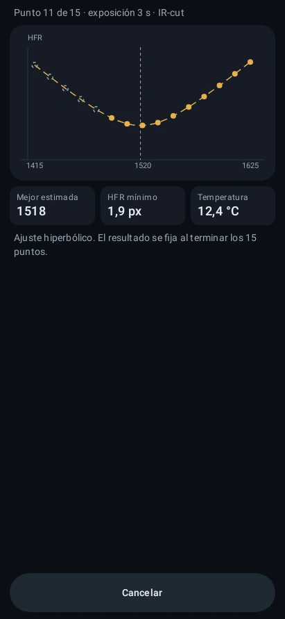 <b>En curso.</b> Punto 11 de 15, una exposición de 3 s con el filtro IR-cut.</td>
<td valign="top" width="240">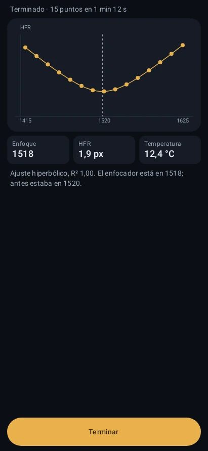 <b>Terminado.</b> 15 puntos en 1 min 12 s; el enfocador pasó de 1520 a 1518.</td>
</tr></table>

### Ajustes de autoenfoque

En *Ajustes › Autoenfoque*, guardados en cada perfil, con los valores por defecto de N.I.N.A.:

- **Paso:** Pasos del enfocador entre puntos (50; 15 para el Seestar). Si es demasiado pequeño, la curva sale plana; si es demasiado grande, hay pocos puntos cerca del foco.
- **Puntos:** Cuántos puntos toma: empieza con la mitad hacia fuera (9 puntos, 4 a cada lado; 15 para el Seestar).
- **Exposición:** De 1 a 8 s, con binning 1×1 o 2×2, con la ganancia de Imagen. No se guardan. 4 s (3 s para el Seestar).
- **Tomas por punto:** 1, 2 o 3. Más tomas promedian el seeing y tardan más.
- **Ajuste:** Cómo se halla el mejor enfoque a partir de los puntos: tendencias, parabólico, tendencias y parábola, hiperbólico (por defecto), o tendencias e hipérbola.
- **Holgura hacia dentro, hacia fuera:** Pasos que pierde el enfocador al cambiar de sentido; se pasa esa cantidad y vuelve.
- **R² mínimo:** Cuánto debe ajustarse la curva (0,7). Sin mínimo, el resultado se queda salvo que sea un 15 % peor que antes.
- **Intentos:** Cuántas veces vuelve a empezar si una ejecución falla (1).
- **Espera tras mover:** Segundos que reposa el enfocador tras cada movimiento antes de la toma (0).

<table><tr>
<td valign="top" width="240">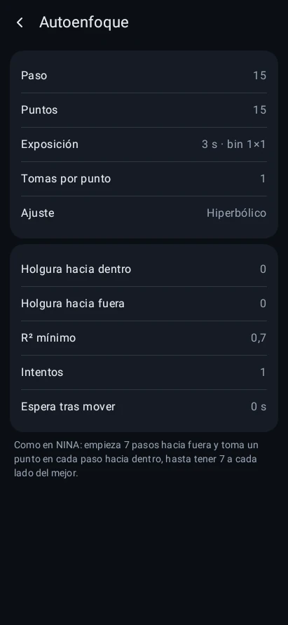 <b>Ajustes › Autoenfoque.</b> Los valores del Seestar.</td>
</tr></table>

### Cuando falla

| La app dice | Qué hacer |
| --- | --- |
| **El HFR no cambió bastante a ningún lado** | Usa un paso mayor. |
| **La curva explica poco los puntos** | El seeing o las nubes estropearon los puntos: más tomas por punto, una exposición más larga, o inténtalo más tarde. |
| **El mejor enfoque cae fuera de los puntos medidos** | Empieza más cerca del foco: mueve el enfocador a mano y vuelve a lanzarlo. |
| **En el mejor enfoque el HFR es peor que antes** | El resultado no se guardó y el enfocador volvió. Comprueba las condiciones y vuelve a intentarlo. |
| **Este enfocador no tiene posiciones a las que ir** | El autoenfoque necesita un enfocador absoluto. |

### Reenfoque automático durante la noche

En una secuencia, las reglas de autoenfoque lanzan una ejecución antes de una toma de luz cuando cambia la temperatura, cambia el filtro, empeora el HFR o pasa un tiempo. Se ponen en las reglas del editor simple ([capítulo 25](#simple)) o como disparadores en el editor avanzado ([capítulo 26](#advanced)). Si una ejecución falla durante la noche, el enfocador vuelve y las reglas esperan a las siguientes exposiciones.

Los desplazamientos de enfoque por filtro se ponen en la pantalla del enfocador ([capítulo 10](#focuser)): al cambiar de filtro, el enfocador se mueve la diferencia.

---

# Captura

## 20. Imagen

Imagen hace tomas a mano: tomas sueltas para comprobar el enfoque y el encuadre, o un bucle que guarda cada toma. Cada toma aparece alrededor de un segundo después de descargarse, estirada, con sus estrellas contadas y medidas.

### Hacer una toma

1. Ajusta la exposición, la ganancia, el binning y el filtro con los botones bajo la toma (ver más abajo).
2. Toca el botón redondo. La pantalla muestra *Exponiendo · 12 de 20 s* y luego *Descargando la toma…*. Tócalo otra vez durante la exposición para abortarla.
3. La toma aparece con su **HFR** y su número de **estrellas** arriba a la izquierda. Tócalos para ver los detalles de la última toma.

**Bucle** hace tomas una tras otra y las guarda todas, como el Loop de N.I.N.A.; pasa a ser **Parar**, que termina tras la toma en curso. Las tomas sueltas solo se guardan si **Guardar las tomas sueltas (el bucle siempre guarda)** está activado en las opciones. Si una toma falla mientras el equipo no contesta, o se pierde la conexión, el bucle espera y sigue con la siguiente toma en cuanto el equipo vuelve a contestar.

### Los ajustes de la toma

- **Exposición:** 10, 20, 30, 60 o 300 s, los que admita la cámara, u **Otro** en el teclado numérico, dentro del rango de la cámara.
- **Ganancia:** En el teclado numérico, dentro del rango de la cámara, o las ganancias con nombre de la cámara. Es la ganancia del perfil, la misma que en *Ajustes › Cámara*: se guarda, y la usan todas las tomas, también las de la secuencia, los flats, los darks y los bias. Empieza en 200, como hace la app del propio Seestar. Después de cambiarla, haz darks y bias nuevos con la nueva ganancia; los flats maestros siguen valiendo.
- **Binning:** 1×1, 2×2… solo si la cámara hace binning.
- **Filtro:** Con una rueda de filtros: el filtro puesto y los demás a los que cambiar. Las tomas para resolver, centrar, alinear o enfocar nunca pasan por **Dark**: antes la rueda pasa a IR. Con Dark, la toma no muestra HFR ni estrellas, que serían ruido.

<table><tr>
<td valign="top" width="240">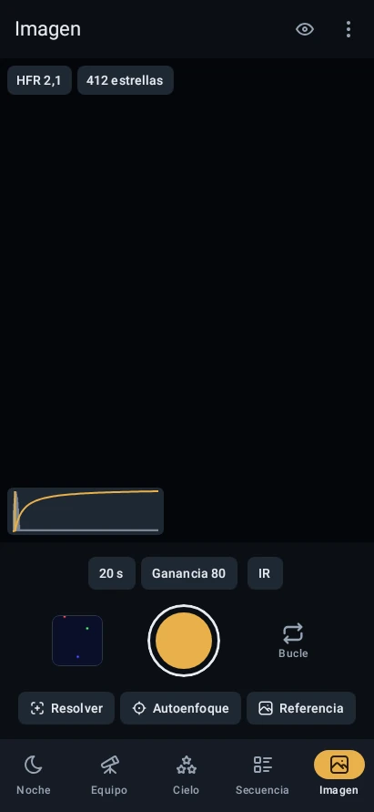 <b>Imagen.</b> HFR 2,1 px y 412 estrellas.</td>
</tr></table>

### Mirar la toma

- **Zoom:** pellizca, y arrastra para moverte. Un doble toque alterna entre la toma entera y los píxeles a 1:1.
- **Histograma:** abajo a la izquierda, con la curva de estirado.
- **Última toma:** toca el HFR y las estrellas de arriba a la izquierda para ver el histograma, la media, la mediana y la desviación en ADU, el HFR con su dispersión, el FWHM en píxeles y en segundos de arco (un perfil de Moffat, como en Hocus Focus), y dónde se guardó la toma.

### Opciones de captura

El **⋮** de arriba las abre:

- **Tipo de toma:** Light, dark, flat o bias. Va en el nombre del archivo y en la cabecera FITS.
- **Objetivo, para el nombre del archivo:** El nombre de la carpeta y de los archivos, como *M 31*. Sin él, las tomas se llaman *Snapshot*.
- **Guardar las tomas sueltas:** El bucle siempre guarda.
- **Dithering en bucles de lights, cada:** *No*, *3* (de inicio), *5* o *10* tomas. Entre tomas la montura recibe un pequeño empujón, como lo da el guiado directo de N.I.N.A.: el campo se mueve unos píxeles (5 por defecto) alrededor de donde empezó el bucle, para que el patrón del sensor no se acumule en rayas en el apilado. Los darks, flats y bias nunca hacen dithering. Con un Seestar, cuyos pulsos de guiado no van donde se mandan, salta en cambio con pequeños GoTo entre los 9 puntos de una rejilla separados 27″; tras cada vuelta la rejilla se desplaza 9″, para 81 posiciones en total.
- **Offset:** Si la cámara lo tiene.
- **Estirado automático:** Activado por defecto, como el de N.I.N.A. Desactivado, dos deslizadores ajustan las **Sombras** y los **Tonos medios**.
- **Marcar las estrellas:** Dibuja un recuadro y el HFR sobre las estrellas más brillantes, como hace N.I.N.A.; **Cuántas**, de 10 a 500.
- **Apilado en vivo:** **Apilar en vivo las tomas de luz** y **Equilibrar el color del apilado** ([capítulo 22](#stacking)).
- **Ajustes:** Los ajustes de la app.

<table><tr>
<td valign="top" width="240">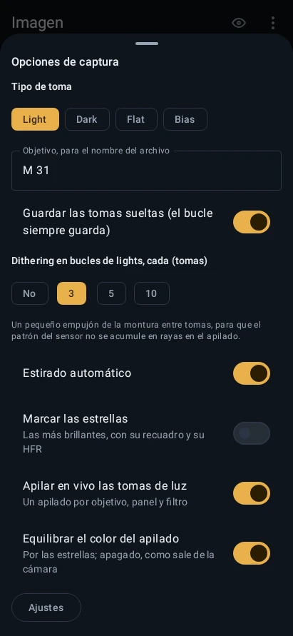 <b>Opciones de captura.</b></td>
</tr></table>

### Los botones bajo la toma

- **Resolver:** Resuelve la última toma con ASTAP y muestra adónde apunta, con **Sincronizar la montura** ([capítulo 18](#solving)).
- **Autoenfoque:** Con un enfocador, lanza el autoenfoque ([capítulo 19](#autofocus)).
- **Referencia:** Pone la foto de la caché del mismo campo sobre la toma, con su rotación, escala y zoom, para que puedas compararlas: ¿esa mancha tenue es la galaxia? Si la toma no está resuelta, primero la resuelve. Tócalo otra vez para volver a la toma.
- **La miniatura:** A la izquierda del botón redondo: abre el historial de la sesión ([capítulo 21](#history)).

<table><tr>
<td valign="top" width="240">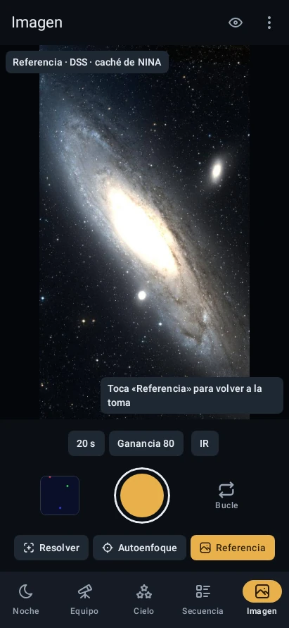 <b>Referencia.</b> La foto de la caché del campo de la toma.</td>
</tr></table>

<table><tr>
<td valign="top" width="470">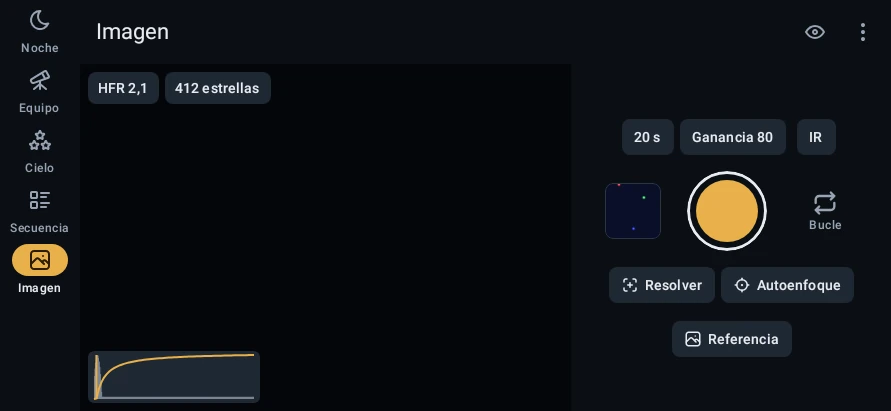 <b>En horizontal</b> la toma ocupa el ancho y los controles pasan al lado.</td>
</tr></table>

## 21. Historial y calidad de las tomas

El historial muestra cada toma guardada en esta sesión con su calidad, y marca las estropeadas por nubes o por luz, para que queden fuera del apilado.

- **La gráfica:** el HFR de cada toma como una línea y sus estrellas como barras, con **AF** donde se hizo un autoenfoque.
- **La lista,** la más reciente primero: número, hora, filtro y exposición, HFR y estrellas.
- **Las tomas descartadas** tienen muchas menos estrellas o un fondo mucho más brillante que la mediana de la sesión, y dicen por qué: *nubes*, *pocas estrellas* o *fondo alto*. Siguen guardadas en el disco; solo el apilado y el resumen las dejan fuera.

El icono del filtro de arriba muestra solo las tomas descartadas. Abre el historial desde la miniatura junto al botón redondo de Imagen.

<table><tr>
<td valign="top" width="240">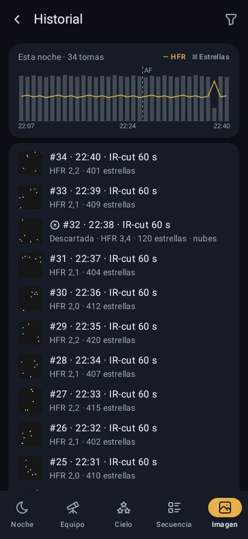 <b>Historial.</b> Toma 32 descartada: nubes.</td>
</tr></table>

## 22. Apilado en vivo

El apilado en vivo suma cada toma de luz buena a un apilado en curso mientras avanza la noche, así que ves cómo el objetivo surge del ruido. Está desactivado hasta que lo quieras, porque usa memoria y batería.

### Activarlo

En las opciones de Imagen, activa **Apilar en vivo las tomas de luz**. A partir de entonces cada toma de luz que se guarda entra en el apilado, venga de un bucle, de una secuencia o de una toma suelta. Las tomas se siguen guardando una a una, como siempre.

Los flats se recogen incluso con el apilado en vivo desactivado: cuando la tanda de un filtro está completa, pasan a ser su flat maestro, que se guarda como `FLATS/MasterFlat_IR.fits` (uno por filtro) en la carpeta de tus tomas para las noches siguientes, un FITS de 32 bits que también leen Siril y PixInsight. Un flat tuyo puesto ahí con ese nombre vale igual. También los darks se guardan para el apilado aunque lo actives después de tomarlos, como cuando una secuencia empieza con sus darks.

### Cómo apila

- **Un apilado por objetivo, panel y filtro,** y por exposición, ganancia y binning. Una toma de otro tipo guarda el apilado anterior y empieza el suyo.
- **Alineado por las estrellas:** desplazamiento, rotación y escala, sobre la primera toma del apilado.
- **Satélites y aviones eliminados** con rechazo a 3 sigma.
- **Calibrado sobre la marcha:** con el dark maestro de la noche de la misma exposición, ganancia, offset y binning a la temperatura del sensor más cercana, y el flat maestro de su filtro de la carpeta FLATS.
- **Color equilibrado con sus propias estrellas,** con **Equilibrar el color del apilado** activado; desactivado, como sale de la cámara.
- **Las tomas descartadas quedan fuera,** igual que las tomas cuyas estrellas no coinciden.

<table><tr>
<td valign="top" width="240">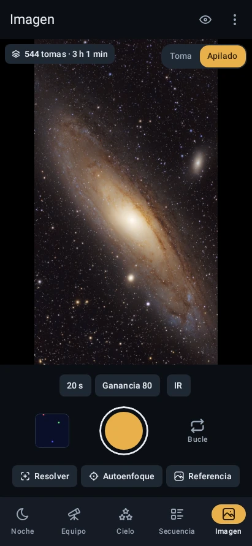 <b>El apilado.</b> M 31 a partir de 544 tomas de 20 s con un Seestar, procesado después.</td>
</tr></table>

### Un mosaico

En un mosaico la secuencia hace cada panel entero y luego el siguiente, y cada panel tiene su propio apilado, calibrado con sus darks y sus flats. Con **Apilado**, Imagen muestra el mosaico entero mientras se construye: cada panel en su sitio del cielo, según la resolución de su centrado, con el fondo igualado al de sus vecinos donde se solapan y las uniones fundidas, y un solo estirado y un solo balance de color para todo. El panel que se está apilando lleva el borde dorado y crece con cada toma; los que faltan, en discontinua. Es una vista a un cuarto del tamaño, o menor en un mosaico grande para que quepa en la memoria del móvil, y se guarda como JPG, como *2026-10-14/M 31/STACK/…_STACK_MOSAIC.jpg*, después de cada panel y al acabar la secuencia. El mosaico final se monta con los apilados de los paneles en Siril o PixInsight.

<table><tr>
<td valign="top" width="240">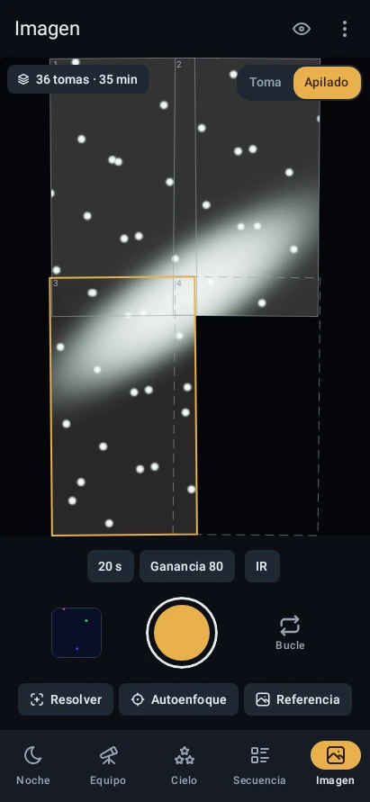 <b>Un mosaico.</b> El tercer panel de cuatro, creciendo.</td>
</tr></table>

### Verlo

Cuando existe un apilado, un selector **Toma** | **Apilado** arriba a la derecha de Imagen alterna entre la última toma y el apilado. Toca la etiqueta del apilado, como *544 tomas · 3 h 1 min*, para abrir su hoja:

- **Apiladas:** Las tomas que contiene, de las que han llegado.
- **Descartadas:** Cuántas quedaron fuera, y por qué.
- **Tiempo:** La integración total y las tomas.
- **Alineación:** Por las estrellas, y cuánto giró la última.
- **Color:** Equilibrado por las estrellas, o como sale de la cámara.
- **Dark** y **Flat:** el dark y el flat maestro en uso, como *MasterFlat_IR.fits del 11 de octubre*, o cuáles faltan.

En Noche, mientras una secuencia está en curso con el apilado activado, la tarjeta de la última toma muestra el apilado; tócala para abrirlo en Imagen.

### Guardarlo

El apilado se guarda solo cada 10 minutos mientras crece, y cuando termina el bucle o la secuencia: un FITS lineal de 32 bits para procesar, y un JPG como lo muestra la pantalla, en la carpeta de las tomas con `STACK` como tipo. **Guardar** lo guarda ahora. Si la app se cierra, el apilado sigue con la siguiente toma del mismo objetivo y filtro.

**Tomar 10 darks de 20 s** (con la exposición de las tomas) hace ahora darks para el apilado. Con un filtro oscuro es automático; sin él, la app te pide que tapes antes el telescopio. **Mantén para empezar de nuevo** vacía el apilado.

<table><tr>
<td valign="top" width="240">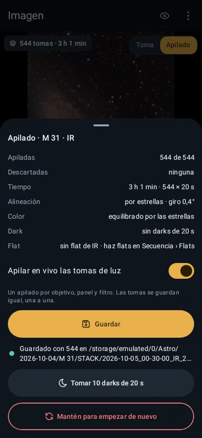 <b>La hoja del apilado.</b> Aún no hay darks ni flat para este filtro.</td>
</tr></table>

## 23. Flats, darks y bias

Las tomas de calibración quitan lo que añaden el sensor y la óptica. Yacana hace los flats con un asistente y los darks y los bias con las reglas de la secuencia, y el apilado en vivo los usa todos.

### El asistente de flats

Ábrelo con la plantilla **Flats** en Secuencia. Calcula la exposición por sí solo y hace los flats de cada filtro a un brillo objetivo. La luz es este móvil, o el panel de flats si hay uno conectado.

1. Comprueba el **ADU objetivo**, 30.000 ± 5 % por defecto, con el máximo de la cámara a la vista. Ajusta el **Brillo del panel** si usas uno.
2. Elige las **Tomas por filtro** (20, 30 o 50) y los **Filtros**. La **Ganancia** de debajo es la del perfil, que usan los flats y sus bias; se cambia en *Ajustes › Cámara* o en Imagen.
3. Toca **Empezar los flats**. Con este móvil como luz, tienes 30 s para ponerlo boca abajo sobre el telescopio, con la pantalla tapando la lente y una hoja de papel blanco en medio. Un pitido empieza los flats y la pantalla se pone en blanco a todo brillo, también en modo rojo; otro pitido los termina. Para pausarlos, toca dos veces la pantalla blanca; **Seguir** deja otros 30 s.
4. Cada filtro muestra *buscando el tiempo…*, luego su exposición y cuántas lleva hechas, con la media de la última toma en ADU. **Pausar** y **Mantén para parar** están abajo. Al acabar, con el filtro Dark del Seestar, hace 10 bias: su nivel queda en cada flat maestro, para que el apilado en vivo divida por él aunque no haya darks.

Si hay demasiada luz incluso con la exposición más corta, o muy poca con la más larga, el asistente se detiene y dice qué cambiar: más o menos papel sobre la pantalla del móvil, o el brillo del panel.

<table><tr>
<td valign="top" width="240">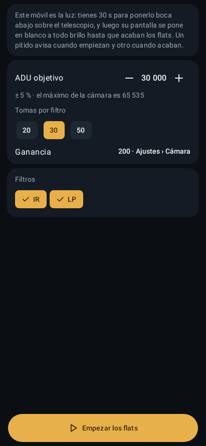 <b>Preparación.</b> Este móvil como luz, dos filtros.</td>
<td valign="top" width="240">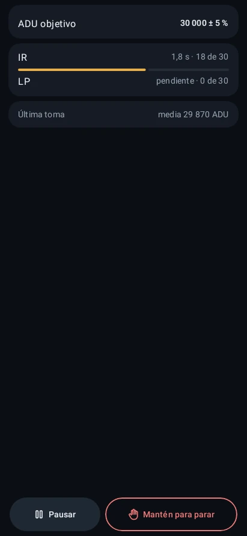 <b>En curso.</b> Los flats de IR a 1,8 s, media 29.870 ADU.</td>
</tr></table>

### Darks y bias en la secuencia

En el editor simple, el botón **Darks** bajo **Reglas** fija cuándo se hacen los darks, con la exposición, la ganancia y el binning de cada toma de luz y el filtro oscuro:

- **Al empezar** la noche.
- **Si la temperatura del sensor cambia** 2, 3 o 5 °C, para que el apilado en vivo use la tanda de temperatura más cercana.
- **Al terminar, con el bias** (activado por defecto).
- **Tomas por tanda:** 5, 10 o 20. La hoja dice cuánto tarda cada tanda sin tomas de luz.

Sin un filtro oscuro, los darks al empezar o por temperatura no son posibles; al final, la app te pide que tapes el telescopio. Los darks y los bias del inicio y del final van a la carpeta del objetivo, junto a LIGHT: los del inicio, a la del primer objetivo; los del final, a la del último.

<table><tr>
<td valign="top" width="240">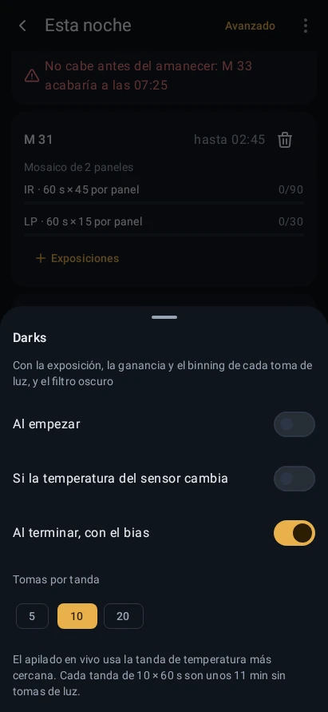 <b>Darks.</b> 10 tomas de 60 s tardan unos 11 min.</td>
</tr></table>

### A mano

En Imagen, pon el **Tipo de toma** en dark, flat o bias en las opciones y captura como siempre: las tomas van a su propia carpeta según el tipo.

---

# Secuencias

## 24. La sección Secuencia

Una secuencia es el plan de la noche: qué objetivos, con qué exposiciones y qué hacer alrededor de ellos. Yacana tiene dos editores sobre el mismo plan: uno simple que pone la noche en una línea de tiempo, y uno avanzado con los contenedores, disparadores y condiciones de N.I.N.A. Puedes pasar de uno a otro sin perder nada.

- **Esta noche:** El plan que ejecutará la noche, con sus objetivos y horas. Tócalo para abrir el editor. Mientras está en curso, lo indica.
- **Guardadas:** Tus secuencias guardadas, con sus objetivos y su duración. Toca una para cargarla como plan de esta noche; **Deshacer** recupera el plan que tenías. Mantén pulsada una fila un momento para borrarla con **Mantén para borrar**. Para guardar el plan de esta noche, usa el menú **⋮** del editor.
- **Plantillas:** Puntos de partida para un plan nuevo (ver abajo).
- **Nueva:** Un plan vacío, en el editor.

### Plantillas

- **Un objetivo toda la noche:** empieza un plan vacío y abre Cielo. El objetivo que añadas a continuación llena la noche hasta el amanecer.
- **Varios objetivos** y **Mosaico:** empiezan un plan vacío y abren Cielo, para encuadrar los objetivos o el mosaico.
- **Flats:** abre el asistente de flats ([capítulo 23](#calibration)).

Lo que había antes de una plantilla vuelve con **Deshacer**.

<table><tr>
<td valign="top" width="240"> <b>Secuencia.</b> Esta noche, secuencias guardadas y plantillas.</td>
</tr></table>

## 25. El editor simple

El editor simple muestra el plan de esta noche como una línea de tiempo y una tarjeta por objetivo. Avisa, con un icono y palabras, cuando el plan no cabe antes del amanecer.

### Añadir objetivos

Los objetivos vienen de Cielo: encuadra uno y toca **Añadir a la secuencia** ([capítulo 16](#framing)). **Añadir objetivo**, al final de la lista, te lleva allí. Un mosaico llega como un solo objetivo con sus paneles.

### Plan de esta noche

La línea de tiempo muestra cada objetivo desde su inicio hasta su fin, y el amanecer. Si el plan pasa del amanecer astronómico, dice qué objetivo acabaría y cuándo, y la hora de fin de ese objetivo se pone del color de aviso. **Deshacer** deshace el último cambio, hasta 50 cambios atrás. Los tiempos salen de lo que tardó tu equipo en su última noche: cada toma además de su exposición, cada dither, cada autoenfoque y cada centrado. Se cuentan los autoenfoques cada tantos minutos y al cambiar de filtro; los de temperatura o HFR no se pueden prever.

### La tarjeta de un objetivo

- Su nombre, cuándo acaba, y el icono de la papelera para quitarlo.
- Para un mosaico, su número de paneles; las exposiciones se aplican a cada panel.
- Una fila por filtro y exposición, como *IR · 60 s × 45 por panel*, con las tomas hechas y el total. Toca una fila para cambiarla; **Exposiciones** añade otro filtro.

<table><tr>
<td valign="top" width="240"> <b>Esta noche.</b> M 33 acabaría a las 07:25, después del amanecer.</td>
<td valign="top" width="240"> <b>Exposiciones.</b> El teclado numérico muestra cuánto duran y hasta cuándo.</td>
</tr></table>

### Exposiciones

La hoja fija una fila de las exposiciones de un objetivo: el **Filtro**, el **Tiempo** (10, 30, 60 o 120 s, u **Otro**) y el **Número de tomas** en el teclado numérico. Mientras escribes, muestra cuánto duran y hasta cuándo, o que acabarían después del amanecer. **Guardar** la guarda; **Quitar estas exposiciones** borra la fila cuando el objetivo tiene más de una.

### Reglas

La tarjeta **Reglas** muestra lo que hace la noche además de las tomas. Un plan nuevo viene con:

- **Desaparcar al empezar**, y **Calentador encendido** si el equipo tiene un interruptor de calentador.
- **Centrar al llegar:** cada objetivo, y cada panel de un mosaico, se centra con plate solving antes de sus tomas.
- **Dither cada 3 tomas**, sin guiado.
- **Autoenfoque si ΔT > 1 °C**, con un enfocador.
- **Recentrar si se desvía > 1′:** antes de cada toma de luz se resuelve la anterior; si el campo se ha desviado más de 1′ del objetivo, se vuelve a centrar. Sustituye al guiado.
- **Darks y bias al final**: 10 de cada, para cada exposición, ganancia, offset y binning de las tomas de luz.
- **Aparcar al final**, y el calentador apagado.

Los botones de debajo las cambian:

- **Autoenfoque:** Antes de cada toma de luz, se hace un autoenfoque si se cumple alguna de estas, como los disparadores de N.I.N.A.:
  - **Si la temperatura cambia** 0,5; 1; 2 o 5 °C;
  - **Al cambiar de filtro;**
  - **Si el HFR empeora** un 5, 10 o 20 %;
  - **Cada cierto tiempo:** 15, 30, 60 o 120 min, u otro tiempo.

  Si un autoenfoque falla, esperan a las siguientes exposiciones.
- **Darks:** Al empezar, cuando cambia la temperatura del sensor, al terminar con el bias, y cuántos cada vez ([capítulo 23](#calibration)).
- **Recentrado:** activado o no, y cuánto puede desviarse el campo: 1′, 2′, 5′ o 10′, cada uno también en píxeles de la cámara conectada. Nunca recentra por menos de 20 px, lo que puede mover un dither; con una cámara gran angular eso es más que cualquier opción, y la hoja lo avisa. Con buena alineación polar recentra una o dos veces por hora.
- **Dither:** activado o no, y cada 1, 3, 5 o 10 tomas, para las tomas de luz de todos los objetivos. Cada dither espera a que la montura se asiente. Con un Seestar, o una montura sin pulsos de guiado, cada dither parte de la resolución de la última toma y va al objetivo más su punto de la rejilla, así que también deshace la deriva, como hace la propia app del Seestar.
- **Calentador**, si el equipo conectado tiene uno: encendido o no durante la noche, y su potencia si es regulable. Gasta batería: apágalo en noches secas y templadas.

Para otras reglas, como esperar a que suba un objetivo o repetir hasta una hora, abre el plan en el editor avanzado.

### Guardar y empezar

El menú **⋮** tiene **Guardar en mis secuencias**. **Empezar**, abajo, inicia la noche cuando el equipo está conectado; mientras está en curso, el botón pasa a ser **Mantén para parar**. Puedes seguir editando el plan mientras está en curso: los cambios se aplican a lo que aún está por venir.

<table><tr>
<td valign="top" width="240"> <b>Reglas de autoenfoque.</b></td>
<td valign="top" width="240"> <b>Recentrado.</b> A menos de 1′ del objetivo.</td>
<td valign="top" width="240"> <b>Dither.</b> Cada 3 tomas.</td>
</tr></table>

## 26. El editor avanzado

El editor avanzado es el secuenciador avanzado de N.I.N.A. convertido en una lista táctil: contenedores en los que entras, instrucciones, disparadores y condiciones, que se reordenan arrastrando, con deshacer y una revisión de la noche antes de que empiece.

Ábrelo con **Avanzado**, arriba en el editor simple. Abre entero el plan de esta noche. Si añades lo que el editor simple no puede mostrar, como una condición o un contenedor paralelo, a partir de entonces esta noche solo se edita en el editor avanzado: el editor simple muestra **Esta noche se edita en Avanzado** con **Abrir en Avanzado** y la lista de objetivos.

### La estructura de la noche

- **Noche,** el nivel superior, con los **disparadores para toda la noche**, y tres áreas:
- **Inicio:** lo que pasa primero, antes de los objetivos, como desaparcar o enfriar la cámara. Lo que apunta a un objetivo no va aquí.
- **Objetivos:** uno tras otro, en este orden. Cada objetivo contiene sus instrucciones.
- **Final:** después de los objetivos: darks, aparcar y apagar.

Las migas de pan de arriba muestran dónde estás, como *Noche › Objetivos › M 33*. La tarjeta de cada nivel dice cómo se ejecuta: una vez, o repetido por sus condiciones, que se comprueban tras cada instrucción.

<table><tr>
<td valign="top" width="240"> <b>Noche.</b> Un disparador de autoenfoque y las tres áreas.</td>
<td valign="top" width="240"> <b>Un objetivo.</b> Repetido hasta las 02:00.</td>
</tr></table>

### Trabajar con los elementos

- **Entra** en un contenedor tocándolo; toca una instrucción para cambiar sus ajustes.
- **Añade** con el botón de abajo, **Añadir a …**, que abre el catálogo. **Condición** y **Disparador**, en la tarjeta del nivel, lo abren en ese tipo.
- **Reordena** arrastrando el asa de un elemento, o con su menú **⋮**.
- **El menú ⋮** de un elemento: *Entrar*, *Cambiar el objetivo*, *Renombrar*, *Ajustes*, *Subir*, *Bajar*, *Mover a…*, *Duplicar*, *Guardar como plantilla* y *Eliminar*.
- **Deshacer** está arriba.

Mientras la noche está en curso, los elementos terminados se marcan como hechos y el que está en curso se resalta. Ambos quedan bloqueados; el resto aún se puede cambiar.

### El catálogo

El catálogo tiene un buscador y botones por tipo: cámara, montura, enfoque, filtros, utilidad, contenedores, disparadores, condiciones y plantillas. Lo que no puede ir donde estás aparece en gris, con el motivo, como *Solo dentro de un Objetivo*.

<table><tr>
<td valign="top" width="240"> <b>El catálogo.</b> Lo que apunta a un objetivo aparece en gris en Inicio.</td>
</tr></table>

| Tipo | Elemento | Qué hace |
| --- | --- | --- |
| **Cámara** | Exposiciones | Tomas de luz, darks o bias: filtro, tiempo, número de tomas y dither |
| **Cámara** | Enfriar cámara · Calentar cámara | Hasta una temperatura poco a poco, o despacio de vuelta antes de apagarla |
| **Montura** | Desaparcar · Aparcar | Sale de su posición de reposo o vuelve a ella |
| **Montura** | Ir y centrar | GoTo al objetivo y plate solving, hasta 1′; solo dentro de un Objetivo |
| **Montura** | Ir al objetivo | GoTo al objetivo sin centrar; solo dentro de un Objetivo |
| **Montura** | Parar el seguimiento | La montura se queda quieta |
| **Enfoque** | Autoenfoque · Mover el enfocador | Una ejecución con curva en V, o a una posición |
| **Filtros** | Cambiar de filtro | La rueda pone otro filtro |
| **Utilidad** | Poner interruptor | Como el calentador antivaho, encendido o apagado |
| **Utilidad** | Esperar hasta la hora · Esperar un tiempo · Esperar a que suba | Sigue a una hora de esta noche, tras unos minutos, o cuando el objetivo llega a una altura |
| **Utilidad** | Anotación | Una nota en el diario de la noche |
| **Contenedor** | Objetivo | Un objetivo de Cielo, con su encuadre; viene con «Ir y centrar» |
| **Contenedor** | Secuencial · Paralelo | Sus instrucciones una tras otra, o a la vez, como esperar a una hora mientras se enfría la cámara |
| **Disparador** | Autoenfoque si cambia la temperatura · cada cierto tiempo · al cambiar de filtro · si sube el HFR | Un autoenfoque antes de la siguiente toma cuando se cumple su condición |
| **Disparador** | Recentrar si se desvía | Resuelve y corrige cuando el objetivo se desvía más de 1′ a 10′ (20 px como mínimo) |
| **Disparador** | Darks si cambia la temperatura | Darks con el filtro oscuro cuando el sensor cambia 2, 3 o 5 °C, para el apilado en vivo |
| **Condición** | Repetir N veces · Repetir hasta la hora · Repetir mientras esté alto | Repite el contenedor entero |
| **Plantilla** | Objetivo con autoenfoque · las tuyas | Un objetivo de Cielo con ir y centrar, autoenfoque y exposiciones; o cualquier bloque que guardaste como plantilla |

### Revisar la noche

El editor comprueba el plan mientras lo construyes. Cuando algo saldría mal esta noche, una insignia arriba cuenta los avisos; tócala para abrir **Revisar la noche**, y toca un aviso para ir a él. Los avisos nunca te impiden guardar ni empezar. Entre ellos:

- una instrucción que necesita un objetivo fuera de un Objetivo, o tomas de luz sin objetivo;
- un aparcado antes de tomas, de un enfoque o de un GoTo sin *Desaparcar* antes;
- tomas de luz sin *Ir y centrar* antes, o con el seguimiento parado;
- un filtro que la rueda no tiene, o enfriar una cámara que no se enfría;
- darks hechos mientras la cámara se calienta;
- dos elementos paralelos que usan el mismo dispositivo a la vez.

### Volver al plan simple

La tarjeta del editor simple, o el menú **⋮** del editor avanzado, tiene **Mantén para volver al plan simple**. Quita lo que solo sabe el editor avanzado y deja los objetivos con sus exposiciones. El mismo menú tiene **Guardar en Mis secuencias**.

<table><tr>
<td valign="top" width="240"> <b>Editada en Avanzado.</b> El editor simple muestra los objetivos.</td>
</tr></table>

> [!NOTE]
> **Para usuarios de N.I.N.A.**
>
> El editor avanzado sigue el secuenciador de N.I.N.A.: los mismos tipos de contenedores, disparadores y condiciones, ejecutados en el mismo orden. Los archivos de secuencia propios de N.I.N.A. no se importan, y las instrucciones que dependen de Windows o del guiado no están.

## 27. La noche en marcha

Empieza la noche con **Empezar la noche** en Noche o con **Empezar** en el editor. A partir de entonces la sesión funciona dentro de un servicio en primer plano: puedes apagar la pantalla y guardar el móvil.

### Noche mientras está en curso

Todo lo que necesitas cabe en una pantalla sin desplazarte:

- **El objetivo:** su nombre, panel y filtro, y su altura con una flecha que indica si sube o baja.
- **La toma:** un anillo con los segundos que quedan, *Toma 35 de 120*, el filtro y la ganancia.
- **Progreso:** el porcentaje de la secuencia y cuándo acaba, frente al amanecer astronómico. Tras unas pocas tomas, sigue lo que están tardando los pasos de esta noche.
- **Última toma:** su miniatura, si fue buena o descartada, su HFR y sus estrellas, y la curva de HFR de la noche. Con el apilado en vivo activado, muestra el apilado: tócalo para abrirlo en Imagen.
- **Próximo:** lo que viene, como el siguiente autoenfoque, el cambio al siguiente objetivo y el aparcado, con sus horas.

**Pausar** para al momento, descartando la toma en curso, y el seguimiento continúa; pasa a ser **Seguir**, que continúa desde la misma instrucción con las tomas que ya hizo. **Mantén para parar** termina la secuencia.

<table><tr>
<td valign="top" width="240"> <b>En curso.</b> Acaba a las 06:56, después del amanecer de las 06:44.</td>
<td valign="top" width="240"> <b>Con el apilado en vivo,</b> el apilado en la tarjeta.</td>
</tr></table>

### En el resto de la app

La barra de sesión de las demás pantallas muestra la toma y permite pausar ([capítulo 4](#tour)), y la notificación muestra el progreso en la pantalla de bloqueo. La secuencia e Imagen comparten la cámara: para un bucle en Imagen antes de empezar la noche.

### Con la pantalla apagada

Yacana mantiene despiertos el procesador y la WiFi del móvil mientras la sesión está en curso, y vincula el tráfico del equipo a su WiFi aunque no tenga internet. En la prueba de referencia funcionó 8,5 horas durante la noche con un Seestar, 503 tomas completas, sin reinicios y sin huecos de más de 6 s, gastando el 1,7 % de la batería por hora. Concede antes los permisos de batería ([capítulo 33](#permissions)).

Mientras Yacana está en pantalla, la pantalla sigue encendida y el móvil no se bloquea. Con la pantalla encendida, Android mantiene la WiFi a toda velocidad y, si se cae, vuelve a conectarse a la WiFi del equipo en segundos; con la pantalla apagada, puede no hacerlo hasta que la enciendas. Pulsa el botón de encendido para apagarla como siempre: la sesión sigue. Para una noche entera con la pantalla encendida, usa el modo rojo con poco brillo y una batería externa.

### Si la app o el móvil se reinician

Si Android cierra la app o el móvil se reinicia, la sesión se retoma sola en menos de un minuto; tras un reinicio, en cuanto desbloqueas el móvil por primera vez. Como mucho se pierde la toma en curso; las tomas ya guardadas nunca se dañan, porque cada una se escribe en un archivo temporal y luego se renombra. El diario registra *La app se cerró y retomó la secuencia*.

## 28. Avisos y paradas seguras

Una noche sin vigilancia termina bien o se detiene de forma segura. Cada aviso dice qué ha pasado, qué está haciendo la app y qué puedes hacer tú.

### Cuando se pierde la conexión

Si el equipo deja de responder, la secuencia entra en **pausa segura**: la exposición se detiene y el seguimiento sigue activo. El aviso, en Noche y como notificación con sonido, muestra los intentos y el tiempo que queda antes de una parada segura. La app reintenta cada 10 s.

- **Reintentar ahora** vuelve a intentarlo al momento.
- **Detalles** abre Equipo.
- **Mantén para parar** termina la secuencia.

Comprueba que el móvil sigue en la WiFi del equipo y que el equipo tiene alimentación. Cuando vuelve la conexión, la secuencia continúa, y el diario registra cuánto tiempo estuvo perdida.

### Parada segura

Una parada segura termina la sesión cuando:

- la conexión no vuelve en el tiempo fijado (2 min por defecto);
- la secuencia falla de una forma de la que no puede recuperarse;
- la batería del móvil baja del nivel fijado (20 % por defecto), y siempre por debajo del 10 %, salvo que esté cargando.

La exposición se detiene y la montura se aparca o para el seguimiento, según diga el perfil. Si se perdió la conexión, eso ocurre en cuanto vuelve. El aviso dice entonces qué se hizo; **Entendido** lo cierra.

<table><tr>
<td valign="top" width="240"> <b>Pausa segura.</b> Parada segura en 1 min 18 s si la conexión no vuelve.</td>
<td valign="top" width="240"> <b>Parada segura.</b> La montura, aparcada.</td>
</tr></table>

### Ajustes de seguridad

En *Ajustes › Seguridad*, por perfil:

- **Parada segura:** **Aparca la montura** o **Para el seguimiento**. El Seestar viene con aparcar, que cierra su brazo.
- **Si se pierde la conexión:** Cuánto espera la pausa segura: 1, 2, 5 o 10 min.
- **Batería baja del móvil:** 15, 20 o 30 %. Por debajo del 10 % siempre se detiene; nunca mientras carga.

<table><tr>
<td valign="top" width="240"> <b>Ajustes › Seguridad.</b></td>
</tr></table>

## 29. La mañana siguiente

Cuando termina la secuencia, Noche muestra el resumen de la noche hasta que lo cierras.

- Cómo terminó y cuándo: terminada, parada a mano, una parada segura o un fallo, y si la montura se aparcó.
- **Integración útil:** el tiempo de exposición de las tomas conservadas.
- **Tomas** y **Descartadas**, y el **HFR mediano**.
- **Por objetivo:** tomas y exposición por objetivo y filtro.
- **Incidencias:** reconexiones, autoenfoques extra, tomas con nubes, con sus horas.

**Ver diario** abre el diario de la noche. **Exportar** guarda un ZIP del registro de la app, con el perfil y las versiones, para conservarlo o adjuntarlo a un informe de error. La **✕** cierra el resumen.

### El diario de la noche

Una lista legible de lo que pasó, aparte del registro técnico: cada suceso con su hora y su porqué, como *Autoenfoque extra · La temperatura cambió 1,3 °C*, *M 31 Panel 1 centrado · a 8″ · 2 intentos* o *Conexión recuperada · 51 s · 5 intentos*. Su icono de arriba guarda el mismo ZIP que **Exportar**.

<table><tr>
<td valign="top" width="240"> <b>Resumen.</b> 34 tomas, una con nubes.</td>
<td valign="top" width="240"> <b>Diario de la noche.</b></td>
</tr></table>

Tus tomas y apilados están en la carpeta de las tomas, una carpeta por noche y objetivo ([capítulo 30](#files)). Para copiarlos, conecta el móvil a un ordenador con un cable USB y elige transferencia de archivos en el móvil; la carpeta aparece como cualquier otra del almacenamiento del móvil.

---

# Ajustes y archivos

## 30. Imágenes y archivos

Yacana guarda cada toma como un archivo FITS de 16 bits con las cabeceras de N.I.N.A., que se abre en Siril, PixInsight y cualquier programa de astronomía, en una carpeta por noche y objetivo.

### La carpeta

En *Ajustes › Imágenes y archivos*, **Carpeta** muestra adónde van las tomas. Por defecto es la carpeta propia de la app, `Android/data/app.yacana/files/Yacana` en el almacenamiento del móvil, que Android borra si desinstalas la app.

**Cambiar carpeta** abre el selector de carpetas de Android: elige o crea una carpeta en el almacenamiento del móvil (como `Astro`), una tarjeta SD o una memoria USB. Yacana conserva el permiso para escribir allí entre reinicios. Elige una antes de tu primera noche, para que tus tomas sean fáciles de encontrar y sobrevivan a una reinstalación.

### Nombres de archivo

El nombre de cada toma sale de un patrón con las etiquetas de N.I.N.A. Una barra crea una carpeta. Toca una etiqueta para añadirla; la pantalla muestra cómo se llamará la próxima toma. **Volver al de por defecto** restaura:

`$$DATEMINUS12$$/$$TARGETNAME$$/$$IMAGETYPE$$/$$DATETIME$$_$$FILTER$$_$$EXPOSURETIME$$s_$$FRAMENR$$`

que da, por ejemplo, `2026-10-04/M 31/LIGHT/2026-10-05_00-30-00_LP_20.00s_0001.fits`: una carpeta para la noche, otra para el objetivo y otra para el tipo de toma.

<table><tr>
<td valign="top" width="240"> <b>Ajustes › Imágenes y archivos.</b></td>
</tr></table>

| Etiqueta | Se convierte en | Ejemplo |
| --- | --- | --- |
| **`DATEMINUS12`** | La fecha de la noche: la fecha de 12 horas antes, para que las tomas de después de medianoche conserven la fecha de la tarde | `2026-10-04` |
| **`DATE`** | La fecha local | `2026-10-05` |
| **`DATETIME`** | La fecha y la hora locales | `2026-10-05_00-30-00` |
| **`TIME`** | La hora local | `00-30-00` |
| **`TARGETNAME`** | El objetivo, o *Snapshot* si no hay | `M 31` |
| **`IMAGETYPE`** | El tipo de toma | `LIGHT`, `DARK`, `FLAT`, `BIAS` |
| **`FILTER`** | El filtro, o *NoFilter* | `LP` |
| **`EXPOSURETIME`** | La exposición en segundos | `20.00` |
| **`FRAMENR`** | El número de toma de la sesión, con 4 cifras | `0001` |
| **`GAIN`, `OFFSET`** | La ganancia y el offset de la cámara | `80` |
| **`BINNING`** | El binning | `1x1` |
| **`SENSORTEMP`** | La temperatura del sensor | `-10.0` |

### Qué hay en cada archivo

- **Tomas:** FITS de 16 bits con los mismos píxeles que los archivos propios del Seestar, y las palabras clave de cabecera de N.I.N.A.: el tipo de toma, la exposición, la ganancia, el offset, el binning y la temperatura del sensor; el filtro; el objetivo y sus coordenadas, con su altura y su azimut; el telescopio, la cámara, la distancia focal y el tamaño de píxel; la posición y la temperatura del enfocador; el sitio; el patrón Bayer y sus desplazamientos, para que Siril les haga el debayer correctamente.
- **Apilados en vivo:** la misma ruta con `STACK` como tipo y número: un FITS lineal de 32 bits, con el número de tomas y la exposición total en su cabecera, y un JPG como lo muestra la pantalla, que se sobrescriben a medida que crece el apilado.
- **Seguridad:** cada archivo se escribe con un nombre temporal y se renombra al completarse, así que un cierre inesperado o un corte de luz nunca deja una toma rota.

El diario de la noche y el registro de la app se guardan dentro de la app; expórtalos como ZIP desde el resumen o desde *Ajustes › Exportar el registro*.

## 31. Referencia de ajustes

Ajustes se abre desde el engranaje de Noche y Equipo, o con **Ajustes** en las opciones de Imagen. El buscador de arriba encuentra cualquier ajuste por parte de su nombre, dentro de cada pantalla, con o sin tildes.

Cada opción dice qué hace. Los ajustes marcados *por perfil* se guardan en el perfil de equipo, para que cada equipo tenga los suyos.

<table><tr>
<td valign="top" width="240"> <b>Ajustes.</b></td>
<td valign="top" width="240"> <b>Cámara.</b> Una ganancia para todas las tomas.</td>
</tr></table>

| Fila | Qué contiene | Capítulo |
| --- | --- | --- |
| **Perfil y ubicación** | Nombre, óptica, sitio, límites, horizonte, base de estrellas, otros perfiles, exportar e importar | [5](#profile) |
| **Imágenes y archivos** | La carpeta y el patrón de nombres de archivo (por perfil) | [30](#files) |
| **Cámara** | La ganancia que usan todas las tomas (por perfil) | [20](#imaging) |
| **Plate solving** | Las opciones de ASTAP, el centrado y las bases de estrellas (por perfil) | [18](#solving), [6](#field) |
| **Autoenfoque** | Paso, puntos, exposición, ajuste, holgura, R², intentos (por perfil) | [19](#autofocus) |
| **Seguridad** | Parada segura, la espera cuando se pierde la conexión, batería baja (por perfil) | [28](#safety) |
| **Mapa del cielo** | Las cachés de N.I.N.A., solo con WiFi, fotos online y capas | [6](#field) |
| **Pantalla** | El modo rojo nocturno y su brillo | [32](#display) |
| **Idioma** | El idioma de la app | [32](#display) |
| **Permisos** | Para qué sirve cada permiso, y su estado | [33](#permissions) |
| **Exportar el registro** | Guarda un ZIP de los últimos 14 días del registro | [36](#troubleshooting) |
| **Acerca de** | La versión, el motor de píxeles y las licencias | [39](#credits) |

El apilado en vivo y su equilibrio de color se ajustan en las opciones de Imagen, y también se guardan por perfil.

## 32. Modo rojo e idioma

### Modo rojo nocturno

La luz roja mantiene tus ojos adaptados a la oscuridad. El modo rojo dibuja cada píxel de la app en rojo puro sobre negro, fotos y tomas incluidas, y ningún píxel tiene nada de verde ni de azul: se comprueba en cada pantalla.

- Actívalo con el icono del ojo arriba en Noche, Equipo, Cielo, Imagen, las fichas de objetos, el encuadre y los asistentes, o con **Modo rojo nocturno** en *Ajustes › Pantalla*.
- Las barras del sistema se ocultan; desliza desde el borde para verlas un momento.
- La app pone su propio brillo de pantalla, que puede bajar del mínimo del sistema: **Brillo en modo rojo**, del 1 al 100 %, 10 % por defecto.
- La app lo recuerda, y se abre en rojo si la dejaste en rojo.

Los diálogos propios de Android y el teclado del sistema no se pueden poner en rojo. Por eso de noche los números se introducen con el teclado numérico propio de la app. Tampoco se puede poner en rojo el punto verde que Android enciende arriba mientras una app lee la ubicación. Yacana solo la lee al abrirse, al activar **Usar la ubicación del móvil** y al conectar, nunca al reconectar, así que el punto se ve unos segundos.

<table><tr>
<td valign="top" width="240"> <b>Noche en rojo.</b></td>
<td valign="top" width="240"> <b>El cielo en rojo.</b> También las fotos.</td>
</tr></table>

### Idioma

Yacana habla inglés, español, catalán, euskera, gallego, alemán, francés, italiano, y el portugués de Portugal y de Brasil. En *Ajustes › Idioma*, **Como el sistema** sigue al móvil, o usa el inglés si el idioma del móvil no es uno de estos; o elige uno. Cambia al momento. En Android 13 y posteriores también puedes elegirlo en los ajustes del sistema para la app. Las fechas y los números siguen el idioma, con coma decimal en todos menos en inglés.

<table><tr>
<td valign="top" width="240"> <b>Ajustes › Idioma.</b></td>
<td valign="top" width="240"> <b>Ajustes › Pantalla.</b></td>
</tr></table>

## 33. Permisos y batería

Android no está pensado para una tarea de ocho horas con la pantalla apagada. Los permisos de *Ajustes › Permisos* son lo que permite a Yacana llevar la noche de todos modos.

La pantalla es la misma que la de los primeros pasos ([capítulo 3](#first-steps)): cada fila dice para qué sirve, qué deja de funcionar sin él, y muestra **Permitir**, **Abrir** o una marca cuando está concedido. Las filas que no se aplican a tu móvil no aparecen: la red local antes de Android 17, las notificaciones antes de Android 13, conservar la app sin uso antes de Android 11, y el autoinicio en móviles que no sean Xiaomi, Redmi o Poco.

### Si Android ya no lo pregunta

Cuando rechazas un permiso dos veces, Android deja de preguntarlo. La fila lo dice entonces: abre los ajustes de Yacana en Android, entra en Permisos, actívalo y vuelve.

### Ahorro de batería

- **Batería sin restricciones** es lo más importante para una noche. Sin él, el sistema puede cortar la sesión con la pantalla apagada.
- Algunos fabricantes añaden sus propios ahorros de batería por encima de los de Android. En los móviles Xiaomi, **Autoinicio** permite que la sesión vuelva si el sistema cierra la app. En otras marcas, busca Yacana en los ajustes de batería del móvil y permite que funcione en segundo plano.
- En los móviles Xiaomi, el ahorro de batería de la información de Yacana debe decir **Sin restricciones**: lo pone **Batería sin restricciones**. Bloquea también Yacana en Recientes (mantén pulsada su tarjeta y toca el candado), para que al borrarlas no se cierre.
- Los modos de ahorro de batería pueden detener el trabajo en segundo plano: déjalos desactivados durante una sesión.

### Lo que la app nunca necesita

Yacana no necesita ninguna cuenta, ni acceso a tus fotos, contactos o archivos más allá de las carpetas que elijas, ni ubicación en segundo plano.

---

# Referencia

## 34. Usar un Seestar S50 Pro

El ZWO Seestar S50 Pro lleva ASCOM Alpaca en su firmware, así que Yacana lo controla directamente por su WiFi. Es el dispositivo de referencia: cada función se construyó y se midió con él, y rellena su propio perfil.

### Antes de la primera noche

1. **Configúralo con la app de ZWO.** Yacana no la sustituye para la configuración propia del dispositivo: activarlo, actualizar su firmware, pasarlo a modo ecuatorial y configurar su WiFi se hace en la app de ZWO.
2. **Ponlo en una cuña ecuatorial, en modo EQ.** En una cuña sigue el cielo con un solo eje y permite exposiciones largas sin rotación de campo. Su modo altazimutal no está contemplado en esta app.
3. **Únete a su WiFi, o pon ambos en la WiFi de casa.** Funcionan sus dos modos de red: su propio punto de acceso, donde responde en `10.0.0.1`, puerto `32323`, y el modo estación en tu router. Una noche de 8,5 horas funcionó en modo punto de acceso, y 2 horas en modo estación, sin cortes largos.
4. **Búscalo en Yacana** y toca **Teleobjetivo** ([capítulo 3](#first-steps)). El perfil del Seestar se carga solo; **Gran angular** crea el de su cámara gran angular, más abajo.

### Qué fija su perfil

| Elemento | Valor | Por qué |
| --- | --- | --- |
| **Óptica** | 260 mm de distancia focal, 50 mm de apertura, f/5,2 | Su refractor apocromático de 4 elementos |
| **Sensor** | 2160 × 3840 px, 2,9 µm, color (Bayer GRBG) | La cámara de teleobjetivo, guardada en vertical como hace la app de ZWO |
| **Escala y campo** | 2,25″ por píxel · 2,40° × 1,35° | Medidos con ASTAP en tomas reales |
| **Rotación de la cámara** | 93,2° hasta que el primer plate solving la mida | Un S50 Pro en modo EQ, con su lado largo casi de norte a sur |
| **Base de estrellas** | D50 | Resuelve sus tomas con margen para noches peores; D05 es la opción ligera |
| **Autoenfoque** | 15 pasos entre puntos, tomas de 3 s | Su enfocador va de 0 a 2600 pasos |
| **Parada segura** | **Aparca la montura** | Al aparcar cierra su brazo |
| **Dispositivos usados** | Montura, cámara de teleobjetivo y su enfocador, rueda de filtros, interruptores | La cámara gran angular y su enfocador tienen su propio perfil, más abajo |

### Su cámara gran angular

**Gran angular** en la tarjeta del Seestar, en los primeros pasos o en **Nuevo perfil**, crea un segundo perfil, *Seestar S50 Pro gran angular*, para su cámara gran angular: todo un trozo de cielo, para la Vía Láctea y paisajes nocturnos. Sus exposiciones duran hasta 60 s.

| Elemento | Valor | Por qué |
| --- | --- | --- |
| **Óptica** | 5,95 mm de distancia focal, 3,4 mm de apertura, f/1,75 | Su objetivo publicado, 63° en diagonal |
| **Campo** | Unos 33° × 59°, 55″ por píxel | Su sensor de 2160 × 3840 px de 1,6 µm |
| **Base de estrellas** | W08, menos de 1 MB | La de ASTAP para campos de 20° a 80°: descárgala en *Ajustes › Plate solving* |
| **Autoenfoque** | 10 pasos entre puntos, 15 puntos, tomas de 3 s | Su enfocador va de 0 a 1023 pasos: valores de partida, a ajustar bajo el cielo |
| **Dispositivos usados** | Montura, cámara gran angular y su enfocador, interruptores | La rueda de filtros está solo delante del teleobjetivo |

### Conviene saber

- **Darks sin taparlo.** Su rueda de filtros tiene una posición **Dark**, que Yacana usa como obturador: los darks y los bias se hacen sin poner nada en el telescopio.
- **El calentador antivaho solo se enciende o se apaga.** Aparece como un interruptor en *Equipo › Interruptores*. Su servidor Alpaca (1.3.1-1) no permite ajustar su potencia.
- **Sin binning.** Su cámara no hace binning, así que un ajuste de 2×2, como el de la alineación polar, se hace a tamaño completo. Una toma tiene unos 8,3 MP, 16 MB a 16 bits, y se descarga en 1,7 a 2,3 s por su WiFi.
- **Sin cambio de meridiano.** En una cuña se comporta como una horquilla de un solo brazo. Mantén los objetivos lejos de donde el brazo podría chocar con la cuña, cerca del polo y del cenit.
- **Los cambios de filtro pueden ser lentos.** Algunos usuarios cuentan que un cambio tarda en reflejarse; las esperas de la app lo tienen en cuenta.
- **Alimentación.** Para una noche larga, alimenta el Seestar y el móvil con energía externa, sobre todo con el calentador encendido.
- **Su propia app a la vez.** No se ha probado usar la app de ZWO en otro móvil mientras Yacana maneja el Seestar; ciérrala durante una sesión.

Las pruebas se hicieron con el firmware 9.31 y el servidor Alpaca 1.3.1-1.

## 35. Qué necesita internet

Una noche no necesita internet en absoluto. En el campo el móvil solo habla con tu equipo, y todo lo que usa la noche está en el móvil.

| Función | Sin internet | Con internet |
| --- | --- | --- |
| **Catálogo de objetos** | 13.371 objetos de cielo profundo de OpenNGC, incluidos en la app | Igual |
| **Efemérides** | Sol, Luna y crepúsculos calculados en el móvil | Igual |
| **Plate solving** | ASTAP en el móvil, con una base de estrellas en el móvil | Igual |
| **Fotos del cielo** | De las cachés de N.I.N.A. en el móvil | Fotos con más detalle de la zona al acercar mucho, de hips2fits del CDS |
| **Búsqueda** | Messier, NGC, IC, Caldwell, Sharpless y nombres comunes | También SIMBAD: cualquier objeto que conozca, guardado en el móvil una vez encontrado |
| **Bases de estrellas y cachés del cielo** | Importadas desde un archivo o una tarjeta | Descargadas desde la app, solo con WiFi por defecto |

Cuando el móvil está en la WiFi del equipo, que no tiene internet, Yacana mantiene todo el tráfico del equipo en esa red, para que Android no lo envíe por los datos móviles. Las descargas que inicias usan la conexión normal del móvil.

## 36. Solución de problemas

Cada aviso de Yacana dice qué ha pasado, qué está haciendo la app y qué puedes hacer tú. Este capítulo reúne las causas habituales que hay detrás.

### Conectar

- **No ha respondido ningún equipo Alpaca:** El móvil y el equipo no están en la misma WiFi, o el equipo aún está arrancando. Únete a su red, espera un minuto y toca **Buscar otra vez**. Si tu red bloquea el descubrimiento, usa **Añadir por IP y puerto** con la dirección que muestra el dispositivo, como `10.0.0.1:32323` para un Seestar en su propio punto de acceso.
- **No se encuentra nada en absoluto:** Comprueba que **Red local** está concedido en *Ajustes › Permisos*. Sin él, Android bloquea cualquier descubrimiento y cualquier orden.
- **No se ha podido conectar:** El dispositivo respondió a la búsqueda pero rechazó la conexión. Comprueba que ningún otro programa lo esté usando, reinícialo y vuelve a conectar.
- **Desconecta para cambiar de perfil:** Los perfiles, los dispositivos y el borrado del perfil solo se pueden cambiar cuando no hay nada conectado. Toca antes **Desconectar todo**.

### Durante la noche

- **Sin conexión con el equipo:** Se cayó la WiFi o el equipo se quedó sin alimentación. La secuencia espera en pausa segura y la app reintenta cada 10 s; si la conexión no vuelve dentro del tiempo fijado en *Ajustes › Seguridad*, se detiene de forma segura en cuanto vuelva. Comprueba que el móvil sigue en la WiFi del equipo y que el equipo tiene batería ([capítulo 28](#safety)).
- **La sesión se detuvo con la pantalla apagada:** Android cerró la app para ahorrar batería. Concede **Batería sin restricciones**, **Se conserva aunque no se use** y, en móviles Xiaomi, **Autoinicio** en *Ajustes › Permisos* ([capítulo 33](#permissions)).
- **No cabe antes del amanecer:** El plan acaba después del amanecer astronómico. Baja el número de tomas de un objetivo, o quita un objetivo, hasta que desaparezca el aviso ([capítulo 25](#simple)).
- **El objetivo está por debajo del límite:** El GoTo bajaría del límite de altura del perfil o de su horizonte, y la montura no se ha movido. Espera a que suba el objetivo, o revisa el límite en el perfil.

### Plate solving y centrado

- **Sin solución con la base:** La toma tiene muy pocas estrellas (nubes, rocío, una exposición corta, mal enfoque) o la distancia focal del perfil está mal, así que ASTAP busca una escala equivocada. Comprueba la distancia focal en *Ajustes › Perfil y ubicación › Óptica*, enfoca, y prueba con una exposición más larga.
- **La base de estrellas no está en el móvil:** Descárgala o impórtala en *Ajustes › Plate solving* ([capítulo 6](#field)).
- **No se centró tras varios intentos:** La montura no llega lo bastante cerca. Sincronízala una vez con una toma resuelta y vuelve a centrar; comprueba que el seguimiento está activado y que la montura no resbala.

### Alineación polar y autoenfoque

- **Esta montura no puede girar sola su eje de AR:** La alineación de tres puntos necesita una montura que pueda mover un eje a una orden (MoveAxis). Sin eso, alinea la montura de otra forma.
- **El perfil no tiene ubicación:** La posición del polo depende del sitio y de la hora. Activa **Usar la ubicación del móvil** en el perfil, o escribe el sitio.
- **El HFR no cambió bastante a ningún lado:** El paso del autoenfoque es demasiado pequeño para tu óptica. Sube el **Paso** en *Ajustes › Autoenfoque*.
- **La curva explica poco los puntos:** El seeing o las nubes estropearon los puntos. Vuelve a intentarlo, usa más tomas por punto o una exposición más larga.
- **El mejor enfoque cae fuera de los puntos:** El enfocador empezó demasiado lejos del foco. Acércalo a mano en *Equipo › Enfocador* y vuelve a lanzarlo.
- **Este enfocador no tiene posiciones a las que ir:** El autoenfoque necesita un enfocador absoluto, uno que informe de su posición en pasos y vaya a la que se le pide.

### Cuando necesites ayuda

Toca *Ajustes › Exportar el registro* y elige dónde guardar el archivo. Es un ZIP con los últimos 14 días del registro de la app, el perfil en uso y las versiones de la app, de Android y del móvil, listo para adjuntarlo a un informe de error en el gestor de incidencias del proyecto. No se envía nada por sí solo. **Exportar** del resumen de la noche y el icono de exportar del diario guardan el mismo ZIP.

## 37. Para usuarios de N.I.N.A.

Si conoces N.I.N.A., ya conoces la mayor parte de Yacana. Mantiene los conceptos de N.I.N.A. y muchos de sus algoritmos, organizados para una pantalla táctil y para la oscuridad.

| En N.I.N.A. | En Yacana |
| --- | --- |
| **Pestaña Equipo** | Sección Equipo: perfil, conexión y control manual de cada dispositivo |
| **Sky Atlas y asistente de encuadre** | Sección Cielo: mapa, lista, fichas de objetos y encuadre |
| **Caché de encuadre (FramingAssistantCache)** | Las mismas cachés, leídas directamente de su ZIP; las fotos online se pueden exportar de vuelta a N.I.N.A. |
| **Pestaña Imagen** | Sección Imagen: captura, estadísticas, historial y la foto de referencia de la caché |
| **Secuenciador simple y avanzado** | Editores simple y avanzado sobre un mismo modelo: puedes pasar de uno a otro en ambos sentidos sin perder nada |
| **Plugin Three Point Polar Alignment** | Asistente de alineación polar integrado, portado del plugin |
| **Autoenfoque, FWHM de Hocus Focus** | Autoenfoque integrado con los mismos cinco ajustes de curva, y un FWHM de Moffat |
| **Asistente de flats (Flat Wizard)** | Asistente de flats |
| **Opciones** | Ajustes, con un buscador |
| **Etiquetas del patrón de archivo** | Las mismas etiquetas, como `$$TARGETNAME$$` |
| **Archivo de horizonte** | El mismo archivo, importado en el perfil |
| **Cabeceras FITS** | Las mismas 36 palabras clave |

### Diferencias que conviene conocer

- **Sin guiado.** El dither se hace sin guiado, como hace el direct guider de N.I.N.A.
- **Diseño centrado en la noche.** Una sección Noche, que N.I.N.A. no tiene, prepara la noche con una lista, sigue la sesión de un vistazo y da un resumen y un diario legible por la mañana.
- **Las secuencias de N.I.N.A. no se importan,** y los plugins no funcionan. Construye la secuencia en el editor simple o en el avanzado; sus instrucciones, disparadores y condiciones siguen los de N.I.N.A.
- **El apilado en vivo viene integrado,** calibrado con los darks de la noche y el flat del filtro.
- **Las cachés van en los dos sentidos.** Las cachés de N.I.N.A., como ZIP o como la carpeta `FramingAssistantCache` de tu PC, se importan en *Ajustes › Mapa del cielo*. Las fotos online que guarda Yacana también están en el formato de N.I.N.A.: mantén pulsado **Fotos online** allí y toca **Exportar ZIP**, descomprímelo en el PC y elige su carpeta en *Opciones › General › Directorio Caché Sky Survey* de N.I.N.A.

## 38. Glosario

- **ADU:** Unidades analógico-digitales: el valor de brillo en bruto de un píxel. Los flats buscan alrededor de la mitad del máximo de la cámara.
- **Alpaca (ASCOM Alpaca):** El estándar abierto de red para equipos de astronomía. Los dispositivos responden a peticiones web sencillas por WiFi o Ethernet, y una búsqueda en la red los encuentra.
- **Aparcar:** Llevar la montura a su posición de reposo y detenerla. Un Seestar cierra su brazo.
- **Apilado en vivo (live stacking):** Sumar cada nueva toma de luz a un apilado en curso, alineada por sus estrellas, mientras avanza la noche.
- **ASTAP:** El programa de plate solving que Yacana ejecuta en el móvil, de Han Kleijn, con sus bases de estrellas.
- **Base de estrellas:** El catálogo de posiciones de estrellas de ASTAP. Las bases más densas resuelven campos más pequeños.
- **Bias:** Una toma de la exposición más corta, sin luz, que registra el nivel base del sensor.
- **Binning:** Sumar píxeles, por ejemplo 2×2, para tener tomas más rápidas, más sensibles y más pequeñas.
- **Centrado:** Hacer una toma, resolverla, corregir la montura y repetir hasta que el objetivo quede dentro de la tolerancia.
- **Condición:** En el editor avanzado, lo que hace que un contenedor se repita: un número de veces, hasta una hora, o mientras el objetivo esté alto.
- **Contenedor:** Un bloque de instrucciones. Los contenedores secuenciales las ejecutan una tras otra; los paralelos, a la vez.
- **Cuña:** Una cuña ecuatorial: inclina una montura altazimutal para que uno de sus ejes apunte al polo celeste.
- **Dark:** Una toma con la misma exposición, ganancia y temperatura que las tomas de luz, sin luz, que registra la señal térmica del sensor.
- **Dec, AR:** Declinación y ascensión recta: la latitud y la longitud del cielo. Yacana las muestra en grados, minutos y segundos, y en horas, minutos y segundos.
- **Disparador (trigger):** En una secuencia, algo que se ejecuta cuando se cumple una condición, como un autoenfoque cuando cambia la temperatura.
- **Dither:** Un pequeño movimiento aleatorio de la montura entre tomas, para que los defectos del sensor no coincidan al apilar las tomas.
- **DSS:** El Digitized Sky Survey, el sondeo fotográfico de todo el cielo en el que se basa la caché completa de N.I.N.A.
- **Encuadre:** Colocar el campo de la cámara sobre el cielo para ver cómo saldrá la foto.
- **FITS:** El formato de archivo estándar de la astronomía. Yacana guarda las tomas en FITS de 16 bits y los apilados en FITS de 32 bits.
- **Flat:** Una toma de una fuente de luz uniforme, que registra el viñeteado y el polvo para poder eliminarlos.
- **FWHM:** Anchura a media altura (full width at half maximum): el tamaño de una estrella, a partir de un perfil de Moffat, en píxeles o en segundos de arco.
- **GoTo:** Un movimiento de la montura hasta unas coordenadas dadas.
- **HFR:** Radio de flujo medio (half-flux radius): el radio que contiene la mitad de la luz de una estrella, en píxeles. Cuanto menor, más nítida; es lo que minimiza el autoenfoque.
- **hips2fits:** El servicio del CDS que recorta imágenes del cielo de cualquier zona. N.I.N.A. y Yacana lo usan para las fotos online.
- **Mosaico:** Un objetivo más grande que el campo, cubierto con varios paneles que se solapan.
- **Noche astronómica:** El tiempo en que el Sol está más de 18° bajo el horizonte: el cielo está totalmente oscuro. Antes y después está el crepúsculo.
- **NSNS:** El Northern Sky Narrowband Survey, cuyas cachés añaden al mapa la emisión de hidrógeno y oxígeno.
- **Parada segura:** El final de una sesión ante un fallo grave: la exposición se detiene y la montura se aparca o para el seguimiento.
- **Patrón Bayer:** La disposición de los filtros de color sobre un sensor en color, como GRBG. El debayer lo convierte en una imagen en color.
- **Pausa segura:** La espera de la secuencia mientras se pierde la conexión con el equipo: exposición detenida, seguimiento activo.
- **Plate solving:** Calcular adónde apunta una toma, su escala y su rotación, a partir del patrón de sus estrellas.
- **R²:** Lo bien que se ajusta la curva del autoenfoque a sus puntos, de 0 a 1.
- **SIMBAD, Sesame:** La base de datos del CDS con más de 20 millones de objetos y su resolvedor de nombres, usados para la búsqueda online.
- **Sincronizar:** Decirle a la montura adónde apunta realmente, a partir de una toma resuelta, para que los GoTo siguientes lleguen más cerca.
- **Toma de luz (light frame):** Una toma del propio objetivo.
- **TPPA:** Alineación polar de tres puntos: tres tomas resueltas girando el eje de AR dan el eje real de la montura y su error respecto al polo.
- **Velocidad de seguimiento:** La velocidad a la que la montura sigue el cielo: sidérea para las estrellas, lunar, solar, o King, que tiene en cuenta la refracción.

## 39. Privacidad, licencias y créditos

### Privacidad

Yacana no tiene cuenta, ni publicidad, ni analíticas, ni telemetría. Nada sale del móvil salvo lo que inicias tú: las descargas de bases de estrellas y cachés del cielo, las fotos online y las búsquedas en SIMBAD, y el ZIP del registro si decides compartirlo. Tu ubicación solo se usa para calcular el cielo, solo mientras usas la app, y se queda en el perfil, en el móvil. Un perfil que exportas lleva la ubicación del sitio, así que compártelo con cuidado.

### Licencia

Yacana es libre y de código abierto bajo la [Mozilla Public License 2.0](https://mozilla.org/MPL/2.0/). Es un proyecto independiente, sin relación con ZWO, la ASCOM Initiative ni el proyecto N.I.N.A.

### Construido sobre

*Ajustes › Acerca de* muestra las licencias de lo que la app incluye o porta:

| Obra | Usada para | Licencia |
| --- | --- | --- |
| **ASTAP, de Han Kleijn** | Plate solving, en el móvil | MPL-2.0 |
| **N.I.N.A.** | Detección de estrellas, HFR y estirado, portados | MPL-2.0 |
| **Plugin Three Point Polar Alignment** | La alineación polar, portada | MPL-2.0 |
| **Plugin Hocus Focus** | El FWHM, portado | MPL-2.0 |
| **Astronomy Engine, de Don Cross** | Efemérides | MIT |
| **ERFA** | Refracción | BSD-3-Clause |
| **OpenNGC** | El catálogo de objetos | CC BY-SA 4.0 |
| **SIMBAD y Sesame, CDS de Estrasburgo** | Búsqueda online | CDS |
| **jpeg-encoder** | El JPG del apilado; basado en parte en el trabajo del Independent JPEG Group | MIT · IJG |
| **Tabler Icons** | Iconos | MIT |

Al final de *Ajustes › Acerca de*, **Licencias de código abierto** muestra todo lo que lleva la app, desde las librerías de Android y Kotlin hasta las de Rust del motor, y los datos que usa, cada uno con el texto completo de su licencia. El catálogo de objetos, hecho a partir de OpenNGC, comparte su licencia CC BY-SA 4.0.

### Datos del cielo

Las fotos del cielo no forman parte de la app. Las descargas de la web de N.I.N.A. o las importas: el Digitized Sky Survey (STScI), que el STScI permite distribuir a N.I.N.A., y el Northern Sky Narrowband Survey, bajo CC BY-NC-SA 4.0. El mapa muestra sus créditos: *DSS: STScI · NSNS: CC BY-NC-SA 4.0*. Las fotos online vienen de hips2fits del CDS. Las bases de estrellas de ASTAP, que también se descargan o se importan, están hechas con los datos de la misión Gaia de la ESA (ESA/Gaia/DPAC), bajo CC BY-NC 3.0 IGO.

*Yacana es la llama celeste de los incas, una constelación oscura de la Vía Láctea. Sus ojos son Alfa y Beta Centauri.*

---

Manual de usuario de Yacana, para la versión 1.0.3. Las pantallas son las capturas de referencia de la propia app; las fotos del cielo que aparecen en ellas son de la caché DSS de N.I.N.A., y el apilado de M 31 son 544 tomas de 20 s hechas con un Seestar S50 Pro y procesadas después.

¿Has encontrado algo que está mal o que falta? Abre una incidencia en el [gestor de incidencias del proyecto](https://github.com/yacana-app/yacana/issues).
