

**Erabiltzailearen eskuliburua · 1.0.1 bertsioa**

# Gau osoa, zure mugikorretik

Yacanak egiten duen guztia eta nola erabili, pantailaz pantaila: lehen abiaraztetik goizeko laburpenera arte, aplikazioaren benetako pantailekin.

`Android 10+ · ARM64` · `ASCOM Alpaca WiFi bidez` · `Internetik gabe dabil` · `10 hizkuntza` · `MPL-2.0`

[English](../README.md) · [Español](../es/README.md) · [Català](../ca/README.md) · **Euskara** · [Galego](../gl/README.md) · [Deutsch](../de/README.md) · [Français](../fr/README.md) · [Italiano](../it/README.md) · [Português (Portugal)](../pt/README.md) · [Português (Brasil)](../pt-BR/README.md)

## Edukiak

**Hasteko**

1. [Ongi etorri Yacanara](#welcome)
2. [Instalatu eta eguneratu](#install)
3. [Lehen urratsak](#first-steps)
4. [Aplikazioan orientatzea](#tour)
5. [Zure ekipoaren profila](#profile)
6. [Landarako prest](#field)

**Ekipoa**

7. [Zure ekipoa konektatzea](#equipment)
8. [Muntura](#mount)
9. [Kamera eta iragazki-gurpila](#camera)
10. [Fokatzailea](#focuser)
11. [Etengailuak, flat panela, segurtasun-monitorea](#accessories)

**Gaua planifikatzea**

12. [Gaur gauean, begirada batean](#night)
13. [Zeruko mapa](#sky-map)
14. [Sky Atlas eta bilaketa](#atlas)
15. [Objektu baten fitxa](#object)
16. [Enkoadraketa eta mosaikoak](#framing)

**Teleskopioaren ondoan**

17. [Lerrokatze polarra](#polar)
18. [Plate solving eta zentratzea](#solving)
19. [Foku automatikoa](#autofocus)

**Argazketa**

20. [Irudia](#imaging)
21. [Historia eta argazkien kalitatea](#history)
22. [Zuzeneko pilaketa](#stacking)
23. [Flatak, darkak eta biasak](#calibration)

**Sekuentziak**

24. [Sekuentzia atala](#sequence)
25. [Editore sinplea](#simple)
26. [Editore aurreratua](#advanced)
27. [Gaua martxan](#running)
28. [Abisuak eta gelditze seguruak](#safety)
29. [Biharamun goizean](#morning)

**Ezarpenak eta fitxategiak**

30. [Irudiak eta fitxategiak](#files)
31. [Ezarpenen erreferentzia](#settings)
32. [Modu gorria eta hizkuntza](#display)
33. [Baimenak eta bateria](#permissions)

**Erreferentzia**

34. [Seestar S50 Pro bat erabiltzea](#seestar)
35. [Zerk behar du interneta](#internet)
36. [Arazoak konpontzea](#troubleshooting)
37. [N.I.N.A.-ren erabiltzaileentzat](#for-nina-users)
38. [Glosarioa](#glossary)
39. [Pribatutasuna, lizentziak, kredituak](#credits)

---

# Hasteko

## 1. Ongi etorri Yacanara

Yacanak astrofotografia-gau oso bat gidatzen du Android mugikor batetik. Zure ekipoarekin zuzenean hitz egiten du WiFi bidez, ASCOM Alpacaren bitartez; gaua planifikatzen du, helburuak enkoadratu eta zentratzen ditu, muntura polarki lerrokatzen du, fokatzen du, argazkiak ateratzen eta pilatzen ditu, eta pantaila itzalita egonda ere jarraitzen du. Goizean, zer gertatu den esaten dizu.

Ez dago tartean ordenagailu eramangarririk, mini-PCrik edo hodeiko zerbitzurik: mugikorra da behatokiko ordenagailua. Haren erreferentzia funtzionala N.I.N.A. da, Windowserako argazketa-suite librea. Yacanak haren lan egiteko moduak jarraitzen ditu eta haren tresna batzuk portatzen ditu, hala nola hiru puntuko lerrokatze polarra, foku automatikoa eta izarren detekzioa, emaitzak bat etor daitezen.

### Zer behar duzu

- **Mugikor bat,** Android 10 edo berriagoarekin eta 64 biteko ARM prozesadorearekin, 2019tik saldutako ia mugikor guztiek duten bezala. Aplikazioak 8 MB inguru ditu.
- **ASCOM Alpaca darabilen ekipoa** sarearen bidez: muntura bat eta kamera bat, eta, badituzu, fokatzaile bat, iragazki-gurpil bat, etengailuak (ihintz-berogailu bat, adibidez), flat panel bat eta segurtasun-monitore bat. ZWO Seestar S50 Prok Alpaca integratuta dakar, eta erreferentziako gailua da.
- **WiFia mugikorraren eta ekipoaren artean:** ekipoaren beraren sarbide-puntua, edo etxeko sare bera.
- **Leku librea lineaz kanpoko datuetarako,** etxean behin deskargatuta: izarren datu-base bat plate solving-erako (900 MB inguru gomendatuak) eta, zeruko argazkietarako, N.I.N.A.-ren zeruko cachea (3,5 GB).

### Zer egiten du Yacanak

| Gaueko unea | Aplikazioan non | Kapitulua |
| --- | --- | --- |
| Egiaztatu gaur gaueko iluntasuna eta Ilargia, eta prestatu gaua zerrenda batekin | Gaua | [12](#night) |
| Konektatu gailu bakoitza eta gidatu eskuz | Ekipoa | [7–11](#equipment) |
| Aurkitu helburuak, ikusi zeruan, enkoadratu, planifikatu mosaikoak | Zerua | [13–16](#sky-map) |
| Lerrokatu polarki muntura arku-segundoraino | Lerrokatze polarraren laguntzailea | [17](#polar) |
| Ebatzi argazkiak eta zentratu helburua | Irudia, Zerua, Muntura | [18](#solving) |
| Fokatu V kurba batekin | Foku automatikoaren laguntzailea | [19](#autofocus) |
| Atera argazkiak, egiaztatu haien kalitatea, pilatu zuzenean | Irudia | [20–22](#imaging) |
| Atera flatak, darkak eta biasak | Flaten laguntzailea, sekuentziaren arauak | [23](#calibration) |
| Planifikatu gaua eta exekutatu inor begira egon gabe | Sekuentzia, Gaua | [24–28](#sequence) |
| Irakurri laburpena eta egunerokoa goizean | Gaua | [29](#morning) |

### Zer ez duen egiten

Yacanak gauza batzuk nahita uzten ditu kanpoan. Ezagutu itzazu gau bat horien mende egon aurretik:

- **Gidaketa.** Ez dago gida-kamerarik ez PHD2rik. Dithering-ak gidaririk gabe funtzionatzen du, pultsu laburrekin edo munturaren mugimendu txikiekin.
- **USB gailuak eta fabrikatzaileen driverrak.** Dena Alpacaren bidez doa, sarearen bidez. INDI ekipoek Alpaca zubi baten bidez bakarrik funtzionatzen dute.
- **Biragailuak, kupulak eta meridiano-iraulketak.** Kameraren biraketa plate solving bidez neurtzen da eta dagoen bezala erabiltzen da.
- **Planetarioekiko loturak** (Stellarium, Cartes du Ciel) eta N.I.N.A.-ren pluginak.
- **Tabletarako diseinuak.** Aplikazioak tabletan mugikorraren diseinuarekin funtzionatzen du.

### Zure lehen gaua, laburki

1. [Instalatu APKa](#install) — Proiektuaren argitalpenen orritik.
2. [Eman baimenak](#first-steps) — Sare lokala, kokapena, jakinarazpenak, bateria.
3. [Bilatu zure ekipoa](#equipment) — Seestar batek bere profila betetzen du bere kabuz.
4. [Deskargatu lineaz kanpoko datuak etxean](#field) — Izarren datu-base bat eta N.I.N.A.-ren zeruko cachea.
5. [Egiaztatu gaur gauekoa](#night) — Iluntasuna, Ilargia eta prestaketa-zerrenda.
6. [Lerrokatu polarki](#polar) — Hiru puntu, eta gero biratu ziriaren torlojuak.
7. [Fokatu](#autofocus) — V kurba bat fokatzailearekin.
8. [Enkoadratu zure helburuak](#framing) — Eremua, biraketa eta mosaikoak zeruko mapan.
9. [Planifikatu esposizioak](#simple) — Iragazkiak, argazkiak eta arauak, egunsentia baino lehen.
10. [Hasi gaua](#running) — Eta gorde mugikorra.

### Nola irakurri eskuliburu hau

Kapitulu bakoitzak aplikazioaren benetako pantailak erakusten ditu, haiek erabiltzen dituzten urratsekin batera. Letra lodiz dauden hitzak, **Joan eta zentratu** adibidez, aplikazioak bere botoietan eta errenkadetan erakusten dituenak dira. «eutsi» markadun botoi bat, **Aparkatu** *(eutsi)* adibidez, sakatuta eduki behar da: gaua kosta diezazukeen edozerk, hala nola aparkatzeak, gelditzeak edo ezabatzeak, sakatuta edukitzea eskatzen du, ukitu bat beharrean. Pantailek Seestar S50 Pro bat erabiltzen dute adibide gisa; beste ekipo batekin, haren gailuak eta balioak erakusten dituzte.

Eskuliburua aplikazioaren beste bederatzi hizkuntzetan ere badago: aukeratu zurea goialdean.

## 2. Instalatu eta eguneratu

Yacana bere APK fitxategitik instalatzen da; bertsio bakoitzarekin argitaratzen da, proiektuaren argitalpenen orrian.

1. Mugikorrean, ireki [azken argitalpena](https://github.com/yacana-app/yacana/releases/latest) eta deskargatu `yacana-<version>.apk`.
2. Ireki deskargatutako fitxategia. Lehen aldian, Androidek zure nabigatzailetik edo fitxategi-kudeatzailetik aplikazioak instalatzeko baimena eskatuko dizu: baimendu, itzuli, eta sakatu **Instalatu**.
3. Ireki Yacana. Lehen urratsak berez hasten dira ([3. kapitulua](#first-steps)).

### Eguneratzea

Bertsio berri bat aurrekoaren gainean instalatzen da, modu berean, eta zure profilak, sekuentziak, ezarpenak, izarren datu-baseak eta zeruko cacheak gordetzen ditu. APK guztiak gako berarekin sinatuta daude, eta horri esker daki Androidek aplikazio beraren eguneraketa bat dela.

### Desinstalatzea

Desinstalatzean, aplikazioa ezabatzen da, bere profil, ezarpen, izarren datu-base eta zeruko cacheekin. **Aldatu karpeta** bidez aukeratutako karpeta batean gordetako argazkiak geratu egiten dira, baina karpeta lehenetsiko argazkiak, aplikazioaren beraren biltegiaren barruan dagoena, harekin batera ezabatzen dira ([30. kapitulua](#files)). Kopiatu itzazu lehenik, eta esportatu zure profilak gorde nahi badituzu ([5. kapitulua](#profile)).

## 3. Lehen urratsak

Yacana lehen aldiz irekitzean, hiru orrik prestatzen dute gau baterako: baimenak, zure ekipoa eta internetik gabe lan egiteko datuak. Amaitu arte bakarrik agertzen dira; ezartzen duten guztia geroago alda daiteke Ezarpenak eta Ekipoa ataletatik.

### 1 · Hasi aurretik

Androidek pantaila itzalita lan egiten duten aplikazioak gelditzen ditu; horregatik, Yacanak baimen eta ezarpen batzuk eskatzen ditu lehenik. Errenkada bakoitzak zertarako den esaten du. Sakatu haren botoia, eta errenkadak esango dizu Androidek zer erakutsiko duen eta han zer sakatu.

<table><tr>
<td valign="top" width="240">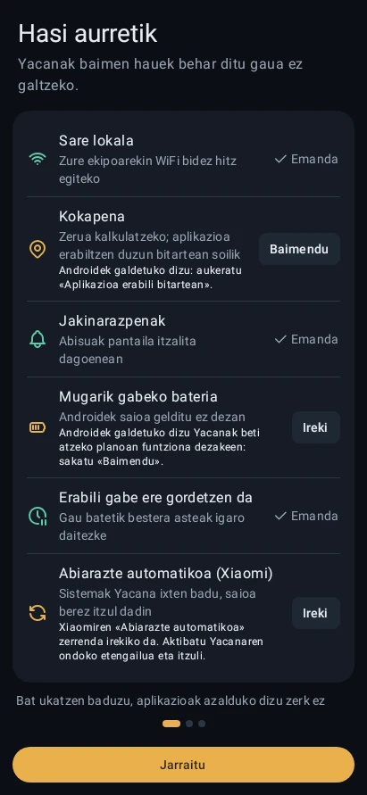 <b>Hasi aurretik.</b> Emandako errenkadek marka bat erakusten dute.</td>
</tr></table>

| Baimena | Zertarako den | Hura gabe |
| --- | --- | --- |
| **Sare lokala** | Zure ekipoarekin WiFi bidez hitz egiteko. Android 17 eta berriagoetan eskatzen da. | Aplikazioak ezin du Alpaca gailurik aurkitu ez kontrolatu. |
| **Kokapena** | Zure lekuko zerua kalkulatzeko, aplikazioa erabiltzen duzun bitartean soilik. Aukeratu **Aplikazioa erabili bitartean**. | Horren ordez, idatzi lekua profilean. |
| **Jakinarazpenak** | Saioa eta haren abisuak pantaila itzalita dagoenean. Android 13 eta berriagoetan eskatzen da. | Ez duzu ikusiko saioa ez haren abisuak aplikaziotik kanpo. |
| **Mugarik gabeko bateria** | Androidek saioa gelditu ez dezan. Sakatu **Baimendu** Androidek galdetzen dizunean. | Sistemak saioa gelditu dezake pantaila itzalita dagoenean. |
| **Erabili gabe ere gordetzen da** | Gau batetik bestera asteak igaro daitezke. Desaktibatu **Pausatu aplikazioko jarduerak erabiltzen ez bada**. Android 11 eta berriagoak. | Androidek aplikazioaren baimenak ken ditzake zenbait hilabetez erabili gabe egon ondoren. |
| **Abiarazte automatikoa (Xiaomi)** | Xiaomi, Redmi eta Poco mugikorretan, sistemak Yacana ixten badu saioa itzul dadin. Aktibatu Yacanaren ondoko etengailua. | Sistemak gauez Yacana ixten badu, saioa ez da itzultzen. |

Bat ukatzen baduzu, ez da ezer hausten berehala: aplikazioak azaltzen du zerk ez duen funtzionatuko eta nola aktibatu geroago, *Ezarpenak › Baimenak* atalean ([33. kapitulua](#permissions)). Sakatu **Jarraitu** aurrera egiteko.

### 2 · Bilatu zure ekipoa

1. Piztu ekipoa eta konektatu mugikorra haren WiFira, edo jarri biak zure etxeko WiFian.
2. Yacanak sarean Alpaca gailuak bilatzen ditu bere kabuz, IPv4 eta IPv6 bidez. Aurkitzen duen zerbitzari bakoitza txartel gisa ageri da, bere gailuekin. **Bilatu berriro** botoiak bilaketa errepikatzen du.
3. Seestar batean, sakatu **Teleobjektiboa** edo **Angelu zabala**: Seestarren profila kargatzen du kamera horretarako, bere optika, eremua eta gomendatutako ezarpenekin. Biak sor ditzakezu eta batetik bestera aldatu Ekipoa ataleko **Profila** txarteletik. Beste ekipo batzuetarako, sakatu **Gehitu**: profilak zerbitzari horretako mota bakoitzeko lehen gailua hartzen du.

Gailu bat aurkitzen ez bada, adibidez aurkikuntza blokeatzen duen sare batean, sakatu **Gehitu IP eta atakaren bidez** eta idatzi haren helbidea, adibidez `192.168.1.10:32323`. Beste mugikor bateko profil bat baduzu jada, **Inportatu profila** botoiak kargatzen du. **Orain ez** botoiak orri hau saltatzen du; zure ekipoa geroago bila dezakezu Ekipoa atalean.

<table><tr>
<td valign="top" width="240">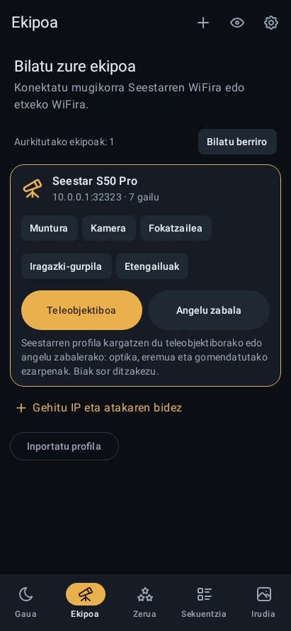 <b>WiFian aurkituta.</b> Seestar bat bere zazpi gailuekin.</td>
</tr></table>

### 3 · Landarako prest

Yacanak internetik gabe funtzionatzen du, baina bi gauza handiegiak dira aplikazioan sartzeko. Orri honek erakusten du zer dagoen jada mugikorrean eta zer lortu behar duzun WiFia duzun bitartean:

- **Objektuen katalogoa** eta **Efemerideak**: aplikazioan bertan, ez dago ezer egin beharrik.
- **Izarren datu-basea**: zure eremurako gomendatua, D50 Seestar baterako. Sakatu **Deskargatu**.
- **NINAren zeruko cachea**: atlaserako eta enkoadraketarako argazkiak. Sakatu **Inportatu** haren ZIPa baduzu jada; aplikazioan bertan deskargatzeko, erabili *Ezarpenak › Zeruko mapa* ([6. kapitulua](#field)).

Deskargek atzeko planoan jarraitzen dute. Sakatu **Hasi** aplikazioa irekitzeko.

<table><tr>
<td valign="top" width="240">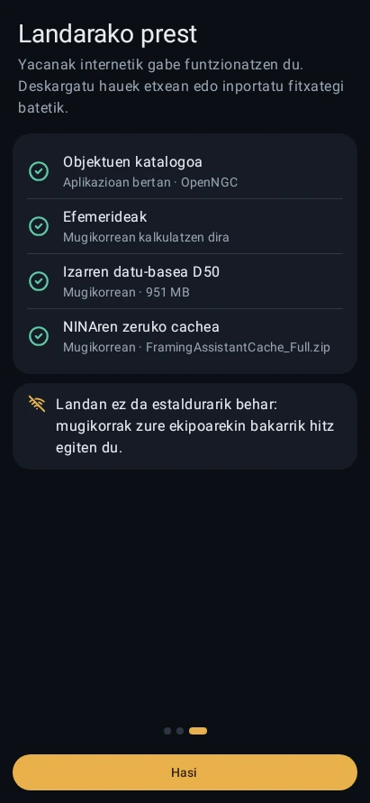 <b>Landarako prest.</b> Dena mugikorrean.</td>
</tr></table>

> [!TIP]
> **Komeni da jakitea**
>
> Lehen urratsak ezin dira berriro ireki. Haien zatiek bizirik jarraitzen dute: baimenak *Ezarpenak › Baimenak* atalean, ekipoaren bilaketa Ekipoa atalean, izarren datu-baseak *Ezarpenak › Plate solving* atalean, eta zeruko cacheak *Ezarpenak › Zeruko mapa* atalean.

## 4. Aplikazioan orientatzea

Yacana gaueko uneen arabera antolatuta dago, ez gailuen panelen arabera. Une bakoitzean behar duzuna erakusten du, eta gainerakoa ukitu batera uzten du.

### Bost atalak

Beheko barrak bost atal ditu. Mugikorra horizontalean dagoenean, ezkerreko errail bihurtzen da. Zauden atala sakatzean, haren lehen pantailara itzultzen zara.

| Atala | Zertarako | Goiko barra |
| --- | --- | --- |
| **Gaua** | Gaur gaueko iluntasuna eta Ilargia, prestaketa-zerrenda, martxan dagoen saioa, laburpena eta egunerokoa | Ekipoaren egoera, modu gorria, Ezarpenak |
| **Ekipoa** | Profilak, konexioa eta gailu bakoitzaren eskuzko kontrola | Gehitu gailua, modu gorria, Ezarpenak |
| **Zerua** | Zeruko mapa, Sky Atlas, objektuen fitxak eta enkoadraketa | Zeruaren geruzak edo Iragazkiak, modu gorria |
| **Sekuentzia** | Gaur gaueko plana, gordetako sekuentziak, txantiloiak, editore sinplea eta aurreratua | — |
| **Irudia** | Eskuzko argazketa, estatistikak, historia, zuzeneko pilaketa eta erreferentzia-argazkia | Modu gorria, Aukera gehiago |

### Kontrol arruntak

- **Ezarpenak:** Engranajea Gaua eta Ekipoa ataletan, edo **Ezarpenak** Irudia ataleko **Aukera gehiago** menuaren amaieran. Haren bilaketa-koadroak edozein ezarpen aurkitzen du bere izenaren zati batetik.
- **Modu gorria:** Begiaren ikonoa Gaua, Ekipoa, Zerua eta Irudia ataletan, objektuaren fitxan, enkoadraketan eta laguntzaileetan. Pixel guztiak gorri bihurtzen ditu ([32. kapitulua](#display)).
- **Ekipoaren egoera:** Gaua atalean, ezkutu bat ekipoa arazorik gabe konektatuta dagoenean, edo abisu-triangelu bat aplikazioa berriro konektatzen edo modu seguruan gelditzen ari den bitartean.
- **Atzera eta itxi:** Goian ezkerreko geziak atzera egiten du. Laguntzaileek (lerrokatze polarra, foku automatikoa eta flatak) **✕** erakusten dute horren ordez, eta gelditu egiten ditu.
- **Beheko orriak:** Aukera asko pantailaren behealdetik irteten den orri batean irekitzen dira. Irristatu behera, edo sakatu haren kanpoaldean, ixteko.
- **Zenbakiak:** Orduak, koordenatuak eta argazki kopuruak ohiko balioekin eta aplikazioaren beraren teklatuarekin sartzen dira, modu gorriak koloreztatu ezin duen sistemaren teklatua gauez inoiz piz ez dadin.
- **Eutsi:** Botoi arriskutsuak bete egiten dira sakatzen dituzun bitartean, eta segundo bat inguru igarotakoan jarduten dute: aparkatzea, sekuentzia bat gelditzea, profil bat, cache bat, datu-base bat edo gordetako sekuentzia bat ezabatzea. Ukitu labur batek ez du ezer egiten, sakatuta eduki behar dela gogoratzea baino ez.
- **Egoerak:** Egoera guztiak ikono eta hitzekin erakusten dira, inoiz ez kolorearekin bakarrik, modu gorrian berdea eta anbarra berdin ikusten direlako.

### Saio-barra

Sekuentzia bat martxan edo pausatuta dagoen bitartean, Gaua ez beste pantaila guztietako barra batek helburua, iragazkia, esposizioa eta argazkia erakusten ditu, bere aurrerapenarekin, musika-aplikazio baten «orain jotzen» barraren antzera. Sakatu saioa Gaua atalean ikusteko; haren botoiak sekuentzia pausatu edo berriro abiarazten du.

### Jakinarazpenak

Ekipoa konektatuta dagoen bitartean, jakinarazpen batek saioa erakusten du, baita blokeo-pantailan ere: helburua, argazkia eta aurrerapena, edo gordetako argazkiak. Sakatu aplikazioa irekitzeko. Haren **Deskonektatu** botoiak argazketa gelditzen du eta ekipoa deskonektatzen du. Zure arreta behar duten abisuek, lotura galtzeak edo gelditze seguru batek adibidez, soinua egiten dute; gertaerak, foku automatiko bat edo sekuentziaren amaiera adibidez, isilik iristen dira. Mota bakoitzak bere jakinarazpen-kanala du (*Gaueko saioa*, *Gaueko abisuak*, *Gaueko gertaerak*), eta Androiden aplikazioaren ezarpenetan doi ditzakezu.

<table><tr>
<td valign="top" width="330">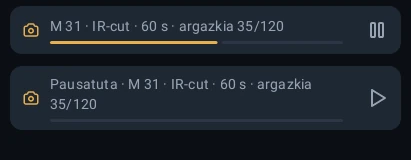 <b>Saio-barra</b>, martxan eta pausatuta.</td>
</tr></table>

## 5. Zure ekipoaren profila

Profil bat ekipo multzo bat eta hura nola erabiltzen duzun da: haren gailuak, optika, lekua, mugak eta aukerak. Yacanak zuretzat kalkulatzen duen guztia, hala nola eremua, plate solving-eko eskala edo gomendatutako izarren datu-basea, hortik dator. Plate solving, foku automatikoa, segurtasuna, fitxategi-izenak eta zuzeneko pilaketa ere profil bakoitzean gordetzen dira.

Ireki *Ezarpenak › Profila eta kokapena* bidez, edo sakatu Ekipoa ataleko **Profila** txartela eta gero **Ireki profila**. Profilak, gailuak eta profilaren ezabatzea ekipoa deskonektatuta dagoen bitartean bakarrik alda daitezke.

### Izena eta optika

- **Izena:** sakatu bertan editatzeko.
- **Foku-distantzia:** milimetrotan, 10 eta 10.000 artean, teleskopioarena, erreduktorea badu, harekin. Plate solving-eko eskala eta zeruko mapak marrazten duen eremua zehazten ditu.
- **Irekiera:** objektiboaren diametroa, 5 eta 2.000 mm artean. Foku-erlazioa ondoan erakusten da.
- **Kameraren sentsorea** eta **Pixelaren tamaina:** zabaleran eta altueran dituen pixelak (altuera zabaleraren ondoren eskatzen da) eta haien tamaina µm-tan, kameraren zehaztapenek ematen duten bezala; Seestar S50 Pro batek 2,9 µm-ko 2160 × 3840 px ditu. Kamerak betetzen ditu konektatzean; idatzita, eremua ezer konektatu gabe ezagutzen da, zeruko maparako eta enkoadraketarako.

Kamera konektatu ondoren, txartelak eskala eta eremua erakusten ditu, adibidez *2,25″/px · eremua 1,35° × 2,40°*.

### Kokapena

Lekuak zehazten ditu gaur gaueko iluntasuna, altuera guztiak eta lerrokatze polarrerako poloa.

- **Erabili mugikorraren kokapena** aukerak mugikorretik irakurtzen du aktibatzean, aplikazioa irekitzen den bakoitzean eta konektatzean; lehen aldian, Androidek baimena eskatzen du. Iristen ez bada, errenkadak zergatik esaten du, eta sakatzean berriro saiatzen da. Desaktibatuta, zuk idazten duzu: latitudea, iparra edo hegoa (0 eta 90° artean), longitudea, ekialdea edo mendebaldea (0 eta 180° artean), eta altitudea metrotan (0 eta 9.000 artean).
- **Bidali ordua eta lekua munturara** aukerak mugikorraren UTC ordua eta lekua ematen dizkio munturari konektatzean.

### Mugak

- **Altuera-muga**, 0 eta 60° artean: ezein GoTo ez da hortik behera joaten, ezta horizontetik behera ere. Hortik beherako GoTo bat baztertu egiten da eta muntura ez da mugitzen; norabide-botoiekin egindako mugimendu bat bere kabuz gelditzen da mugan.
- **Horizontea:** laua, edo zurea, zuhaitz eta eraikinekin. **Inportatu** botoiak N.I.N.A.-ren horizonte-fitxategi bat irakurtzen du: puntu bat lerro bakoitzeko, azimuta eta altuera gradutan, zuriuneekin edo tabulazioekin bereizita, eta `#` iruzkinetarako. **Ezarri laua** botoiak kendu egiten du. Objektuen fitxek beren altuera-grafikoan marrazten dute.

<table><tr>
<td valign="top" width="240">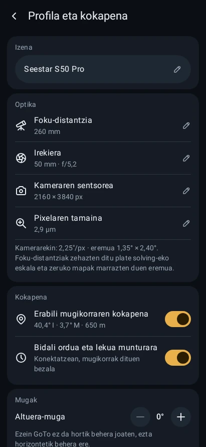 <b>Profila eta kokapena.</b> Seestarren profila.</td>
<td valign="top" width="240">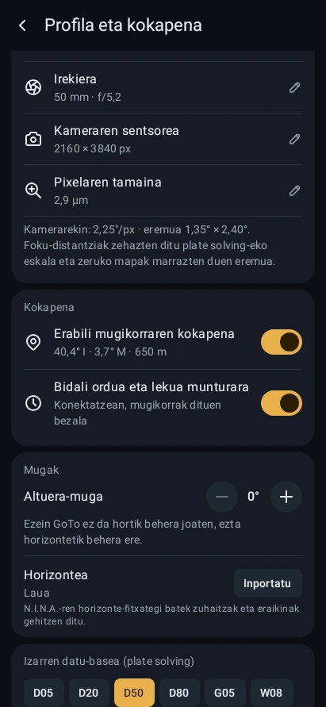 <b>Izarren datu-basea</b> plate solving-erako, profil bakoitzean aukeratua.</td>
</tr></table>

### Izarren datu-basea

Botoiek profilaren datu-basea aukeratzen dute plate solving-erako. Aplikazioak esaten du zein dagokion zure eremuari. Mugikorrean ez dagoen bat aukeratzen baduzu, haren tamaina eta **Deskargatu** botoi bat agertzen dira: deskarga amaitzean erabiltzen hasten da, eta ordura arte aurrekoak jarraitzen du.

### Profil bat baino gehiago

- **Aldatu:** sakatu Ekipoa ataleko **Profila** txartela eta aukeratu beste bat, edo sakatu haren ondoko **Erabili**, **Beste profil batzuk** atalean.
- **Berria:** **Profil berria** botoiak, **Beste profil batzuk** atalean, sarean bilatzen du; aukeratzen duzun ekipoa profil berri bihurtzen da, eta erabiltzen hasten da.
- **Kopiatu beste mugikor batera:** **Profilaren kopia** atalean, **Esportatu** botoiak profila JSON fitxategi gisa gordetzen du aukeratzen duzun lekuan, eta **Inportatu** botoiak bat irakurtzen du eta erabiltzen hasten da. Fitxategiak lekuaren kokapena darama.
- **Ezabatu:** **Ezabatu profila** *(eutsi)*, pantailaren amaieran.

## 6. Landarako prest

Landan mugikorrak zure ekipoarekin bakarrik hitz egiten du. Zure lehen gauaren aurretik, etxean WiFia duzun bitartean, jarri bi gauza mugikorrean: izarren datu-base bat plate solving-erako eta zeruko argazkiak. Biak fitxategi batetik ere inporta daitezke, adibidez ordenagailu batetik edo memoria-txartel batetik kopiatuta.

### Izarren datu-baseak

*Ezarpenak › Plate solving* atalean, **Izarren datu-basea** azpian. Aplikazioak zure eremurako **gomendatua** markatzen du eta eremuaren tamaina erakusten du. Zenbait egon daitezke mugikorrean aldi berean; profilak bat erabiltzen du, **Erabiltzen** markatuta.

<table><tr>
<td valign="top" width="240">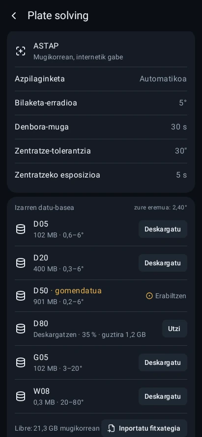 <b>Izarren datu-baseak.</b> D50 erabiltzen, D80 deskargatzen.</td>
</tr></table>

| Datu-basea | Tamaina | Eremu hauetarako | Oharrak |
| --- | ---: | --- | --- |
| **D05** | 102 MB | 0,6° eta 6° artean | Aukera arina |
| **D20** | 400 MB | 0,3° eta 6° artean |  |
| **D50** | 901 MB | 0,2° eta 6° artean | Seestarrerako gomendatua |
| **D80** | 1,2 GB | 0,15° eta 6° artean | Dentsoena |
| **G05** | 102 MB | 3° eta 20° artean | Eremu zabalak, kamera-objektiboak |
| **W08** | 0,3 MB | 20° eta 80° artean | Eremu oso zabalak |

- **Deskargatu** botoiak ASTAPen webgunetik eskuratzen du, WiFiarekin soilik, aplikazioa itxita egon arren, eta eteten bada utzitako lekutik jarraitzen du. Amaitzean erabiltzen hasten da. Mugikorreko leku librea zerrendaren azpian erakusten da.
- **Inportatu fitxategia** botoiak ASTAPen beraren ZIP edo `.deb` fitxategitik instalatzen du, adibidez memoria-txartel batetik.
- Eduki sakatuta instalatutako datu-base bat **Ezabatu datu-basea** *(eutsi)* bidez ezabatzeko. Erabiltzen ari dena ezin da ezabatu: aktibatu beste bat lehenik.
- **Probatu azken argazkiarekin** botoiak Irudia ataleko azken argazkia ebazten du uneko ezarpenekin, haiek egiaztatzeko.

### Zeruko argazkiak: N.I.N.A.-ren cacheak

Zeruko mapak, Sky Atlasek, objektuen fitxek, enkoadraketak eta Irudia ataleko erreferentziak N.I.N.A.-ren enkoadraketa-cacheetako argazkiak erabiltzen dituzte. Yacanak N.I.N.A.-k argitaratzen dituen bezala irakurtzen ditu, zuzenean beren ZIPetik, deskonprimatu gabe; beraz, cache batek bere ZIPak adina leku hartzen du, eta ez gehiago. Ireki *Ezarpenak › Zeruko mapa*, edo zeruko mapako geruzen ikonoa.

- **Cache osoa (DSS):** zeru osoa, Digitized Sky Surveyko 5°-ko 2.131 koloretako argazkitan, 3,5 GB. Hau da lortu beharrekoa.
- **NSNS izarrekin** (1,4 GB) eta **NSNS izarrik gabe** (471 MB): Northern Sky Narrowband Survey, hidrogeno- eta oxigeno-igorpena, −17° inguruko deklinazioraino. Bigarren geruza gisa marrazten dira.
- **Lineako argazkiak:** internetarekin asko handiagotzean mapak eskuratzen dituen argazki zehatzagoak, mugikorrean gordeta.

<table><tr>
<td valign="top" width="240">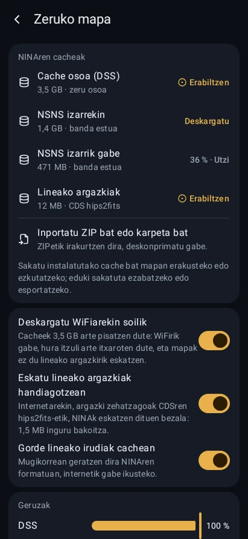 <b>Ezarpenak › Zeruko mapa.</b> Cache osoa erabiltzen, banda estuko bat iristen.</td>
</tr></table>

#### Lortu cache bat

- **Deskargatu** botoiak N.I.N.A.-ren webgunetik eskuratzen du, Androiden deskarga-kudeatzailearen bidez. Eteten bada, jarraitu egiten du, eta lehenik leku librea egiaztatzen du. **Deskargatu WiFiarekin soilik** aktibatuta badago (lehenetsia), WiFiaren zain geratzen da.
- **Inportatu ZIP bat edo karpeta bat**: **Aukeratu ZIP bat** botoiak N.I.N.A.-ren ZIP bat hartzen du, haren webgunekoak bezalakoa; **Aukeratu karpeta bat** botoiak N.I.N.A.-k ordenagailuan duen cache-karpeta hartzen du (`FramingAssistantCache`), mugikorrera kopiatuta edo txartel batean. Aplikaziora kopiatzen dira.

#### Erabili

- Sakatu instalatutako cache bat mapan erakusteko edo ezkutatzeko: **Erabiltzen** edo **Instalatuta**.
- **Geruzak:** DSS geruzaren opakutasuna (100 % lehenetsita) eta banda estukoarena (40 %), biak nahasteko.
- **Eskatu lineako argazkiak handiagotzean** (lehenespenez aktibatuta): internetarekin, mapa handiagotzean argazki zehatzagoak eskatzen zaizkio CDSren hips2fits-i, N.I.N.A.-k egiten duen bezala, 1,5 MB inguru bakoitza. Desaktibatu datu mugikorrak beste gauza batzuetarako gordetzeko; **Deskargatu WiFiarekin soilik** aktibatuta badago, mapak ez ditu datu mugikorrekin eskatzen.
- **Gorde lineako irudiak cachean**: aktibatuta, mugikorrean geratzen dira N.I.N.A.-ren formatuan, internetik gabe berriro ikusteko.

#### Ezabatu edo esportatu

Eduki sakatuta instalatutako cache bat. Orriak esaten du zenbat leku askatzen duen; **Ezabatu cachea** *(eutsi)* botoiak ezabatu egiten du. Karpeta-cache batek, lineako argazkiek adibidez, **Esportatu ZIPa** ere eskaintzen du, ordenagailuko N.I.N.A.-n irekitzeko.

<table><tr>
<td valign="top" width="240">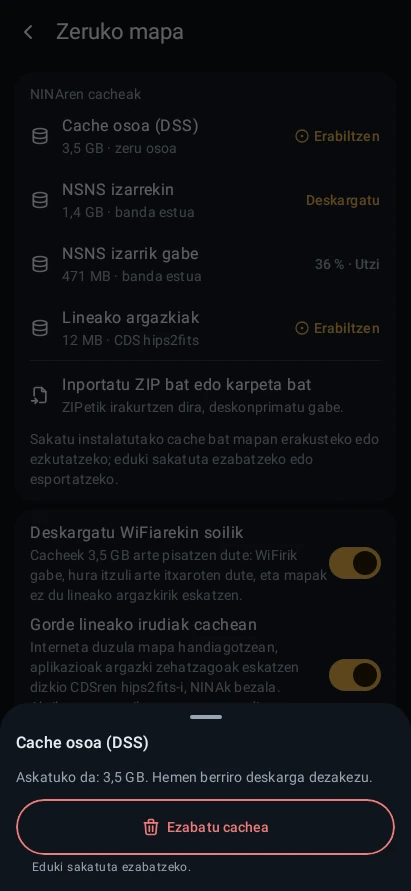 <b>Cache bat sakatuta edukitzean.</b> Zer askatzen duen, eta sakatuta eduki beharreko botoia.</td>
</tr></table>

> [!TIP]
> **Kredituak**
>
> Argazkiak ez dira aplikazioaren parte: N.I.N.A.-ren webgunetik deskargatzen dituzu edo inportatu egiten dituzu. DSS STScI-rena da, eta N.I.N.A.-ri banatzeko baimena ematen dio; NSNS CC BY-NC-SA 4.0 lizentziapean dago. Mapak hau erakusten du: *DSS: STScI · NSNS: CC BY-NC-SA 4.0*.

---

# Ekipoa

## 7. Zure ekipoa konektatzea

Ekipoa atalak erabiltzen ari den profila gordetzen du, konektatu egiten du, eta gailu guztien eskuzko kontrola ematen dizu.

1. Egiaztatu **Profila** txartela: profilaren izena eta haren lekua nondik datorren, adibidez *GPS bidezko kokapena · 40,4° I · 3,7° M · 650 m*. Sakatu beste profil batera aldatzeko.
2. Sakatu **Konektatu**. Errenkadak *Konektatzen…* esaten du, eta gero zenbat gailuk erantzun duten, adibidez *5 / 5 konektatuta*, edo zergatik ezin izan den bat konektatu.
3. Gailu bakoitzak errenkada bat du bere uneko egoerarekin: muntura jarraipenean eta haren altuera, kamera geldirik eta haren sentsorearen tenperatura, fokatzailearen posizioa, jarrita dagoen iragazkia, ihintz-berogailua piztuta. Segundo bat edo bitik behin eguneratzen dira.
4. Sakatu konektatutako gailu bat haren pantaila irekitzeko. **Deskonektatu guztiak** botoiak konexioa amaitzen du.

Lotura galtzen bada, Yacana berriro konektatzen da bere kabuz. Sekuentzia batean, lehenik modu seguruan pausatzen da ([28. kapitulua](#safety)).

<table><tr>
<td valign="top" width="240">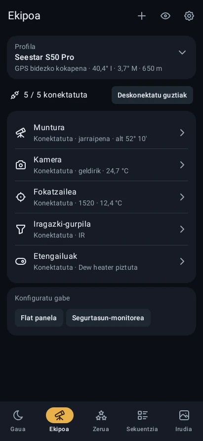 <b>Ekipoa.</b> Bost gailu konektatuta; flat panela eta segurtasun-monitorea konfiguratu gabe.</td>
</tr></table>

### Gailu bat gehitzea

Goiko **+** ikurrak *Gehitu gailua* irekitzen du, eta sarean berriro bilatzen du. Zerbitzari bakoitzak zure profilak oraindik ez dituen gailuak erakusten ditu, bakoitza **Gehitu** botoiarekin; **Gehitu IP eta atakaren bidez** botoiak helbide bat hartzen du. Zerrendaren amaierako **Konfiguratu gabe** txartelak botoi bat du aukerako gailu bakoitzerako, flat panelerako eta segurtasun-monitorerako, eta bilaketa bera irekitzen du. Gailuak ekipoa deskonektatuta dagoen bitartean bakarrik gehitzen dira.

### Profilik gabe

Lehen urratsak saltatu badituzu, Ekipoa **Bilatu zure ekipoa** atalarekin hasten da, [3. kapituluko](#first-steps) bilaketa bera, eta **Inportatu profila** botoi batekin.

## 8. Muntura

Munturaren pantailak nora zuzenduta dagoen erakusten du eta eskuz mugitzen du, GoTo, sinkronizazio, aparkatze eta jarraipenarekin.

### Nora zuzenduta dagoen

Goiko txartelak haren egoera erakusten du, adibidez *Jarraipena · siderala*, *Mugitzen*, *Jarraipenik gabe* edo *Aparkatuta*, eta haren RA, Dek, altuera eta azimuta. Helburu bat zentratzen ari den bitartean, txartelak saiakera eta uneko urratsa erakusten ditu, **Gelditu** botoiarekin.

### Eskuz mugitzea

Eduki sakatuta gezi bat (I, H, E, M) muntura mugitzeko; askatzean gelditzen da. Erdiko botoi gorriak berehala gelditzen du. Azpiko botoiek abiadura ezartzen dute: abiadura sideralaren **1×**, **8×** (lehenetsia) edo **64×**, edo **Max**, munturaren azkarrena. Mugimendu bat bere kabuz gelditzen da profilaren altuera-mugan.

### Botoiak

- **Joan hona…:** Orri bat irekitzen du RA eta Dek aplikazioaren teklatuarekin idazteko (ikus behean).
- **Sinkronizatu:** Munturari esaten dio idazten dituzun koordenatuetara zuzenduta dagoela. Ebatzitako argazki batekin, erabili horren ordez Irudia ataleko **Sinkronizatu muntura** ([18. kapitulua](#solving)). Muntura sinkroniza badaiteke bakarrik erakusten da.
- **Aparkatu:** Eduki sakatuta muntura atseden-posiziora bidaltzeko. Ukitu labur batek sakatuta eduki behar dela gogorarazten du soilik. Muntura aparkatuta dagoenean, botoiak **Desaparkatu** dio, eta sakatze batek desaparkatzen du.
- **Jarraipena:** Jarraipena aktibatzen edo desaktibatzen du.
- **Lerrokatze polarra:** Lerrokatze polarraren laguntzailea irekitzen du ([17. kapitulua](#polar)).

Goiko **⋮** menuak gainerakoa du: **Jarraipen-abiadura** (siderala, ilargikoa, eguzkikoa edo King, munturak onartzen dituenak), **Desaparkatu** aparkatuta dagoenean, eta **Joan etxera**, munturak badu.

<table><tr>
<td valign="top" width="240">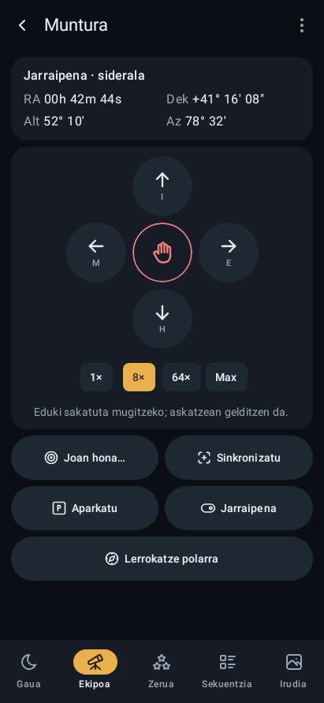 <b>Muntura.</b> Eduki sakatuta gezi bat mugitzeko; sakatu abiadura.</td>
<td valign="top" width="240">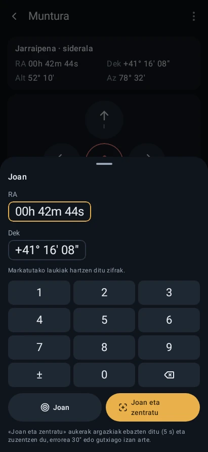 <b>Joan hona.</b> Markatutako laukiak hartzen ditu zifrak.</td>
</tr></table>

### Joan koordenatu batzuetara

1. Sakatu **Joan hona…**. Orriak munturaren uneko RA eta Dek erakusten ditu.
2. Sakatu RA edo Dek laukia markatzeko, eta idatzi zifrak teklatuan. **±** botoiak deklinazioaren zeinua aldatzen du.
3. Sakatu **Joan** hara mugitzeko, edo **Joan eta zentratu** mugitzeko eta gero plate solving bidez doitzeko, helburua tolerantziaren barruan egon arte (30″ lehenetsita).

> [!CAUTION]
> **Mugaren azpitik**
>
> Profilaren altuera-mugaren azpitik, edo haren horizontearen azpitik, dagoen helburu baterako GoTo bat baztertu egiten da. Pantailak esaten du non dagoen helburua eta muntura ez dela mugitu. Itxaron igo arte, edo aldatu muga profilean ([5. kapitulua](#profile)).

## 9. Kamera eta iragazki-gurpila

### Kamera

Kameraren pantailak haren egoera erakusten du, adibidez *Geldirik · −10 °C*, eta kamerak jakinarazten duena: sentsorearen tamaina, pixelaren tamaina, Bayer eredua, irabaziaren eta offsetaren tarteak, eta esposiziorik luzeena. Argazkiak Irudia atalean ateratzen dira; **Joan Irudia atalera** botoiak hara eramaten zaitu ([20. kapitulua](#imaging)).

Yacanak kamera bakoitza Alpaca bidez bere burua deskribatzen duen bezala erabiltzen du: irabazia, offseta, binning-a, interes-eremua eta sentsorearen tenperatura, kamerak baditu. Argazkiak zuzenean mugikorraren memoria natiboan deskargatzen dira hurrengo esposizioa hasten den bitartean; beraz, 61 MPko kamerak ere sartzen dira.

### Iragazki-gurpila

Iragazki-gurpilaren pantailak bere iragazkiak zerrendatzen ditu, jarrita dagoenean marka batekin. Sakatu iragazki bat hura erabiltzeko. Irudia atalean, iragazkia argazkiaren azpiko botoi bat ere bada.

**Dark** izeneko iragazki bat, Seestarrean bezala, obturadore gisa erabiltzen da dark eta bias argazkietarako; beraz, ez da ezer estali behar. Halakorik gabe, aplikazioak teleskopioa estaltzeko eskatzen dizu darkak ateratzean.

## 10. Fokatzailea

- **Posizioa** eta **Tenperatura**, handi, azken foku automatikoaren ordu eta tenperaturarekin.
- **Mugitu:** **−100**, **−10**, **+10** eta **+100** urrats, eta **Joan posiziora…**, teklatua fokatzailearen tartearekin irekitzen duena. **Gelditu** mugitzen ari den bitartean agertzen da.
- **Azken kurba:** azken foku automatikoaren V kurba, bere HFR eta posizio onenarekin.
- **Fokuaren desplazamendua iragazkiaren arabera**, iragazki-gurpil batekin: sakatu iragazki bat haren desplazamendua urratsetan ezartzeko, besteekiko. Iragazkia aldatzean, fokatzailea iragazki berriaren eta zaharraren desplazamenduen arteko aldea mugitzen da; horrela, iragazki bakoitza fokuan geratzen da foku automatiko berririk gabe.
- **Foku automatikoa** botoiak foku automatikoa berehala abiarazten du ([19. kapitulua](#autofocus)).

<table><tr>
<td valign="top" width="240">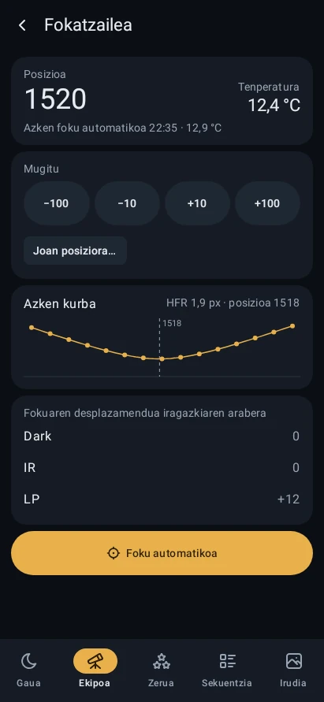 <b>Fokatzailea.</b> LP iragazkia 12 urrats kanporago fokatzen da.</td>
</tr></table>

## 11. Etengailuak, flat panela eta segurtasun-monitorea

### Etengailuak

Etengailu bakoitza gailuak deklaratzen duen bezala erakusten da: piztu eta itzaltzeko etengailu bat, − eta + dituen graduatzaile bat balio baterako, berogailu baten potentzia adibidez (bere tarte eta urratsarekin; balioa askatzean bidaltzen da), edo irakurketa bat irakurtzeko soilik direnetan. Ohikoena ihintz-berogailua da; sekuentziak hasieran piztu eta amaieran itzal dezake.

### Flat panela

Estalkia duen flat panel baterako (Alpaca CoverCalibrator bat):

- **Estalkia:** haren egoera, **Ireki** eta **Itxi** botoiekin, eta **Gelditu** mugitzen ari den bitartean. Ireki gauerako eta itxi darketarako.
- **Argia:** piztuta edo itzalita, eta haren **Distira**, graduatzaile batekin edo − eta + botoiekin.

Flatetarako, flaten laguntzaileak estalkia ixten du, argia pizten du eta esposizioa bere kabuz bilatzen du ([23. kapitulua](#calibration)).

### Segurtasun-monitorea

**Segurua** edo **Ez segurua** erakusten du, segundo oro irakurrita, adibidez hodei- edo euri-sentsore batetik. Aplikazioak erakutsi egiten du, baina oraindik ez du horren arabera jarduten: **Ez segurua** bihurtzen bada, gelditu sekuentzia Gaua ataletik.

<table><tr>
<td valign="top" width="240">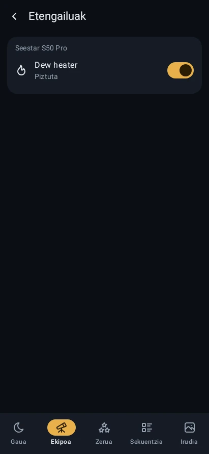 <b>Etengailuak.</b> Seestarren ihintz-berogailua.</td>
<td valign="top" width="240">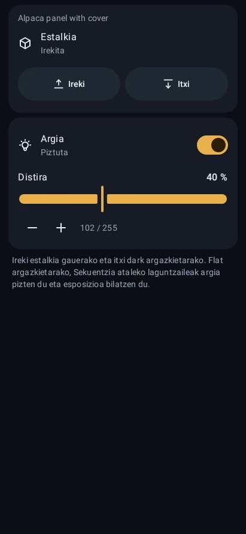 <b>Flat panela.</b> Estalkia irekita, argia 40 %-an.</td>
<td valign="top" width="240">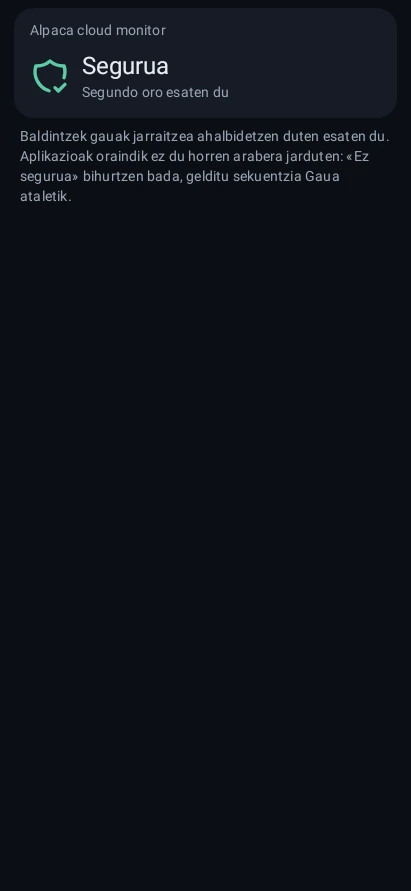 <b>Segurtasun-monitorea.</b> Segundo oro irakurria.</td>
</tr></table>

---

# Gaua planifikatzea

## 12. Gaur gauean, begirada batean

Arratsa Gaua atalean hasten da. Gaur gaueko iluntasuna eta Ilargia erakusten ditu, prestatzeko zerrenda bat, saioa martxan dagoen bitartean, eta laburpena goizean.

### Gaur gaueko txartela

Mugikorrean kalkulatua, profilaren lekurako:

- Data eta Ilargiaren argiztapena, adibidez *Ilargia 34 %*.
- Leiho ilun onena: *Iluna eta Ilargirik gabe*, edo *Iluna, Ilargia zeruan dela* Ilargia gau astronomiko osoan zeruan dagoenean, bere hasiera, amaiera eta iraupenarekin.
- Eguzki-sartzea eta eguzki-irteera, eta arratsetik goizera arteko denbora-lerro bat: ilunabarra, gau astronomikoa eta Ilargia zeruan dagoen orduak, leiho onena inguratuta.

Udako solstizioaren inguruan, latitude altuetan, *Ez dago gau astronomikorik* esan dezake: Eguzkia ez da horizontetik 18° behera jaisten. Lekurik gabe, txartelak nola ezarri esaten du: baimendu kokapena *Ezarpenak › Baimenak* atalean eta aktibatu mugikorrarena, edo idatzi profilean.

### Beste gau bat

Sakatu egutegiaren ikonoa beste edozein gau ikusteko. Hilabetearen sareak gaur gaua ingerada batekin markatzen du, eta aukeratzen duzun gaua beteta; geziek hilabetea aldatzen dute. **Itzuli gaurko gauera** botoiak gaur gauera itzultzen zaitu.

<table><tr>
<td valign="top" width="240">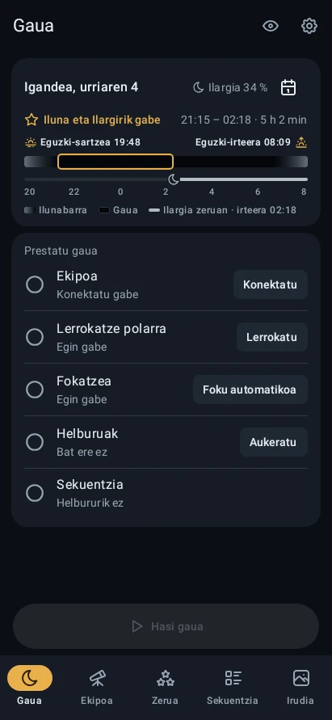 <b>Gaua.</b> 5 h 2 min zeru ilun Ilargia atera aurretik.</td>
<td valign="top" width="240">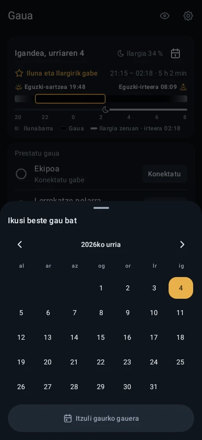 <b>Ikusi beste gau bat.</b></td>
</tr></table>

### Prestatu gaua

Derrigorrezko urratsik gabeko zerrenda bat: egin zure gauak behar duena, edozein ordenatan. Errenkada bakoitzak bere egoera erakusten du, eta hara eramaten zaituen botoi bat.

| Errenkada | Erakusten duena | Botoia |
| --- | --- | --- |
| **Ekipoa** | Profila eta haren gailuak, konektatu ondoren | **Konektatu** |
| **Lerrokatze polarra** | *Egin gabe*, edo azken errore osoa eta duela zenbat | **Lerrokatu**, gero **Findu** |
| **Fokatzea** | *Egin gabe*, edo azken HFRa eta duela zenbat (fokatzaile batekin) | **Foku automatikoa** |
| **Helburuak** | *Bat ere ez*, edo gaur gaueko helburuak | **Aukeratu**, Zerua irekitzen duena |
| **Sekuentzia** | Plana egunsentia baino lehen sartzen den, eta haren iraupena | **Doitu**, sartzen ez denean |

Ekipoa konektatuta dagoenean eta planak esposizioak dituenean, **Hasi gaua** botoiak sekuentzia abiarazten du ([27. kapitulua](#running)). Errenkaden markak ikonoak dira, ez koloreak bakarrik; beraz, berdin irakurtzen dira modu gorrian.

<table><tr>
<td valign="top" width="240">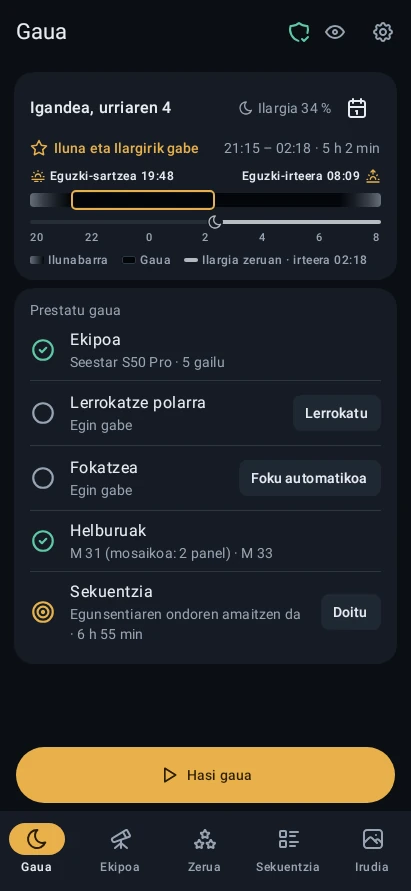 <b>Hasteko prest.</b> Plana egunsentiaren ondoren amaitzen da: <i>Doitu</i> botoiak laburtzen du.</td>
</tr></table>

## 13. Zeruko mapa

Zerua atala benetako zeruaren mapa batean irekitzen da, N.I.N.A.-ren cacheko argazkiekin marraztua, internetik gabe. Mapa utzi zenuen tokian geratzen da, aplikazioa itxi ondoren ere. Arrastatu hatz batekin, atximurkatu zooma egiteko ikuspegi zabal batetik zure kameraren eremua baino txikiagora arte, eta sakatu objektu bat hautatzeko.

Mapa profilaren lekutik une honetan zerua ikusten duzun bezala orientatuta dago, zenita goian; lekurik gabe, iparra goian. Eskala-barra batek gradu baten tamaina erakusten du, eta erdigunearen koordenatuak behean eskuinean daude.

### Zer erakusten du

- **Argazkiak:** goiko etiketak nondik datozen esaten du, adibidez *DSS · NINAren cachea*. Internetarekin, handiagotzean eremuaren argazki zehatzagoak eskuratzen dira; bat iristen ari den bitartean, gurpil txiki bat biraka dabil etiketan. Cacherik gabe, etiketak nola instalatu esaten du; sakatu zeruko maparen ezarpenak irekitzeko.
- **Zure eremua:** lauki eten bat erdigunean, zure kameraren eremuaren tamainakoa, profilaren izenarekin.
- **Objektuak:** katalogoko objektuen ingeradak eta izenak.
- **Horizontea:** lerro argi bat profilaren kokapeneko horizontea dagoen tokian; profilak bere horizontea badu, hari jarraitzen dio. Gainean **I**, **E**, **H** eta **M** ditu.

### Objektu bat hautatzea

Sakatu objektu bat: mapa haren gainean zentratzen da, eta txartel batek haren izena, tamaina, altuera eta ordu onena erakusten ditu, **Enkoadratu** botoiarekin. Sakatu txartela objektuaren fitxa irekitzeko. Sakatu zeru hutsa hautapena kentzeko.

Katalogoko objekturik gabeko eremu bat enkoadratzeko, zentratu mapan, zure eremuaren laukian, eta sakatu **Enkoadratu hemen**, zoomaren azpiko botoi biribil urrekara: enkoadraketa han irekitzen da, eta eremua sekuentziara sartzen da bere koordenatuak izen gisa, adibidez *03h 47m +24° 07′*.

### Botoiak

- **+ eta −:** handiagotu eta txikiagotu.
- **Enkoadratu hemen:** azpiko urrekarak maparen erdia enkoadratzen du.
- **Geruzak** (goiko barra): zeruko maparen ezarpenak, cacheekin eta geruzen opakutasunarekin ([6. kapitulua](#field)).

<table><tr>
<td valign="top" width="240">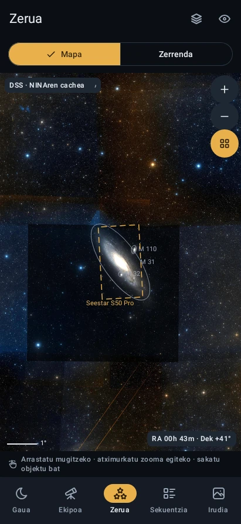 <b>Mapa.</b> M 31 DSS argazkien gainean, Seestarren eremuarekin.</td>
</tr></table>

### Muntura mapan

Muntura konektatuta dagoenean, mapak zure kameraren eremuko bi lauki erakusten ditu. Lerroagatik bereizten dira, modu gorrian ere bereiz daitezen:

- **Enkoadraketa:** etena, maparen erdigunean. Joan nahi duzun lekua da.
- **Teleskopioa:** jarraitua, teleskopioa orain zuzenduta dagoen lekuan; mugitu egiten da, segundo oro irakurtzen baita.

Arrastatu mapa helburua enkoadraketa-laukian jartzeko, edo sakatu objektu bat zentratzeko, eta gero:

- **Joan eta zentratu** botoiak teleskopioa enkoadraketara eramaten du eta plate solving bidez doitzen du, profilaren tolerantziara arte. Txartel batek urrats bakoitza eta zenbat falta den erakusten du, **Gelditu** botoiarekin, muntura eta argazkia gelditzen dituena.
- **Joan bakarrik** botoiak GoTo egiten du, zentratu gabe.

Muntura aparkatuta edo jarraipenik gabe dagoenean, **Teleskopioa** etiketak hala dio, eta hura sakatzean muntura desaparkatzen da edo jarraipena aktibatzen da.

<table><tr>
<td valign="top" width="240">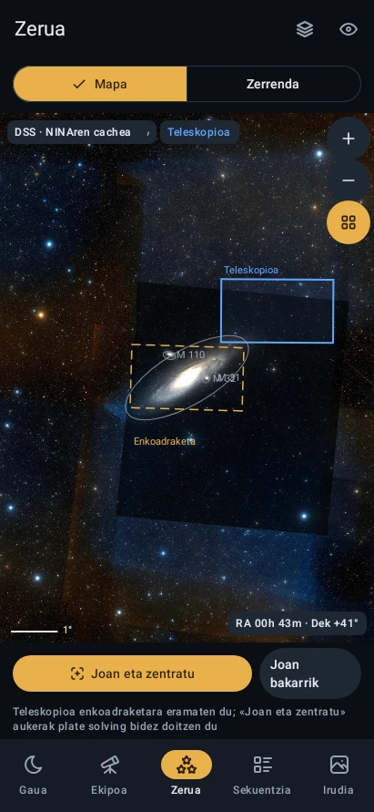 <b>Teleskopioa eta enkoadraketa.</b> Lauki jarraitua da zuzenduta dagoen lekua.</td>
<td valign="top" width="240">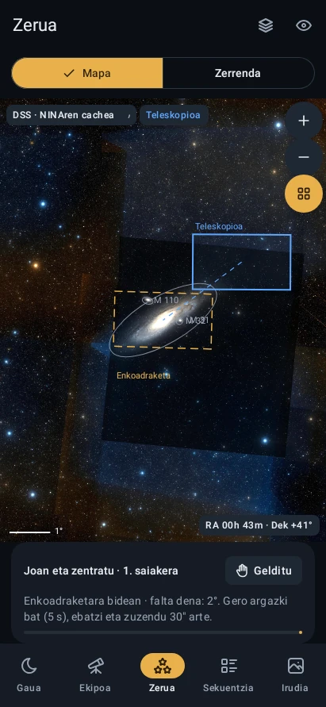 <b>Joan eta zentratu.</b> 2° falta dira, gero 5 s-ko argazki bat, ebatzi eta zuzendua.</td>
</tr></table>

## 14. Sky Atlas eta bilaketa

Aldatu Zerua atala **Zerrenda** ikuspegira Sky Atlas ikusteko: OpenNGCko 13.371 zeru sakoneko objektu (NGC, IC, Messier, Caldwell eta gehiago) mugikorrean, bakoitza cacheko bere argazkiarekin, gaur gauerako sailkatuta.

### Gaur gaueko onenak

**Gaur gauean** aktibatuta dagoela (lehenetsia), zerrendak profilaren lekutik gaur gauean ondo kokatuta dagoena erakusten du, ordu onenaren arabera ordenatuta. Errenkada bakoitzak miniatura bat du, izena, katalogo-zenbakia eta tamaina, zure eremuan *sartzen da* edo *mosaikoa N* behar duen, eta altuera-kurba txiki bat bere ordu onenarekin. Sakatu errenkada bat objektuaren fitxa irekitzeko.

Zerrendaren gainean, **Gaur gauean** eta **Gogokoak**, haien fitxan izarrarekin markatu dituzun objektuak, ukitu batekin aktibatzen eta desaktibatzen dira. Ondoan agertzen da aktibo dagoen iragazki bakoitza, adibidez *Gehienez 8 mag* edo *1°-tik aurrera*: haren ✕-k kentzen du, eta haren testuak iragazkiak irekitzen ditu. Graduatzaileen ikonoak zenbat dauden dio, eta oharrak zenbat objektu geratzen diren eta zer ordenatan. Iragazkiak eta zerrendako tokia mantendu egiten dira objektu bat irekitzean, atalez aldatzean eta aplikazioa ixtean.

<table><tr>
<td valign="top" width="240">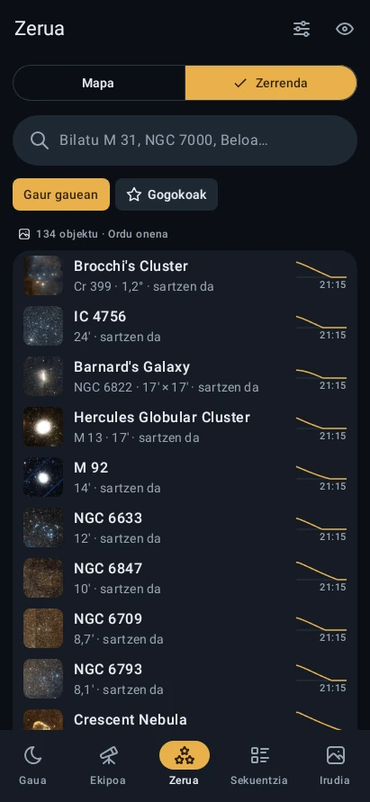 <b>Gaur gauean.</b> Cacheko miniaturak, internetik gabe.</td>
<td valign="top" width="240">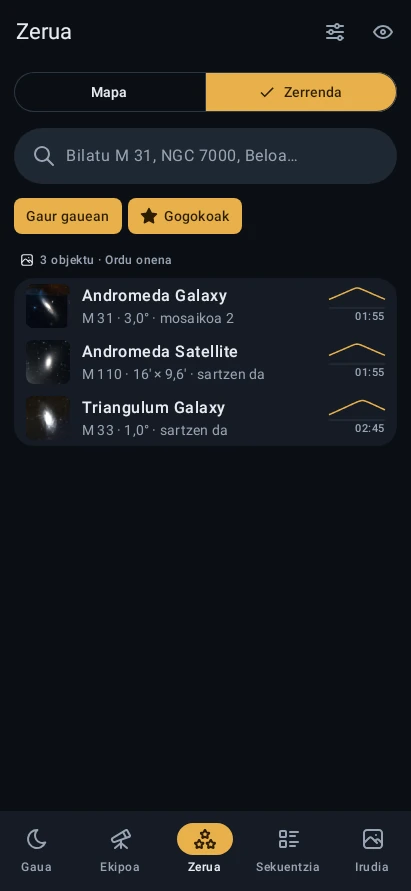 <b>Gogokoak.</b> M 31k 2 paneleko mosaiko bat behar du.</td>
<td valign="top" width="240">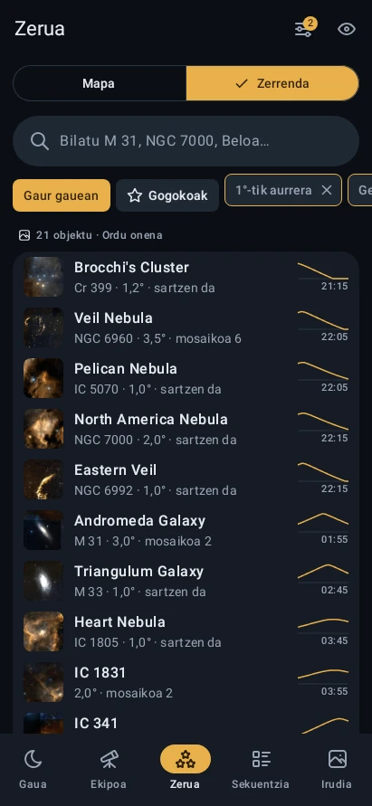 <b>Iragazkiak aktibo.</b> Gehienez 8 mag eta 1°-tik aurrera.</td>
</tr></table>

### Iragazkiak

Goiko graduatzaileen ikonoak, edo aktibo dagoen iragazki baten testuak, iragazkiak irekitzen ditu. Zerrenda aldatu egiten da aukeratu ahala, eta goiburuak zenbat objektu geratzen diren dio; **Berrezarri**-k hasieran bezala uzten ditu, eta **Eginda**-k, behera irristatzeak, kanpoan ukitzeak edo atzera egiteak ixten dituzte. Horizontalean alboan irekitzen dira, zerrenda bistan dela.

- **Ordenatu honen arabera:** Ordu onena (lehenetsia), Altuera handiena, Ordu ikusgaiak, Tamaina edo Distira, bakoitza bere berezko noranzkoan: lehenik goizena, gehien igotzen dena, zure altueraren gainetik denbora gehien ematen duena, handiena edo distiratsuena. Zerrendaren gaineko oharrak ordena esaten du.
- **Mota:** Galaxiak, nebulosak, multzoak, besteak.
- **Tamaina:** Edozein, zure eremurako (haren tamaina erakusten da), edo 15′, 30′ edo 1°-tik aurrera.
- **Magnitudea:** Edozein, edo gehienez 8, 10 edo 12.
- **Bakarrik:** Gogokoak, eta eremuan sartzen direnak.
- **Gaur gauean:** aktibatuta (lehenetsia), gaur gauean ondo kokatuta dagoena bakarrik; altuera eta orduak profilaren kokapeneko gaurko gau beltzekoak dira. Desaktibatuta, hurrengo hirurak ez dira kontuan hartzen.
- **Hau baino gorago:** 20°, 30° edo 45°.
- **Iraupena, gutxienez:** 1, 2 edo 4 ordu.
- **Ilargitik urrun:** Edozein, edo gutxienez 30°, 60° edo 90°.

Ezer bat ez badator, zerrendak hala dio, **Berrezarri**-rekin berriro hasteko.

<table><tr>
<td valign="top" width="240">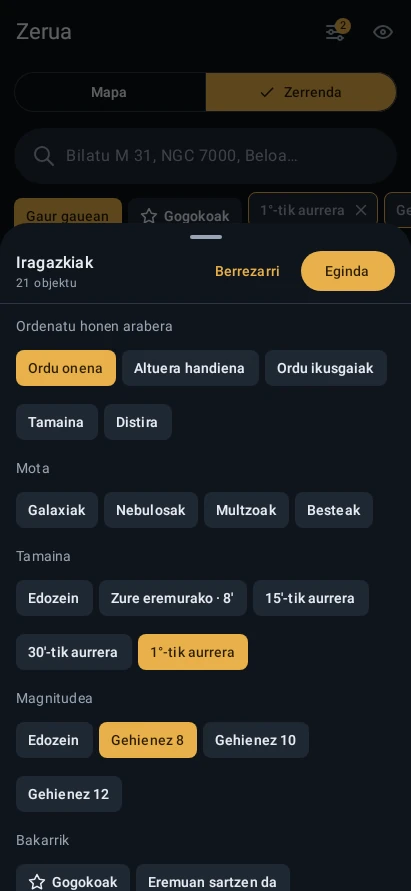 <b>Iragazkiak.</b></td>
</tr></table>

### Bilaketa

Idatzi bilaketa-koadroan: Messier, NGC, IC, Caldwell edo Sharpless zenbaki bat, edo izen bat, adibidez *M 31*, *NGC 7000* edo *Beloa*. Emaitzak idatzi ahala agertzen dira, milisegundotan, internetik gabe. Modu gorrian, bilaketa-koadroak aplikazioaren teklatu propioa irekitzen du, gainerakoa bezain gorria, mugikorrarena beharrean; ⌄ edo atzera sakatuta ezkutatzen da.

Beste edozertarako, azken errenkadak **Bilatu «…» SIMBADen** eskaintzen du. Internetarekin, CDSren SIMBADi galdetzen dio; 20 milioi objektu baino gehiago ezagutzen ditu, TON 618 kuasarretik konstelazio bateko izarretaraino. Aurkitzen duena mugikorrean geratzen da, lineaz kanpo berriro aurkitzeko. Bat-etortze zehatzik ez badago, antzeko izenak dituzten objektuak zerrendatzen ditu, distiratsuenak lehenik.

<table><tr>
<td valign="top" width="240">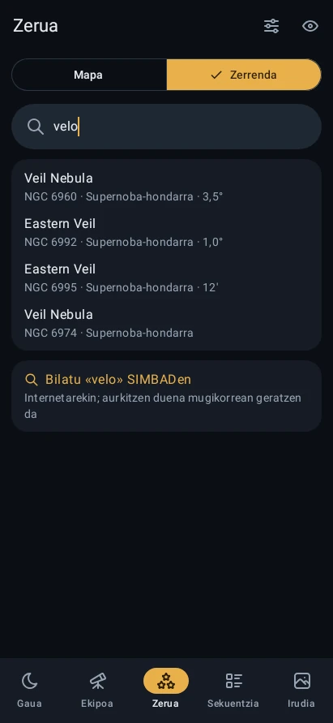 <b>Lineaz kanpoko bilaketa.</b> «velo» bilatuta, Beloa aurkitzen da.</td>
<td valign="top" width="240">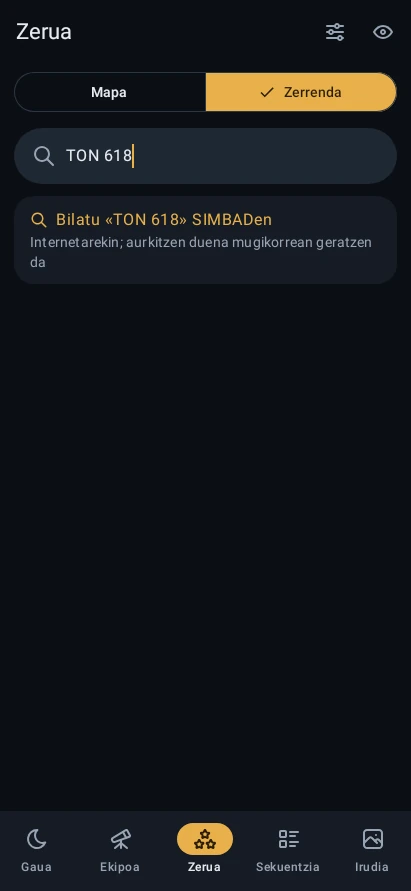 <b>Katalogotik haratago:</b> SIMBAD, internetarekin.</td>
</tr></table>

## 15. Objektu baten fitxa

Helburu bat erabakitzeko behar duzun guztia: haren argazkia zure eremua gainean duela, zer den, gaur gauean zenbat igotzen den eta Ilargia zein hurbil dagoen.

- **Argazkia:** cachetik, zure kameraren eremua gainean marraztuta. Sakatu, edo bere **Mapa** botoia, objektua zeruko mapan enkoadratuta ikusteko; mapa bakarrik mugitzen da, ez teleskopioa.
- **Honi buruz:** izena, mota, magnitudea eta tamaina; bere beste izenak eta izendapenak, adibidez *Baita ere: Triangulum Galaxy · Triangulum Pinwheel · NGC 598*; *Eremuan sartzen da* edo *Mosaikoa: N panel*; eta Ilargiaren distantzia eta fasea, adibidez *Ilargitik 87° · 34 %*.
- **Altuera gaur gauean:** objektuaren kurba arratsetik egunsentira, bi muturretan ilunabarra itzalduta, 30°-ko lerroa, zure horizontea etenda profilak badu, eta oraingo unearen lerro bat. Azpian, 30° baino gorago dagoen orduak eta haren punturik altuena, edo baxu geratzen dela edo ez dela ateratzen.

Goiko izarrak gogoko gisa markatzen du. **Enkoadratu** botoiak enkoadraketa irekitzen du ([16. kapitulua](#framing)). **Joan eta zentratu** botoiak, muntura konektatuta, teleskopioa hara eramaten du eta zentratu egiten du, munturaren pantailan.

<table><tr>
<td valign="top" width="240">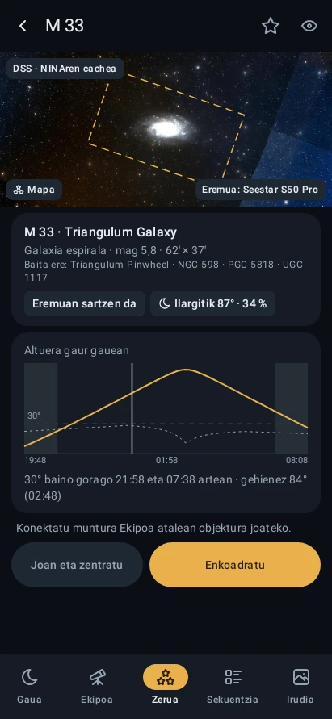 <b>M 33.</b> Seestarren eremuan sartzen da; lerro etena lekuaren horizontea da.</td>
<td valign="top" width="240">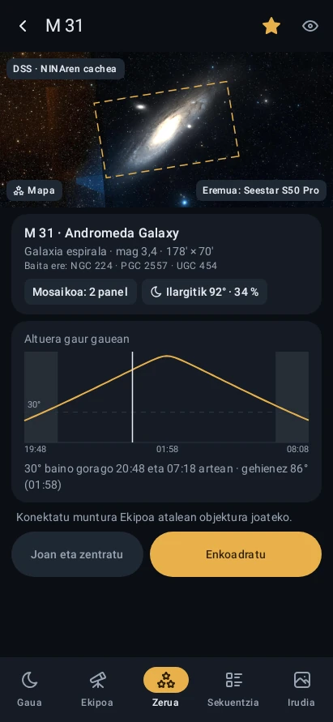 <b>M 31.</b> 2 paneleko mosaiko bat behar duen gogoko bat.</td>
</tr></table>

## 16. Enkoadraketa eta mosaikoak

Enkoadraketak argazkia nola aterako den erakusten du: zure kameraren benetako eremua zeruaren gainean, konposizioa egokia izan arte arrastatzen duzuna, eta mosaikoak eremua baino handiagoak diren helburuetarako.

1. Ireki objektu baten fitxako edo maparen objektu-txarteleko **Enkoadratu** botoiarekin.
2. Arrastatu zerua helburua eremuan kokatzeko; atximurkatu zooma egiteko. Eremuaren tamaina goian eskuinean erakusten da.
3. Mosaiko baterako, ezarri **Zutabeak** eta **Errenkadak** − eta + botoiekin, eta panelen arteko **Gainjartzea**, 5 eta 50 % artean (15 % lehenetsita). Panelak ateratzeko ordenaren arabera zenbakituta daude.
4. Egiaztatu azpiko lerroa: gaur gauean 30° baino gorago dagoen orduak.
5. Sakatu **Gehitu sekuentziari**. Aplikazioak baieztatzen du helburua gaur gaueko sekuentzian dagoela, **Aukeratu beste helburu bat** eta **Ikusi gaur gauekoa** botoiekin.

Helburu berri bat 60 s-ko 60 argazkirekin dator, iluna ez den lehen iragazkiarekin, eta dithering-a 3 argazkiz behin; doitu editorean ([25. kapitulua](#simple)). **Helburu bat gau osoan** txantiloiaren ondoren, berriz, helburuak gau osoa betetzen du egunsentira arte.

**Joan eta zentratu** botoiak, muntura konektatuta, teleskopioa enkoadraketara eramaten du.

<table><tr>
<td valign="top" width="240">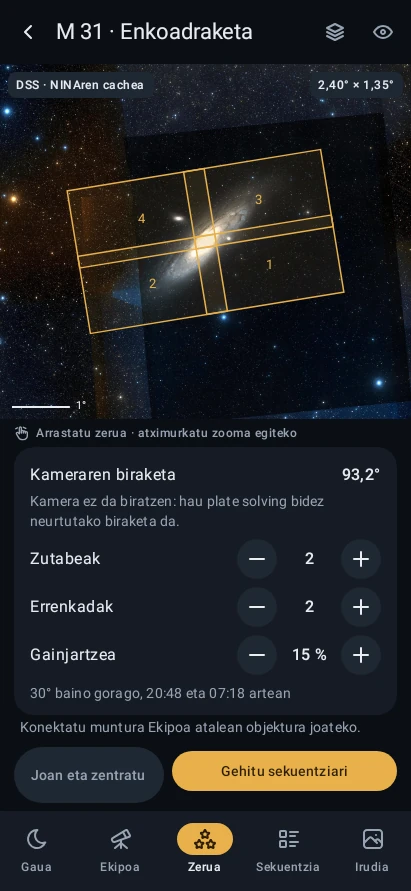 <b>M 31 · Enkoadraketa.</b> 2 × 2ko mosaikoa, kamera bezala biratuta.</td>
</tr></table>

### Kameraren biraketa

Biragailurik gabe, kamera ez da biratzen; beraz, enkoadraketak ez du eremua eskuz biratzen: **Kameraren biraketa** plate solving bidez neurtutako angelua da, eta eremua eta panelak harekin marrazten dira. Lehen ebazpenera arte 0° da, edo 93,2° EQ moduko Seestar batentzat. Ebatzi argazki bat Irudia atalean kamera muntatuta dagoenean, eta enkoadraketa harekin bat etorriko da ([18. kapitulua](#solving)).

> [!TIP]
> **Eremua behar du**
>
> Enkoadraketak profilaren eremua behar du: foku-distantzia eta kameraren sentsorea (*Ezarpenak › Profila eta kokapena › Optika*), idatzita edo kameraren azken konexiotik gordeta. Ez da ezer konektatu behar; pantailak profilerako botoi bat du.

---

# Teleskopioaren ondoan

## 17. Hiru puntuko lerrokatze polarra

Lerrokatze polarraren laguntzaileak munturaren ardatza zeruko polotik zenbat aldentzen den neurtzen du, eta gero gidatu egiten zaitu, zuzenean, ziriaren torlojuak biratzen dituzun bitartean. N.I.N.A.-ren Three Point Polar Alignment pluginaren portatze bat da, eta neurketa berberetan emaitza bera ematen du, 0,4″-ko aldearen barruan.

Agindu bidez igoera zuzeneko ardatza biratu dezakeen edozein munturarekin funtzionatzen du. Muntura eta kamera konektatuta behar ditu, izarren datu-base bat mugikorrean, eta profilaren lekua, poloa non dagoen zehazten duena.

### Ireki laguntzailea

Sakatu **Lerrokatu** Gaua ataleko zerrendako **Lerrokatze polarra** errenkadan (**Findu**, behin neurtu ondoren), edo **Lerrokatze polarra** munturaren pantailan. Laguntzaileak pantaila osoa betetzen du eta piztuta mantentzen du martxan dagoen bitartean; goian ezkerreko **✕** ikurrak gelditu eta atzera egiten du.

### Hasi aurretik

Lehen orriak azaltzen du zer gertatuko den eta nora zuzendu: zeruko eremu garbi batera, polotik eta horizontetik urrun, ardatza biratuko den norabidean. Lau aukera erakusten ditu; bakoitza profilean gordetzen da.

- **Biraketa puntuen artean:** RA ardatza zenbat biratzen den hiru argazkien artean, eta zein norabidetan: 10°, 15°, 20° edo 30°, mendebalderantz edo ekialderantz. Lehenetsia 15° mendebalderantz da. Utzi lekua biratzeko, muntura oztoporik gabe mugi dadin.
- **Esposizioa:** 1, 2, 3 edo 5 s, 1×1 edo 2×2 binning-arekin, Irudia ataleko irabaziarekin. Argazki laburrekin errorea lehenago eguneratzen da torlojuak biratzen dituzun bitartean. Lehenetsia 1 s da, 2×2-n.
- **Tolerantzia:** Desaktibatuta, 0,5′, 1′, 2′ edo 5′. Errore osoa hortik behera jaistean, mugikorrak dar-dar egiten du. Ez ditu inoiz geziak ezkutatzen. Desaktibatuta dago lehenetsita, pluginean bezala.
- **Ebatzi pistarekin soilik:** Jada hurbil dagoen lerrokatze bat fintzeko: hiru puntuak muntura zuzenduta dagoen lekutik hurbil soilik ebazten dira, inoiz ez itsuan.

<table><tr>
<td valign="top" width="240">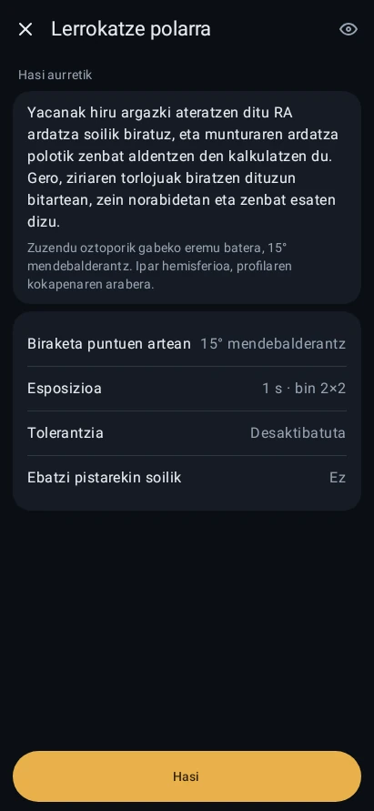 <b>Hasi aurretik.</b> Aukerak, Seestarren balio lehenetsiekin.</td>
</tr></table>

### Neurtu hiru puntuak

1. Zuzendu teleskopioa eremu garbi batera lehen orriak dioen bezala, eta sakatu **Hasi**.
2. Yacanak lehen argazkia ateratzen eta ebazten du, RA ardatza biratzen du, bigarrena atera eta ebazten du, berriro biratzen du eta hirugarrena ateratzen du. Puntu bakoitzak *RA ardatza biratzen…*, *Argazkia ateratzen*, *ASTAPekin ebazten* erakusten ditu, eta gero ebazpenak zenbat iraun duen.
3. **Ez ukitu muntura neurtzen ari den bitartean.** Hiru erdiguneek zirkulu bat marrazten dute, eta haren erdigunea munturaren benetako ardatza da. Horrek polorainoko duen distantzia, zure leku eta ordurako prezesio, nutazio eta errefrakzioagatik zuzenduta, errorea da.

Puntu bat ebazten ez bada, laguntzaileak esaten du zein eta zergatik, eta **Hasi berriro** eskaintzen du.

<table><tr>
<td valign="top" width="240">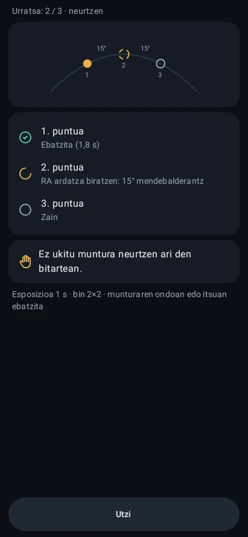 <b>Neurtzen.</b> 1. puntua 1,8 s-tan ebatzita, ardatza 2. punturantz biratzen.</td>
</tr></table>

### Biratu ziriaren torlojuak

Orain laguntzaileak argazkiak ateratzen jarraitzen du, bakoitza azken posiziotik hurbil ebazten du, eta errorea segundo gutxitik behin eguneratzen du. Ardatz bakoitzak bere txartela du:

- **Altuera:** gezi bat eta *Igo* edo *Jaitsi*, edo *pixka bat* hurbil dagoenean.
- **Azimuta:** gezi bat eta *Biratu mendebalderantz* edo *ekialderantz*, edo *pixka bat* hurbil dagoenean.
- Zeinudun errorea gradu, minutu eta segundotan, metro batera irakurtzeko bezain handia, eta **Errore osoa** azpian.

Biratu torloju bat aldi bakoitzean eta begiratu haren zenbakia nola jaisten den. Haien azpian, diana batek poloaren posizioa erakusten du, 30″, 1′ eta 5′-ko eraztunekin. Hurbiltzen zarenean, bere burua handitzen du *segundoen eskalara*, 10″ eta 30″-ko eraztunekin, segundoz segundo fin doitu ahal izateko.

**Ezer ez da onetzat jotzen goizegi.** Ardatz batek bere gezia mantentzen du haren errorea, segundora biribilduta, 00° 00′ 00″ izan arte; orduan *Zentratuta* erakusten du. Ez dago marka berderik atalase batean: zuk erabakitzen duzu noiz den nahikoa ona. Tolerantzia bat ezartzen baduzu, mugikorrak dar-dar egiten du errore osoa hortik behera jaistean, eta geziek bertan jarraitzen dute.

Azken argazkia ebatzi ez bada, pantailak hala dio eta saiatzen jarraitzen du. **Neurtu berriro** botoiak hiru puntuak errepikatzen ditu muntura dagoen lekutik, adibidez zuzenketa handi baten ondoren. **Amaitu** botoiak laguntzailea ixten du, eta Gaua ataleko zerrendak emaitza eta noiz neurtu zen erakusten ditu.

<table><tr>
<td valign="top" width="240">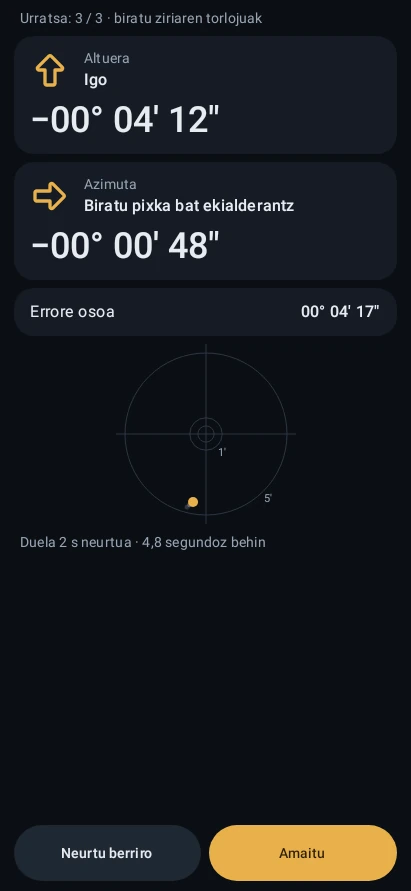 <b>Minutuetako aldea.</b> Igo, eta pixka bat ekialderantz.</td>
<td valign="top" width="240">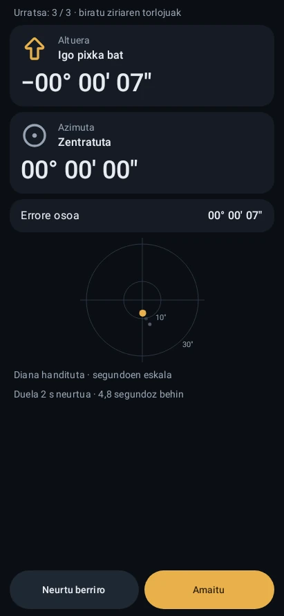 <b>Segundoetako aldea.</b> Diana handituta; azimuta zentratuta.</td>
</tr></table>

<table><tr>
<td valign="top" width="470">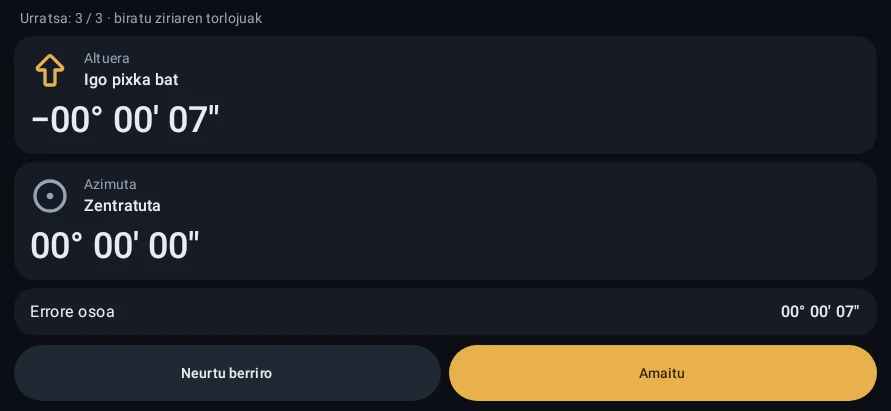 <b>Horizontalean</b>, txartelek zabalera osoa erabiltzen dute; zenbakiak handi geratzen dira.</td>
</tr></table>

> [!TIP]
> **Seestar**
>
> Ziri batean, altuera ziriaren inklinazioarekin doitzen da, eta azimuta haren oinarria biratuz. Seestarren Alpacak bere RA ardatza biratu dezake, eta hori da laguntzaileak behar duen guztia.

## 18. Plate solving eta zentratzea

Plate solving-ek argazki bat nora zuzenduta dagoen, haren eskala eta biraketa kalkulatzen ditu, haren izarren ereduaren bidez. Yacanak ASTAP exekutatzen du, ebazle ezaguna, mugikorrean bertan, internetik gabe: 0,4 s inguru munturaren posizioa pista gisa hartuta, eta 7 s inguru itsuan, erdi-mailako mugikor batean Seestarren argazkiekin.

### Ebatzi argazki bat

Irudia atalean, atera argazki bat eta sakatu **Ebatzi**. Yacanak lehenik muntura zuzenduta dagoela dioen lekutik hurbil bilatzen du, eta gero itsuan, behar izanez gero. Emaitzak hau erakusten du:

- argazkiaren erdigunearen **RA eta Dek**, J2000n;
- kameraren **biraketa**;
- **eskala**, arku-segundotan pixeleko, eta eremua gradutan;
- zenbat iraun duen, munturaren ondoan ala itsuan izan den, eta erabilitako izarren datu-basea.

Sakatu **Sinkronizatu muntura** munturari hara zuzenduta dagoela esateko, hurrengo GoTo-ak hurbilago irits daitezen. Ebatzitako biraketa kameraren biraketa bihurtzen da enkoadraketarako eta mosaikoetarako ([16. kapitulua](#framing)).

### Joan eta zentratu

**Joan eta zentratu** teleskopioa nonbaitera bidal dezakezun leku guztietan agertzen da: zeruko mapan, objektu baten fitxan, enkoadraketa-pantailan eta munturaren **Joan hona…** orrian. Muntura mugitzen du, argazki bat ateratzen du zentratzeko esposizioarekin, ebatzi egiten du, muntura zuzentzen du, eta errepikatu egiten du argazkiaren erdigunea tolerantziaren barruan egon arte, 30″ lehenetsita. Haren aurrerapenak urrats bakoitza erakusten du, azken argazkia zein urrun zegoen eta saiakera; **Gelditu** botoiak muntura eta argazkia gelditzen ditu. Zentratzeko argazkiak ez dira gordetzen.

<table><tr>
<td valign="top" width="240">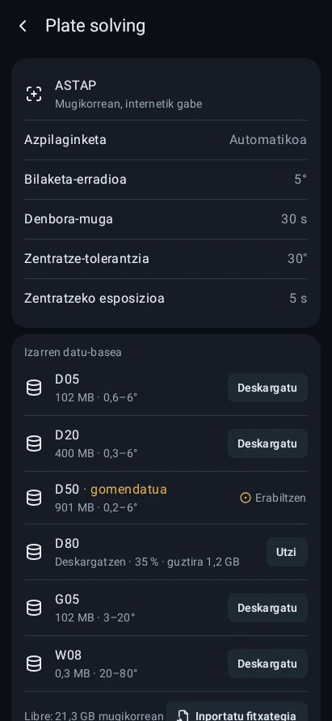 <b>Ezarpenak › Plate solving.</b> ASTAPen aukerak eta izarren datu-baseak.</td>
</tr></table>

### Plate solving-en ezarpenak

*Ezarpenak › Plate solving* atalean, profil bakoitzean gordeta:

| Ezarpena | Lehenetsia | Zer egiten duen |
| --- | --- | --- |
| **Azpilaginketa** | Automatikoa | ASTAPek pixelak taldekatzen ditu izarrak bilatu aurretik. Automatikoak faktorea argazkiaren tamainaren arabera aukeratzen du. |
| **Bilaketa-erradioa** | 5° | Munturaren posizioaren inguruan zenbateraino bilatu, 1 eta 180° artean. Han soluziorik ez badago, zeru osoan bilatzen du. |
| **Denbora-muga** | 30 s | Munturaren ondoan eta gero itsuan ebazteko, 5 eta 600 s artean. |
| **Zentratze-tolerantzia** | 30″ | Zentratzea gelditu egiten da argazkiaren erdigunea helburutik hain hurbil dagoenean, 5 eta 600″ artean. |
| **Zentratzeko esposizioa** | 5 s | Zentratzeak ebazten dituen argazkiak, Irudia ataleko irabaziarekin; 1 eta 60 s artean. Ez dira gordetzen. |

Izarren datu-baseak pantaila berean daude; [6. kapituluak](#field) azaltzen du nola aukeratu, deskargatu eta inportatu.

> [!TIP]
> **Argazki bat ebazten ez denean**
>
> Egiaztatu argazkiak izarrak dituela, profilaren foku-distantzia zuzena dela (ASTAPek eskala hori bilatzen du), eta datu-basea zure eremurako egokia dela. Hodeiak, ihintza edo fokutik oso kanpo dagoen argazki bat dira ohiko arrazoiak.

## 19. Foku automatikoa

Foku automatikoak fokatzailea fokuan zehar mugitzen du, izarren HFRa neurtzen du puntu bakoitzean eta V kurba bat doitzen du posizio onena aurkitzeko. N.I.N.A.-ren foku automatikoaren portatze bat da, haren bost kurba-doikuntzekin, huts-tartearen konpentsazioarekin eta iragazkiko fokuaren desplazamenduekin.

Fokatzaile absolutu bat behar du (urrats-posizioetara joaten dena) eta kamera bat, izarrak dituen eremu batera zuzenduta. Ireki **Foku automatikoa** botoiarekin Gaua ataleko zerrendan, fokatzailearen pantailan edo Irudia atalean: exekuzioa berehala hasten da, *Ezarpenak › Foku automatikoa* ataleko aukerekin.

### Nola doan exekuzio bat

1. Fokatzailea urrats kopuru bat kanporantz joaten da, eta gero barrurantzko urrats bakoitzean puntu bat hartzen du: argazki bat, haren izarrak eta haien HFRa.
2. Puntuak gehitzen ditu onenaren alde bakoitzean hasieran bezainbeste egon arte. Grafikoa aurrera egin ahala betetzen da, uneko puntuarekin, haren esposizioarekin eta iragazkiarekin.
3. Azken puntuaren ondoren, kurba doitzen du, fokatzailea foku onenera eramaten du eta egiaztatu egiten du. Emaitzak posizioa, HFRa, tenperatura, doikuntzaren R² eta fokatzailea lehen non zegoen erakusten ditu.

Sakatu **Amaitu** ixteko. Exekuzio batean, **Utzi** botoiak fokatzailea lehen zegoen lekura itzultzen du. Exekuzioak huts egiten badu, pantailak zergatik esaten du, fokatzailea itzuli egiten da, eta **Saiatu berriro** botoiak berriro abiarazten du.

Emaitza gorde egiten da: fokatzailearen pantailak azken foku automatikoa eta haren kurba erakusten ditu, Gaua ataleko zerrendak HFRa eta duela zenbat, eta egunerokoak erregistratu egiten du.

<table><tr>
<td valign="top" width="240">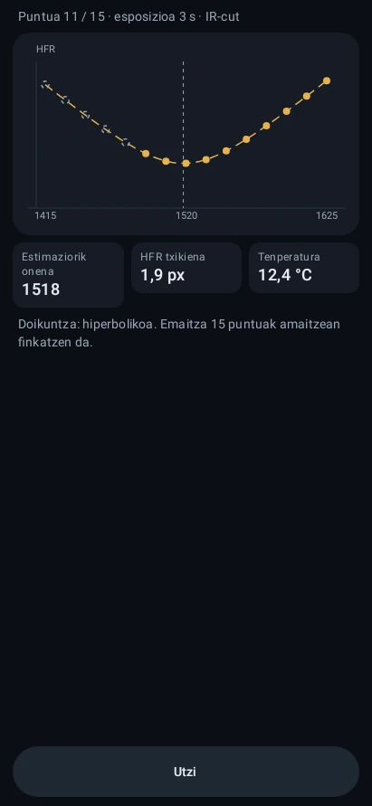 <b>Martxan.</b> Puntua 11 / 15, 3 s-ko esposizioa IR-cut iragazkiarekin.</td>
<td valign="top" width="240">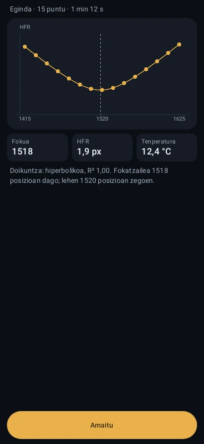 <b>Eginda.</b> 15 puntu 1 min 12 s-tan; fokatzailea 1520tik 1518ra mugitu da.</td>
</tr></table>

### Foku automatikoaren ezarpenak

*Ezarpenak › Foku automatikoa* atalean, profil bakoitzean gordeta, N.I.N.A.-ren balio lehenetsiekin:

- **Urratsa:** Fokatzailearen urratsak puntuen artean (50; 15 Seestarrerako). Txikiegia bada, kurba laua geratzen da; handiegia bada, puntu gutxi daude fokutik hurbil.
- **Puntuak:** Zenbat puntu hartzen dituen: erdiak kanpoaldean hasten da (9 puntu, 4 alde bakoitzean; 15 Seestarrerako).
- **Esposizioa:** 1 eta 8 s artean, 1×1 edo 2×2 binning-arekin, Irudia ataleko irabaziarekin. Ez da gordetzen. 4 s (3 s Seestarrerako).
- **Argazkiak puntu bakoitzeko:** 1, 2 edo 3. Argazki gehiagok seeing-a batez bestekotzen dute, eta denbora gehiago behar dute.
- **Doikuntza:** Puntuetatik fokurik onena nola aurkitzen den: joera-lerroa, parabolikoa, joera eta parabolikoa, hiperbolikoa (lehenetsia), edo joera eta hiperbolikoa.
- **Huts-tartea barrurantz, kanporantz:** Fokatzaileak norabidez aldatzean galtzen dituen urratsak; hainbeste pasatzen da eta itzuli egiten da.
- **Gutxieneko R²:** Kurbak zein ondo egokitu behar duen (0,7). Gutxienekorik gabe, emaitza mantendu egiten da, lehen baino 15 % okerragoa ez bada.
- **Saiakerak:** Exekuzio batek huts egiten badu, zenbat aldiz hasten den berriro (1).
- **Itxaron mugitu ondoren:** Fokatzaileak mugimendu bakoitzaren ondoren, argazkiaren aurretik, atseden hartzen dituen segundoak (0).

<table><tr>
<td valign="top" width="240">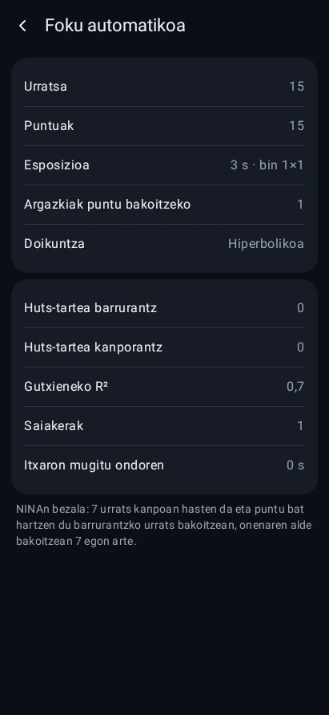 <b>Ezarpenak › Foku automatikoa.</b> Seestarren balioak.</td>
</tr></table>

### Huts egiten duenean

| Aplikazioak dioena | Zer egin |
| --- | --- |
| **HFRa ez da nahikoa aldatu alde batean ere** | Erabili urrats handiago bat. |
| **Kurbak gutxiegi azaltzen ditu puntuak** | Seeing-ak edo hodeiek puntuak hondatu dituzte: argazki gehiago puntu bakoitzeko, esposizio luzeago bat, edo saiatu geroago. |
| **Fokurik onena neurtutako puntuetatik kanpo dago** | Hasi fokutik hurbilago: mugitu fokatzailea eskuz, eta exekutatu berriro. |
| **Fokurik onenean HFRa lehen baino okerragoa da** | Emaitza ez da gorde eta fokatzailea itzuli egin da. Egiaztatu baldintzak eta saiatu berriro. |
| **Fokatzaile honek ez du joateko posiziorik** | Foku automatikoak fokatzaile absolutua behar du. |

### Berriro fokatzea automatikoki gauean zehar

Sekuentzia batean, foku automatikoaren arauek exekuzio bat abiarazten dute argi-argazki baten aurretik tenperatura aldatzen denean, iragazkia aldatzen denean, HFRa okertzen denean, edo denbora jakin baten ondoren. Editore sinplearen arauetan ezartzen dira ([25. kapitulua](#simple)), edo abiarazle gisa editore aurreratuan ([26. kapitulua](#advanced)). Exekuzio batek gauean huts egiten badu, fokatzailea itzuli egiten da eta arauak hurrengo esposizioen zain geratzen dira.

Iragazkiko fokuaren desplazamenduak fokatzailearen pantailan ezartzen dira ([10. kapitulua](#focuser)): iragazkia aldatzean, fokatzailea aldea mugitzen da.

---

# Argazketa

## 20. Irudia

Irudia atalak argazkiak eskuz ateratzen ditu: bakarkako argazkiak fokua eta enkoadraketa egiaztatzeko, edo argazki guztiak gordetzen dituen begizta bat. Argazki bakoitza deskargatu eta segundo batera agertzen da, luzatuta, izarrak zenbatuta eta neurtuta.

### Atera argazki bat

1. Ezarri esposizioa, irabazia, binning-a eta iragazkia argazkiaren azpiko botoiekin (ikus behean).
2. Sakatu botoi biribila. Pantailak *Esposatzen · 12 / 20 s* erakusten du, eta gero *Argazkia deskargatzen…*. Sakatu berriro esposizioan zehar eteteko.
3. Argazkia bere **HFR** balioarekin eta **izar** kopuruarekin agertzen da goian ezkerrean. Sakatu horiek azken argazkiaren xehetasunak ikusteko.

**Begizta** botoiak argazkiak bata bestearen atzetik ateratzen ditu eta guztiak gordetzen ditu, N.I.N.A.-ren Loop-ek bezala; **Gelditu** bihurtzen da, eta horrek martxan dagoen argazkiaren ondoren amaitzen du. Bakarkako argazkiak aukeretan **Gorde bakarkako argazkiak (begiztak beti gordetzen ditu)** aktibatuta badago bakarrik gordetzen dira. Argazki batek huts egiten badu ekipoak erantzuten ez duen bitartean, edo konexioa galtzen bada, begiztak itxaron egiten du eta hurrengo argazkiarekin jarraitzen du ekipoak berriro erantzuten duenean.

### Argazkiaren ezarpenak

- **Esposizioa:** 10, 20, 30, 60 edo 300 s, kamerak onartzen dituenak, edo **Beste bat** teklatuan, kameraren tartearen barruan.
- **Irabazia:** Teklatuan, kameraren tartearen barruan, edo kameraren izendun irabaziak. 200etik hasten da kamerak onartzen badu, Seestarren beraren aplikazioak egiten duen bezala, eta irabazi propiorik gabeko sekuentziako argazkiek hau erabiltzen dute.
- **Binning:** 1×1, 2×2… kamerak binning-a egiten badu bakarrik.
- **Iragazkia:** Iragazki-gurpil batekin: jarrita dagoen iragazkia, eta aldatzeko beste iragazkiak. Ebazteko, zentratzeko, lerrokatzeko edo fokatzeko argazkiak ez dira inoiz **Dark**-etik pasatzen: aurretik gurpila IR-ra pasatzen da. Dark-ekin, argazkiak ez du HFR-rik ez izarrik erakusten, zarata liratekeelako.

<table><tr>
<td valign="top" width="240">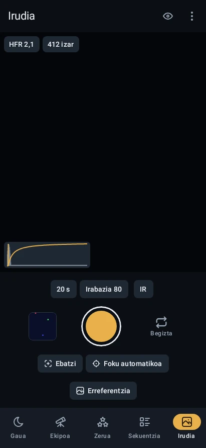 <b>Irudia.</b> HFR 2,1 px eta 412 izar.</td>
</tr></table>

### Argazkiari begira

- **Zooma:** atximurkatu, eta arrastatu mugitzeko. Ukitu bikoitzak argazki osoaren eta 1:1 pixelen artean txandakatzen du.
- **Histograma:** behean ezkerrean, luzatze-kurbarekin.
- **Azken argazkia:** sakatu goian ezkerreko HFRa eta izarrak histograma ikusteko, batez bestekoa, mediana eta desbideratzea ADUtan, HFRa bere sakabanaketarekin, FWHMa pixeletan eta arku-segundotan (Moffat profil bat, Hocus Focusen bezala), eta argazkia non gorde den.

### Argazketa-aukerak

Goiko **⋮** ikurrak irekitzen ditu:

- **Argazki mota:** Light, dark, flat edo bias. Fitxategi-izenean eta FITS goiburuan sartzen da.
- **Helburua, fitxategiaren izenerako:** Karpetaren eta fitxategien izena, adibidez *M 31*. Halakorik gabe, argazkiek *Snapshot* izena dute.
- **Gorde bakarkako argazkiak:** Begiztek beti gordetzen dute.
- **Dithering-a light-begiztetan, zenbat argazkiro:** *Ez*, *3* (hasieran), *5* edo *10* argazki. Argazkien artean munturak bultzada txiki bat jasotzen du, N.I.N.A.ren gidatze zuzenak ematen duen bezala: eremua pixel batzuk mugitzen da (5 lehenespenez) begizta hasi zen tokiaren inguruan, sentsorearen patroia pilaketan marra gisa meta ez dadin. Darkek, flatek eta biasek ez dute inoiz dithering-ik egiten. Seestar batekin, haren gidaketa-pultsuak ez baitoaz bidaltzen diren lekura, GoTo txikiekin jauzi egiten du 27″-ko tartea duen sare bateko 9 puntuen artean.
- **Offset:** Kamerak badu.
- **Luzatze automatikoa:** Aktibatuta lehenetsita, N.I.N.A.-rena bezala. Desaktibatuta, bi graduatzailek **Itzalak** eta **Tarteko tonuak** ezartzen dituzte.
- **Markatu izarrak:** Lauki bat eta HFRa marrazten ditu izar distiratsuenetan, N.I.N.A.-k bezala; **Zenbat**, 10 eta 500 artean.
- **Zuzeneko pilaketa:** **Pilatu zuzenean argi-argazkiak** eta **Orekatu pilaketaren kolorea** ([22. kapitulua](#stacking)).
- **Ezarpenak:** Aplikazioaren ezarpenak.

<table><tr>
<td valign="top" width="240">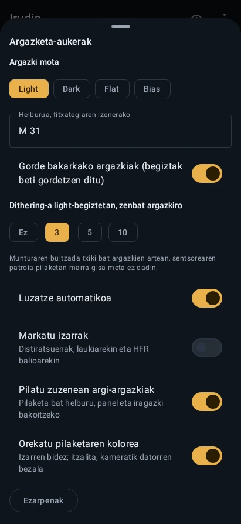 <b>Argazketa-aukerak.</b></td>
</tr></table>

### Argazkiaren azpiko botoiak

- **Ebatzi:** Azken argazkia ASTAPekin ebazten du eta nora zuzenduta dagoen erakusten du, **Sinkronizatu muntura** botoiarekin ([18. kapitulua](#solving)).
- **Foku automatikoa:** Fokatzaile batekin, foku automatikoa abiarazten du ([19. kapitulua](#autofocus)).
- **Erreferentzia:** Eremu bereko cacheko argazkia argazkiaren gainean jartzen du, haren biraketa, eskala eta zoomarekin, biak alderatu ahal izateko: orban ahul hori galaxia al da? Argazkia ebatzita ez badago, lehenik ebatzi egiten du. Sakatu berriro argazkira itzultzeko.
- **Miniatura:** Botoi biribilaren ezkerrean: saioaren historia irekitzen du ([21. kapitulua](#history)).

<table><tr>
<td valign="top" width="240">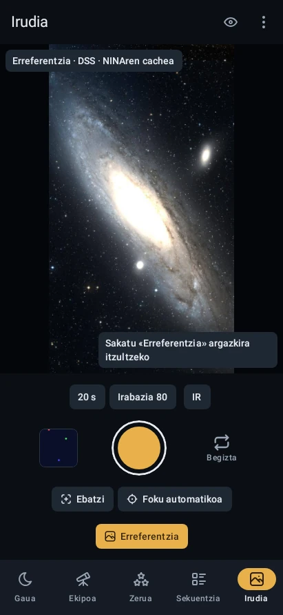 <b>Erreferentzia.</b> Argazkiaren eremuko cacheko argazkia.</td>
</tr></table>

<table><tr>
<td valign="top" width="470">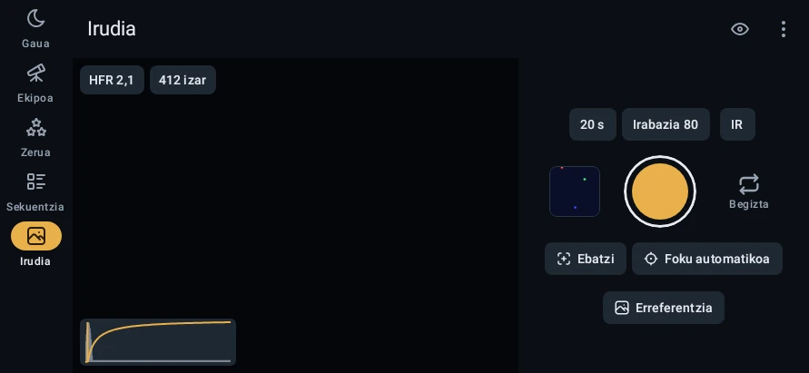 <b>Horizontalean</b>, argazkiak zabalera hartzen du eta kontrolak albora mugitzen dira.</td>
</tr></table>

## 21. Historia eta argazkien kalitatea

Historiak saio honetan gordetako argazki guztiak zerrendatzen ditu, bakoitzaren kalitatearekin, eta hodeiek edo argiak hondatutakoak markatzen ditu, pilaketatik kanpo gera daitezen.

- **Grafikoa:** argazki bakoitzaren HFRa lerro gisa eta haren izarrak barra gisa, **AF** foku automatiko bat egin den lekuan.
- **Zerrenda,** berrienak lehenik: zenbakia, ordua, iragazkia eta esposizioa, HFRa eta izarrak.
- **Baztertutako argazkiek** saioaren medianak baino izar askoz gutxiago edo hondo askoz argiagoa dute, eta zergatik esaten dute: *hodeiak*, *izar gutxi* edo *hondo argia*. Diskoan gordeta geratzen dira; pilaketak eta laburpenak bakarrik uzten dituzte kanpoan.

Goiko iragazkiaren ikonoak baztertutako argazkiak soilik erakusten ditu. Ireki historia Irudia ataleko botoi biribilaren ondoko miniaturatik.

<table><tr>
<td valign="top" width="240">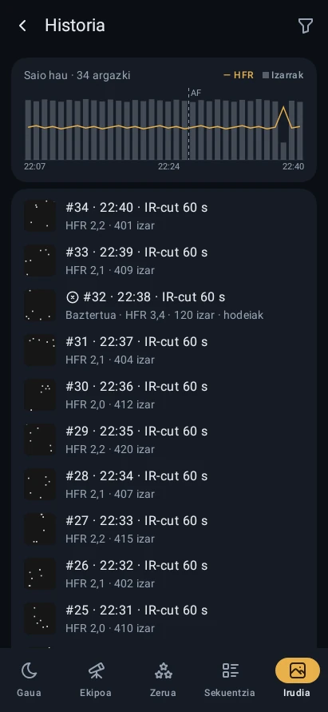 <b>Historia.</b> 32. argazkia baztertuta: hodeiak.</td>
</tr></table>

## 22. Zuzeneko pilaketa

Zuzeneko pilaketak argi-argazki on bakoitza martxan dagoen pilaketa bati gehitzen dio gaua aurrera doan bitartean; horrela, helburua zaratatik nola ateratzen den ikusten duzu. Desaktibatuta dago nahi duzun arte, memoria eta bateria erabiltzen dituelako.

### Aktibatu

Irudia ataleko aukeretan, aktibatu **Pilatu zuzenean argi-argazkiak**. Hortik aurrera, gordetzen den argi-argazki oro pilaketan sartzen da, begizta batetik, sekuentzia batetik edo bakarkako argazki batetik. Argazkiak banan-banan gordetzen jarraitzen dute, beti bezala.

Flatak zuzeneko pilaketa desaktibatuta dagoenean ere biltzen dira: iragazki baten sorta osatzen denean, haren master flata bihurtzen dira, zure argazkien karpetan `FLATS/MasterFlat_IR.fits` gisa gordeta (bat iragazki bakoitzeko) hurrengo gauetarako, Siril eta PixInsight-ek ere irakurtzen duten 32 biteko FITS bat. Izen horrekin hor jartzen duzun zure flat bat ere balio du. Darkak ere pilaketarako gordetzen dira, haiek atera ondoren aktibatzen baduzu ere, sekuentzia bat bere darkekin hasten denean bezala.

### Nola pilatzen duen

- **Pilaketa bat helburu, panel eta iragazki bakoitzeko,** eta esposizio, irabazi eta binning bakoitzeko. Beste mota bateko argazki batek aurreko pilaketa gordetzen du eta berea hasten du.
- **Izarren bidez lerrokatua:** desplazamendua, biraketa eta eskala, pilaketaren lehen argazkiaren gainean.
- **Sateliteak eta hegazkinak kenduta**, 3 sigmako baztertzearekin.
- **Bidean kalibratua:** gaueko master darkarekin, esposizio, irabazi, offset eta binning berekoa eta sentsorearen tenperatura hurbilenekoa, eta FLATS karpetako bere iragazkiaren master flatarekin.
- **Kolorea bere izarren bidez orekatua,** **Orekatu pilaketaren kolorea** aktibatuta badago; desaktibatuta, kameratik datorren bezala.
- **Baztertutako argazkiak kanpoan geratzen dira,** baita izarrak bat ez datozen argazkiak ere.

<table><tr>
<td valign="top" width="240">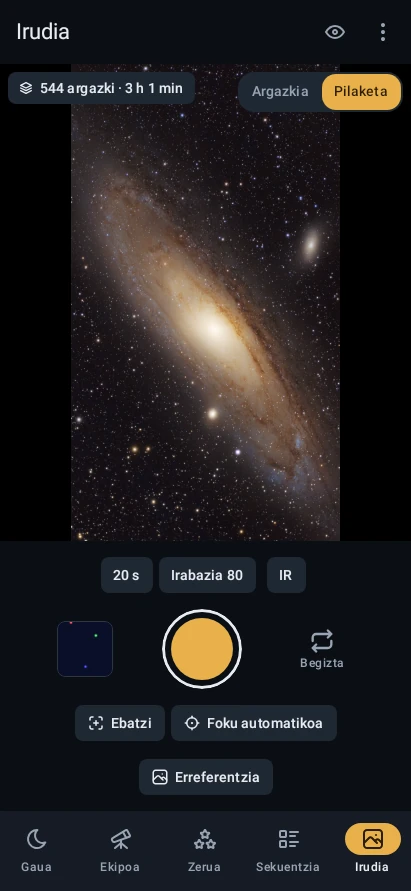 <b>Pilaketa.</b> M 31, Seestar batekin ateratako 20 s-ko 544 argazkirekin, gero prozesatuta.</td>
</tr></table>

### Mosaiko bat

Mosaiko batean sekuentziak panel bakoitza osorik egiten du eta gero hurrengoa, eta panel bakoitzak bere pilaketa du, bere dark eta flatekin kalibratua. **Pilaketa** aukeratuta, Irudiak mosaiko osoa erakusten du eraikitzen den bitartean: panel bakoitza zeruko bere tokian, bere zentratzeak ebatzi bezala, gainjartzen diren tokian hondoa auzokoenarekin berdinduta eta junturak urtuta, eta tiratze bakarra eta kolore-oreka bakarra guztiarentzat. Pilatzen ari den panelak ertz urrekara du eta argazki bakoitzarekin hazten da; falta direnak, marra etenez. Tamainaren laurdenean dagoen ikuspegia da, edo txikiagoa mosaiko handi batean, mugikorraren memorian sar dadin, eta JPG gisa gordetzen da, adibidez *2026-10-14/M 31/STACK/…_STACK_MOSAIC.jpg*, panel bakoitzaren ondoren eta sekuentzia amaitzean. Azken mosaikoa panelen pilaketekin muntatzen da Siril edo PixInsight-en.

<table><tr>
<td valign="top" width="240">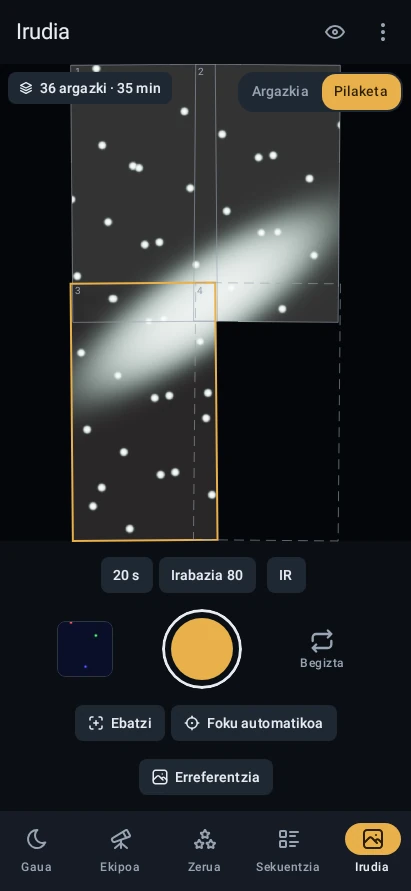 <b>Mosaiko bat.</b> Lautik hirugarren panela, hazten.</td>
</tr></table>

### Pilaketari begira

Pilaketa bat dagoenean, Irudia ataleko goiko eskuinaldeko **Argazkia** | **Pilaketa** hautagailuak azken argazkiaren eta pilaketaren artean txandakatzen du. Sakatu pilaketaren etiketa, adibidez *544 argazki · 3 h 1 min*, haren orria irekitzeko:

- **Pilatuak:** Barruan dauden argazkiak, iritsi direnetatik.
- **Baztertuak:** Zenbat geratu diren kanpoan, eta zergatik.
- **Denbora:** Integrazio osoa eta argazkiak.
- **Lerrokatzea:** Izarren bidez, eta azkena zenbat biratu den.
- **Kolorea:** Izarren bidez orekatua, edo kameratik datorren bezala.
- **Dark** eta **Flat:** erabiltzen ari diren darka eta master flata, adibidez *MasterFlat_IR.fits, urria 11*, edo zein falta diren.

Gaua atalean, sekuentzia bat pilaketa aktibatuta martxan dagoen bitartean, azken argazkiaren txartelak pilaketa erakusten du; sakatu Irudia atalean irekitzeko.

### Gordetzea

Pilaketa bere kabuz gordetzen da 10 minuturo, hazten den bitartean, eta begizta edo sekuentzia amaitzean: 32 biteko FITS lineal bat prozesatzeko, eta JPG bat pantailan ikusten den bezala, argazkien karpetan, `STACK` mota gisa duela. **Gorde** botoiak orain gordetzen du. Aplikazioa ixten bada, pilaketak helburu eta iragazki bereko hurrengo argazkiarekin jarraitzen du.

**Atera 20 s-ko 10 dark** (argazkien esposizioarekin) botoiak darkak ateratzen ditu orain pilaketarako. Iragazki ilun batekin automatikoa da; halakorik gabe, aplikazioak teleskopioa lehenik estaltzeko eskatzen dizu. **Eutsi berriro hasteko** botoiak pilaketa husten du.

<table><tr>
<td valign="top" width="240">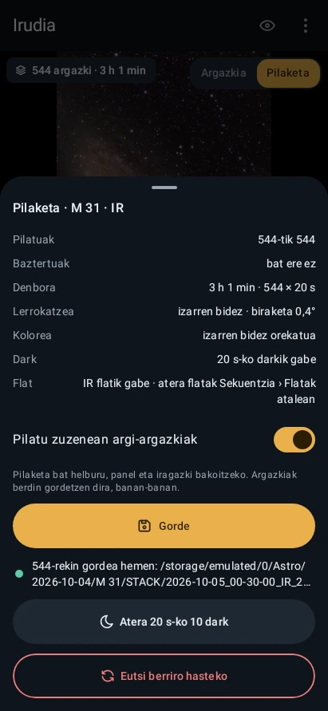 <b>Pilaketaren orria.</b> Oraindik ez dago darkik ez flatik iragazki honetarako.</td>
</tr></table>

## 23. Flatak, darkak eta biasak

Kalibrazio-argazkiek sentsoreak eta optikak gehitzen dutena kentzen dute. Yacanak flatak laguntzaile batekin ateratzen ditu, eta darkak eta biasak sekuentziaren arauekin, eta zuzeneko pilaketak denak erabiltzen ditu.

### Flaten laguntzailea

Ireki Sekuentzia ataleko **Flatak** txantiloiarekin. Esposizioa bere kabuz kalkulatzen du, eta iragazki bakoitzaren flatak helburuko distira batean ateratzen ditu. Argia mugikor hau da, edo flat-panela, bat konektatuta badago.

1. Egiaztatu **Helburuko ADU**, 30.000 ± 5 % lehenetsita, kameraren maximoa erakutsita. Ezarri **Panelaren distira**, bat erabiltzen baduzu.
2. Aukeratu **Argazkiak iragazki bakoitzeko** (20, 30 edo 50) eta **Iragazkiak**.
3. Sakatu **Hasi flatak**. Mugikor hau argi gisa, 30 s dituzu ahoz behera teleskopioaren gainean jartzeko, pantailak lentea estaltzen duela eta paper zuri orri bat tartean. Txistu batek flatak hasten ditu eta pantaila zuri jartzen da distira osoan, modu gorrian ere bai; beste txistu batek amaitzen ditu. Pausatzeko, sakatu bi aldiz pantaila zuria; **Jarraitu** botoiak beste 30 s ematen ditu.
4. Iragazki bakoitzak *esposizioa bilatzen…* erakusten du, eta gero bere esposizioa eta zenbat egin diren, azken argazkiaren batez bestekoarekin ADUtan. **Pausatu** eta **Eduki sakatuta gelditzeko** behealdean daude. Amaieran, Seestarren Dark iragazkiarekin, 10 bias ateratzen ditu: haien maila master flat bakoitzean geratzen da, zuzeneko pilaketak horrekin zatitu dezan darkik ez badago ere.

Esposiziorik laburrenarekin ere argi gehiegi badago, edo luzeenarekin gutxiegi, laguntzailea gelditu egiten da eta zer aldatu esaten du: paper gehiago edo gutxiago mugikorraren pantailaren gainean, edo panelaren distira.

<table><tr>
<td valign="top" width="240">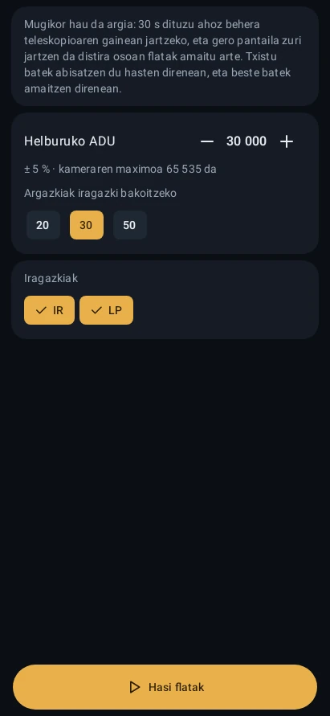 <b>Prestatzen.</b> Mugikor hau argi gisa, bi iragazki.</td>
<td valign="top" width="240">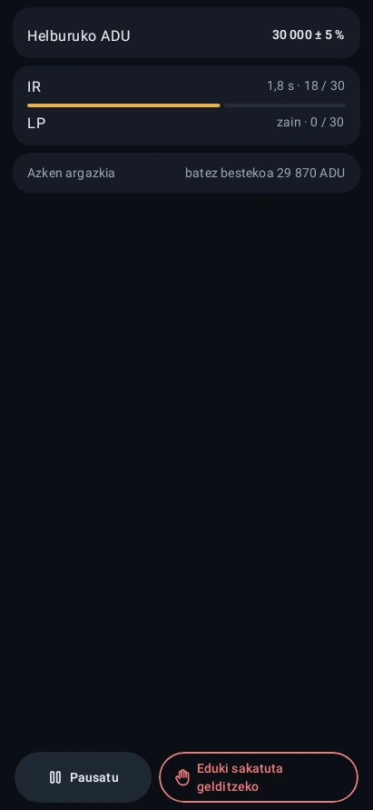 <b>Martxan.</b> IR flatak 1,8 s-tan, batez bestekoa 29.870 ADU.</td>
</tr></table>

### Darkak eta biasak sekuentzian

Editore sinplean, **Darkak** botoiak, **Arauak** azpian, darkak noiz ateratzen diren ezartzen du, argi-argazki bakoitzaren esposizio, irabazi eta binningarekin, eta iragazki ilunarekin:

- **Hastean**, gauaren hasieran.
- **Sentsorearen tenperatura aldatzen bada** 2, 3 edo 5 °C, zuzeneko pilaketak tenperatura hurbileneko sorta erabil dezan.
- **Amaitzean, biasarekin** (lehenetsita aktibatuta).
- **Argazkiak sorta bakoitzeko:** 5, 10 edo 20. Orriak esaten du sorta bakoitzak zenbat irauten duen argi-argazkirik gabe.

Iragazki ilunik gabe, ezin da darkik atera hastean edo tenperaturagatik; amaieran, aplikazioak teleskopioa estaltzeko eskatzen dizu. Hasierako eta amaierako darkak eta biasak helburuaren karpetara doaz, LIGHT ondoan: hasierakoak lehen helburuarenera; amaierakoak azkenarenera.

<table><tr>
<td valign="top" width="240"> <b>Darkak.</b> 60 s-ko 10 argazkik 11 min inguru behar dituzte.</td>
</tr></table>

### Eskuz

Irudia atalean, ezarri **Argazki mota** dark, flat edo bias aukeretan, eta atera argazkiak ohi bezala: argazkiak motaren araberako beren karpetara doaz.

---

# Sekuentziak

## 24. Sekuentzia atala

Sekuentzia bat gaueko plana da: zein helburu, zein esposiziorekin, eta haien inguruan zer egin. Yacanak bi editore ditu plan berarentzat: sinple bat, gaua denbora-lerro batean jartzen duena, eta aurreratu bat, N.I.N.A.-ren edukiontzi, abiarazle eta baldintzekin. Batetik bestera alda zaitezke ezer galdu gabe.

- **Gaur gauean:** Gauak exekutatuko duen plana, bere helburu eta orduekin. Sakatu editorea irekitzeko. Martxan dagoen bitartean, hala dio.
- **Gordetakoak:** Zure gordetako sekuentziak, beren helburu eta iraupenarekin. Sakatu bat gaur gaueko plan gisa kargatzeko; **Desegin** botoiak lehen zenuen plana itzultzen du. Eduki errenkada bat sakatuta une batez, **Eduki sakatuta ezabatzeko** bidez ezabatzeko. Gaur gaueko plana gordetzeko, erabili editorearen **⋮** menua.
- **Txantiloiak:** Plan berri baterako abiapuntuak (ikus behean).
- **Berria:** Plan huts bat, editorean.

### Txantiloiak

- **Helburu bat gau osoan:** plan huts bat hasten du eta Zerua irekitzen du. Hurrengo gehitzen duzun helburuak gaua betetzen du egunsentira arte.
- **Zenbait helburu** eta **Mosaikoa:** plan huts bat hasten dute eta Zerua irekitzen dute, helburuak edo mosaikoa enkoadratzeko.
- **Flatak:** flaten laguntzailea irekitzen du ([23. kapitulua](#calibration)).

Txantiloi baten aurretik zegoena **Desegin** botoiarekin itzultzen da.

<table><tr>
<td valign="top" width="240"> <b>Sekuentzia.</b> Gaur gauean, gordetako sekuentziak eta txantiloiak.</td>
</tr></table>

## 25. Editore sinplea

Editore sinpleak gaur gaueko plana denbora-lerro gisa erakusten du, eta txartel bat helburu bakoitzeko. Ikono eta hitzekin ohartarazten du plana egunsentia baino lehen sartzen ez denean.

### Helburuak gehitzea

Helburuak Zerua ataletik datoz: enkoadratu bat eta sakatu **Gehitu sekuentziari** ([16. kapitulua](#framing)). Zerrendaren amaierako **Gehitu helburu bat** botoiak hara eramaten zaitu. Mosaiko bat helburu bakar gisa iristen da, bere panelekin.

### Gaur gaueko plana

Denbora-lerroak helburu bakoitza erakusten du hasieratik amaierara, eta egunsentia. Plana egunsenti astronomikoaz haratago badoa, zein helburu noiz amaituko litzatekeen esaten du, eta helburu horren amaiera-ordua abisu-kolorera aldatzen da. **Desegin** botoiak azken aldaketa desegiten du, 50 aldaketa atzera arte.

### Helburu baten txartela

- Haren izena, noiz amaitzen den, eta zakarrontziaren ikonoa, kentzeko.
- Mosaiko baterako, haren panel kopurua; esposizioak panel bakoitzari aplikatzen zaizkio.
- Errenkada bat iragazki eta esposizio bakoitzeko, adibidez *IR · 60 s × 45 panel bakoitzeko*, egindako eta guztizko argazkiekin. Sakatu errenkada bat aldatzeko; **Esposizioak** botoiak beste iragazki bat gehitzen du.

<table><tr>
<td valign="top" width="240"> <b>Gaur gauean.</b> M 33 07:25ean amaituko litzateke, egunsentiaren ondoren.</td>
<td valign="top" width="240"> <b>Esposizioak.</b> Teklatuak erakusten du zenbat iraungo duen, eta noiz arte.</td>
</tr></table>

### Esposizioak

Orriak helburu baten esposizioen errenkada bat ezartzen du: **Iragazkia**, **Denbora** (10, 30, 60 edo 120 s, edo **Beste bat**), eta **Argazki kopurua** teklatuan. Idatzi ahala, erakusten du zenbat iraungo duten eta noiz arte, edo egunsentiaren ondoren amaituko liratekeela. **Gorde** botoiak gordetzen du; **Kendu esposizio hauek** botoiak errenkada ezabatzen du helburuak bat baino gehiago dituenean.

### Arauak

**Arauak** txartelak gauak argazkiez gain egiten duena zerrendatzen du. Plan berri bat honekin dator:

- **Desaparkatu hasieran**, eta **Ihintz-berogailua piztuta**, ekipoak berogailu-etengailu bat badu.
- **Zentratu iristean:** helburu bakoitza, eta mosaiko bateko panel bakoitza, plate solving bidez zentratzen da bere argazkien aurretik.
- **Dithering, 3 argazkiz behin**, gidaririk gabe.
- **Foku automatikoa ΔT > 1 °C bada**, fokatzaile batekin.
- **Berriro zentratu > 1′ desbideratzen bada:** light argazki bakoitzaren aurretik aurrekoa ebazten da; eremua helburutik 1′ baino gehiago desbideratu bada, berriro zentratzen da. Gidaketaren ordez dabil.
- **Darkak eta biasak amaieran**: bakoitzetik 10, argi-argazkien esposizio, irabazi, offset eta binning bakoitzerako.
- **Aparkatu amaieran**, eta berogailua itzalita.

Azpiko botoiek aldatzen dituzte:

- **Foku automatikoa:** Argi-argazki bakoitzaren aurretik, foku automatiko bat exekutatzen da hauetako bat betetzen bada, N.I.N.A.-ren abiarazleen antzera:
  - **Tenperatura aldatzen denean** 0,5, 1, 2 edo 5 °C;
  - **Iragazkia aldatzean;**
  - **HFRa okertzen denean** 5, 10 edo 20 %;
  - **Noizean behin:** 15, 30, 60 edo 120 min, edo beste denbora bat.

  Foku automatiko batek huts egiten badu, hurrengo esposizioen zain geratzen dira.
- **Darkak:** Hastean, sentsorearen tenperatura aldatzen denean, amaitzean biasarekin, eta zenbat aldi bakoitzean ([23. kapitulua](#calibration)).
- **Berriro zentratzea:** aktibatuta edo ez, eta eremua zenbat desbidera daitekeen: 1′, 2′, 5′ edo 10′, bakoitza konektatutako kameraren pixeletan ere bai. Ez du inoiz berriro zentratzen 20 px baino gutxiagogatik, dithering batek mugi dezakeena; angelu zabaleko kamera batekin hori edozein aukera baino gehiago da, eta orriak abisatzen du. Lerrokatze polar onarekin orduko behin edo bitan zentratzen du berriro.
- **Dithering:** aktibatuta edo ez, eta 1, 3, 5 edo 10 argazkiz behin, helburu guztien light argazkietarako. Dithering bakoitzak muntaia egonkortu arte itxaroten du. Seestar batekin, edo gidaketa-pultsurik gabeko muntaia batekin, dithering bakoitza azken argazkiaren ebazpenetik abiatzen da eta helburura gehi bere sareko puntura doa, beraz desbideratzea ere desegiten du, Seestar-en aplikazioak berak egiten duen bezala.
- **Ihintz-berogailua**, konektatutako ekipoak badu: piztuta edo ez gauean zehar, eta bere potentzia erregulagarria bada. Bateria kontsumitzen du: itzali gau lehor eta epeletan.

Beste arau batzuetarako, hala nola helburu bat igo arte itxarotea edo ordu batera arte errepikatzea, ireki plana editore aurreratuan.

### Gorde eta hasi

**⋮** menuak **Gorde nire sekuentzietan** du. Behealdeko **Hasi** botoiak gaua abiarazten du ekipoa konektatuta dagoenean; martxan dagoen bitartean, botoia **Eduki sakatuta gelditzeko** bihurtzen da. Plana editatu dezakezu martxan dagoen bitartean ere: aldaketak oraindik etortzeko dagoenari aplikatzen zaizkio.

<table><tr>
<td valign="top" width="240"> <b>Foku automatikoaren arauak.</b></td>
<td valign="top" width="240"> <b>Berriro zentratzea.</b> Helburutik 1′ baino gutxiagora.</td>
<td valign="top" width="240"> <b>Dithering.</b> 3 argazkiz behin.</td>
</tr></table>

## 26. Editore aurreratua

Editore aurreratua N.I.N.A.-ren sekuentziatzaile aurreratua da, ukipen-zerrenda bihurtuta: sartzen zaren edukiontziak, aginduak, abiarazleak eta baldintzak, arrastatuz berrordenatuak, desegiteko aukerarekin eta hasi aurretik gauaren berrikuspen batekin.

Ireki editore sinplearen goialdeko **Aurreratua** botoiarekin. Gaur gaueko plana osorik irekitzen du. Editore sinpleak erakutsi ezin duena gehitzen baduzu, baldintza bat edo edukiontzi paralelo bat adibidez, gaur gauekoa editore aurreratuan bakarrik editatuko da hortik aurrera: editore sinpleak **Gaur gauekoa Aurreratua editorean editatzen da** erakusten du, **Ireki Aurreratua editorean** botoiarekin eta helburuen zerrendarekin.

### Gauaren egitura

- **Gaua,** goiko maila, **gau osorako abiarazleekin**, eta hiru zati:
- **Hasiera:** lehenik gertatzen dena, helburuen aurretik, hala nola desaparkatzea edo kamera hoztea. Helburu bati zuzentzen dena ez doa hemen.
- **Helburuak:** bata bestearen atzetik, ordena honetan. Helburu bakoitzak bere aginduak ditu.
- **Amaiera:** helburuen ondoren: darkak, aparkatzea eta itzaltzea.

Goiko ogi-apurrek non zauden erakusten dute, adibidez *Gaua › Helburuak › M 33*. Maila bakoitzaren txartelak nola exekutatzen den esaten du: behin, edo bere baldintzek errepikatuta, agindu bakoitzaren ondoren egiaztatzen direnak.

<table><tr>
<td valign="top" width="240"> <b>Gaua.</b> Foku automatikoko abiarazle bat eta hiru zatiak.</td>
<td valign="top" width="240"> <b>Helburu bat.</b> 02:00ak arte errepikatuta.</td>
</tr></table>

### Elementuekin lan egitea

- **Sartu** edukiontzi batean hura sakatuz; sakatu agindu bat haren ezarpenak aldatzeko.
- **Gehitu** behealdeko botoiarekin, **Gehitu hemen: …**, katalogoa irekitzen duena. Mailaren txarteleko **Baldintza** eta **Abiarazlea** botoiek mota horretan irekitzen dute.
- **Berrordenatu** elementu baten heldulekua arrastatuz, edo haren **⋮** menuarekin.
- Elementu baten **⋮ menua**: *Sartu*, *Aldatu helburua*, *Aldatu izena*, *Ezarpenak*, *Igo*, *Jaitsi*, *Eraman hona…*, *Bikoiztu*, *Gorde txantiloi gisa* eta *Ezabatu*.
- **Desegin** goian dago.

Gaua martxan dagoen bitartean, amaitutako elementuak eginda gisa markatzen dira eta martxan dagoena nabarmenduta dago. Biak blokeatuta daude; gainerakoak oraindik alda daitezke.

### Katalogoa

Katalogoak bilaketa-koadro bat eta motaren araberako botoiak ditu: kamera, muntura, fokatzea, iragazkiak, tresnak, edukiontziak, abiarazleak, baldintzak eta txantiloiak. Zauden lekuan joan ezin dena grisez ageri da, arrazoiarekin, adibidez *Helburu baten barruan soilik*.

<table><tr>
<td valign="top" width="240"> <b>Katalogoa.</b> Helburu bati zuzentzen dena grisez ageri da Hasieran.</td>
</tr></table>

| Mota | Elementua | Zer egiten duen |
| --- | --- | --- |
| **Kamera** | Esposizioak | Light, dark edo bias argazkiak: iragazkia, denbora, argazki kopurua eta dither-a |
| **Kamera** | Hoztu kamera · Berotu kamera | Tenperatura batera arte pixkanaka, edo poliki itzuli, itzali aurretik |
| **Muntura** | Desaparkatu · Aparkatu | Atseden-posiziotik ateratzen da edo hara itzultzen da |
| **Muntura** | Joan eta zentratu | GoTo helburura eta plate solving, 1′ barruan; Helburu baten barruan soilik |
| **Muntura** | Joan helburura | GoTo helburura zentratu gabe; Helburu baten barruan soilik |
| **Muntura** | Gelditu jarraipena | Muntura geldi geratzen da |
| **Fokatzea** | Foku automatikoa · Mugitu fokatzailea | V kurbako exekuzio bat, edo posizio batera |
| **Iragazkiak** | Aldatu iragazkia | Gurpilak beste iragazki bat jartzen du |
| **Tresnak** | Ezarri etengailu bat | Ihintz-berogailua, adibidez, piztu edo itzali |
| **Tresnak** | Itxaron ordu batera arte · Itxaron denbora batez · Itxaron igo arte | Gaur gaueko ordu batean jarraitzen du, minutu batzuen ondoren, edo helburua altuera batera iristen denean |
| **Tresnak** | Oharra | Ohar bat gaueko egunerokoan |
| **Edukiontzia** | Helburua | Zerua ataleko helburu bat, bere enkoadraketarekin; «Joan eta zentratu» dakar |
| **Edukiontzia** | Sekuentziala · Paraleloa | Bere aginduak bata bestearen atzetik, edo aldi berean, adibidez ordu baten zain egotea kamera hozten den bitartean |
| **Abiarazlea** | Foku automatikoa tenperatura aldatzean · noizean behin · iragazkia aldatzean · HFRa handitzen bada | Foku automatiko bat hurrengo argazkiaren aurretik, bere baldintza betetzen denean |
| **Abiarazlea** | Berriro zentratu desbideratzen bada | Ebatzi eta zuzendu egiten du helburua 1′ eta 10′ arteko balio bat baino gehiago (gutxienez 20 px) desbideratzen denean |
| **Abiarazlea** | Darkak tenperatura aldatzen bada | Darkak iragazki ilunarekin sentsorea 2, 3 edo 5 °C aldatzen denean, zuzeneko pilaketarako |
| **Baldintza** | Errepikatu N aldiz · Errepikatu ordu batera arte · Errepikatu altu dagoen bitartean | Edukiontzi osoa errepikatzen du |
| **Txantiloia** | Helburua foku automatikoarekin · zureak | Zerua ataleko helburu bat, joan eta zentratu, foku automatikoa eta esposizioekin; edo txantiloi gisa gorde duzun edozein bloke |

### Berrikusi gaua

Editoreak plana egiaztatzen du eraikitzen duzun ahala. Gaur gauean zerbait gaizki aterako balitz, goiko bereizgarri batek abisuak zenbatzen ditu; sakatu **Berrikusi gaua** irekitzeko, eta sakatu abisu bat hara joateko. Abisuek ez dute inoiz galarazten gordetzea edo hastea. Hauek dira, besteak beste:

- helburu bat behar duen agindu bat Helburu batetik kanpo, edo helbururik gabeko light argazkiak;
- aparkatze bat argazki, fokatze edo GoTo baten aurretik, aurretik *Desaparkatu* gabe;
- aurretik *Joan eta zentratu* ez duten light argazkiak, edo jarraipena geldituta dutenak;
- gurpilak ez duen iragazki bat, edo hozten ez den kamera bat hoztea;
- kamera berotzen ari den bitartean ateratako darkak;
- gailu bera aldi berean erabiltzen duten bi elementu paralelo.

### Plan sinplera itzultzea

Editore sinplearen txartelak, edo editore aurreratuaren **⋮** menuak, **Eduki sakatuta plan sinplera itzultzeko** du. Editore aurreratuak bakarrik dakiena kentzen du, eta helburuak gordetzen ditu beren esposizioekin. Menu berak **Gorde Nire sekuentziak atalean** du.

<table><tr>
<td valign="top" width="240"> <b>Aurreratua editorean editatua.</b> Editore sinpleak helburuak erakusten ditu.</td>
</tr></table>

> [!NOTE]
> **N.I.N.A.-ren erabiltzaileentzat**
>
> Editore aurreratuak N.I.N.A.-ren sekuentziatzailea jarraitzen du: edukiontzi, abiarazle eta baldintza mota berberak, ordena berean exekutatuta. N.I.N.A.-ren beraren sekuentzia-fitxategiak ez dira inportatzen, eta Windowsen edo gidaketaren mende dauden aginduak ez daude.

## 27. Gaua martxan

Hasi gaua Gaua ataleko **Hasi gaua** botoiarekin edo editoreko **Hasi** botoiarekin. Hortik aurrera, saioa aurreko planoko zerbitzu baten barruan exekutatzen da: pantaila itzali eta mugikorra gorde dezakezu.

### Gaua atala martxan dagoen bitartean

Behar duzun guztia pantaila bakarrean sartzen da, korritu gabe:

- **Helburua:** haren izena, panela eta iragazkia, eta haren altuera, igotzen edo jaisten ari den adierazten duen gezi batekin.
- **Argazkia:** geratzen diren segundoak dituen eraztun bat, *Argazkia 35 / 120*, iragazkia eta irabazia.
- **Aurrerapena:** sekuentziaren ehunekoa eta noiz amaitzen den, egunsenti astronomikoarekin alderatuta.
- **Azken argazkia:** haren miniatura, ona ala baztertua izan den, haren HFRa eta izarrak, eta gaueko HFR kurba. Zuzeneko pilaketa aktibatuta, pilaketa erakusten du: sakatu Irudia atalean irekitzeko.
- **Hurrengoa:** datorrena, hala nola hurrengo foku automatikoa, hurrengo helbururako aldaketa eta aparkatzea, beren orduekin.

**Pausatu** botoiak berehala gelditzen du, martxan dagoen argazkia baztertuz, eta jarraipenak aurrera jarraitzen du; **Jarraitu** bihurtzen da, eta horrek agindu beretik jarraitzen du, jada ateratako argazkiekin. **Eduki sakatuta gelditzeko** botoiak sekuentzia amaitzen du.

<table><tr>
<td valign="top" width="240"> <b>Martxan.</b> 06:56an amaitzen da, 06:44ko egunsentiaren ondoren.</td>
<td valign="top" width="240"> <b>Zuzeneko pilaketarekin,</b> pilaketa txartelean.</td>
</tr></table>

### Aplikazioaren beste leku batzuetan

Beste pantaila guztietako saio-barrak argazkia erakusten du eta pausatzeko aukera ematen du ([4. kapitulua](#tour)), eta jakinarazpenak aurrerapena erakusten du blokeo-pantailan. Sekuentziak eta Irudia atalak kamera partekatzen dute: gelditu Irudia ataleko begizta bat gaua hasi aurretik.

### Pantaila itzalita

Yacanak mugikorraren prozesadorea eta WiFia esna mantentzen ditu saioa martxan dagoen bitartean, eta ekipoaren trafikoa haren WiFira lotzen du, internetik ez badu ere. Erreferentziako proban, 8,5 orduz aritu zen gau batez Seestar baten aurka, 503 argazki oso, berrabiarazterik gabe eta 6 s baino luzeagoko etenik gabe, bateriaren 1,7 % erabiliz orduko. Eman bateriaren baimenak lehenik ([33. kapitulua](#permissions)).

Yacana pantailan dagoen bitartean, pantaila piztuta geratzen da eta mugikorra ez da blokeatzen. Pantaila piztuta dagoenean, Androidek WiFia abiadura osoan mantentzen du eta, eroriz gero, segundo gutxitan konektatzen da berriro ekipoaren WiFira; pantaila itzalita, baliteke ez konektatzea piztu arte. Sakatu pizteko botoia ohi bezala itzaltzeko: saioak aurrera jarraitzen du. Gau oso batean pantaila piztuta edukitzeko, erabili modu gorria distira gutxirekin eta kanpoko bateria bat.

### Aplikazioa edo mugikorra berrabiarazten bada

Androidek aplikazioa ixten badu edo mugikorra berrabiarazten bada, saioa bere kabuz berreskuratzen da, minutu bat igaro baino lehen; berrabiarazi ondoren, mugikorra lehen aldiz desblokeatzen duzunean. Gehienez martxan dagoen argazkia galtzen da; jada gordetako argazkiak ez dira inoiz hondatzen, bakoitza aldi baterako fitxategi batean idazten delako eta gero izena aldatzen zaiolako. Egunerokoak *Aplikazioa itxi egin da eta sekuentzia berrekin du* erregistratzen du.

## 28. Abisuak eta gelditze seguruak

Inor begira ez dagoen gau bat ondo amaitzen da edo modu seguruan gelditzen da. Abisu orok esaten du zer gertatu den, aplikazioa zer egiten ari den eta zuk zer egin dezakezun.

### Lotura galtzen denean

Ekipoak erantzuteari uzten badio, sekuentzia **pausa segurura** pasatzen da: esposizioa gelditzen da eta jarraipenak aktibatuta jarraitzen du. Abisuak, Gaua atalean eta soinudun jakinarazpen gisa, saiakerak eta gelditze segurua baino lehen geratzen den denbora erakusten ditu. Aplikazioa 10 segundoz behin saiatzen da berriro.

- **Saiatu berriro orain** botoiak berehala saiatzen da berriro.
- **Xehetasunak** botoiak Ekipoa irekitzen du.
- **Eduki sakatuta gelditzeko** botoiak sekuentzia amaitzen du.

Egiaztatu mugikorra oraindik ekipoaren WiFian dagoela eta ekipoak elikadura duela. Lotura itzultzen denean, sekuentziak jarraitu egiten du, eta egunerokoak zenbat denboraz galdu zen erregistratzen du.

### Gelditze segurua

Gelditze seguru batek saioa amaitzen du kasu hauetan:

- lotura ez da itzultzen ezarritako denboran (2 min lehenetsita);
- sekuentziak berreskuratu ezin den moduan huts egiten du;
- mugikorraren bateria ezarritako mailatik behera jaisten da (20 % lehenetsita), eta beti 10 %-tik behera, kargatzen ari ez bada.

Esposizioa gelditzen da, eta muntura aparkatu egiten da edo jarraipena gelditzen du, profilak dioen bezala. Lotura galdu bazen, hori itzuli bezain laster gertatzen da. Orduan abisuak zer egin den esaten du; **Ulertuta** botoiak ixten du.

<table><tr>
<td valign="top" width="240"> <b>Pausa segurua.</b> Gelditze segurua 1 min 18 s barru, lotura itzultzen ez bada.</td>
<td valign="top" width="240"> <b>Gelditze segurua.</b> Muntura aparkatuta.</td>
</tr></table>

### Segurtasun-ezarpenak

*Ezarpenak › Segurtasuna* atalean, profil bakoitzeko:

- **Gelditze segurua:** **Muntura aparkatzen du** edo **Jarraipena gelditzen du**. Seestarrek aparkatzea dakar lehenetsita, eta horrek besoa tolesten du.
- **Lotura galtzen bada:** Pausa seguruak zenbat itxaroten duen: 1, 2, 5 edo 10 min.
- **Mugikorraren bateria baxua:** 15, 20 edo 30 %. 10 %-tik behera beti gelditzen da; kargatzen ari den bitartean, inoiz ez.

<table><tr>
<td valign="top" width="240"> <b>Ezarpenak › Segurtasuna.</b></td>
</tr></table>

## 29. Biharamun goizean

Sekuentzia amaitzean, Gaua atalak gaueko laburpena erakusten du, ixten duzun arte.

- Nola eta noiz amaitu zen: amaituta, eskuz geldituta, gelditze segurua edo hutsegitea, eta muntura aparkatu zen ala ez.
- **Integrazio erabilgarria:** mantendutako argazkien esposizio-denbora.
- **Argazkiak** eta **Baztertuak**, eta **HFR mediana**.
- **Helburuka:** argazkiak eta esposizioa helburu eta iragazki bakoitzeko.
- **Gorabeherak:** birkonexioak, foku automatiko gehigarriak, hodeiak dituzten argazkiak, beren orduekin.

**Ikusi egunerokoa** botoiak gaueko egunerokoa irekitzen du. **Esportatu** botoiak aplikazioaren erregistroaren ZIP bat gordetzen du, profilarekin eta bertsioekin, gordetzeko edo akats-txosten bati eransteko. **✕** ikurrak laburpena ixten du.

### Gaueko egunerokoa

Gertatutakoaren zerrenda irakurgarri bat, erregistro teknikotik bereizia: gertaera bakoitza bere ordu eta arrazoiarekin, adibidez *Foku automatiko gehigarria · Tenperatura 1,3 °C aldatu da*, *M 31 Panela 1 zentratuta · aldea 8″ · 2 saiakera* edo *Lotura berreskuratuta · 51 s · 5 saiakera*. Goiko haren ikonoak **Esportatu** botoiaren ZIP bera gordetzen du.

<table><tr>
<td valign="top" width="240"> <b>Laburpena.</b> 34 argazki, bat hodeiekin.</td>
<td valign="top" width="240"> <b>Gaueko egunerokoa.</b></td>
</tr></table>

Zure argazkiak eta pilaketak argazkien karpetan daude, karpeta bat gau eta helburu bakoitzeko ([30. kapitulua](#files)). Kopiatzeko, konektatu mugikorra ordenagailu batera USB kable batekin eta aukeratu fitxategi-transferentzia mugikorrean; karpeta mugikorraren biltegiko beste edozein bezala ageri da.

---

# Ezarpenak eta fitxategiak

## 30. Irudiak eta fitxategiak

Yacanak argazki bakoitza 16 biteko FITS fitxategi gisa gordetzen du, N.I.N.A.-ren goiburuekin, Sirilen, PixInsighten eta astronomia-programa guztietan irekitzen dena, karpeta batean gau eta helburu bakoitzeko.

### Karpeta

*Ezarpenak › Irudiak eta fitxategiak* atalean, **Karpeta** aukerak argazkiak nora doazen erakusten du. Lehenetsita aplikazioaren beraren karpeta da, `Android/data/app.yacana/files/Yacana` mugikorraren biltegian, eta Androidek ezabatu egiten du aplikazioa desinstalatzen baduzu.

**Aldatu karpeta** botoiak Androiden karpeta-hautatzailea irekitzen du: aukeratu edo sortu karpeta bat mugikorraren biltegian (`Astro`, adibidez), SD txartel batean edo USB unitate batean. Yacanak hor idazteko eskubidea mantentzen du berrabiarazteen artean. Aukeratu bat zure lehen gauaren aurretik, zure argazkiak erraz aurkitzeko eta berrinstalatze bati eusteko.

### Fitxategi-izenak

Argazki bakoitzaren izena N.I.N.A.-ren etiketak dituen eredu batetik dator. Barra batek karpeta bat sortzen du. Sakatu etiketa bat gehitzeko; pantailak hurrengo argazkiak zer izen izango duen erakusten du. **Itzuli lehenetsira** botoiak hau berrezartzen du:

`$$DATEMINUS12$$/$$TARGETNAME$$/$$IMAGETYPE$$/$$DATETIME$$_$$FILTER$$_$$EXPOSURETIME$$s_$$FRAMENR$$`

eta horrek, adibidez, `2026-10-04/M 31/LIGHT/2026-10-05_00-30-00_LP_20.00s_0001.fits` ematen du: karpeta bat gauerako, beste bat helbururako eta beste bat argazki motarako.

<table><tr>
<td valign="top" width="240"> <b>Ezarpenak › Irudiak eta fitxategiak.</b></td>
</tr></table>

| Etiketa | Bihurtzen da | Adibidea |
| --- | --- | --- |
| **`DATEMINUS12`** | Gaueko data: 12 ordu lehenagoko data; horrela, gauerdiaren ondorengo argazkiek arratsaldeko data mantentzen dute | `2026-10-04` |
| **`DATE`** | Tokiko data | `2026-10-05` |
| **`DATETIME`** | Tokiko data eta ordua | `2026-10-05_00-30-00` |
| **`TIME`** | Tokiko ordua | `00-30-00` |
| **`TARGETNAME`** | Helburua, edo *Snapshot* halakorik ez badago | `M 31` |
| **`IMAGETYPE`** | Argazki mota | `LIGHT`, `DARK`, `FLAT`, `BIAS` |
| **`FILTER`** | Iragazkia, edo *NoFilter* | `LP` |
| **`EXPOSURETIME`** | Esposizioa segundotan | `20.00` |
| **`FRAMENR`** | Saioko argazki-zenbakia, 4 zifra | `0001` |
| **`GAIN`, `OFFSET`** | Kameraren irabazia eta offseta | `80` |
| **`BINNING`** | Binning-a | `1x1` |
| **`SENSORTEMP`** | Sentsorearen tenperatura | `-10.0` |

### Zer dago fitxategi bakoitzean

- **Argazkiak:** 16 biteko FITS, Seestarren beraren fitxategien pixel berberekin, eta N.I.N.A.-ren goiburu-gako-hitzekin: argazki mota, esposizioa, irabazia, offseta, binning-a eta sentsorearen tenperatura; iragazkia; helburua eta haren koordenatuak, altuera eta azimutarekin; teleskopioa, kamera, foku-distantzia eta pixelaren tamaina; fokatzailearen posizioa eta tenperatura; lekua; Bayer eredua eta haren desplazamenduak, Sirilek behar bezala debayerizatu ditzan.
- **Zuzeneko pilaketak:** bide bera, `STACK` mota eta zenbaki gisa duela: 32 biteko FITS lineal bat, goiburuan argazki kopurua eta esposizio osoa dituela, eta JPG bat pantailan ikusten den bezala, pilaketa hazi ahala gainidatzita.
- **Segurtasuna:** fitxategi bakoitza aldi baterako izen batekin idazten da eta osatzean izena aldatzen zaio; horrela, kraskatze batek edo argindarraren eten batek ez du inoiz argazki hautsirik uzten.

Gaueko egunerokoa eta aplikazioaren erregistroa aplikazioaren barruan gordetzen dira; esportatu ZIP gisa laburpenetik edo *Ezarpenak › Esportatu erregistroa* ataletik.

## 31. Ezarpenen erreferentzia

Ezarpenak Gaua eta Ekipoa ataletako engranajetik irekitzen dira, edo Irudia ataleko aukeretako **Ezarpenak** botoiarekin. Goiko bilaketa-koadroak edozein ezarpen aurkitzen du bere izenaren zati batetik, pantaila guztien barruan, azentuekin edo gabe.

Aukera bakoitzak zer egiten duen esaten du. *Profil bakoitzeko* markatutako ezarpenak ekipoaren profilean gordetzen dira; horrela, ekipo multzo bakoitzak bereak ditu.

<table><tr>
<td valign="top" width="240"> <b>Ezarpenak.</b></td>
</tr></table>

| Errenkada | Zer dauka | Kapitulua |
| --- | --- | --- |
| **Profila eta kokapena** | Izena, optika, lekua, mugak, horizontea, izarren datu-basea, beste profilak, esportatu eta inportatu | [5](#profile) |
| **Irudiak eta fitxategiak** | Karpeta, eta fitxategi-izenen eredua (profil bakoitzeko) | [30](#files) |
| **Plate solving** | ASTAPen aukerak, zentratzea eta izarren datu-baseak (profil bakoitzeko) | [18](#solving), [6](#field) |
| **Foku automatikoa** | Urratsa, puntuak, esposizioa, doikuntza, huts-tartea, R², saiakerak (profil bakoitzeko) | [19](#autofocus) |
| **Segurtasuna** | Gelditze segurua, lotura galtzean itxarotea, bateria baxua (profil bakoitzeko) | [28](#safety) |
| **Zeruko mapa** | N.I.N.A.-ren cacheak, WiFi soilik, lineako argazkiak eta geruzak | [6](#field) |
| **Pantaila** | Gaueko modu gorria eta haren distira | [32](#display) |
| **Hizkuntza** | Aplikazioaren hizkuntza | [32](#display) |
| **Baimenak** | Baimen bakoitza zertarako den, eta haren egoera | [33](#permissions) |
| **Esportatu erregistroa** | Erregistroaren azken 14 egunetako ZIP bat gordetzen du | [36](#troubleshooting) |
| **Honi buruz** | Bertsioa, pixel-motorra eta lizentziak | [39](#credits) |

Zuzeneko pilaketa eta haren kolore-oreka Irudia ataleko aukeretan ezartzen dira, eta profil bakoitzean ere gordetzen dira.

## 32. Modu gorria eta hizkuntza

### Gaueko modu gorria

Argi gorriak zure begiak iluntasunera egokituta mantentzen ditu. Modu gorriak aplikazioaren pixel guztiak gorri hutsez marrazten ditu beltzaren gainean, zeruko argazkiak eta zure argazkiak barne, eta pixel batek ere ez du berderik edo urdinik: pantaila guztietan egiaztatzen da.

- Aktibatu begiaren ikonoarekin, Gaua, Ekipoa, Zerua eta Irudia ataletako goialdean, objektuen fitxetan, enkoadraketan eta laguntzaileetan, edo **Gaueko modu gorria** aukerarekin, *Ezarpenak › Pantaila* atalean.
- Sistemaren barrak ezkutatu egiten dira; irristatu ertzetik une batez ikusteko.
- Aplikazioak bere pantaila-distira ezartzen du, eta sistemaren minimotik behera jaits daiteke: **Distira modu gorrian**, 1 eta 100 % artean, 10 % lehenetsita.
- Aplikazioak gogoratu egiten du, eta gorrian irekitzen da gorrian utzi bazenuen.

Androiden beraren elkarrizketa-koadroak eta sistemaren teklatua ezin dira gorri bihurtu. Horregatik sartzen dira zenbakiak gauez aplikazioaren beraren teklatuarekin. Androidek goian pizten duen puntu berdea ere, aplikazio batek kokapena irakurtzen duen bitartean, ezin da gorri bihurtu. Yacanak irekitzean, **Erabili mugikorraren kokapena** aktibatzean eta konektatzean bakarrik irakurtzen du, inoiz ez berriro konektatzean; beraz, puntua segundo batzuetan baino ez da ikusten.

<table><tr>
<td valign="top" width="240"> <b>Gaua gorrian.</b></td>
<td valign="top" width="240"> <b>Zerua gorrian.</b> Argazkiak ere bai.</td>
</tr></table>

### Hizkuntza

Yacanak ingelesez, gaztelaniaz, katalanez, euskaraz, galizieraz, alemanez, frantsesez, italieraz, eta Portugalgo eta Brasilgo portugesez hitz egiten du. *Ezarpenak › Hizkuntza* atalean, **Sistemaren berdina** aukerak mugikorrari jarraitzen dio, edo ingelesa erabiltzen du mugikorraren hizkuntza horietako bat ez bada; bestela, aukeratu bat. Berehala aldatzen da. Android 13 eta berriagoetan, sistemaren aplikazio-ezarpenetan ere aukera dezakezu. Datek eta zenbakiek hizkuntzari jarraitzen diote, koma hamartarrarekin, ingelesean izan ezik.

<table><tr>
<td valign="top" width="240"> <b>Ezarpenak › Hizkuntza.</b></td>
<td valign="top" width="240"> <b>Ezarpenak › Pantaila.</b></td>
</tr></table>

## 33. Baimenak eta bateria

Android ez dago diseinatuta pantaila itzalita zortzi orduko lan baterako. *Ezarpenak › Baimenak* ataleko baimenei esker gidatu dezake Yacanak gaua, hala ere.

Pantaila lehen urratsetakoa bera da ([3. kapitulua](#first-steps)): errenkada bakoitzak zertarako den eta hura gabe zerk ez duen funtzionatzen esaten du, eta **Baimendu**, **Ireki** edo marka bat erakusten du emanda dagoenean. Zure mugikorrari aplikatzen ez zaizkion errenkadak ez dira erakusten: sare lokala Android 17 baino lehen, jakinarazpenak Android 13 baino lehen, aplikazioa erabili gabe gordetzea Android 11 baino lehen, eta abiarazte automatikoa Xiaomi, Redmi eta Poco ez diren mugikorretan.

### Androidek gehiago galdetzen ez badu

Baimen bat bi aldiz ukatu ondoren, Androidek galdetzeari uzten dio. Orduan errenkadak hala dio: ireki Yacanaren ezarpenak Androiden, ireki Baimenak, aktibatu eta itzuli.

### Bateria-aurrezleak

- **Mugarik gabeko bateria** da garrantzitsuena gau baterako. Hura gabe, sistemak saioa gelditu dezake pantaila itzalita dagoenean.
- Fabrikatzaile batzuek beren aurrezleak gehitzen dituzte Androidenen gainetik. Xiaomi mugikorretan, **Abiarazte automatikoa** aukerak saioa itzultzea ahalbidetzen du sistemak aplikazioa ixten badu. Beste marka batzuetan, bilatu Yacana mugikorraren bateria-ezarpenetan eta baimendu atzeko planoan exekutatzea.
- Xiaomi mugikorretan, Yacanaren informazioko bateria-aurrezleak **Murrizketarik gabe** esan behar du: **Mugarik gabeko bateria** aukerak jartzen du. Blokeatu Yacana Azkenak atalean ere (eduki sakatuta haren txartela eta sakatu giltzarrapoa), garbitzean itxi ez dadin.
- Bateria aurrezteko moduek atzeko planoko lana gelditu dezakete: utzi desaktibatuta saio batean zehar.

### Aplikazioak inoiz behar ez duena

Yacanak ez du konturik behar, ezta zure argazki, kontaktu edo fitxategietarako sarbiderik ere, zuk aukeratzen dituzun karpetez harago, ezta atzeko planoko kokapenik ere.

---

# Erreferentzia

## 34. Seestar S50 Pro bat erabiltzea

ZWO Seestar S50 Prok ASCOM Alpaca du bere firmwarean; beraz, Yacanak zuzenean kontrolatzen du haren WiFiaren bidez. Erreferentziako gailua da: funtzio guztiak haren aurka eraiki eta neurtu ziren, eta bere profila betetzen du bere kabuz.

### Lehen gauaren aurretik

1. **Konfiguratu ZWOren aplikazioarekin.** Yacanak ez du hura ordezkatzen gailuaren beraren konfiguraziorako: aktibatzea, firmwarea eguneratzea, modu ekuatorialera aldatzea eta WiFia konfiguratzea ZWOren aplikazioan egiten dira.
2. **Jarri ziri ekuatorial batean, EQ moduan.** Ziri batean ardatz bakarrean egiten du jarraipena, eta esposizio luzeak ahalbidetzen ditu eremu-biraketarik gabe. Haren altazimut modua ez da aplikazio honen helburua.
3. **Sartu haren WiFian, edo jarri biak zure etxeko WiFian.** Haren bi sare-moduek funtzionatzen dute: bere sarbide-puntua, non `10.0.0.1` helbidean erantzuten duen, `32323` atakan, eta estazio modua zure bideratzailean. 8,5 orduko gau bat sarbide-puntu moduan eta 2 ordu estazio moduan exekutatu ziren, eten luzerik gabe.
4. **Bilatu Yacanan** eta sakatu **Teleobjektiboa** ([3. kapitulua](#first-steps)). Seestarren profila bere kabuz kargatzen da; **Angelu zabala** botoiak haren angelu zabaleko kamerarena sortzen du, beherago.

### Haren profilak zer ezartzen duen

| Elementua | Balioa | Zergatik |
| --- | --- | --- |
| **Optika** | 260 mm-ko foku-distantzia, 50 mm-ko irekiera, f/5,2 | Bere 4 elementuko errefraktore apokromatikoa |
| **Sentsorea** | 2160 × 3840 px, 2,9 µm, koloretakoa (GRBG Bayer) | Telefoto-kamera, bertikalean gordea, ZWOren aplikazioak egiten duen bezala |
| **Eskala eta eremua** | 2,25″ pixeleko · 2,40° × 1,35° | ASTAPekin neurtua, benetako argazkietan |
| **Kameraren biraketa** | 93,2°, lehen plate solving-ak neurtu arte | EQ moduko S50 Pro bat, bere alde luzea ia iparretik hegora |
| **Izarren datu-basea** | D50 | Bere argazkiak ebazten ditu, gau txarragoetarako tartearekin; D05 aukera arina da |
| **Foku automatikoa** | 15 urrats puntuen artean, 3 s-ko argazkiak | Haren fokatzailea 0tik 2.600 urratsera doa |
| **Gelditze segurua** | **Muntura aparkatzen du** | Aparkatzean besoa tolesten du |
| **Erabilitako gailuak** | Muntura, telefoto-kamera eta haren fokatzailea, iragazki-gurpila, etengailuak | Angelu zabaleko kamerak eta haren fokatzaileak beren profila dute, beherago |

### Haren angelu zabaleko kamera

Seestarren txarteleko **Angelu zabala** botoiak, lehen urratsetan edo **Profil berria** atalean, bigarren profil bat sortzen du, *Seestar S50 Pro angelu zabala*, haren angelu zabaleko kamerarako: zeru zati oso bat, Esne Bidearentzat eta gaueko paisaietarako. Haren esposizioek 60 s arte irauten dute.

| Elementua | Balioa | Zergatik |
| --- | --- | --- |
| **Optika** | 5,95 mm-ko foku-distantzia, 3,4 mm-ko irekiera, f/1,75 | Argitaratutako objektiboa, 63° diagonalean |
| **Eremua** | 33° × 59° inguru, 55″ pixeleko | Bere 2160 × 3840 px-ko sentsorea, 1,6 µm-koa |
| **Izarren datu-basea** | W08, 1 MB baino gutxiago | ASTAPena 20° eta 80° arteko eremuetarako: deskargatu *Ezarpenak › Plate solving* atalean |
| **Foku automatikoa** | 10 urrats puntuen artean, 15 puntu, 3 s-ko argazkiak | Haren fokatzailea 0tik 1.023 urratsera doa: hasierako balioak, zeruaren azpian doitzeko |
| **Erabilitako gailuak** | Muntura, angelu zabaleko kamera eta haren fokatzailea, etengailuak | Iragazki-gurpila teleobjektiboaren aurrean bakarrik dago |

### Komeni da jakitea

- **Darkak hura estali gabe.** Haren iragazki-gurpilak **Dark** posizio bat du, Yacanak obturadore gisa erabiltzen duena: darkak eta biasak teleskopioari ezer jarri gabe ateratzen dira.
- **Ihintz-berogailua piztuta edo itzalita dago.** Etengailu gisa ageri da *Ekipoa › Etengailuak* atalean. Haren Alpaca zerbitzariak (1.3.1-1) ez du haren potentzia ezartzen uzten.
- **Binning-ik ez.** Haren kamerak ez du binning-ik egiten; beraz, 2×2 ezarpen bat, lerrokatze polarrarena adibidez, tamaina osoan ateratzen da. Argazki batek 8,3 MP inguru ditu, 16 MB 16 bitetan, eta 1,7 eta 2,3 s artean deskargatzen da haren WiFiaren bidez.
- **Meridiano-iraulketarik ez.** Ziri batean beso bakarreko furka baten moduan jokatzen du. Mantendu helburuak besoak ziria jo dezakeen lekutik urrun, polotik eta zenitetik hurbil.
- **Iragazki-aldaketak motelak izan daitezke.** Erabiltzaile batzuek diote aldaketa batek denbora luzea behar duela agertzeko; aplikazioaren itxaronaldiek kontuan hartzen dute.
- **Elikadura.** Gau luze baterako, erabili Seestarra eta mugikorra kanpoko elikadurarekin, batez ere berogailua piztuta dagoela.
- **Haren aplikazioa aldi berean.** Ez da probatu ZWOren aplikazioa beste mugikor batean exekutatzea Yacanak Seestarra gidatzen duen bitartean; itxi saio batean zehar.

Probak 9.31 firmwarearekin eta 1.3.1-1 Alpaca zerbitzariarekin egin ziren.

## 35. Zerk behar du interneta

Gau batek ez du internetik behar inondik inora. Landan mugikorrak zure ekipoarekin bakarrik hitz egiten du, eta gauak erabiltzen duen guztia mugikorrean dago.

| Funtzioa | Internetik gabe | Internetarekin |
| --- | --- | --- |
| **Objektuen katalogoa** | OpenNGCko 13.371 zeru sakoneko objektu, aplikazioan bertan | Berdin |
| **Efemerideak** | Eguzkia, Ilargia eta ilunabarrak mugikorrean kalkulatuta | Berdin |
| **Plate solving** | ASTAP mugikorrean, izarren datu-base batekin mugikorrean | Berdin |
| **Zeruko argazkiak** | Mugikorreko N.I.N.A.-ren cacheetatik | Eremuaren argazki zehatzagoak asko handiagotzean, CDSren hips2fits-etik |
| **Bilaketa** | Messier, NGC, IC, Caldwell, Sharpless eta izen arruntak | SIMBAD ere bai: ezagutzen duen edozein objektu, behin aurkituta mugikorrean gordeta |
| **Izarren datu-baseak eta zeruko cacheak** | Fitxategi edo txartel batetik inportatuta | Aplikazioan bertan deskargatuta, lehenetsita WiFiarekin soilik |

Mugikorra ekipoaren WiFian dagoenean, internetik ez duena, Yacanak ekipoaren trafiko guztia sare horretan mantentzen du; horrela, Androidek ez du datu mugikorren bidez bidaltzen. Zuk abiarazten dituzun deskargek mugikorraren ohiko konexioa erabiltzen dute.

## 36. Arazoak konpontzea

Yacanako abisu orok esaten du zer gertatu den, aplikazioa zer egiten ari den eta zuk zer egin dezakezun. Kapitulu honek horien atzean dauden ohiko arrazoiak biltzen ditu.

### Konektatzean

- **Ez du Alpaca ekiporik erantzun:** Mugikorra eta ekipoa ez daude WiFi berean, edo ekipoa abiarazten ari da oraindik. Sartu haren sarean, itxaron minutu bat eta sakatu **Bilatu berriro**. Zure sareak aurkikuntza blokeatzen badu, erabili **Gehitu IP eta atakaren bidez** gailuak erakusten duen helbidearekin, adibidez `10.0.0.1:32323` bere sarbide-puntuan dagoen Seestar baterako.
- **Ez da ezer aurkitzen:** Egiaztatu **Sare lokala** emanda dagoela *Ezarpenak › Baimenak* atalean. Hura gabe, Androidek aurkikuntza eta agindu guztiak blokeatzen ditu.
- **Ezin izan da konektatu:** Gailuak bilaketari erantzun zion, baina konexioa ukatu zuen. Egiaztatu beste programa batek ez duela hartuta, berrabiarazi, eta konektatu berriro.
- **Deskonektatu profila aldatzeko:** Profilak, gailuak eta profilaren ezabatzea ezer konektatuta ez dagoen bitartean bakarrik alda daitezke. Sakatu **Deskonektatu guztiak** lehenik.

### Gauean zehar

- **Ekipoarekin loturarik ez:** WiFia erori da edo ekipoak elikadura galdu du. Sekuentzia pausa seguruan itxaroten du eta aplikazioa 10 segundoz behin saiatzen da berriro; lotura *Ezarpenak › Segurtasuna* atalean ezarritako denboran itzultzen ez bada, modu seguruan gelditzen da itzuli bezain laster. Egiaztatu mugikorra oraindik ekipoaren WiFian dagoela eta ekipoak bateria duela ([28. kapitulua](#safety)).
- **Saioa gelditu egin da pantaila itzalita:** Androidek aplikazioa itxi du bateria aurrezteko. Eman **Mugarik gabeko bateria**, **Erabili gabe ere gordetzen da** eta, Xiaomi mugikorretan, **Abiarazte automatikoa**, *Ezarpenak › Baimenak* atalean ([33. kapitulua](#permissions)).
- **Ez da sartzen egunsentia baino lehen:** Plana egunsenti astronomikoaren ondoren amaitzen da. Jaitsi helburu baten argazki kopurua, edo kendu helburu bat, abisua desagertu arte ([25. kapitulua](#simple)).
- **Helburua mugaren azpitik dago:** GoTo-a profilaren altuera-mugaren edo haren horizontearen azpitik joango litzateke, eta muntura ez da mugitu. Itxaron helburua igo arte, edo egiaztatu muga profilean.

### Plate solving eta zentratzea

- **Ez dago soluziorik datu-basearekin:** Argazkiak izar gutxiegi ditu (hodeiak, ihintza, esposizio laburra, foku txarra) edo profilaren foku-distantzia okerra da, eta ASTAPek eskala okerra bilatzen du. Egiaztatu foku-distantzia *Ezarpenak › Profila eta kokapena › Optika* atalean, fokatu, eta probatu esposizio luzeago bat.
- **Izarren datu-basea ez dago mugikorrean:** Deskargatu edo inportatu *Ezarpenak › Plate solving* atalean ([6. kapitulua](#field)).
- **Ez da zentratu zenbait saiakeraren ondoren:** Muntura ez da behar bezain hurbil iristen. Sinkronizatu behin ebatzitako argazki batekin, eta zentratu berriro; egiaztatu jarraipena aktibatuta dagoela eta muntura ez dela irristatzen.

### Lerrokatze polarra eta foku automatikoa

- **Muntura honek ezin du bere kabuz RA ardatza biratu:** Hiru puntuko lerrokatzeak agindu bidez ardatz bat mugi dezakeen muntura bat behar du (MoveAxis). Hura gabe, lerrokatu muntura beste modu batean.
- **Profilak ez du lekurik:** Poloaren posizioa lekuaren eta orduaren araberakoa da. Aktibatu **Erabili mugikorraren kokapena** profilean, edo idatzi lekua.
- **HFRa ez da nahikoa aldatu alde batean ere:** Foku automatikoaren urratsa txikiegia da zure optikarako. Handitu **Urratsa** *Ezarpenak › Foku automatikoa* atalean.
- **Kurbak gutxiegi azaltzen ditu puntuak:** Seeing-ak edo hodeiek puntuak hondatu dituzte. Saiatu berriro, erabili argazki gehiago puntu bakoitzeko, edo esposizio luzeago bat.
- **Fokurik onena puntuetatik kanpo dago:** Fokatzailea fokutik urrunegi hasi da. Hurbildu eskuz *Ekipoa › Fokatzailea* atalean eta exekutatu berriro.
- **Fokatzaile honek ez du joateko posiziorik:** Foku automatikoak fokatzaile absolutu bat behar du, urrats-posizioak jakinarazi eta haietara joaten dena.

### Laguntza behar duzunean

Sakatu *Ezarpenak › Esportatu erregistroa* eta aukeratu fitxategia non gorde. Aplikazioaren erregistroaren azken 14 egunak, erabiltzen ari den profila, eta aplikazioaren, Androiden eta mugikorraren bertsioak dituen ZIP bat da, proiektuaren arazoen jarraipen-sisteman akats-txosten bati eransteko prest. Ez da ezer bidaltzen bere kabuz. Gaueko laburpeneko **Esportatu** botoiak eta egunerokoaren esportatze-ikonoak ZIP bera gordetzen dute.

## 37. N.I.N.A.-ren erabiltzaileentzat

N.I.N.A. ezagutzen baduzu, Yacanaren gehiena ezagutzen duzu jada. N.I.N.A.-ren kontzeptuak eta haren algoritmo asko mantentzen ditu, ukipen-pantaila baterako eta iluntasunerako antolatuta.

| N.I.N.A.-n | Yacanan |
| --- | --- |
| **Equipment fitxa** | Ekipoa atala: profila, konexioa eta gailu bakoitzaren eskuzko kontrola |
| **Sky Atlas eta Framing Assistant** | Zerua atala: mapa, zerrenda, objektuen fitxak eta enkoadraketa |
| **Framing cachea (FramingAssistantCache)** | Cache berberak, zuzenean beren ZIPetik irakurrita; lineako argazkiak N.I.N.A.-ra esporta daitezke berriro |
| **Imaging fitxa** | Irudia atala: argazketa, estatistikak, historia eta cacheko erreferentzia-argazkia |
| **Simple eta Advanced Sequencer** | Editore sinplea eta aurreratua eredu bakarraren gainean: bi norabideetan alda zaitezke ezer galdu gabe |
| **Three Point Polar Alignment plugina** | Lerrokatze polarraren laguntzaile integratua, pluginetik portatua |
| **Autofocus, Hocus Focusen FWHM** | Foku automatiko integratua, bost doikuntza berberekin, eta Moffat FWHM bat |
| **Flat Wizard** | Flaten laguntzailea |
| **Options** | Ezarpenak, bilaketa-koadro batekin |
| **Fitxategi-ereduaren etiketak** | Etiketa berberak, adibidez `$$TARGETNAME$$` |
| **Horizonte-fitxategia** | Fitxategi bera, profilean inportatuta |
| **FITS goiburuak** | 36 gako-hitz berberak |

### Jakitea merezi duten desberdintasunak

- **Gidaketarik ez.** Dithering-a gidaririk gabe egiten da, N.I.N.A.-ren direct guider-ak bezala.
- **Gauari begirako diseinua.** Gaua atal batek, N.I.N.A.-k ez duenak, gaua prestatzen du zerrenda batekin, saioari begirada batean jarraitzen dio, eta goizean laburpen bat eta eguneroko irakurgarri bat ematen ditu.
- **N.I.N.A.-ren sekuentziak ez dira inportatzen,** eta pluginak ez dira exekutatzen. Eraiki sekuentzia editore sinplean edo aurreratuan; haren aginduek, abiarazleek eta baldintzek N.I.N.A.-renak jarraitzen dituzte.
- **Zuzeneko pilaketa integratuta dago,** gaueko darkekin eta iragazkiaren flatarekin kalibratua.
- **Cacheak bi norabideetan doaz.** N.I.N.A.-ren cacheak, ZIP gisa edo zure ordenagailuko `FramingAssistantCache` karpeta gisa, *Ezarpenak › Zeruko mapa* atalean inportatzen dira. Yacanak gordetzen dituen lineako argazkiak ere N.I.N.A.-ren formatuan daude: eduki sakatuta **Lineako argazkiak** han eta sakatu **Esportatu ZIPa**, deskonprimatu ordenagailuan eta aukeratu haren karpeta N.I.N.A.-ren *Options › General › Sky Survey Cache Directory* aukeran.

## 38. Glosarioa

- **Abiarazlea:** Sekuentzia batean, baldintza bat betetzean exekutatzen den zerbait, adibidez foku automatiko bat tenperatura aldatzen denean.
- **ADU:** Unitate analogiko-digitalak: pixel baten distira-balio gordina. Flatek kameraren maximoaren erdia inguru bilatzen dute.
- **Alpaca (ASCOM Alpaca):** Astronomia-ekipoetarako sare-estandar irekia. Gailuek web-eskaera sinpleei erantzuten diete WiFi edo Ethernet bidez, eta sareko bilaketa batek aurkitzen ditu.
- **Aparkatzea:** Muntura atseden-posiziora bidali eta gelditzea. Seestar batek besoa tolesten du.
- **Argi-argazkia (light frame):** Helburuaren beraren argazki bat.
- **ASTAP:** Yacanak mugikorrean exekutatzen duen plate solving ebazlea, Han Kleijnena, bere izarren datu-baseekin.
- **Baldintza:** Editore aurreratuan, edukiontzi bat errepikarazten duena: aldi kopuru bat, ordu batera arte, edo helburua altu dagoen bitartean.
- **Bayer eredua:** Kolore-iragazkien antolaketa koloretako sentsore batean, adibidez GRBG. Debayerizatzeak koloretako irudi bihurtzen du.
- **Bias:** Esposiziorik laburreneko argazki bat, argirik gabe, sentsorearen oinarrizko maila erregistratzen duena.
- **Binning:** Pixelak elkarrekin batzea, 2×2 adibidez, argazki azkarragoak, sentikorragoak eta txikiagoak lortzeko.
- **Dark:** Argi-argazkien esposizio, irabazi eta tenperatura bereko argazki bat, argirik gabe, sentsorearen seinale termikoa erregistratzen duena.
- **Dek, RA:** Deklinazioa eta igoera zuzena: zeruko latitudea eta longitudea. Yacanak gradu, minutu eta segundotan erakusten ditu, eta ordu, minutu eta segundotan.
- **Dithering:** Munturaren ausazko mugimendu txiki bat argazkien artean, sentsorearen akatsak lerrokatu ez daitezen argazkiak pilatzean.
- **DSS:** Digitized Sky Survey, zeru osoaren argazki-azterketa, N.I.N.A.-ren cache osoaren oinarria.
- **Edukiontzia:** Agindu-bloke bat. Edukiontzi sekuentzialek bata bestearen atzetik exekutatzen dituzte; paraleloek, aldi berean.
- **Enkoadraketa:** Kameraren eremua zeruan kokatzea, argazkia nola aterako den ikusteko.
- **FITS:** Astronomiaren fitxategi-formatu estandarra. Yacanak 16 biteko FITS argazkiak eta 32 biteko FITS pilaketak gordetzen ditu.
- **Flat:** Argi-iturri uniforme baten argazki bat, bineteoa eta hautsa erregistratzen dituena, kendu ahal izateko.
- **FWHM:** Altuera erdiko zabalera osoa: izar baten tamaina, Moffat profil batetik, pixeletan edo arku-segundotan.
- **Gau astronomikoa:** Eguzkia horizontetik 18° baino gehiago behera dagoen denbora: zerua guztiz iluna dago. Ilunabarra haren aurretik eta ondoren dago.
- **Gelditze segurua:** Saio baten amaiera akats larri baten aurrean: esposizioa gelditzen da, eta muntura aparkatu egiten da edo jarraipena gelditzen du.
- **GoTo:** Munturaren mugimendu bat koordenatu jakin batzuetara.
- **HFR:** Fluxu erdiko erradioa: izar baten argiaren erdia biltzen duen erradioa, pixeletan. Txikiagoa, zorrotzagoa; foku automatikoak minimizatzen duena da.
- **hips2fits:** Edozein eremutako zeruko irudiak mozten dituen CDSren zerbitzua. N.I.N.A.-k eta Yacanak lineako argazkietarako erabiltzen dute.
- **Izarren datu-basea:** ASTAPen izar-posizioen katalogoa. Datu-base dentsoagoek eremu txikiagoak ebazten dituzte.
- **Jarraipen-abiadura:** Muntura zeruari jarraitzen dion abiadura: siderala izarretarako, ilargikoa, eguzkikoa, edo King, errefrakzioa kontuan hartzen duena.
- **Mosaikoa:** Eremua baino handiagoa den helburu bat, gainjartzen diren zenbait panelez estalia.
- **NSNS:** Northern Sky Narrowband Survey; haren cacheek hidrogeno- eta oxigeno-igorpena gehitzen diote mapari.
- **Pausa segurua:** Sekuentziaren itxaronaldia ekipoarekiko lotura galduta dagoen bitartean: esposizioa geldituta, jarraipena aktibatuta.
- **Plate solving:** Argazki bat nora zuzenduta dagoen, haren eskala eta biraketa kalkulatzea, haren izarren ereduaren bidez.
- **R²:** Foku automatikoaren kurba bere puntuetara zein ondo egokitzen den, 0tik 1era.
- **SIMBAD, Sesame:** CDSren 20 milioi objektu baino gehiagoko datu-basea eta haren izen-ebazlea, lineako bilaketarako erabiliak.
- **Sinkronizazioa:** Munturari benetan nora zuzenduta dagoen esatea, ebatzitako argazki batetik abiatuta, ondorengo GoTo-ak hurbilago irits daitezen.
- **TPPA:** Hiru puntuko lerrokatze polarra: RA ardatza biratuz ebatzitako hiru argazkik munturaren benetako ardatza eta poloarekiko errorea ematen dute.
- **Zentratzea:** Argazki bat atera, ebatzi, muntura zuzendu eta errepikatzea, helburua tolerantziaren barruan egon arte.
- **Ziria:** Ziri ekuatoriala: altazimut muntura bat inklinatzen du, ardatz bat zeruko polora zuzen dadin.
- **Zuzeneko pilaketa (live stacking):** Argi-argazki berri bakoitza martxan dagoen pilaketa bati gehitzea, bere izarren bidez lerrokatuta, gaua aurrera doan bitartean.

## 39. Pribatutasuna, lizentziak eta kredituak

### Pribatutasuna

Yacanak ez du konturik, iragarkirik, analitikarik ez telemetriarik. Ez da ezer ateratzen mugikorretik, zuk zeuk abiarazten duzuna izan ezik: izarren datu-baseen eta zeruko cacheen deskargak, lineako argazkiak eta SIMBADeko bilaketak, eta erregistroaren ZIPa, partekatzea erabakitzen baduzu. Zure kokapena zerua kalkulatzeko soilik erabiltzen da, aplikazioa erabiltzen duzun bitartean soilik, eta mugikorreko profilean geratzen da. Esportatzen duzun profil batek lekuaren kokapena darama; beraz, partekatu kontuz.

### Lizentzia

Yacana software librea eta kode irekikoa da, [Mozilla Public License 2.0](https://mozilla.org/MPL/2.0/) lizentziapean. Proiektu independentea da, ez dago ZWOrekin, ASCOM Initiative-rekin edo N.I.N.A. proiektuarekin lotuta.

### Zertan oinarritzen den

*Ezarpenak › Honi buruz* atalak aplikazioak barne hartzen edo portatzen duenaren lizentziak zerrendatzen ditu:

| Lana | Zertarako erabiltzen den | Lizentzia |
| --- | --- | --- |
| **ASTAP, Han Kleijnena** | Plate solving, mugikorrean | MPL-2.0 |
| **N.I.N.A.** | Izarren detekzioa, HFR eta luzatzea, portatuak | MPL-2.0 |
| **Three Point Polar Alignment plugina** | Lerrokatze polarra, portatua | MPL-2.0 |
| **Hocus Focus plugina** | FWHM, portatua | MPL-2.0 |
| **Astronomy Engine, Don Crossena** | Efemerideak | MIT |
| **ERFA** | Errefrakzioa | BSD-3-Clause |
| **OpenNGC** | Objektuen katalogoa | CC BY-SA 4.0 |
| **SIMBAD eta Sesame, CDS Strasbourg** | Lineako bilaketa | CDS |
| **jpeg-encoder** | Pilaketaren JPGa; neurri batean Independent JPEG Group-en lanean oinarritua | MIT · IJG |
| **Tabler Icons** | Ikonoak | MIT |

*Ezarpenak › Honi buruz* ataleko amaieran, **Kode irekiko lizentziak** aukerak aplikazioak daraman guztia erakusten du, Android eta Kotlinen liburutegietatik motorraren Rust liburutegietaraino, eta erabiltzen dituen datuak, bakoitza bere lizentziaren testu osoarekin. Objektuen katalogoa OpenNGCtik egina dago, eta haren CC BY-SA 4.0 lizentzia partekatzen du.

### Zeruko datuak

Zeruko argazkiak ez dira aplikazioaren parte. N.I.N.A.-ren webgunetik deskargatzen dituzu edo inportatu egiten dituzu: Digitized Sky Survey (STScI), STScI-k N.I.N.A.-ri banatzeko baimena ematen diona, eta Northern Sky Narrowband Survey, CC BY-NC-SA 4.0 lizentziapean. Mapak haien kredituak erakusten ditu: *DSS: STScI · NSNS: CC BY-NC-SA 4.0*. Lineako argazkiak CDSren hips2fits-etik datoz. ASTAPen izar-datu-baseak, era berean deskargatzen edo inportatzen direnak, ESAren Gaia misioaren datuekin eginak daude (ESA/Gaia/DPAC), CC BY-NC 3.0 IGO lizentziapean.

*Yacana inken zeruko lama da, Esne Bideko konstelazio ilun bat. Haren begiak Alfa eta Beta Centauri dira.*

---

Yacanaren erabiltzailearen eskuliburua, 1.0.1 bertsiorako. Pantailak aplikazioaren beraren erreferentziako pantaila-argazkiak dira; haietako zeruko argazkiak N.I.N.A.-ren DSS cachekoak dira, eta M 31ren pilaketa Seestar S50 Pro batekin ateratako 20 s-ko 544 argazkik osatzen dute, gero prozesatuta.

Zerbait oker edo falta dela ikusi duzu? Ireki gai bat [proiektuaren arazoen jarraipen-sisteman](https://github.com/yacana-app/yacana/issues).
