

**Manuel d'utilisation · version 1.0.0**

# Toute la nuit, depuis votre téléphone

Tout ce que fait Yacana et comment s'en servir, écran par écran : du premier lancement au bilan du matin, avec les vrais écrans de l'app.

`Android 10+ · ARM64` · `ASCOM Alpaca en WiFi` · `Fonctionne sans internet` · `10 langues` · `MPL-2.0`

[English](../README.md) · [Español](../es/README.md) · [Català](../ca/README.md) · [Euskara](../eu/README.md) · [Galego](../gl/README.md) · [Deutsch](../de/README.md) · **Français** · [Italiano](../it/README.md) · [Português (Portugal)](../pt/README.md) · [Português (Brasil)](../pt-BR/README.md)

## Sommaire

**Prise en main**

1. [Bienvenue dans Yacana](#welcome)
2. [Installer et mettre à jour](#install)
3. [Premiers pas](#first-steps)
4. [S'orienter dans l'app](#tour)
5. [Votre profil de matériel](#profile)
6. [Prêt pour le terrain](#field)

**Équipement**

7. [Connecter votre matériel](#equipment)
8. [La monture](#mount)
9. [Caméra et roue à filtres](#camera)
10. [Le focuser](#focuser)
11. [Interrupteurs, panneau à flats, moniteur de sécurité](#accessories)

**Planifier la nuit**

12. [Ce soir d'un coup d'œil](#night)
13. [La carte du ciel](#sky-map)
14. [Sky Atlas et recherche](#atlas)
15. [La fiche d'un objet](#object)
16. [Cadrage et mosaïques](#framing)

**Au télescope**

17. [Alignement polaire](#polar)
18. [Plate solving et centrage](#solving)
19. [Autofocus](#autofocus)

**Capture**

20. [Imagerie](#imaging)
21. [Historique et qualité des images](#history)
22. [Empilement en direct](#stacking)
23. [Flats, darks et bias](#calibration)

**Séquences**

24. [La section Séquence](#sequence)
25. [L'éditeur simple](#simple)
26. [L'éditeur avancé](#advanced)
27. [Mener la nuit](#running)
28. [Alertes et arrêts de sécurité](#safety)
29. [Le lendemain matin](#morning)

**Réglages et fichiers**

30. [Images et fichiers](#files)
31. [Référence des réglages](#settings)
32. [Mode rouge et langue](#display)
33. [Autorisations et batterie](#permissions)

**Référence**

34. [Utiliser un Seestar S50 Pro](#seestar)
35. [Ce qui demande internet](#internet)
36. [Dépannage](#troubleshooting)
37. [Pour les utilisateurs de N.I.N.A.](#for-nina-users)
38. [Glossaire](#glossary)
39. [Confidentialité, licences, crédits](#credits)

---

# Prise en main

## 1. Bienvenue dans Yacana

Yacana mène toute une nuit d'astrophotographie depuis un téléphone Android. L'app parle directement à votre matériel en WiFi via ASCOM Alpaca, planifie la nuit, cadre et centre les cibles, fait l'alignement polaire de la monture, la mise au point, la capture et l'empilement, et continue écran éteint. Le matin, elle vous dit ce qui s'est passé.

Il n'y a ni ordinateur portable, ni mini-PC, ni service cloud entre les deux : le téléphone est l'ordinateur de l'observatoire. Sa référence fonctionnelle est N.I.N.A., la suite d'imagerie gratuite pour Windows. Yacana suit ses façons de travailler et reprend certains de ses outils, comme l'alignement polaire en trois points, l'autofocus et la détection d'étoiles, pour que les résultats concordent.

### Ce qu'il vous faut

- **Un téléphone** sous Android 10 ou ultérieur avec un processeur ARM 64 bits, comme presque tous les téléphones vendus depuis 2019. L'app pèse environ 8 MB.
- **Du matériel qui parle ASCOM Alpaca** sur le réseau : une monture et une caméra et, si vous en avez, un focuser, une roue à filtres, des interrupteurs (comme une résistance chauffante), un panneau à flats et un moniteur de sécurité. Le ZWO Seestar S50 Pro intègre Alpaca et sert d'appareil de référence.
- **Du WiFi entre le téléphone et le matériel :** le point d'accès du matériel lui-même, ou le même réseau domestique.
- **De l'espace libre pour les données hors ligne,** téléchargées une fois à la maison : une base d'étoiles pour le plate solving (environ 900 MB pour la recommandée) et, pour les photos du ciel, le cache du ciel de N.I.N.A. (3,5 GB).

### Ce que fait Yacana

| Moment de la nuit | Où dans l'app | Chapitre |
| --- | --- | --- |
| Vérifier l'obscurité et la Lune de ce soir, et se préparer avec une liste | Nuit | [12](#night) |
| Connecter chaque appareil et le piloter à la main | Équipement | [7–11](#equipment) |
| Trouver des cibles, les voir sur le ciel, les cadrer, planifier des mosaïques | Ciel | [13–16](#sky-map) |
| Faire l'alignement polaire de la monture à la seconde d'arc près | Assistant d'alignement polaire | [17](#polar) |
| Résoudre des images et centrer la cible | Imagerie, Ciel, Monture | [18](#solving) |
| Faire la mise au point avec une courbe en V | Assistant d'autofocus | [19](#autofocus) |
| Prendre des images, vérifier leur qualité, les empiler en direct | Imagerie | [20–22](#imaging) |
| Prendre des flats, des darks et des bias | Assistant de flats, règles de la séquence | [23](#calibration) |
| Planifier la nuit et la mener sans surveillance | Séquence, Nuit | [24–28](#sequence) |
| Lire le bilan et le journal le matin | Nuit | [29](#morning) |

### Ce que Yacana ne fait pas

Yacana laisse volontairement de côté quelques fonctions. Sachez-le avant qu'une nuit en dépende :

- **Le guidage.** Il n'y a ni caméra de guidage ni PHD2. Le dithering fonctionne sans guidage, avec de courtes impulsions ou de petits déplacements de la monture.
- **Les appareils USB et les pilotes des fabricants.** Tout passe par Alpaca sur le réseau. Le matériel INDI ne fonctionne qu'au travers d'une passerelle Alpaca.
- **Rotateurs, coupoles et retournements au méridien.** La rotation de la caméra est mesurée par plate solving et utilisée telle quelle.
- **Les liens avec les planétariums** (Stellarium, Cartes du Ciel) et les plugins de N.I.N.A.
- **Les mises en page pour tablette.** L'app fonctionne sur tablette avec la mise en page du téléphone.

### Votre première nuit, en bref

1. [Installer l'APK](#install) — Depuis la page des versions du projet.
2. [Accorder les autorisations](#first-steps) — Réseau local, localisation, notifications, batterie.
3. [Trouver votre matériel](#equipment) — Un Seestar remplit lui-même son profil.
4. [Télécharger les données hors ligne à la maison](#field) — Une base d'étoiles et le cache du ciel de N.I.N.A.
5. [Vérifier ce soir](#night) — L'obscurité, la Lune et la liste de préparation.
6. [Faire l'alignement polaire](#polar) — Trois points, puis tourner les vis de la table équatoriale.
7. [Faire la mise au point](#autofocus) — Une courbe en V avec le focuser.
8. [Cadrer vos cibles](#framing) — Champ, rotation et mosaïques sur la carte du ciel.
9. [Planifier les poses](#simple) — Filtres, images et règles, avant l'aube.
10. [Lancer la nuit](#running) — Puis rangez le téléphone.

### Comment lire ce manuel

Chaque chapitre montre les vrais écrans de l'app avec les étapes qui les utilisent. Les mots en gras, comme **Aller et centrer**, sont ce que l'app affiche sur ses boutons et ses lignes. Un bouton marqué « appui long », comme **Parquer** *(appui long)*, se maintient appuyé : tout ce qui pourrait vous coûter la nuit, comme parquer, arrêter ou supprimer, demande un appui long au lieu d'une simple touche. Les écrans prennent un Seestar S50 Pro pour exemple ; avec un autre matériel, ils affichent ses propres appareils et valeurs.

Le manuel existe aussi dans les neuf autres langues de l'app : choisissez la vôtre en haut.

## 2. Installer et mettre à jour

Yacana s'installe depuis son fichier APK, publié avec chaque version sur la page des versions du projet.

1. Sur le téléphone, ouvrez la [dernière version](https://github.com/yacana-app/yacana/releases/latest) et téléchargez `yacana-<version>.apk`.
2. Ouvrez le fichier téléchargé. La première fois, Android demande d'autoriser l'installation d'apps depuis votre navigateur ou votre gestionnaire de fichiers : autorisez-la, revenez en arrière et touchez **Installer**.
3. Ouvrez Yacana. Les premiers pas démarrent d'eux-mêmes ([chapitre 3](#first-steps)).

### Mettre à jour

Une nouvelle version s'installe de la même façon par-dessus la précédente, et conserve vos profils, séquences, réglages, bases d'étoiles et caches du ciel. Chaque APK est signé avec la même clé : c'est ainsi qu'Android sait qu'il s'agit d'une mise à jour de la même app.

### Désinstaller

La désinstallation supprime l'app avec ses profils, réglages, bases d'étoiles et caches du ciel. Les images enregistrées dans un dossier choisi avec **Changer de dossier** restent, mais celles du dossier par défaut, qui se trouve dans le stockage propre de l'app, sont supprimées avec elle ([chapitre 30](#files)). Copiez-les d'abord, et exportez vos profils si vous voulez les garder ([chapitre 5](#profile)).

## 3. Premiers pas

La première fois que vous ouvrez Yacana, trois pages la préparent pour une nuit : les autorisations, votre matériel et les données pour travailler sans internet. Elles n'apparaissent que jusqu'à ce que vous les terminiez ; tout ce qu'elles règlent peut être modifié plus tard depuis Réglages et Équipement.

### 1 · Avant de commencer

Android arrête les apps qui travaillent écran éteint : Yacana demande donc d'abord quelques autorisations et réglages. Chaque ligne dit à quoi elle sert. Touchez son bouton et la ligne indique ce qu'Android va afficher et ce qu'il faut y toucher.

<table><tr>
<td valign="top" width="240">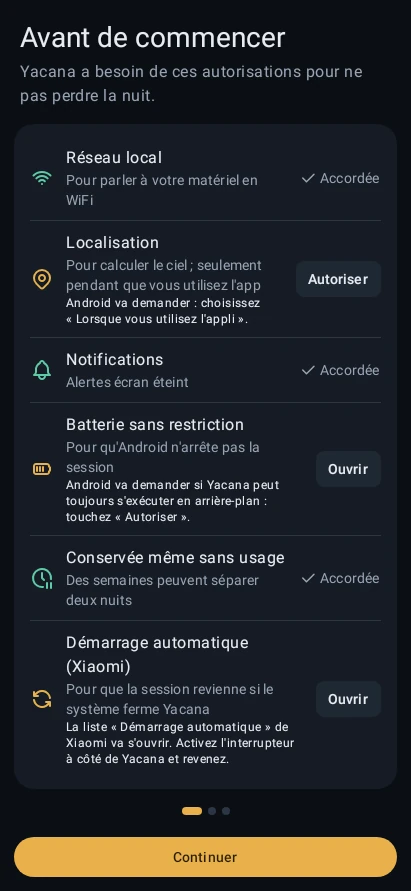 <b>Avant de commencer.</b> Les lignes accordées affichent une coche.</td>
</tr></table>

| Autorisation | À quoi elle sert | Sans elle |
| --- | --- | --- |
| **Réseau local** | Parler à votre matériel en WiFi. Demandée sous Android 17 et ultérieur. | L'app ne peut trouver ni contrôler aucun appareil Alpaca. |
| **Localisation** | Calculer le ciel à votre site, seulement pendant que vous utilisez l'app. Choisissez **Lorsque vous utilisez l'appli**. | Saisissez plutôt le site dans le profil. |
| **Notifications** | La session et ses alertes écran éteint. Demandée sous Android 13 et ultérieur. | Vous ne voyez ni la session ni ses alertes hors de l'app. |
| **Batterie sans restriction** | Pour qu'Android n'arrête pas la session. Touchez **Autoriser** quand Android le demande. | Le système peut arrêter la session écran éteint. |
| **Conservée même sans usage** | Des semaines peuvent séparer deux nuits. Désactivez **Suspendre l'activité de l'appli si elle n'est pas utilisée**. Android 11 et ultérieur. | Android peut retirer les autorisations de l'app après quelques mois sans utilisation. |
| **Démarrage automatique (Xiaomi)** | Sur les téléphones Xiaomi, Redmi et Poco, pour que la session revienne si le système ferme Yacana. Activez l'interrupteur à côté de Yacana. | Si le système ferme Yacana pendant la nuit, la session ne revient pas. |

Si vous en refusez une, rien ne casse sur le moment : l'app explique ce qui ne marche plus et comment l'activer plus tard, dans *Réglages › Autorisations* ([chapitre 33](#permissions)). Touchez **Continuer** pour poursuivre.

### 2 · Trouvez votre matériel

1. Allumez le matériel et connectez le téléphone à son WiFi, ou mettez les deux sur votre WiFi domestique.
2. Yacana cherche d'elle-même les appareils Alpaca sur le réseau, en IPv4 et en IPv6. Chaque serveur trouvé apparaît sous forme de carte avec ses appareils. **Chercher à nouveau** relance la recherche.
3. Sur un Seestar, touchez **Téléobjectif** ou **Grand angle** : cela charge le profil du Seestar pour cette caméra, avec son optique, son champ et ses réglages recommandés. Vous pouvez créer les deux et passer de l'un à l'autre depuis la carte **Profil** dans Équipement. Pour un autre matériel, touchez **Ajouter** : le profil prend le premier appareil de chaque type sur ce serveur.

Si un appareil n'est pas trouvé, par exemple sur un réseau qui bloque la découverte, touchez **Ajouter par IP et port** et saisissez son adresse, comme `192.168.1.10:32323`. Si vous avez déjà un profil venant d'un autre téléphone, **Importer un profil** le charge. **Pas maintenant** passe cette page ; vous pourrez trouver votre matériel plus tard dans Équipement.

<table><tr>
<td valign="top" width="240">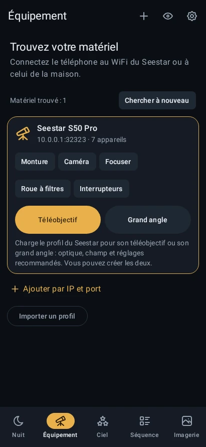 <b>Trouvé sur le WiFi.</b> Un Seestar avec ses sept appareils.</td>
</tr></table>

### 3 · Prêt pour le terrain

Yacana fonctionne sans internet, mais deux éléments sont trop volumineux pour être livrés dans l'app. Cette page montre ce qui est déjà sur le téléphone et ce qu'il faut récupérer tant que vous avez encore le WiFi :

- **Catalogue d'objets** et **Éphémérides** : inclus dans l'app, rien à faire.
- **Base d'étoiles** : celle recommandée pour votre champ, D50 pour un Seestar. Touchez **Télécharger**.
- **Cache du ciel de NINA** : les photos pour l'atlas et le cadrage. Touchez **Importer** si vous avez déjà son ZIP ; pour le télécharger dans l'app, passez par *Réglages › Carte du ciel* ([chapitre 6](#field)).

Les téléchargements continuent en arrière-plan. Touchez **Commencer** pour ouvrir l'app.

<table><tr>
<td valign="top" width="240">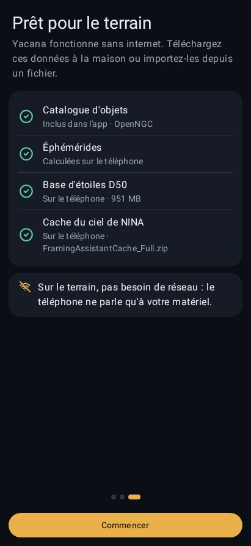 <b>Prêt pour le terrain.</b> Tout est sur le téléphone.</td>
</tr></table>

> [!TIP]
> **Bon à savoir**
>
> Les premiers pas ne peuvent pas être rouverts. Leurs éléments restent disponibles : les autorisations dans *Réglages › Autorisations*, la recherche de matériel dans Équipement, les bases d'étoiles dans *Réglages › Plate solving* et les caches du ciel dans *Réglages › Carte du ciel*.

## 4. S'orienter dans l'app

Yacana est organisée selon les moments de la nuit plutôt que par panneaux d'appareils. À chaque moment, elle montre ce dont vous avez besoin et laisse le reste à portée d'une touche.

### Les cinq sections

La barre du bas compte cinq sections. Avec le téléphone en paysage, elle devient un rail à gauche. Toucher la section où vous êtes vous ramène à son premier écran.

| Section | À quoi elle sert | Barre du haut |
| --- | --- | --- |
| **Nuit** | L'obscurité et la Lune de ce soir, la liste de préparation, la session en cours, le bilan et le journal | État du matériel, mode rouge, Réglages |
| **Équipement** | Profils, connexion et contrôle manuel de chaque appareil | Ajouter un appareil, mode rouge, Réglages |
| **Ciel** | Carte du ciel, Sky Atlas, fiches d'objets et cadrage | Calques du ciel ou Filtres, mode rouge |
| **Séquence** | Le plan de ce soir, les séquences enregistrées, les modèles, les éditeurs simple et avancé | — |
| **Imagerie** | Capture manuelle, statistiques, historique, empilement en direct et photo de référence | Mode rouge, Plus d'options |

### Commandes communes

- **Réglages:** L'engrenage dans Nuit et Équipement, ou **Réglages** à la fin de **Plus d'options** dans Imagerie. Sa zone de recherche trouve n'importe quel réglage à partir d'une partie de son nom.
- **Mode rouge:** L'icône en forme d'œil dans Nuit, Équipement, Ciel, Imagerie, la fiche d'objet, le cadrage et les assistants. Elle rend chaque pixel rouge ([chapitre 32](#display)).
- **État du matériel:** Dans Nuit, un bouclier quand le matériel est connecté sans problème, ou un triangle d'avertissement pendant que l'app se reconnecte ou s'arrête en sécurité.
- **Retour et fermeture:** La flèche en haut à gauche revient en arrière. Les assistants (alignement polaire, autofocus et flats) affichent **✕** à la place, qui les arrête.
- **Feuilles:** Beaucoup d'options s'ouvrent dans une feuille qui monte du bas de l'écran. Faites-la glisser vers le bas, ou touchez en dehors, pour la fermer.
- **Nombres:** Les heures, les coordonnées et les nombres d'images se saisissent avec des valeurs fréquentes et le pavé numérique propre de l'app, pour que le clavier du système, que le mode rouge ne peut pas colorer, ne s'allume jamais la nuit.
- **Appui long:** Les boutons risqués se remplissent pendant que vous appuyez et agissent au bout d'environ une seconde : parquer, arrêter une séquence, supprimer un profil, un cache, une base ou une séquence enregistrée. Une touche brève ne fait rien, sinon vous rappeler de maintenir appuyé.
- **États:** Chaque état est indiqué par une icône et des mots, jamais par la seule couleur, car en mode rouge le vert et l'ambre se ressemblent.

### La barre de session

Pendant qu'une séquence tourne ou est en pause, une barre sur tous les écrans sauf Nuit montre la cible, le filtre, la pose et l'image, avec sa progression, comme la barre « lecture en cours » d'une app de musique. Touchez-la pour voir la session dans Nuit ; son bouton met la séquence en pause ou la reprend.

### Notifications

Tant que le matériel est connecté, une notification montre la session, y compris sur l'écran de verrouillage : la cible, l'image et la progression, ou les images enregistrées. Touchez-la pour ouvrir l'app. Son bouton **Déconnecter** arrête la capture et déconnecte le matériel. Les alertes qui ont besoin de vous, comme une liaison perdue ou un arrêt de sécurité, sonnent ; les événements comme un autofocus ou la fin de la séquence arrivent en silence. Chaque type a son propre canal de notification (*Session de nuit*, *Alertes de la nuit*, *Événements de la nuit*), que vous pouvez régler dans les paramètres Android de l'app.

<table><tr>
<td valign="top" width="330">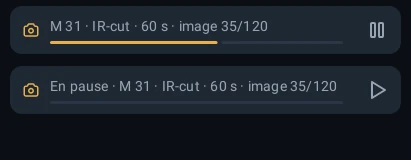 <b>La barre de session</b>, en cours et en pause.</td>
</tr></table>

## 5. Votre profil de matériel

Un profil, c'est un ensemble de matériel et la façon dont vous l'utilisez : ses appareils, son optique, son site, ses limites et ses options. Tout ce que Yacana calcule pour vous, comme le champ, l'échelle du plate solving ou la base d'étoiles recommandée, en découle. Le plate solving, l'autofocus, la sécurité, les noms de fichiers et l'empilement en direct sont aussi gardés par profil.

Ouvrez-le avec *Réglages › Profil et lieu*, ou touchez la carte **Profil** dans Équipement puis **Ouvrir le profil**. Les profils, les appareils et la suppression du profil ne se modifient que lorsque le matériel est déconnecté.

### Nom et optique

- **Nom :** touchez-le pour le modifier sur place.
- **Focale :** en millimètres, de 10 à 10 000, celle du télescope avec son réducteur s'il en a un. Elle fixe l'échelle du plate solving et le champ que dessine la carte du ciel.
- **Diamètre :** le diamètre de l'objectif, de 5 à 2 000 mm. Le rapport d'ouverture s'affiche à côté.
- **Capteur de la caméra** et **Taille des pixels :** ses pixels en largeur et en hauteur (la hauteur est demandée après la largeur) et leur taille en µm, comme dans les caractéristiques de la caméra ; un Seestar S50 Pro a 2160 × 3840 px de 2,9 µm. La caméra les remplit à la connexion ; saisis, le champ est connu sans rien connecter, pour la carte du ciel et le cadrage.

Une fois la caméra connectée, la carte affiche l'échelle et le champ, comme *2,25″/px · champ 1,35° × 2,40°*.

### Lieu

Le site détermine l'obscurité de ce soir, chaque hauteur et le pôle pour l'alignement polaire.

- **Utiliser la position du téléphone** la lit sur le téléphone dès que vous l'activez, à chaque ouverture de l'app et à la connexion ; la première fois, Android demande l'autorisation. Si rien n'arrive, la ligne dit pourquoi, et la toucher réessaie. Désactivé, vous la saisissez : latitude nord ou sud (0 à 90°), longitude est ou ouest (0 à 180°) et altitude en mètres (0 à 9 000).
- **Envoyer l'heure et le site à la monture** transmet à la monture l'heure UTC du téléphone et le site à la connexion.

### Limites

- **Limite de hauteur**, de 0 à 60° : aucun GoTo ne descend en dessous, ni sous l'horizon. Un GoTo en dessous est refusé et la monture ne bouge pas ; un déplacement avec le pavé s'arrête de lui-même à la limite.
- **Horizon :** plat, ou le vôtre avec arbres et bâtiments. **Importer** lit un fichier d'horizon N.I.N.A. : un point par ligne, azimut et hauteur en degrés, séparés par des espaces ou des tabulations, avec `#` pour les commentaires. **Le rendre plat** le supprime. Les fiches d'objets le dessinent sur leur graphique de hauteur.

<table><tr>
<td valign="top" width="240">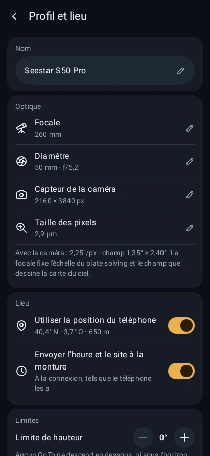 <b>Profil et lieu.</b> Le profil du Seestar.</td>
<td valign="top" width="240">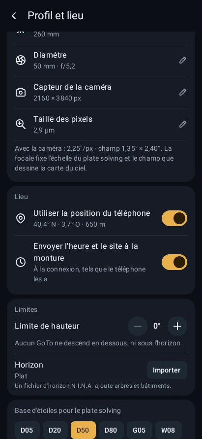 <b>Base d'étoiles</b> pour le plate solving, choisie par profil.</td>
</tr></table>

### Base d'étoiles

Les boutons choisissent la base du profil pour le plate solving. L'app indique celle qui convient à votre champ. Si vous en choisissez une qui n'est pas sur le téléphone, sa taille et un bouton **Télécharger** apparaissent : elle est utilisée à la fin du téléchargement et, d'ici là, la précédente reste.

### Plus d'un profil

- **Changer :** touchez la carte **Profil** dans Équipement et choisissez-en un autre, ou touchez **Utiliser** à côté de lui sous **Autres profils**.
- **Nouveau :** **Nouveau profil** sous **Autres profils** cherche sur le réseau ; le matériel que vous choisissez devient un nouveau profil, aussitôt utilisé.
- **Copier sur un autre téléphone :** sous **Copie du profil**, **Exporter** enregistre le profil dans un fichier JSON à l'endroit de votre choix, et **Importer** en lit un et le met en service. Le fichier contient la position du site.
- **Supprimer :** **Supprimer le profil** *(appui long)*, à la fin de l'écran.

## 6. Prêt pour le terrain

Sur le terrain, le téléphone ne parle qu'à votre matériel. Avant votre première nuit, tant que vous avez le WiFi à la maison, mettez deux choses sur le téléphone : une base d'étoiles pour le plate solving et les photos du ciel. Les deux peuvent aussi s'importer depuis un fichier, par exemple copié depuis un PC ou depuis une carte mémoire.

### Bases d'étoiles

Dans *Réglages › Plate solving*, sous **Base d'étoiles**. L'app marque celle qui est **recommandée** pour votre champ et affiche la taille du champ. Plusieurs peuvent être sur le téléphone en même temps ; le profil en utilise une, marquée **Utilisée**.

<table><tr>
<td valign="top" width="240">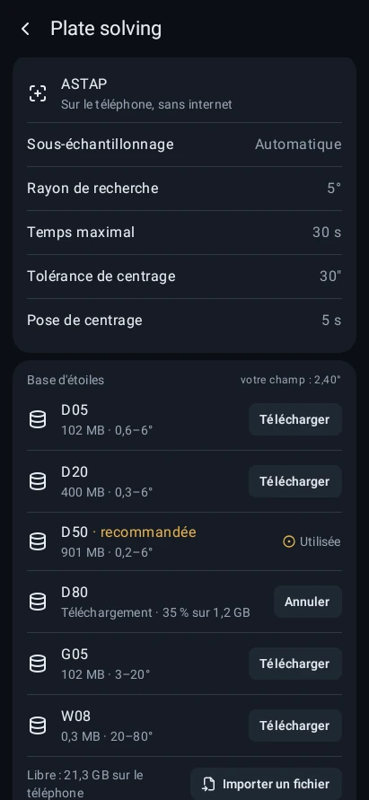 <b>Les bases d'étoiles.</b> D50 utilisée, D80 en téléchargement.</td>
</tr></table>

| Base | Taille | Pour des champs de | Remarques |
| --- | ---: | --- | --- |
| **D05** | 102 MB | 0,6° à 6° | L'option légère |
| **D20** | 400 MB | 0,3° à 6° |  |
| **D50** | 901 MB | 0,2° à 6° | Recommandée pour le Seestar |
| **D80** | 1,2 GB | 0,15° à 6° | La plus dense |
| **G05** | 102 MB | 3° à 20° | Grands champs, objectifs photo |
| **W08** | 0,3 MB | 20° à 80° | Très grands champs |

- **Télécharger** la récupère depuis le site d'ASTAP en WiFi seulement, même app fermée, et reprend si le téléchargement est interrompu. Elle est utilisée une fois terminée. L'espace libre sur le téléphone s'affiche sous la liste.
- **Importer un fichier** l'installe depuis le fichier ZIP ou `.deb` d'ASTAP lui-même, par exemple depuis une carte mémoire.
- Maintenez appuyée une base installée pour la supprimer avec **Supprimer la base** *(appui long)*. Celle qui est utilisée ne peut pas être supprimée : utilisez-en d'abord une autre.
- **Essayer avec la dernière image** résout la dernière image d'Imagerie avec les réglages actuels, pour les vérifier.

### Les photos du ciel : les caches de N.I.N.A.

La carte du ciel, le Sky Atlas, les fiches d'objets, le cadrage et la référence d'Imagerie utilisent tous les photos des caches de cadrage de N.I.N.A. Yacana les lit telles que N.I.N.A. les publie, directement dans leur ZIP sans le décompresser : un cache occupe donc autant que son ZIP, pas plus. Ouvrez *Réglages › Carte du ciel*, ou l'icône des calques sur la carte du ciel.

- **Cache complet (DSS) :** tout le ciel en 2 131 photos en couleur de 5° issues du Digitized Sky Survey, 3,5 GB. C'est celui à récupérer.
- **NSNS avec étoiles** (1,4 GB) et **NSNS sans étoiles** (471 MB) : le Northern Sky Narrowband Survey, l'émission de l'hydrogène et de l'oxygène jusqu'à environ −17° de déclinaison. Ils se dessinent en second calque.
- **Photos en ligne :** les photos plus nettes que la carte récupère quand vous zoomez de près avec internet, gardées sur le téléphone.

<table><tr>
<td valign="top" width="240">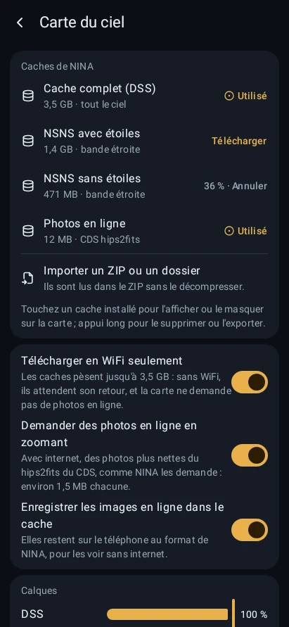 <b>Réglages › Carte du ciel.</b> Le cache complet utilisé, un cache bande étroite en cours d'arrivée.</td>
</tr></table>

#### Obtenir un cache

- **Télécharger** le récupère depuis le site de N.I.N.A. via le gestionnaire de téléchargements d'Android. Il reprend en cas d'interruption et vérifie d'abord l'espace libre. Avec **Télécharger en WiFi seulement** activé (par défaut), il attend le WiFi.
- **Importer un ZIP ou un dossier** : **Choisir un ZIP** prend l'un des ZIP de N.I.N.A., comme ceux de son site ; **Choisir un dossier** prend le dossier de cache que N.I.N.A. a sur un PC (`FramingAssistantCache`), copié sur le téléphone ou sur une carte. Ils sont copiés dans l'app.

#### L'utiliser

- Touchez un cache installé pour l'afficher sur la carte ou le masquer : **Utilisé** ou **Installé**.
- **Calques :** l'opacité du calque DSS (100 % par défaut) et de celui en bande étroite (40 %), pour les mélanger.
- **Demander des photos en ligne en zoomant** (activé par défaut) : avec internet, zoomer sur la carte demande des photos plus nettes au hips2fits du CDS, comme le fait N.I.N.A., d'environ 1,5 MB chacune. Désactivez-le pour garder vos données mobiles pour autre chose ; avec **Télécharger en WiFi seulement** activé, la carte ne les demande de toute façon pas en données mobiles.
- **Enregistrer les images en ligne dans le cache** : si activé, elles restent sur le téléphone au format de N.I.N.A., pour les revoir sans internet.

#### Le supprimer ou l'exporter

Maintenez appuyé un cache installé. La feuille indique combien d'espace il libère ; **Supprimer le cache** *(appui long)* le supprime. Un cache en dossier, comme les photos en ligne, propose aussi **Exporter le ZIP**, pour l'ouvrir dans N.I.N.A. sur un PC.

<table><tr>
<td valign="top" width="240">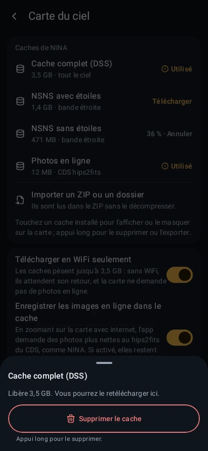 <b>Appui long sur un cache.</b> Ce qu'il libère, et le bouton à maintenir.</td>
</tr></table>

> [!TIP]
> **Crédits**
>
> Les photos ne font pas partie de l'app : vous les téléchargez depuis le site de N.I.N.A. ou les importez. Le DSS vient du STScI, qui autorise N.I.N.A. à le distribuer, et le NSNS est sous CC BY-NC-SA 4.0. La carte affiche *DSS : STScI · NSNS : CC BY-NC-SA 4.0*.

---

# Équipement

## 7. Connecter votre matériel

La section Équipement contient le profil utilisé, le connecte et vous donne le contrôle manuel de chaque appareil.

1. Vérifiez la carte **Profil** : le nom du profil et l'origine de son site, comme *Lieu par GPS · 40,4° N · 3,7° O · 650 m*. Touchez-la pour passer à un autre profil.
2. Touchez **Connecter**. La ligne affiche *Connexion…* puis combien d'appareils ont répondu, comme *5 sur 5 connectés*, ou pourquoi l'un d'eux n'a pas pu se connecter.
3. Chaque appareil a une ligne avec son état en direct : la monture en suivi et sa hauteur, la caméra au repos et la température de son capteur, la position du focuser, le filtre en place, la résistance chauffante allumée. Elles se rafraîchissent toutes les une ou deux secondes.
4. Touchez un appareil connecté pour ouvrir son écran. **Tout déconnecter** met fin à la connexion.

Si la liaison tombe, Yacana se reconnecte d'elle-même. Pendant une séquence, elle se met d'abord en pause de sécurité ([chapitre 28](#safety)).

<table><tr>
<td valign="top" width="240">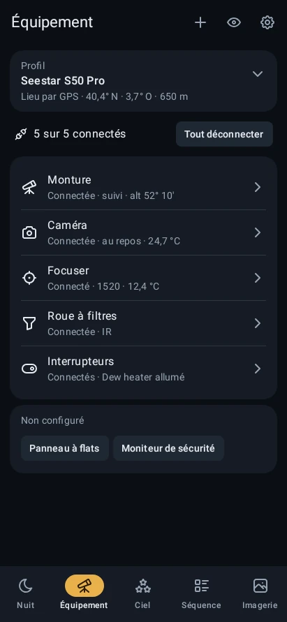 <b>Équipement.</b> Cinq appareils connectés ; le panneau à flats et le moniteur de sécurité non configurés.</td>
</tr></table>

### Ajouter un appareil

Le **+** en haut ouvre *Ajouter un appareil*, qui cherche à nouveau sur le réseau. Chaque serveur montre les appareils que votre profil n'a pas encore, chacun avec **Ajouter** ; **Ajouter par IP et port** prend une adresse. La carte **Non configuré** en fin de liste a un bouton pour chaque appareil facultatif, le panneau à flats et le moniteur de sécurité, qui ouvre la même recherche. Les appareils ne s'ajoutent que lorsque le matériel est déconnecté.

### Sans profil

Si vous avez passé les premiers pas, Équipement commence par **Trouvez votre matériel**, la même recherche qu'au [chapitre 3](#first-steps), et un bouton **Importer un profil**.

## 8. La monture

L'écran de la monture montre où elle pointe et la déplace à la main, avec GoTo, synchronisation, parquage et suivi.

### Où elle pointe

La carte du haut affiche son état, comme *Suivi · sidéral*, *En déplacement*, *Pas de suivi* ou *Parquée*, et son AD, sa Déc, sa hauteur et son azimut. Pendant qu'elle centre une cible, la carte affiche l'essai et l'étape en cours, avec **Arrêter**.

### La déplacer à la main

Maintenez appuyée une flèche (N, S, E, O) pour déplacer la monture ; elle s'arrête quand vous relâchez. Le bouton rouge au centre l'arrête immédiatement. Les boutons en dessous règlent la vitesse : **1×**, **8×** (par défaut) ou **64×** la vitesse sidérale, ou **Max**, la plus rapide de la monture. Un déplacement s'arrête de lui-même à la limite de hauteur du profil.

### Les boutons

- **Aller à…:** Ouvre une feuille pour saisir l'AD et la Déc avec le pavé numérique de l'app (voir ci-dessous).
- **Synchroniser:** Indique à la monture qu'elle pointe vers les coordonnées que vous saisissez. Avec une image résolue, utilisez plutôt **Synchroniser la monture** dans Imagerie ([chapitre 18](#solving)). Affiché seulement si la monture sait se synchroniser.
- **Parquer:** Maintenez-le appuyé pour envoyer la monture à sa position de repos. Une touche brève ne fait que vous rappeler de maintenir appuyé. Monture parquée, le bouton indique **Déparquer**, et un appui la déparque.
- **Suivi:** Active ou désactive le suivi.
- **Alignement polaire:** Ouvre l'assistant d'alignement polaire ([chapitre 17](#polar)).

Le menu **⋮** en haut contient le reste : la **Vitesse de suivi** (sidérale, lunaire, solaire ou King, parmi celles que la monture prend en charge), **Déparquer** quand elle est parquée, et **Chercher l'origine** si la monture le permet.

<table><tr>
<td valign="top" width="240">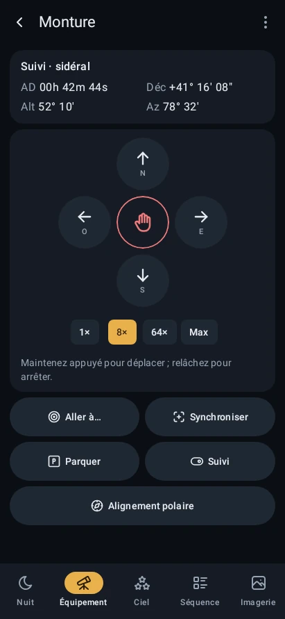 <b>Monture.</b> Maintenez une flèche pour déplacer ; touchez la vitesse.</td>
<td valign="top" width="240">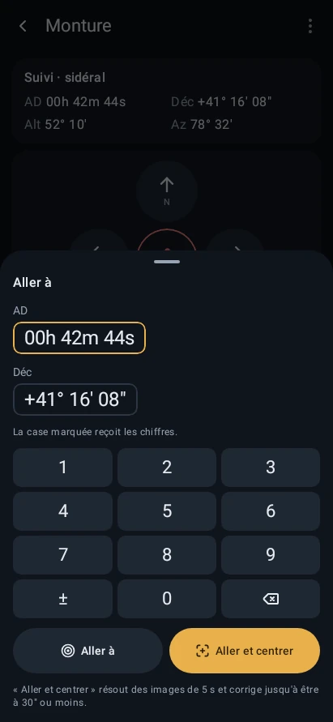 <b>Aller à.</b> La case marquée reçoit les chiffres.</td>
</tr></table>

### Aller à des coordonnées

1. Touchez **Aller à…**. La feuille affiche l'AD et la Déc actuelles de la monture.
2. Touchez la case AD ou Déc pour la marquer, et tapez les chiffres sur le pavé. **±** inverse le signe de la déclinaison.
3. Touchez **Aller à** pour vous y rendre, ou **Aller et centrer** pour y aller puis affiner par plate solving jusqu'à ce que la cible soit dans la tolérance (30″ par défaut).

> [!CAUTION]
> **Sous la limite**
>
> Un GoTo vers une cible sous la limite de hauteur du profil, ou sous son horizon, est refusé. L'écran indique où se trouve la cible et que la monture n'a pas bougé. Attendez qu'elle monte, ou modifiez la limite dans le profil ([chapitre 5](#profile)).

## 9. Caméra et roue à filtres

### Caméra

L'écran de la caméra affiche son état, comme *Au repos · −10 °C*, et ce qu'elle indique : la taille du capteur, la taille des pixels, la matrice de Bayer, les plages de gain et d'offset, et la pose la plus longue. Les images se prennent dans Imagerie ; **Aller à Imagerie** vous y emmène ([chapitre 20](#imaging)).

Yacana utilise chaque caméra telle qu'elle se décrit via Alpaca : gain, offset, binning, région d'intérêt et température du capteur quand la caméra les a. Les images se téléchargent directement dans la mémoire native du téléphone pendant que la pose suivante commence : même les caméras de 61 MP y tiennent.

### Roue à filtres

L'écran de la roue à filtres liste ses filtres, avec une coche sur celui en place. Touchez un filtre pour l'utiliser. Dans Imagerie, le filtre est aussi un bouton sous l'image.

Un filtre nommé **Dark**, comme sur le Seestar, sert d'obturateur pour les darks et les bias : rien à couvrir. Sans un tel filtre, l'app vous demande de couvrir le télescope quand elle prend des darks.

## 10. Le focuser

- **Position** et **Température**, en grand, avec l'heure et la température du dernier autofocus.
- **Déplacer :** **−100**, **−10**, **+10** et **+100** pas, et **Aller à la position…**, qui ouvre le pavé avec la plage du focuser. **Arrêter** apparaît pendant qu'il bouge.
- **Dernière courbe :** la courbe en V du dernier autofocus, avec son meilleur HFR et sa position.
- **Décalage de mise au point par filtre**, avec une roue à filtres : touchez un filtre pour régler son décalage en pas, par rapport aux autres. Au changement de filtre, le focuser se déplace de la différence entre le décalage du nouveau filtre et celui de l'ancien : chaque filtre reste net sans nouvel autofocus.
- **Autofocus** lance l'autofocus immédiatement ([chapitre 19](#autofocus)).

<table><tr>
<td valign="top" width="240">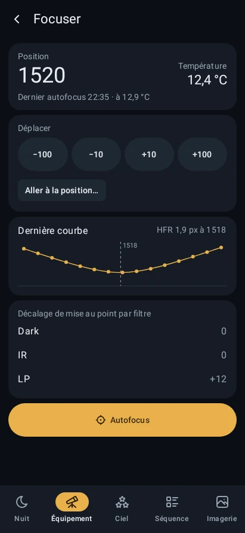 <b>Focuser.</b> Le filtre LP fait le point 12 pas plus loin vers l'extérieur.</td>
</tr></table>

## 11. Interrupteurs, panneau à flats et moniteur de sécurité

### Interrupteurs

Chaque interrupteur s'affiche tel que l'appareil le déclare : une bascule pour allumé et éteint, un curseur avec − et + pour une valeur comme la puissance d'une résistance (avec sa plage et son pas ; la valeur est envoyée quand vous relâchez), ou une lecture pour ceux en lecture seule. Le plus courant est une résistance chauffante, que la séquence peut allumer au début et éteindre à la fin.

### Panneau à flats

Pour un panneau à flats avec couvercle (un CoverCalibrator Alpaca) :

- **Couvercle :** son état, avec **Ouvrir** et **Fermer**, et **Arrêter** pendant qu'il bouge. Ouvrez-le pour la nuit et fermez-le pour les darks.
- **Lumière :** allumée ou éteinte, et sa **Luminosité** avec un curseur ou − et +.

Pour les flats, l'assistant de flats ferme le couvercle, allume la lumière et trouve la pose de lui-même ([chapitre 23](#calibration)).

### Moniteur de sécurité

Affiche **Sûr** ou **Non sûr**, lu chaque seconde, par exemple depuis un capteur de nuages ou de pluie. L'app l'affiche mais n'en tient pas encore compte : s'il passe à **Non sûr**, arrêtez la séquence depuis Nuit.

<table><tr>
<td valign="top" width="240">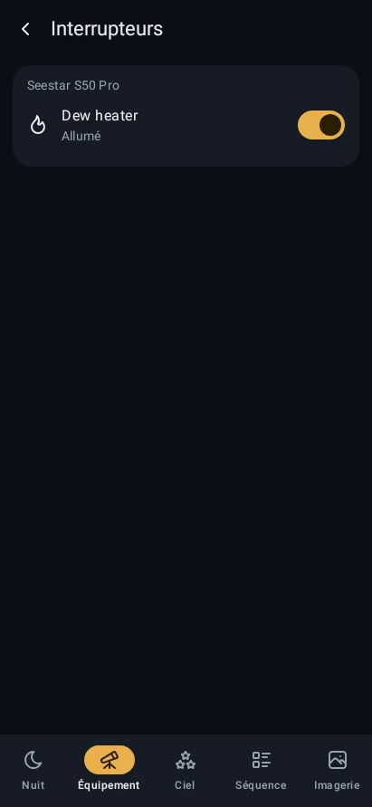 <b>Interrupteurs.</b> La résistance chauffante du Seestar.</td>
<td valign="top" width="240">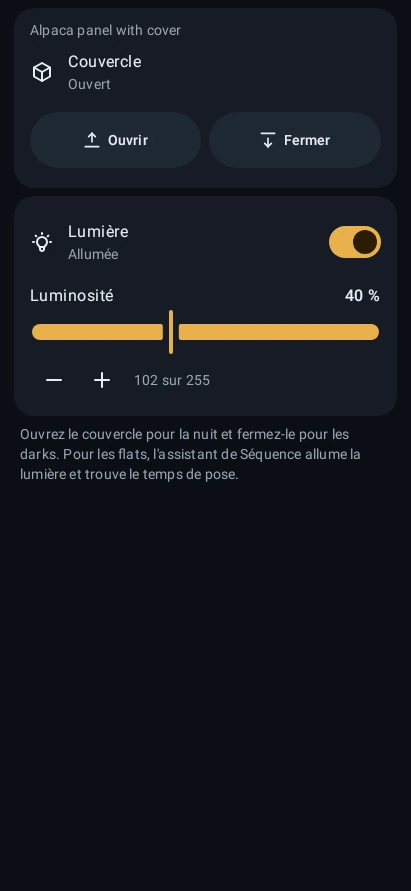 <b>Panneau à flats.</b> Couvercle ouvert, lumière à 40 %.</td>
<td valign="top" width="240">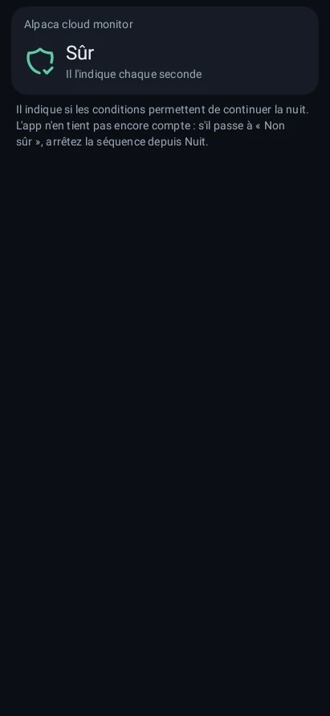 <b>Moniteur de sécurité.</b> Lu chaque seconde.</td>
</tr></table>

---

# Planifier la nuit

## 12. Ce soir d'un coup d'œil

Nuit est la section où commence la soirée. Elle montre l'obscurité et la Lune de ce soir, une liste pour se préparer, la session pendant qu'elle tourne, et le bilan au matin.

### La carte de ce soir

Calculée sur le téléphone pour le site du profil :

- La date et l'illumination de la Lune, comme *Lune 34 %*.
- Le meilleur créneau sombre : *Nuit noire sans Lune*, ou *Nuit noire, Lune levée* quand la Lune est levée pendant toute la nuit astronomique, avec son début, sa fin et sa durée.
- Le coucher et le lever du Soleil, et une frise du soir au matin : le crépuscule, la nuit astronomique et les heures où la Lune est levée, avec le meilleur créneau entouré.

Près du solstice d'été, aux hautes latitudes, elle peut indiquer *Pas de nuit astronomique* : le Soleil ne descend pas à 18° sous l'horizon. Sans site, la carte explique comment en définir un : autorisez la localisation dans *Réglages › Autorisations* et activez celle du téléphone, ou saisissez-le dans le profil.

### Une autre nuit

Touchez l'icône du calendrier pour voir n'importe quelle autre nuit. La grille du mois marque ce soir d'un contour et la nuit choisie en plein ; les flèches changent de mois. **Revenir à cette nuit** vous y ramène.

<table><tr>
<td valign="top" width="240">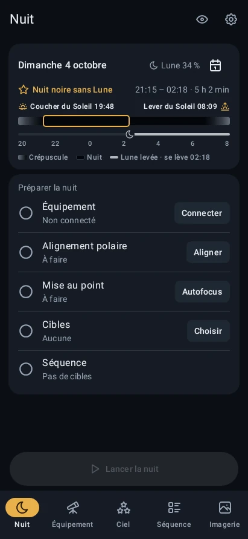 <b>Nuit.</b> 5 h 2 min de ciel noir avant le lever de la Lune.</td>
<td valign="top" width="240">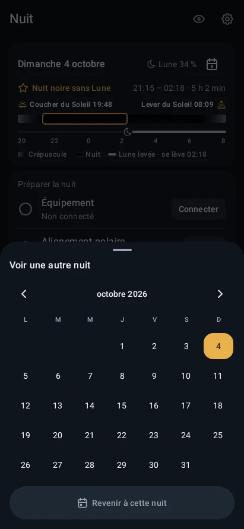 <b>Voir une autre nuit.</b></td>
</tr></table>

### Préparer la nuit

Une liste sans étape obligatoire : faites ce dont votre nuit a besoin, dans l'ordre que vous voulez. Chaque ligne affiche son état et un bouton qui vous y emmène.

| Ligne | Affiche | Bouton |
| --- | --- | --- |
| **Équipement** | Le profil et ses appareils une fois connectés | **Connecter** |
| **Alignement polaire** | *À faire*, ou la dernière erreur totale et il y a combien de temps | **Aligner**, puis **Affiner** |
| **Mise au point** | *À faire*, ou le dernier HFR et il y a combien de temps (avec un focuser) | **Autofocus** |
| **Cibles** | *Aucune*, ou les cibles de ce soir | **Choisir**, qui ouvre Ciel |
| **Séquence** | Si le plan tient avant l'aube, et sa durée | **Ajuster** quand il ne tient pas |

Quand le matériel est connecté et que le plan a des poses, **Lancer la nuit** démarre la séquence ([chapitre 27](#running)). Les marques des lignes sont des icônes autant que des couleurs : elles se lisent de la même façon en mode rouge.

<table><tr>
<td valign="top" width="240">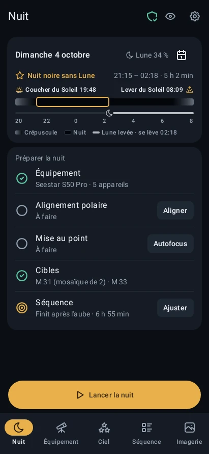 <b>Prêt à démarrer.</b> Le plan finit après l'aube : <i>Ajuster</i> le raccourcit.</td>
</tr></table>

## 13. La carte du ciel

La section Ciel s'ouvre sur une carte du vrai ciel, dessinée à partir des photos du cache de N.I.N.A., sans internet. La carte reste là où vous l'avez laissée, même après la fermeture de l'app. Faites-la glisser d'un doigt, pincez pour zoomer d'une vue large jusqu'à moins que le champ de votre caméra, et touchez un objet pour le sélectionner.

La carte est orientée comme vous voyez le ciel depuis le site du profil à cet instant, le zénith en haut ; sans site, le nord est en haut. Une barre d'échelle montre la taille d'un degré, et les coordonnées du centre figurent en bas à droite.

### Ce qu'elle montre

- **Photos :** l'étiquette en haut indique leur provenance, comme *DSS · cache de NINA*. Avec internet, zoomer récupère des photos plus nettes de la zone ; pendant qu'une arrive, une petite roue tourne dans l'étiquette. Sans cache, l'étiquette explique comment en installer un ; touchez-la pour ouvrir les réglages de la carte du ciel.
- **Votre champ :** un cadre en pointillés au centre, de la taille du champ de votre caméra, portant le nom du profil.
- **Objets :** les contours et les noms des objets du catalogue.
- **Horizon :** une ligne nette là où se trouve l'horizon du lieu du profil, qui suit son propre horizon si le profil en a un, avec **N**, **E**, **S** et **O** dessus.

### Sélectionner un objet

Touchez un objet : la carte se centre dessus et un encart affiche son nom, sa taille, sa hauteur et sa meilleure heure, avec **Cadrer**. Touchez l'encart pour ouvrir la fiche de l'objet. Touchez le ciel vide pour désélectionner.

Pour cadrer une zone sans objet du catalogue, centrez-la sur la carte, dans le cadre de votre champ, et touchez **Cadrer ici**, le bouton rond doré sous le zoom : le cadrage s'ouvre là, et la zone entre dans la séquence avec ses coordonnées pour nom, comme *03h 47m +24° 07′*.

### Boutons

- **+ et − :** zoomer et dézoomer.
- **Cadrer ici :** le bouton doré en dessous cadre le centre de la carte.
- **Calques** (barre du haut) : les réglages de la carte du ciel, avec les caches et l'opacité des calques ([chapitre 6](#field)).

<table><tr>
<td valign="top" width="240">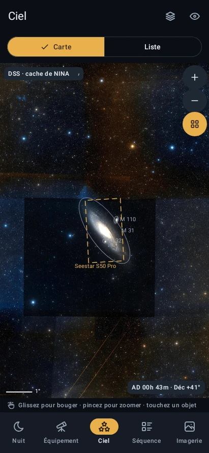 <b>La carte.</b> M 31 sur les photos DSS, avec le champ du Seestar.</td>
</tr></table>

### La monture sur la carte

Avec la monture connectée, la carte montre deux cadres du champ de votre caméra. Ils se distinguent par leur trait, pour qu'on puisse les différencier aussi en mode rouge :

- **Cadrage :** en pointillés, au centre de la carte. C'est là où vous voulez aller.
- **Télescope :** en trait plein, là où le télescope pointe maintenant ; il se déplace à mesure qu'il est lu, chaque seconde.

Faites glisser la carte pour placer la cible dans le cadre Cadrage, ou touchez un objet pour le centrer, puis :

- **Aller et centrer** amène le télescope au cadrage et l'affine par plate solving jusqu'à la tolérance du profil. Un encart montre chaque étape et la distance restante, avec **Arrêter**, qui arrête la monture et l'image.
- **Aller seulement** fait le GoTo sans centrer.

Quand la monture est parquée ou sans suivi, l'étiquette **Télescope** l'indique, et la toucher déparque la monture ou active le suivi.

<table><tr>
<td valign="top" width="240">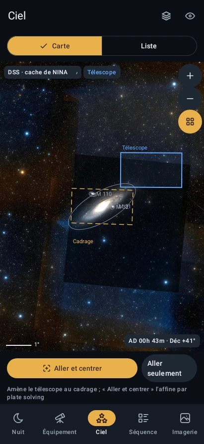 <b>Télescope et cadrage.</b> Le cadre plein est là où il pointe.</td>
<td valign="top" width="240">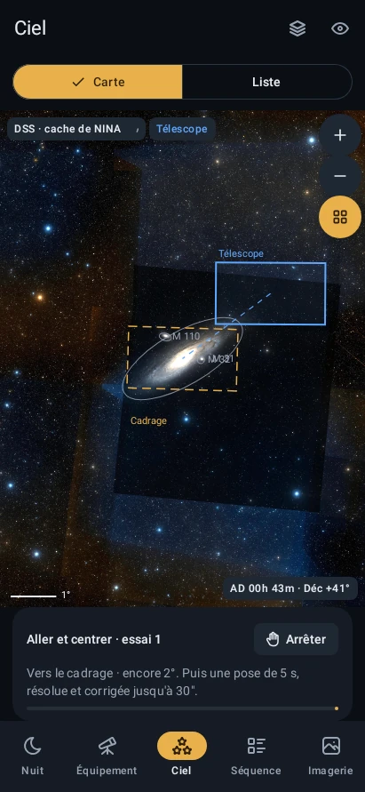 <b>Aller et centrer.</b> Encore 2°, puis une pose de 5 s, résolue et corrigée.</td>
</tr></table>

## 14. Sky Atlas et recherche

Basculez la section Ciel sur **Liste** pour le Sky Atlas : 13 371 objets du ciel profond d'OpenNGC (NGC, IC, Messier, Caldwell et d'autres) sur le téléphone, chacun avec sa photo du cache, classés pour ce soir.

### Le meilleur de ce soir

Avec **Ce soir** activé (par défaut), la liste montre ce qui est bien placé ce soir depuis le site du profil, trié par meilleure heure. Chaque ligne a une vignette, le nom, le numéro de catalogue et la taille, l'indication qu'il *tient* dans votre champ ou demande une *mosaïque de N*, et une petite courbe de hauteur avec sa meilleure heure. Touchez une ligne pour la fiche de l'objet.

Au-dessus de la liste, **Ce soir** et **Favoris**, les objets que vous avez marqués de l'étoile sur leur fiche, s'activent et se désactivent d'un toucher. À côté apparaît chaque filtre actif, comme *Jusqu'à mag 8* ou *À partir de 1°* : son ✕ le retire et son texte ouvre les filtres. L'icône des curseurs dit combien il y en a, et la note combien d'objets restent et dans quel ordre. Les filtres et la place dans la liste restent quand vous ouvrez un objet, changez de section ou fermez l'app.

<table><tr>
<td valign="top" width="240">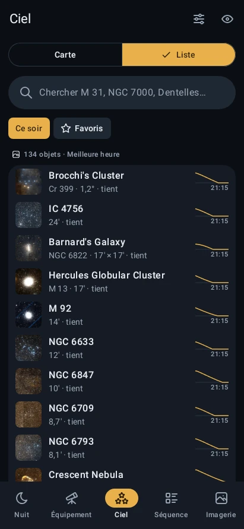 <b>Ce soir.</b> Vignettes du cache, sans internet.</td>
<td valign="top" width="240">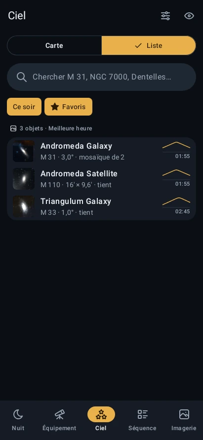 <b>Favoris.</b> M 31 demande une mosaïque de 2.</td>
<td valign="top" width="240">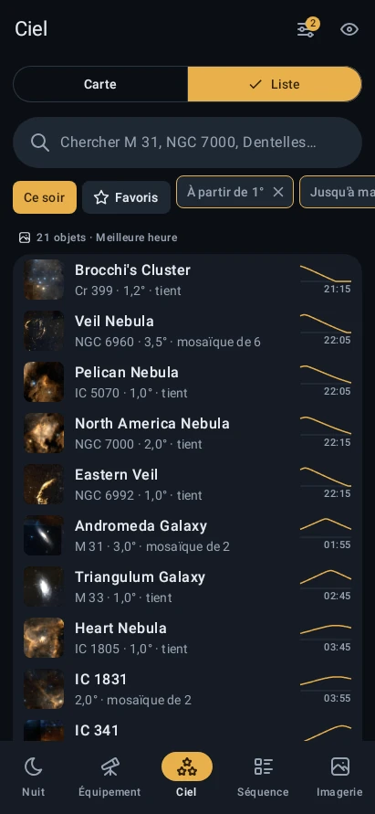 <b>Filtres actifs.</b> Jusqu'à mag 8 et à partir de 1°.</td>
</tr></table>

### Filtres

L'icône des curseurs en haut, ou le texte d'un filtre actif, ouvre les filtres. La liste change pendant que vous choisissez et l'en-tête dit combien d'objets restent ; **Réinitialiser** remet les filtres comme au début, et **Terminé**, un glissement vers le bas, un toucher à l'extérieur ou retour les ferment. En paysage, ils s'ouvrent sur le côté, avec la liste à côté.

- **Trier par :** Meilleure heure (par défaut), Hauteur maximale, Heures visibles, Taille ou Luminosité, chacun dans son sens naturel : d'abord le plus tôt, le plus haut, le plus longtemps au-dessus de votre hauteur, le plus grand ou le plus brillant. La note au-dessus de la liste indique l'ordre.
- **Type:** Galaxies, nébuleuses, amas, autres.
- **Taille :** Indifférent, pour votre champ (sa taille est indiquée), ou à partir de 15′, 30′ ou 1°.
- **Magnitude:** Indifférent, ou jusqu'à 8, 10 ou 12.
- **Seulement :** Favoris, et ceux qui tiennent dans le champ.
- **Ce soir :** activé (par défaut), seulement ce qui est bien placé ce soir ; la hauteur et les heures sont celles de la nuit noire de ce soir au lieu du profil. Désactivé, les trois suivants ne comptent pas.
- **Au-dessus de :** 20°, 30° ou 45°.
- **Pendant au moins:** 1, 2 ou 4 heures.
- **Loin de la Lune:** Indifférent, ou au moins 30°, 60° ou 90°.

Si rien ne correspond, la liste l'indique, avec **Réinitialiser** pour recommencer.

<table><tr>
<td valign="top" width="240">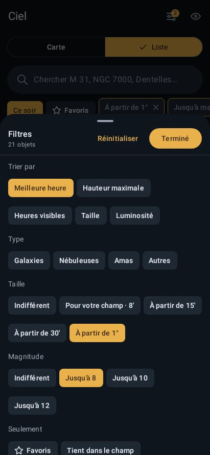 <b>Filtres.</b></td>
</tr></table>

### Recherche

Tapez dans la zone de recherche : un numéro Messier, NGC, IC, Caldwell ou Sharpless, ou un nom, comme *M 31*, *NGC 7000* ou *Dentelles*. Les résultats apparaissent pendant la frappe, en quelques millisecondes, sans internet. En mode rouge, la zone de recherche ouvre le clavier de l'app, rouge comme tout le reste, au lieu de celui du téléphone ; ⌄ ou retour le masque.

Pour tout le reste, la dernière ligne propose **Chercher « … » dans SIMBAD**. Avec internet, elle interroge SIMBAD, du CDS, qui connaît plus de 20 millions d'objets, du quasar TON 618 aux étoiles d'une constellation. Ce qu'elle trouve reste sur le téléphone, pour le retrouver hors ligne. S'il n'y a pas de correspondance exacte, elle liste les objets aux noms proches, les plus brillants d'abord.

<table><tr>
<td valign="top" width="240">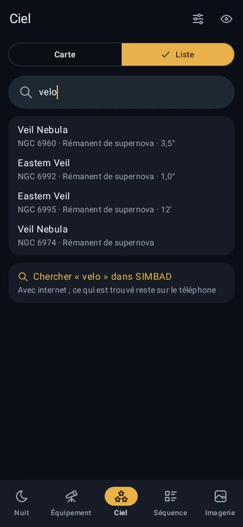 <b>Recherche hors ligne.</b> « velo » trouve les Dentelles.</td>
<td valign="top" width="240">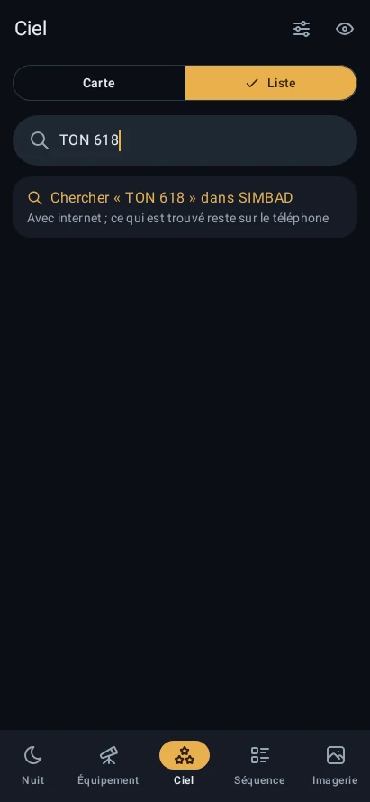 <b>Au-delà du catalogue :</b> SIMBAD, avec internet.</td>
</tr></table>

## 15. La fiche d'un objet

Tout ce qu'il faut pour choisir une cible : sa photo avec votre champ par-dessus, ce qu'elle est, la hauteur qu'elle atteint ce soir et la proximité de la Lune.

- **Photo :** issue du cache, avec le champ de votre caméra dessiné dessus. Touchez-la, ou son bouton **Carte**, pour voir l'objet cadré sur la carte du ciel ; seule la carte bouge, pas le télescope.
- **À propos :** nom, type, magnitude et taille ; ses autres noms et désignations, comme *Aussi Triangulum Galaxy · Triangulum Pinwheel · NGC 598* ; *Tient dans le champ* ou *Mosaïque de N panneaux* ; et la distance et la phase de la Lune, comme *Lune à 87° · 34 %*.
- **Hauteur ce soir :** la courbe de l'objet du soir à l'aube, avec le crépuscule grisé aux deux extrémités, la ligne des 30°, votre propre horizon en pointillés si le profil en a un, et une ligne pour l'instant présent. En dessous, les heures où il est au-dessus de 30° et son point le plus haut, ou bien qu'il reste bas ou ne se lève pas.

L'étoile en haut le marque comme favori. **Cadrer** ouvre le cadrage ([chapitre 16](#framing)). **Aller et centrer**, avec la monture connectée, y amène le télescope et le centre, sur l'écran de la monture.

<table><tr>
<td valign="top" width="240">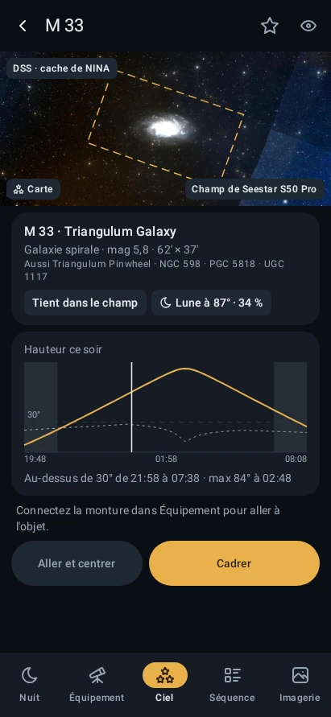 <b>M 33.</b> Tient dans le champ du Seestar ; la ligne en pointillés est l'horizon du site.</td>
<td valign="top" width="240">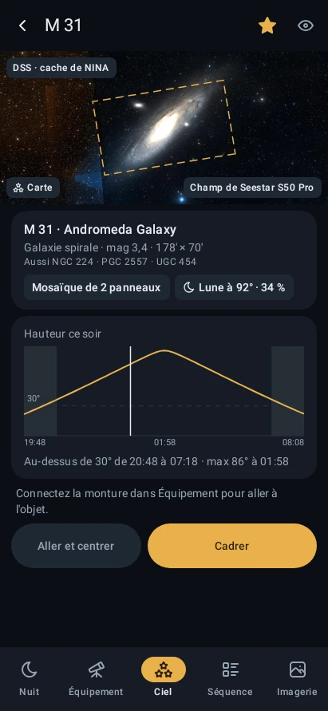 <b>M 31.</b> Un favori qui demande une mosaïque de 2 panneaux.</td>
</tr></table>

## 16. Cadrage et mosaïques

Le cadrage montre à quoi ressemblera la photo : le champ réel de votre caméra sur le ciel, que vous faites glisser jusqu'à obtenir la bonne composition, et des mosaïques pour les cibles plus grandes que le champ.

1. Ouvrez-le avec **Cadrer** sur la fiche d'un objet ou sur l'encart d'objet de la carte.
2. Faites glisser le ciel pour placer la cible dans le champ ; pincez pour zoomer. La taille du champ s'affiche en haut à droite.
3. Pour une mosaïque, réglez **Colonnes** et **Lignes** avec − et +, et le **Recouvrement** entre panneaux, de 5 à 50 % (15 % par défaut). Les panneaux sont numérotés dans l'ordre où ils seront pris.
4. Vérifiez la ligne en dessous : les heures où la cible est au-dessus de 30° ce soir.
5. Touchez **Ajouter à la séquence**. L'app confirme que la cible est dans la séquence de ce soir, avec **Choisir une autre cible** et **Voir celle de ce soir**.

Une nouvelle cible arrive avec 60 images de 60 s à travers le premier filtre qui n'est pas le filtre opaque, avec un dithering toutes les 3 images ; ajustez-les dans l'éditeur ([chapitre 25](#simple)). Après le modèle **Une cible toute la nuit**, la cible remplit plutôt la nuit jusqu'à l'aube.

**Aller et centrer**, avec la monture connectée, amène le télescope au cadrage.

<table><tr>
<td valign="top" width="240">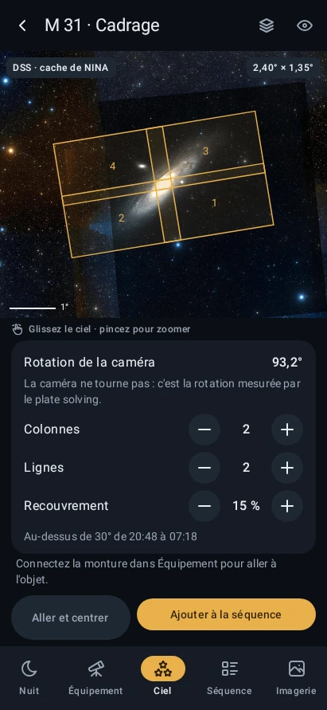 <b>M 31 · Cadrage.</b> Une mosaïque de 2 × 2, tournée comme l'est la caméra.</td>
</tr></table>

### La rotation de la caméra

Sans rotateur, la caméra ne tourne pas : le cadrage ne fait donc pas tourner le champ à la main. La **Rotation de la caméra** est l'angle mesuré par le plate solving, et le champ et les panneaux sont dessinés avec cet angle. Jusqu'au premier plate solving, elle vaut 0°, ou 93,2° pour un Seestar en mode EQ. Résolvez une image dans Imagerie une fois la caméra montée, et le cadrage s'y accorde ([chapitre 18](#solving)).

> [!TIP]
> **Le champ est nécessaire**
>
> Le cadrage a besoin du champ du profil : sa focale et le capteur de sa caméra (*Réglages › Profil et lieu › Optique*), saisis ou gardés de la dernière connexion de la caméra. Rien n'a besoin d'être connecté ; l'écran a un bouton vers le profil.

---

# Au télescope

## 17. Alignement polaire en trois points

L'assistant d'alignement polaire mesure l'écart entre l'axe de la monture et le pôle céleste, puis vous guide en direct pendant que vous tournez les vis de la table équatoriale. C'est un portage du plugin Three Point Polar Alignment de N.I.N.A., qui donne le même résultat à 0,4″ près sur les mêmes mesures.

Il fonctionne avec toute monture capable de tourner son axe d'ascension droite sur commande. Il lui faut la monture et la caméra connectées, une base d'étoiles sur le téléphone et le site du profil, qui détermine où se trouve le pôle.

### Ouvrir l'assistant

Touchez **Aligner** sur la ligne **Alignement polaire** de la liste de Nuit (**Affiner** une fois la mesure faite), ou **Alignement polaire** sur l'écran de la monture. L'assistant occupe tout l'écran et le garde allumé pendant qu'il tourne ; le **✕** en haut à gauche l'arrête et revient en arrière.

### Avant de commencer

La première page explique ce qui va se passer et où pointer : une zone de ciel dégagée, loin du pôle et de l'horizon, dans la direction où l'axe va tourner. Elle propose quatre options ; chacune est gardée dans le profil.

- **Rotation entre points:** De combien l'axe AD tourne entre les trois images, et dans quel sens : 10°, 15°, 20° ou 30°, vers l'ouest ou vers l'est. 15° vers l'ouest par défaut. Laissez la place à la rotation pour que la monture ne rencontre aucun obstacle.
- **Pose:** 1, 2, 3 ou 5 s, en bin 1×1 ou 2×2, avec le gain d'Imagerie. Des poses courtes rafraîchissent l'erreur plus vite pendant que vous tournez les vis. 1 s en 2×2 par défaut.
- **Tolérance:** Désactivée, 0,5′, 1′, 2′ ou 5′. Quand l'erreur totale passe en dessous, le téléphone vibre. Elle ne masque jamais les flèches. Désactivée par défaut, comme dans le plugin.
- **Résoudre seulement avec indice:** Pour affiner un alignement déjà proche : les trois points ne sont résolus que près de là où pointe la monture, jamais à l'aveugle.

<table><tr>
<td valign="top" width="240">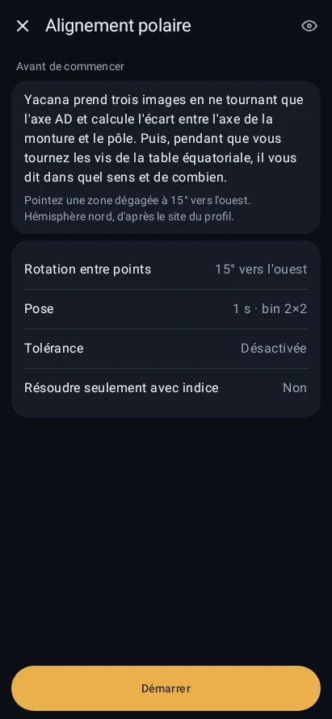 <b>Avant de commencer.</b> Les options, avec les valeurs par défaut du Seestar.</td>
</tr></table>

### Mesurer les trois points

1. Pointez le télescope vers une zone dégagée comme l'indique la première page, et touchez **Démarrer**.
2. Yacana prend la première image et la résout, tourne l'axe AD, prend et résout la deuxième, tourne à nouveau et prend la troisième. Chaque point affiche *Rotation de l'axe AD…*, *Prise de l'image*, *Résolution avec ASTAP*, puis le temps qu'a pris la résolution.
3. **Ne touchez pas la monture pendant la mesure.** Les trois centres tracent un cercle dont le milieu est l'axe réel de la monture. Sa distance au pôle, corrigée de la précession, de la nutation et de la réfraction pour votre site et l'heure, est l'erreur.

Si un point n'est pas résolu, l'assistant dit lequel et pourquoi, et propose **Recommencer**.

<table><tr>
<td valign="top" width="240">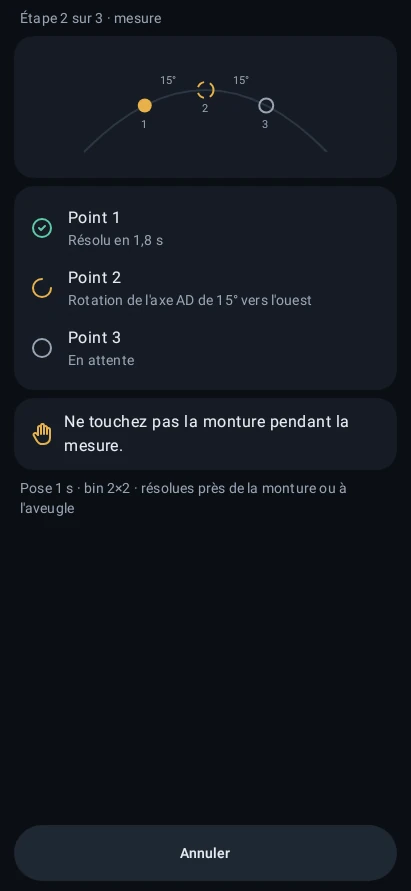 <b>Mesure.</b> Point 1 résolu en 1,8 s, l'axe tourne vers le point 2.</td>
</tr></table>

### Tourner les vis de la table équatoriale

L'assistant continue alors à prendre des images, résout chacune près de la dernière position et rafraîchit l'erreur toutes les quelques secondes. Chaque axe a sa propre carte :

- **Hauteur :** une flèche et *Monter* ou *Descendre*, ou *un peu* quand c'est proche.
- **Azimut :** une flèche et *Tourner vers l'ouest* ou *vers l'est*, ou *un peu* quand c'est proche.
- L'erreur signée en degrés, minutes et secondes, assez grande pour être lue à un mètre, et l'**Erreur totale** en dessous.

Tournez une vis à la fois et regardez son nombre baisser. En dessous, une cible montre la position du pôle avec des cercles à 30″, 1′ et 5′. Quand vous approchez, elle s'agrandit d'elle-même à l'*échelle en secondes*, avec des cercles à 10″ et 30″, pour affiner seconde par seconde.

**Rien n'est déclaré bon trop tôt.** Un axe garde sa flèche jusqu'à ce que son erreur, arrondie à la seconde, soit de 00° 00′ 00″ ; il affiche alors *Centré*. Il n'y a pas de coche verte à un seuil : c'est vous qui décidez quand c'est assez bon. Si vous réglez une tolérance, le téléphone vibre quand l'erreur totale passe en dessous, et les flèches restent.

Si la dernière image n'a pas été résolue, l'écran l'indique et continue d'essayer. **Mesurer à nouveau** refait les trois points depuis la position de la monture, par exemple après une grosse correction. **Terminer** ferme l'assistant, et la liste de Nuit affiche le résultat et le moment de la mesure.

<table><tr>
<td valign="top" width="240">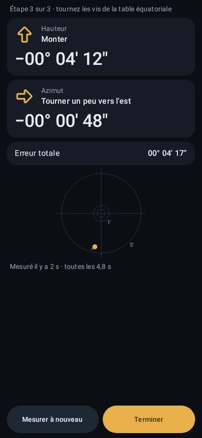 <b>À quelques minutes.</b> Monter, et un peu vers l'est.</td>
<td valign="top" width="240">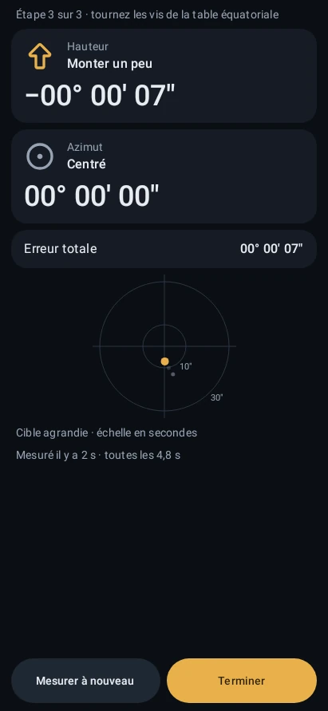 <b>À quelques secondes.</b> La cible agrandie ; azimut centré.</td>
</tr></table>

<table><tr>
<td valign="top" width="470">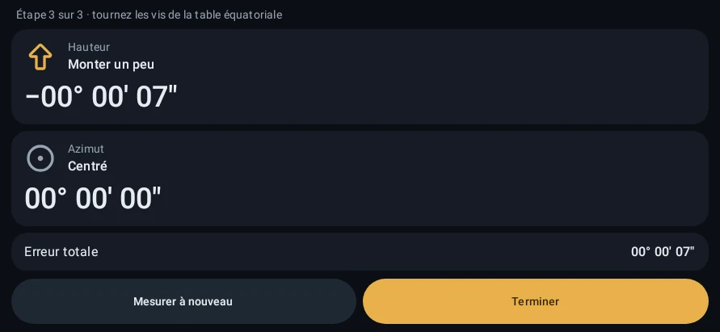 <b>En paysage</b>, les cartes utilisent la largeur ; les nombres restent grands.</td>
</tr></table>

> [!TIP]
> **Seestar**
>
> Sur une table équatoriale, la hauteur se règle avec l'inclinaison de la table et l'azimut en tournant sa base. L'Alpaca du Seestar peut tourner son axe AD, et c'est tout ce dont l'assistant a besoin.

## 18. Plate solving et centrage

Le plate solving détermine où pointe une image, son échelle et sa rotation, à partir de la disposition de ses étoiles. Yacana fait tourner ASTAP, le solveur bien connu, sur le téléphone même, sans internet : environ 0,4 s avec la position de la monture comme indice, et environ 7 s à l'aveugle sur un téléphone de milieu de gamme avec des images du Seestar.

### Résoudre une image

Dans Imagerie, prenez une image et touchez **Résoudre**. Yacana cherche d'abord près de là où la monture dit pointer, puis à l'aveugle si nécessaire. Le résultat affiche :

- l'**AD et la Déc** du centre de l'image, en J2000 ;
- la **rotation** de la caméra ;
- l'**échelle** en secondes d'arc par pixel et le champ en degrés ;
- le temps de résolution, si elle a eu lieu près de la monture ou à l'aveugle, et la base d'étoiles utilisée.

Touchez **Synchroniser la monture** pour indiquer à la monture qu'elle pointe là, afin que ses prochains GoTo arrivent plus près. La rotation résolue devient la rotation de la caméra pour le cadrage et les mosaïques ([chapitre 16](#framing)).

### Aller et centrer

**Aller et centrer** apparaît partout où vous pouvez envoyer le télescope quelque part : sur la carte du ciel, sur la fiche d'un objet, sur l'écran de cadrage et dans la feuille **Aller à…** de la monture. Il déplace la monture, prend une image avec la pose de centrage, la résout, corrige la monture et recommence jusqu'à ce que le centre de l'image soit dans la tolérance, 30″ par défaut. Sa progression montre chaque étape, l'écart de la dernière image et l'essai ; **Arrêter** arrête la monture et l'image. Les images de centrage ne sont pas enregistrées.

<table><tr>
<td valign="top" width="240">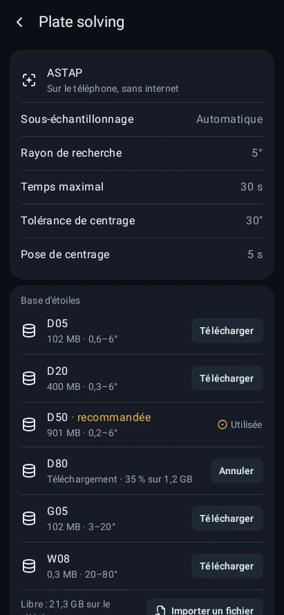 <b>Réglages › Plate solving.</b> Les options d'ASTAP et les bases d'étoiles.</td>
</tr></table>

### Réglages du plate solving

Dans *Réglages › Plate solving*, gardés dans chaque profil :

| Réglage | Par défaut | Ce qu'il fait |
| --- | --- | --- |
| **Sous-échantillonnage** | Automatique | ASTAP regroupe les pixels de l'image avant de chercher les étoiles. En automatique, il choisit le facteur selon la taille de l'image. |
| **Rayon de recherche** | 5° | Jusqu'où chercher autour de la position de la monture, de 1 à 180°. Sans solution là, il cherche dans tout le ciel. |
| **Temps maximal** | 30 s | Pour résoudre près de la monture puis à l'aveugle, de 5 à 600 s. |
| **Tolérance de centrage** | 30″ | Le centrage s'arrête quand le centre de l'image est à cette distance de la cible, de 5 à 600″. |
| **Pose de centrage** | 5 s | Les images que résout le centrage, avec le gain d'Imagerie ; de 1 à 60 s. Elles ne sont pas enregistrées. |

Les bases d'étoiles sont sur le même écran ; le [chapitre 6](#field) explique comment les choisir, les télécharger et les importer.

> [!TIP]
> **Quand une image n'est pas résolue**
>
> Vérifiez que l'image a des étoiles, que la focale du profil est correcte (ASTAP cherche à cette échelle) et que la base convient à votre champ. Les nuages, la buée ou une image très floue sont les causes habituelles.

## 19. Autofocus

L'autofocus fait passer le focuser à travers la mise au point, mesure le HFR des étoiles à chaque point et ajuste une courbe en V pour trouver la meilleure position. C'est un portage de l'autofocus de N.I.N.A., avec ses cinq ajustements de courbe, la compensation du jeu et les décalages de mise au point par filtre.

Il lui faut un focuser absolu (qui va à des positions en pas) et une caméra, pointés vers un champ avec des étoiles. Ouvrez-le avec **Autofocus** dans la liste de Nuit, sur l'écran du focuser ou dans Imagerie : il démarre aussitôt, avec les options de *Réglages › Autofocus*.

### Déroulement d'un autofocus

1. Le focuser part d'un certain nombre de pas vers l'extérieur, puis prend un point à chaque pas vers l'intérieur : une image, ses étoiles et leur HFR.
2. Il ajoute des points jusqu'à en avoir autant de chaque côté du meilleur qu'au départ. Le graphique se remplit au fur et à mesure, avec le point en cours, sa pose et son filtre.
3. Après le dernier point, il ajuste la courbe, amène le focuser à la meilleure mise au point et la vérifie. Le résultat affiche la position, le HFR, la température, le R² de l'ajustement, et où était le focuser avant.

Touchez **Terminer** pour fermer. **Annuler** pendant un autofocus ramène le focuser où il était. Si l'autofocus échoue, l'écran dit pourquoi, le focuser revient, et **Réessayer** le relance.

Le résultat est gardé : l'écran du focuser affiche le dernier autofocus et sa courbe, la liste de Nuit affiche le HFR et il y a combien de temps, et le journal l'enregistre.

<table><tr>
<td valign="top" width="240">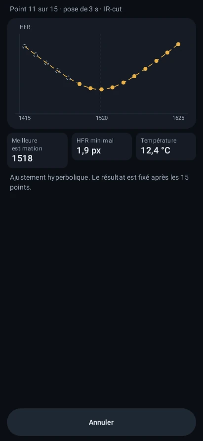 <b>En cours.</b> Point 11 sur 15, une pose de 3 s avec le filtre IR-cut.</td>
<td valign="top" width="240">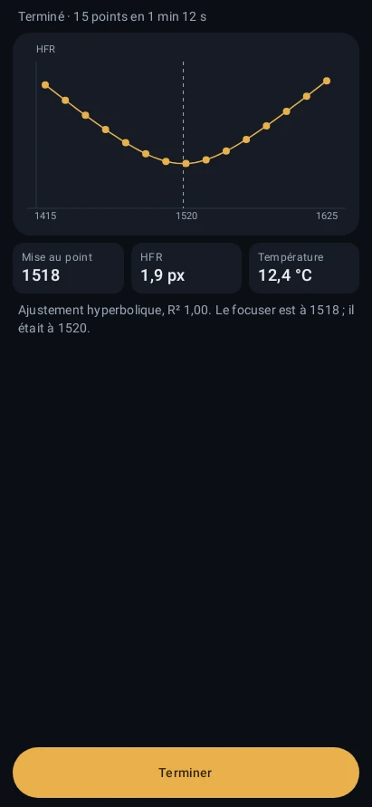 <b>Terminé.</b> 15 points en 1 min 12 s ; le focuser est passé de 1520 à 1518.</td>
</tr></table>

### Réglages de l'autofocus

Dans *Réglages › Autofocus*, gardés dans chaque profil, avec les valeurs par défaut de N.I.N.A. :

- **Pas:** Pas du focuser entre les points (50 ; 15 pour le Seestar). Trop petit, la courbe reste plate ; trop grand, il y a peu de points près du foyer.
- **Points:** Combien de points il prend : il commence avec la moitié vers l'extérieur (9 points, 4 de chaque côté ; 15 pour le Seestar).
- **Pose:** 1 à 8 s, en bin 1×1 ou 2×2, avec le gain d'Imagerie. Non enregistrée. 4 s (3 s pour le Seestar).
- **Images par point:** 1, 2 ou 3. Plus d'images moyennent la turbulence et prennent plus de temps.
- **Ajustement:** Comment la meilleure mise au point est trouvée à partir des points : lignes de tendance, parabolique, tendances et parabolique, hyperbolique (par défaut), ou tendances et hyperbolique.
- **Jeu vers l'intérieur, vers l'extérieur:** Pas que le focuser perd en changeant de sens ; il dépasse d'autant puis revient.
- **R² minimal:** À quel point la courbe doit coller aux points (0,7). Sans minimum, le résultat est gardé sauf s'il est 15 % pire qu'avant.
- **Essais:** Combien de fois il recommence si un autofocus échoue (1).
- **Attente après déplacement:** Secondes de repos du focuser après chaque déplacement, avant l'image (0).

<table><tr>
<td valign="top" width="240">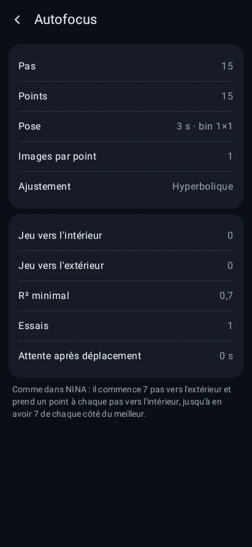 <b>Réglages › Autofocus.</b> Les valeurs du Seestar.</td>
</tr></table>

### Quand il échoue

| L'app indique | Que faire |
| --- | --- |
| **Le HFR n'a pas assez changé, d'un côté comme de l'autre** | Utilisez un pas plus grand. |
| **La courbe explique trop peu les points** | La turbulence ou les nuages ont gâché les points : plus d'images par point, une pose plus longue, ou réessayez plus tard. |
| **La meilleure mise au point tombe hors des points mesurés** | Partez plus près du point : déplacez le focuser à la main, puis relancez l'autofocus. |
| **À la meilleure mise au point, le HFR est pire qu'avant** | Le résultat n'a pas été gardé et le focuser est revenu. Vérifiez les conditions et réessayez. |
| **Ce focuser n'a pas de positions où aller** | L'autofocus a besoin d'un focuser absolu. |

### Refaire la mise au point automatiquement pendant la nuit

Dans une séquence, les règles d'autofocus lancent un autofocus avant une image de lumière quand la température change, quand le filtre change, quand le HFR se dégrade, ou après un certain temps. Elles se règlent dans les règles de l'éditeur simple ([chapitre 25](#simple)) ou comme déclencheurs dans l'éditeur avancé ([chapitre 26](#advanced)). Si un autofocus échoue pendant la nuit, le focuser revient et les règles attendent les poses suivantes.

Les décalages de mise au point par filtre se règlent sur l'écran du focuser ([chapitre 10](#focuser)) : au changement de filtre, le focuser se déplace de la différence.

---

# Capture

## 20. Imagerie

Imagerie prend des images à la main : des images isolées pour vérifier la mise au point et le cadrage, ou une boucle qui enregistre chaque image. Chaque image apparaît environ une seconde après son téléchargement, étirée, avec ses étoiles comptées et mesurées.

### Prendre une image

1. Réglez la pose, le gain, le binning et le filtre avec les boutons sous l'image (ci-dessous).
2. Touchez le bouton rond. L'écran affiche *Pose · 12 sur 20 s*, puis *Téléchargement de l'image…*. Touchez-le à nouveau pendant la pose pour l'interrompre.
3. L'image s'affiche avec son **HFR** et son nombre d'**étoiles** en haut à gauche. Touchez-les pour les détails de la dernière image.

**Boucle** prend des images l'une après l'autre et les enregistre toutes, comme le fait la boucle (Loop) de N.I.N.A. ; le bouton devient **Arrêter**, qui s'arrête après l'image en cours. Les images isolées ne sont enregistrées que si **Enregistrer les images isolées (la boucle enregistre toujours)** est activé dans les options. Si une image échoue pendant que le matériel ne répond pas, ou si la connexion est perdue, la boucle attend et reprend avec l'image suivante dès que le matériel répond à nouveau.

### Les réglages de l'image

- **Pose:** 10, 20, 30, 60 ou 300 s, parmi celles que permet la caméra, ou **Autre** au pavé, dans la plage de la caméra.
- **Gain:** Au pavé, dans la plage de la caméra, ou parmi les gains nommés de la caméra. Il commence à 200 si la caméra l'accepte, comme le fait l'app du Seestar lui-même, et les poses de la séquence sans gain propre prennent celui-ci.
- **Binning:** 1×1, 2×2… seulement si la caméra fait du binning.
- **Filtre:** Avec une roue à filtres : le filtre en place, et les autres pour en changer. Les poses pour résoudre, centrer, aligner ou faire la mise au point ne passent jamais par **Dark** : la roue passe d'abord sur IR. Avec Dark, la pose n'affiche ni HFR ni étoiles, qui ne seraient que du bruit.

<table><tr>
<td valign="top" width="240">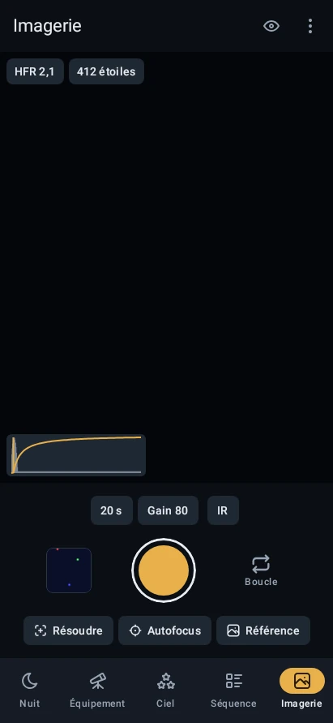 <b>Imagerie.</b> HFR 2,1 px et 412 étoiles.</td>
</tr></table>

### Examiner l'image

- **Zoom :** pincez, et faites glisser pour vous déplacer. Une double touche bascule entre l'image entière et les pixels à 1:1.
- **Histogramme :** en bas à gauche, avec la courbe d'étirement.
- **Dernière image :** touchez le HFR et les étoiles en haut à gauche pour l'histogramme, la moyenne, la médiane et l'écart-type en ADU, le HFR avec sa dispersion, la FWHM en pixels et en secondes d'arc (un profil de Moffat, comme dans Hocus Focus), et l'endroit où l'image a été enregistrée.

### Options de capture

Le **⋮** en haut les ouvre :

- **Type d'image:** Light, dark, flat ou bias. Il figure dans le nom du fichier et dans l'en-tête FITS.
- **Cible, pour le nom du fichier:** Le nom du dossier et des fichiers, comme *M 31*. Sans cible, les images sont nommées *Snapshot*.
- **Enregistrer les images isolées:** La boucle enregistre toujours.
- **Dithering des boucles de lights, toutes les :** *Non*, *3* (au départ), *5* ou *10* poses. Entre les poses, la monture reçoit un petit coup de pouce, comme le donne le guidage direct de N.I.N.A. : le champ se déplace de quelques pixels (5 par défaut) autour de l'endroit où la boucle a commencé, pour que le motif du capteur ne s'accumule pas en stries dans l'empilement. Les darks, flats et bias ne sont jamais ditherés.
- **Offset:** Si la caméra en a un.
- **Étirement automatique:** Activé par défaut, comme celui de N.I.N.A. Désactivé, deux curseurs règlent les **Ombres** et les **Tons moyens**.
- **Marquer les étoiles:** Dessine un cadre et le HFR sur les étoiles les plus brillantes, comme le fait N.I.N.A. ; **Combien**, de 10 à 500.
- **Empilement en direct:** **Empiler en direct les images de lumière** et **Équilibrer la couleur de l'empilement** ([chapitre 22](#stacking)).
- **Réglages:** Les réglages de l'app.

<table><tr>
<td valign="top" width="240">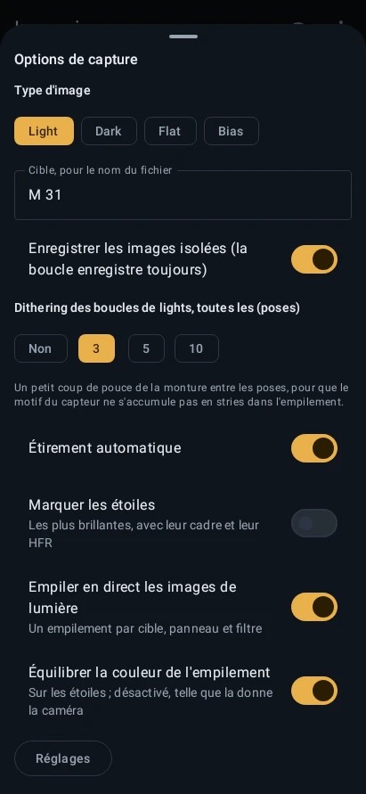 <b>Options de capture.</b></td>
</tr></table>

### Les boutons sous l'image

- **Résoudre:** Résout la dernière image avec ASTAP et montre où elle pointe, avec **Synchroniser la monture** ([chapitre 18](#solving)).
- **Autofocus:** Avec un focuser, lance l'autofocus ([chapitre 19](#autofocus)).
- **Référence:** Superpose à l'image la photo du cache du même champ, avec sa rotation, son échelle et son zoom, pour les comparer : cette faible tache, est-ce bien la galaxie ? Si l'image n'est pas résolue, il la résout d'abord. Touchez-le à nouveau pour revenir à l'image.
- **La vignette:** À gauche du bouton rond : ouvre l'historique de la session ([chapitre 21](#history)).

<table><tr>
<td valign="top" width="240">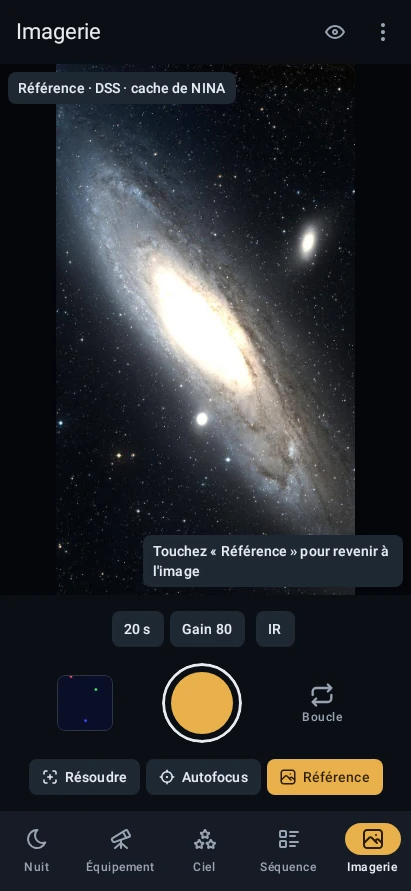 <b>Référence.</b> La photo du cache pour le champ de l'image.</td>
</tr></table>

<table><tr>
<td valign="top" width="470">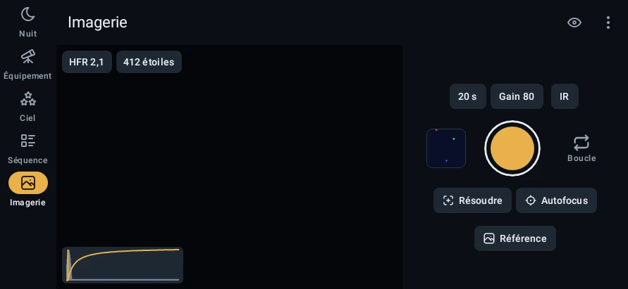 <b>En paysage</b>, l'image prend la largeur et les commandes passent sur le côté.</td>
</tr></table>

## 21. Historique et qualité des images

L'historique liste chaque image enregistrée pendant cette session avec sa qualité, et marque celles gâchées par les nuages ou la lumière, pour qu'elles soient exclues de l'empilement.

- **Le graphique :** le HFR de chaque image en ligne et ses étoiles en barres, avec **AF** là où un autofocus a eu lieu.
- **La liste,** la plus récente d'abord : numéro, heure, filtre et pose, HFR et étoiles.
- **Les images écartées** ont beaucoup moins d'étoiles ou un fond beaucoup plus lumineux que la médiane de la session, et disent pourquoi : *nuages*, *peu d'étoiles* ou *fond lumineux*. Elles restent enregistrées sur le disque ; seuls l'empilement et le bilan les excluent.

L'icône de filtre en haut n'affiche que les images écartées. Ouvrez l'historique depuis la vignette à côté du bouton rond d'Imagerie.

<table><tr>
<td valign="top" width="240">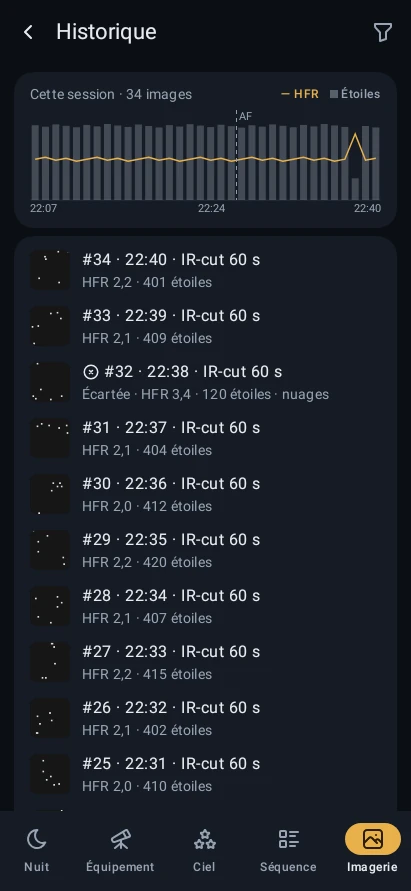 <b>Historique.</b> Image 32 écartée : nuages.</td>
</tr></table>

## 22. Empilement en direct

L'empilement en direct ajoute chaque bonne image de lumière à un empilement en cours pendant que la nuit avance : vous voyez la cible sortir du bruit. Il reste désactivé tant que vous ne le voulez pas, car il consomme de la mémoire et de la batterie.

### L'activer

Dans les options d'Imagerie, activez **Empiler en direct les images de lumière**. Dès lors, chaque image de lumière enregistrée rejoint l'empilement, qu'elle vienne d'une boucle, d'une séquence ou d'une image isolée. Les images sont toujours enregistrées une par une, comme d'habitude.

Les flats sont collectés même sans empilement en direct : une fois la série d'un filtre complète, ils deviennent son master flat, enregistré sous `FLATS/MasterFlat_IR.fits` (un par filtre) dans le dossier de vos images pour les nuits suivantes, un FITS 32 bits que Siril et PixInsight lisent aussi. Un flat à vous déposé là sous ce nom compte de même. Les darks aussi sont gardés pour l'empilement même si vous l'activez après les avoir pris, comme quand une séquence commence par ses darks.

### Comment il empile

- **Un empilement par cible, panneau et filtre,** ainsi que par pose, gain et binning. Une image d'un autre type enregistre l'empilement précédent et démarre le sien.
- **Aligné sur les étoiles :** translation, rotation et échelle, sur la première image de l'empilement.
- **Satellites et avions supprimés** par réjection à 3 sigmas.
- **Calibré au fil de l'eau :** avec le master dark de la nuit de même pose, gain, offset et binning, à la température de capteur la plus proche, et le master flat de son filtre dans le dossier FLATS.
- **Couleur équilibrée sur ses propres étoiles,** avec **Équilibrer la couleur de l'empilement** activé ; désactivé, telle que la donne la caméra.
- **Les images écartées sont exclues,** tout comme celles dont les étoiles ne correspondent pas.

<table><tr>
<td valign="top" width="240">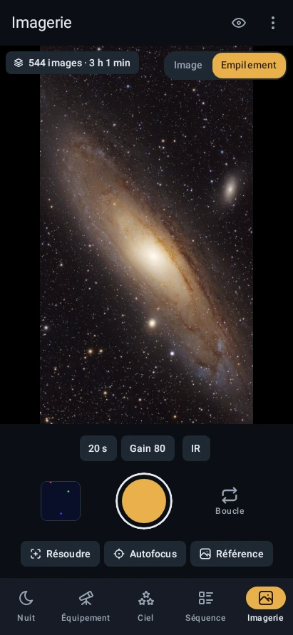 <b>L'empilement.</b> M 31 à partir de 544 images de 20 s avec un Seestar, traité ensuite.</td>
</tr></table>

### Une mosaïque

Dans une mosaïque, la séquence fait chaque panneau en entier, puis le suivant, et chaque panneau a son propre empilement, calibré avec ses darks et ses flats. Avec **Empilement**, Imagerie montre la mosaïque entière pendant qu'elle se construit : chaque panneau à sa place dans le ciel, telle que son centrage l'a résolue, son fond égalisé avec celui de ses voisins là où ils se chevauchent et les raccords fondus, et un seul étirement et une seule balance des couleurs pour l'ensemble. Le panneau en cours d'empilement est bordé d'or et grandit à chaque pose ; ceux qui restent sont en pointillés. C'est une vue au quart de la taille, ou plus petite pour une grande mosaïque afin qu'elle tienne dans la mémoire du téléphone, et elle est gardée en JPG, comme *2026-10-14/M 31/STACK/…_STACK_MOSAIC.jpg*, après chaque panneau et à la fin de la séquence. La mosaïque finale se monte avec les empilements des panneaux, dans Siril ou PixInsight.

<table><tr>
<td valign="top" width="240">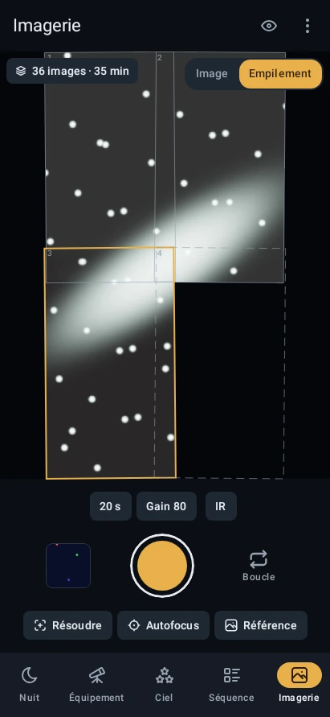 <b>Une mosaïque.</b> Le troisième panneau sur quatre, qui grandit.</td>
</tr></table>

### Le suivre

Quand un empilement existe, une bascule **Image** | **Empilement** en haut à droite d'Imagerie passe de la dernière image à l'empilement. Touchez l'étiquette de l'empilement, comme *544 images · 3 h 1 min*, pour ouvrir sa feuille :

- **Empilées:** Les images qu'il contient, parmi celles reçues.
- **Écartées:** Combien ont été exclues, et pourquoi.
- **Temps:** L'intégration totale et les images.
- **Alignement:** Sur les étoiles, et de combien la dernière a tourné.
- **Couleur:** Équilibrée sur les étoiles, ou telle que la donne la caméra.
- **Dark** et **Flat :** le dark et le master flat utilisés, comme *MasterFlat_IR.fits du 11 octobre*, ou ceux qui manquent.

Dans Nuit, pendant qu'une séquence tourne avec l'empilement activé, la carte de la dernière image montre l'empilement ; touchez-la pour l'ouvrir dans Imagerie.

### L'enregistrer

L'empilement s'enregistre de lui-même toutes les 10 minutes pendant qu'il grandit, et quand la boucle ou la séquence se termine : un FITS 32 bits linéaire pour le traitement, et un JPG tel que l'écran le montre, dans le dossier des images avec `STACK` comme type. **Enregistrer** l'enregistre tout de suite. Si l'app est fermée, l'empilement reprend avec l'image suivante de la même cible et du même filtre.

**Prendre 10 darks de 20 s** (avec la pose des images) prend tout de suite des darks pour l'empilement. Avec un filtre opaque, c'est automatique ; sans filtre opaque, l'app vous demande d'abord de couvrir le télescope. **Maintenir pour recommencer** vide l'empilement.

<table><tr>
<td valign="top" width="240">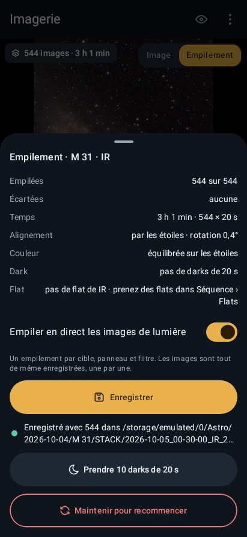 <b>La feuille de l'empilement.</b> Pas encore de darks ni de flat pour ce filtre.</td>
</tr></table>

## 23. Flats, darks et bias

Les images de calibration retirent ce qu'ajoutent le capteur et l'optique. Yacana prend les flats avec un assistant, les darks et les bias avec les règles de la séquence, et l'empilement en direct les utilise tous.

### L'assistant de flats

Ouvrez-le avec le modèle **Flats** dans Séquence. Il trouve la pose de lui-même et prend les flats de chaque filtre à une luminosité cible. La lumière est ce téléphone, ou le panneau à flats s'il y en a un de connecté.

1. Vérifiez l'**ADU cible**, 30 000 ± 5 % par défaut, avec le maximum de la caméra affiché. Réglez la **Luminosité du panneau** si vous en utilisez un.
2. Choisissez les **Images par filtre** (20, 30 ou 50) et les **Filtres**.
3. Touchez **Lancer les flats**. Avec ce téléphone comme lumière, vous avez alors 30 s pour le poser écran vers le bas sur le télescope, l'écran couvrant l'objectif, avec une feuille de papier blanc entre les deux. Un bip lance les flats et l'écran devient blanc à pleine luminosité, même en mode rouge ; un autre bip les termine. Pour les mettre en pause, touchez deux fois l'écran blanc ; **Reprendre** laisse 30 s de plus.
4. Chaque filtre affiche *recherche de la pose…*, puis sa pose et le nombre d'images faites, avec la moyenne en ADU de la dernière image. **Pause** et **Appui long pour arrêter** sont en bas. À la fin, derrière le filtre Dark du Seestar, il prend 10 bias : leur niveau est gardé dans chaque master flat, pour que l'empilement en direct divise par celui-ci même sans darks.

S'il y a trop de lumière même avec la pose la plus courte, ou trop peu avec la plus longue, l'assistant s'arrête et dit quoi changer : plus ou moins de papier sur l'écran du téléphone, ou la luminosité du panneau.

<table><tr>
<td valign="top" width="240">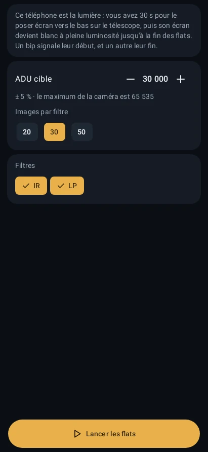 <b>Préparation.</b> Ce téléphone comme lumière, deux filtres.</td>
<td valign="top" width="240">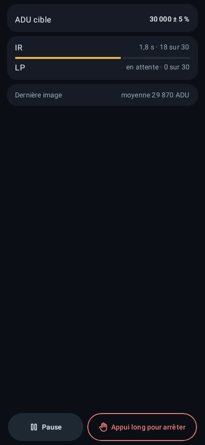 <b>En cours.</b> Les flats IR à 1,8 s, moyenne 29 870 ADU.</td>
</tr></table>

### Darks et bias dans la séquence

Dans l'éditeur simple, le bouton **Darks** sous **Règles** définit quand les darks sont pris, avec la pose, le gain et le binning de chaque image de lumière, et le filtre opaque :

- **Au début** de la nuit.
- **Si la température du capteur change** de 2, 3 ou 5 °C, pour que l'empilement en direct utilise la série de température la plus proche.
- **À la fin, avec le bias** (activé par défaut).
- **Images par série :** 5, 10 ou 20. La feuille indique combien de temps prend chaque série sans images de lumière.

Sans filtre opaque, les darks au début ou selon la température ne sont pas possibles ; à la fin, l'app vous demande de couvrir le télescope. Les darks et les bias du début et de la fin vont dans le dossier de la cible, à côté de LIGHT : ceux du début dans celui de la première cible, ceux de la fin dans celui de la dernière.

<table><tr>
<td valign="top" width="240"> <b>Darks.</b> 10 images de 60 s prennent environ 11 min.</td>
</tr></table>

### À la main

Dans Imagerie, réglez le **Type d'image** sur dark, flat ou bias dans les options et capturez comme d'habitude : les images vont dans leur propre dossier selon leur type.

---

# Séquences

## 24. La section Séquence

Une séquence est le plan de la nuit : quelles cibles, avec quelles poses, et quoi faire autour. Yacana a deux éditeurs pour le même plan : un simple, qui place la nuit sur une frise, et un avancé, avec les conteneurs, les déclencheurs et les conditions de N.I.N.A. Vous pouvez passer de l'un à l'autre sans rien perdre.

- **Ce soir:** Le plan que la nuit va exécuter, avec ses cibles et ses horaires. Touchez-le pour ouvrir l'éditeur. Pendant qu'il tourne, il l'indique.
- **Enregistrées:** Vos séquences enregistrées, avec leurs cibles et leur durée. Touchez-en une pour la charger comme plan de ce soir ; **Annuler** ramène le plan que vous aviez. Maintenez une ligne appuyée un instant pour la supprimer avec **Appui long pour supprimer**. Pour enregistrer le plan de ce soir, utilisez le menu **⋮** de l'éditeur.
- **Modèles:** Des points de départ pour un nouveau plan (ci-dessous).
- **Nouvelle:** Un plan vide, dans l'éditeur.

### Modèles

- **Une cible toute la nuit :** démarre un plan vide et ouvre Ciel. La cible que vous ajoutez ensuite remplit la nuit jusqu'à l'aube.
- **Plusieurs cibles** et **Mosaïque :** démarrent un plan vide et ouvrent Ciel, pour cadrer les cibles ou la mosaïque.
- **Flats :** ouvre l'assistant de flats ([chapitre 23](#calibration)).

Ce qu'il y avait avant un modèle revient avec **Annuler**.

<table><tr>
<td valign="top" width="240"> <b>Séquence.</b> Ce soir, séquences enregistrées et modèles.</td>
</tr></table>

## 25. L'éditeur simple

L'éditeur simple montre le plan de ce soir sous forme de frise, avec une carte par cible. Il avertit, avec une icône et des mots, quand le plan ne tient pas avant l'aube.

### Ajouter des cibles

Les cibles viennent de Ciel : cadrez-en une et touchez **Ajouter à la séquence** ([chapitre 16](#framing)). **Ajouter une cible** en fin de liste vous y emmène. Une mosaïque arrive comme une seule cible avec ses panneaux.

### Plan de ce soir

La frise montre chaque cible de son début à sa fin, et l'aube. Si le plan déborde après l'aube astronomique, elle indique quelle cible finirait à quelle heure, et l'heure de fin de cette cible passe à la couleur d'avertissement. **Annuler** défait la dernière modification, jusqu'à 50 modifications en arrière.

### La carte d'une cible

- Son nom, l'heure de sa fin et l'icône de corbeille pour la retirer.
- Pour une mosaïque, son nombre de panneaux ; les poses s'appliquent à chaque panneau.
- Une ligne par filtre et pose, comme *IR · 60 s × 45 par panneau*, avec les images faites et le total. Touchez une ligne pour la modifier ; **Poses** ajoute un autre filtre.

<table><tr>
<td valign="top" width="240"> <b>Ce soir.</b> M 33 finirait à 07:25, après l'aube.</td>
<td valign="top" width="240"> <b>Poses.</b> Le pavé indique la durée, et jusqu'à quand.</td>
</tr></table>

### Poses

La feuille règle une ligne des poses d'une cible : le **Filtre**, la **Durée** (10, 30, 60 ou 120 s, ou **Autre**), et le **Nombre d'images** au pavé. Pendant la saisie, elle indique combien de temps elles prennent et jusqu'à quand, ou qu'elles finiraient après l'aube. **Enregistrer** la garde ; **Retirer ces poses** supprime la ligne quand la cible en a plus d'une.

### Règles

La carte **Règles** liste ce que fait la nuit en plus des images. Un nouveau plan arrive avec :

- **Déparquer au début**, et **Résistance chauffante allumée** si le matériel a un interrupteur de résistance.
- **Centrer à l'arrivée :** chaque cible, et chaque panneau d'une mosaïque, est centré par plate solving avant ses images.
- **Dithering toutes les 3 images**, sans guidage.
- **Autofocus si ΔT > 1 °C**, avec un focuser.
- **Darks et bias à la fin** : 10 de chaque, pour chaque pose, gain, offset et binning des lights.
- **Parquer à la fin**, et la résistance éteinte.

Deux boutons en dessous les modifient :

- **Autofocus:** Avant chaque image de lumière, un autofocus se lance si l'une de ces conditions est remplie, comme les déclencheurs de N.I.N.A. :
  - **Quand la température change** de 0,5, 1, 2 ou 5 °C ;
  - **Au changement de filtre ;**
  - **Quand le HFR se dégrade** de 5, 10 ou 20 % ;
  - **Régulièrement :** 15, 30, 60 ou 120 min, ou une autre durée.

  Si un autofocus échoue, ces règles attendent les poses suivantes.
- **Darks:** Au début, quand la température du capteur change, à la fin avec le bias, et combien à chaque fois ([chapitre 23](#calibration)).

Pour d'autres règles, comme un dithering selon un autre nombre d'images, le recentrage quand la cible dérive, l'attente qu'une cible monte ou la répétition jusqu'à une heure, ouvrez le plan dans l'éditeur avancé.

### Enregistrer et démarrer

Le menu **⋮** contient **Enregistrer dans mes séquences**. **Démarrer**, en bas, lance la nuit une fois le matériel connecté ; pendant qu'elle tourne, le bouton devient **Appui long pour arrêter**. Vous pouvez encore modifier le plan pendant qu'il tourne : les changements s'appliquent à ce qui reste à venir.

<table><tr>
<td valign="top" width="240"> <b>Règles d'autofocus.</b></td>
</tr></table>

## 26. L'éditeur avancé

L'éditeur avancé est le séquenceur avancé de N.I.N.A. transformé en liste tactile : des conteneurs dans lesquels on entre, des instructions, des déclencheurs et des conditions, réordonnés par glisser-déposer, avec annulation et une vérification de la nuit avant son démarrage.

Ouvrez-le avec **Avancé** en haut de l'éditeur simple. Il ouvre le plan de ce soir en entier. Si vous ajoutez ce que l'éditeur simple ne peut pas afficher, comme une condition ou un conteneur parallèle, ce soir ne se modifie plus que dans l'éditeur avancé : l'éditeur simple affiche **Ce soir se modifie dans Avancé** avec **Ouvrir dans Avancé** et la liste des cibles.

### La structure de la nuit

- **Nuit,** le niveau supérieur, avec les **déclencheurs pour toute la nuit**, et trois zones :
- **Début :** ce qui se fait en premier, avant les cibles, comme déparquer ou refroidir la caméra. Ce qui pointe une cible ne va pas ici.
- **Cibles :** l'une après l'autre, dans cet ordre. Chaque cible contient ses instructions.
- **Fin :** après les cibles : les darks, le parquage et l'extinction.

Un fil d'Ariane en haut montre où vous êtes, comme *Nuit › Cibles › M 33*. La carte de chaque niveau dit comment il s'exécute : une fois, ou répété par ses conditions, qui sont vérifiées après chaque instruction.

<table><tr>
<td valign="top" width="240"> <b>Nuit.</b> Un déclencheur d'autofocus et les trois zones.</td>
<td valign="top" width="240"> <b>Une cible.</b> Répétée jusqu'à 02:00.</td>
</tr></table>

### Travailler avec les éléments

- **Entrez** dans un conteneur en le touchant ; touchez une instruction pour modifier ses réglages.
- **Ajoutez** avec le bouton du bas, **Ajouter à …**, qui ouvre le catalogue. **Condition** et **Déclencheur** sur la carte du niveau l'ouvrent sur ce type.
- **Réordonnez** en faisant glisser la poignée d'un élément, ou avec son menu **⋮**.
- **Le menu ⋮** d'un élément : *Entrer*, *Changer la cible*, *Renommer*, *Réglages*, *Monter*, *Descendre*, *Déplacer vers…*, *Dupliquer*, *Enregistrer comme modèle* et *Supprimer*.
- **Annuler** est en haut.

Pendant que la nuit tourne, les éléments finis sont marqués comme terminés et celui en cours est mis en évidence. Les deux sont verrouillés ; le reste peut encore être modifié.

### Le catalogue

Le catalogue a une zone de recherche et des boutons par type : caméra, monture, mise au point, filtres, utilitaires, conteneurs, déclencheurs, conditions et modèles. Ce qui ne peut pas aller là où vous êtes est grisé, avec la raison, comme *Seulement dans une Cible*.

<table><tr>
<td valign="top" width="240"> <b>Le catalogue.</b> Ce qui pointe une cible est grisé dans Début.</td>
</tr></table>

| Type | Élément | Ce qu'il fait |
| --- | --- | --- |
| **Caméra** | Poses | Lights, darks ou bias : filtre, durée, nombre d'images et dithering |
| **Caméra** | Refroidir la caméra · Réchauffer la caméra | Jusqu'à une température, peu à peu, ou lentement, avant de l'éteindre |
| **Monture** | Déparquer · Parquer | Quitte sa position de repos ou y revient |
| **Monture** | Aller et centrer | GoTo vers la cible et plate solving, à 1′ près ; seulement dans une Cible |
| **Monture** | Aller à la cible | GoTo vers la cible sans centrer ; seulement dans une Cible |
| **Monture** | Arrêter le suivi | La monture reste immobile |
| **Mise au point** | Autofocus · Déplacer le focuser | Une courbe en V, ou vers une position |
| **Filtres** | Changer de filtre | La roue met un autre filtre |
| **Utilitaires** | Régler un interrupteur | Comme la résistance chauffante, allumée ou éteinte |
| **Utilitaires** | Attendre une heure · Attendre un moment · Attendre qu'elle monte | Continue à une heure de cette nuit, après quelques minutes, ou quand la cible atteint une hauteur |
| **Utilitaires** | Note | Une note dans le journal de la nuit |
| **Conteneur** | Cible | Une cible depuis Ciel, avec son cadrage ; vient avec « Aller et centrer » |
| **Conteneur** | Séquentiel · Parallèle | Ses instructions l'une après l'autre, ou en même temps, comme attendre une heure pendant que la caméra refroidit |
| **Déclencheur** | Autofocus si la température change · périodique · au changement de filtre · si le HFR augmente | Un autofocus avant la prochaine image quand sa condition est remplie |
| **Déclencheur** | Recentrer en cas de dérive | Résout et corrige quand la cible dérive de plus de 0,5′ à 5′ |
| **Déclencheur** | Darks si la température change | Des darks avec le filtre opaque quand le capteur change de 2, 3 ou 5 °C, pour l'empilement en direct |
| **Condition** | Répéter N fois · Répéter jusqu'à une heure · Répéter tant qu'elle est haute | Répète tout le conteneur |
| **Modèle** | Cible avec autofocus · les vôtres | Une cible depuis Ciel avec aller et centrer, autofocus et poses ; ou tout bloc que vous avez enregistré comme modèle |

### Vérifier la nuit

L'éditeur vérifie le plan pendant que vous le construisez. Quand quelque chose irait mal cette nuit, un badge en haut compte les avertissements ; touchez-le pour **Vérifier la nuit**, et touchez un avertissement pour y aller. Les avertissements ne vous empêchent jamais d'enregistrer ni de démarrer. Ils signalent notamment :

- une instruction qui a besoin d'une cible hors d'une Cible, ou des lights sans cible ;
- un parquage avant des images, une mise au point ou un GoTo sans *Déparquer* avant ;
- des lights sans *Aller et centrer* avant, ou avec le suivi arrêté ;
- un filtre que la roue n'a pas, ou le refroidissement d'une caméra qui ne refroidit pas ;
- des darks pris pendant que la caméra se réchauffe ;
- deux éléments parallèles qui utilisent le même appareil en même temps.

### Revenir au plan simple

La carte de l'éditeur simple, ou le menu **⋮** de l'éditeur avancé, propose **Appui long pour revenir au plan simple**. Cela retire ce que seul l'éditeur avancé connaît et garde les cibles avec leurs poses. Le même menu propose **Enregistrer dans Mes séquences**.

<table><tr>
<td valign="top" width="240"> <b>Modifié dans Avancé.</b> L'éditeur simple affiche les cibles.</td>
</tr></table>

> [!NOTE]
> **Pour les utilisateurs de N.I.N.A.**
>
> L'éditeur avancé suit le séquenceur de N.I.N.A. : les mêmes types de conteneurs, de déclencheurs et de conditions, exécutés dans le même ordre. Les fichiers de séquence de N.I.N.A. ne s'importent pas, et les instructions qui dépendent de Windows ou du guidage n'y figurent pas.

## 27. Mener la nuit

Lancez la nuit avec **Lancer la nuit** dans Nuit ou **Démarrer** dans l'éditeur. Dès lors, la session tourne dans un service de premier plan : vous pouvez éteindre l'écran et ranger le téléphone.

### Nuit pendant la session

Tout ce dont vous avez besoin tient sur un seul écran, sans faire défiler :

- **La cible :** son nom, son panneau et son filtre, et sa hauteur avec une flèche indiquant si elle monte ou descend.
- **L'image :** un anneau avec les secondes restantes, *Image 35 sur 120*, le filtre et le gain.
- **Progression :** le pourcentage de la séquence et l'heure de fin, comparée à l'aube astronomique.
- **Dernière image :** sa vignette, si elle était bonne ou écartée, son HFR et ses étoiles, et la courbe du HFR de la nuit. Avec l'empilement en direct activé, elle montre l'empilement : touchez-la pour l'ouvrir dans Imagerie.
- **Ensuite :** ce qui arrive, comme le prochain autofocus, le passage à la cible suivante et le parquage, avec leurs heures.

**Pause** s'arrête aussitôt, en laissant de côté l'image en cours, et le suivi continue ; le bouton devient **Reprendre**, qui repart de la même instruction avec les images déjà prises. **Appui long pour arrêter** met fin à la séquence.

<table><tr>
<td valign="top" width="240"> <b>En cours.</b> Fin à 06:56, après l'aube de 06:44.</td>
<td valign="top" width="240"> <b>Avec l'empilement en direct,</b> l'empilement dans la carte.</td>
</tr></table>

### Ailleurs dans l'app

La barre de session sur tous les autres écrans montre l'image et permet de mettre en pause ([chapitre 4](#tour)), et la notification montre la progression sur l'écran de verrouillage. La séquence et Imagerie partagent la caméra : arrêtez une boucle dans Imagerie avant de lancer la nuit.

### Écran éteint

Yacana garde le processeur et le WiFi du téléphone éveillés pendant la session, et lie le trafic du matériel à son WiFi même s'il n'a pas internet. Lors du test de référence, elle a tourné 8,5 heures dans la nuit avec un Seestar, 503 images complètes, sans redémarrage et sans interruption de plus de 6 s, en consommant 1,7 % de batterie par heure. Accordez d'abord les autorisations de batterie ([chapitre 33](#permissions)).

Tant que Yacana est à l'écran, l'écran reste allumé et le téléphone ne se verrouille pas. Écran allumé, Android garde le WiFi à pleine vitesse et, s'il décroche, se reconnecte au WiFi du matériel en quelques secondes ; écran éteint, il peut attendre que vous le rallumiez. Appuyez sur le bouton marche/arrêt pour l'éteindre comme d'habitude : la session continue. Pour une nuit entière écran allumé, utilisez le mode rouge avec peu de luminosité et une batterie externe.

### Si l'app ou le téléphone redémarre

Si Android ferme l'app ou si le téléphone redémarre, la session reprend d'elle-même en moins d'une minute ; après un redémarrage, dès que vous déverrouillez le téléphone pour la première fois. Au pire, l'image en cours est perdue ; les images déjà enregistrées ne sont jamais abîmées, car chacune est écrite dans un fichier temporaire puis renommée. Le journal enregistre *L'app s'est fermée et a repris la séquence*.

## 28. Alertes et arrêts de sécurité

Une nuit sans surveillance se termine bien ou s'arrête en sécurité. Chaque alerte dit ce qui s'est passé, ce que fait l'app et ce que vous pouvez faire.

### Quand la liaison est perdue

Si le matériel ne répond plus, la séquence passe en **pause de sécurité** : la pose s'arrête et le suivi reste actif. L'alerte, dans Nuit et sous forme de notification sonore, montre les essais et le temps restant avant un arrêt de sécurité. L'app réessaie toutes les 10 s.

- **Réessayer maintenant** réessaie immédiatement.
- **Détails** ouvre Équipement.
- **Appui long pour arrêter** met fin à la séquence.

Vérifiez que le téléphone est toujours sur le WiFi du matériel et que le matériel est alimenté. Quand la liaison revient, la séquence continue, et le journal enregistre combien de temps elle a été perdue.

### Arrêt de sécurité

Un arrêt de sécurité met fin à la session quand :

- la liaison ne revient pas dans le délai réglé (2 min par défaut) ;
- la séquence échoue d'une façon dont elle ne peut pas se remettre ;
- la batterie du téléphone passe sous le niveau réglé (20 % par défaut), et toujours sous 10 %, sauf pendant la charge.

La pose s'arrête et la monture se parque ou arrête le suivi, selon le profil. Si la liaison était perdue, cela se fait dès son retour. L'alerte dit alors ce qui a été fait ; **Compris** la ferme.

<table><tr>
<td valign="top" width="240"> <b>Pause de sécurité.</b> Un arrêt de sécurité dans 1 min 18 s si la liaison ne revient pas.</td>
<td valign="top" width="240"> <b>Arrêt de sécurité.</b> La monture parquée.</td>
</tr></table>

### Réglages de sécurité

Dans *Réglages › Sécurité*, par profil :

- **Arrêt de sécurité:** **Parque la monture** ou **Arrête le suivi**. Le Seestar vient avec le parquage, qui replie son bras.
- **Si la liaison est perdue:** Combien de temps attend la pause de sécurité : 1, 2, 5 ou 10 min.
- **Batterie du téléphone faible:** 15, 20 ou 30 %. Sous 10 %, l'arrêt est systématique ; jamais pendant la charge.

<table><tr>
<td valign="top" width="240"> <b>Réglages › Sécurité.</b></td>
</tr></table>

## 29. Le lendemain matin

Quand la séquence se termine, Nuit affiche le bilan de la nuit jusqu'à ce que vous le fermiez.

- Comment et quand elle s'est terminée : terminée, arrêtée à la main, arrêt de sécurité ou échec, et si la monture s'est parquée.
- **Intégration utile :** le temps de pose des images gardées.
- **Images** et **Écartées**, et le **HFR médian**.
- **Par cible :** images et pose par cible et par filtre.
- **Incidents :** reconnexions, autofocus supplémentaires, images avec nuages, avec leurs heures.

**Voir le journal** ouvre le journal de la nuit. **Exporter** enregistre un ZIP du journal technique de l'app, avec le profil et les versions, à garder ou à joindre à un rapport de bug. Le **✕** ferme le bilan.

### Le journal de la nuit

Une liste lisible de ce qui s'est passé, distincte du journal technique : chaque événement avec son heure et sa raison, comme *Autofocus supplémentaire · La température a changé de 1,3 °C*, *M 31 Panneau 1 centré · écart 8″ · 2 essais* ou *Liaison rétablie · 51 s · 5 essais*. Son icône en haut enregistre le même ZIP qu'**Exporter**.

<table><tr>
<td valign="top" width="240"> <b>Bilan.</b> 34 images, dont une avec des nuages.</td>
<td valign="top" width="240"> <b>Journal de la nuit.</b></td>
</tr></table>

Vos images et empilements sont dans le dossier des images, un dossier par nuit et par cible ([chapitre 30](#files)). Pour les copier, connectez le téléphone à un ordinateur avec un câble USB et choisissez le transfert de fichiers sur le téléphone ; le dossier apparaît comme n'importe quel autre dans le stockage du téléphone.

---

# Réglages et fichiers

## 30. Images et fichiers

Yacana enregistre chaque image en fichier FITS 16 bits avec les en-têtes de N.I.N.A., qui s'ouvre dans Siril, PixInsight et tout logiciel d'astronomie, dans un dossier par nuit et par cible.

### Le dossier

Dans *Réglages › Images et fichiers*, **Dossier** indique où vont les images. Par défaut, c'est le dossier propre de l'app, `Android/data/app.yacana/files/Yacana` dans le stockage du téléphone, qu'Android supprime si vous désinstallez l'app.

**Changer de dossier** ouvre le sélecteur de dossiers d'Android : choisissez ou créez un dossier dans le stockage du téléphone (comme `Astro`), sur une carte SD ou sur une clé USB. Yacana garde le droit d'y écrire d'un redémarrage à l'autre. Choisissez-en un avant votre première nuit, pour que vos images soient faciles à trouver et survivent à une réinstallation.

### Noms de fichiers

Le nom de chaque image vient d'un modèle avec les balises de N.I.N.A. Une barre oblique crée un dossier. Touchez une balise pour l'ajouter ; l'écran montre comment s'appellera la prochaine image. **Revenir au modèle par défaut** rétablit :

`$$DATEMINUS12$$/$$TARGETNAME$$/$$IMAGETYPE$$/$$DATETIME$$_$$FILTER$$_$$EXPOSURETIME$$s_$$FRAMENR$$`

ce qui donne par exemple `2026-10-04/M 31/LIGHT/2026-10-05_00-30-00_LP_20.00s_0001.fits` : un dossier pour la nuit, un pour la cible et un pour le type d'image.

<table><tr>
<td valign="top" width="240"> <b>Réglages › Images et fichiers.</b></td>
</tr></table>

| Balise | Devient | Exemple |
| --- | --- | --- |
| **`DATEMINUS12`** | La date de la nuit : la date 12 heures plus tôt, pour que les images d'après minuit gardent la date du soir | `2026-10-04` |
| **`DATE`** | La date locale | `2026-10-05` |
| **`DATETIME`** | La date et l'heure locales | `2026-10-05_00-30-00` |
| **`TIME`** | L'heure locale | `00-30-00` |
| **`TARGETNAME`** | La cible, ou *Snapshot* sans cible | `M 31` |
| **`IMAGETYPE`** | Le type d'image | `LIGHT`, `DARK`, `FLAT`, `BIAS` |
| **`FILTER`** | Le filtre, ou *NoFilter* | `LP` |
| **`EXPOSURETIME`** | La pose en secondes | `20.00` |
| **`FRAMENR`** | Le numéro d'image de la session, sur 4 chiffres | `0001` |
| **`GAIN`, `OFFSET`** | Le gain et l'offset de la caméra | `80` |
| **`BINNING`** | Le binning | `1x1` |
| **`SENSORTEMP`** | La température du capteur | `-10.0` |

### Ce que contient chaque fichier

- **Images :** FITS 16 bits avec les mêmes pixels que les fichiers du Seestar lui-même, et les mots-clés d'en-tête de N.I.N.A. : le type d'image, la pose, le gain, l'offset, le binning et la température du capteur ; le filtre ; la cible et ses coordonnées, avec sa hauteur et son azimut ; le télescope, la caméra, la focale et la taille des pixels ; la position et la température du focuser ; le site ; la matrice de Bayer et ses décalages, pour que Siril les dématrice correctement.
- **Empilements en direct :** le même chemin avec `STACK` comme type et comme numéro : un FITS 32 bits linéaire, avec le nombre d'images et la pose totale dans son en-tête, et un JPG tel que l'écran le montre, réécrits à mesure que l'empilement grandit.
- **Sécurité :** chaque fichier est écrit sous un nom temporaire et renommé une fois complet : un plantage ou une coupure de courant ne laisse jamais une image cassée.

Le journal de la nuit et le journal technique de l'app sont gardés dans l'app ; exportez-les en ZIP depuis le bilan ou depuis *Réglages › Exporter le journal*.

## 31. Référence des réglages

Réglages s'ouvre depuis l'engrenage dans Nuit et Équipement, ou avec **Réglages** dans les options d'Imagerie. La zone de recherche en haut trouve n'importe quel réglage à partir d'une partie de son nom, dans tous les écrans, avec ou sans accents.

Chaque option dit ce qu'elle fait. Les réglages marqués *par profil* sont gardés dans le profil de matériel : chaque ensemble de matériel a les siens.

<table><tr>
<td valign="top" width="240"> <b>Réglages.</b></td>
</tr></table>

| Ligne | Ce qu'elle contient | Chapitre |
| --- | --- | --- |
| **Profil et lieu** | Nom, optique, site, limites, horizon, base d'étoiles, autres profils, export et import | [5](#profile) |
| **Images et fichiers** | Le dossier, et le modèle de nom de fichier (par profil) | [30](#files) |
| **Plate solving** | Les options d'ASTAP, le centrage et les bases d'étoiles (par profil) | [18](#solving), [6](#field) |
| **Autofocus** | Pas, points, pose, ajustement, jeu, R², essais (par profil) | [19](#autofocus) |
| **Sécurité** | Arrêt de sécurité, attente quand la liaison est perdue, batterie faible (par profil) | [28](#safety) |
| **Carte du ciel** | Les caches de N.I.N.A., WiFi seulement, photos en ligne et calques | [6](#field) |
| **Affichage** | Mode nuit rouge et sa luminosité | [32](#display) |
| **Langue** | La langue de l'app | [32](#display) |
| **Autorisations** | À quoi sert chaque autorisation, et son état | [33](#permissions) |
| **Exporter le journal** | Enregistre un ZIP des 14 derniers jours du journal | [36](#troubleshooting) |
| **À propos** | La version, le moteur de pixels et les licences | [39](#credits) |

L'empilement en direct et son équilibre des couleurs se règlent dans les options d'Imagerie, et sont aussi gardés par profil.

## 32. Mode rouge et langue

### Mode nuit rouge

La lumière rouge garde vos yeux adaptés à l'obscurité. Le mode rouge dessine chaque pixel de l'app en rouge pur sur noir, photos et images comprises, et aucun pixel n'a de vert ni de bleu : c'est vérifié sur chaque écran.

- Activez-le avec l'icône en forme d'œil en haut de Nuit, Équipement, Ciel, Imagerie, des fiches d'objets, du cadrage et des assistants, ou avec **Mode nuit rouge** dans *Réglages › Affichage*.
- Les barres système se masquent ; balayez depuis le bord pour les voir un instant.
- L'app règle sa propre luminosité d'écran, qui peut descendre sous le minimum du système : **Luminosité en mode rouge**, de 1 à 100 %, 10 % par défaut.
- L'app s'en souvient, et s'ouvre en rouge si vous l'avez quittée en rouge.

Les boîtes de dialogue d'Android et le clavier du système ne peuvent pas être rendus rouges. C'est pourquoi, la nuit, les nombres se saisissent avec le pavé numérique propre de l'app. Le point vert qu'Android allume en haut pendant qu'une app lit la position ne peut pas non plus être rendu rouge. Yacana ne la lit qu'à son ouverture, quand vous activez **Utiliser la position du téléphone** et à la connexion, jamais à la reconnexion : le point ne se voit que quelques secondes.

<table><tr>
<td valign="top" width="240"> <b>Nuit en rouge.</b></td>
<td valign="top" width="240"> <b>Le ciel en rouge.</b> Les photos aussi.</td>
</tr></table>

### Langue

Yacana parle anglais, espagnol, catalan, basque, galicien, allemand, français, italien, ainsi que le portugais du Portugal et celui du Brésil. Dans *Réglages › Langue*, **Comme le système** suit le téléphone, ou l'anglais si la langue du téléphone n'en fait pas partie ; ou bien choisissez-en une. Le changement est immédiat. Sous Android 13 et ultérieur, vous pouvez aussi la choisir dans les paramètres système de l'app. Les dates et les nombres suivent la langue, avec une virgule décimale dans toutes sauf l'anglais.

<table><tr>
<td valign="top" width="240"> <b>Réglages › Langue.</b></td>
<td valign="top" width="240"> <b>Réglages › Affichage.</b></td>
</tr></table>

## 33. Autorisations et batterie

Android n'est pas conçu pour une tâche de huit heures écran éteint. Les autorisations de *Réglages › Autorisations* sont ce qui permet malgré tout à Yacana de mener la nuit.

L'écran est le même que celui des premiers pas ([chapitre 3](#first-steps)) : chaque ligne dit à quoi elle sert, ce qui ne marche plus sans elle, et affiche **Autoriser**, **Ouvrir** ou une coche une fois accordée. Les lignes qui ne concernent pas votre téléphone ne s'affichent pas : le réseau local avant Android 17, les notifications avant Android 13, la conservation de l'app sans usage avant Android 11, et le démarrage automatique sur les téléphones autres que Xiaomi, Redmi et Poco.

### Si Android ne demande plus

Après deux refus d'une autorisation, Android cesse de la demander. La ligne l'indique alors : ouvrez les paramètres de Yacana dans Android, ouvrez Autorisations, activez-la et revenez.

### Économiseurs de batterie

- **Batterie sans restriction** est la plus importante pour une nuit. Sans elle, le système peut arrêter la session écran éteint.
- Certains fabricants ajoutent leurs propres économiseurs par-dessus ceux d'Android. Sur les téléphones Xiaomi, **Démarrage automatique** permet à la session de revenir si le système ferme l'app. Sur d'autres marques, cherchez Yacana dans les réglages de batterie du téléphone et autorisez-la à fonctionner en arrière-plan.
- Sur les téléphones Xiaomi, l'économiseur de batterie des infos de Yacana doit indiquer **Aucune restriction** : **Batterie sans restriction** le règle. Verrouillez aussi Yacana dans les applications récentes (appui long sur sa carte, puis le cadenas), pour que les effacer ne la ferme pas.
- Les modes d'économie de batterie peuvent arrêter le travail en arrière-plan : laissez-les désactivés pendant une session.

### Ce dont l'app n'a jamais besoin

Yacana n'a besoin d'aucun compte, d'aucun accès à vos photos, contacts ou fichiers au-delà des dossiers que vous choisissez, ni de la localisation en arrière-plan.

---

# Référence

## 34. Utiliser un Seestar S50 Pro

Le ZWO Seestar S50 Pro intègre ASCOM Alpaca dans son firmware : Yacana le contrôle donc directement par son WiFi. C'est l'appareil de référence : chaque fonction a été construite et mesurée avec lui, et il remplit lui-même son profil.

### Avant la première nuit

1. **Configurez-le avec l'app de ZWO.** Yacana ne la remplace pas pour la configuration propre de l'appareil : l'activation, la mise à jour du firmware, le passage en mode équatorial et la configuration du WiFi se font dans l'app de ZWO.
2. **Posez-le sur une table équatoriale, en mode EQ.** Sur une table, il suit sur un seul axe et permet de longues poses sans rotation de champ. Son mode altazimutal n'est pas visé par cette app.
3. **Rejoignez son WiFi, ou mettez les deux sur votre WiFi domestique.** Ses deux modes réseau fonctionnent : son propre point d'accès, où il répond à `10.0.0.1`, port `32323`, et le mode station sur votre routeur. Une nuit de 8,5 heures a tourné en mode point d'accès, et 2 heures en mode station, sans longues coupures.
4. **Trouvez-le dans Yacana** et touchez **Téléobjectif** ([chapitre 3](#first-steps)). Le profil du Seestar se charge de lui-même ; **Grand angle** crée celui de sa caméra grand-angle, plus bas.

### Ce que règle son profil

| Élément | Valeur | Pourquoi |
| --- | --- | --- |
| **Optique** | 260 mm de focale, 50 mm de diamètre, f/5,2 | Sa lunette apochromatique à 4 lentilles |
| **Capteur** | 2160 × 3840 px, 2,9 µm, couleur (Bayer GRBG) | La caméra téléobjectif, enregistrée en portrait comme le fait l'app de ZWO |
| **Échelle et champ** | 2,25″ par pixel · 2,40° × 1,35° | Mesurés avec ASTAP sur de vraies images |
| **Rotation de la caméra** | 93,2° jusqu'à ce que le premier plate solving la mesure | Un S50 Pro en mode EQ, son grand côté presque nord-sud |
| **Base d'étoiles** | D50 | Résout ses images avec de la marge pour les nuits moins bonnes ; D05 est l'option légère |
| **Autofocus** | 15 pas entre les points, poses de 3 s | Son focuser va de 0 à 2 600 pas |
| **Arrêt de sécurité** | **Parque la monture** | Le parquage replie son bras |
| **Appareils utilisés** | Monture, caméra téléobjectif et son focuser, roue à filtres, interrupteurs | La caméra grand-angle et son focuser ont leur propre profil, plus bas |

### Sa caméra grand-angle

**Grand angle** sur la carte du Seestar, dans les premiers pas ou dans **Nouveau profil**, crée un second profil, *Seestar S50 Pro grand angle*, pour sa caméra grand-angle : tout un pan de ciel, pour la Voie lactée et les paysages nocturnes. Ses poses durent jusqu'à 60 s.

| Élément | Valeur | Pourquoi |
| --- | --- | --- |
| **Optique** | 5,95 mm de focale, 3,4 mm de diamètre, f/1,75 | Son objectif publié, 63° en diagonale |
| **Champ** | Environ 33° × 59°, 55″ par pixel | Son capteur de 2160 × 3840 px de 1,6 µm |
| **Base d'étoiles** | W08, moins de 1 Mo | Celle d'ASTAP pour les champs de 20° à 80° : téléchargez-la dans *Réglages › Plate solving* |
| **Autofocus** | 10 pas entre les points, 15 points, poses de 3 s | Son focuser va de 0 à 1 023 pas : valeurs de départ, à ajuster sous le ciel |
| **Appareils utilisés** | Monture, caméra grand-angle et son focuser, interrupteurs | La roue à filtres n'est que devant le téléobjectif |

### Bon à savoir

- **Des darks sans le couvrir.** Sa roue à filtres a une position **Dark**, que Yacana utilise comme obturateur : les darks et les bias se prennent sans rien mettre sur le télescope.
- **La résistance chauffante est allumée ou éteinte.** Elle apparaît comme un interrupteur dans *Équipement › Interrupteurs*. Son serveur Alpaca (1.3.1-1) ne permet pas de régler sa puissance.
- **Pas de binning.** Sa caméra ne fait pas de binning : un réglage 2×2, comme celui de l'alignement polaire, est pris en pleine taille. Une image fait environ 8,3 MP, 16 MB en 16 bits, téléchargée en 1,7 à 2,3 s par son WiFi.
- **Pas de retournement au méridien.** Sur une table équatoriale, il se comporte comme une fourche à un seul bras. Gardez les cibles loin des endroits où le bras pourrait toucher la table, près du pôle et du zénith.
- **Les changements de filtre peuvent être lents.** Certains utilisateurs signalent qu'un changement met du temps à apparaître ; les attentes de l'app en tiennent compte.
- **Alimentation.** Pour une longue nuit, alimentez le Seestar et le téléphone sur une source externe, surtout avec la résistance allumée.
- **Sa propre app en même temps.** Utiliser l'app de ZWO sur un autre téléphone pendant que Yacana pilote le Seestar n'a pas été testé ; fermez-la pendant une session.

Les tests ont été faits avec le firmware 9.31 et le serveur Alpaca 1.3.1-1.

## 35. Ce qui demande internet

Une nuit ne demande aucun accès à internet. Sur le terrain, le téléphone ne parle qu'à votre matériel, et tout ce que la nuit utilise se trouve sur le téléphone.

| Fonction | Sans internet | Avec internet |
| --- | --- | --- |
| **Catalogue d'objets** | 13 371 objets du ciel profond d'OpenNGC, inclus dans l'app | Identique |
| **Éphémérides** | Soleil, Lune et crépuscules calculés sur le téléphone | Identique |
| **Plate solving** | ASTAP sur le téléphone, avec une base d'étoiles sur le téléphone | Identique |
| **Photos du ciel** | Depuis les caches de N.I.N.A. sur le téléphone | Des photos plus nettes de la zone quand vous zoomez de près, depuis le hips2fits du CDS |
| **Recherche** | Messier, NGC, IC, Caldwell, Sharpless et noms courants | Aussi SIMBAD : tout objet qu'il connaît, gardé sur le téléphone une fois trouvé |
| **Bases d'étoiles et caches du ciel** | Importés depuis un fichier ou une carte | Téléchargés dans l'app, en WiFi seulement par défaut |

Quand le téléphone est sur le WiFi du matériel, qui n'a pas internet, Yacana garde tout le trafic du matériel sur ce réseau, pour qu'Android ne l'envoie pas par les données mobiles. Les téléchargements que vous lancez utilisent la connexion normale du téléphone.

## 36. Dépannage

Chaque alerte de Yacana dit ce qui s'est passé, ce que fait l'app et ce que vous pouvez faire. Ce chapitre rassemble les causes habituelles qui se cachent derrière.

### Connexion

- **Aucun matériel Alpaca n'a répondu:** Le téléphone et le matériel ne sont pas sur le même WiFi, ou le matériel est encore en train de démarrer. Rejoignez son réseau, attendez une minute et touchez **Chercher à nouveau**. Si votre réseau bloque la découverte, utilisez **Ajouter par IP et port** avec l'adresse qu'affiche l'appareil, comme `10.0.0.1:32323` pour un Seestar sur son propre point d'accès.
- **Rien n'est trouvé du tout:** Vérifiez que **Réseau local** est accordé dans *Réglages › Autorisations*. Sans cette autorisation, Android bloque toute découverte et toute commande.
- **Connexion impossible:** L'appareil a répondu à la recherche mais a refusé la connexion. Vérifiez qu'aucun autre programme ne l'occupe, redémarrez-le et connectez-vous à nouveau.
- **Déconnectez pour changer de profil:** Les profils, les appareils et la suppression du profil ne se modifient que lorsque rien n'est connecté. Touchez d'abord **Tout déconnecter**.

### Pendant la nuit

- **Liaison perdue avec le matériel:** Le WiFi est tombé ou le matériel a perdu son alimentation. La séquence attend en pause de sécurité et l'app réessaie toutes les 10 s ; si la liaison ne revient pas dans le délai réglé dans *Réglages › Sécurité*, elle s'arrête en sécurité dès son retour. Vérifiez que le téléphone est toujours sur le WiFi du matériel et que le matériel a de la batterie ([chapitre 28](#safety)).
- **La session s'est arrêtée écran éteint:** Android a fermé l'app pour économiser la batterie. Accordez **Batterie sans restriction**, **Conservée même sans usage** et, sur les téléphones Xiaomi, **Démarrage automatique** dans *Réglages › Autorisations* ([chapitre 33](#permissions)).
- **Ça ne tient pas avant l'aube:** Le plan finit après l'aube astronomique. Baissez le nombre d'images d'une cible, ou retirez une cible, jusqu'à ce que l'avertissement disparaisse ([chapitre 25](#simple)).
- **La cible est sous la limite:** Le GoTo descendrait sous la limite de hauteur du profil ou sous son horizon, et la monture n'a pas bougé. Attendez que la cible monte, ou vérifiez la limite dans le profil.

### Plate solving et centrage

- **Pas de solution avec la base:** L'image a trop peu d'étoiles (nuages, buée, pose courte, mauvaise mise au point) ou la focale du profil est fausse, si bien qu'ASTAP cherche à la mauvaise échelle. Vérifiez la focale dans *Réglages › Profil et lieu › Optique*, faites la mise au point, et essayez une pose plus longue.
- **La base d'étoiles n'est pas sur le téléphone:** Téléchargez-la ou importez-la dans *Réglages › Plate solving* ([chapitre 6](#field)).
- **Pas centré après plusieurs essais:** La monture n'arrive pas assez près. Synchronisez-la une fois avec une image résolue, puis centrez à nouveau ; vérifiez que le suivi est actif et que la monture ne glisse pas.

### Alignement polaire et autofocus

- **Cette monture ne peut pas tourner seule son axe AD:** L'alignement en trois points a besoin d'une monture capable de bouger un axe sur commande (MoveAxis). Sans cela, alignez la monture d'une autre façon.
- **Le profil n'a pas de site:** La position du pôle dépend du site et de l'heure. Activez **Utiliser la position du téléphone** dans le profil, ou saisissez le site.
- **Le HFR n'a pas assez changé, d'un côté comme de l'autre:** Le pas de l'autofocus est trop petit pour votre optique. Augmentez **Pas** dans *Réglages › Autofocus*.
- **La courbe explique trop peu les points:** La turbulence ou les nuages ont gâché les points. Réessayez, utilisez plus d'images par point, ou une pose plus longue.
- **La meilleure mise au point tombe hors des points:** Le focuser est parti trop loin du point. Rapprochez-le à la main dans *Équipement › Focuser* et relancez l'autofocus.
- **Ce focuser n'a pas de positions où aller:** L'autofocus a besoin d'un focuser absolu, qui indique des positions en pas et s'y rend.

### Quand vous avez besoin d'aide

Touchez *Réglages › Exporter le journal* et choisissez où enregistrer le fichier. C'est un ZIP avec les 14 derniers jours du journal de l'app, le profil utilisé, et les versions de l'app, d'Android et du téléphone, prêt à joindre à un rapport de bug sur le gestionnaire de tickets du projet. Rien n'est envoyé automatiquement. **Exporter** dans le bilan de la nuit et l'icône d'export du journal de la nuit enregistrent le même ZIP.

## 37. Pour les utilisateurs de N.I.N.A.

Si vous connaissez N.I.N.A., vous connaissez déjà l'essentiel de Yacana. Elle reprend les concepts de N.I.N.A. et beaucoup de ses algorithmes, adaptés à un écran tactile et à l'obscurité.

| Dans N.I.N.A. | Dans Yacana |
| --- | --- |
| **Onglet Équipement** | Section Équipement : profil, connexion et contrôle manuel de chaque appareil |
| **Sky Atlas et Framing Assistant** | Section Ciel : carte, liste, fiches d'objets et cadrage |
| **Cache de cadrage (FramingAssistantCache)** | Les mêmes caches, lus directement dans leur ZIP ; les photos en ligne peuvent être réexportées vers N.I.N.A. |
| **Onglet Imagerie** | Section Imagerie : capture, statistiques, historique et photo de référence du cache |
| **Séquenceur simple et avancé** | Éditeurs simple et avancé sur un même modèle : vous pouvez passer de l'un à l'autre dans les deux sens sans rien perdre |
| **Plugin Three Point Polar Alignment** | Assistant d'alignement polaire intégré, porté depuis le plugin |
| **Autofocus, FWHM de Hocus Focus** | Autofocus intégré avec les cinq mêmes ajustements, et une FWHM de Moffat |
| **Flat Wizard** | Assistant de flats |
| **Options** | Réglages, avec une zone de recherche |
| **Balises du modèle de fichier** | Les mêmes balises, comme `$$TARGETNAME$$` |
| **Fichier d'horizon** | Le même fichier, importé dans le profil |
| **En-têtes FITS** | Les mêmes 36 mots-clés |

### Différences à connaître

- **Pas de guidage.** Le dithering se fait sans guidage, comme le fait le direct guider de N.I.N.A.
- **Une organisation centrée sur la nuit.** Une section Nuit, que N.I.N.A. n'a pas, prépare la nuit avec une liste, suit la session d'un coup d'œil et donne au matin un bilan et un journal lisible.
- **Les séquences de N.I.N.A. ne s'importent pas,** et les plugins ne tournent pas. Construisez la séquence dans l'éditeur simple ou avancé ; ses instructions, déclencheurs et conditions suivent ceux de N.I.N.A.
- **L'empilement en direct est intégré,** calibré avec les darks de la nuit et le flat du filtre.
- **Les caches vont dans les deux sens.** Les caches de N.I.N.A., en ZIP ou sous forme du dossier `FramingAssistantCache` de votre PC, s'importent dans *Réglages › Carte du ciel*. Les photos en ligne que Yacana enregistre sont aussi au format de N.I.N.A. : maintenez appuyé **Photos en ligne** à cet endroit et touchez **Exporter le ZIP**, décompressez-le sur le PC et choisissez son dossier dans *Options › Général › répertoire du cache Sky Survey* de N.I.N.A.

## 38. Glossaire

- **ADU:** Unités analogique-numérique (analog-to-digital units) : la valeur brute de luminosité d'un pixel. Les flats visent environ la moitié du maximum de la caméra.
- **Alpaca (ASCOM Alpaca):** La norme réseau ouverte pour le matériel d'astronomie. Les appareils répondent à de simples requêtes web en WiFi ou en Ethernet, et une recherche sur le réseau les trouve.
- **Arrêt de sécurité:** La fin d'une session sur une panne grave : la pose s'arrête et la monture se parque ou arrête le suivi.
- **ASTAP:** Le solveur que Yacana fait tourner sur le téléphone, de Han Kleijn, avec ses bases d'étoiles.
- **Base d'étoiles:** Le catalogue de positions d'étoiles d'ASTAP. Les bases plus denses résolvent des champs plus petits.
- **Bias:** Une image de la pose la plus courte, sans lumière, qui enregistre le niveau de base du capteur.
- **Binning:** Le regroupement de pixels, 2×2 par exemple, pour des images plus rapides, plus sensibles et plus petites.
- **Cadrage:** Placer le champ de la caméra sur le ciel pour voir à quoi ressemblera la photo.
- **Centrage:** Prendre une image, la résoudre, corriger la monture et recommencer jusqu'à ce que la cible soit dans la tolérance.
- **Condition:** Dans l'éditeur avancé, ce qui fait se répéter un conteneur : un nombre de fois, jusqu'à une heure, ou tant que la cible est haute.
- **Conteneur:** Un bloc d'instructions. Les conteneurs séquentiels les exécutent l'une après l'autre ; les parallèles, en même temps.
- **Dark:** Une image de même pose, gain et température que les lights, sans lumière, qui enregistre le signal thermique du capteur.
- **Déc, AD (Dec, RA):** Déclinaison et ascension droite : la latitude et la longitude du ciel. Yacana les affiche en degrés, minutes et secondes, et en heures, minutes et secondes.
- **Déclencheur:** Dans une séquence, quelque chose qui s'exécute quand une condition est remplie, comme un autofocus quand la température change.
- **Dithering:** Un petit déplacement aléatoire de la monture entre les images, pour que les défauts du capteur ne s'alignent pas quand les images sont empilées.
- **DSS:** Le Digitized Sky Survey, le relevé photographique de tout le ciel qui est à l'origine du cache complet de N.I.N.A.
- **Empilement en direct (live stacking):** Ajouter chaque nouvelle image de lumière à un empilement en cours, aligné sur ses étoiles, pendant que la nuit avance.
- **FITS:** Le format de fichier standard de l'astronomie. Yacana enregistre les images en FITS 16 bits et les empilements en FITS 32 bits.
- **Flat:** Une image d'une source de lumière uniforme, qui enregistre le vignetage et les poussières pour pouvoir les retirer.
- **FWHM:** Largeur à mi-hauteur (full width at half maximum) : la taille d'une étoile, d'après un profil de Moffat, en pixels ou en secondes d'arc.
- **GoTo:** Un déplacement de la monture vers des coordonnées données.
- **HFR:** Rayon de demi-flux (half-flux radius) : le rayon qui contient la moitié de la lumière d'une étoile, en pixels. Plus il est petit, plus l'image est nette ; c'est ce que l'autofocus minimise.
- **hips2fits:** Le service du CDS qui découpe des images du ciel de n'importe quelle zone. N.I.N.A. et Yacana l'utilisent pour les photos en ligne.
- **Image de lumière (light frame):** Une image de la cible elle-même.
- **Matrice de Bayer:** La disposition des filtres colorés sur un capteur couleur, comme GRBG. Le dématriçage la transforme en image couleur.
- **Mosaïque:** Une cible plus grande que le champ, couverte par plusieurs panneaux qui se recouvrent.
- **NSNS:** Le Northern Sky Narrowband Survey, dont les caches ajoutent à la carte l'émission de l'hydrogène et de l'oxygène.
- **Nuit astronomique:** Le moment où le Soleil est à plus de 18° sous l'horizon : le ciel est complètement noir. Le crépuscule la précède et la suit.
- **Parquer:** Envoyer la monture à sa position de repos et l'arrêter. Un Seestar replie son bras.
- **Pause de sécurité:** L'attente de la séquence pendant que la liaison avec le matériel est perdue : pose arrêtée, suivi actif.
- **Plate solving:** Déterminer où pointe une image, son échelle et sa rotation, à partir de la disposition de ses étoiles.
- **R²:** La qualité de l'ajustement de la courbe d'autofocus à ses points, de 0 à 1.
- **SIMBAD, Sesame:** La base de données du CDS de plus de 20 millions d'objets et son résolveur de noms, utilisés pour la recherche en ligne.
- **Synchroniser:** Indiquer à la monture où elle pointe réellement, d'après une image résolue, pour que les GoTo suivants arrivent plus près.
- **Table équatoriale (wedge):** Un support en coin qui incline une monture altazimutale pour qu'un de ses axes pointe vers le pôle céleste.
- **TPPA:** Alignement polaire en trois points (three-point polar alignment) : trois images résolues en tournant l'axe AD donnent l'axe réel de la monture et son erreur par rapport au pôle.
- **Vitesse de suivi:** La vitesse à laquelle la monture suit le ciel : sidérale pour les étoiles, lunaire, solaire, ou King, qui tient compte de la réfraction.

## 39. Confidentialité, licences et crédits

### Confidentialité

Yacana n'a ni compte, ni publicité, ni statistiques d'usage, ni télémétrie. Rien ne quitte le téléphone sauf ce que vous lancez vous-même : les téléchargements de bases d'étoiles et de caches du ciel, les photos en ligne et les recherches SIMBAD, et le ZIP du journal si vous décidez de le partager. Votre position ne sert qu'à calculer le ciel, seulement pendant que vous utilisez l'app, et reste dans le profil sur le téléphone. Un profil exporté contient la position du site : partagez-le avec prudence.

### Licence

Yacana est libre et open source, sous la [Mozilla Public License 2.0](https://mozilla.org/MPL/2.0/). C'est un projet indépendant, sans lien avec ZWO, l'ASCOM Initiative ou le projet N.I.N.A.

### Construit sur

*Réglages › À propos* liste les licences de ce que l'app inclut ou reprend :

| Œuvre | Utilisée pour | Licence |
| --- | --- | --- |
| **ASTAP, de Han Kleijn** | Plate solving, sur le téléphone | MPL-2.0 |
| **N.I.N.A.** | Détection d'étoiles, HFR et étirement, portés | MPL-2.0 |
| **Plugin Three Point Polar Alignment** | L'alignement polaire, porté | MPL-2.0 |
| **Plugin Hocus Focus** | La FWHM, portée | MPL-2.0 |
| **Astronomy Engine, de Don Cross** | Éphémérides | MIT |
| **ERFA** | Réfraction | BSD-3-Clause |
| **OpenNGC** | Le catalogue d'objets | CC BY-SA 4.0 |
| **SIMBAD et Sesame, CDS Strasbourg** | Recherche en ligne | CDS |
| **jpeg-encoder** | Le JPG de l'empilement ; fondé en partie sur le travail de l'Independent JPEG Group | MIT · IJG |
| **Tabler Icons** | Icônes | MIT |

À la fin de *Réglages › À propos*, **Licences open source** montre tout ce que contient l'app, des bibliothèques d'Android et de Kotlin jusqu'à celles en Rust du moteur, et les données qu'elle utilise, chacun avec le texte complet de sa licence. Le catalogue d'objets, fait à partir d'OpenNGC, en partage la licence CC BY-SA 4.0.

### Données du ciel

Les photos du ciel ne font pas partie de l'app. Vous les téléchargez depuis le site de N.I.N.A. ou les importez : le Digitized Sky Survey (STScI), que le STScI autorise N.I.N.A. à distribuer, et le Northern Sky Narrowband Survey, sous CC BY-NC-SA 4.0. La carte affiche leurs crédits : *DSS : STScI · NSNS : CC BY-NC-SA 4.0*. Les photos en ligne viennent du hips2fits du CDS. Les bases d'étoiles d'ASTAP, téléchargées ou importées de la même façon, sont faites à partir des données de la mission Gaia de l'ESA (ESA/Gaia/DPAC), sous CC BY-NC 3.0 IGO.

*Yacana est le lama céleste des Incas, une constellation sombre de la Voie lactée. Ses yeux sont Alpha et Bêta du Centaure.*

---

Manuel d'utilisation de Yacana, pour la version 1.0.0. Les écrans sont les captures de référence de l'app elle-même ; les photos du ciel qu'ils contiennent viennent du cache DSS de N.I.N.A., et l'empilement de M 31 compte 544 images de 20 s prises avec un Seestar S50 Pro et traitées ensuite.

Vous avez trouvé une erreur ou un manque ? Ouvrez un ticket sur le [gestionnaire de tickets du projet](https://github.com/yacana-app/yacana/issues).
