

**Manual de usuario · versión 1.0.1**

# Toda a noite, desde o teu móbil

Todo o que fai Yacana e como usalo, pantalla a pantalla: desde o primeiro arranque ata o resumo pola mañá, coas pantallas reais da app.

`Android 10+ · ARM64` · `ASCOM Alpaca por wifi` · `Funciona sen internet` · `10 idiomas` · `MPL-2.0`

[English](../README.md) · [Español](../es/README.md) · [Català](../ca/README.md) · [Euskara](../eu/README.md) · **Galego** · [Deutsch](../de/README.md) · [Français](../fr/README.md) · [Italiano](../it/README.md) · [Português (Portugal)](../pt/README.md) · [Português (Brasil)](../pt-BR/README.md)

## Contidos

**Para comezar**

1. [Dámosche a benvida a Yacana](#welcome)
2. [Instalar e actualizar](#install)
3. [Primeiros pasos](#first-steps)
4. [Orientarse na app](#tour)
5. [O perfil do teu equipo](#profile)
6. [Listo para o campo](#field)

**Equipo**

7. [Conectar o teu equipo](#equipment)
8. [A montura](#mount)
9. [Cámara e roda de filtros](#camera)
10. [O enfocador](#focuser)
11. [Interruptores, panel de flats, monitor de seguridade](#accessories)

**Planificar a noite**

12. [Esta noite, dunha ollada](#night)
13. [O mapa do ceo](#sky-map)
14. [Sky Atlas e busca](#atlas)
15. [A ficha dun obxecto](#object)
16. [Encadramento e mosaicos](#framing)

**No telescopio**

17. [Aliñamento polar](#polar)
18. [Plate solving e centrado](#solving)
19. [Autoenfoque](#autofocus)

**Captura**

20. [Imaxe](#imaging)
21. [Historial e calidade das tomas](#history)
22. [Apilado en directo](#stacking)
23. [Flats, darks e bias](#calibration)

**Secuencias**

24. [A sección Secuencia](#sequence)
25. [O editor simple](#simple)
26. [O editor avanzado](#advanced)
27. [A noite en marcha](#running)
28. [Avisos e paradas seguras](#safety)
29. [Á mañá seguinte](#morning)

**Axustes e ficheiros**

30. [Imaxes e ficheiros](#files)
31. [Referencia dos axustes](#settings)
32. [Modo vermello e idioma](#display)
33. [Permisos e batería](#permissions)

**Referencia**

34. [Usar un Seestar S50 Pro](#seestar)
35. [Que necesita internet](#internet)
36. [Solución de problemas](#troubleshooting)
37. [Para usuarios de N.I.N.A.](#for-nina-users)
38. [Glosario](#glossary)
39. [Privacidade, licenzas, créditos](#credits)

---

# Para comezar

## 1. Dámosche a benvida a Yacana

Yacana leva unha noite enteira de astrofotografía desde un móbil Android. Fala directamente co teu equipo por wifi mediante ASCOM Alpaca, planifica a noite, encadra e centra os obxectivos, fai o aliñamento polar da montura, enfoca, captura, apila e segue traballando coa pantalla apagada. Pola mañá cóntache o que pasou.

Non hai portátil, mini-PC nin servizo na nube polo medio: o móbil é o ordenador do observatorio. A súa referencia funcional é N.I.N.A., a suite de captura libre para Windows. Yacana segue as súas formas de traballar e adapta algunhas das súas ferramentas, como o aliñamento polar en tres puntos, o autoenfoque e a detección de estrelas, para que os resultados coincidan.

### Que necesitas

- **Un móbil** con Android 10 ou posterior e un procesador ARM de 64 bits, como case todos os móbiles vendidos desde 2019. A app ocupa uns 8 MB.
- **Equipo que fale ASCOM Alpaca** pola rede: unha montura e unha cámara e, se os tes, un enfocador, unha roda de filtros, interruptores (como un quentador antiorballo), un panel de flats e un monitor de seguridade. O ZWO Seestar S50 Pro leva Alpaca integrado e é o dispositivo de referencia.
- **Wifi entre o móbil e o equipo:** o punto de acceso do propio equipo, ou a mesma rede da casa.
- **Espazo libre para os datos sen conexión,** descargados unha vez na casa: unha base de estrelas para o plate solving (uns 900 MB a recomendada) e, para as fotos do ceo, a caché do ceo de N.I.N.A. (3,5 GB).

### Que fai Yacana

| Momento da noite | Onde na app | Capítulo |
| --- | --- | --- |
| Consultar a escuridade e a Lúa desta noite, e preparala cunha lista | Noite | [12](#night) |
| Conectar cada dispositivo e manexalo a man | Equipo | [7–11](#equipment) |
| Atopar obxectivos, velos no ceo, encadralos, planificar mosaicos | Ceo | [13–16](#sky-map) |
| Facer o aliñamento polar da montura ao segundo de arco | Asistente de aliñamento polar | [17](#polar) |
| Resolver tomas e centrar o obxectivo | Imaxe, Ceo, Montura | [18](#solving) |
| Enfocar cunha curva en V | Asistente de autoenfoque | [19](#autofocus) |
| Facer tomas, comprobar a súa calidade, apilalas en directo | Imaxe | [20–22](#imaging) |
| Facer flats, darks e bias | Asistente de flats, regras da secuencia | [23](#calibration) |
| Planificar a noite e deixala funcionar soa | Secuencia, Noite | [24–28](#sequence) |
| Ler o resumo e o diario pola mañá | Noite | [29](#morning) |

### Que non fai

Yacana deixa fóra algunhas cousas a propósito. Coñéceas antes de que unha noite dependa delas:

- **Guiado.** Non hai cámara guía nin PHD2. O dither funciona sen guiador, con pulsos curtos ou pequenos movementos da montura.
- **Dispositivos USB e controladores do fabricante.** Todo vai por Alpaca pola rede. Os equipos INDI só funcionan a través dunha ponte Alpaca.
- **Rotadores, cúpulas e cambios de meridiano.** A rotación da cámara mídea o plate solving e úsase tal como está.
- **Conexión con planetarios** (Stellarium, Cartes du Ciel) e complementos de N.I.N.A.
- **Deseños para tableta.** A app funciona nunha tableta co deseño do móbil.

### A túa primeira noite, en resumo

1. [Instala o APK](#install) — Desde a páxina de versións do proxecto.
2. [Concede os permisos](#first-steps) — Rede local, localización, notificacións, batería.
3. [Busca o teu equipo](#equipment) — Un Seestar enche o seu propio perfil.
4. [Descarga na casa os datos sen conexión](#field) — Unha base de estrelas e a caché do ceo de N.I.N.A.
5. [Consulta esta noite](#night) — A escuridade, a Lúa e a lista de preparación.
6. [Fai o aliñamento polar](#polar) — Tres puntos e despois xira os parafusos da cuña.
7. [Enfoca](#autofocus) — Unha curva en V co enfocador.
8. [Encadra os teus obxectivos](#framing) — Campo, rotación e mosaicos no mapa do ceo.
9. [Planifica as exposicións](#simple) — Filtros, tomas e regras, antes do amencer.
10. [Comeza a noite](#running) — Despois garda o móbil.

### Como ler este manual

Cada capítulo mostra as pantallas reais da app cos pasos que as usan. As palabras en negriña, como **Ir e centrar**, son o que a app mostra nos seus botóns e filas. Un botón marcado «mantén», como **Aparcar** *(mantén)*, hai que mantelo premido: todo o que poida custarche a noite, como aparcar, parar ou borrar, pide manter premido en vez dun toque. As pantallas usan como exemplo un Seestar S50 Pro; con outro equipo mostran os seus propios dispositivos e valores.

O manual tamén está nos outros nove idiomas da app: escolle o teu na parte superior.

## 2. Instalar e actualizar

Yacana instálase desde o seu ficheiro APK, publicado con cada versión na páxina de versións do proxecto.

1. No móbil, abre a [última versión](https://github.com/yacana-app/yacana/releases/latest) e descarga `yacana-<version>.apk`.
2. Abre o ficheiro descargado. A primeira vez, Android pide permitir instalar apps desde o teu navegador ou xestor de ficheiros: permíteo, volve atrás e toca **Instalar**.
3. Abre Yacana. Os primeiros pasos comezan sós ([capítulo 3](#first-steps)).

### Actualizar

Unha versión nova instálase enriba da anterior do mesmo xeito e conserva os teus perfís, secuencias, axustes, bases de estrelas e cachés do ceo. Cada APK está asinado coa mesma chave, e así sabe Android que é unha actualización da mesma app.

### Desinstalar

Ao desinstalar bórrase a app cos seus perfís, axustes, bases de estrelas e cachés do ceo. As tomas gardadas nun cartafol que escolliches con **Cambiar cartafol** quedan, pero as do cartafol predeterminado, que está dentro do almacenamento propio da app, bórranse con ela ([capítulo 30](#files)). Cópiaas antes, e exporta os teus perfís se queres conservalos ([capítulo 5](#profile)).

## 3. Primeiros pasos

A primeira vez que abres Yacana, tres páxinas déixana lista para unha noite: os permisos, o teu equipo e os datos para traballar sen internet. Só aparecen ata que as completas; todo o que configuran pódese cambiar despois desde Axustes e Equipo.

### 1 · Antes de comezar

Android detén as apps que traballan coa pantalla apagada, así que Yacana pide antes algúns permisos e axustes. Cada fila di para que serve. Toca o seu botón e a fila di o que mostrará Android e que tocar alí.

<table><tr>
<td valign="top" width="240">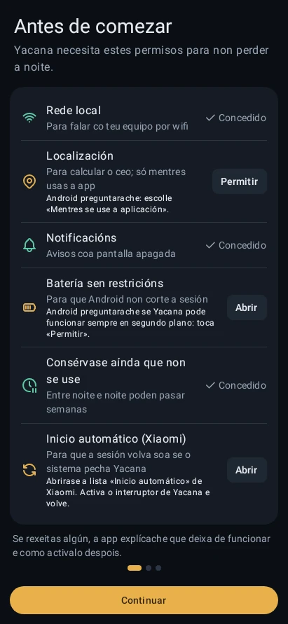 <b>Antes de comezar.</b> As filas concedidas mostran un visto.</td>
</tr></table>

| Permiso | Para que serve | Sen el |
| --- | --- | --- |
| **Rede local** | Para falar co teu equipo por wifi. Pídese en Android 17 e posteriores. | A app non pode atopar nin controlar ningún dispositivo Alpaca. |
| **Localización** | Para calcular o ceo no teu sitio, só mentres usas a app. Escolle **Mentres se use a aplicación**. | Escribe entón o sitio no perfil. |
| **Notificacións** | A sesión e os seus avisos coa pantalla apagada. Pídese en Android 13 e posteriores. | Non ves a sesión nin os seus avisos fóra da app. |
| **Batería sen restricións** | Para que Android non corte a sesión. Toca **Permitir** cando Android pregunte. | O sistema pode cortar a sesión coa pantalla apagada. |
| **Consérvase aínda que non se use** | Entre noite e noite poden pasar semanas. Desactiva **Pausar a actividade da aplicación se non se usa**. Android 11 e posteriores. | Android pode quitarlle os permisos á app tras uns meses sen usala. |
| **Inicio automático (Xiaomi)** | Nos móbiles Xiaomi, Redmi e Poco, para que a sesión volva se o sistema pecha Yacana. Activa o interruptor de Yacana. | Se o sistema pecha Yacana pola noite, a sesión non volve soa. |

Se rexeitas algún, nada se rompe de inmediato: a app explica que deixa de funcionar e como activalo despois, en *Axustes › Permisos* ([capítulo 33](#permissions)). Toca **Continuar** para seguir.

### 2 · Busca o teu equipo

1. Acende o equipo e conecta o móbil á súa wifi, ou pon os dous na wifi da casa.
2. Yacana busca soa dispositivos Alpaca na rede, en IPv4 e IPv6. Cada servidor que atopa aparece como unha tarxeta cos seus dispositivos. **Buscar outra vez** repite a busca.
3. Nun Seestar, toca **Teleobxectivo** ou **Gran angular**: carga o perfil do Seestar para esa cámara, coa súa óptica, campo e axustes recomendados. Podes crear os dous e cambiar dun a outro desde a tarxeta **Perfil** en Equipo. Para outro equipo, toca **Engadir**: o perfil colle o primeiro dispositivo de cada tipo dese servidor.

Se non se atopa un dispositivo, por exemplo nunha rede que bloquea a detección, toca **Engadir por IP e porto** e escribe o seu enderezo, como `192.168.1.10:32323`. Se xa tes un perfil doutro móbil, **Importar perfil** cárgao. **Agora non** salta esta páxina; podes buscar o teu equipo despois en Equipo.

<table><tr>
<td valign="top" width="240">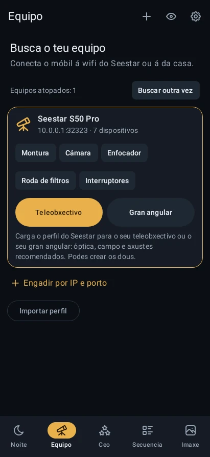 <b>Atopado na wifi.</b> Un Seestar cos seus sete dispositivos.</td>
</tr></table>

### 3 · Listo para o campo

Yacana funciona sen internet, pero dúas cousas son demasiado grandes para incluílas na app. Esta páxina mostra o que xa está no móbil e o que descargar mentres aínda tes wifi:

- **Catálogo de obxectos** e **Efemérides**: incluídos na app, non hai que facer nada.
- **Base de estrelas**: a recomendada para o teu campo, D50 para un Seestar. Toca **Descargar**.
- **Caché do ceo de NINA**: as fotos do atlas e do encadramento. Toca **Importar** se xa tes o seu ZIP; para descargala dentro da app, usa *Axustes › Mapa do ceo* ([capítulo 6](#field)).

As descargas seguen en segundo plano. Toca **Comezar** para abrir a app.

<table><tr>
<td valign="top" width="240">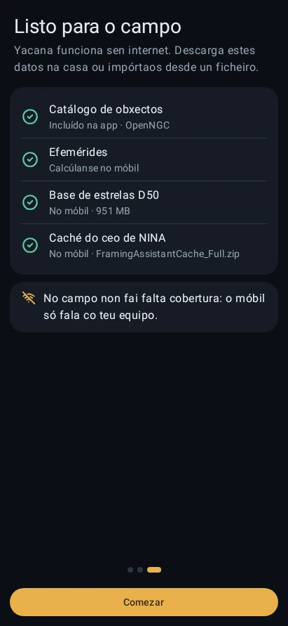 <b>Listo para o campo.</b> Todo no móbil.</td>
</tr></table>

> [!TIP]
> **Convén saber**
>
> Os primeiros pasos non se poden volver abrir. As súas partes seguen dispoñibles: os permisos en *Axustes › Permisos*, a busca de equipo en Equipo, as bases de estrelas en *Axustes › Plate solving* e as cachés do ceo en *Axustes › Mapa do ceo*.

## 4. Orientarse na app

Yacana está organizada polos momentos da noite e non por paneis de dispositivos. En cada momento mostra o que necesitas e deixa o resto a un toque.

### As cinco seccións

A barra inferior ten cinco seccións. Co móbil en horizontal convértese nunha barra lateral á esquerda. Ao tocar a sección na que estás, volves á súa primeira pantalla.

| Sección | Para que | Barra superior |
| --- | --- | --- |
| **Noite** | A escuridade e a Lúa desta noite, a lista de preparación, a sesión en curso, o resumo e o diario | Estado do equipo, modo vermello, Axustes |
| **Equipo** | Perfís, conexión e control manual de cada dispositivo | Engadir dispositivo, modo vermello, Axustes |
| **Ceo** | Mapa do ceo, Sky Atlas, fichas dos obxectos e encadramento | Capas do ceo ou Filtros, modo vermello |
| **Secuencia** | Plan desta noite, secuencias gardadas, modelos, os editores simple e avanzado | — |
| **Imaxe** | Captura manual, estatísticas, historial, apilado en directo e foto de referencia | Modo vermello, Máis opcións |

### Controis comúns

- **Axustes:** A roda dentada en Noite e Equipo, ou **Axustes** ao final de **Máis opcións** en Imaxe. A súa caixa de busca atopa calquera axuste por parte do seu nome.
- **Modo vermello:** A icona do ollo en Noite, Equipo, Ceo, Imaxe, a ficha do obxecto, o encadramento e os asistentes. Pon cada píxel en vermello ([capítulo 32](#display)).
- **Estado do equipo:** En Noite, un escudo cando o equipo está conectado sen problemas, ou un triángulo de aviso mentres a app reconecta ou se detén de forma segura.
- **Atrás e pechar:** A frecha da parte superior esquerda volve atrás. Os asistentes (aliñamento polar, autoenfoque e flats) mostran no seu lugar **✕**, que os detén.
- **Follas:** Moitas opcións ábrense nunha folla que sobe desde a parte inferior da pantalla. Arrástraa cara abaixo, ou toca fóra dela, para pechala.
- **Números:** As horas, as coordenadas e o número de tomas introdúcense con valores frecuentes e co teclado numérico propio da app, para que o teclado do sistema, que o modo vermello non pode colorear, nunca se acenda pola noite.
- **Manter premido:** Os botóns arriscados énchense mentres os premes e actúan despois de aproximadamente un segundo: aparcar, parar unha secuencia, borrar un perfil, unha caché, unha base ou unha secuencia gardada. Un toque curto non fai nada máis que lembrarche que o manteñas premido.
- **Estados:** Cada estado móstrase cunha icona e palabras, nunca só coa cor, porque en modo vermello o verde e o ámbar vense iguais.

### A barra da sesión

Mentres unha secuencia está en curso ou en pausa, unha barra en todas as pantallas agás Noite mostra o obxectivo, o filtro, a exposición e a toma, co seu progreso, como a barra «a soar agora» dunha app de música. Tócaa para ver a sesión en Noite; o seu botón pausa ou retoma a secuencia.

### Notificacións

Mentres o equipo está conectado, unha notificación mostra a sesión, tamén na pantalla de bloqueo: o obxectivo, a toma e o progreso, ou as tomas gardadas. Tócaa para abrir a app. O seu botón **Desconectar** detén a captura e desconecta o equipo. Os avisos que te necesitan, como unha conexión perdida ou unha parada segura, soan; os sucesos, como un autoenfoque ou o final da secuencia, chegan en silencio. Cada tipo ten a súa propia canle de notificación (*Sesión da noite*, *Alertas da noite*, *Sucesos da noite*), que podes axustar nos axustes de Android para a app.

<table><tr>
<td valign="top" width="330">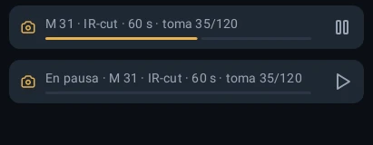 <b>A barra da sesión</b>, en curso e en pausa.</td>
</tr></table>

## 5. O perfil do teu equipo

Un perfil é un conxunto de equipo e a forma en que o usas: os seus dispositivos, óptica, sitio, límites e opcións. Todo o que Yacana calcula por ti, como o campo, a escala do plate solving ou a base de estrelas recomendada, sae del. O plate solving, o autoenfoque, a seguridade, os nomes de ficheiro e o apilado en directo tamén se gardan por perfil.

Ábreo con *Axustes › Perfil e localización*, ou toca a tarxeta **Perfil** en Equipo e despois **Abrir o perfil**. Os perfís, os dispositivos e o borrado do perfil só se cambian co equipo desconectado.

### Nome e óptica

- **Nome:** tócao para editalo aí mesmo.
- **Distancia focal:** en milímetros, de 10 a 10.000, a do telescopio co seu redutor se o leva. Dá a escala do plate solving e o campo que debuxa o mapa do ceo.
- **Abertura:** o diámetro do obxectivo, de 5 a 2.000 mm. A relación focal móstrase ao seu carón.
- **Sensor da cámara** e **Tamaño de píxel:** os seus píxeles en ancho e en alto (o alto pídese despois do ancho) e o seu tamaño en µm, como dan as especificacións da cámara; un Seestar S50 Pro ten 2160 × 3840 px de 2,9 µm. A cámara éncheos ao conectarse; escritos, o campo coñécese sen conectar nada, para o mapa do ceo e o encadramento.

Unha vez conectada a cámara, a tarxeta mostra a escala e o campo, como *2,25″/px · campo 1,35° × 2,40°*.

### Localización

O sitio determina a escuridade desta noite, cada altura e o polo para o aliñamento polar.

- **Usar a localización do móbil** tómaa do móbil ao activala, cada vez que se abre a app e ao conectar; a primeira vez, Android pide o permiso. Se non chega, a fila di por que, e ao tocala volve intentalo. Desactivado, escríbela ti: latitude norte ou sur (de 0 a 90°), lonxitude leste ou oeste (de 0 a 180°) e altitude en metros (de 0 a 9.000).
- **Enviar a hora e o sitio á montura** pásalle á montura a hora UTC do móbil e o sitio ao conectar.

### Límites

- **Límite de altura**, de 0 a 60°: ningún GoTo baixa del, nin do horizonte. Un GoTo por debaixo rexéitase e a montura non se move; un movemento coa cruceta detense só no límite.
- **Horizonte:** plano, ou o teu propio con árbores e edificios. **Importar** le un ficheiro de horizonte de N.I.N.A.: un punto por liña, acimut e altura en graos, separados por espazos ou tabulacións, con `#` para os comentarios. **Deixalo plano** elimínao. As fichas dos obxectos debúxano na súa gráfica de altura.

<table><tr>
<td valign="top" width="240">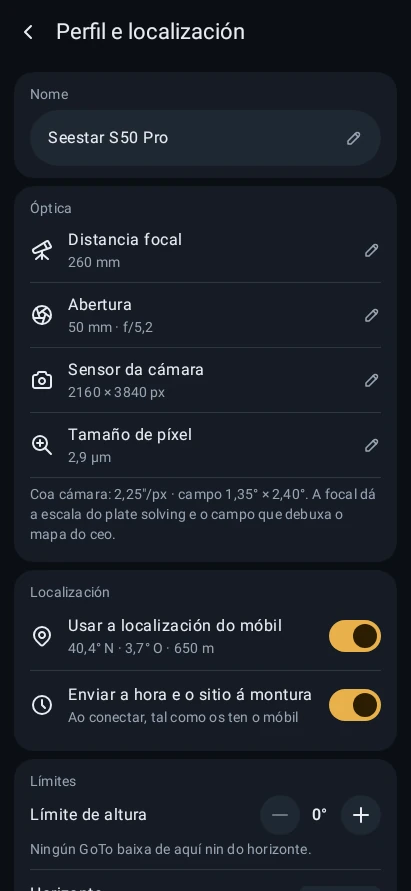 <b>Perfil e localización.</b> O perfil do Seestar.</td>
<td valign="top" width="240">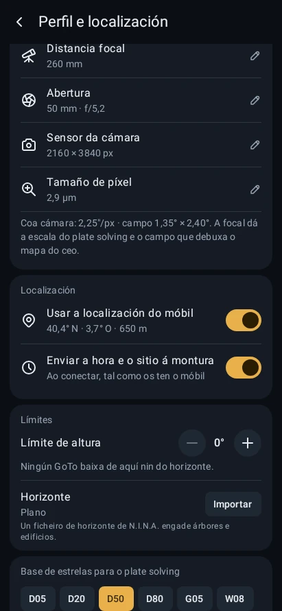 <b>Base de estrelas</b> para o plate solving, escollida por perfil.</td>
</tr></table>

### Base de estrelas

Os botóns escollen a base do perfil para o plate solving. A app indica cal é a axeitada para o teu campo. Se escolles unha que non está no móbil, aparecen o seu tamaño e un botón **Descargar**: pasa a estar en uso cando remata a descarga, e mentres tanto segue a anterior.

### Máis dun perfil

- **Cambiar:** toca a tarxeta **Perfil** en Equipo e escolle outro, ou toca **Usar** xunto a el en **Outros perfís**.
- **Novo:** **Novo perfil**, en **Outros perfís**, busca na rede; o equipo que escollas convértese nun perfil novo, en uso.
- **Copiar a outro móbil:** en **Copia do perfil**, **Exportar** garda o perfil como ficheiro JSON onde ti escollas, e **Importar** le un e ponno en uso. O ficheiro leva a localización do sitio.
- **Borrar:** **Borrar perfil** *(mantén)*, ao final da pantalla.

## 6. Listo para o campo

No campo o móbil só fala co teu equipo. Antes da túa primeira noite, mentres tes wifi na casa, pon dúas cousas no móbil: unha base de estrelas para o plate solving e as fotos do ceo. As dúas tamén se poden importar desde un ficheiro, por exemplo copiado dun PC ou dunha tarxeta de memoria.

### Bases de estrelas

En *Axustes › Plate solving*, en **Base de estrelas**. A app marca a **recomendada** para o teu campo e mostra o tamaño do campo. Pode haber varias no móbil á vez; o perfil usa unha, marcada **En uso**.

<table><tr>
<td valign="top" width="240">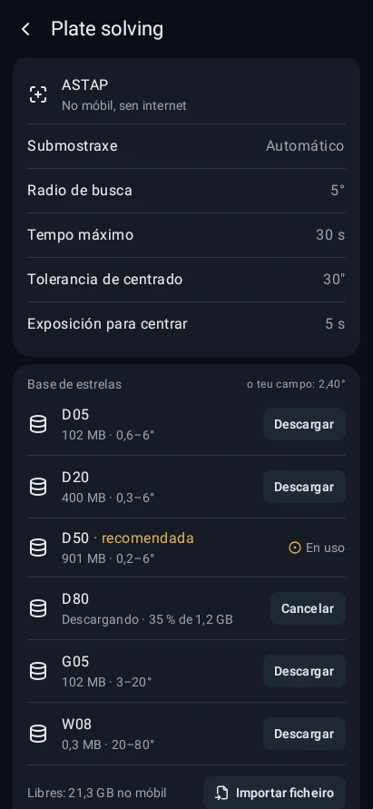 <b>As bases de estrelas.</b> D50 en uso, D80 descargándose.</td>
</tr></table>

| Base | Tamaño | Para campos de | Notas |
| --- | ---: | --- | --- |
| **D05** | 102 MB | 0,6° a 6° | A opción lixeira |
| **D20** | 400 MB | 0,3° a 6° |  |
| **D50** | 901 MB | 0,2° a 6° | Recomendada para o Seestar |
| **D80** | 1,2 GB | 0,15° a 6° | A máis densa |
| **G05** | 102 MB | 3° a 20° | Campos amplos, obxectivos fotográficos |
| **W08** | 0,3 MB | 20° a 80° | Campos moi amplos |

- **Descargar** tráea da web de ASTAP só con wifi, mesmo coa app pechada, e continúa se se interrompe. Pasa a estar en uso ao rematar. O espazo libre no móbil móstrase debaixo da lista.
- **Importar ficheiro** instálaa desde o propio ficheiro ZIP ou `.deb` de ASTAP, por exemplo desde unha tarxeta de memoria.
- Mantén premida unha base instalada para borrala con **Borrar base** *(mantén)*. A que está en uso non se pode borrar: pon antes outra en uso.
- **Probar coa última toma** resolve a última toma de Imaxe cos axustes actuais, para comprobalos.

### As fotos do ceo: as cachés de N.I.N.A.

O mapa do ceo, o Sky Atlas, as fichas dos obxectos, o encadramento e a referencia de Imaxe usan todos as fotos das cachés de encadramento de N.I.N.A. Yacana le as cachés tal como as publica N.I.N.A., directamente desde o seu ZIP sen descomprimilo, así que unha caché ocupa o mesmo que o seu ZIP e nada máis. Abre *Axustes › Mapa do ceo*, ou a icona de capas no mapa do ceo.

- **Caché completa (DSS):** todo o ceo en 2.131 fotos en cor de 5° do Digitized Sky Survey, 3,5 GB. É a que tes que descargar.
- **NSNS con estrelas** (1,4 GB) e **NSNS sen estrelas** (471 MB): o Northern Sky Narrowband Survey, emisión de hidróxeno e osíxeno ata uns −17° de declinación. Debúxanse como unha segunda capa.
- **Fotos en liña:** as fotos con máis detalle que trae o mapa cando o amplías moito con internet, gardadas no móbil.

<table><tr>
<td valign="top" width="240">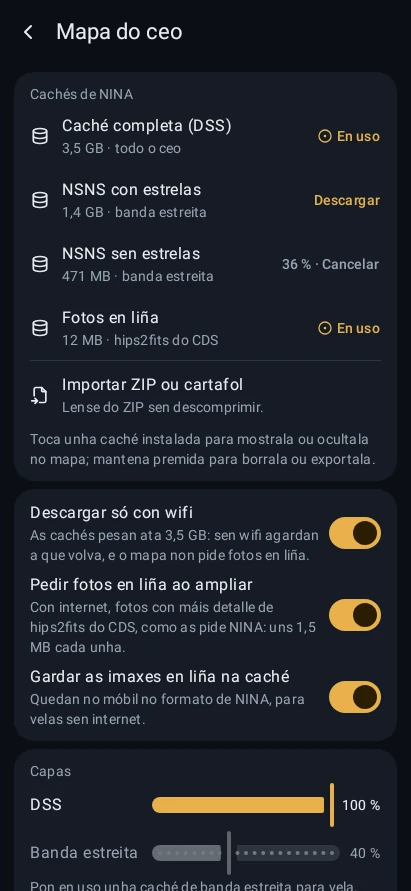 <b>Axustes › Mapa do ceo.</b> A caché completa en uso e unha de banda estreita chegando.</td>
</tr></table>

#### Conseguir unha caché

- **Descargar** tráea da web de N.I.N.A. a través do xestor de descargas de Android. Continúa se se interrompe e comproba antes o espazo libre. Con **Descargar só con wifi** activado (o predeterminado), agarda pola wifi.
- **Importar ZIP ou cartafol**: **Escoller un ZIP** colle un dos ZIP de N.I.N.A., como os da súa web; **Escoller un cartafol** colle o cartafol da caché que N.I.N.A. ten nun PC (`FramingAssistantCache`), copiado ao móbil ou nunha tarxeta. Cópianse á app.

#### Usala

- Toca unha caché instalada para mostrala no mapa ou ocultala: **En uso** ou **Instalada**.
- **Capas:** a opacidade da capa DSS (100 % por defecto) e da de banda estreita (40 %), para mesturalas.
- **Pedir fotos en liña ao ampliar** (activado por defecto): con internet, ao ampliar o mapa pídense fotos con máis detalle a hips2fits do CDS, como fai N.I.N.A., de uns 1,5 MB cada unha. Desactívao para reservar os datos móbiles para outras cousas; con **Descargar só con wifi** activado, o mapa tampouco as pide con datos móbiles.
- **Gardar as imaxes en liña na caché**: se está activado, quedan no móbil no formato de N.I.N.A., para velas de novo sen internet.

#### Borrala ou exportala

Mantén premida unha caché instalada. A folla indica canto espazo libera; **Borrar caché** *(mantén)* elimínaa. Unha caché en cartafol, como as fotos en liña, tamén ofrece **Exportar ZIP**, para abrila en N.I.N.A. nun PC.

<table><tr>
<td valign="top" width="240">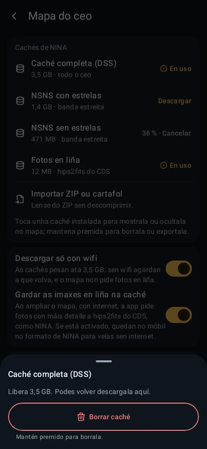 <b>Mantendo premida unha caché.</b> O que libera e o botón que hai que manter premido.</td>
</tr></table>

> [!TIP]
> **Créditos**
>
> As fotos non forman parte da app: descárgalas da web de N.I.N.A. ou impórtalas. O DSS é do STScI, que permite a N.I.N.A. distribuílo, e o NSNS está baixo CC BY-NC-SA 4.0. O mapa mostra *DSS: STScI · NSNS: CC BY-NC-SA 4.0*.

---

# Equipo

## 7. Conectar o teu equipo

A sección Equipo contén o perfil en uso, conéctao e dáche control manual de cada dispositivo.

1. Comproba a tarxeta **Perfil**: o nome do perfil e de onde vén o seu sitio, como *Localización por GPS · 40,4° N · 3,7° O · 650 m*. Tócaa para cambiar a outro perfil.
2. Toca **Conectar**. A fila di *Conectando…* e despois cantos dispositivos responderon, como *5 de 5 conectados*, ou por que un non se puido conectar.
3. Cada dispositivo ten unha fila co seu estado en directo: a montura seguindo e a súa altura, a cámara en repouso e a temperatura do seu sensor, a posición do enfocador, o filtro posto, o quentador antiorballo acendido. Actualízanse cada un ou dous segundos.
4. Toca un dispositivo conectado para abrir a súa pantalla. **Desconectar todo** remata a conexión.

Se cae a conexión, Yacana reconecta soa. Durante unha secuencia, primeiro fai unha pausa segura ([capítulo 28](#safety)).

<table><tr>
<td valign="top" width="240">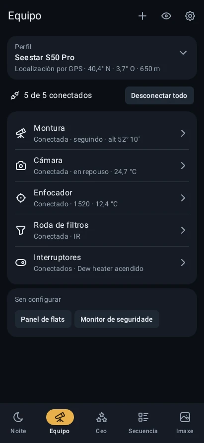 <b>Equipo.</b> Cinco dispositivos conectados; o panel de flats e o monitor de seguridade, sen configurar.</td>
</tr></table>

### Engadir un dispositivo

O **+** da parte superior abre *Engadir dispositivo*, que busca de novo na rede. Cada servidor mostra os dispositivos que o teu perfil aínda non ten, cada un con **Engadir**; **Engadir por IP e porto** admite un enderezo. A tarxeta **Sen configurar**, ao final da lista, ten un botón para cada dispositivo opcional, o panel de flats e o monitor de seguridade, que abre a mesma busca. Os dispositivos só se engaden co equipo desconectado.

### Sen perfil

Se saltaches os primeiros pasos, Equipo comeza con **Busca o teu equipo**, a mesma busca que no [capítulo 3](#first-steps), e un botón **Importar perfil**.

## 8. A montura

A pantalla da montura mostra a onde apunta e móvea a man, con GoTo, sincronización, aparcado e seguimento.

### A onde apunta

A tarxeta superior mostra o seu estado, como *Seguindo · sideral*, *Movéndose*, *Sen seguimento* ou *Aparcada*, e a súa AR, Dec, altura e acimut. Mentres centra un obxectivo, a tarxeta mostra o intento e o paso actual, con **Deter**.

### Movela a man

Mantén premida unha frecha (N, S, L, O) para mover a montura; párase ao soltala. O botón vermello do medio detena ao momento. Os botóns de debaixo fixan a velocidade: **1×**, **8×** (a predeterminada) ou **64×** a velocidade sideral, ou **Máx**, a máis rápida da montura. Un movemento detense só no límite de altura do perfil.

### Os botóns

- **Ir a…:** Abre unha folla para escribir a AR e a Dec co teclado numérico da app (máis abaixo).
- **Sincronizar:** Dille á montura que apunta ás coordenadas que escribas. Cunha toma resolta, usa no seu lugar **Sincronizar a montura** de Imaxe ([capítulo 18](#solving)). Só se mostra se a montura pode sincronizar.
- **Aparcar:** Mantén premido este botón para levar a montura á súa posición de repouso. Un toque curto só che lembra que o manteñas premido. Coa montura aparcada, o botón di **Desaparcar**, e un toque desaparcaa.
- **Seguimento:** Activa ou desactiva o seguimento.
- **Aliñamento polar:** Abre o asistente de aliñamento polar ([capítulo 17](#polar)).

O menú **⋮** da parte superior contén o resto: a **Velocidade de seguimento** (sideral, lunar, solar ou King, as que admita a montura), **Desaparcar** cando está aparcada, e **Ir a casa** se a montura o ten.

<table><tr>
<td valign="top" width="240">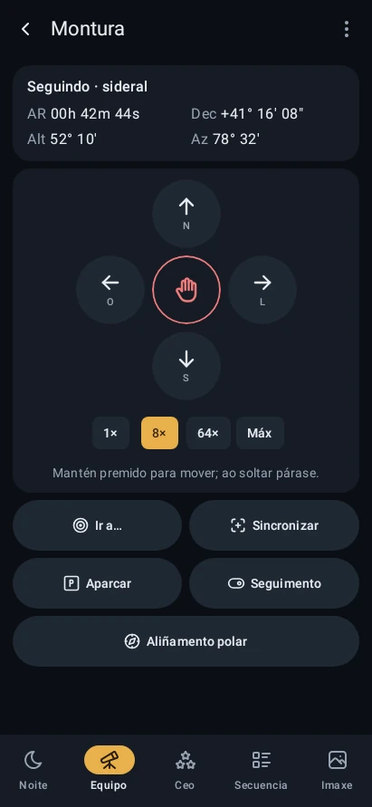 <b>Montura.</b> Mantén premida unha frecha para mover; toca a velocidade.</td>
<td valign="top" width="240">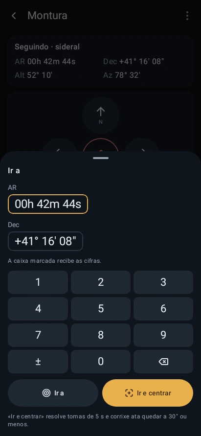 <b>Ir a.</b> A caixa marcada recibe as cifras.</td>
</tr></table>

### Ir a unhas coordenadas

1. Toca **Ir a…**. A folla mostra a AR e a Dec actuais da montura.
2. Toca a caixa da AR ou da Dec para marcala e escribe as cifras no teclado numérico. **±** cambia o signo da declinación.
3. Toca **Ir a** para moverse alí, ou **Ir e centrar** para moverse e despois afinar con plate solving ata que o obxectivo estea dentro da tolerancia (30″ por defecto).

> [!CAUTION]
> **Por debaixo do límite**
>
> Un GoTo a un obxectivo por debaixo do límite de altura do perfil, ou do seu horizonte, rexéitase. A pantalla indica onde está o obxectivo e que a montura non se moveu. Agarda a que suba, ou cambia o límite no perfil ([capítulo 5](#profile)).

## 9. Cámara e roda de filtros

### Cámara

A pantalla da cámara mostra o seu estado, como *En repouso · −10 °C*, e o que informa: o tamaño do sensor, o tamaño do píxel, o patrón Bayer, os rangos de ganancia e offset, e a exposición máis longa. As tomas fanse en Imaxe; **Ir a Imaxe** lévate alí ([capítulo 20](#imaging)).

Yacana usa cada cámara tal como se describe por Alpaca: ganancia, offset, binning, rexión de interese e temperatura do sensor, se a cámara os ten. As tomas descárganse directamente na memoria nativa do móbil mentres comeza a seguinte exposición, así que caben ata cámaras de 61 MP.

### Roda de filtros

A pantalla da roda de filtros lista os seus filtros, cun visto no que está posto. Toca un filtro para poñelo. En Imaxe o filtro tamén é un botón debaixo da toma.

Un filtro chamado **Dark**, como no Seestar, úsase como obturador para os darks e os bias, así que non hai que tapar nada. Sen el, a app pídeche que tapes o telescopio cando fai darks.

## 10. O enfocador

- **Posición** e **Temperatura**, en grande, coa hora e a temperatura do último autoenfoque.
- **Mover:** **−100**, **−10**, **+10** e **+100** pasos, e **Ir á posición…**, que abre o teclado numérico co rango do enfocador. **Parar** aparece mentres se move.
- **Última curva:** a curva en V do último autoenfoque, co seu mellor HFR e posición.
- **Desprazamento por filtro**, cunha roda de filtros: toca un filtro para fixar o seu desprazamento en pasos, respecto aos demais. Ao cambiar de filtro, o enfocador móvese a diferenza entre o desprazamento do filtro novo e o do anterior, así cada filtro segue enfocado sen un novo autoenfoque.
- **Autoenfoque** lanza o autoenfoque ao momento ([capítulo 19](#autofocus)).

<table><tr>
<td valign="top" width="240">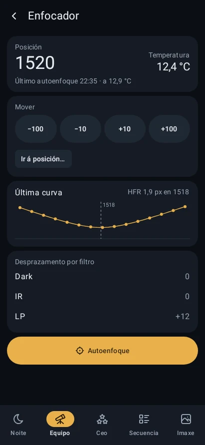 <b>Enfocador.</b> O filtro LP enfoca 12 pasos máis cara a fóra.</td>
</tr></table>

## 11. Interruptores, panel de flats e monitor de seguridade

### Interruptores

Cada interruptor móstrase tal como o declara o dispositivo: un conmutador para acendido e apagado, un control desprazable con − e + para un valor como a potencia dun quentador (co seu rango e paso; o valor envíase ao soltar), ou unha lectura para os de só lectura. O máis común é un quentador antiorballo, que a secuencia pode acender ao comezo e apagar ao final.

### Panel de flats

Para un panel de flats con tapa (un CoverCalibrator de Alpaca):

- **Tapa:** o seu estado, con **Abrir** e **Pechar**, e **Parar** mentres se move. Ábrea para a noite e péchaa para os darks.
- **Luz:** acendida ou apagada, e o seu **Brillo** cun control desprazable ou con − e +.

Para os flats, o asistente de flats pecha a tapa, acende a luz e busca el só a exposición ([capítulo 23](#calibration)).

### Monitor de seguridade

Mostra **Seguro** ou **Non seguro**, lido cada segundo, por exemplo dun sensor de nubes ou de chuvia. A app móstrao pero aínda non actúa por el: se pasa a **Non seguro**, para a secuencia desde Noite.

<table><tr>
<td valign="top" width="240">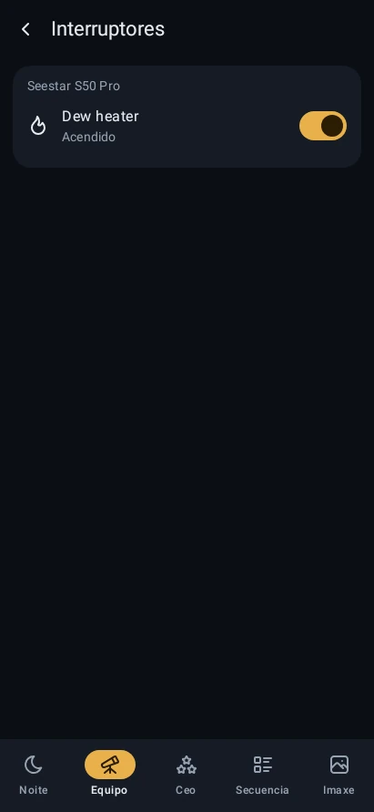 <b>Interruptores.</b> O quentador antiorballo do Seestar.</td>
<td valign="top" width="240">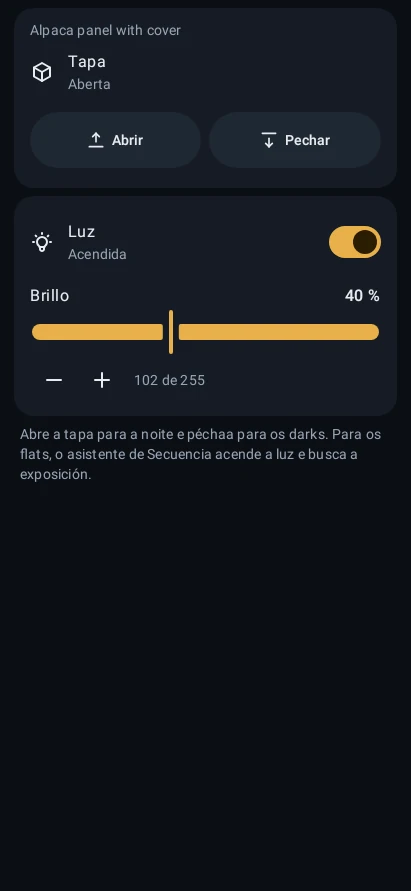 <b>Panel de flats.</b> Tapa aberta, luz ao 40 %.</td>
<td valign="top" width="240">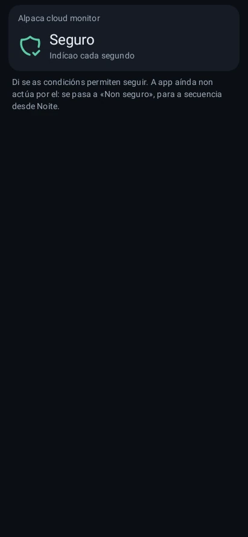 <b>Monitor de seguridade.</b> Lido cada segundo.</td>
</tr></table>

---

# Planificar a noite

## 12. Esta noite, dunha ollada

Noite é onde comeza a velada. Mostra a escuridade e a Lúa desta noite, unha lista para prepararte, a sesión mentres está en curso e o resumo pola mañá.

### A tarxeta desta noite

Calculada no móbil para o sitio do perfil:

- A data e a iluminación da Lúa, como *Lúa 34 %*.
- A mellor xanela escura: *Escuro e sen Lúa*, ou *Escuro, coa Lúa arriba* cando a Lúa está arriba durante toda a noite astronómica, co seu comezo, final e duración.
- O solpor e a saída do Sol, e unha liña de tempo desde o serán ata a mañá: crepúsculo, noite astronómica e as horas en que a Lúa está arriba, coa mellor xanela contornada.

Preto do solsticio de verán, en latitudes altas, pode dicir *Sen noite astronómica*: o Sol non baixa 18° baixo o horizonte. Sen sitio, a tarxeta indica como poñelo: permite a localización en *Axustes › Permisos* e activa a do móbil, ou escríbeo no perfil.

### Outra noite

Toca a icona do calendario para ver calquera outra noite. A grade do mes marca esta noite cun contorno e a noite que escollas enchida; as frechas cambian o mes. **Volver a esta noite** volve.

<table><tr>
<td valign="top" width="240">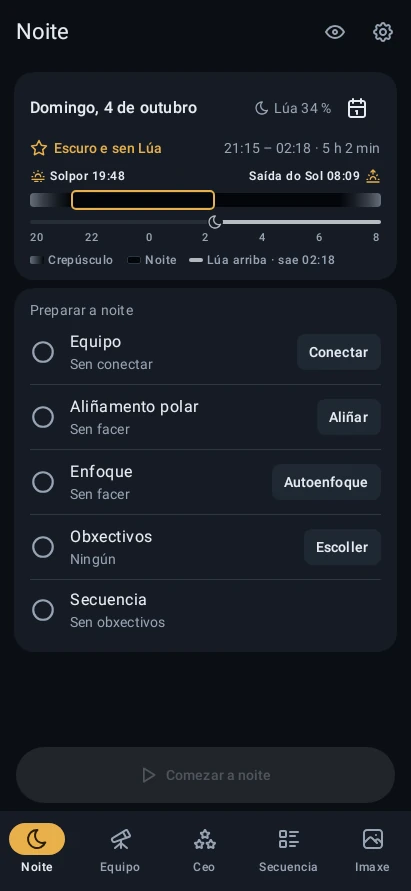 <b>Noite.</b> 5 h 2 min de ceo escuro antes de que saia a Lúa.</td>
<td valign="top" width="240">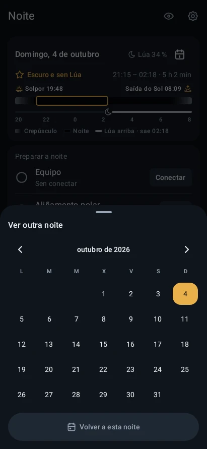 <b>Ver outra noite.</b></td>
</tr></table>

### Preparar a noite

Unha lista sen pasos obrigatorios: fai o que necesite a túa noite, en calquera orde. Cada fila mostra o seu estado e un botón que te leva alí.

| Fila | Mostra | Botón |
| --- | --- | --- |
| **Equipo** | O perfil e os seus dispositivos, unha vez conectado | **Conectar** |
| **Aliñamento polar** | *Sen facer*, ou o último erro total e hai canto tempo | **Aliñar**, despois **Afinar** |
| **Enfoque** | *Sen facer*, ou o último HFR e hai canto tempo (cun enfocador) | **Autoenfoque** |
| **Obxectivos** | *Ningún*, ou os obxectivos desta noite | **Escoller**, que abre Ceo |
| **Secuencia** | Se o plan cabe antes do amencer, e a súa duración | **Axustar** cando non cabe |

Cando o equipo está conectado e o plan ten exposicións, **Comezar a noite** inicia a secuencia ([capítulo 27](#running)). As marcas das filas son iconas ademais de cores, así que se len igual en modo vermello.

<table><tr>
<td valign="top" width="240">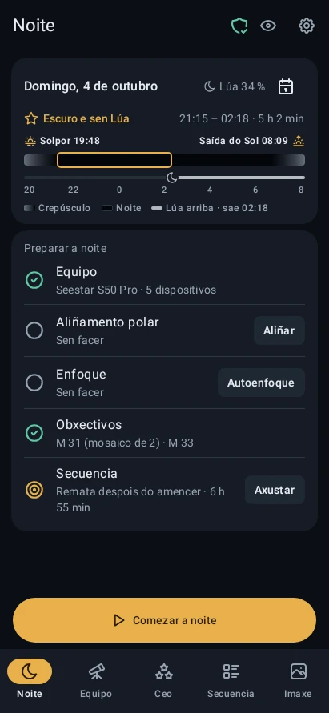 <b>Listo para comezar.</b> O plan remata despois do amencer: <i>Axustar</i> recórtao.</td>
</tr></table>

## 13. O mapa do ceo

A sección Ceo ábrese nun mapa do ceo real, debuxado coas fotos da caché de N.I.N.A., sen internet. O mapa quédase onde o deixaches, tamén despois de pechar a app. Arrástrao cun dedo, belisca para ampliar desde unha vista ampla ata menos do campo da túa cámara, e toca un obxecto para seleccionalo.

O mapa oriéntase como ves o ceo desde o sitio do perfil neste momento, co cénit arriba; sen sitio, o norte está arriba. Unha barra de escala mostra o tamaño dun grao, e as coordenadas do centro están abaixo á dereita.

### Que mostra

- **Fotos:** a etiqueta da parte superior indica de onde veñen, como *DSS · caché de NINA*. Con internet, ao ampliar tráense fotos con máis detalle da zona; mentres chega unha, xira unha rodiña na etiqueta. Sen caché, a etiqueta indica como instalar unha; tócaa para abrir os axustes do mapa do ceo.
- **O teu campo:** un recadro discontinuo no centro, do tamaño do campo da túa cámara, co nome do perfil.
- **Obxectos:** contornos e nomes dos obxectos do catálogo.
- **Horizonte:** unha liña clara onde está o horizonte da localización do perfil, que segue o seu propio horizonte se o perfil ten un, con **N**, **L**, **S** e **O** sobre ela.

### Seleccionar un obxecto

Toca un obxecto: o mapa céntrase nel e unha tarxeta mostra o seu nome, tamaño, altura e mellor hora, con **Encadrar**. Toca a tarxeta para ver a ficha do obxecto. Toca ceo baleiro para deseleccionalo.

Para encadrar unha área sen obxecto do catálogo, céntraa no mapa, dentro do recadro do teu campo, e toca **Encadrar aquí**, o botón redondo dourado debaixo do zoom: o encadramento ábrese aí, e a área entra na secuencia coas súas coordenadas como nome, como *03h 47m +24° 07′*.

### Botóns

- **+ e −:** ampliar e reducir.
- **Encadrar aquí:** o dourado, debaixo, encadra o centro do mapa.
- **Capas** (barra superior): os axustes do mapa do ceo, coas cachés e a opacidade das capas ([capítulo 6](#field)).

<table><tr>
<td valign="top" width="240">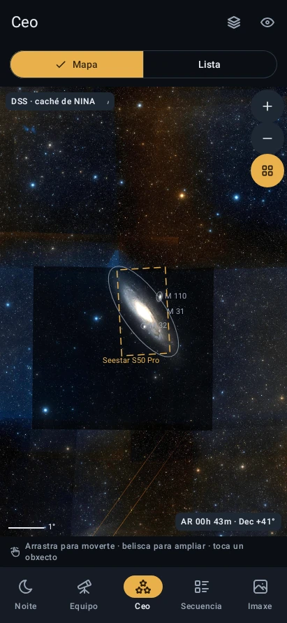 <b>O mapa.</b> M 31 sobre as fotos DSS, co campo do Seestar.</td>
</tr></table>

### A montura no mapa

Coa montura conectada, o mapa mostra dous recadros do campo da túa cámara. Distínguense pola súa liña, así que tamén se diferencian en modo vermello:

- **Encadramento:** discontinuo, no centro do mapa. É onde queres ir.
- **Telescopio:** continuo, onde apunta agora o telescopio, movéndose segundo se le cada segundo.

Arrastra o mapa para poñer o obxectivo no recadro do encadramento, ou toca un obxecto para centralo, e despois:

- **Ir e centrar** leva o telescopio ao encadramento e afínao con plate solving ata a tolerancia do perfil. Unha tarxeta mostra cada paso e canto falta, con **Deter**, que detén a montura e a toma.
- **Só ir** fai o GoTo sen centrar.

Cando a montura está aparcada ou sen seguimento, a etiqueta **Telescopio** indícao, e ao tocala desaparca a montura ou activa o seguimento.

<table><tr>
<td valign="top" width="240">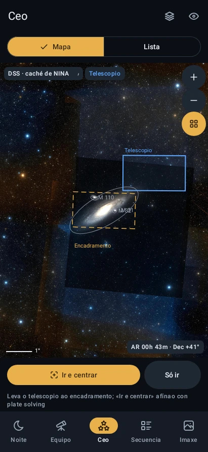 <b>Telescopio e encadramento.</b> O recadro continuo é onde apunta.</td>
<td valign="top" width="240">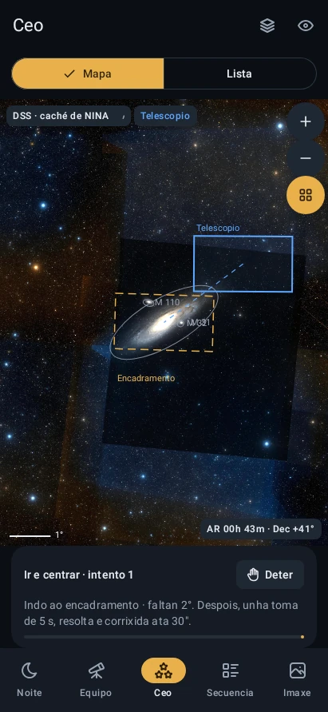 <b>Ir e centrar.</b> Faltan 2°; despois, unha toma de 5 s, resolta e corrixida.</td>
</tr></table>

## 14. Sky Atlas e busca

Cambia a sección Ceo a **Lista** para ver o Sky Atlas: 13.371 obxectos de ceo profundo de OpenNGC (NGC, IC, Messier, Caldwell e máis) no móbil, cada un coa súa foto da caché, ordenados para esta noite.

### O mellor desta noite

Con **Esta noite** activado (o predeterminado), a lista mostra o que está ben situado esta noite desde o sitio do perfil, ordenado pola súa mellor hora. Cada fila ten unha miniatura, o nome, o número de catálogo e o tamaño, se *cabe* no teu campo ou necesita un *mosaico de N*, e unha pequena curva de altura coa súa mellor hora. Toca unha fila para ver a ficha do obxecto.

Enriba da lista, **Esta noite** e **Favoritos**, os obxectos que marcaches coa estrela na súa ficha, actívanse e desactívanse cun toque. Ao seu carón aparece cada filtro activo, como *Ata mag 8* ou *Desde 1°*: o seu ✕ quítao e o seu texto abre os filtros. A icona dos controis desprazables di cantos hai, e a nota cantos obxectos quedan e en que orde. Os filtros e o sitio da lista mantéñense ao abrir un obxecto, ao cambiar de sección e ao pechar a app.

<table><tr>
<td valign="top" width="240">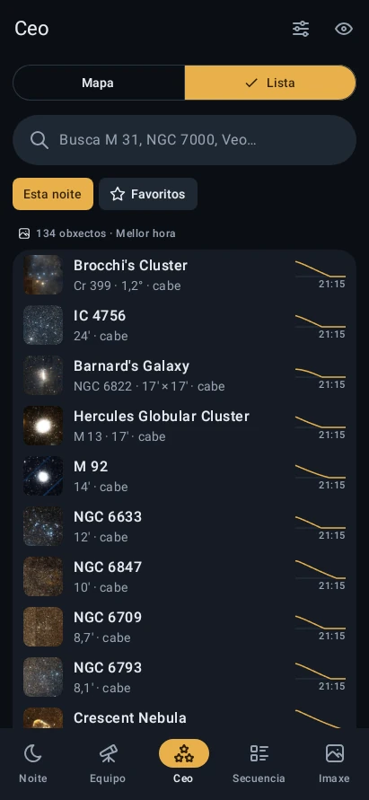 <b>Esta noite.</b> Miniaturas da caché, sen internet.</td>
<td valign="top" width="240">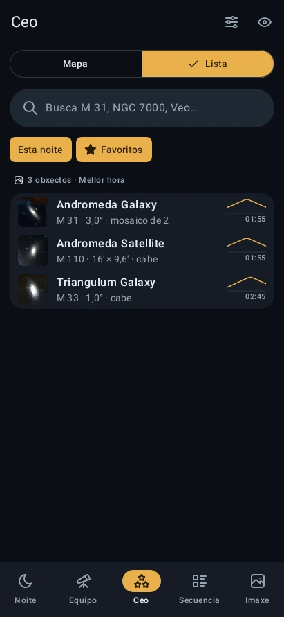 <b>Favoritos.</b> M 31 necesita un mosaico de 2.</td>
<td valign="top" width="240">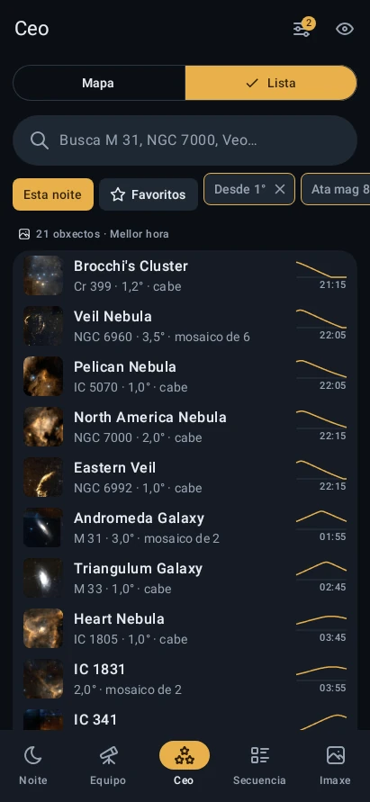 <b>Filtros activos.</b> Ata mag 8 e desde 1°.</td>
</tr></table>

### Filtros

A icona dos controis desprazables da parte superior, ou o texto dun filtro activo, abre os filtros. A lista cambia mentres escolles e a cabeceira di cantos obxectos quedan; **Restablecer** déixaos como ao principio, e **Feito**, esvarar cara abaixo, tocar fóra ou atrás péchanos. En horizontal ábrense ao lado, coa lista á vista.

- **Ordenar por:** Mellor hora (por defecto), Altura máxima, Horas visibles, Tamaño ou Brillo, cada un no seu sentido natural: primeiro o máis cedo, o que máis sobe, o que máis tempo pasa sobre a túa altura, o máis grande ou o máis brillante. A nota sobre a lista indica a orde.
- **Tipo:** Galaxias, nebulosas, cúmulos, outros.
- **Tamaño:** Calquera, para o teu campo (móstrase o seu tamaño), ou desde 15′, 30′ ou 1°.
- **Magnitude:** Calquera, ou ata 8, 10 ou 12.
- **Só:** Favoritos, e os que caben no campo.
- **Esta noite:** activado (por defecto), só o que está ben situado esta noite; a altura e as horas son as da noite pechada desta noite na localización do perfil. Desactivado, os tres seguintes non contan.
- **Por riba de:** 20°, 30° ou 45°.
- **Durante polo menos:** 1, 2 ou 4 horas.
- **Lonxe da Lúa:** Calquera, ou polo menos 30°, 60° ou 90°.

Se nada coincide, a lista indícao, con **Restablecer** para volver comezar.

<table><tr>
<td valign="top" width="240">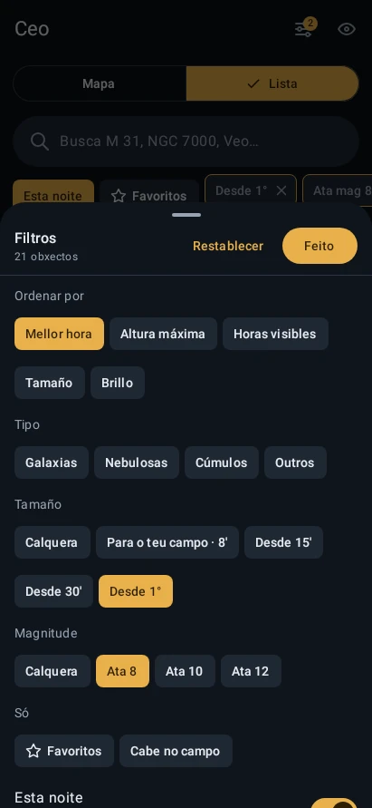 <b>Filtros.</b></td>
</tr></table>

### Busca

Escribe na caixa de busca: un número Messier, NGC, IC, Caldwell ou Sharpless, ou un nome, como *M 31*, *NGC 7000* ou *Veo*. Os resultados aparecen mentres escribes, en milisegundos, sen internet. En modo vermello, a caixa de busca abre o teclado propio da app, vermello coma todo, en lugar do do móbil; ⌄ ou atrás ocúltano.

Para calquera outra cousa, a última fila ofrece **Buscar «…» en SIMBAD**. Con internet, pregúntalle a SIMBAD do CDS, que coñece máis de 20 millóns de obxectos, desde o cuásar TON 618 ata as estrelas dunha constelación. O que atopa queda no móbil, para atopalo de novo sen conexión. Se non hai unha coincidencia exacta, lista os obxectos con nomes parecidos, os máis brillantes primeiro.

<table><tr>
<td valign="top" width="240">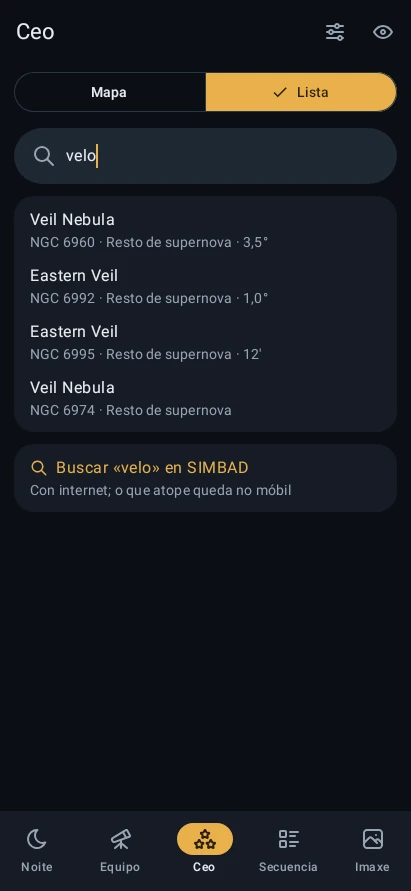 <b>Busca sen conexión.</b> «velo» atopa o Veo.</td>
<td valign="top" width="240"> <b>Máis alá do catálogo:</b> SIMBAD, con internet.</td>
</tr></table>

## 15. A ficha dun obxecto

Todo o que necesitas para decidirte por un obxectivo: a súa foto co teu campo enriba, que é, canto sobe esta noite e canto de preto está a Lúa.

- **Foto:** da caché, co campo da túa cámara debuxado enriba. Tócaa, ou o seu botón **Mapa**, para ver o obxecto encadrado no mapa do ceo; só se move o mapa, non o telescopio.
- **Datos:** nome, tipo, magnitude e tamaño; os seus outros nomes e designacións, como *Tamén Triangulum Galaxy · Triangulum Pinwheel · NGC 598*; *Cabe no campo* ou *Mosaico de N paneis*; e a distancia e a fase da Lúa, como *Lúa a 87° · 34 %*.
- **Altura esta noite:** a curva do obxecto desde o anoitecer ata o amencer, co crepúsculo sombreado nos dous extremos, a liña dos 30°, o teu propio horizonte en discontinuo se o perfil ten un, e unha liña para o momento actual. Debaixo, as horas que está por riba de 30° e o seu punto máis alto, ou que se mantén baixo ou non sae.

A estrela da parte superior márcao como favorito. **Encadrar** abre o encadramento ([capítulo 16](#framing)). **Ir e centrar**, coa montura conectada, leva o telescopio alí e céntrao, na pantalla da montura.

<table><tr>
<td valign="top" width="240">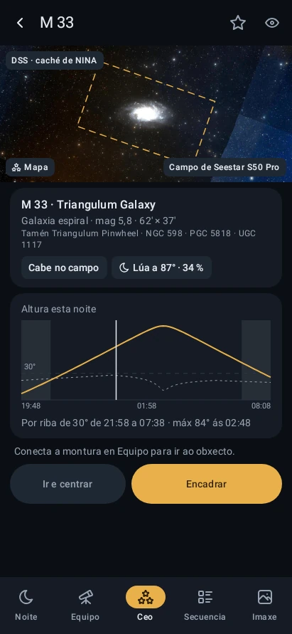 <b>M 33.</b> Cabe no campo do Seestar; a liña discontinua é o horizonte do sitio.</td>
<td valign="top" width="240">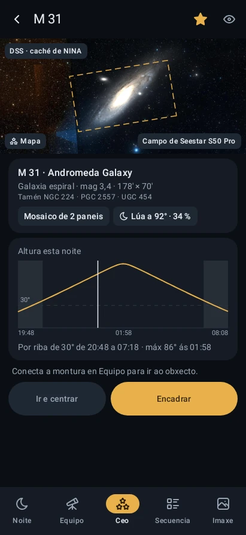 <b>M 31.</b> Un favorito que necesita un mosaico de 2 paneis.</td>
</tr></table>

## 16. Encadramento e mosaicos

O encadramento mostra como sairá a foto: o campo real da túa cámara sobre o ceo, que arrastras ata que a composición é a correcta, e mosaicos para obxectivos maiores ca o campo.

1. Ábreo con **Encadrar** na ficha dun obxecto ou na tarxeta do obxecto no mapa.
2. Arrastra o ceo para colocar o obxectivo no campo; belisca para ampliar. O tamaño do campo móstrase arriba á dereita.
3. Para un mosaico, fixa **Columnas** e **Filas** con − e +, e o **Solapamento** entre paneis, do 5 ao 50 % (15 % por defecto). Os paneis numéranse na orde en que se tomarán.
4. Comproba a liña de debaixo: as horas que está por riba de 30° esta noite.
5. Toca **Engadir á secuencia**. A app confirma que o obxectivo está na secuencia desta noite, con **Escoller outro obxectivo** e **Ver a desta noite**.

Un obxectivo novo vén con 60 tomas de 60 s co primeiro filtro que non sexa o escuro, con dither cada 3 tomas; axústaas no editor ([capítulo 25](#simple)). Despois do modelo **Un obxectivo toda a noite**, o obxectivo enche en cambio a noite ata o amencer.

**Ir e centrar**, coa montura conectada, leva o telescopio ao encadramento.

<table><tr>
<td valign="top" width="240">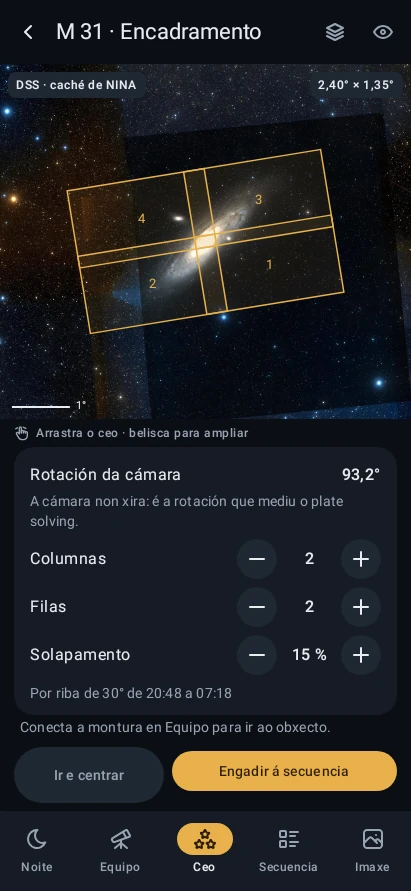 <b>M 31 · Encadramento.</b> Un mosaico de 2 × 2, rotado como está a cámara.</td>
</tr></table>

### A rotación da cámara

Sen rotador, a cámara non xira, así que o encadramento non rota o campo a man: **Rotación da cámara** é o ángulo que mediu o plate solving, e o campo e os paneis debúxanse con el. Ata a primeira resolución é 0°, ou 93,2° para un Seestar en modo EQ. Resolve unha toma en Imaxe unha vez montada a cámara, e o encadramento axústase a ela ([capítulo 18](#solving)).

> [!TIP]
> **Necesita o campo**
>
> O encadramento necesita o campo do perfil: a distancia focal e o sensor da cámara (*Axustes › Perfil e localización › Óptica*), escritos ou gardados da última conexión da cámara. Non fai falta conectar nada; a pantalla ten un botón ao perfil.

---

# No telescopio

## 17. Aliñamento polar en tres puntos

O asistente de aliñamento polar mide canto se aparta o eixe da montura do polo celeste e despois guíate, en directo, mentres xiras os parafusos da cuña. É unha adaptación do complemento Three Point Polar Alignment de N.I.N.A. e, coas mesmas medidas, dá o mesmo resultado cunha diferenza de 0,4″ como máximo.

Funciona con calquera montura que poida xirar o seu eixe de ascensión recta por orde. Necesita a montura e a cámara conectadas, unha base de estrelas no móbil e o sitio do perfil, que determina onde está o polo.

### Abrir o asistente

Toca **Aliñar** na fila **Aliñamento polar** da lista de Noite (**Afinar** unha vez medido), ou **Aliñamento polar** na pantalla da montura. O asistente ocupa a pantalla e mantena acendida mentres funciona; o **✕** da parte superior esquerda deteno e volve atrás.

### Antes de comezar

A primeira páxina explica o que vai pasar e onde apuntar: unha zona de ceo sen obstáculos, lonxe do polo e do horizonte, na dirección na que xirará o eixe. Mostra catro opcións; cada unha gárdase no perfil.

- **Xiro entre puntos:** Canto xira o eixe de AR entre as tres tomas, e cara a onde: 10°, 15°, 20° ou 30°, cara ao oeste ou cara ao leste. O predeterminado é 15° cara ao oeste. Deixa sitio para o xiro para que a montura non tope con ningún obstáculo.
- **Exposición:** 1, 2, 3 ou 5 s, con binning 1×1 ou 2×2, coa ganancia de Imaxe. Con tomas curtas o erro actualízase antes mentres xiras os parafusos. O predeterminado é 1 s a 2×2.
- **Tolerancia:** Desactivada, 0,5′, 1′, 2′ ou 5′. Cando o erro total baixa dela, o móbil vibra. Nunca oculta as frechas. Desactivada por defecto, como no complemento.
- **Resolver só con pista:** Para afinar un aliñamento que xa está preto: os tres puntos só se resolven preto de onde apunta a montura, nunca ás cegas.

<table><tr>
<td valign="top" width="240">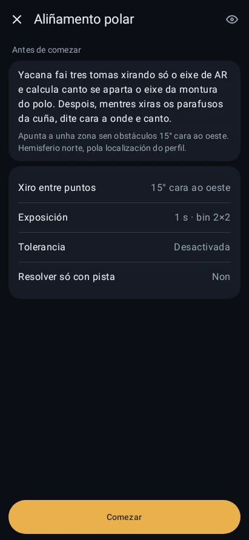 <b>Antes de comezar.</b> As opcións, cos valores predeterminados do Seestar.</td>
</tr></table>

### Medir os tres puntos

1. Apunta o telescopio a unha zona sen obstáculos como indica a primeira páxina, e toca **Comezar**.
2. Yacana fai a primeira toma e resólvea, xira o eixe de AR, fai e resolve a segunda, xira de novo e fai a terceira. Cada punto mostra *Xirando o eixe de AR…*, *Facendo a toma*, *Resolvendo con ASTAP* e despois canto tardou a resolución.
3. **Non toques a montura mentres mide.** Os tres centros trazan un círculo cuxo centro é o eixe real da montura. A súa distancia ao polo, corrixida de precesión, nutación e refracción para o teu sitio e a túa hora, é o erro.

Se un punto non se resolve, o asistente indica cal e por que, e ofrece **Comezar de novo**.

<table><tr>
<td valign="top" width="240">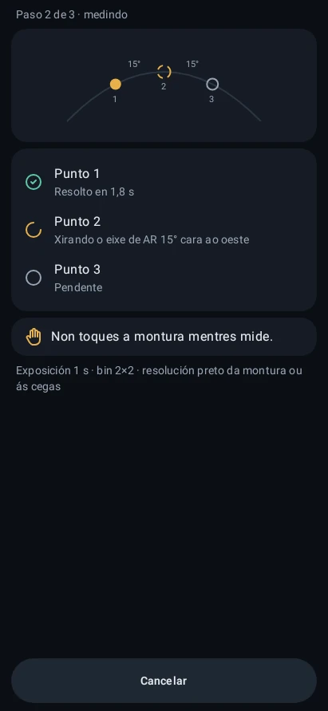 <b>Medindo.</b> Punto 1 resolto en 1,8 s, o eixe xirando cara ao punto 2.</td>
</tr></table>

### Xirar os parafusos da cuña

Agora o asistente segue facendo tomas, resolve cada unha preto da última posición e actualiza o erro cada poucos segundos. Cada eixe ten a súa propia tarxeta:

- **Altura:** unha frecha e *Sube* ou *Baixa*, ou *un pouco* cando está preto.
- **Acimut:** unha frecha e *Xira cara ao oeste* ou *cara ao leste*, ou *un pouco* cando está preto.
- O erro con signo en graos, minutos e segundos, o bastante grande para lelo a un metro, e o **Erro total** debaixo.

Xira un parafuso de cada vez e mira como baixa o seu número. Debaixo, unha diana mostra a posición do polo con aneis a 30″, 1′ e 5′. Cando estás preto, amplíase soa á *escala de segundos*, con aneis a 10″ e 30″, para que poidas afinar segundo a segundo.

**Nada se dá por bo antes de tempo.** Un eixe mantén a súa frecha ata que o seu erro, redondeado ao segundo, é 00° 00′ 00″; entón mostra *Centrado*. Non hai un visto verde ao pasar un limiar: ti decides cando está o bastante ben. Se fixas unha tolerancia, o móbil vibra cando o total baixa dela, e as frechas seguen.

Se a última toma non se resolveu, a pantalla indícao e segue tentándoo. **Medir de novo** repite os tres puntos desde onde está a montura, por exemplo despois dunha corrección grande. **Rematar** pecha o asistente, e a lista de Noite mostra o resultado e cando se mediu.

<table><tr>
<td valign="top" width="240">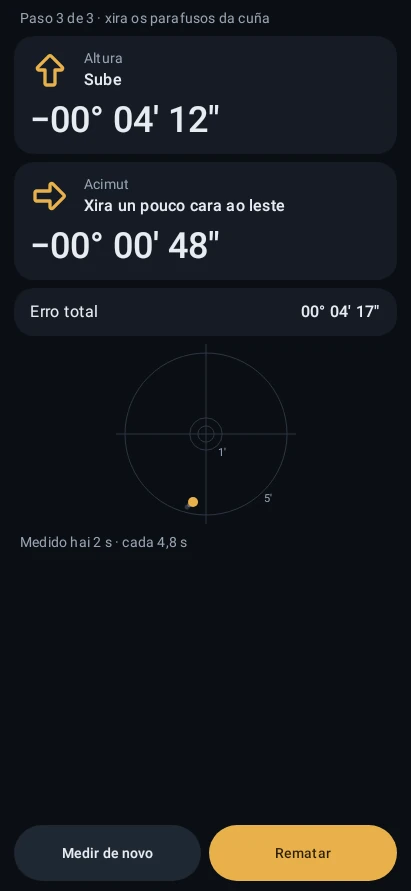 <b>A minutos.</b> Sube, e un pouco cara ao leste.</td>
<td valign="top" width="240">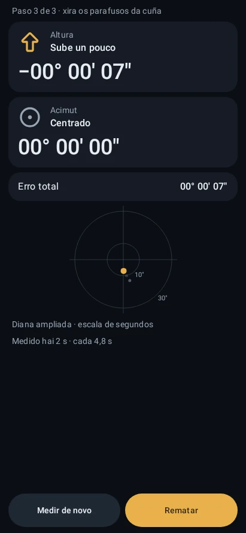 <b>A segundos.</b> A diana ampliada; acimut centrado.</td>
</tr></table>

<table><tr>
<td valign="top" width="470">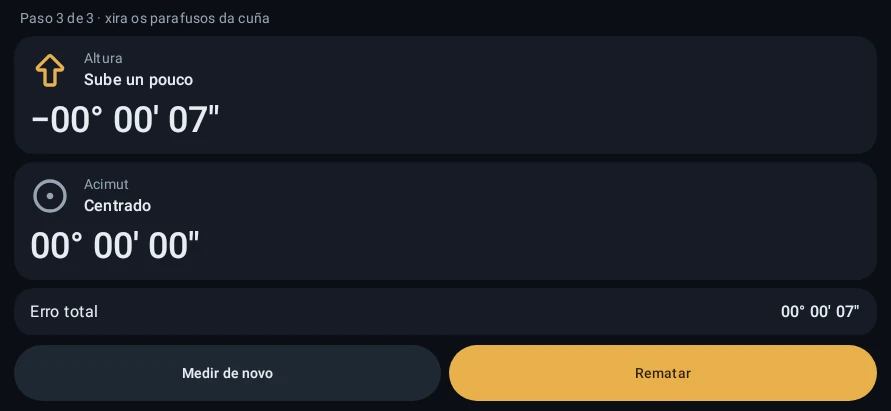 <b>En horizontal</b>, as tarxetas usan o ancho; os números seguen grandes.</td>
</tr></table>

> [!TIP]
> **Seestar**
>
> Nunha cuña, a altura axústase coa inclinación da cuña e o acimut xirando a súa base. O Alpaca do Seestar pode xirar o seu eixe de AR, que é todo o que necesita o asistente.

## 18. Plate solving e centrado

O plate solving calcula a onde apunta unha toma, a súa escala e a súa rotación, a partir do patrón das súas estrelas. Yacana executa ASTAP, o coñecido resolvedor, no propio móbil, sen internet: uns 0,4 s coa posición da montura como pista e uns 7 s ás cegas nun móbil de gama media con tomas do Seestar.

### Resolver unha toma

En Imaxe, fai unha toma e toca **Resolver**. Yacana busca primeiro preto de onde a montura di que apunta, e despois ás cegas se fai falta. O resultado mostra:

- **AR e Dec** do centro da toma, en J2000;
- a **rotación** da cámara;
- a **escala** en segundos de arco por píxel e o campo en graos;
- canto tardou, se foi preto da montura ou ás cegas, e a base de estrelas usada.

Toca **Sincronizar a montura** para dicirlle á montura que apunta aí, para que os seus próximos GoTo cheguen máis preto. A rotación resolta pasa a ser a rotación da cámara para o encadramento e os mosaicos ([capítulo 16](#framing)).

### Ir e centrar

**Ir e centrar** aparece onde queira que poidas mandar o telescopio a algún sitio: no mapa do ceo, na ficha dun obxecto, na pantalla de encadramento e na folla **Ir a…** da montura. Move a montura, fai unha toma coa exposición para centrar, resólvea, corrixe a montura e repite ata que o centro da toma está dentro da tolerancia, 30″ por defecto. O seu progreso mostra cada paso, a que distancia estaba a última toma e o intento; **Deter** detén a montura e a toma. As tomas de centrado non se gardan.

<table><tr>
<td valign="top" width="240">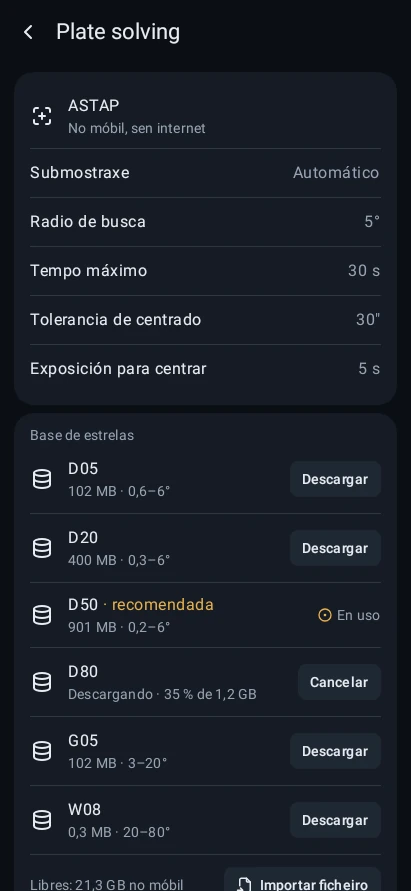 <b>Axustes › Plate solving.</b> As opcións de ASTAP e as bases de estrelas.</td>
</tr></table>

### Axustes de plate solving

En *Axustes › Plate solving*, gardados en cada perfil:

| Axuste | Predeterminado | Que fai |
| --- | --- | --- |
| **Submostraxe** | Automático | ASTAP agrupa os píxeles da toma antes de buscar estrelas. En automático escolle o factor polo tamaño da toma. |
| **Radio de busca** | 5° | Canto buscar arredor da posición da montura, de 1 a 180°. Se aí non hai solución, busca en todo o ceo. |
| **Tempo máximo** | 30 s | Para resolver preto da montura e despois ás cegas, de 5 a 600 s. |
| **Tolerancia de centrado** | 30″ | O centrado remata cando o centro da toma está así de preto do obxectivo, de 5 a 600″. |
| **Exposición para centrar** | 5 s | As tomas que resolve o centrado, coa ganancia de Imaxe; de 1 a 60 s. Non se gardan. |

As bases de estrelas están na mesma pantalla; o [capítulo 6](#field) explica como escollelas, descargalas e importalas.

> [!TIP]
> **Cando unha toma non se resolve**
>
> Comproba que a toma ten estrelas, que a distancia focal do perfil é a correcta (ASTAP busca esa escala) e que a base é axeitada para o teu campo. As nubes, o orballo ou unha toma moi desenfocada son as causas habituais.

## 19. Autoenfoque

O autoenfoque move o enfocador a través do foco, mide o HFR das estrelas en cada punto e axusta unha curva en V para atopar a mellor posición. É unha adaptación do autoenfoque de N.I.N.A., cos seus cinco axustes de curva, a compensación da folga e os desprazamentos de enfoque por filtro.

Necesita un enfocador absoluto (un que vaia a posicións en pasos) e unha cámara, apuntando a un campo con estrelas. Ábreo con **Autoenfoque** na lista de Noite, na pantalla do enfocador ou en Imaxe: a execución comeza ao momento, coas opcións de *Axustes › Autoenfoque*.

### Como vai unha execución

1. O enfocador vai uns cantos pasos cara a fóra e despois toma un punto en cada paso cara a dentro: unha toma, as súas estrelas e o seu HFR.
2. Engade puntos ata que hai tantos a cada lado do mellor como cos que comezou. A gráfica vaise enchendo, co punto actual, a súa exposición e o filtro.
3. Despois do último punto, axusta a curva, move o enfocador ao mellor enfoque e compróbao. O resultado mostra a posición, o HFR, a temperatura, o R² do axuste e onde estaba antes o enfocador.

Toca **Rematar** para pechalo. **Cancelar** durante unha execución devolve o enfocador a onde estaba. Se a execución falla, a pantalla indica por que, o enfocador volve, e **Tentalo de novo** comeza outra vez.

O resultado gárdase: a pantalla do enfocador mostra o último autoenfoque e a súa curva, a lista de Noite mostra o HFR e hai canto tempo, e o diario rexístrao.

<table><tr>
<td valign="top" width="240">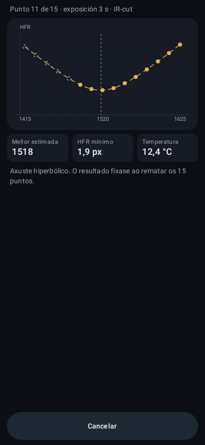 <b>En curso.</b> Punto 11 de 15, unha exposición de 3 s co filtro de corte IR.</td>
<td valign="top" width="240">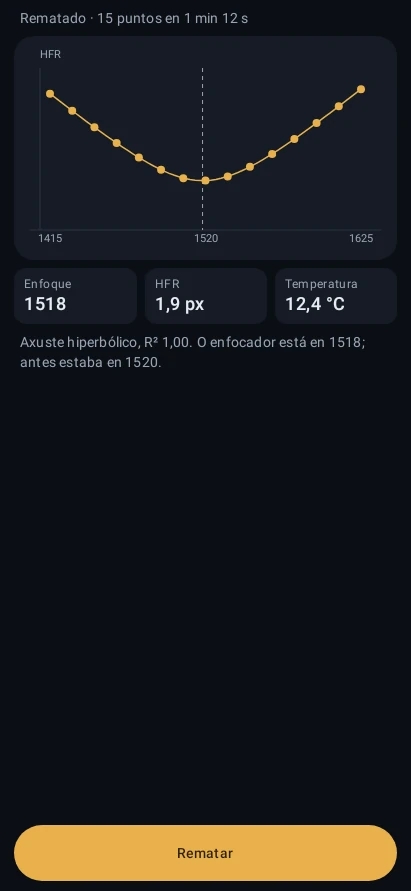 <b>Rematado.</b> 15 puntos en 1 min 12 s; o enfocador pasou de 1520 a 1518.</td>
</tr></table>

### Axustes de autoenfoque

En *Axustes › Autoenfoque*, gardados en cada perfil, cos valores predeterminados de N.I.N.A.:

- **Paso:** Pasos do enfocador entre puntos (50; 15 para o Seestar). Se é demasiado pequeno, a curva sae plana; se é demasiado grande, hai poucos puntos preto do foco.
- **Puntos:** Cantos puntos toma: comeza coa metade cara a fóra (9 puntos, 4 a cada lado; 15 para o Seestar).
- **Exposición:** De 1 a 8 s, con binning 1×1 ou 2×2, coa ganancia de Imaxe. As tomas non se gardan. 4 s (3 s para o Seestar).
- **Tomas por punto:** 1, 2 ou 3. Máis tomas promedian o seeing e tardan máis.
- **Axuste:** Como se acha o mellor enfoque a partir dos puntos: tendencias, parabólico, tendencias e parábola, hiperbólico (predeterminado), ou tendencias e hipérbole.
- **Folga cara a dentro, cara a fóra:** Pasos que perde o enfocador ao cambiar de sentido; pásase eses pasos e volve.
- **R² mínimo:** Canto debe axustarse a curva (0,7). Sen mínimo, o resultado mantense salvo que sexa un 15 % peor ca antes.
- **Intentos:** Cantas veces volve comezar se unha execución falla (1).
- **Espera tras mover:** Segundos que repousa o enfocador tras cada movemento antes da toma (0).

<table><tr>
<td valign="top" width="240">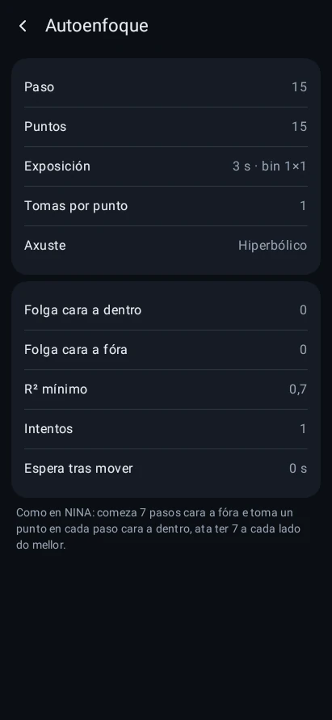 <b>Axustes › Autoenfoque.</b> Os valores do Seestar.</td>
</tr></table>

### Cando falla

| A app di | Que facer |
| --- | --- |
| **O HFR non cambiou abondo a ningún lado** | Usa un paso maior. |
| **A curva explica pouco os puntos** | O seeing ou as nubes estragaron os puntos: máis tomas por punto, unha exposición máis longa, ou proba máis tarde. |
| **O mellor enfoque cae fóra dos puntos medidos** | Comeza máis preto do foco: move o enfocador a man e despois lánzao de novo. |
| **No mellor enfoque o HFR é peor ca antes** | O resultado non se gardou e o enfocador volveu. Comproba as condicións e téntao de novo. |
| **Este enfocador non ten posicións ás que ir** | O autoenfoque necesita un enfocador absoluto. |

### Reenfoque automático durante a noite

Nunha secuencia, as regras de autoenfoque lanzan unha execución antes dunha toma de luz cando cambia a temperatura, cambia o filtro, empeora o HFR, ou despois dun tempo. Fíxanse nas regras do editor simple ([capítulo 25](#simple)) ou como disparadores no editor avanzado ([capítulo 26](#advanced)). Se unha execución falla durante a noite, o enfocador volve e as regras agardan ás seguintes exposicións.

Os desprazamentos de enfoque por filtro fíxanse na pantalla do enfocador ([capítulo 10](#focuser)): ao cambiar de filtro, o enfocador móvese a diferenza.

---

# Captura

## 20. Imaxe

Imaxe fai tomas a man: tomas soltas para comprobar o enfoque e o encadramento, ou un bucle que garda cada toma. Cada toma aparece aproximadamente un segundo despois de descargarse, estirada, coas súas estrelas contadas e medidas.

### Facer unha toma

1. Fixa a exposición, a ganancia, o binning e o filtro cos botóns de debaixo da toma (máis abaixo).
2. Toca o botón redondo. A pantalla mostra *Expoñendo · 12 de 20 s* e despois *Descargando a toma…*. Tócao de novo durante a exposición para abortar.
3. A toma aparece co seu **HFR** e o seu número de **estrelas** arriba á esquerda. Tócaos para ver os detalles da última toma.

**Bucle** fai tomas unha tras outra e gárdaas todas, como o Loop de N.I.N.A.; convértese en **Parar**, que remata despois da toma en curso. As tomas soltas só se gardan se **Gardar as tomas soltas (o bucle sempre garda)** está activado nas opcións. Se unha toma falla mentres o equipo non responde, ou se perde a conexión, o bucle agarda e segue coa seguinte toma en canto o equipo volve responder.

### Os axustes da toma

- **Exposición:** 10, 20, 30, 60 ou 300 s, os que permita a cámara, ou **Outro** no teclado numérico, dentro do rango da cámara.
- **Ganancia:** No teclado numérico, dentro do rango da cámara, ou as ganancias con nome da cámara. Comeza en 200 se a cámara o admite, como fai a app do propio Seestar, e as tomas da secuencia sen ganancia propia usan esta.
- **Binning:** 1×1, 2×2… só se a cámara fai binning.
- **Filtro:** Cunha roda de filtros: o filtro posto, e os outros aos que cambiar. As tomas para resolver, centrar, aliñar ou enfocar nunca pasan por **Dark**: antes a roda pasa a IR. Con Dark, a toma non mostra HFR nin estrelas, que serían ruído.

<table><tr>
<td valign="top" width="240">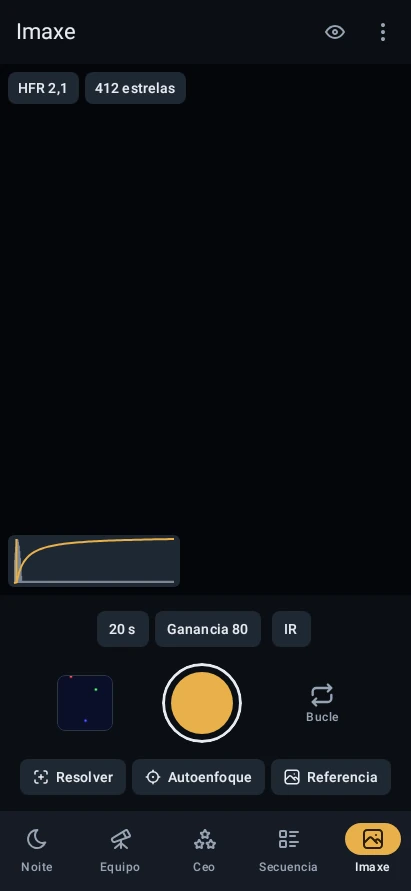 <b>Imaxe.</b> HFR 2,1 px e 412 estrelas.</td>
</tr></table>

### Ver a toma

- **Zoom:** belisca, e arrastra para moverte. Un dobre toque alterna entre a toma enteira e os píxeles a 1:1.
- **Histograma:** abaixo á esquerda, coa curva de estiramento.
- **Última toma:** toca o HFR e as estrelas de arriba á esquerda para ver o histograma, a media, a mediana e a desviación en ADU, o HFR coa súa dispersión, o FWHM en píxeles e en segundos de arco (un perfil de Moffat, como en Hocus Focus) e onde se gardou a toma.

### Opcións de captura

O **⋮** da parte superior ábreas:

- **Tipo de toma:** Light, dark, flat ou bias. Vai no nome do ficheiro e na cabeceira FITS.
- **Obxectivo, para o nome do ficheiro:** O nome do cartafol e dos ficheiros, como *M 31*. Sen el, as tomas chámanse *Snapshot*.
- **Gardar as tomas soltas:** O bucle sempre garda.
- **Dithering en bucles de lights, cada:** *Non*, *3* (de inicio), *5* ou *10* tomas. Entre tomas a montura recibe un pequeno empurrón, como o dá o guiado directo de N.I.N.A.: o campo móvese uns píxeles (5 por defecto) arredor de onde comezou o bucle, para que o patrón do sensor non se acumule en raias no apilado. Os darks, flats e bias nunca fan dithering. Cun Seestar, cuxos pulsos de guiado non van onde se mandan, salta en cambio con pequenos GoTo entre os 9 puntos dunha grella separados 27″.
- **Offset:** Se a cámara o ten.
- **Estiramento automático:** Activado por defecto, como o de N.I.N.A. Desactivado, dous controis desprazables fixan as **Sombras** e os **Tons medios**.
- **Marcar as estrelas:** Debuxa un recadro e o HFR nas estrelas máis brillantes, como fai N.I.N.A.; **Cantas**, de 10 a 500.
- **Apilado en directo:** **Apilar en directo as tomas de luz** e **Equilibrar a cor do apilado** ([capítulo 22](#stacking)).
- **Axustes:** Os axustes da app.

<table><tr>
<td valign="top" width="240">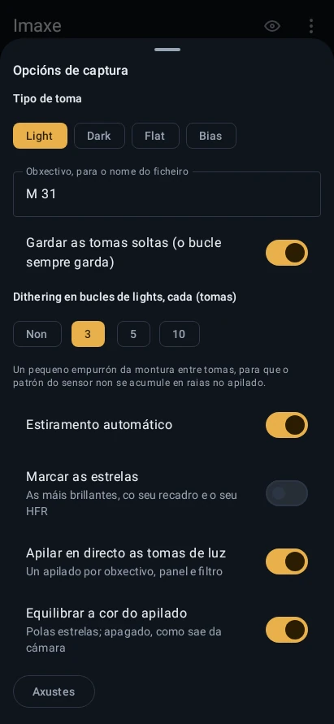 <b>Opcións de captura.</b></td>
</tr></table>

### Os botóns de debaixo da toma

- **Resolver:** Resolve a última toma con ASTAP e mostra a onde apunta, con **Sincronizar a montura** ([capítulo 18](#solving)).
- **Autoenfoque:** Cun enfocador, lanza o autoenfoque ([capítulo 19](#autofocus)).
- **Referencia:** Pon a foto da caché do mesmo campo sobre a toma, coa súa rotación, escala e zoom, para que poidas comparalas: esa mancha tenue é a galaxia? Se a toma non está resolta, resólvea primeiro. Tócao de novo para volver á toma.
- **A miniatura:** Á esquerda do botón redondo: abre o historial da sesión ([capítulo 21](#history)).

<table><tr>
<td valign="top" width="240">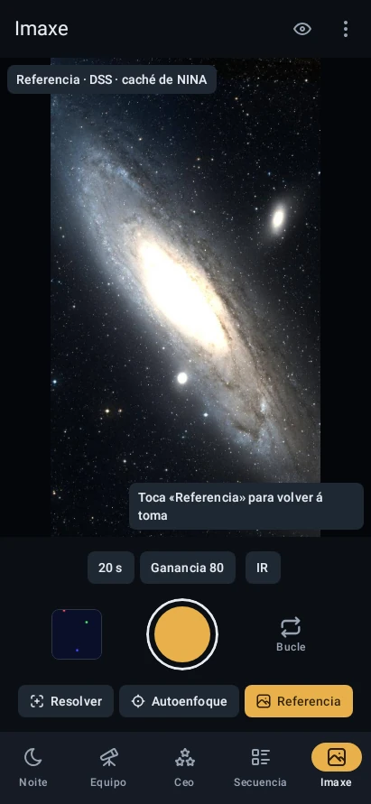 <b>Referencia.</b> A foto da caché do campo da toma.</td>
</tr></table>

<table><tr>
<td valign="top" width="470">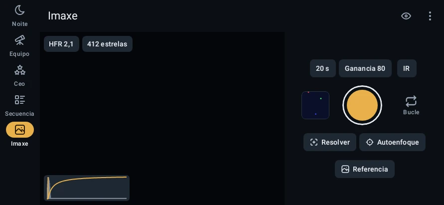 <b>En horizontal</b> a toma ocupa o ancho e os controis pasan ao lado.</td>
</tr></table>

## 21. Historial e calidade das tomas

O historial lista cada toma gardada nesta sesión coa súa calidade, e marca as estragadas por nubes ou luz, para deixalas fóra do apilado.

- **A gráfica:** o HFR de cada toma como liña e as súas estrelas como barras, con **AF** onde houbo un autoenfoque.
- **A lista,** as máis recentes primeiro: número, hora, filtro e exposición, HFR e estrelas.
- **As tomas descartadas** teñen moitas menos estrelas ou un fondo moito máis brillante ca a mediana da sesión, e din por que: *nubes*, *poucas estrelas* ou *fondo alto*. Seguen gardadas no disco; só o apilado e o resumo as deixan fóra.

A icona do filtro da parte superior mostra só as tomas descartadas. Abre o historial desde a miniatura xunto ao botón redondo de Imaxe.

<table><tr>
<td valign="top" width="240">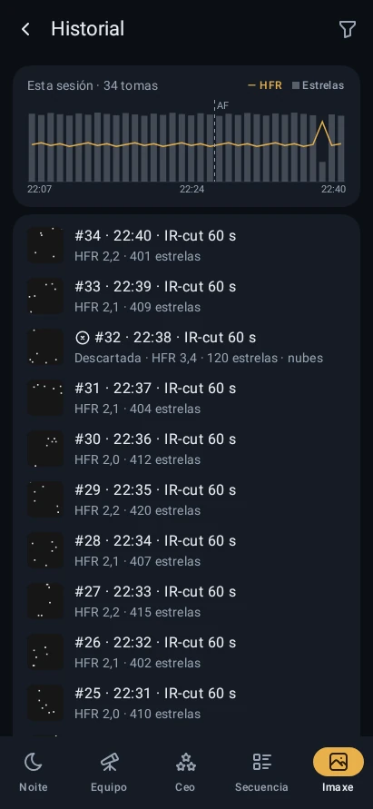 <b>Historial.</b> Toma 32 descartada: nubes.</td>
</tr></table>

## 22. Apilado en directo

O apilado en directo engade cada toma de luz boa a un apilado en marcha mentres avanza a noite, así que ves como o obxectivo xorde do ruído. Está desactivado ata que o queiras, porque usa memoria e batería.

### Activalo

Nas opcións de Imaxe, activa **Apilar en directo as tomas de luz**. Desde entón, cada toma de luz que se garda vai ao apilado, xa veña dun bucle, dunha secuencia ou dunha toma solta. As tomas seguen gardándose unha a unha, como sempre.

Os flats recóllense mesmo co apilado en directo desactivado: unha vez completa a tanda dun filtro, convértense no seu flat mestre, gardado como `FLATS/MasterFlat_IR.fits` (un por filtro) no cartafol das túas tomas para as noites seguintes, un FITS de 32 bits que tamén len Siril e PixInsight. Un flat teu posto aí con ese nome vale igual. Tamén os darks se gardan para o apilado aínda que o actives despois de facelos, como cando unha secuencia comeza cos seus darks.

### Como apila

- **Un apilado por obxectivo, panel e filtro,** e por exposición, ganancia e binning. Unha toma doutro tipo garda o apilado anterior e comeza o seu propio.
- **Aliñado polas estrelas:** desprazamento, rotación e escala, sobre a primeira toma do apilado.
- **Satélites e avións eliminados** con rexeitamento a 3 sigma.
- **Calibrado sobre a marcha:** co dark mestre da noite da mesma exposición, ganancia, offset e binning á temperatura do sensor máis próxima, e o flat mestre do seu filtro do cartafol FLATS.
- **Cor equilibrada polas súas propias estrelas,** con **Equilibrar a cor do apilado** activado; desactivado, como sae da cámara.
- **As tomas descartadas quedan fóra,** e tamén as tomas cuxas estrelas non coinciden.

<table><tr>
<td valign="top" width="240">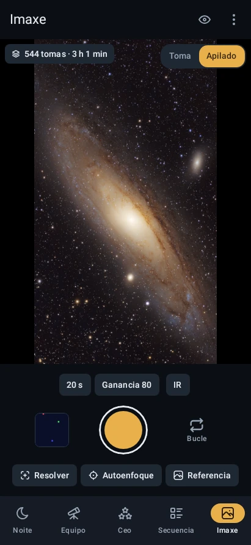 <b>O apilado.</b> M 31 a partir de 544 tomas de 20 s cun Seestar, procesado despois.</td>
</tr></table>

### Un mosaico

Nun mosaico a secuencia fai cada panel enteiro e despois o seguinte, e cada panel ten o seu propio apilado, calibrado cos seus darks e os seus flats. Con **Apilado**, Imaxe mostra o mosaico enteiro mentres se constrúe: cada panel no seu sitio do ceo, segundo a resolución do seu centrado, co fondo igualado ao dos seus veciños onde se solapan e as unións fundidas, e un só estirado e un só balance de cor para todo. O panel que se está apilando leva o bordo dourado e medra con cada toma; os que faltan, en descontinuo. É unha vista a un cuarto do tamaño, ou menor nun mosaico grande para que caiba na memoria do móbil, e gárdase como JPG, como *2026-10-14/M 31/STACK/…_STACK_MOSAIC.jpg*, despois de cada panel e ao rematar a secuencia. O mosaico final móntase cos apilados dos paneis en Siril ou PixInsight.

<table><tr>
<td valign="top" width="240">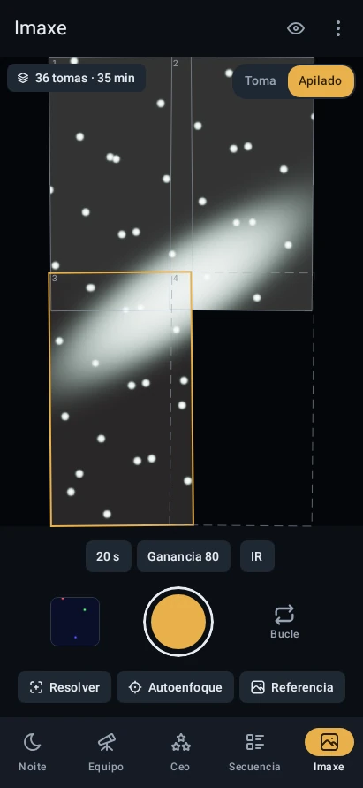 <b>Un mosaico.</b> O terceiro panel de catro, medrando.</td>
</tr></table>

### Velo

Cando hai un apilado, un selector **Toma** | **Apilado** arriba á dereita de Imaxe alterna entre a última toma e o apilado. Toca a etiqueta do apilado, como *544 tomas · 3 h 1 min*, para ver a súa folla:

- **Apiladas:** As tomas que ten, das que chegaron.
- **Descartadas:** Cantas quedaron fóra, e por que.
- **Tempo:** A integración total e as tomas.
- **Aliñamento:** Polas estrelas, e canto xirou a última.
- **Cor:** Equilibrada polas estrelas, ou como sae da cámara.
- **Dark** e **Flat:** o dark e o flat mestre en uso, como *MasterFlat_IR.fits do 11 de outubro*, ou cales faltan.

En Noite, mentres unha secuencia está en curso co apilado activado, a tarxeta da última toma mostra o apilado; tócaa para abrilo en Imaxe.

### Gardalo

O apilado gárdase só cada 10 minutos mentres crece, e cando remata o bucle ou a secuencia: un FITS lineal de 32 bits para procesar, e un JPG tal como o mostra a pantalla, no cartafol das tomas con `STACK` como tipo. **Gardar** gárdao agora. Se a app se pecha, o apilado continúa coa seguinte toma do mesmo obxectivo e filtro.

**Tomar 10 darks de 20 s** (coa exposición das tomas) fai agora darks para o apilado. Cun filtro escuro é automático; sen el, a app pídeche antes que tapes o telescopio. **Mantén para empezar de novo** baleira o apilado.

<table><tr>
<td valign="top" width="240">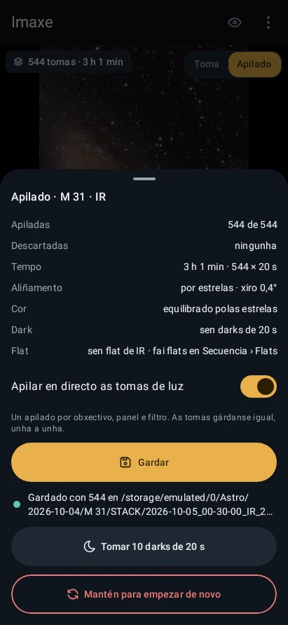 <b>A folla do apilado.</b> Aínda sen darks nin flat para este filtro.</td>
</tr></table>

## 23. Flats, darks e bias

As tomas de calibración eliminan o que engaden o sensor e a óptica. Yacana fai os flats cun asistente e os darks e bias coas regras da secuencia, e o apilado en directo úsaos todos.

### O asistente de flats

Ábreo co modelo **Flats** en Secuencia. Calcula el só a exposición e fai os flats de cada filtro cun brillo obxectivo. A luz é este móbil, ou o panel de flats se hai un conectado.

1. Comproba o **ADU obxectivo**, 30.000 ± 5 % por defecto, co máximo da cámara á vista. Fixa o **Brillo do panel** se usas un.
2. Escolle as **Tomas por filtro** (20, 30 ou 50) e os **Filtros**.
3. Toca **Comezar os flats**. Con este móbil como luz, tes 30 s para poñelo boca abaixo sobre o telescopio, coa pantalla tapando a lente e unha folla de papel branco no medio. Un pitido comeza os flats e a pantalla ponse en branco a todo brillo, tamén en modo vermello; outro pitido remátaos. Para pausalos, toca dúas veces a pantalla branca; **Seguir** deixa outros 30 s.
4. Cada filtro mostra *buscando o tempo…*, despois a súa exposición e cantos están feitos, coa media da última toma en ADU. **Pausar** e **Mantén para parar** están na parte inferior. Ao rematar, co filtro Dark do Seestar, fai 10 bias: o seu nivel queda en cada flat mestre, para que o apilado en directo divida por el aínda que non haxa darks.

Se hai demasiada luz mesmo coa exposición máis curta, ou moi pouca coa máis longa, o asistente detense e indica que cambiar: máis ou menos papel sobre a pantalla do móbil, ou o brillo do panel.

<table><tr>
<td valign="top" width="240">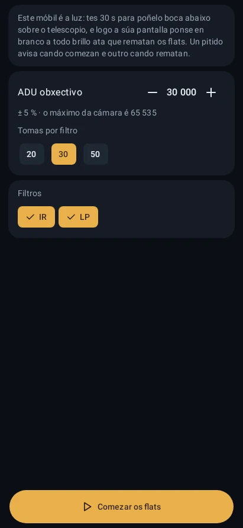 <b>Configuración.</b> Este móbil como luz, dous filtros.</td>
<td valign="top" width="240">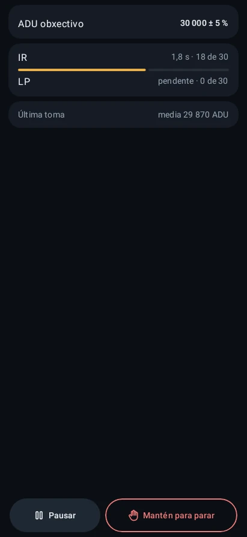 <b>En curso.</b> Os flats IR a 1,8 s, media 29.870 ADU.</td>
</tr></table>

### Darks e bias na secuencia

No editor simple, o botón **Darks** en **Regras** fixa cando se fan os darks, coa exposición, a ganancia e o binning de cada toma de luz e o filtro escuro:

- **Ao comezar** a noite.
- **Se a temperatura do sensor cambia** 2, 3 ou 5 °C, para que o apilado en directo use a tanda de temperatura máis próxima.
- **Ao rematar, co bias** (activado por defecto).
- **Tomas por tanda:** 5, 10 ou 20. A folla indica canto dura cada tanda sen tomas de luz.

Sen filtro escuro, non se poden facer darks ao comezar nin por temperatura; ao final, a app pídeche que tapes o telescopio. Os darks e os bias do inicio e do final van ao cartafol do obxectivo, xunto a LIGHT: os do inicio, ao do primeiro obxectivo; os do final, ao do último.

<table><tr>
<td valign="top" width="240">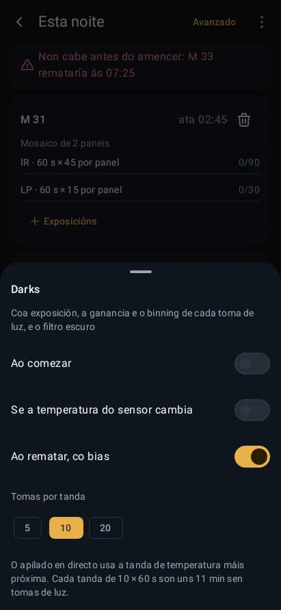 <b>Darks.</b> 10 tomas de 60 s son uns 11 min.</td>
</tr></table>

### A man

En Imaxe, pon o **Tipo de toma** en dark, flat ou bias nas opcións e captura como sempre: as tomas van ao seu propio cartafol por tipo.

---

# Secuencias

## 24. A sección Secuencia

Unha secuencia é o plan da noite: que obxectivos, con que exposicións e que facer arredor deles. Yacana ten dous editores sobre o mesmo plan: un simple, que pon a noite nunha liña de tempo, e un avanzado, cos contedores, disparadores e condicións de N.I.N.A. Podes cambiar dun a outro sen perder nada.

- **Esta noite:** O plan que seguirá a noite, cos seus obxectivos e horas. Tócao para abrir o editor. Mentres está en curso, indícao.
- **Gardadas:** As túas secuencias gardadas, cos seus obxectivos e duración. Toca unha para cargala como plan desta noite; **Desfacer** trae de volta o plan que tiñas. Preme unha fila un momento para borrala con **Mantén para borrar**. Para gardar o plan desta noite, usa o menú **⋮** do editor.
- **Modelos:** Puntos de partida para un plan novo (máis abaixo).
- **Nova:** Un plan baleiro, no editor.

### Modelos

- **Un obxectivo toda a noite:** comeza un plan baleiro e abre Ceo. O obxectivo que engadas a continuación enche a noite ata o amencer.
- **Varios obxectivos** e **Mosaico:** comezan un plan baleiro e abren Ceo, para encadrar os obxectivos ou o mosaico.
- **Flats:** abre o asistente de flats ([capítulo 23](#calibration)).

O que había antes dun modelo volve con **Desfacer**.

<table><tr>
<td valign="top" width="240"> <b>Secuencia.</b> Esta noite, secuencias gardadas e modelos.</td>
</tr></table>

## 25. O editor simple

O editor simple mostra o plan desta noite como unha liña de tempo e unha tarxeta por obxectivo. Avisa, cunha icona e palabras, cando o plan non cabe antes do amencer.

### Engadir obxectivos

Os obxectivos veñen de Ceo: encadra un e toca **Engadir á secuencia** ([capítulo 16](#framing)). **Engadir obxectivo**, ao final da lista, lévate alí. Un mosaico chega como un obxectivo cos seus paneis.

### Plan desta noite

A liña de tempo mostra cada obxectivo desde o seu comezo ata o seu final, e o amencer. Se o plan pasa do amencer astronómico, indica que obxectivo remataría e cando, e a hora final dese obxectivo cambia á cor de aviso. **Desfacer** desfai o último cambio, ata 50 cambios atrás.

### A tarxeta dun obxectivo

- O seu nome, cando remata, e a icona da papeleira para quitalo.
- Para un mosaico, o seu número de paneis; as exposicións aplícanse a cada panel.
- Unha fila por filtro e exposición, como *IR · 60 s × 45 por panel*, coas tomas feitas e o total. Toca unha fila para cambiala; **Exposicións** engade outro filtro.

<table><tr>
<td valign="top" width="240"> <b>Esta noite.</b> M 33 remataría ás 07:25, despois do amencer.</td>
<td valign="top" width="240"> <b>Exposicións.</b> O teclado numérico mostra canto dura e ata cando.</td>
</tr></table>

### Exposicións

A folla fixa unha fila das exposicións dun obxectivo: o **Filtro**, o **Tempo** (10, 30, 60 ou 120 s, ou **Outro**) e o **Número de tomas** no teclado numérico. Mentres escribes, mostra canto duran e ata cando, ou que rematarían despois do amencer. **Gardar** consérvaa; **Quitar estas exposicións** borra a fila cando o obxectivo ten máis dunha.

### Regras

A tarxeta **Regras** lista o que fai a noite ademais das tomas. Un plan novo vén con:

- **Desaparcar ao comezar**, e **Quentador acendido** se o equipo ten un interruptor de quentador.
- **Centrar ao chegar:** cada obxectivo, e cada panel dun mosaico, céntrase con plate solving antes das súas tomas.
- **Dither cada 3 tomas**, sen guiador.
- **Autoenfoque se ΔT > 1 °C**, cun enfocador.
- **Recentrar se se desvía > 1′:** antes de cada toma de luz resólvese a anterior; se o campo se desviou máis de 1′ do obxectivo, vólvese centrar. Substitúe o guiado.
- **Darks e bias ao final**: 10 de cada, para cada exposición, ganancia, offset e binning das tomas de luz.
- **Aparcar ao final**, e o quentador apagado.

Os botóns de debaixo cámbianas:

- **Autoenfoque:** Antes de cada toma de luz, faise un autoenfoque se se cumpre algunha destas, como os disparadores de N.I.N.A.:
  - **Se a temperatura cambia** 0,5, 1, 2 ou 5 °C;
  - **Ao cambiar de filtro;**
  - **Se o HFR empeora** un 5, 10 ou 20 %;
  - **Cada certo tempo:** 15, 30, 60 ou 120 min, ou outro tempo.

  Se un autoenfoque falla, agardan ás seguintes exposicións.
- **Darks:** Ao comezar, cando cambia a temperatura do sensor, ao rematar co bias, e cantos cada vez ([capítulo 23](#calibration)).
- **Recentrado:** activado ou non, e canto pode desviarse o campo: 1′, 2′, 5′ ou 10′, cada un tamén en píxeles da cámara conectada. Nunca recentra por menos de 20 px, o que pode mover un dither; cunha cámara gran angular iso é máis ca calquera opción, e a folla avísao. Cun bo aliñamento polar recentra unha ou dúas veces por hora.
- **Dither:** activado ou non, e cada 1, 3, 5 ou 10 tomas, para as tomas de luz de todos os obxectivos. Cada dither agarda a que a montura se asente. Cun Seestar, ou unha montura sen pulsos de guiado, cada dither parte da resolución da última toma e vai ao obxectivo máis o seu punto da grella, así que tamén desfai a deriva, como fai a propia app do Seestar.
- **Quentador**, se o equipo conectado ten un: acendido ou non durante a noite, e a súa potencia se é regulable. Gasta batería: apágao en noites secas e temperadas.

Para outras regras, como agardar a que suba un obxectivo ou repetir ata unha hora, abre o plan no editor avanzado.

### Gardar e comezar

O menú **⋮** ten **Gardar nas miñas secuencias**. **Comezar**, na parte inferior, inicia a noite unha vez conectado o equipo; mentres está en curso, o botón pasa a ser **Mantén para parar**. Podes seguir editando o plan mentres está en curso: os cambios aplícanse ao que aínda está por vir.

<table><tr>
<td valign="top" width="240"> <b>Regras de autoenfoque.</b></td>
<td valign="top" width="240"> <b>Recentrado.</b> A menos de 1′ do obxectivo.</td>
<td valign="top" width="240"> <b>Dither.</b> Cada 3 tomas.</td>
</tr></table>

## 26. O editor avanzado

O editor avanzado é o secuenciador avanzado de N.I.N.A. convertido nunha lista táctil: contedores nos que entras, instrucións, disparadores e condicións, reordenados arrastrando, con desfacer e unha revisión da noite antes de que comece.

Ábreo con **Avanzado** na parte superior do editor simple. Abre o plan desta noite enteiro. Se engades o que o editor simple non pode mostrar, como unha condición ou un contedor paralelo, desde entón esta noite edítase só no editor avanzado: o editor simple mostra **Esta noite edítase en Avanzado** con **Abrir en Avanzado** e a lista de obxectivos.

### A estrutura da noite

- **Noite,** o nivel superior, cos **disparadores para toda a noite**, e tres áreas:
- **Inicio:** o que pasa primeiro, antes dos obxectivos, como desaparcar ou arrefriar a cámara. O que apunta a un obxectivo non vai aquí.
- **Obxectivos:** un tras outro, nesta orde. Cada obxectivo contén as súas instrucións.
- **Final:** despois dos obxectivos: darks, aparcar e apagar.

A ruta da parte superior mostra onde estás, como *Noite › Obxectivos › M 33*. A tarxeta de cada nivel indica como se executa: unha vez, ou repetido polas súas condicións, que se comproban despois de cada instrución.

<table><tr>
<td valign="top" width="240"> <b>Noite.</b> Un disparador de autoenfoque e as tres áreas.</td>
<td valign="top" width="240"> <b>Un obxectivo.</b> Repetido ata as 02:00.</td>
</tr></table>

### Traballar cos elementos

- **Entra** nun contedor tocándoo; toca unha instrución para cambiar os seus axustes.
- **Engade** co botón da parte inferior, **Engadir a …**, que abre o catálogo. **Condición** e **Disparador**, na tarxeta do nivel, ábreno nese tipo.
- **Reordena** arrastrando a asa dun elemento, ou co seu menú **⋮**.
- **O menú ⋮** dun elemento: *Entrar*, *Cambiar o obxectivo*, *Renomear*, *Axustes*, *Subir*, *Baixar*, *Mover a…*, *Duplicar*, *Gardar como modelo* e *Eliminar*.
- **Desfacer** está na parte superior.

Mentres a noite está en curso, os elementos rematados márcanse como feitos e o que está en curso destácase. Ambos quedan bloqueados; o resto aínda se pode cambiar.

### O catálogo

O catálogo ten unha caixa de busca e botóns por tipo: cámara, montura, enfoque, filtros, utilidade, contedores, disparadores, condicións e modelos. O que non pode ir onde estás aparece en gris, co motivo, como *Só dentro dun Obxectivo*.

<table><tr>
<td valign="top" width="240"> <b>O catálogo.</b> O que apunta a un obxectivo aparece en gris en Inicio.</td>
</tr></table>

| Tipo | Elemento | Que fai |
| --- | --- | --- |
| **Cámara** | Exposicións | Tomas de luz, darks ou bias: filtro, tempo, número de tomas e dither |
| **Cámara** | Arrefriar cámara · Quentar cámara | Ata unha temperatura aos poucos, ou amodo de volta antes de apagala |
| **Montura** | Desaparcar · Aparcar | Sae da súa posición de repouso ou volve a ela |
| **Montura** | Ir e centrar | GoTo ao obxectivo e plate solving, ata 1′; só dentro dun Obxectivo |
| **Montura** | Ir ao obxectivo | GoTo ao obxectivo sen centrar; só dentro dun Obxectivo |
| **Montura** | Parar o seguimento | A montura queda quieta |
| **Enfoque** | Autoenfoque · Mover o enfocador | Unha execución en curva en V, ou a unha posición |
| **Filtros** | Cambiar de filtro | A roda pon outro filtro |
| **Utilidade** | Poñer interruptor | Como o quentador antiorballo, acendido ou apagado |
| **Utilidade** | Agardar ata a hora · Agardar un tempo · Agardar a que suba | Segue a unha hora desta noite, despois duns minutos, ou cando o obxectivo chega a unha altura |
| **Utilidade** | Nota | Unha nota no diario da noite |
| **Contedor** | Obxectivo | Un obxectivo de Ceo, co seu encadramento; vén con «Ir e centrar» |
| **Contedor** | Secuencial · Paralelo | As súas instrucións unha tras outra, ou á vez, como agardar a unha hora mentres arrefría a cámara |
| **Disparador** | Autoenfoque se cambia a temperatura · cada certo tempo · ao cambiar de filtro · se sobe o HFR | Un autoenfoque antes da seguinte toma cando se cumpre a súa condición |
| **Disparador** | Recentrar se se desvía | Resolve e corrixe cando o obxectivo se desvía máis de 1′ a 10′ (20 px como mínimo) |
| **Disparador** | Darks se cambia a temperatura | Darks co filtro escuro cando o sensor cambia 2, 3 ou 5 °C, para o apilado en directo |
| **Condición** | Repetir N veces · Repetir ata a hora · Repetir mentres estea alto | Repite o contedor enteiro |
| **Modelo** | Obxectivo con autoenfoque · os teus propios | Un obxectivo de Ceo con ir e centrar, autoenfoque e exposicións; ou calquera bloque que gardases como modelo |

### Revisar a noite

O editor comproba o plan mentres o constrúes. Cando algo sairía mal esta noite, un distintivo na parte superior conta os avisos; tócao para ver **Revisar a noite**, e toca un aviso para ir a el. Os avisos nunca che impiden gardar nin comezar. Entre eles están:

- unha instrución que necesita un obxectivo fóra dun Obxectivo, ou tomas de luz sen obxectivo;
- un aparcado antes de tomas, enfoque ou un GoTo sen *Desaparcar* antes;
- tomas de luz sen *Ir e centrar* antes, ou co seguimento parado;
- un filtro que a roda non ten, ou arrefriar unha cámara que non arrefría;
- darks feitos mentres a cámara se quenta;
- dous elementos paralelos que usan o mesmo dispositivo á vez.

### Volver ao plan simple

A tarxeta do editor simple, ou o menú **⋮** do editor avanzado, ten **Mantén para volver ao plan simple**. Quita o que só sabe o editor avanzado e deixa os obxectivos coas súas exposicións. O mesmo menú ten **Gardar nas Miñas secuencias**.

<table><tr>
<td valign="top" width="240"> <b>Editada en Avanzado.</b> O editor simple mostra os obxectivos.</td>
</tr></table>

> [!NOTE]
> **Para usuarios de N.I.N.A.**
>
> O editor avanzado segue o secuenciador de N.I.N.A.: os mesmos tipos de contedores, disparadores e condicións, executados na mesma orde. Os ficheiros de secuencia propios de N.I.N.A. non se importan, e as instrucións que dependen de Windows ou do guiado non están.

## 27. A noite en marcha

Comeza a noite con **Comezar a noite** en Noite ou con **Comezar** no editor. Desde entón a sesión funciona dentro dun servizo en primeiro plano: podes apagar a pantalla e gardar o móbil.

### Noite mentres está en curso

Todo o que necesitas cabe nunha pantalla sen desprazarse:

- **O obxectivo:** o seu nome, panel e filtro, e a súa altura cunha frecha que indica se sobe ou baixa.
- **A toma:** un anel cos segundos que faltan, *Toma 35 de 120*, o filtro e a ganancia.
- **Progreso:** a porcentaxe da secuencia e cando remata, fronte ao amencer astronómico.
- **Última toma:** a súa miniatura, se foi boa ou descartada, o seu HFR e estrelas, e a curva de HFR da noite. Co apilado en directo activado, mostra o apilado: tócao para abrilo en Imaxe.
- **Seguinte:** o que vén, como o seguinte autoenfoque, o cambio ao seguinte obxectivo e o aparcado, coas súas horas.

**Pausar** detén a secuencia ao momento, deixando fóra a toma en curso, e o seguimento continúa; pasa a ser **Seguir**, que continúa desde a mesma instrución coas tomas que xa fixo. **Mantén para parar** remata a secuencia.

<table><tr>
<td valign="top" width="240"> <b>En curso.</b> Remata ás 06:56, despois do amencer das 06:44.</td>
<td valign="top" width="240"> <b>Co apilado en directo,</b> o apilado na tarxeta.</td>
</tr></table>

### No resto da app

A barra da sesión en todas as demais pantallas mostra a toma e permite pausar ([capítulo 4](#tour)), e a notificación mostra o progreso na pantalla de bloqueo. A secuencia e Imaxe comparten a cámara: para un bucle en Imaxe antes de comezar a noite.

### Coa pantalla apagada

Yacana mantén esperto o procesador e a wifi do móbil mentres a sesión está en curso, e liga o tráfico do equipo á súa wifi aínda que non teña internet. Na proba de referencia funcionou 8,5 horas durante a noite cun Seestar, 503 tomas completas, sen reinicios e sen ningún oco de máis de 6 s, usando o 1,7 % da batería por hora. Concede antes os permisos de batería ([capítulo 33](#permissions)).

Mentres Yacana está na pantalla, a pantalla segue acesa e o móbil non se bloquea. Coa pantalla acesa, Android mantén a wifi a toda velocidade e, se cae, volve conectarse á wifi do equipo en segundos; coa pantalla apagada, pode non facelo ata que a acendas. Preme o botón de acendido para apagala como sempre: a sesión segue. Para unha noite enteira coa pantalla acesa, usa o modo vermello con pouco brillo e unha batería externa.

### Se a app ou o móbil se reinician

Se Android pecha a app ou o móbil se reinicia, a sesión retómase soa, en menos dun minuto; tras un reinicio, unha vez que desbloqueas o móbil por primeira vez. Como moito pérdese a toma en curso; as tomas xa gardadas nunca se danan, porque cada unha se escribe nun ficheiro temporal e se renomea. O diario rexistra *A app pechouse e retomou a secuencia*.

## 28. Avisos e paradas seguras

Unha noite sen vixilancia remata ben ou detense de forma segura. Cada aviso di que pasou, que está facendo a app e que podes facer ti.

### Cando se perde a conexión

Se o equipo deixa de responder, a secuencia entra en **pausa segura**: a exposición detense e o seguimento segue activo. O aviso, en Noite e como notificación con son, mostra os intentos e o tempo que queda antes dunha parada segura. A app reinténtao cada 10 s.

- **Reintentar agora** téntao de novo ao momento.
- **Detalles** abre Equipo.
- **Mantén para parar** remata a secuencia.

Comproba que o móbil segue na wifi do equipo e que o equipo ten alimentación. Cando volve a conexión, a secuencia continúa, e o diario rexistra canto tempo estivo perdida.

### Parada segura

Unha parada segura remata a sesión cando:

- a conexión non volve no tempo fixado (2 min por defecto);
- a secuencia falla dun xeito do que non se pode recuperar;
- a batería do móbil baixa do nivel fixado (20 % por defecto), e sempre por debaixo do 10 %, salvo que estea cargando.

A exposición detense e a montura aparca ou para o seguimento, segundo diga o perfil. Se se perdeu a conexión, isto pasa en canto volve. Entón o aviso indica o que se fixo; **Entendido** péchao.

<table><tr>
<td valign="top" width="240"> <b>Pausa segura.</b> Parada segura en 1 min 18 s se a conexión non volve.</td>
<td valign="top" width="240"> <b>Parada segura.</b> A montura aparcada.</td>
</tr></table>

### Axustes de seguridade

En *Axustes › Seguridade*, por perfil:

- **Parada segura:** **Aparca a montura** ou **Para o seguimento**. O Seestar trae o aparcado, que pecha o seu brazo.
- **Se se perde a conexión:** Canto agarda a pausa segura: 1, 2, 5 ou 10 min.
- **Batería baixa do móbil:** 15, 20 ou 30 %. Por debaixo do 10 % sempre se detén; nunca mentres carga.

<table><tr>
<td valign="top" width="240"> <b>Axustes › Seguridade.</b></td>
</tr></table>

## 29. Á mañá seguinte

Cando remata a secuencia, Noite mostra o resumo da noite ata que o peches.

- Como rematou e cando: rematada, parada a man, unha parada segura ou un fallo, e se a montura aparcou.
- **Integración útil:** o tempo de exposición das tomas conservadas.
- **Tomas** e **Descartadas**, e o **HFR mediano**.
- **Por obxectivo:** tomas e exposición por obxectivo e filtro.
- **Incidencias:** reconexións, autoenfoques extra, tomas con nubes, coas súas horas.

**Ver diario** abre o diario da noite. **Exportar** garda un ZIP do rexistro da app, co perfil e as versións, para conservalo ou anexalo a un informe de erro. O **✕** pecha o resumo.

### O diario da noite

Unha lista lexible do que pasou, separada do rexistro técnico: cada suceso coa súa hora e o porqué, como *Autoenfoque extra · A temperatura cambiou 1,3 °C*, *M 31 Panel 1 centrado · a 8″ · 2 intentos* ou *Conexión recuperada · 51 s · 5 intentos*. A súa icona da parte superior garda o mesmo ZIP que **Exportar**.

<table><tr>
<td valign="top" width="240"> <b>Resumo.</b> 34 tomas, unha con nubes.</td>
<td valign="top" width="240"> <b>Diario da noite.</b></td>
</tr></table>

As túas tomas e apilados están no cartafol das tomas, un cartafol por noite e obxectivo ([capítulo 30](#files)). Para copialos, conecta o móbil a un ordenador cun cable USB e escolle a transferencia de ficheiros no móbil; o cartafol aparece coma calquera outro no almacenamento do móbil.

---

# Axustes e ficheiros

## 30. Imaxes e ficheiros

Yacana garda cada toma como un ficheiro FITS de 16 bits coas cabeceiras de N.I.N.A., que se abre en Siril, PixInsight e calquera programa de astronomía, nun cartafol por noite e obxectivo.

### O cartafol

En *Axustes › Imaxes e ficheiros*, **Cartafol** mostra onde van as tomas. Por defecto é o cartafol propio da app, `Android/data/app.yacana/files/Yacana` no almacenamento do móbil, que Android borra se desinstalas a app.

**Cambiar cartafol** abre o selector de cartafoles de Android: escolle ou crea un cartafol no almacenamento do móbil (como `Astro`), nunha tarxeta SD ou nunha unidade USB. Yacana conserva o permiso para escribir alí tras os reinicios. Escolle un antes da túa primeira noite, para que as túas tomas sexan fáciles de atopar e sobrevivan a unha reinstalación.

### Nomes de ficheiro

O nome de cada toma sae dun patrón coas etiquetas de N.I.N.A. Unha barra crea un cartafol. Toca unha etiqueta para engadila; a pantalla mostra como se chamará a próxima toma. **Volver ao predeterminado** restaura:

`$$DATEMINUS12$$/$$TARGETNAME$$/$$IMAGETYPE$$/$$DATETIME$$_$$FILTER$$_$$EXPOSURETIME$$s_$$FRAMENR$$`

que dá, por exemplo, `2026-10-04/M 31/LIGHT/2026-10-05_00-30-00_LP_20.00s_0001.fits`: un cartafol para a noite, outro para o obxectivo e outro para o tipo de toma.

<table><tr>
<td valign="top" width="240"> <b>Axustes › Imaxes e ficheiros.</b></td>
</tr></table>

| Etiqueta | Pasa a ser | Exemplo |
| --- | --- | --- |
| **`DATEMINUS12`** | A data da noite: a data de 12 horas antes, para que as tomas despois da medianoite manteñan a data da tarde | `2026-10-04` |
| **`DATE`** | A data local | `2026-10-05` |
| **`DATETIME`** | A data e a hora locais | `2026-10-05_00-30-00` |
| **`TIME`** | A hora local | `00-30-00` |
| **`TARGETNAME`** | O obxectivo, ou *Snapshot* se non hai | `M 31` |
| **`IMAGETYPE`** | O tipo de toma | `LIGHT`, `DARK`, `FLAT`, `BIAS` |
| **`FILTER`** | O filtro, ou *NoFilter* | `LP` |
| **`EXPOSURETIME`** | A exposición en segundos | `20.00` |
| **`FRAMENR`** | O número de toma da sesión, con 4 cifras | `0001` |
| **`GAIN`, `OFFSET`** | A ganancia e o offset da cámara | `80` |
| **`BINNING`** | O binning | `1x1` |
| **`SENSORTEMP`** | A temperatura do sensor | `-10.0` |

### Que hai en cada ficheiro

- **Tomas:** FITS de 16 bits cos mesmos píxeles que os ficheiros propios do Seestar, e as palabras clave de cabeceira de N.I.N.A.: o tipo de toma, a exposición, a ganancia, o offset, o binning e a temperatura do sensor; o filtro; o obxectivo e as súas coordenadas, coa súa altura e acimut; o telescopio, a cámara, a distancia focal e o tamaño do píxel; a posición e a temperatura do enfocador; o sitio; o patrón Bayer e os seus desprazamentos, para que Siril faga o debayer correctamente.
- **Apilados en directo:** a mesma ruta con `STACK` como tipo e número: un FITS lineal de 32 bits, co número de tomas e a exposición total na súa cabeceira, e un JPG tal como o mostra a pantalla, que se sobrescriben a medida que crece o apilado.
- **Seguridade:** cada ficheiro escríbese cun nome temporal e renoméase cando está completo, así que un bloqueo ou un corte de luz nunca deixa unha toma rota.

O diario da noite e o rexistro da app gárdanse dentro da app; expórtaos como ZIP desde o resumo ou desde *Axustes › Exportar o rexistro*.

## 31. Referencia dos axustes

Axustes ábrese desde a roda dentada en Noite e Equipo, ou con **Axustes** nas opcións de Imaxe. A caixa de busca da parte superior atopa calquera axuste por parte do seu nome, dentro de cada pantalla, con ou sen acentos.

Cada opción indica o que fai. Os axustes marcados *por perfil* gárdanse no perfil do equipo, para que cada conxunto de equipo teña os seus.

<table><tr>
<td valign="top" width="240"> <b>Axustes.</b></td>
</tr></table>

| Fila | Que contén | Capítulo |
| --- | --- | --- |
| **Perfil e localización** | Nome, óptica, sitio, límites, horizonte, base de estrelas, outros perfís, exportar e importar | [5](#profile) |
| **Imaxes e ficheiros** | O cartafol e o patrón de nomes de ficheiro (por perfil) | [30](#files) |
| **Plate solving** | As opcións de ASTAP, o centrado e as bases de estrelas (por perfil) | [18](#solving), [6](#field) |
| **Autoenfoque** | Paso, puntos, exposición, axuste, folga, R², intentos (por perfil) | [19](#autofocus) |
| **Seguridade** | Parada segura, a espera cando se perde a conexión, batería baixa (por perfil) | [28](#safety) |
| **Mapa do ceo** | As cachés de N.I.N.A., só con wifi, fotos en liña e capas | [6](#field) |
| **Pantalla** | Modo vermello nocturno e o seu brillo | [32](#display) |
| **Idioma** | O idioma da app | [32](#display) |
| **Permisos** | Para que serve cada permiso, e o seu estado | [33](#permissions) |
| **Exportar o rexistro** | Garda un ZIP dos últimos 14 días do rexistro | [36](#troubleshooting) |
| **Acerca de** | A versión, o motor de píxeles e as licenzas | [39](#credits) |

O apilado en directo e o seu equilibrio de cor fíxanse nas opcións de Imaxe, e tamén se gardan por perfil.

## 32. Modo vermello e idioma

### Modo vermello nocturno

A luz vermella mantén os teus ollos adaptados á escuridade. O modo vermello debuxa cada píxel da app en vermello puro sobre negro, fotos e tomas incluídas, e ningún píxel ten nada de verde nin de azul: compróbase en cada pantalla.

- Actívao coa icona do ollo na parte superior de Noite, Equipo, Ceo, Imaxe, as fichas dos obxectos, o encadramento e os asistentes, ou con **Modo vermello nocturno** en *Axustes › Pantalla*.
- As barras do sistema ocúltanse; pasa o dedo desde o bordo para velas un momento.
- A app pon o seu propio brillo de pantalla, que pode baixar do mínimo do sistema: **Brillo en modo vermello**, do 1 ao 100 %, 10 % por defecto.
- A app lémbrao, e ábrese en vermello se a deixaches en vermello.

Os diálogos propios de Android e o teclado do sistema non se poden poñer en vermello. Por iso, pola noite, os números introdúcense co teclado numérico propio da app. Tampouco se pode poñer en vermello o punto verde que Android acende arriba mentres unha app le a localización. Yacana só a le ao abrirse, ao activar **Usar a localización do móbil** e ao conectar, nunca ao reconectar, así que o punto vese uns segundos.

<table><tr>
<td valign="top" width="240"> <b>Noite en vermello.</b></td>
<td valign="top" width="240"> <b>O ceo en vermello.</b> As fotos tamén.</td>
</tr></table>

### Idioma

Yacana fala inglés, castelán, catalán, éuscaro, galego, alemán, francés, italiano e o portugués de Portugal e do Brasil. En *Axustes › Idioma*, **Como o sistema** segue o móbil, ou inglés se o idioma do móbil non é un destes; ou escolle un. Cambia ao momento. En Android 13 e posteriores tamén podes escollelo nos axustes do sistema para a app. As datas e os números seguen o idioma, con coma decimal en todos agás o inglés.

<table><tr>
<td valign="top" width="240"> <b>Axustes › Idioma.</b></td>
<td valign="top" width="240"> <b>Axustes › Pantalla.</b></td>
</tr></table>

## 33. Permisos e batería

Android non está pensado para unha tarefa de oito horas coa pantalla apagada. Os permisos de *Axustes › Permisos* son o que permite a Yacana levar a noite igualmente.

A pantalla é a mesma que a dos primeiros pasos ([capítulo 3](#first-steps)): cada fila di para que serve, que deixa de funcionar sen el, e mostra **Permitir**, **Abrir** ou un visto cando está concedido. As filas que non se aplican ao teu móbil non se mostran: a rede local antes de Android 17, as notificacións antes de Android 13, conservar a app sen uso antes de Android 11, e o inicio automático en móbiles que non sexan Xiaomi, Redmi ou Poco.

### Se Android xa non pregunta

Despois de rexeitar un permiso dúas veces, Android deixa de preguntar. A fila indícao entón: abre os axustes de Yacana en Android, entra en Permisos, actívao e volve.

### Aforradores de batería

- **Batería sen restricións** é o máis importante para unha noite. Sen el, o sistema pode cortar a sesión coa pantalla apagada.
- Algúns fabricantes engaden os seus propios aforradores ademais dos de Android. Nos móbiles Xiaomi, **Inicio automático** permite que a sesión volva se o sistema pecha a app. Noutras marcas, busca Yacana nos axustes de batería do móbil e permítelle funcionar en segundo plano.
- Nos móbiles Xiaomi, o aforro de batería da información de Yacana debe dicir **Sen restricións**: pono **Batería sen restricións**. Bloquea tamén Yacana en Recentes (mantén premida a súa tarxeta e toca o cadeado), para que ao borralas non se peche.
- Os modos de aforro de batería poden deter o traballo en segundo plano: déixaos desactivados durante unha sesión.

### O que a app nunca necesita

Yacana non necesita ningunha conta, nin acceso ás túas fotos, contactos ou ficheiros fóra dos cartafoles que escollas, nin localización en segundo plano.

---

# Referencia

## 34. Usar un Seestar S50 Pro

O ZWO Seestar S50 Pro leva ASCOM Alpaca no seu firmware, así que Yacana contrólao directamente pola súa wifi. É o dispositivo de referencia: cada función creouse e mediuse con el, e enche o seu propio perfil.

### Antes da primeira noite

1. **Configúrao coa app de ZWO.** Yacana non a substitúe para a configuración propia do dispositivo: activalo, actualizar o seu firmware, pasalo a modo ecuatorial e configurar a súa wifi fanse na app de ZWO.
2. **Colócao nunha cuña ecuatorial, en modo EQ.** Nunha cuña segue nun só eixe e permite exposicións longas sen rotación de campo. O seu modo altacimutal non é un obxectivo desta app.
3. **Conéctate á súa wifi, ou pon os dous na wifi da casa.** Funcionan os seus dous modos de rede: o seu propio punto de acceso, onde responde en `10.0.0.1`, porto `32323`, e o modo estación no teu router. Unha noite de 8,5 horas funcionou en modo punto de acceso e 2 horas en modo estación sen cortes longos.
4. **Búscao en Yacana** e toca **Teleobxectivo** ([capítulo 3](#first-steps)). O perfil do Seestar cárgase só; **Gran angular** crea o da súa cámara gran angular, máis abaixo.

### Que fixa o seu perfil

| Elemento | Valor | Por que |
| --- | --- | --- |
| **Óptica** | 260 mm de distancia focal, 50 mm de abertura, f/5,2 | O seu refractor apocromático de 4 elementos |
| **Sensor** | 2160 × 3840 px, 2,9 µm, cor (Bayer GRBG) | A cámara teleobxectivo, gardada en vertical como fai a app de ZWO |
| **Escala e campo** | 2,25″ por píxel · 2,40° × 1,35° | Medidos con ASTAP en tomas reais |
| **Rotación da cámara** | 93,2° ata que a mida o primeiro plate solving | Un S50 Pro en modo EQ, co seu lado longo case de norte a sur |
| **Base de estrelas** | D50 | Resolve as súas tomas con marxe para noites peores; D05 é a opción lixeira |
| **Autoenfoque** | 15 pasos entre puntos, tomas de 3 s | O seu enfocador vai de 0 a 2.600 pasos |
| **Parada segura** | **Aparca a montura** | Ao aparcar pecha o brazo |
| **Dispositivos usados** | Montura, cámara teleobxectivo e o seu enfocador, roda de filtros, interruptores | A cámara gran angular e o seu enfocador teñen o seu propio perfil, máis abaixo |

### A súa cámara gran angular

**Gran angular** na tarxeta do Seestar, nos primeiros pasos ou en **Novo perfil**, crea un segundo perfil, *Seestar S50 Pro gran angular*, para a súa cámara gran angular: todo un anaco de ceo, para a Vía Láctea e paisaxes nocturnas. As súas exposicións duran ata 60 s.

| Elemento | Valor | Por que |
| --- | --- | --- |
| **Óptica** | 5,95 mm de distancia focal, 3,4 mm de abertura, f/1,75 | O seu obxectivo publicado, 63° en diagonal |
| **Campo** | Uns 33° × 59°, 55″ por píxel | O seu sensor de 2160 × 3840 px de 1,6 µm |
| **Base de estrelas** | W08, menos de 1 MB | A de ASTAP para campos de 20° a 80°: descárgaa en *Axustes › Plate solving* |
| **Autoenfoque** | 10 pasos entre puntos, 15 puntos, tomas de 3 s | O seu enfocador vai de 0 a 1.023 pasos: valores de partida, para axustar baixo o ceo |
| **Dispositivos usados** | Montura, cámara gran angular e o seu enfocador, interruptores | A roda de filtros está só diante do teleobxectivo |

### Convén saber

- **Darks sen tapalo.** A súa roda de filtros ten unha posición **Dark**, que Yacana usa como obturador: os darks e os bias fanse sen poñer nada no telescopio.
- **O quentador antiorballo só se acende ou se apaga.** Aparece como un interruptor en *Equipo › Interruptores*. O seu servidor Alpaca (1.3.1-1) non permite axustar a súa potencia.
- **Sen binning.** A súa cámara non fai binning, así que un axuste 2×2, como o do aliñamento polar, tómase a tamaño completo. Unha toma ten uns 8,3 MP, 16 MB a 16 bits, e descárgase en 1,7 a 2,3 s pola súa wifi.
- **Sen cambio de meridiano.** Nunha cuña compórtase como unha forquita dun só brazo. Mantén os obxectivos lonxe de onde o brazo podería tocar a cuña, preto do polo e do cénit.
- **Os cambios de filtro poden ser lentos.** Algúns usuarios indican que un cambio tarda en reflectirse; as esperas da app contan con iso.
- **Alimentación.** Para unha noite longa, alimenta o Seestar e o móbil cunha fonte externa, sobre todo co quentador acendido.
- **A súa propia app ao mesmo tempo.** Non se probou usar a app de ZWO noutro móbil mentres Yacana controla o Seestar; péchaa durante unha sesión.

As probas fixéronse co firmware 9.31 e o servidor Alpaca 1.3.1-1.

## 35. Que necesita internet

Unha noite non necesita internet en absoluto. No campo o móbil só fala co teu equipo, e todo o que usa a noite está no móbil.

| Función | Sen internet | Con internet |
| --- | --- | --- |
| **Catálogo de obxectos** | 13.371 obxectos de ceo profundo de OpenNGC, incluídos na app | Igual |
| **Efemérides** | Sol, Lúa e crepúsculos calculados no móbil | Igual |
| **Plate solving** | ASTAP no móbil, cunha base de estrelas no móbil | Igual |
| **Fotos do ceo** | Das cachés de N.I.N.A. no móbil | Fotos con máis detalle da zona cando amplías moito, de hips2fits do CDS |
| **Busca** | Messier, NGC, IC, Caldwell, Sharpless e nomes comúns | Tamén SIMBAD: calquera obxecto que coñeza, gardado no móbil unha vez atopado |
| **Bases de estrelas e cachés do ceo** | Importadas desde un ficheiro ou unha tarxeta | Descargadas dentro da app, só con wifi por defecto |

Cando o móbil está na wifi do equipo, que non ten internet, Yacana mantén todo o tráfico do equipo nesa rede, para que Android non o envíe polos datos móbiles. As descargas que inicias usan a conexión normal do móbil.

## 36. Solución de problemas

Cada aviso de Yacana di que pasou, que está facendo a app e que podes facer ti. Este capítulo recolle as causas habituais detrás deles.

### Conexión

- **Non respondeu ningún equipo Alpaca:** O móbil e o equipo non están na mesma wifi, ou o equipo aínda está arrancando. Conéctate á súa rede, agarda un minuto e toca **Buscar outra vez**. Se a túa rede bloquea a detección, usa **Engadir por IP e porto** co enderezo que mostra o dispositivo, como `10.0.0.1:32323` para un Seestar no seu propio punto de acceso.
- **Non se atopa nada en absoluto:** Comproba que **Rede local** está concedido en *Axustes › Permisos*. Sen el, Android bloquea toda detección e todas as ordes.
- **Non se puido conectar:** O dispositivo respondeu á busca pero rexeitou a conexión. Comproba que ningún outro programa o está usando, reiníciao e conecta de novo.
- **Desconecta para cambiar de perfil:** Os perfís, os dispositivos e o borrado do perfil só se poden cambiar cando non hai nada conectado. Toca antes **Desconectar todo**.

### Durante a noite

- **Sen conexión co equipo:** Caeu a wifi ou o equipo quedou sen alimentación. A secuencia agarda en pausa segura e a app reinténtao cada 10 s; se a conexión non volve dentro do tempo fixado en *Axustes › Seguridade*, detense de forma segura en canto volva. Comproba que o móbil segue na wifi do equipo e que o equipo ten batería ([capítulo 28](#safety)).
- **A sesión parou coa pantalla apagada:** Android pechou a app para aforrar batería. Concede **Batería sen restricións**, **Consérvase aínda que non se use** e, nos móbiles Xiaomi, **Inicio automático** en *Axustes › Permisos* ([capítulo 33](#permissions)).
- **Non cabe antes do amencer:** O plan remata despois do amencer astronómico. Baixa o número de tomas dun obxectivo, ou quita un obxectivo, ata que desapareza o aviso ([capítulo 25](#simple)).
- **O obxectivo está por debaixo do límite:** O GoTo baixaría do límite de altura do perfil ou do seu horizonte, e a montura non se moveu. Agarda a que suba o obxectivo, ou revisa o límite no perfil.

### Plate solving e centrado

- **Sen solución coa base:** A toma ten moi poucas estrelas (nubes, orballo, unha exposición curta, mal enfoque) ou a distancia focal do perfil é incorrecta, así que ASTAP busca a escala equivocada. Comproba a distancia focal en *Axustes › Perfil e localización › Óptica*, enfoca e proba cunha exposición máis longa.
- **A base de estrelas non está no móbil:** Descárgaa ou impórtaa en *Axustes › Plate solving* ([capítulo 6](#field)).
- **Non centrado tras varios intentos:** A montura non chega o bastante preto. Sincronízaa unha vez cunha toma resolta e despois centra de novo; comproba que o seguimento está activado e que a montura non esvara.

### Aliñamento polar e autoenfoque

- **Esta montura non pode xirar soa o seu eixe de AR:** O aliñamento en tres puntos necesita unha montura que poida mover un eixe por orde (MoveAxis). Sen iso, aliña a montura doutro xeito.
- **O perfil non ten localización:** A posición do polo depende do sitio e da hora. Activa **Usar a localización do móbil** no perfil, ou escribe o sitio.
- **O HFR non cambiou abondo a ningún lado:** O paso do autoenfoque é demasiado pequeno para a túa óptica. Sobe **Paso** en *Axustes › Autoenfoque*.
- **A curva explica pouco os puntos:** O seeing ou as nubes estragaron os puntos. Téntao de novo, usa máis tomas por punto ou unha exposición máis longa.
- **O mellor enfoque cae fóra dos puntos:** O enfocador comezou demasiado lonxe do foco. Achégao a man en *Equipo › Enfocador* e lánzao de novo.
- **Este enfocador non ten posicións ás que ir:** O autoenfoque necesita un enfocador absoluto, un que informe de posicións en pasos e vaia a elas.

### Cando necesites axuda

Toca *Axustes › Exportar o rexistro* e escolle onde gardar o ficheiro. É un ZIP cos últimos 14 días do rexistro da app, o perfil en uso e as versións da app, de Android e do móbil, listo para anexar a un informe de erro no xestor de incidencias do proxecto. Nada se envía só. **Exportar**, no resumo da noite, e a icona de exportar do diario gardan o mesmo ZIP.

## 37. Para usuarios de N.I.N.A.

Se coñeces N.I.N.A., xa coñeces a maior parte de Yacana. Mantén os conceptos de N.I.N.A. e moitos dos seus algoritmos, adaptados a unha pantalla táctil e á escuridade.

| En N.I.N.A. | En Yacana |
| --- | --- |
| **Pestana Equipment** | Sección Equipo: perfil, conexión e control manual de cada dispositivo |
| **Sky Atlas e Framing Assistant** | Sección Ceo: mapa, lista, fichas dos obxectos e encadramento |
| **Caché de encadramento (FramingAssistantCache)** | As mesmas cachés, lidas directamente desde o seu ZIP; as fotos en liña pódense exportar de volta a N.I.N.A. |
| **Pestana Imaging** | Sección Imaxe: captura, estatísticas, historial e a foto de referencia da caché |
| **Simple Sequencer e Advanced Sequencer** | Editores simple e avanzado sobre un único modelo: podes cambiar nos dous sentidos sen perder nada |
| **Complemento Three Point Polar Alignment** | Asistente de aliñamento polar integrado, adaptado do complemento |
| **Autoenfoque, o FWHM de Hocus Focus** | Autoenfoque integrado cos mesmos cinco axustes, e un FWHM de Moffat |
| **Flat Wizard** | Asistente de flats |
| **Options** | Axustes, cunha caixa de busca |
| **Etiquetas do patrón de ficheiros** | As mesmas etiquetas, como `$$TARGETNAME$$` |
| **Ficheiro de horizonte** | O mesmo ficheiro, importado no perfil |
| **Cabeceiras FITS** | As mesmas 36 palabras clave |

### Diferenzas que convén coñecer

- **Sen guiado.** O dither faise sen guiador, como fai o guiador directo de N.I.N.A.
- **Deseño centrado na noite.** Unha sección Noite, que N.I.N.A. non ten, prepara a noite cunha lista, segue a sesión dunha ollada e dá un resumo e un diario lexible pola mañá.
- **As secuencias de N.I.N.A. non se importan,** e os complementos non funcionan. Crea a secuencia no editor simple ou no avanzado; as súas instrucións, disparadores e condicións seguen os de N.I.N.A.
- **O apilado en directo está integrado,** calibrado cos darks da noite e o flat do filtro.
- **As cachés van nos dous sentidos.** As cachés de N.I.N.A., como ZIP ou como o cartafol `FramingAssistantCache` do teu PC, impórtanse en *Axustes › Mapa do ceo*. As fotos en liña que garda Yacana tamén están no formato de N.I.N.A.: mantén premido **Fotos en liña** alí e toca **Exportar ZIP**, descomprímeo no PC e escolle o seu cartafol en *Options › General › Sky Survey Cache Directory* de N.I.N.A.

## 38. Glosario

- **ADU:** Unidades analóxico-dixitais: o valor bruto de brillo dun píxel. Os flats buscan aproximadamente a metade do máximo da cámara.
- **Alpaca (ASCOM Alpaca):** O estándar de rede aberto para equipos de astronomía. Os dispositivos responden a peticións web sinxelas por wifi ou Ethernet, e unha busca na rede atópaos.
- **Aparcar:** Levar a montura á súa posición de repouso e detela. Un Seestar pecha o seu brazo.
- **Apilado en directo (live stacking):** Engadir cada nova toma de luz a un apilado en marcha, aliñada polas súas estrelas, mentres avanza a noite.
- **ASTAP:** O resolvedor de plate solving que Yacana executa no móbil, de Han Kleijn, coas súas bases de estrelas.
- **Base de estrelas:** O catálogo de posicións de estrelas de ASTAP. As bases máis densas resolven campos máis pequenos.
- **Bias:** Unha toma da exposición máis curta sen luz, que rexistra o nivel base do sensor.
- **Binning:** Sumar píxeles, 2×2 por exemplo, para ter tomas máis rápidas, máis sensibles e máis pequenas.
- **Centrado:** Facer unha toma, resolvela, corrixir a montura e repetir ata que o obxectivo está dentro da tolerancia.
- **Condición:** No editor avanzado, o que fai que un contedor se repita: un número de veces, ata unha hora, ou mentres o obxectivo está alto.
- **Contedor:** Un bloque de instrucións. Os contedores secuenciais execútanas unha tras outra; os paralelos, á vez.
- **Cuña:** Unha cuña ecuatorial: inclina unha montura altacimutal para que un eixe apunte ao polo celeste.
- **Dark:** Unha toma coa mesma exposición, ganancia e temperatura que as tomas de luz, sen luz, que rexistra o sinal térmico do sensor.
- **Dec, AR:** Declinación e ascensión recta: a latitude e a lonxitude do ceo. Yacana móstraas en graos, minutos e segundos, e en horas, minutos e segundos.
- **Disparador (trigger):** Nunha secuencia, algo que se executa cando se cumpre unha condición, como un autoenfoque cando cambia a temperatura.
- **Dither:** Un pequeno movemento aleatorio da montura entre tomas, para que os defectos do sensor non se aliñen ao apilar as tomas.
- **DSS:** O Digitized Sky Survey, o levantamento fotográfico de todo o ceo detrás da caché completa de N.I.N.A.
- **Encadramento (framing):** Colocar o campo da cámara no ceo para ver como sairá a foto.
- **FITS:** O formato de ficheiro estándar da astronomía. Yacana garda as tomas en FITS de 16 bits e os apilados en FITS de 32 bits.
- **Flat:** Unha toma dunha fonte de luz uniforme, que rexistra o viñeteado e o po para poder eliminalos.
- **FWHM:** Anchura a media altura (full width at half maximum): o tamaño dunha estrela, a partir dun perfil de Moffat, en píxeles ou segundos de arco.
- **GoTo:** Un movemento da montura a unhas coordenadas dadas.
- **HFR:** Radio de fluxo medio (half-flux radius): o radio que contén a metade da luz dunha estrela, en píxeles. Canto máis pequeno, máis nítido; é o que minimiza o autoenfoque.
- **hips2fits:** O servizo do CDS que recorta imaxes do ceo de calquera zona. N.I.N.A. e Yacana úsano para as fotos en liña.
- **Mosaico:** Un obxectivo maior ca o campo, cuberto por varios paneis que se solapan.
- **Noite astronómica:** O tempo no que o Sol está máis de 18° baixo o horizonte: o ceo está completamente escuro. Antes e despois está o crepúsculo.
- **NSNS:** O Northern Sky Narrowband Survey, cuxas cachés engaden ao mapa a emisión de hidróxeno e osíxeno.
- **Parada segura:** O final dunha sesión ante un fallo grave: a exposición detense e a montura aparca ou para o seguimento.
- **Patrón Bayer:** A disposición dos filtros de cor nun sensor en cor, como GRBG. O debayer convérteo nunha imaxe en cor.
- **Pausa segura:** A espera da secuencia mentres está perdida a conexión co equipo: exposición detida, seguimento activo.
- **Plate solving:** Calcular a onde apunta unha toma, a súa escala e a súa rotación, a partir do patrón das súas estrelas.
- **R²:** Canto se axusta a curva do autoenfoque aos seus puntos, de 0 a 1.
- **SIMBAD, Sesame:** A base de datos do CDS de máis de 20 millóns de obxectos e o seu resolvedor de nomes, usados para a busca en liña.
- **Sincronizar:** Dicirlle á montura onde apunta realmente, a partir dunha toma resolta, para que os GoTo posteriores cheguen máis preto.
- **Toma de luz (light frame):** Unha toma do propio obxectivo.
- **TPPA:** Aliñamento polar en tres puntos (three-point polar alignment): tres tomas resoltas xirando o eixe de AR dan o eixe real da montura e o seu erro respecto ao polo.
- **Velocidade de seguimento:** A velocidade á que a montura segue o ceo: sideral para as estrelas, lunar, solar ou King, que ten en conta a refracción.

## 39. Privacidade, licenzas e créditos

### Privacidade

Yacana non ten contas, nin publicidade, nin analítica, nin telemetría. Nada sae do móbil agás o que inicias ti: as descargas de bases de estrelas e cachés do ceo, as fotos en liña e as buscas en SIMBAD, e o ZIP do rexistro se decides compartilo. A túa localización úsase só para calcular o ceo, só mentres usas a app, e queda no perfil, no móbil. Un perfil que exportes leva a localización do sitio, así que compárteo con coidado.

### Licenza

Yacana é software libre e de código aberto baixo a [Mozilla Public License 2.0](https://mozilla.org/MPL/2.0/). É un proxecto independente, sen relación con ZWO, coa ASCOM Initiative nin co proxecto N.I.N.A.

### Construído sobre

*Axustes › Acerca de* lista as licenzas do que a app inclúe ou adapta:

| Obra | Usada para | Licenza |
| --- | --- | --- |
| **ASTAP, de Han Kleijn** | Plate solving, no móbil | MPL-2.0 |
| **N.I.N.A.** | Detección de estrelas, HFR e estiramento, adaptados | MPL-2.0 |
| **Complemento Three Point Polar Alignment** | O aliñamento polar, adaptado | MPL-2.0 |
| **Complemento Hocus Focus** | O FWHM, adaptado | MPL-2.0 |
| **Astronomy Engine, de Don Cross** | Efemérides | MIT |
| **ERFA** | Refracción | BSD-3-Clause |
| **OpenNGC** | O catálogo de obxectos | CC BY-SA 4.0 |
| **SIMBAD e Sesame, CDS Strasbourg** | Busca en liña | CDS |
| **jpeg-encoder** | O JPG do apilado; baseado en parte no traballo do Independent JPEG Group | MIT · IJG |
| **Tabler Icons** | Iconas | MIT |

Ao final de *Axustes › Acerca de*, **Licenzas de código aberto** mostra todo o que leva a app, desde as bibliotecas de Android e Kotlin ata as de Rust do motor, e os datos que usa, cada un co texto completo da súa licenza. O catálogo de obxectos, feito a partir de OpenNGC, comparte a súa licenza CC BY-SA 4.0.

### Datos do ceo

As fotos do ceo non forman parte da app. Descárgalas da web de N.I.N.A. ou impórtalas: o Digitized Sky Survey (STScI), que o STScI permite distribuír a N.I.N.A., e o Northern Sky Narrowband Survey, baixo CC BY-NC-SA 4.0. O mapa mostra os seus créditos: *DSS: STScI · NSNS: CC BY-NC-SA 4.0*. As fotos en liña veñen de hips2fits do CDS. As bases de estrelas de ASTAP, que tamén se descargan ou se importan, están feitas cos datos da misión Gaia da ESA (ESA/Gaia/DPAC), baixo CC BY-NC 3.0 IGO.

*Yacana é a llama celeste dos incas, unha constelación escura da Vía Láctea. Os seus ollos son Alfa e Beta Centauri.*

---

Manual de usuario de Yacana, para a versión 1.0.1. As pantallas son as capturas de referencia da propia app; as fotos do ceo que aparecen nelas son da caché DSS de N.I.N.A., e o apilado de M 31 son 544 tomas de 20 s feitas cun Seestar S50 Pro e procesadas despois.

Atopaches algo incorrecto ou que falta? Abre unha incidencia no [xestor de incidencias do proxecto](https://github.com/yacana-app/yacana/issues).
