

**Manuale utente · versione 1.0.0**

# Tutta la notte, dal tuo telefono

Tutto ciò che fa Yacana e come usarlo, schermata per schermata: dal primo avvio al riepilogo del mattino, con le vere schermate dell'app.

`Android 10+ · ARM64` · `ASCOM Alpaca via WiFi` · `Funziona senza internet` · `10 lingue` · `MPL-2.0`

[English](../README.md) · [Español](../es/README.md) · [Català](../ca/README.md) · [Euskara](../eu/README.md) · [Galego](../gl/README.md) · [Deutsch](../de/README.md) · [Français](../fr/README.md) · **Italiano** · [Português (Portugal)](../pt/README.md) · [Português (Brasil)](../pt-BR/README.md)

## Indice

**Per iniziare**

1. [Benvenuto in Yacana](#welcome)
2. [Installazione e aggiornamento](#install)
3. [Primi passi](#first-steps)
4. [Orientarsi nell'app](#tour)
5. [Il profilo della tua attrezzatura](#profile)
6. [Pronto per il campo](#field)

**Attrezzatura**

7. [Connettere la tua attrezzatura](#equipment)
8. [La montatura](#mount)
9. [Camera e ruota portafiltri](#camera)
10. [Il focheggiatore](#focuser)
11. [Interruttori, pannello per flat e monitor di sicurezza](#accessories)

**Pianificare la notte**

12. [Stanotte a colpo d'occhio](#night)
13. [La mappa del cielo](#sky-map)
14. [Sky Atlas e ricerca](#atlas)
15. [La scheda di un oggetto](#object)
16. [Inquadratura e mosaici](#framing)

**Al telescopio**

17. [Allineamento polare a tre punti](#polar)
18. [Plate solving e centratura](#solving)
19. [Autofocus](#autofocus)

**Acquisizione**

20. [Ripresa](#imaging)
21. [Cronologia e qualità delle pose](#history)
22. [Stack dal vivo](#stacking)
23. [Flat, dark e bias](#calibration)

**Sequenze**

24. [La sezione Sequenza](#sequence)
25. [L'editor semplice](#simple)
26. [L'editor avanzato](#advanced)
27. [Eseguire la notte](#running)
28. [Avvisi e arresti sicuri](#safety)
29. [Il mattino dopo](#morning)

**Impostazioni e file**

30. [Immagini e file](#files)
31. [Riferimento delle impostazioni](#settings)
32. [Modalità rossa e lingua](#display)
33. [Permessi e batteria](#permissions)

**Riferimento**

34. [Usare un Seestar S50 Pro](#seestar)
35. [Cosa richiede internet](#internet)
36. [Risoluzione dei problemi](#troubleshooting)
37. [Per chi usa N.I.N.A.](#for-nina-users)
38. [Glossario](#glossary)
39. [Privacy, licenze e crediti](#credits)

---

# Per iniziare

## 1. Benvenuto in Yacana

Yacana gestisce un'intera notte di astrofotografia da un telefono Android. Parla direttamente con la tua attrezzatura via WiFi tramite ASCOM Alpaca, pianifica la notte, inquadra e centra gli oggetti, esegue l'allineamento polare della montatura, mette a fuoco, riprende, fa lo stack e continua a lavorare a schermo spento. Al mattino ti dice cosa è successo.

Non c'è nessun portatile, mini-PC o servizio cloud di mezzo: il telefono è il computer dell'osservatorio. Il suo riferimento funzionale è N.I.N.A., la suite di ripresa gratuita per Windows. Yacana ne segue il modo di lavorare e ne porta alcuni strumenti, come l'allineamento polare a tre punti, l'autofocus e il rilevamento delle stelle, perché i risultati coincidano.

### Cosa ti serve

- **Un telefono** con Android 10 o successivo e un processore ARM a 64 bit, come quasi tutti i telefoni venduti dal 2019. L'app occupa circa 8 MB.
- **Attrezzatura che parla ASCOM Alpaca** in rete: una montatura e una camera e, se li hai, un focheggiatore, una ruota portafiltri, interruttori (come una fascia anticondensa), un pannello per flat e un monitor di sicurezza. Lo ZWO Seestar S50 Pro ha Alpaca integrato ed è il dispositivo di riferimento.
- **WiFi tra il telefono e l'attrezzatura:** il punto di accesso dell'attrezzatura stessa, oppure la stessa rete di casa.
- **Spazio libero per i dati offline,** scaricati una volta a casa: un database stellare per il plate solving (circa 900 MB quello consigliato) e, per le foto del cielo, la cache del cielo di N.I.N.A. (3,5 GB).

### Cosa fa Yacana

| Momento della notte | Dove nell'app | Capitolo |
| --- | --- | --- |
| Controllare il buio e la Luna di stanotte, e prepararsi con una checklist | Notte | [12](#night) |
| Connettere ogni dispositivo e comandarlo a mano | Attrezzatura | [7–11](#equipment) |
| Trovare oggetti, vederli in cielo, inquadrarli, pianificare mosaici | Cielo | [13–16](#sky-map) |
| Allineare al polo la montatura al secondo d'arco | Assistente di allineamento polare | [17](#polar) |
| Risolvere le pose e centrare l'oggetto | Ripresa, Cielo, Montatura | [18](#solving) |
| Mettere a fuoco con una curva a V | Assistente di autofocus | [19](#autofocus) |
| Scattare pose, controllarne la qualità, sommarle dal vivo | Ripresa | [20–22](#imaging) |
| Scattare flat, dark e bias | Assistente dei flat, regole della sequenza | [23](#calibration) |
| Pianificare la notte ed eseguirla senza sorveglianza | Sequenza, Notte | [24–28](#sequence) |
| Leggere il riepilogo e il diario al mattino | Notte | [29](#morning) |

### Cosa non fa

Yacana lascia fuori alcune cose di proposito. Conoscile prima che una notte dipenda da loro:

- **Autoguida.** Non c'è camera di guida né PHD2. Il dithering funziona senza autoguida, con brevi impulsi o piccoli movimenti della montatura.
- **Dispositivi USB e driver dei produttori.** Tutto passa per Alpaca in rete. L'attrezzatura INDI funziona solo tramite un ponte Alpaca.
- **Rotatori, cupole e meridian flip.** La rotazione della camera si misura con il plate solving e si usa così com'è.
- **Collegamenti con i planetari** (Stellarium, Cartes du Ciel) e plugin di N.I.N.A.
- **Layout per tablet.** Su un tablet l'app funziona con il layout del telefono.

### La tua prima notte, in breve

1. [Installa l'APK](#install) — Dalla pagina delle release del progetto.
2. [Consenti i permessi](#first-steps) — Rete locale, posizione, notifiche, batteria.
3. [Trova la tua attrezzatura](#equipment) — Un Seestar compila da solo il suo profilo.
4. [Scarica i dati offline a casa](#field) — Un database stellare e la cache del cielo di N.I.N.A.
5. [Controlla stanotte](#night) — Il buio, la Luna e la lista di preparazione.
6. [Fai l'allineamento polare](#polar) — Tre punti, poi gira le viti del cuneo.
7. [Metti a fuoco](#autofocus) — Una curva a V con il focheggiatore.
8. [Inquadra i tuoi oggetti](#framing) — Campo, rotazione e mosaici sulla mappa del cielo.
9. [Pianifica le esposizioni](#simple) — Filtri, pose e regole, prima dell'alba.
10. [Inizia la notte](#running) — Poi metti via il telefono.

### Come leggere questo manuale

Ogni capitolo mostra le vere schermate dell'app con i passi che le usano. Le parole in grassetto, come **Vai e centra**, sono ciò che l'app mostra sui suoi pulsanti e sulle sue righe. Un pulsante segnato «tieni premuto», come **Parcheggia** *(tieni premuto)*, va premuto e tenuto premuto: tutto ciò che potrebbe costarti la notte, come parcheggiare, fermare o eliminare, chiede di tenere premuto invece di un tocco. Le schermate usano come esempio un Seestar S50 Pro; con un'altra attrezzatura mostrano i suoi dispositivi e i suoi valori.

Il manuale è disponibile anche nelle altre nove lingue dell'app: scegli la tua in alto.

## 2. Installazione e aggiornamento

Yacana si installa dal suo file APK, pubblicato con ogni versione nella pagina delle release del progetto.

1. Sul telefono, apri l'[ultima release](https://github.com/yacana-app/yacana/releases/latest) e scarica `yacana-<version>.apk`.
2. Apri il file scaricato. La prima volta, Android chiede di consentire l'installazione di app dal browser o dal file manager: consentila, torna indietro e tocca **Installa**.
3. Apri Yacana. I primi passi partono da soli ([capitolo 3](#first-steps)).

### Aggiornare

Una nuova versione si installa sopra la precedente allo stesso modo e conserva profili, sequenze, impostazioni, database stellari e cache del cielo. Ogni APK è firmato con la stessa chiave: è così che Android sa che si tratta di un aggiornamento della stessa app.

### Disinstallare

La disinstallazione rimuove l'app con i suoi profili, impostazioni, database stellari e cache del cielo. Le pose salvate in una cartella scelta con **Cambia cartella** restano, ma quelle nella cartella predefinita, che si trova nello spazio di archiviazione dell'app, vengono rimosse insieme all'app ([capitolo 30](#files)). Copiale prima, ed esporta i tuoi profili se vuoi conservarli ([capitolo 5](#profile)).

## 3. Primi passi

La prima volta che apri Yacana, tre pagine la preparano per una notte: i permessi, la tua attrezzatura e i dati per lavorare senza internet. Compaiono solo finché non le completi; tutto ciò che impostano si può cambiare in seguito da Impostazioni e Attrezzatura.

### 1 · Prima di iniziare

Android ferma le app che lavorano a schermo spento, quindi Yacana chiede prima alcuni permessi e impostazioni. Ogni riga dice a cosa serve. Tocca il suo pulsante e la riga ti dice cosa mostrerà Android e cosa toccare lì.

<table><tr>
<td valign="top" width="240">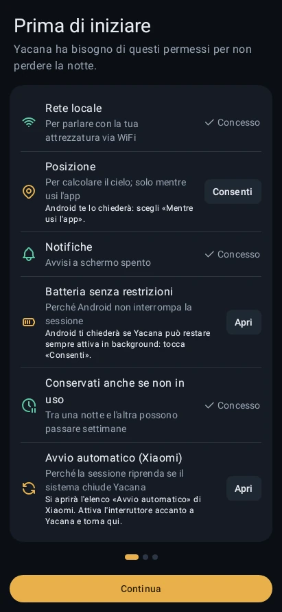 <b>Prima di iniziare.</b> Le righe concesse mostrano un segno di spunta.</td>
</tr></table>

| Permesso | A cosa serve | Senza |
| --- | --- | --- |
| **Rete locale** | Parlare con la tua attrezzatura via WiFi. Richiesto da Android 17 in poi. | L'app non può trovare né controllare alcun dispositivo Alpaca. |
| **Posizione** | Calcolare il cielo nel tuo luogo, solo mentre usi l'app. Scegli **Mentre usi l'app**. | Scrivi invece il luogo nel profilo. |
| **Notifiche** | La sessione e i suoi avvisi a schermo spento. Richiesto da Android 13 in poi. | Non vedi la sessione né i suoi avvisi fuori dall'app. |
| **Batteria senza restrizioni** | Perché Android non interrompa la sessione. Tocca **Consenti** quando Android lo chiede. | Il sistema può interrompere la sessione a schermo spento. |
| **Conservati anche se non in uso** | Tra una notte e l'altra possono passare settimane. Disattiva **Sospendi attività app se inutilizzata**. Da Android 11 in poi. | Android può revocare i permessi dell'app dopo qualche mese di inutilizzo. |
| **Avvio automatico (Xiaomi)** | Sui telefoni Xiaomi, Redmi e Poco, perché la sessione riprenda se il sistema chiude Yacana. Attiva l'interruttore accanto a Yacana. | Se il sistema chiude Yacana di notte, la sessione non riprende. |

Se ne rifiuti uno, non si rompe nulla subito: l'app spiega cosa smette di funzionare e come attivarlo in seguito, in *Impostazioni › Permessi* ([capitolo 33](#permissions)). Tocca **Continua** per proseguire.

### 2 · Trova la tua attrezzatura

1. Accendi l'attrezzatura e connetti il telefono al suo WiFi, oppure metti entrambi sul WiFi di casa.
2. Yacana cerca da sola i dispositivi Alpaca in rete, su IPv4 e IPv6. Ogni server trovato compare come una scheda con i suoi dispositivi. **Cerca di nuovo** ripete la ricerca.
3. Su un Seestar, tocca **Teleobiettivo** o **Grandangolo**: carica il profilo del Seestar per quella camera, con ottica, campo e impostazioni consigliate. Puoi crearli entrambi e passare dall'uno all'altro dalla scheda **Profilo** in Attrezzatura. Per un'altra attrezzatura, tocca **Aggiungi**: il profilo prende il primo dispositivo di ogni tipo su quel server.

Se un dispositivo non viene trovato, per esempio su una rete che blocca la ricerca automatica, tocca **Aggiungi per IP e porta** e scrivi il suo indirizzo, ad esempio `192.168.1.10:32323`. Se hai già un profilo da un altro telefono, **Importa profilo** lo carica. **Non ora** salta questa pagina; potrai trovare la tua attrezzatura più tardi in Attrezzatura.

<table><tr>
<td valign="top" width="240">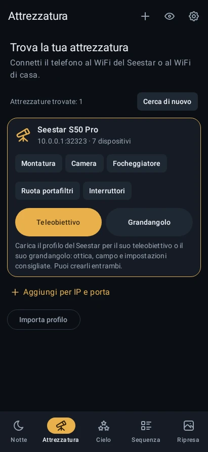 <b>Trovato sul WiFi.</b> Un Seestar con i suoi sette dispositivi.</td>
</tr></table>

### 3 · Pronto per il campo

Yacana funziona senza internet, ma due cose sono troppo grandi per includerle nell'app. Questa pagina mostra cosa c'è già sul telefono e cosa scaricare finché hai ancora il WiFi:

- **Catalogo di oggetti** ed **Effemeridi**: inclusi nell'app, non c'è niente da fare.
- **Database stellare**: quello consigliato per il tuo campo, D50 per un Seestar. Tocca **Scarica**.
- **Cache del cielo di NINA**: le foto per l'atlante e l'inquadratura. Tocca **Importa** se hai già il suo ZIP; per scaricarla dentro l'app, usa *Impostazioni › Mappa del cielo* ([capitolo 6](#field)).

I download proseguono in background. Tocca **Inizia** per aprire l'app.

<table><tr>
<td valign="top" width="240">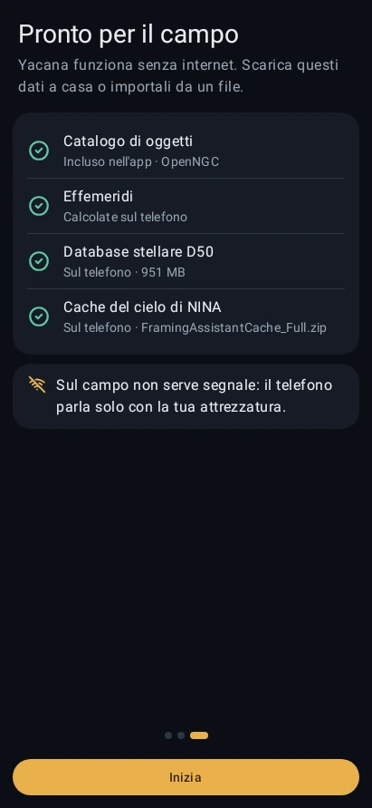 <b>Pronto per il campo.</b> Tutto sul telefono.</td>
</tr></table>

> [!TIP]
> **Buono a sapersi**
>
> I primi passi non si possono riaprire. Le loro parti restano disponibili: i permessi in *Impostazioni › Permessi*, la ricerca dell'attrezzatura in Attrezzatura, i database stellari in *Impostazioni › Plate solving* e le cache del cielo in *Impostazioni › Mappa del cielo*.

## 4. Orientarsi nell'app

Yacana è organizzata secondo i momenti della notte, non per pannelli dei dispositivi. In ogni momento mostra ciò che ti serve e lascia il resto a un tocco di distanza.

### Le cinque sezioni

La barra in basso ha cinque sezioni. Con il telefono in orizzontale diventa una barra laterale a sinistra. Se tocchi la sezione in cui ti trovi, torni alla sua prima schermata.

| Sezione | A cosa serve | Barra superiore |
| --- | --- | --- |
| **Notte** | Il buio e la Luna di stanotte, la checklist di preparazione, la sessione in corso, il riepilogo e il diario | Stato dell'attrezzatura, modalità rossa, Impostazioni |
| **Attrezzatura** | Profili, connessione e controllo manuale di ogni dispositivo | Aggiungi dispositivo, modalità rossa, Impostazioni |
| **Cielo** | Mappa del cielo, Sky Atlas, schede degli oggetti e inquadratura | Livelli del cielo o Filtri, modalità rossa |
| **Sequenza** | Piano di stanotte, sequenze salvate, modelli, gli editor semplice e avanzato | — |
| **Ripresa** | Ripresa manuale, statistiche, cronologia, stack dal vivo e foto di riferimento | Modalità rossa, Altre opzioni |

### Controlli comuni

- **Impostazioni:** L'ingranaggio in Notte e Attrezzatura, oppure **Impostazioni** in fondo ad **Altre opzioni** di Ripresa. La sua casella di ricerca trova qualsiasi impostazione da una parte del nome.
- **Modalità rossa:** L'icona dell'occhio in Notte, Attrezzatura, Cielo, Ripresa, nella scheda dell'oggetto, nell'inquadratura e negli assistenti. Rende rosso ogni pixel ([capitolo 32](#display)).
- **Stato dell'attrezzatura:** In Notte, uno scudo quando l'attrezzatura è connessa senza problemi, oppure un triangolo di avviso mentre l'app si riconnette o si ferma in sicurezza.
- **Indietro e chiudi:** La freccia in alto a sinistra torna indietro. Gli assistenti (allineamento polare, autofocus e flat) mostrano invece **✕**, che li ferma.
- **Finestre dal basso:** Molte opzioni si aprono in una finestra che sale dal fondo dello schermo. Trascinala verso il basso, o tocca fuori da essa, per chiuderla.
- **Numeri:** Orari, coordinate e numeri di pose si inseriscono con valori frequenti e con il tastierino dell'app, così la tastiera di sistema, che la modalità rossa non può colorare, non si accende mai di notte.
- **Tieni premuto:** I pulsanti rischiosi si riempiono mentre li premi e agiscono dopo circa un secondo: parcheggiare, fermare una sequenza, eliminare un profilo, una cache, un database o una sequenza salvata. Un tocco breve non fa altro che ricordarti di tenere premuto.
- **Stati:** Ogni stato si mostra con un'icona e con parole, mai solo con il colore, perché in modalità rossa il verde e l'ambra sembrano uguali.

### La barra della sessione

Mentre una sequenza è in corso o in pausa, una barra in ogni schermata tranne Notte mostra l'oggetto, il filtro, l'esposizione e la posa, con il suo avanzamento, come la barra «in riproduzione» di un'app di musica. Toccala per vedere la sessione in Notte; il suo pulsante mette in pausa o riprende la sequenza.

### Notifiche

Mentre l'attrezzatura è connessa, una notifica mostra la sessione, anche sulla schermata di blocco: l'oggetto, la posa e l'avanzamento, oppure le pose salvate. Toccala per aprire l'app. Il suo pulsante **Disconnetti** ferma la ripresa e disconnette l'attrezzatura. Gli avvisi che richiedono il tuo intervento, come un collegamento perso o un arresto sicuro, suonano; eventi come un autofocus o la fine della sequenza arrivano in silenzio. Ogni tipo ha il suo canale di notifica (*Sessione notturna*, *Avvisi della notte*, *Eventi della notte*), che puoi regolare nelle impostazioni di Android per l'app.

<table><tr>
<td valign="top" width="330">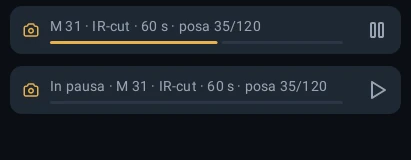 <b>La barra della sessione</b>, in corso e in pausa.</td>
</tr></table>

## 5. Il profilo della tua attrezzatura

Un profilo è un insieme di attrezzatura e il modo in cui la usi: i suoi dispositivi, l'ottica, il luogo, i limiti e le opzioni. Tutto ciò che Yacana calcola per te, come il campo, la scala del plate solving o il database stellare consigliato, viene da lì. Anche plate solving, autofocus, sicurezza, nomi dei file e stack dal vivo si conservano per profilo.

Aprilo con *Impostazioni › Profilo e posizione*, oppure tocca la scheda **Profilo** in Attrezzatura e poi **Apri il profilo**. Profili, dispositivi ed eliminazione del profilo si cambiano solo mentre l'attrezzatura è disconnessa.

### Nome e ottica

- **Nome:** toccalo per modificarlo sul posto.
- **Lunghezza focale:** in millimetri, da 10 a 10.000, quella del telescopio con il riduttore se ce l'ha. Dà la scala del plate solving e il campo che disegna la mappa del cielo.
- **Apertura:** il diametro dell'obiettivo, da 5 a 2.000 mm. Accanto si mostra il rapporto focale.
- **Sensore della camera** e **Dimensione dei pixel:** i suoi pixel in larghezza e in altezza (l'altezza si chiede dopo la larghezza) e la loro dimensione in µm, come nelle specifiche della camera; un Seestar S50 Pro ha 2160 × 3840 px da 2,9 µm. La camera li compila quando si connette; scritti, il campo è noto senza connettere nulla, per la mappa del cielo e l'inquadratura.

Una volta connessa la camera, la scheda mostra la scala e il campo, ad esempio *2,25″/px · campo 1,35° × 2,40°*.

### Posizione

Il luogo determina il buio di stanotte, ogni altezza e il polo per l'allineamento polare.

- **Usa la posizione del telefono** la legge dal telefono appena la attivi, a ogni apertura dell'app e alla connessione; la prima volta, Android chiede il permesso. Se non arriva, la riga dice perché, e toccandola riprova. Se è spento, la scrivi tu: latitudine nord o sud (da 0 a 90°), longitudine est o ovest (da 0 a 180°) e altitudine in metri (da 0 a 9.000).
- **Invia ora e luogo alla montatura** dà alla montatura l'ora UTC del telefono e il luogo alla connessione.

### Limiti

- **Limite di altezza**, da 0 a 60°: nessun GoTo scende sotto questo limite né sotto l'orizzonte. Un GoTo al di sotto viene rifiutato e la montatura non si muove; un movimento con la pulsantiera si ferma da solo al limite.
- **Orizzonte:** piatto, oppure il tuo, con alberi ed edifici. **Importa** legge un file di orizzonte di N.I.N.A.: un punto per riga, azimut e altezza in gradi, separati da spazi o tabulazioni, con `#` per i commenti. **Rendilo piatto** lo rimuove. Le schede degli oggetti lo disegnano nel loro grafico dell'altezza.

<table><tr>
<td valign="top" width="240">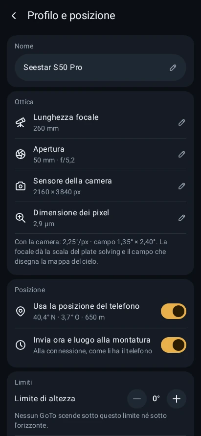 <b>Profilo e posizione.</b> Il profilo del Seestar.</td>
<td valign="top" width="240">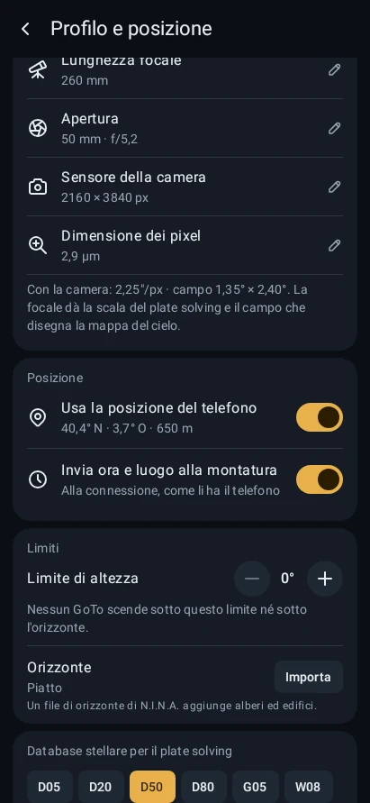 <b>Database stellare</b> per il plate solving, scelto per profilo.</td>
</tr></table>

### Database stellare

I pulsanti scelgono il database del profilo per il plate solving. L'app indica quale è adatto al tuo campo. Se ne scegli uno che non è sul telefono, compaiono la sua dimensione e un pulsante **Scarica**: entra in uso quando finisce il download, e fino ad allora resta il precedente.

### Più di un profilo

- **Cambiare:** tocca la scheda **Profilo** in Attrezzatura e scegline un altro, oppure tocca **Usa** accanto a esso in **Altri profili**.
- **Nuovo:** **Nuovo profilo** in **Altri profili** cerca in rete; l'attrezzatura che scegli diventa un nuovo profilo, in uso.
- **Copiare su un altro telefono:** in **Copia del profilo**, **Esporta** salva il profilo come file JSON dove scegli, e **Importa** ne legge uno e lo mette in uso. Il file contiene la posizione del luogo.
- **Eliminare:** **Elimina profilo** *(tieni premuto)*, in fondo alla schermata.

## 6. Pronto per il campo

Sul campo il telefono parla solo con la tua attrezzatura. Prima della tua prima notte, mentre hai il WiFi di casa, metti due cose sul telefono: un database stellare per il plate solving e le foto del cielo. Entrambi si possono anche importare da un file, ad esempio copiato da un PC o da una scheda di memoria.

### Database stellari

In *Impostazioni › Plate solving*, sotto **Database stellare**. L'app segna quello **consigliato** per il tuo campo e mostra la dimensione del campo. Sul telefono possono essercene diversi; il profilo ne usa uno, segnato **In uso**.

<table><tr>
<td valign="top" width="240">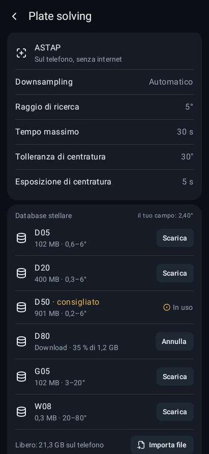 <b>I database stellari.</b> D50 in uso, D80 in download.</td>
</tr></table>

| Database | Dimensione | Per campi di | Note |
| --- | ---: | --- | --- |
| **D05** | 102 MB | da 0,6° a 6° | L'opzione leggera |
| **D20** | 400 MB | da 0,3° a 6° |  |
| **D50** | 901 MB | da 0,2° a 6° | Consigliato per il Seestar |
| **D80** | 1,2 GB | da 0,15° a 6° | Il più denso |
| **G05** | 102 MB | da 3° a 20° | Campi larghi, obiettivi fotografici |
| **W08** | 0,3 MB | da 20° a 80° | Campi molto larghi |

- **Scarica** lo prende dal sito di ASTAP solo con WiFi, anche ad app chiusa, e riprende se si interrompe. Quando finisce è in uso. Lo spazio libero sul telefono si mostra sotto l'elenco.
- **Importa file** lo installa dal file ZIP o `.deb` di ASTAP stesso, ad esempio da una scheda di memoria.
- Tieni premuto un database installato per eliminarlo con **Elimina database** *(tieni premuto)*. Quello in uso non si può eliminare: prima metti in uso un altro.
- **Prova con l'ultima posa** risolve l'ultima posa di Ripresa con le impostazioni attuali, per verificarle.

### Le foto del cielo: le cache di N.I.N.A.

La mappa del cielo, lo Sky Atlas, le schede degli oggetti, l'inquadratura e il riferimento di Ripresa usano tutti le foto delle cache di inquadratura di N.I.N.A. Yacana le legge come le pubblica N.I.N.A., direttamente dal loro ZIP senza decomprimerlo, quindi una cache occupa quanto il suo ZIP e niente di più. Apri *Impostazioni › Mappa del cielo*, oppure l'icona dei livelli sulla mappa del cielo.

- **Cache completa (DSS):** tutto il cielo in 2.131 foto a colori di 5° del Digitized Sky Survey, 3,5 GB. È quella da scaricare.
- **NSNS con stelle** (1,4 GB) e **NSNS senza stelle** (471 MB): il Northern Sky Narrowband Survey, emissione di idrogeno e ossigeno fino a circa −17° di declinazione. Si disegnano come secondo livello.
- **Foto online:** le foto più nitide che la mappa scarica quando ingrandisci molto con internet, conservate sul telefono.

<table><tr>
<td valign="top" width="240">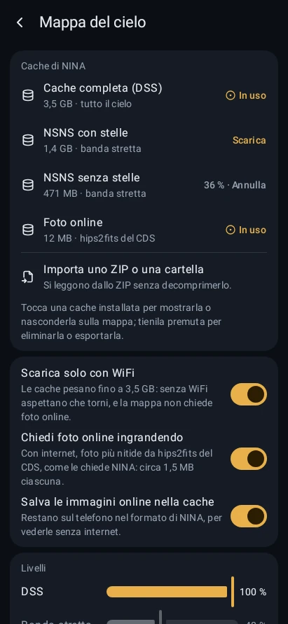 <b>Impostazioni › Mappa del cielo.</b> La cache completa in uso, una a banda stretta in arrivo.</td>
</tr></table>

#### Ottenere una cache

- **Scarica** la prende dal sito di N.I.N.A. tramite il gestore dei download di Android. Riprende se si interrompe e prima controlla lo spazio libero. Con **Scarica solo con WiFi** attivo (predefinito), aspetta il WiFi.
- **Importa uno ZIP o una cartella**: **Scegli uno ZIP** prende uno degli ZIP di N.I.N.A., come quelli del suo sito; **Scegli una cartella** prende la cartella della cache che N.I.N.A. ha su un PC (`FramingAssistantCache`), copiata sul telefono o su una scheda. Vengono copiati nell'app.

#### Usarla

- Tocca una cache installata per mostrarla sulla mappa o nasconderla: **In uso** o **Installata**.
- **Livelli:** l'opacità del livello DSS (100 % come predefinito) e di quello a banda stretta (40 %), per fonderli.
- **Chiedi foto online ingrandendo** (attivo di default): con internet, ingrandendo la mappa si chiedono a hips2fits del CDS foto più nitide, come fa N.I.N.A., di circa 1,5 MB ciascuna. Disattivalo per tenere i dati mobili per altro; con **Scarica solo con WiFi** attivo, la mappa non le chiede comunque con i dati mobili.
- **Salva le immagini online nella cache**: se attivo, restano sul telefono nel formato di N.I.N.A., per rivederle senza internet.

#### Eliminarla o esportarla

Tieni premuta una cache installata. La finestra indica quanto spazio libera; **Elimina cache** *(tieni premuto)* la rimuove. Una cache in cartella, come le foto online, offre anche **Esporta ZIP**, per aprirla in N.I.N.A. su un PC.

<table><tr>
<td valign="top" width="240">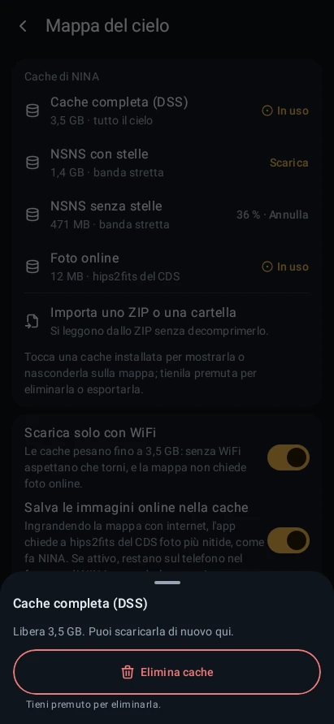 <b>Tenendo premuta una cache.</b> Quanto libera, e il pulsante da tenere premuto.</td>
</tr></table>

> [!TIP]
> **Crediti**
>
> Le foto non fanno parte dell'app: le scarichi dal sito di N.I.N.A. o le importi. Il DSS è dello STScI, che permette a N.I.N.A. di distribuirlo, e l'NSNS è sotto CC BY-NC-SA 4.0. La mappa mostra *DSS: STScI · NSNS: CC BY-NC-SA 4.0*.

---

# Attrezzatura

## 7. Connettere la tua attrezzatura

La sezione Attrezzatura contiene il profilo in uso, lo connette e ti dà il controllo manuale di ogni dispositivo.

1. Controlla la scheda **Profilo**: il nome del profilo e da dove viene il suo luogo, ad esempio *Posizione dal GPS · 40,4° N · 3,7° O · 650 m*. Toccala per passare a un altro profilo.
2. Tocca **Connetti**. La riga dice *Connessione…* e poi quanti dispositivi hanno risposto, ad esempio *5 di 5 connessi*, oppure perché uno non si è potuto connettere.
3. Ogni dispositivo ha una riga con il suo stato in tempo reale: la montatura in inseguimento e la sua altezza, la camera inattiva e la temperatura del sensore, la posizione del focheggiatore, il filtro inserito, la fascia anticondensa accesa. Si aggiornano ogni secondo o due.
4. Tocca un dispositivo connesso per aprire la sua schermata. **Disconnetti tutto** chiude la connessione.

Se il collegamento cade, Yacana si riconnette da sola. Durante una sequenza, prima entra in pausa sicura ([capitolo 28](#safety)).

<table><tr>
<td valign="top" width="240">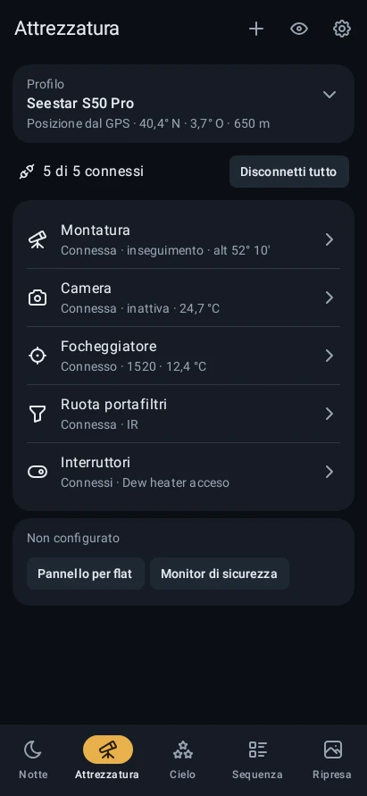 <b>Attrezzatura.</b> Cinque dispositivi connessi; il pannello per flat e il monitor di sicurezza non configurati.</td>
</tr></table>

### Aggiungere un dispositivo

Il **+** in alto apre *Aggiungi dispositivo*, che cerca di nuovo in rete. Ogni server mostra i dispositivi che il tuo profilo non ha ancora, ognuno con **Aggiungi**; **Aggiungi per IP e porta** accetta un indirizzo. La scheda **Non configurato** in fondo all'elenco ha un pulsante per ogni dispositivo opzionale, il pannello per flat e il monitor di sicurezza, che apre la stessa ricerca. I dispositivi si aggiungono solo mentre l'attrezzatura è disconnessa.

### Senza un profilo

Se hai saltato i primi passi, Attrezzatura inizia con **Trova la tua attrezzatura**, la stessa ricerca del [capitolo 3](#first-steps), e un pulsante **Importa profilo**.

## 8. La montatura

La schermata della montatura mostra dove punta e la muove a mano, con GoTo, sincronizzazione, parcheggio e inseguimento.

### Dove punta

La scheda in alto mostra il suo stato, ad esempio *Inseguimento · siderale*, *In movimento*, *Senza inseguimento* o *Parcheggiata*, e la sua AR, Dec, altezza e azimut. Mentre centra un oggetto, la scheda mostra il tentativo e il passo attuale, con **Ferma**.

### Muoverla a mano

Tieni premuta una freccia (N, S, E, O) per muovere la montatura; si ferma quando rilasci. Il pulsante rosso al centro la ferma subito. I pulsanti sotto impostano la velocità: **1×**, **8×** (predefinita) o **64×** la velocità siderale, oppure **Max**, la più alta della montatura. Un movimento si ferma da solo al limite di altezza del profilo.

### I pulsanti

- **Vai a…:** Apre una finestra per scrivere AR e Dec con il tastierino dell'app (vedi sotto).
- **Sincronizza:** Dice alla montatura che punta alle coordinate che scrivi. Con una posa risolta, usa invece **Sincronizza la montatura** di Ripresa ([capitolo 18](#solving)). Compare solo se la montatura può sincronizzarsi.
- **Parcheggia:** Tienilo premuto per mandare la montatura nella sua posizione di riposo. Un tocco breve ti ricorda soltanto di tenere premuto. Con la montatura parcheggiata, il pulsante dice **Sparcheggia**, e un tocco la sparcheggia.
- **Inseguimento:** Attiva o disattiva l'inseguimento.
- **Allineamento polare:** Apre l'assistente di allineamento polare ([capitolo 17](#polar)).

Il menu **⋮** in alto contiene il resto: la **Velocità di inseguimento** (siderale, lunare, solare o King, quelle che la montatura supporta), **Sparcheggia** quando è parcheggiata e **Cerca home** se la montatura ce l'ha.

<table><tr>
<td valign="top" width="240">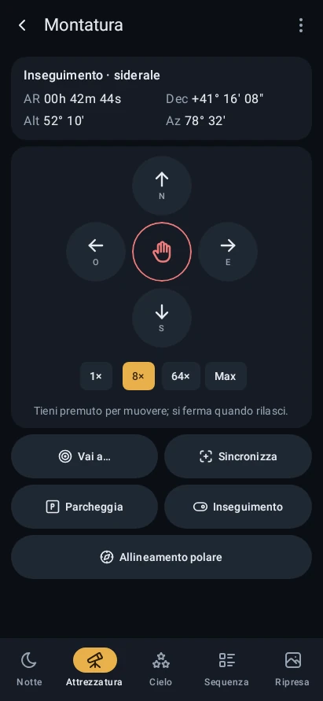 <b>Montatura.</b> Tieni premuta una freccia per muovere; tocca la velocità.</td>
<td valign="top" width="240">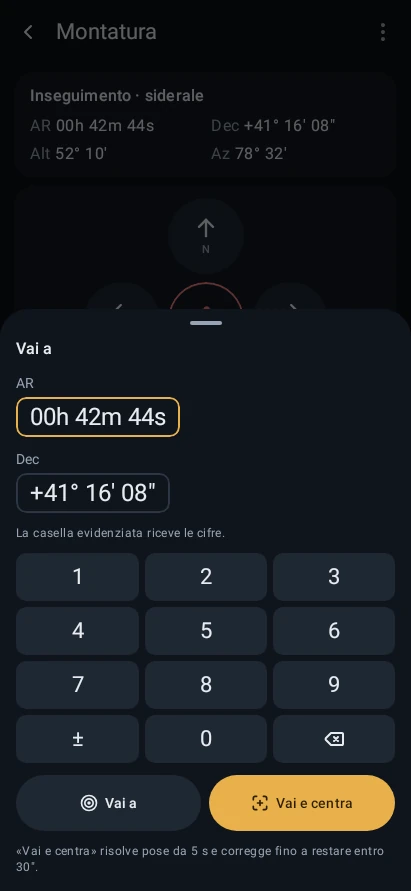 <b>Vai a.</b> La casella evidenziata riceve le cifre.</td>
</tr></table>

### Andare a delle coordinate

1. Tocca **Vai a…**. La finestra mostra AR e Dec attuali della montatura.
2. Tocca la casella dell'AR o della Dec per evidenziarla e scrivi le cifre sul tastierino. **±** cambia il segno della declinazione.
3. Tocca **Vai a** per spostarti lì, oppure **Vai e centra** per spostarti e poi affinare con il plate solving finché l'oggetto non è entro la tolleranza (30″ come predefinito).

> [!CAUTION]
> **Sotto il limite**
>
> Un GoTo verso un oggetto sotto il limite di altezza del profilo, o sotto il suo orizzonte, viene rifiutato. La schermata dice dove si trova l'oggetto e che la montatura non si è mossa. Aspetta che salga, oppure cambia il limite nel profilo ([capitolo 5](#profile)).

## 9. Camera e ruota portafiltri

### Camera

La schermata della camera mostra il suo stato, ad esempio *Inattiva · −10 °C*, e ciò che comunica: la dimensione del sensore, la dimensione dei pixel, la matrice di Bayer, gli intervalli di guadagno e offset e l'esposizione più lunga. Le pose si scattano in Ripresa; **Vai a Ripresa** ti porta lì ([capitolo 20](#imaging)).

Yacana usa ogni camera come essa si descrive via Alpaca: guadagno, offset, binning, regione di interesse e temperatura del sensore, dove la camera li ha. Le pose si scaricano direttamente nella memoria nativa del telefono mentre parte l'esposizione successiva, così entrano anche le camere da 61 MP.

### Ruota portafiltri

La schermata della ruota portafiltri elenca i suoi filtri, con un segno di spunta su quello inserito. Tocca un filtro per usarlo. In Ripresa il filtro è anche un pulsante sotto la posa.

Un filtro chiamato **Dark**, come sul Seestar, si usa come otturatore per dark e bias, così non serve coprire nulla. Senza, l'app ti chiede di coprire il telescopio quando scatta i dark.

## 10. Il focheggiatore

- **Posizione** e **Temperatura**, in grande, con l'ora e la temperatura dell'ultimo autofocus.
- **Muovi:** **−100**, **−10**, **+10** e **+100** passi, e **Vai alla posizione…**, che apre il tastierino con l'intervallo del focheggiatore. **Ferma** compare mentre si muove.
- **Ultima curva:** la curva a V dell'ultimo autofocus, con il suo HFR migliore e la posizione.
- **Offset di fuoco per filtro**, con una ruota portafiltri: tocca un filtro per impostare il suo offset in passi, rispetto agli altri. Al cambio filtro, il focheggiatore si sposta della differenza tra l'offset del nuovo filtro e quello del precedente, così ogni filtro resta a fuoco senza un nuovo autofocus.
- **Autofocus** avvia subito l'autofocus ([capitolo 19](#autofocus)).

<table><tr>
<td valign="top" width="240">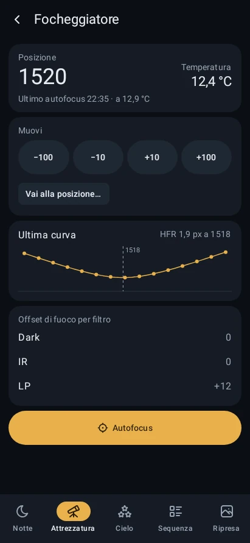 <b>Focheggiatore.</b> Il filtro LP va a fuoco 12 passi più in fuori.</td>
</tr></table>

## 11. Interruttori, pannello per flat e monitor di sicurezza

### Interruttori

Ogni interruttore si mostra come lo dichiara il dispositivo: un interruttore a levetta per acceso e spento, un cursore con − e + per un valore come la potenza di una fascia riscaldante (con il suo intervallo e passo; il valore si invia quando rilasci), oppure una lettura per quelli di sola lettura. Il più comune è una fascia anticondensa, che la sequenza può accendere all'inizio e spegnere alla fine.

### Pannello per flat

Per un pannello per flat con coperchio (un CoverCalibrator Alpaca):

- **Coperchio:** il suo stato, con **Apri** e **Chiudi**, e **Ferma** mentre si muove. Aprilo per la notte e chiudilo per i dark.
- **Luce:** accesa o spenta, e la sua **Luminosità** con un cursore o con − e +.

Per i flat, l'assistente dei flat chiude il coperchio, accende la luce e trova l'esposizione da solo ([capitolo 23](#calibration)).

### Monitor di sicurezza

Mostra **Sicuro** o **Non sicuro**, letto ogni secondo, ad esempio da un sensore di nuvole o di pioggia. L'app lo mostra ma non agisce ancora di conseguenza: se passa a **Non sicuro**, ferma la sequenza da Notte.

<table><tr>
<td valign="top" width="240">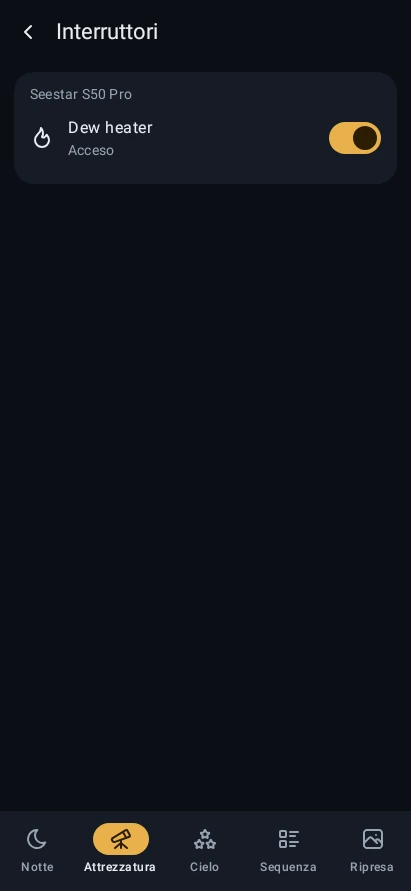 <b>Interruttori.</b> La fascia anticondensa del Seestar.</td>
<td valign="top" width="240">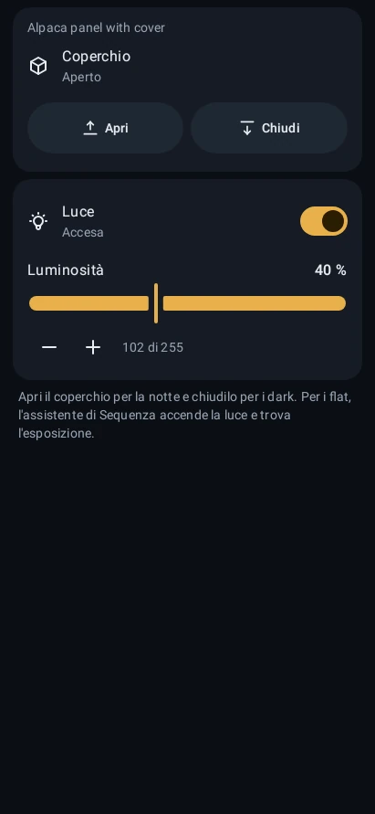 <b>Pannello per flat.</b> Coperchio aperto, luce al 40 %.</td>
<td valign="top" width="240">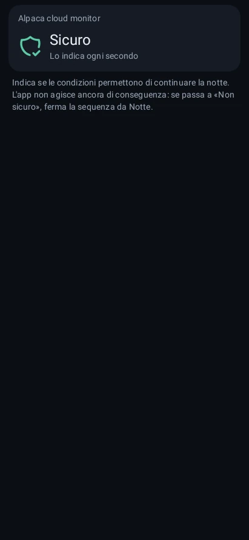 <b>Monitor di sicurezza.</b> Letto ogni secondo.</td>
</tr></table>

---

# Pianificare la notte

## 12. Stanotte a colpo d'occhio

Notte è dove inizia la serata. Mostra il buio e la Luna di stanotte, una checklist per prepararti, la sessione mentre è in corso e il riepilogo al mattino.

### La scheda di stanotte

Calcolata sul telefono per il luogo del profilo:

- La data e l'illuminazione della Luna, ad esempio *Luna 34 %*.
- La migliore finestra di buio: *Buio e senza Luna*, oppure *Buio, con la Luna in cielo* quando la Luna è in cielo per tutta la notte astronomica, con il suo inizio, la fine e la durata.
- Tramonto e alba, e una linea del tempo dalla sera al mattino: crepuscolo, notte astronomica e le ore in cui la Luna è in cielo, con la finestra migliore evidenziata.

Vicino al solstizio d'estate, alle alte latitudini, può dire *Nessuna notte astronomica*: il Sole non scende 18° sotto l'orizzonte. Senza un luogo, la scheda spiega come impostarlo: consenti la posizione in *Impostazioni › Permessi* e attiva quella del telefono, oppure scrivilo nel profilo.

### Un'altra notte

Tocca l'icona del calendario per vedere qualsiasi altra notte. La griglia del mese segna stanotte con un contorno e la notte che scegli con il riempimento; le frecce cambiano mese. **Torna a stanotte** ti riporta indietro.

<table><tr>
<td valign="top" width="240">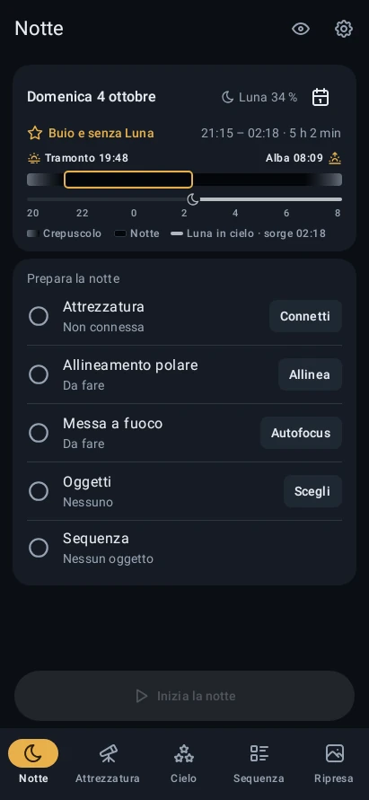 <b>Notte.</b> 5 h 2 min di cielo buio prima che sorga la Luna.</td>
<td valign="top" width="240">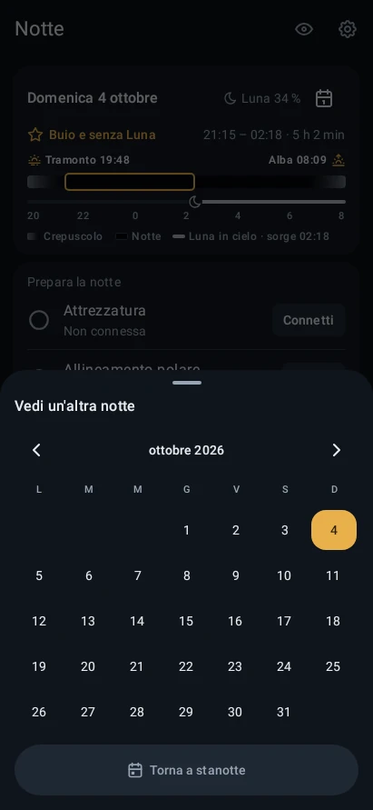 <b>Vedi un'altra notte.</b></td>
</tr></table>

### Prepara la notte

Una checklist senza passi obbligatori: fai ciò che serve alla tua notte, in qualsiasi ordine. Ogni riga mostra il suo stato e un pulsante che ti porta lì.

| Riga | Mostra | Pulsante |
| --- | --- | --- |
| **Attrezzatura** | Il profilo e i suoi dispositivi una volta connessi | **Connetti** |
| **Allineamento polare** | *Da fare*, oppure l'ultimo errore totale e quanto tempo fa | **Allinea**, poi **Rifinisci** |
| **Messa a fuoco** | *Da fare*, oppure l'ultimo HFR e quanto tempo fa (con un focheggiatore) | **Autofocus** |
| **Oggetti** | *Nessuno*, oppure gli oggetti di stanotte | **Scegli**, che apre Cielo |
| **Sequenza** | Se il piano sta prima dell'alba, e la sua durata | **Regola** quando non sta |

Quando l'attrezzatura è connessa e il piano ha esposizioni, **Inizia la notte** avvia la sequenza ([capitolo 27](#running)). I segni delle righe sono icone oltre che colori, così si leggono allo stesso modo in modalità rossa.

<table><tr>
<td valign="top" width="240">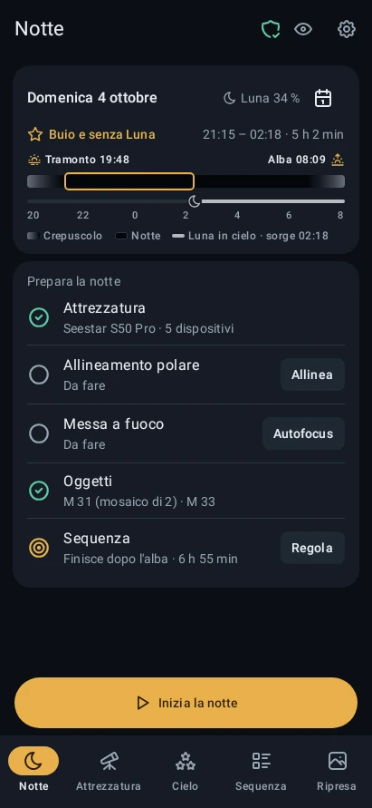 <b>Pronto per iniziare.</b> Il piano finisce dopo l'alba: <i>Regola</i> lo accorcia.</td>
</tr></table>

## 13. La mappa del cielo

La sezione Cielo si apre su una mappa del cielo reale, disegnata dalle foto della cache di N.I.N.A., senza internet. La mappa resta dove l'hai lasciata, anche dopo aver chiuso l'app. Trascinala con un dito, pizzica per lo zoom da una vista ampia fino a meno del campo della tua camera, e tocca un oggetto per selezionarlo.

La mappa è orientata come vedi il cielo dal luogo del profilo in questo momento, con lo zenit in alto; senza un luogo, il nord è in alto. Una barra di scala mostra la dimensione di un grado, e le coordinate del centro sono in basso a destra.

### Cosa mostra

- **Foto:** l'etichetta in alto dice da dove vengono, ad esempio *DSS · cache di NINA*. Con internet, ingrandendo si scaricano foto più nitide della zona; mentre ne arriva una, una piccola rotella gira nell'etichetta. Senza una cache, l'etichetta spiega come installarne una; toccala per aprire le impostazioni della mappa del cielo.
- **Il tuo campo:** un riquadro tratteggiato al centro, grande quanto il campo della tua camera, con il nome del profilo.
- **Oggetti:** contorni e nomi degli oggetti del catalogo.
- **Orizzonte:** una linea chiara dove si trova l'orizzonte del luogo del profilo, che segue il suo orizzonte se il profilo ne ha uno, con **N**, **E**, **S** e **O** sopra.

### Selezionare un oggetto

Tocca un oggetto: la mappa si centra su di esso e una scheda mostra nome, dimensione, altezza e ora migliore, con **Inquadra**. Tocca la scheda per aprire la scheda completa dell'oggetto. Tocca il cielo vuoto per deselezionarlo.

Per inquadrare un'area senza oggetti del catalogo, centrala nella mappa, dentro il riquadro del tuo campo, e tocca **Inquadra qui**, il pulsante rotondo dorato sotto lo zoom: l'inquadratura si apre lì, e l'area entra nella sequenza con le sue coordinate come nome, ad esempio *03h 47m +24° 07′*.

### Pulsanti

- **+ e −:** ingrandiscono e riducono.
- **Inquadra qui:** quello dorato, sotto, inquadra il centro della mappa.
- **Livelli** (barra superiore): le impostazioni della mappa del cielo, con le cache e l'opacità dei livelli ([capitolo 6](#field)).

<table><tr>
<td valign="top" width="240">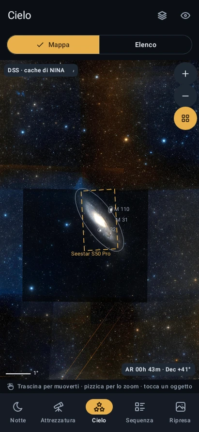 <b>La mappa.</b> M 31 sulle foto DSS, con il campo del Seestar.</td>
</tr></table>

### La montatura sulla mappa

Con la montatura connessa, la mappa mostra due riquadri del campo della tua camera. Si distinguono per la linea, così si riconoscono anche in modalità rossa:

- **Inquadratura:** tratteggiato, al centro della mappa. È dove vuoi andare.
- **Telescopio:** continuo, dove punta ora il telescopio; si muove perché viene letto ogni secondo.

Trascina la mappa per mettere l'oggetto nel riquadro dell'inquadratura, oppure tocca un oggetto per centrarlo, poi:

- **Vai e centra** porta il telescopio all'inquadratura e la affina con il plate solving fino alla tolleranza del profilo. Una scheda mostra ogni passo e quanto manca, con **Ferma**, che ferma la montatura e la posa.
- **Vai soltanto** fa il GoTo senza centrare.

Quando la montatura è parcheggiata o senza inseguimento, l'etichetta **Telescopio** lo indica, e toccandola si sparcheggia la montatura o si attiva l'inseguimento.

<table><tr>
<td valign="top" width="240">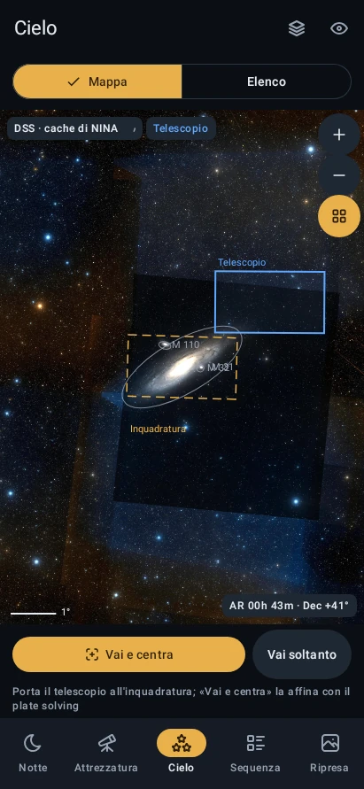 <b>Telescopio e inquadratura.</b> Il riquadro continuo è dove punta.</td>
<td valign="top" width="240">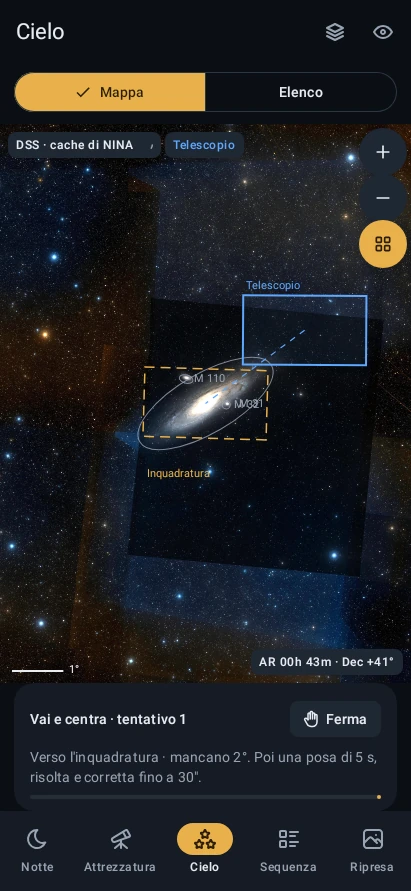 <b>Vai e centra.</b> Mancano 2°, poi una posa di 5 s, risolta e corretta.</td>
</tr></table>

## 14. Sky Atlas e ricerca

Passa la sezione Cielo a **Elenco** per lo Sky Atlas: 13.371 oggetti del profondo cielo di OpenNGC (NGC, IC, Messier, Caldwell e altri) sul telefono, ognuno con la sua foto dalla cache, ordinati per stanotte.

### Il meglio di stanotte

Con **Stanotte** attivo (predefinito), l'elenco mostra ciò che è ben posizionato stanotte dal luogo del profilo, ordinato per ora migliore. Ogni riga ha una miniatura, il nome, il numero di catalogo e la dimensione, se *entra* nel tuo campo o richiede un *mosaico di N*, e una piccola curva di altezza con la sua ora migliore. Tocca una riga per la scheda dell'oggetto.

Sopra l'elenco, **Stanotte** e **Preferiti**, gli oggetti che hai segnato con la stella nella loro scheda, si attivano e disattivano con un tocco. Accanto compare ogni filtro attivo, come *Fino a mag 8* o *Da 1°*: la sua ✕ lo toglie e il suo testo apre i filtri. L'icona dei cursori dice quanti sono, e la nota quanti oggetti restano e in che ordine. I filtri e il punto dell'elenco restano quando apri un oggetto, cambi sezione o chiudi l'app.

<table><tr>
<td valign="top" width="240">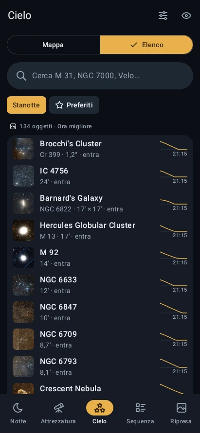 <b>Stanotte.</b> Miniature dalla cache, senza internet.</td>
<td valign="top" width="240">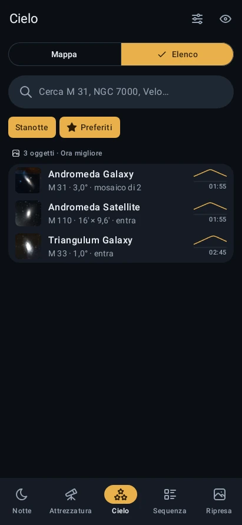 <b>Preferiti.</b> M 31 richiede un mosaico di 2.</td>
<td valign="top" width="240">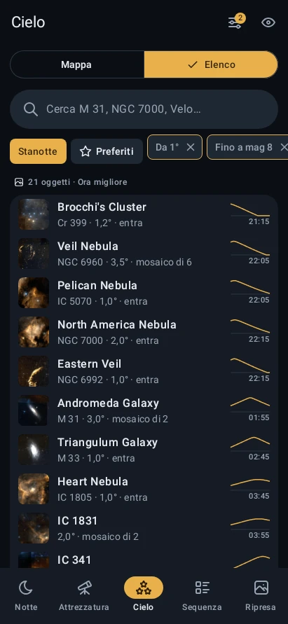 <b>Filtri attivi.</b> Fino a mag 8 e da 1°.</td>
</tr></table>

### Filtri

L'icona dei cursori in alto, o il testo di un filtro attivo, apre i filtri. L'elenco cambia mentre scegli e l'intestazione dice quanti oggetti restano; **Ripristina** li rimette come all'inizio, e **Fatto**, uno scorrimento verso il basso, un tocco fuori o indietro li chiudono. In orizzontale si aprono di lato, con l'elenco accanto.

- **Ordina per:** Ora migliore (predefinito), Altezza massima, Ore visibili, Dimensione o Luminosità, ciascuno nel suo verso naturale: prima il più presto, il più alto, quello più a lungo sopra la tua altezza, il più grande o il più luminoso. La nota sopra l'elenco indica l'ordine.
- **Tipo:** Galassie, nebulose, ammassi, altri.
- **Dimensione:** Qualsiasi, per il tuo campo (se ne mostra la dimensione), oppure da 15′, 30′ o 1°.
- **Magnitudine:** Qualsiasi, oppure fino a 8, 10 o 12.
- **Solo:** Preferiti, e quelli che entrano nel campo.
- **Stanotte:** attivo (predefinito), solo ciò che è ben posizionato stanotte; l'altezza e le ore sono quelle della notte buia di stanotte nella posizione del profilo. Disattivato, i tre seguenti non contano.
- **Sopra:** 20°, 30° o 45°.
- **Per almeno:** 1, 2 o 4 ore.
- **Lontano dalla Luna:** Qualsiasi, oppure almeno 30°, 60° o 90°.

Se niente corrisponde, l'elenco lo dice, con **Ripristina** per ricominciare.

<table><tr>
<td valign="top" width="240">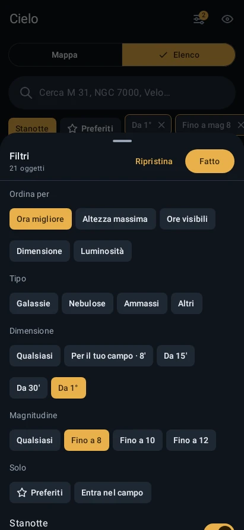 <b>Filtri.</b></td>
</tr></table>

### Ricerca

Scrivi nella casella di ricerca: un numero Messier, NGC, IC, Caldwell o Sharpless, oppure un nome, come *M 31*, *NGC 7000* o *Velo*. I risultati compaiono mentre scrivi, in millisecondi, senza internet. In modalità rossa, la casella di ricerca apre la tastiera dell'app, rossa come tutto il resto, invece di quella del telefono; ⌄ o indietro la nasconde.

Per tutto il resto, l'ultima riga offre **Cerca «…» in SIMBAD**. Con internet, interroga SIMBAD del CDS, che conosce più di 20 milioni di oggetti, dal quasar TON 618 alle stelle di una costellazione. Ciò che trova resta sul telefono, per ritrovarlo offline. Se non c'è una corrispondenza esatta, elenca gli oggetti con nomi simili, prima i più luminosi.

<table><tr>
<td valign="top" width="240">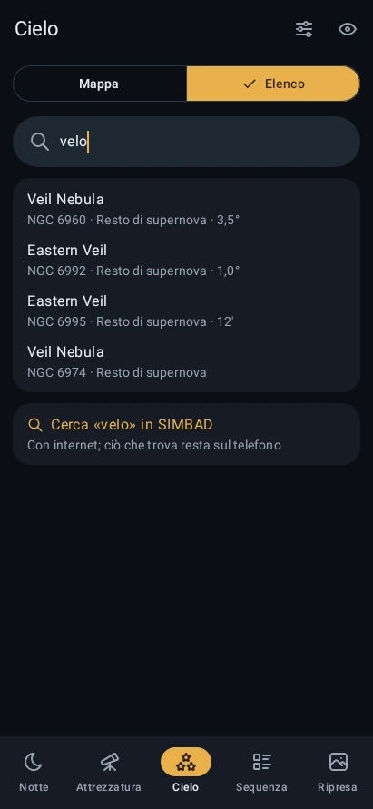 <b>Ricerca offline.</b> «velo» trova il Velo.</td>
<td valign="top" width="240">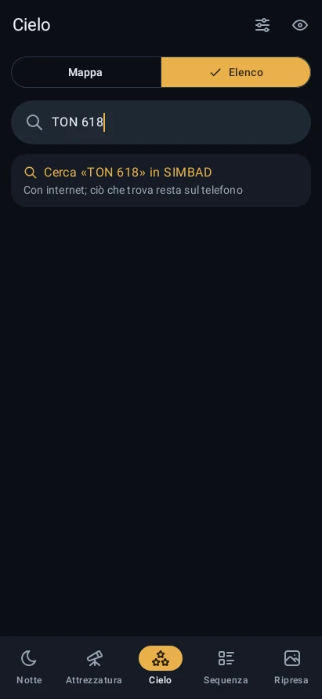 <b>Oltre il catalogo:</b> SIMBAD, con internet.</td>
</tr></table>

## 15. La scheda di un oggetto

Tutto ciò che ti serve per decidere su un oggetto: la sua foto con il tuo campo sopra, cos'è, quanto sale stanotte e quanto è vicina la Luna.

- **Foto:** dalla cache, con il campo della tua camera disegnato sopra. Toccala, o il suo pulsante **Mappa**, per vedere l'oggetto inquadrato nella mappa del cielo; si muove solo la mappa, non il telescopio.
- **Informazioni:** nome, tipo, magnitudine e dimensione; i suoi altri nomi e designazioni, ad esempio *Anche Triangulum Galaxy · Triangulum Pinwheel · NGC 598*; *Entra nel campo* o *Mosaico di N pannelli*; e la distanza e la fase della Luna, ad esempio *Luna a 87° · 34 %*.
- **Altezza stanotte:** la curva dell'oggetto dal crepuscolo serale all'alba, con il crepuscolo ombreggiato ai due estremi, la linea dei 30°, il tuo orizzonte tratteggiato se il profilo ne ha uno, e una linea per l'ora attuale. Sotto, le ore in cui è sopra 30° e il suo punto più alto, oppure che resta basso o non sorge.

La stella in alto lo segna come preferito. **Inquadra** apre l'inquadratura ([capitolo 16](#framing)). **Vai e centra**, con la montatura connessa, porta lì il telescopio e lo centra, nella schermata della montatura.

<table><tr>
<td valign="top" width="240">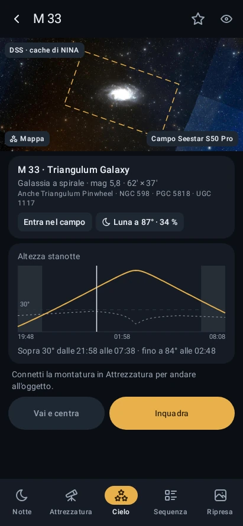 <b>M 33.</b> Entra nel campo del Seestar; la linea tratteggiata è l'orizzonte del luogo.</td>
<td valign="top" width="240">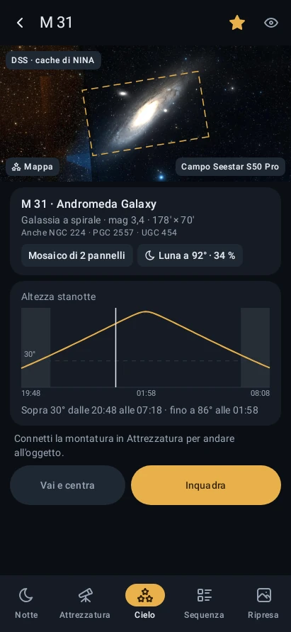 <b>M 31.</b> Un preferito che richiede un mosaico di 2 pannelli.</td>
</tr></table>

## 16. Inquadratura e mosaici

L'inquadratura mostra come verrà la foto: il campo reale della tua camera sul cielo, che trascini finché la composizione non è giusta, e i mosaici per gli oggetti più grandi del campo.

1. Aprila con **Inquadra** nella scheda di un oggetto o nella scheda dell'oggetto che compare sulla mappa.
2. Trascina il cielo per mettere l'oggetto nel campo; pizzica per lo zoom. La dimensione del campo si mostra in alto a destra.
3. Per un mosaico, imposta **Colonne** e **Righe** con − e +, e la **Sovrapposizione** tra i pannelli, dal 5 al 50 % (15 % come predefinito). I pannelli sono numerati nell'ordine in cui verranno ripresi.
4. Controlla la riga sotto: le ore in cui è sopra 30° stanotte.
5. Tocca **Aggiungi alla sequenza**. L'app conferma che l'oggetto è nella sequenza di stanotte, con **Scegli un altro oggetto** e **Vedi stanotte**.

Un nuovo oggetto arriva con 60 pose da 60 s con il primo filtro che non è quello scuro, con dithering ogni 3 pose; regolale nell'editor ([capitolo 25](#simple)). Dopo il modello **Un oggetto tutta la notte**, invece, l'oggetto riempie la notte fino all'alba.

**Vai e centra**, con la montatura connessa, porta il telescopio all'inquadratura.

<table><tr>
<td valign="top" width="240">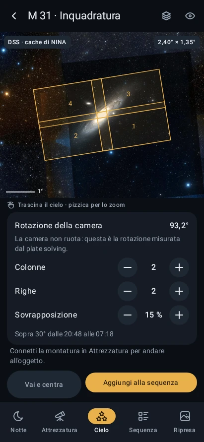 <b>M 31 · Inquadratura.</b> Un mosaico 2 × 2, ruotato come la camera.</td>
</tr></table>

### La rotazione della camera

Senza un rotatore la camera non ruota, quindi l'inquadratura non ruota il campo a mano: **Rotazione della camera** è l'angolo misurato dal plate solving, e il campo e i pannelli si disegnano con esso. Fino al primo plate solving è 0°, oppure 93,2° per un Seestar in modalità EQ. Risolvi una posa in Ripresa una volta montata la camera, e l'inquadratura vi si adegua ([capitolo 18](#solving)).

> [!TIP]
> **Serve il campo**
>
> L'inquadratura richiede il campo del profilo: la sua focale e il sensore della camera (*Impostazioni › Profilo e posizione › Ottica*), scritti o conservati dall'ultima connessione della camera. Non serve connettere nulla; la schermata ha un pulsante per il profilo.

---

# Al telescopio

## 17. Allineamento polare a tre punti

L'assistente di allineamento polare misura quanto l'asse della montatura dista dal polo celeste e poi ti guida, in tempo reale, mentre giri le viti del cuneo. È un port del plugin Three Point Polar Alignment di N.I.N.A. e dà lo stesso risultato entro 0,4″ sulle stesse misure.

Funziona con qualsiasi montatura in grado di ruotare a comando il suo asse di ascensione retta. Richiede la montatura e la camera connesse, un database stellare sul telefono e il luogo del profilo, che determina dove si trova il polo.

### Aprire l'assistente

Tocca **Allinea** nella riga **Allineamento polare** della checklist di Notte (**Rifinisci** una volta misurato), oppure **Allineamento polare** nella schermata della montatura. L'assistente occupa lo schermo e lo tiene acceso mentre è in funzione; la **✕** in alto a sinistra lo ferma e torna indietro.

### Prima di iniziare

La prima pagina spiega cosa succederà e dove puntare: un'area libera del cielo, lontana dal polo e dall'orizzonte, nella direzione in cui ruoterà l'asse. Mostra quattro opzioni; ognuna si conserva nel profilo.

- **Rotazione tra i punti:** Di quanto ruota l'asse AR tra le tre pose, e in che direzione: 10°, 15°, 20° o 30°, verso ovest o verso est. Il valore predefinito è 15° verso ovest. Lascia spazio per la rotazione, perché la montatura non incontri ostacoli.
- **Esposizione:** 1, 2, 3 o 5 s, in bin 1×1 o 2×2, con il guadagno di Ripresa. Con pose brevi l'errore si aggiorna prima mentre giri le viti. Il valore predefinito è 1 s a 2×2.
- **Tolleranza:** Disattivata, 0,5′, 1′, 2′ o 5′. Quando l'errore totale scende sotto, il telefono vibra. Non nasconde mai le frecce. Disattivata come predefinito, come nel plugin.
- **Risolvi solo con suggerimento:** Per rifinire un allineamento già vicino: i tre punti si risolvono solo vicino a dove punta la montatura, mai alla cieca.

<table><tr>
<td valign="top" width="240">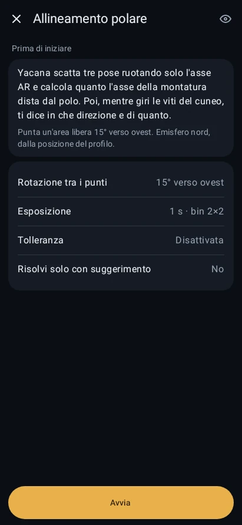 <b>Prima di iniziare.</b> Le opzioni, con i valori predefiniti del Seestar.</td>
</tr></table>

### Misurare i tre punti

1. Punta il telescopio verso un'area libera come indica la prima pagina, e tocca **Avvia**.
2. Yacana scatta la prima posa e la risolve, ruota l'asse AR, scatta e risolve la seconda, ruota di nuovo e scatta la terza. Ogni punto mostra *Rotazione dell'asse AR…*, *Scatto della posa*, *Risoluzione con ASTAP*, e poi quanto è durata la risoluzione.
3. **Non toccare la montatura mentre misura.** I tre centri tracciano un cerchio il cui centro è l'asse reale della montatura. La sua distanza dal polo, corretta per precessione, nutazione e rifrazione nel tuo luogo e alla tua ora, è l'errore.

Se un punto non si risolve, l'assistente dice quale e perché, e offre **Ricomincia**.

<table><tr>
<td valign="top" width="240">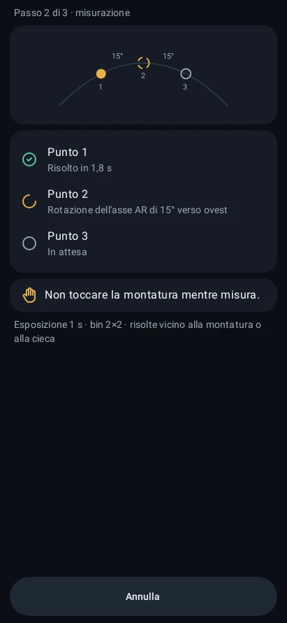 <b>Misurazione.</b> Punto 1 risolto in 1,8 s, l'asse che ruota verso il punto 2.</td>
</tr></table>

### Girare le viti del cuneo

Ora l'assistente continua a scattare pose, risolve ognuna vicino all'ultima posizione e aggiorna l'errore ogni pochi secondi. Ogni asse ha la sua scheda:

- **Altezza:** una freccia e *Su* o *Giù*, con *Un po'* davanti quando è vicino.
- **Azimut:** una freccia e *Gira verso ovest* o *verso est*, con *un po'* quando è vicino.
- L'errore con segno in gradi, minuti e secondi, abbastanza grande da leggerlo a un metro di distanza, e l'**Errore totale** sotto.

Gira una vite alla volta e guarda scendere il suo numero. Sotto, un bersaglio mostra la posizione del polo con anelli a 30″, 1′ e 5′. Quando ti avvicini, si ingrandisce da solo alla *scala in secondi*, con anelli a 10″ e 30″, così puoi rifinire secondo per secondo.

**Niente viene dato per buono troppo presto.** Un asse mantiene la sua freccia finché il suo errore, arrotondato al secondo, non è 00° 00′ 00″; poi mostra *Centrato*. Non c'è una spunta verde a una soglia: decidi tu quando è abbastanza buono. Se imposti una tolleranza, il telefono vibra quando il totale scende sotto, e le frecce restano.

Se l'ultima posa non si è risolta, la schermata lo dice e continua a provare. **Misura di nuovo** ripete i tre punti da dove si trova la montatura, ad esempio dopo una correzione grande. **Fine** chiude l'assistente, e la checklist di Notte mostra il risultato e quando è stato misurato.

<table><tr>
<td valign="top" width="240">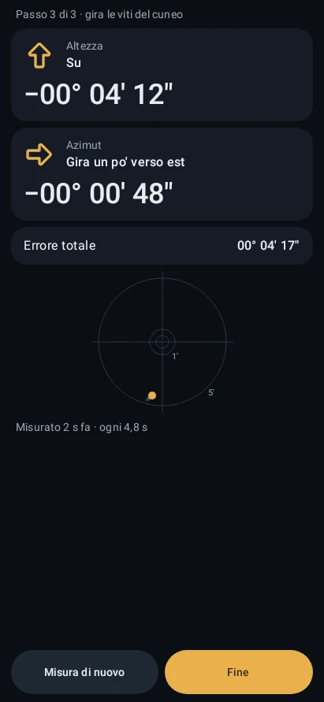 <b>Minuti di errore.</b> Su, e un po' verso est.</td>
<td valign="top" width="240">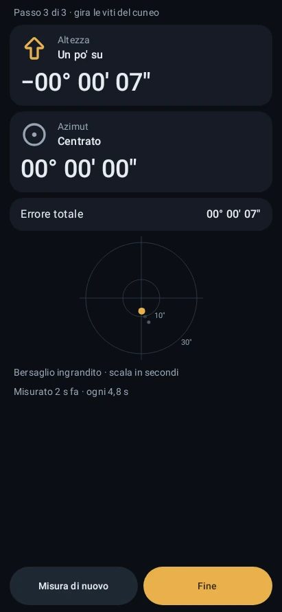 <b>Secondi di errore.</b> Il bersaglio ingrandito; azimut centrato.</td>
</tr></table>

<table><tr>
<td valign="top" width="470">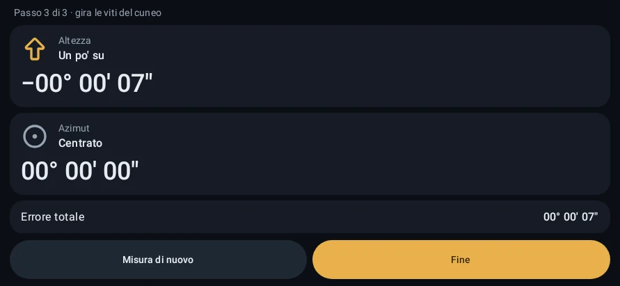 <b>In orizzontale</b>, le schede usano la larghezza; i numeri restano grandi.</td>
</tr></table>

> [!TIP]
> **Seestar**
>
> Su un cuneo, l'altezza si regola con l'inclinazione del cuneo e l'azimut ruotando la sua base. L'Alpaca del Seestar può ruotare il suo asse AR, ed è tutto ciò che serve all'assistente.

## 18. Plate solving e centratura

Il plate solving calcola dove punta una posa, la sua scala e la sua rotazione, dalla disposizione delle sue stelle. Yacana esegue ASTAP, il noto risolutore, sul telefono stesso, senza internet: circa 0,4 s con la posizione della montatura come suggerimento e circa 7 s alla cieca su un telefono di fascia media con pose del Seestar.

### Risolvere una posa

In Ripresa, scatta una posa e tocca **Risolvi**. Yacana cerca prima vicino a dove la montatura dice di puntare, e poi alla cieca se serve. Il risultato mostra:

- **AR e Dec** del centro della posa, in J2000;
- la **rotazione** della camera;
- la **scala** in secondi d'arco per pixel e il campo in gradi;
- quanto ha impiegato, se è stato vicino alla montatura o alla cieca, e il database stellare usato.

Tocca **Sincronizza la montatura** per dire alla montatura che punta lì, così i suoi prossimi GoTo arrivano più vicini. La rotazione risolta diventa la rotazione della camera per l'inquadratura e i mosaici ([capitolo 16](#framing)).

### Vai e centra

**Vai e centra** compare ovunque tu possa mandare il telescopio da qualche parte: sulla mappa del cielo, nella scheda di un oggetto, nella schermata dell'inquadratura e nella finestra **Vai a…** della montatura. Sposta la montatura, scatta una posa con l'esposizione di centratura, la risolve, corregge la montatura e ripete finché il centro della posa non è entro la tolleranza, 30″ come predefinito. Il suo avanzamento mostra ogni passo, quanto distava l'ultima posa e il tentativo; **Ferma** ferma la montatura e la posa. Le pose di centratura non vengono salvate.

<table><tr>
<td valign="top" width="240">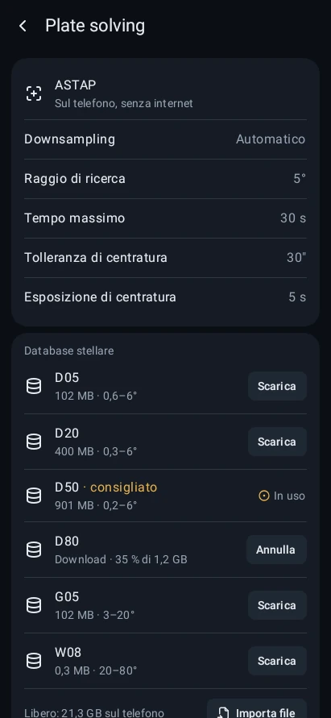 <b>Impostazioni › Plate solving.</b> Le opzioni di ASTAP e i database stellari.</td>
</tr></table>

### Impostazioni del plate solving

In *Impostazioni › Plate solving*, conservate in ogni profilo:

| Impostazione | Predefinito | Cosa fa |
| --- | --- | --- |
| **Downsampling** | Automatico | ASTAP raggruppa i pixel della posa prima di cercare le stelle. In automatico sceglie il fattore in base alla dimensione della posa. |
| **Raggio di ricerca** | 5° | Quanto cercare attorno alla posizione della montatura, da 1 a 180°. Se lì non trova una soluzione, cerca in tutto il cielo. |
| **Tempo massimo** | 30 s | Per risolvere vicino alla montatura e poi alla cieca, da 5 a 600 s. |
| **Tolleranza di centratura** | 30″ | La centratura si ferma quando il centro della posa è così vicino all'oggetto, da 5 a 600″. |
| **Esposizione di centratura** | 5 s | Le pose che risolve la centratura, con il guadagno di Ripresa; da 1 a 60 s. Non vengono salvate. |

I database stellari sono nella stessa schermata; il [capitolo 6](#field) spiega come sceglierli, scaricarli e importarli.

> [!TIP]
> **Quando una posa non si risolve**
>
> Controlla che la posa abbia stelle, che la lunghezza focale del profilo sia giusta (ASTAP cerca quella scala) e che il database sia adatto al tuo campo. Nuvole, condensa o una posa molto fuori fuoco sono le cause abituali.

## 19. Autofocus

L'autofocus muove il focheggiatore attraverso il fuoco, misura l'HFR delle stelle in ogni punto e adatta una curva a V per trovare la posizione migliore. È un port dell'autofocus di N.I.N.A., con le sue cinque interpolazioni della curva, la compensazione del backlash e gli offset di fuoco per filtro.

Richiede un focheggiatore assoluto (uno che va a posizioni in passi) e una camera, puntati su un campo con stelle. Aprilo con **Autofocus** nella checklist di Notte, nella schermata del focheggiatore o in Ripresa: la procedura parte subito, con le opzioni di *Impostazioni › Autofocus*.

### Come si svolge una procedura

1. Il focheggiatore si porta un certo numero di passi in fuori, poi prende un punto a ogni passo verso l'interno: una posa, le sue stelle e il loro HFR.
2. Aggiunge punti finché ce ne sono tanti da ogni lato del migliore quanti quelli con cui è partito. Il grafico si riempie man mano, con il punto attuale, la sua esposizione e il filtro.
3. Dopo l'ultimo punto, adatta la curva, porta il focheggiatore al fuoco migliore e lo verifica. Il risultato mostra la posizione, l'HFR, la temperatura, l'R² dell'interpolazione e dove si trovava prima il focheggiatore.

Tocca **Fine** per chiuderlo. **Annulla** durante una procedura riporta il focheggiatore dov'era. Se la procedura fallisce, la schermata dice perché, il focheggiatore torna indietro e **Riprova** la riavvia.

Il risultato si conserva: la schermata del focheggiatore mostra l'ultimo autofocus e la sua curva, la checklist di Notte mostra l'HFR e quanto tempo fa, e il diario lo registra.

<table><tr>
<td valign="top" width="240">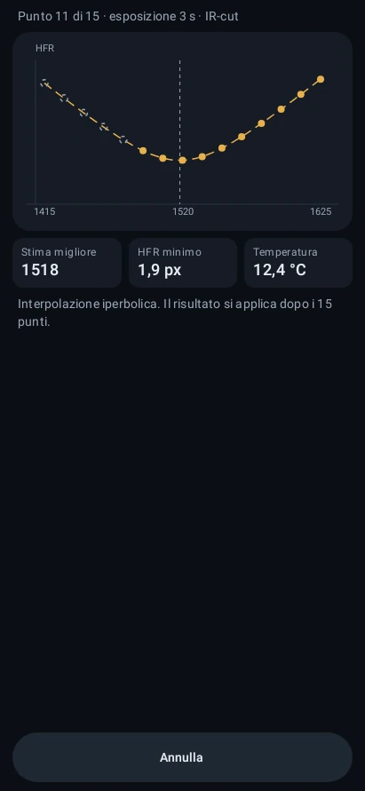 <b>In corso.</b> Punto 11 di 15, un'esposizione di 3 s con il filtro IR-cut.</td>
<td valign="top" width="240">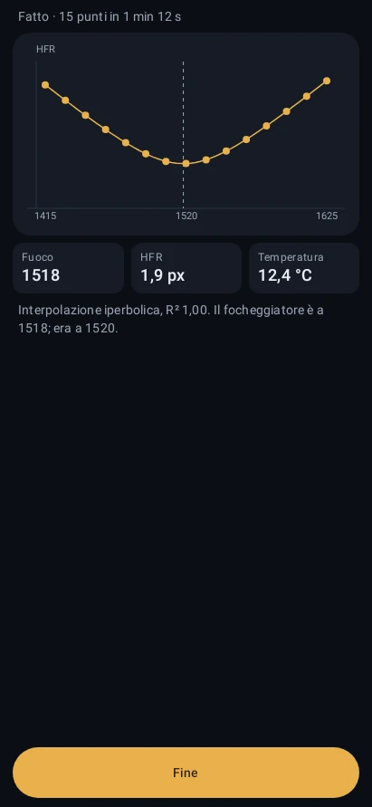 <b>Fatto.</b> 15 punti in 1 min 12 s; il focheggiatore è passato da 1520 a 1518.</td>
</tr></table>

### Impostazioni dell'autofocus

In *Impostazioni › Autofocus*, conservate in ogni profilo, con i valori predefiniti di N.I.N.A.:

- **Passo:** Passi del focheggiatore tra i punti (50; 15 per il Seestar). Troppo piccolo e la curva resta piatta; troppo grande e ci sono pochi punti vicino al fuoco.
- **Punti:** Quanti punti prende: parte con metà di essi all'esterno (9 punti, 4 da ogni lato; 15 per il Seestar).
- **Esposizione:** Da 1 a 8 s, in bin 1×1 o 2×2, con il guadagno di Ripresa. Non viene salvata. 4 s (3 s per il Seestar).
- **Pose per punto:** 1, 2 o 3. Più pose mediano il seeing e richiedono più tempo.
- **Interpolazione:** Come si trova il fuoco migliore a partire dai punti: linee di tendenza, parabolica, tendenza e parabola, iperbolica (predefinita), oppure tendenza e iperbole.
- **Backlash in entrata, in uscita:** Passi che il focheggiatore perde quando cambia direzione; va oltre di tanto e torna indietro.
- **R² minimo:** Quanto bene la curva deve adattarsi (0,7). Senza minimo, il risultato si tiene a meno che sia peggiore del 15 % rispetto a prima.
- **Tentativi:** Quante volte ricomincia se una procedura fallisce (1).
- **Attesa dopo il movimento:** Secondi di riposo del focheggiatore dopo ogni movimento, prima della posa (0).

<table><tr>
<td valign="top" width="240">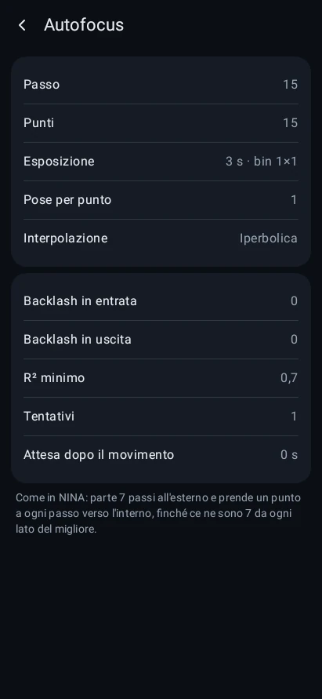 <b>Impostazioni › Autofocus.</b> I valori del Seestar.</td>
</tr></table>

### Quando fallisce

| L'app dice | Cosa fare |
| --- | --- |
| **L'HFR non è cambiato abbastanza da nessun lato** | Usa un passo più grande. |
| **La curva spiega troppo poco i punti** | Il seeing o le nuvole hanno rovinato i punti: più pose per punto, un'esposizione più lunga, oppure riprova più tardi. |
| **Il fuoco migliore cade fuori dai punti misurati** | Parti più vicino al fuoco: muovi il focheggiatore a mano, poi riavvialo. |
| **Al fuoco migliore l'HFR è peggio di prima** | Il risultato non è stato tenuto e il focheggiatore è tornato indietro. Controlla le condizioni e riprova. |
| **Questo focheggiatore non ha posizioni a cui andare** | L'autofocus richiede un focheggiatore assoluto. |

### Rimessa a fuoco automatica durante la notte

In una sequenza, le regole di autofocus avviano una procedura prima di una posa light quando cambia la temperatura, cambia il filtro, l'HFR peggiora, o dopo un certo tempo. Si impostano nelle regole dell'editor semplice ([capitolo 25](#simple)) o come trigger nell'editor avanzato ([capitolo 26](#advanced)). Se una procedura fallisce durante la notte, il focheggiatore torna indietro e le regole aspettano le esposizioni successive.

Gli offset di fuoco per filtro si impostano nella schermata del focheggiatore ([capitolo 10](#focuser)): al cambio filtro il focheggiatore si sposta della differenza.

---

# Acquisizione

## 20. Ripresa

Ripresa scatta pose a mano: pose singole per controllare il fuoco e l'inquadratura, oppure un loop che salva ogni posa. Ogni posa compare circa un secondo dopo il download, con lo stretching applicato e le stelle contate e misurate.

### Scattare una posa

1. Imposta esposizione, guadagno, binning e filtro con i pulsanti sotto la posa (vedi sotto).
2. Tocca il pulsante rotondo. La schermata mostra *In esposizione · 12 di 20 s*, poi *Download della posa…*. Toccalo di nuovo durante l'esposizione per interromperla.
3. La posa compare con il suo **HFR** e il suo numero di **stelle** in alto a sinistra. Toccali per i dettagli dell'ultima posa.

**Loop** scatta pose una dopo l'altra e le salva tutte, come il Loop di N.I.N.A.; diventa **Ferma**, che termina dopo la posa in corso. Le pose singole si salvano solo se **Salva le pose singole (il loop salva sempre)** è attivo nelle opzioni. Se uno scatto fallisce mentre l'attrezzatura non risponde, o la connessione si perde, il loop aspetta e riprende con lo scatto successivo appena l'attrezzatura risponde di nuovo.

### Le impostazioni della posa

- **Esposizione:** 10, 20, 30, 60 o 300 s, quelle che la camera consente, oppure **Altro** sul tastierino, entro l'intervallo della camera.
- **Guadagno:** Sul tastierino, entro l'intervallo della camera, oppure i guadagni con nome della camera. Parte da 200 se la camera lo accetta, come fa l'app dello stesso Seestar, e gli scatti della sequenza senza un guadagno proprio usano questo.
- **Binning:** 1×1, 2×2… solo se la camera fa il binning.
- **Filtro:** Con una ruota portafiltri: il filtro inserito e gli altri a cui passare. Gli scatti per risolvere, centrare, allineare o mettere a fuoco non passano mai per **Dark**: prima la ruota passa a IR. Con Dark, lo scatto non mostra HFR né stelle, che sarebbero rumore.

<table><tr>
<td valign="top" width="240">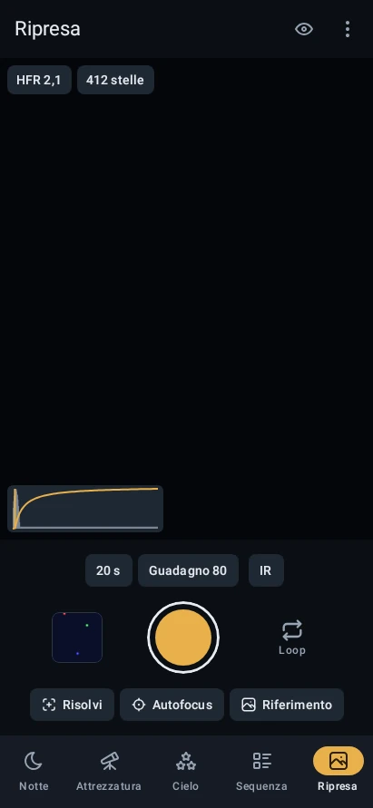 <b>Ripresa.</b> HFR 2,1 px e 412 stelle.</td>
</tr></table>

### Osservare la posa

- **Zoom:** pizzica, e trascina per spostarti. Un doppio tocco passa dalla posa intera ai pixel 1:1 e viceversa.
- **Istogramma:** in basso a sinistra, con la curva di stretching.
- **Ultima posa:** tocca l'HFR e le stelle in alto a sinistra per l'istogramma, la media, la mediana e la deviazione in ADU, l'HFR con la sua dispersione, la FWHM in pixel e in secondi d'arco (un profilo di Moffat, come in Hocus Focus), e dove è stata salvata la posa.

### Opzioni di ripresa

Il **⋮** in alto le apre:

- **Tipo di posa:** Light, dark, flat o bias. Va nel nome del file e nell'intestazione FITS.
- **Oggetto, per il nome del file:** Il nome della cartella e dei file, ad esempio *M 31*. Senza, le pose si chiamano *Snapshot*.
- **Salva le pose singole:** Il loop salva sempre.
- **Dithering nei loop di light, ogni:** *No*, *3* (all'inizio), *5* o *10* pose. Tra una posa e l'altra la montatura riceve una piccola spinta, come la dà il guider diretto di N.I.N.A.: il campo si sposta di qualche pixel (5 di default) intorno a dove è iniziato il loop, perché il motivo del sensore non si accumuli in strisce nello stack. Dark, flat e bias non fanno mai dithering. Con un Seestar, i cui impulsi di guida non vanno dove vengono inviati, salta invece con piccoli GoTo tra i 9 punti di una griglia distanti 27″.
- **Offset:** Se la camera ne ha uno.
- **Stretching automatico:** Attivo come predefinito, come quello di N.I.N.A. Se è spento, due cursori impostano le **Ombre** e i **Mezzitoni**.
- **Segna le stelle:** Disegna un riquadro e l'HFR sulle stelle più luminose, come fa N.I.N.A.; **Quante**, da 10 a 500.
- **Stack dal vivo:** **Sommare dal vivo le pose light** e **Bilanciare il colore dello stack** ([capitolo 22](#stacking)).
- **Impostazioni:** Le impostazioni dell'app.

<table><tr>
<td valign="top" width="240">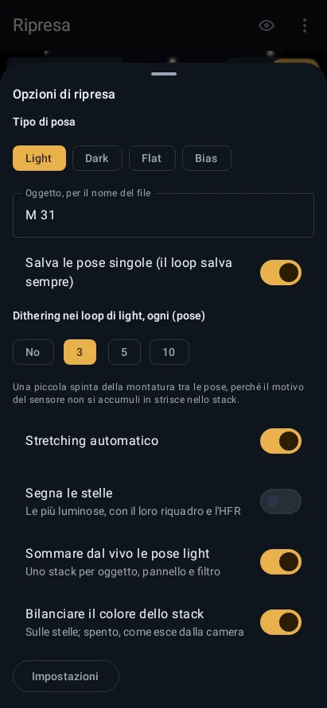 <b>Opzioni di ripresa.</b></td>
</tr></table>

### I pulsanti sotto la posa

- **Risolvi:** Risolve l'ultima posa con ASTAP e mostra dove punta, con **Sincronizza la montatura** ([capitolo 18](#solving)).
- **Autofocus:** Con un focheggiatore, avvia l'autofocus ([capitolo 19](#autofocus)).
- **Riferimento:** Mette la foto della cache dello stesso campo sopra la posa, con la sua rotazione, scala e zoom, così puoi confrontarle: quella macchia debole è la galassia? Se la posa non è risolta, prima la risolve. Toccalo di nuovo per tornare alla posa.
- **La miniatura:** A sinistra del pulsante rotondo: apre la cronologia della sessione ([capitolo 21](#history)).

<table><tr>
<td valign="top" width="240">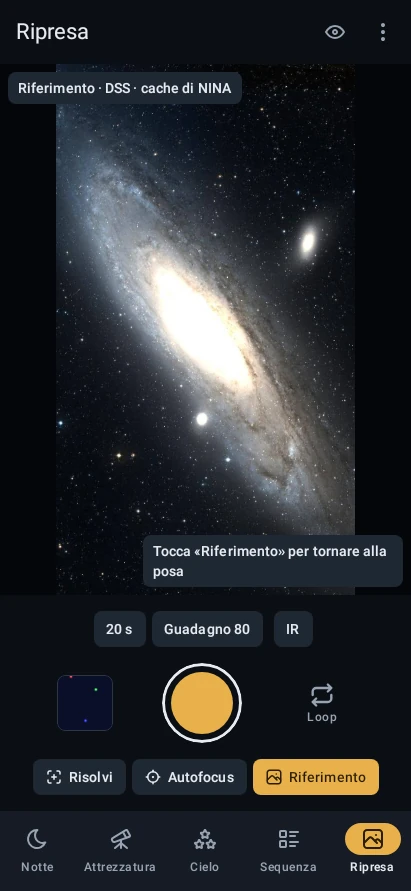 <b>Riferimento.</b> La foto della cache del campo della posa.</td>
</tr></table>

<table><tr>
<td valign="top" width="470">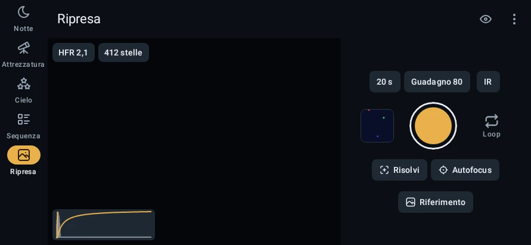 <b>In orizzontale</b> la posa occupa la larghezza e i controlli si spostano di lato.</td>
</tr></table>

## 21. Cronologia e qualità delle pose

La cronologia elenca ogni posa salvata in questa sessione con la sua qualità, e segna quelle rovinate da nuvole o luce, così restano fuori dallo stack.

- **Il grafico:** l'HFR di ogni posa come linea e le sue stelle come barre, con **AF** dove è stato eseguito un autofocus.
- **L'elenco,** dalla più recente: numero, ora, filtro ed esposizione, HFR e stelle.
- **Le pose scartate** hanno molte meno stelle o un fondo molto più chiaro della mediana della sessione, e dicono perché: *nuvole*, *poche stelle* o *fondo chiaro*. Restano salvate su disco; solo lo stack e il riepilogo le lasciano fuori.

L'icona del filtro in alto mostra solo le pose scartate. Apri la cronologia dalla miniatura accanto al pulsante rotondo di Ripresa.

<table><tr>
<td valign="top" width="240">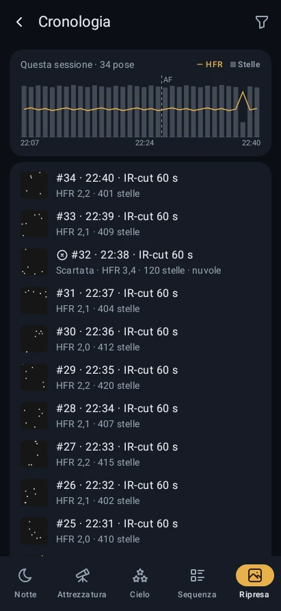 <b>Cronologia.</b> Posa 32 scartata: nuvole.</td>
</tr></table>

## 22. Stack dal vivo

Lo stack dal vivo aggiunge ogni buona posa light a uno stack progressivo mentre la notte va avanti, così vedi l'oggetto emergere dal rumore. È spento finché non lo vuoi, perché usa memoria e batteria.

### Attivarlo

Nelle opzioni di Ripresa, attiva **Sommare dal vivo le pose light**. Da quel momento ogni posa light salvata entra nello stack, che venga da un loop, da una sequenza o da una posa singola. Le pose vengono comunque salvate una per una, come sempre.

I flat si raccolgono anche con lo stack dal vivo spento: quando la serie di un filtro è completa diventano il suo master flat, salvato come `FLATS/MasterFlat_IR.fits` (uno per filtro) nella cartella delle tue pose per le notti successive, un FITS a 32 bit che leggono anche Siril e PixInsight. Un tuo flat messo lì con quel nome vale lo stesso. Anche i dark si conservano per lo stack anche se lo attivi dopo averli scattati, come quando una sequenza inizia con i suoi dark.

### Come fa lo stack

- **Uno stack per oggetto, pannello e filtro,** e per esposizione, guadagno e binning. Una posa di un altro tipo salva lo stack precedente e ne inizia uno suo.
- **Allineato sulle stelle:** traslazione, rotazione e scala, sulla prima posa dello stack.
- **Satelliti e aerei rimossi** con un rigetto a 3 sigma.
- **Calibrato man mano:** con il master dark della notte con la stessa esposizione, guadagno, offset e binning alla temperatura del sensore più vicina, e il master flat del suo filtro nella cartella FLATS.
- **Colore bilanciato sulle sue stelle,** con **Bilanciare il colore dello stack** attivo; se è spento, come esce dalla camera.
- **Le pose scartate restano fuori,** e così quelle le cui stelle non corrispondono.

<table><tr>
<td valign="top" width="240">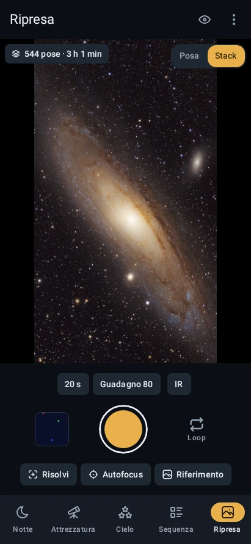 <b>Lo stack.</b> M 31 da 544 pose da 20 s con un Seestar, elaborato in seguito.</td>
</tr></table>

### Un mosaico

In un mosaico la sequenza fa ogni pannello intero e poi il successivo, e ogni pannello ha il proprio stack, calibrato con i suoi dark e i suoi flat. Con **Stack**, Ripresa mostra il mosaico intero mentre si costruisce: ogni pannello al suo posto nel cielo, come l'ha risolto il suo centraggio, con lo sfondo uguagliato a quello dei vicini dove si sovrappongono e le giunture sfumate, e un solo stretch e un solo bilanciamento del colore per tutto. Il pannello in stacking ha il bordo dorato e cresce a ogni posa; quelli che mancano sono tratteggiati. È una vista a un quarto della dimensione, o più piccola per un mosaico grande così che stia nella memoria del telefono, e viene salvata come JPG, ad esempio *2026-10-14/M 31/STACK/…_STACK_MOSAIC.jpg*, dopo ogni pannello e alla fine della sequenza. Il mosaico finale si monta con gli stack dei pannelli in Siril o PixInsight.

<table><tr>
<td valign="top" width="240">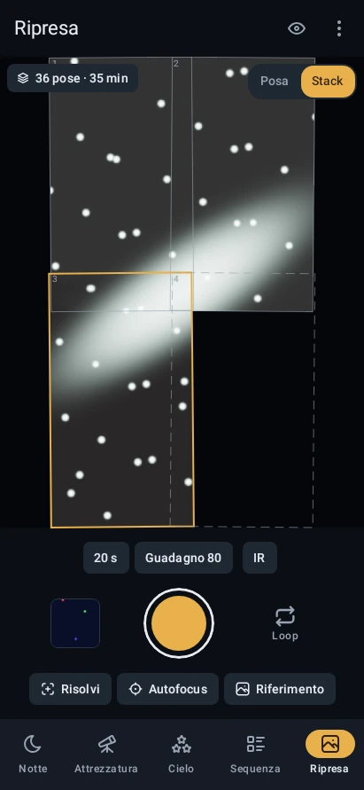 <b>Un mosaico.</b> Il terzo pannello su quattro, che cresce.</td>
</tr></table>

### Osservarlo

Quando esiste uno stack, un selettore **Posa** | **Stack** in alto a destra di Ripresa passa dall'ultima posa allo stack. Tocca l'etichetta dello stack, ad esempio *544 pose · 3 h 1 min*, per la sua finestra:

- **Sommate:** Le pose che contiene, su quelle arrivate.
- **Scartate:** Quante sono rimaste fuori, e perché.
- **Tempo:** Integrazione totale e le pose.
- **Allineamento:** Sulle stelle, e di quanto è ruotata l'ultima.
- **Colore:** Bilanciato sulle stelle, oppure come esce dalla camera.
- **Dark** e **Flat:** il dark e il master flat in uso, come *MasterFlat_IR.fits del 11 ottobre*, oppure quali mancano.

In Notte, mentre una sequenza è in corso con lo stack attivo, la scheda dell'ultima posa mostra lo stack; toccala per aprirlo in Ripresa.

### Salvarlo

Lo stack si salva da solo ogni 10 minuti mentre cresce, e quando finisce il loop o la sequenza: un FITS lineare a 32 bit per l'elaborazione, e un JPG come lo vedi sullo schermo, nella cartella delle pose con `STACK` come tipo. **Salva** lo salva subito. Se l'app viene chiusa, lo stack continua con la posa successiva dello stesso oggetto e filtro.

**Scattare 10 dark da 20 s** (con l'esposizione delle pose) scatta subito i dark per lo stack. Con un filtro scuro è automatico; senza, l'app ti chiede prima di coprire il telescopio. **Tieni premuto per ricominciare** svuota lo stack.

<table><tr>
<td valign="top" width="240">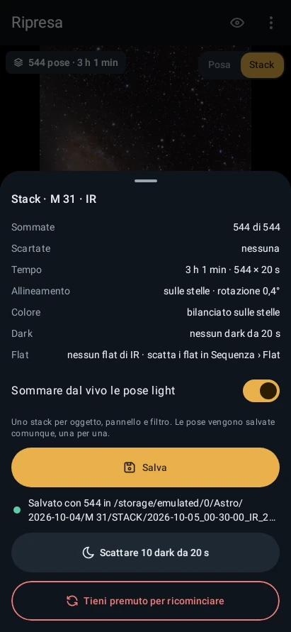 <b>La finestra dello stack.</b> Ancora nessun dark né flat per questo filtro.</td>
</tr></table>

## 23. Flat, dark e bias

Le pose di calibrazione tolgono ciò che aggiungono il sensore e l'ottica. Yacana scatta i flat con un assistente e i dark e i bias con le regole della sequenza, e lo stack dal vivo li usa tutti.

### L'assistente dei flat

Aprilo con il modello **Flat** in Sequenza. Calcola da solo l'esposizione e scatta i flat di ogni filtro a una luminosità obiettivo. La luce è questo telefono, o il pannello per flat se ce n'è uno collegato.

1. Controlla gli **ADU obiettivo**, 30.000 ± 5 % come predefinito, con il massimo della camera indicato. Imposta la **Luminosità del pannello** se ne usi uno.
2. Scegli le **Pose per filtro** (20, 30 o 50) e i **Filtri**.
3. Tocca **Avvia i flat**. Con questo telefono come luce, hai 30 s per appoggiarlo a faccia in giù sul telescopio, con lo schermo sopra l'obiettivo e un foglio di carta bianca in mezzo. Un bip avvia i flat e lo schermo diventa bianco alla massima luminosità, anche in modalità rossa; un altro bip li termina. Per metterli in pausa, tocca due volte lo schermo bianco; **Riprendi** lascia altri 30 s.
4. Ogni filtro mostra *ricerca dell'esposizione…*, poi la sua esposizione e quante pose sono fatte, con la media dell'ultima posa in ADU. **Pausa** e **Tieni premuto per fermare** sono in basso. Alla fine, con il filtro Dark del Seestar, scatta 10 bias: il loro livello resta in ogni master flat, perché lo stack dal vivo lo divida anche senza dark.

Se c'è troppa luce anche con l'esposizione più breve, o troppo poca con la più lunga, l'assistente si ferma e dice cosa cambiare: più o meno carta sullo schermo del telefono, o la luminosità del pannello.

<table><tr>
<td valign="top" width="240">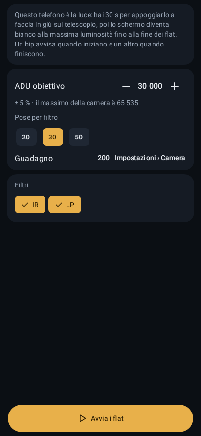 <b>Configurazione.</b> Questo telefono come luce, due filtri.</td>
<td valign="top" width="240">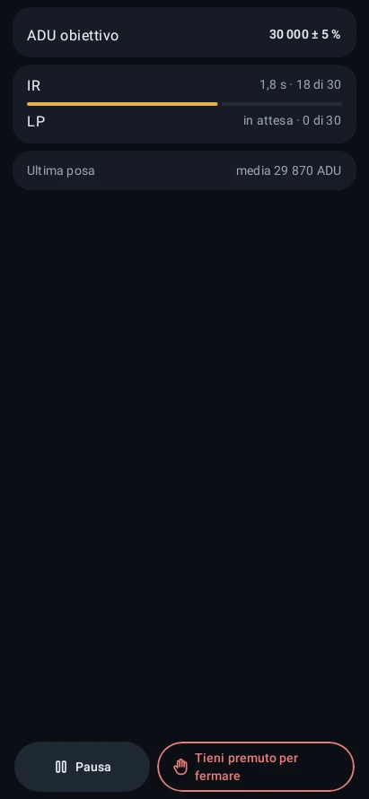 <b>In corso.</b> I flat IR a 1,8 s, media 29.870 ADU.</td>
</tr></table>

### Dark e bias nella sequenza

Nell'editor semplice, il pulsante **Dark** sotto **Regole** imposta quando si scattano i dark, con l'esposizione, il guadagno e il binning di ogni posa light e il filtro scuro:

- **All'inizio** della notte.
- **Se la temperatura del sensore cambia** di 2, 3 o 5 °C, perché lo stack dal vivo usi la serie di temperatura più vicina.
- **Alla fine, con il bias** (attivo come predefinito).
- **Pose per serie:** 5, 10 o 20. La finestra indica quanto tempo di pose light toglie ogni serie.

Senza un filtro scuro, i dark all'inizio o per temperatura non sono possibili; alla fine, l'app ti chiede di coprire il telescopio. I dark e i bias dell'inizio e della fine vanno nella cartella dell'obiettivo, accanto a LIGHT: quelli dell'inizio in quella del primo obiettivo, quelli della fine in quella dell'ultimo.

<table><tr>
<td valign="top" width="240"> <b>Dark.</b> 10 pose da 60 s richiedono circa 11 min.</td>
</tr></table>

### A mano

In Ripresa, imposta il **Tipo di posa** su dark, flat o bias nelle opzioni e scatta come al solito: le pose vanno nella loro cartella per tipo.

---

# Sequenze

## 24. La sezione Sequenza

Una sequenza è il piano della notte: quali oggetti, con quali esposizioni e cosa fare intorno a essi. Yacana ha due editor sullo stesso piano: uno semplice che mette la notte su una linea del tempo, e uno avanzato con i contenitori, i trigger e le condizioni di N.I.N.A. Puoi passare dall'uno all'altro senza perdere nulla.

- **Stanotte:** Il piano che la notte eseguirà, con i suoi oggetti e orari. Toccalo per aprire l'editor. Mentre è in corso, lo indica.
- **Salvate:** Le tue sequenze salvate, con i loro oggetti e la durata. Toccane una per caricarla come piano di stanotte; **Ripristina** riporta il piano che avevi. Tieni premuta una riga per un momento per eliminarla con **Tieni premuto per eliminare**. Per salvare il piano di stanotte, usa il menu **⋮** dell'editor.
- **Modelli:** Punti di partenza per un nuovo piano (vedi sotto).
- **Nuova:** Un piano vuoto, nell'editor.

### Modelli

- **Un oggetto tutta la notte:** avvia un piano vuoto e apre Cielo. L'oggetto che aggiungi dopo riempie la notte fino all'alba.
- **Più oggetti** e **Mosaico:** avviano un piano vuoto e aprono Cielo, per inquadrare gli oggetti o il mosaico.
- **Flat:** apre l'assistente dei flat ([capitolo 23](#calibration)).

Ciò che c'era prima di un modello torna con **Ripristina**.

<table><tr>
<td valign="top" width="240"> <b>Sequenza.</b> Stanotte, sequenze salvate e modelli.</td>
</tr></table>

## 25. L'editor semplice

L'editor semplice mostra il piano di stanotte come una linea del tempo e una scheda per oggetto. Avvisa, con un'icona e con parole, quando il piano non sta prima dell'alba.

### Aggiungere oggetti

Gli oggetti vengono da Cielo: inquadrane uno e tocca **Aggiungi alla sequenza** ([capitolo 16](#framing)). **Aggiungi un oggetto** in fondo all'elenco ti porta lì. Un mosaico arriva come un solo oggetto con i suoi pannelli.

### Piano di stanotte

La linea del tempo mostra ogni oggetto dal suo inizio alla sua fine, e l'alba. Se il piano va oltre l'alba astronomica, dice quale oggetto finirebbe e quando, e l'ora di fine di quell'oggetto passa al colore di avviso. **Ripristina** annulla l'ultima modifica, fino a 50 modifiche indietro.

### La scheda di un oggetto

- Il suo nome, quando finisce e l'icona del cestino per rimuoverlo.
- Per un mosaico, il suo numero di pannelli; le esposizioni valgono per ogni pannello.
- Una riga per filtro ed esposizione, ad esempio *IR · 60 s × 45 per pannello*, con le pose fatte e il totale. Tocca una riga per cambiarla; **Esposizioni** aggiunge un altro filtro.

<table><tr>
<td valign="top" width="240"> <b>Stanotte.</b> M 33 finirebbe alle 07:25, dopo l'alba.</td>
<td valign="top" width="240"> <b>Esposizioni.</b> Il tastierino mostra quanto dura, e fino a quando.</td>
</tr></table>

### Esposizioni

La finestra imposta una riga delle esposizioni di un oggetto: il **Filtro**, il **Tempo** (10, 30, 60 o 120 s, oppure **Altro**) e il **Numero di pose** sul tastierino. Mentre scrivi, mostra quanto durano e fino a quando, oppure che finirebbero dopo l'alba. **Salva** la conserva; **Rimuovi queste esposizioni** elimina la riga quando l'oggetto ne ha più di una.

### Regole

La scheda **Regole** elenca ciò che la notte fa oltre alle pose. Un nuovo piano arriva con:

- **Sparcheggia all'inizio**, e **Fascia anticondensa accesa** se l'attrezzatura ha un interruttore per la fascia.
- **Centra all'arrivo:** ogni oggetto, e ogni pannello di un mosaico, viene centrato con il plate solving prima delle sue pose.
- **Dithering ogni 3 pose**, senza autoguida.
- **Autofocus se ΔT > 1 °C**, con un focheggiatore.
- **Ricentra se deriva > 1′:** prima di ogni posa light si risolve la precedente; se il campo si è spostato di più di 1′ dal target, viene ricentrato. Sostituisce la guida.
- **Dark e bias alla fine**: 10 di ciascuno, per ogni esposizione, guadagno, offset e binning dei light.
- **Parcheggia alla fine**, e la fascia spenta.

I pulsanti sotto le cambiano:

- **Autofocus:** Prima di ogni posa light, si esegue un autofocus se vale una di queste condizioni, come i trigger di N.I.N.A.:
  - **Quando cambia la temperatura** di 0,5; 1; 2 o 5 °C;
  - **Al cambio filtro;**
  - **Quando l'HFR peggiora** del 5, 10 o 20 %;
  - **Ogni tanto:** 15, 30, 60 o 120 min, oppure un altro intervallo.

  Se un autofocus fallisce, aspettano le esposizioni successive.
- **Dark:** All'inizio, quando cambia la temperatura del sensore, alla fine con il bias, e quanti ogni volta ([capitolo 23](#calibration)).
- **Ricentraggio:** attivo o no, e di quanto può derivare il campo: 0,5′, 1′, 2′ o 5′. Con un buon allineamento polare ricentra una o due volte all'ora.
- **Dithering:** attivo o no, e ogni 1, 3, 5 o 10 pose, per le pose light di tutti i target. Ogni dithering aspetta che la montatura si stabilizzi.
- **Fascia anticondensa**, se l'attrezzatura collegata ne ha una: accesa o no durante la notte, e la sua potenza se è regolabile. Consuma batteria: spegnila nelle notti secche e miti.

Per altre regole, come aspettare che un target sorga o ripetere fino a un'ora, apri il piano nell'editor avanzato.

### Salvare e avviare

Il menu **⋮** ha **Salva nelle mie sequenze**. **Avvia**, in basso, avvia la notte una volta connessa l'attrezzatura; mentre è in corso, il pulsante diventa **Tieni premuto per fermare**. Puoi ancora modificare il piano mentre è in corso: le modifiche valgono per ciò che deve ancora venire.

<table><tr>
<td valign="top" width="240"> <b>Regole di autofocus.</b></td>
<td valign="top" width="240"> <b>Ricentraggio.</b> Entro 1′ dal target.</td>
<td valign="top" width="240"> <b>Dithering.</b> Ogni 3 pose.</td>
</tr></table>

## 26. L'editor avanzato

L'editor avanzato è il sequencer avanzato di N.I.N.A. trasformato in un elenco touch: contenitori in cui entri, istruzioni, trigger e condizioni, riordinati trascinando, con annullamento delle modifiche e un controllo della notte prima che inizi.

Aprilo con **Avanzato** in cima all'editor semplice. Apre il piano di stanotte per intero. Se aggiungi ciò che l'editor semplice non può mostrare, come una condizione o un contenitore parallelo, da quel momento stanotte si modifica solo nell'editor avanzato: l'editor semplice mostra **Stanotte si modifica in Avanzato** con **Apri in Avanzato** e l'elenco degli oggetti.

### La struttura della notte

- **Notte,** il livello superiore, con i **trigger per tutta la notte**, e tre aree:
- **Inizio:** ciò che succede per primo, prima degli oggetti, come sparcheggiare o raffreddare la camera. Ciò che punta un oggetto non va qui.
- **Oggetti:** uno dopo l'altro, in questo ordine. Ogni oggetto contiene le sue istruzioni.
- **Fine:** dopo gli oggetti: dark, parcheggio e spegnimento.

Le briciole di pane in alto mostrano dove sei, ad esempio *Notte › Oggetti › M 33*. La scheda di ogni livello dice come si esegue: una volta, oppure ripetuto dalle sue condizioni, che si controllano dopo ogni istruzione.

<table><tr>
<td valign="top" width="240"> <b>Notte.</b> Un trigger di autofocus e le tre aree.</td>
<td valign="top" width="240"> <b>Un oggetto.</b> Ripetuto fino alle 02:00.</td>
</tr></table>

### Lavorare con gli elementi

- **Entra** in un contenitore toccandolo; tocca un'istruzione per cambiarne le impostazioni.
- **Aggiungi** con il pulsante in basso, **Aggiungi a …**, che apre il catalogo. **Condizione** e **Trigger** nella scheda del livello lo aprono su quel tipo.
- **Riordina** trascinando la maniglia di un elemento, oppure con il suo menu **⋮**.
- **Il menu ⋮** di un elemento: *Entra*, *Cambia l'oggetto*, *Rinomina*, *Impostazioni*, *Sposta su*, *Sposta giù*, *Sposta in…*, *Duplica*, *Salva come modello* ed *Elimina*.
- **Annulla modifica** è in alto.

Mentre la notte è in corso, gli elementi finiti sono segnati come fatti e quello in corso è evidenziato. Entrambi sono bloccati; il resto si può ancora cambiare.

### Il catalogo

Il catalogo ha una casella di ricerca e pulsanti per tipo: camera, montatura, fuoco, filtri, utilità, contenitori, trigger, condizioni e modelli. Ciò che non può andare dove ti trovi è in grigio, con il motivo, ad esempio *Solo dentro un Oggetto*.

<table><tr>
<td valign="top" width="240"> <b>Il catalogo.</b> Ciò che punta un oggetto è in grigio in Inizio.</td>
</tr></table>

| Tipo | Elemento | Cosa fa |
| --- | --- | --- |
| **Camera** | Esposizioni | Light, dark o bias: filtro, tempo, numero di pose e dithering |
| **Camera** | Raffredda camera · Riscalda camera | A una temperatura poco a poco, oppure lentamente di nuovo prima di spegnerla |
| **Montatura** | Sparcheggia · Parcheggia | Lascia la posizione di riposo o vi torna |
| **Montatura** | Vai e centra | GoTo sull'oggetto e plate solving, entro 1′; solo dentro un Oggetto |
| **Montatura** | Vai all'oggetto | GoTo sull'oggetto senza centrare; solo dentro un Oggetto |
| **Montatura** | Ferma l'inseguimento | La montatura resta ferma |
| **Fuoco** | Autofocus · Muovi il focheggiatore | Una procedura a curva a V, oppure a una posizione |
| **Filtri** | Cambia filtro | La ruota mette un altro filtro |
| **Utilità** | Imposta un interruttore | Come la fascia anticondensa, acceso o spento |
| **Utilità** | Attendi fino a un'ora · Attendi un po' · Attendi che salga | Continua a un'ora di stanotte, dopo qualche minuto, o quando l'oggetto raggiunge un'altezza |
| **Utilità** | Nota | Una nota nel diario della notte |
| **Contenitore** | Oggetto | Un oggetto da Cielo, con la sua inquadratura; arriva con «Vai e centra» |
| **Contenitore** | Sequenziale · Parallelo | Le sue istruzioni una dopo l'altra, oppure insieme, come attendere un'ora mentre la camera si raffredda |
| **Trigger** | Autofocus se cambia la temperatura · ogni tanto · al cambio filtro · se l'HFR cresce | Un autofocus prima della posa successiva quando vale la sua condizione |
| **Trigger** | Ricentra se deriva | Risolve e corregge quando l'oggetto deriva oltre una soglia da 0,5′ a 5′ |
| **Trigger** | Dark se cambia la temperatura | Dark con il filtro scuro quando il sensore cambia di 2, 3 o 5 °C, per lo stack dal vivo |
| **Condizione** | Ripeti N volte · Ripeti fino a un'ora · Ripeti finché è alto | Ripete l'intero contenitore |
| **Modello** | Oggetto con autofocus · i tuoi | Un oggetto da Cielo con vai e centra, autofocus ed esposizioni; oppure qualsiasi blocco salvato come modello |

### Controlla la notte

L'editor controlla il piano mentre lo costruisci. Quando qualcosa andrebbe storto stanotte, un badge in alto conta gli avvisi; toccalo per **Controlla la notte**, e tocca un avviso per andarci. Gli avvisi non ti impediscono mai di salvare o di iniziare. Tra questi:

- un'istruzione che richiede un oggetto fuori da un Oggetto, o light senza oggetto;
- un parcheggio prima di pose, messa a fuoco o un GoTo senza *Sparcheggia* prima;
- light senza *Vai e centra* prima, o con l'inseguimento fermo;
- un filtro che la ruota non ha, o il raffreddamento di una camera che non si raffredda;
- dark scattati mentre la camera si riscalda;
- due elementi paralleli che usano lo stesso dispositivo insieme.

### Tornare al piano semplice

La scheda dell'editor semplice, o il menu **⋮** dell'editor avanzato, ha **Tieni premuto per tornare al piano semplice**. Rimuove ciò che conosce solo l'editor avanzato e tiene gli oggetti con le loro esposizioni. Lo stesso menu ha **Salva nelle mie sequenze**.

<table><tr>
<td valign="top" width="240"> <b>Modificato in Avanzato.</b> L'editor semplice mostra gli oggetti.</td>
</tr></table>

> [!NOTE]
> **Per chi usa N.I.N.A.**
>
> L'editor avanzato segue il sequencer di N.I.N.A.: gli stessi tipi di contenitori, trigger e condizioni, eseguiti nello stesso ordine. I file di sequenza di N.I.N.A. non si importano, e le istruzioni che dipendono da Windows o dall'autoguida non ci sono.

## 27. Eseguire la notte

Avvia la notte con **Inizia la notte** in Notte o con **Avvia** nell'editor. Da quel momento la sessione gira in un servizio in primo piano: puoi spegnere lo schermo e mettere via il telefono.

### Notte durante l'esecuzione

Tutto ciò che ti serve sta in una schermata, senza scorrere:

- **L'oggetto:** il suo nome, pannello e filtro, e la sua altezza con una freccia che indica se sale o scende.
- **La posa:** un anello con i secondi rimanenti, *Posa 35 di 120*, il filtro e il guadagno.
- **Avanzamento:** la percentuale della sequenza e quando finisce, rispetto all'alba astronomica.
- **Ultima posa:** la sua miniatura, se era buona o scartata, il suo HFR e le stelle, e la curva HFR della notte. Con lo stack dal vivo attivo, mostra lo stack: toccalo per aprirlo in Ripresa.
- **Prossimo:** ciò che viene, come il prossimo autofocus, il cambio al prossimo oggetto e il parcheggio, con i loro orari.

**Pausa** si ferma subito, lasciando fuori la posa in corso, e l'inseguimento continua; diventa **Riprendi**, che prosegue dalla stessa istruzione con le pose già scattate. **Tieni premuto per fermare** termina la sequenza.

<table><tr>
<td valign="top" width="240"> <b>In corso.</b> Finisce alle 06:56, dopo l'alba delle 06:44.</td>
<td valign="top" width="240"> <b>Con lo stack dal vivo,</b> lo stack nella scheda.</td>
</tr></table>

### Nel resto dell'app

La barra della sessione in ogni altra schermata mostra la posa e ti permette di mettere in pausa ([capitolo 4](#tour)), e la notifica mostra l'avanzamento sulla schermata di blocco. La sequenza e Ripresa condividono la camera: ferma un loop in Ripresa prima di iniziare la notte.

### A schermo spento

Yacana mantiene attivi il processore e il WiFi del telefono mentre la sessione è in corso, e lega il traffico dell'attrezzatura al suo WiFi anche se non ha internet. Nel test di riferimento ha funzionato per 8,5 ore di notte con un Seestar, 503 pose complete, senza riavvii e senza interruzioni più lunghe di 6 s, consumando l'1,7 % della batteria all'ora. Concedi prima i permessi della batteria ([capitolo 33](#permissions)).

Finché Yacana è sullo schermo, lo schermo resta acceso e il telefono non si blocca. Con lo schermo acceso, Android mantiene il WiFi alla massima velocità e, se cade, si ricollega al WiFi dell'attrezzatura in pochi secondi; con lo schermo spento, potrebbe non farlo finché non lo riaccendi. Premi il tasto di accensione per spegnerlo come sempre: la sessione continua. Per un'intera notte con lo schermo acceso, usa la modalità rossa con poca luminosità e una batteria esterna.

### Se l'app o il telefono si riavviano

Se Android chiude l'app o il telefono si riavvia, la sessione riprende da sola, entro un minuto; dopo un riavvio, quando sblocchi il telefono per la prima volta. Al massimo si perde la posa in corso; le pose già salvate non si danneggiano mai, perché ognuna si scrive in un file temporaneo e poi si rinomina. Il diario registra *L'app si è chiusa e ha ripreso la sequenza*.

## 28. Avvisi e arresti sicuri

Una notte senza sorveglianza finisce bene o si ferma in sicurezza. Ogni avviso dice cosa è successo, cosa sta facendo l'app e cosa puoi fare tu.

### Quando si perde il collegamento

Se l'attrezzatura smette di rispondere, la sequenza entra in **pausa sicura**: l'esposizione si ferma e l'inseguimento resta attivo. L'avviso, in Notte e come notifica sonora, mostra i tentativi e il tempo che resta prima di un arresto sicuro. L'app riprova ogni 10 s.

- **Riprova ora** riprova subito.
- **Dettagli** apre Attrezzatura.
- **Tieni premuto per fermare** termina la sequenza.

Controlla che il telefono sia ancora sul WiFi dell'attrezzatura e che l'attrezzatura sia alimentata. Quando il collegamento torna, la sequenza continua, e il diario registra per quanto tempo è stato perso.

### Arresto sicuro

Un arresto sicuro termina la sessione quando:

- il collegamento non torna entro il tempo impostato (2 min come predefinito);
- la sequenza fallisce in un modo da cui non può riprendersi;
- la batteria del telefono scende sotto il livello impostato (20 % come predefinito), e sempre sotto il 10 %, a meno che non sia in carica.

L'esposizione si ferma e la montatura si parcheggia o ferma l'inseguimento, come indica il profilo. Se il collegamento era perso, ciò avviene appena torna. L'avviso dice poi cosa è stato fatto; **Ho capito** lo chiude.

<table><tr>
<td valign="top" width="240"> <b>Pausa sicura.</b> Un arresto sicuro tra 1 min 18 s se il collegamento non torna.</td>
<td valign="top" width="240"> <b>Arresto sicuro.</b> La montatura parcheggiata.</td>
</tr></table>

### Impostazioni di sicurezza

In *Impostazioni › Sicurezza*, per profilo:

- **Arresto sicuro:** **Parcheggia la montatura** o **Ferma l'inseguimento**. Il Seestar arriva con il parcheggio, che ripiega il suo braccio.
- **Se si perde il collegamento:** Quanto aspetta la pausa sicura: 1, 2, 5 o 10 min.
- **Batteria del telefono scarica:** 15, 20 o 30 %. Sotto il 10 % si ferma sempre; mai durante la ricarica.

<table><tr>
<td valign="top" width="240"> <b>Impostazioni › Sicurezza.</b></td>
</tr></table>

## 29. Il mattino dopo

Quando la sequenza finisce, Notte mostra il riepilogo della notte finché non lo chiudi.

- Come è finita e quando: terminata, fermata a mano, un arresto sicuro o un errore, e se la montatura si è parcheggiata.
- **Integrazione utile:** il tempo di esposizione delle pose tenute.
- **Pose** e **Scartate**, e l'**HFR mediano**.
- **Per oggetto:** pose ed esposizione per oggetto e filtro.
- **Imprevisti:** riconnessioni, autofocus extra, pose con nuvole, con i loro orari.

**Vedi diario** apre il diario della notte. **Esporta** salva uno ZIP del registro dell'app, con il profilo e le versioni, da conservare o allegare a una segnalazione di bug. La **✕** chiude il riepilogo.

### Il diario della notte

Un elenco leggibile di ciò che è successo, separato dal registro tecnico: ogni evento con la sua ora e il perché, ad esempio *Autofocus extra · La temperatura è cambiata di 1,3 °C*, *M 31 Pannello 1 centrato · scarto 8″ · 2 tentativi* o *Collegamento ripristinato · 51 s · 5 tentativi*. La sua icona in alto salva lo stesso ZIP di **Esporta**.

<table><tr>
<td valign="top" width="240"> <b>Riepilogo.</b> 34 pose, una con nuvole.</td>
<td valign="top" width="240"> <b>Diario della notte.</b></td>
</tr></table>

Le tue pose e i tuoi stack sono nella cartella delle pose, una cartella per notte e oggetto ([capitolo 30](#files)). Per copiarli, collega il telefono a un computer con un cavo USB e scegli il trasferimento file sul telefono; la cartella compare come qualsiasi altra nella memoria del telefono.

---

# Impostazioni e file

## 30. Immagini e file

Yacana salva ogni posa come file FITS a 16 bit con le intestazioni di N.I.N.A., che si apre in Siril, PixInsight e ogni programma di astronomia, in una cartella per notte e oggetto.

### La cartella

In *Impostazioni › Immagini e file*, **Cartella** mostra dove vanno le pose. Come predefinito è la cartella dell'app stessa, `Android/data/app.yacana/files/Yacana` nella memoria del telefono, che Android rimuove se disinstalli l'app.

**Cambia cartella** apre il selettore di cartelle di Android: scegli o crea una cartella nella memoria del telefono (ad esempio `Astro`), su una scheda SD o su un'unità USB. Yacana mantiene il permesso di scrivere lì anche dopo i riavvii. Scegline una prima della tua prima notte, così le tue pose sono facili da trovare e sopravvivono a una reinstallazione.

### Nomi dei file

Il nome di ogni posa viene da uno schema con le etichette di N.I.N.A. Una barra crea una cartella. Tocca un'etichetta per aggiungerla; la schermata mostra come si chiamerà la prossima posa. **Torna a quello predefinito** ripristina:

`$$DATEMINUS12$$/$$TARGETNAME$$/$$IMAGETYPE$$/$$DATETIME$$_$$FILTER$$_$$EXPOSURETIME$$s_$$FRAMENR$$`

che dà, ad esempio, `2026-10-04/M 31/LIGHT/2026-10-05_00-30-00_LP_20.00s_0001.fits`: una cartella per la notte, una per l'oggetto e una per il tipo di posa.

<table><tr>
<td valign="top" width="240"> <b>Impostazioni › Immagini e file.</b></td>
</tr></table>

| Etichetta | Diventa | Esempio |
| --- | --- | --- |
| **`DATEMINUS12`** | La data della notte: la data di 12 ore prima, così le pose dopo mezzanotte mantengono la data della sera | `2026-10-04` |
| **`DATE`** | La data locale | `2026-10-05` |
| **`DATETIME`** | La data e l'ora locali | `2026-10-05_00-30-00` |
| **`TIME`** | L'ora locale | `00-30-00` |
| **`TARGETNAME`** | L'oggetto, oppure *Snapshot* se non c'è | `M 31` |
| **`IMAGETYPE`** | Il tipo di posa | `LIGHT`, `DARK`, `FLAT`, `BIAS` |
| **`FILTER`** | Il filtro, oppure *NoFilter* | `LP` |
| **`EXPOSURETIME`** | L'esposizione in secondi | `20.00` |
| **`FRAMENR`** | Il numero di posa della sessione, a 4 cifre | `0001` |
| **`GAIN`, `OFFSET`** | Il guadagno e l'offset della camera | `80` |
| **`BINNING`** | Il binning | `1x1` |
| **`SENSORTEMP`** | La temperatura del sensore | `-10.0` |

### Cosa contiene ogni file

- **Pose:** FITS a 16 bit con gli stessi pixel dei file del Seestar e le parole chiave dell'intestazione di N.I.N.A.: tipo di posa, esposizione, guadagno, offset, binning e temperatura del sensore; il filtro; l'oggetto e le sue coordinate, con altezza e azimut; il telescopio, la camera, la lunghezza focale e la dimensione dei pixel; la posizione e la temperatura del focheggiatore; il luogo; la matrice di Bayer e i suoi offset, così Siril esegue correttamente il debayering.
- **Stack dal vivo:** lo stesso percorso con `STACK` come tipo e numero: un FITS lineare a 32 bit, con il numero di pose e l'esposizione totale nell'intestazione, e un JPG come lo vedi sullo schermo, sovrascritti man mano che lo stack cresce.
- **Sicurezza:** ogni file si scrive con un nome temporaneo e si rinomina quando è completo, così un crash o un'interruzione di corrente non lasciano mai una posa danneggiata.

Il diario della notte e il registro dell'app si conservano dentro l'app; esportali come ZIP dal riepilogo o da *Impostazioni › Esporta il registro*.

## 31. Riferimento delle impostazioni

Impostazioni si apre dall'ingranaggio in Notte e Attrezzatura, oppure con **Impostazioni** nelle opzioni di Ripresa. La casella di ricerca in alto trova qualsiasi impostazione da una parte del nome, dentro ogni schermata, con o senza accenti.

Ogni opzione dice cosa fa. Le impostazioni segnate *per profilo* si conservano nel profilo dell'attrezzatura, così ogni insieme di attrezzatura ha le sue.

<table><tr>
<td valign="top" width="240"> <b>Impostazioni.</b></td>
</tr></table>

| Riga | Cosa contiene | Capitolo |
| --- | --- | --- |
| **Profilo e posizione** | Nome, ottica, luogo, limiti, orizzonte, database stellare, altri profili, esportazione e importazione | [5](#profile) |
| **Immagini e file** | La cartella, e lo schema dei nomi dei file (per profilo) | [30](#files) |
| **Plate solving** | Opzioni di ASTAP, centratura e database stellari (per profilo) | [18](#solving), [6](#field) |
| **Autofocus** | Passo, punti, esposizione, interpolazione, backlash, R², tentativi (per profilo) | [19](#autofocus) |
| **Sicurezza** | Arresto sicuro, attesa quando si perde il collegamento, batteria scarica (per profilo) | [28](#safety) |
| **Mappa del cielo** | Cache di N.I.N.A., solo WiFi, foto online e livelli | [6](#field) |
| **Schermo** | Modalità notte rossa e la sua luminosità | [32](#display) |
| **Lingua** | La lingua dell'app | [32](#display) |
| **Permessi** | A cosa serve ogni permesso, e il suo stato | [33](#permissions) |
| **Esporta il registro** | Salva uno ZIP degli ultimi 14 giorni del registro | [36](#troubleshooting) |
| **Informazioni** | La versione, il motore dei pixel e le licenze | [39](#credits) |

Lo stack dal vivo e il suo bilanciamento del colore si impostano nelle opzioni di Ripresa, e si conservano anch'essi per profilo.

## 32. Modalità rossa e lingua

### Modalità notte rossa

La luce rossa mantiene i tuoi occhi adattati al buio. La modalità rossa disegna ogni pixel dell'app in rosso puro su nero, foto e pose comprese, e nessun pixel ha verde o blu: questo si verifica su ogni schermata.

- Attivala con l'icona dell'occhio in cima a Notte, Attrezzatura, Cielo, Ripresa, alle schede degli oggetti, all'inquadratura e agli assistenti, oppure con **Modalità notte rossa** in *Impostazioni › Schermo*.
- Le barre di sistema si nascondono; scorri dal bordo per vederle per un momento.
- L'app imposta la propria luminosità dello schermo, che può scendere sotto il minimo del sistema: **Luminosità in modalità rossa**, da 1 a 100 %, 10 % come predefinito.
- L'app se lo ricorda, e si apre in rosso se l'hai lasciata in rosso.

Le finestre di dialogo di Android e la tastiera di sistema non si possono rendere rosse. Per questo di notte i numeri si inseriscono con il tastierino dell'app. Anche il punto verde che Android accende in alto mentre un'app legge la posizione non si può rendere rosso. Yacana la legge solo all'apertura, quando attivi **Usa la posizione del telefono** e alla connessione, mai alla riconnessione, quindi il punto si vede per pochi secondi.

<table><tr>
<td valign="top" width="240"> <b>Notte in rosso.</b></td>
<td valign="top" width="240"> <b>Il cielo in rosso.</b> Anche le foto.</td>
</tr></table>

### Lingua

Yacana parla inglese, spagnolo, catalano, basco, galiziano, tedesco, francese, italiano e il portoghese del Portogallo e del Brasile. In *Impostazioni › Lingua*, **Come il sistema** segue il telefono, o l'inglese se la lingua del telefono non è una di queste; oppure scegline una. Cambia subito. Da Android 13 in poi puoi sceglierla anche nelle impostazioni di sistema per l'app. Date e numeri seguono la lingua, con la virgola decimale in tutte tranne l'inglese.

<table><tr>
<td valign="top" width="240"> <b>Impostazioni › Lingua.</b></td>
<td valign="top" width="240"> <b>Impostazioni › Schermo.</b></td>
</tr></table>

## 33. Permessi e batteria

Android non è pensato per un compito di otto ore a schermo spento. I permessi in *Impostazioni › Permessi* sono ciò che permette comunque a Yacana di gestire la notte.

La schermata è la stessa dei primi passi ([capitolo 3](#first-steps)): ogni riga dice a cosa serve e cosa smette di funzionare senza, e mostra **Consenti**, **Apri** o un segno di spunta quando è concesso. Le righe che non riguardano il tuo telefono non si mostrano: la rete locale prima di Android 17, le notifiche prima di Android 13, la conservazione dell'app inutilizzata prima di Android 11, e l'avvio automatico sui telefoni diversi da Xiaomi, Redmi e Poco.

### Se Android non chiede più

Dopo che hai rifiutato un permesso due volte, Android smette di chiedere. La riga allora lo dice: apri le impostazioni di Yacana in Android, apri Autorizzazioni, attivalo e torna qui.

### Risparmio batteria

- **Batteria senza restrizioni** è il più importante per una notte. Senza, il sistema può interrompere la sessione a schermo spento.
- Alcuni produttori aggiungono i propri sistemi di risparmio sopra quelli di Android. Sui telefoni Xiaomi, l'**Avvio automatico** permette alla sessione di riprendere se il sistema chiude l'app. Su altre marche, cerca Yacana nelle impostazioni della batteria del telefono e consentile di funzionare in background.
- Sui telefoni Xiaomi, il risparmio batteria nelle informazioni di Yacana deve indicare **Nessuna restrizione**: lo imposta **Batteria senza restrizioni**. Blocca anche Yacana nelle app recenti (tieni premuta la sua scheda e tocca il lucchetto), così cancellarle non la chiude.
- Le modalità di risparmio batteria possono fermare il lavoro in background: lasciale spente durante una sessione.

### Ciò di cui l'app non ha mai bisogno

Yacana non richiede alcun account, nessun accesso alle tue foto, ai contatti o ai file oltre alle cartelle che scegli, e nessuna posizione in background.

---

# Riferimento

## 34. Usare un Seestar S50 Pro

Lo ZWO Seestar S50 Pro ha ASCOM Alpaca nel suo firmware, quindi Yacana lo controlla direttamente tramite il suo WiFi. È il dispositivo di riferimento: ogni funzione è stata sviluppata e misurata su di esso, e compila da solo il suo profilo.

### Prima della prima notte

1. **Configuralo con l'app di ZWO.** Yacana non la sostituisce per la configurazione del dispositivo stesso: l'attivazione, l'aggiornamento del firmware, il passaggio alla modalità equatoriale e la configurazione del WiFi si fanno nell'app di ZWO.
2. **Mettilo su un cuneo equatoriale, in modalità EQ.** Su un cuneo insegue su un solo asse e consente esposizioni lunghe senza rotazione di campo. La sua modalità altazimutale non è un obiettivo di questa app.
3. **Connettiti al suo WiFi, oppure metti entrambi sul WiFi di casa.** Funzionano entrambe le sue modalità di rete: il suo punto di accesso, dove risponde su `10.0.0.1`, porta `32323`, e la modalità stazione sul tuo router. Una notte di 8,5 ore è andata in modalità punto di accesso e una di 2 ore in modalità stazione, senza interruzioni lunghe.
4. **Trovalo in Yacana** e tocca **Teleobiettivo** ([capitolo 3](#first-steps)). Il profilo del Seestar si carica da solo; **Grandangolo** crea quello della sua camera grandangolare, più sotto.

### Cosa imposta il suo profilo

| Voce | Valore | Perché |
| --- | --- | --- |
| **Ottica** | Lunghezza focale 260 mm, apertura 50 mm, f/5,2 | Il suo rifrattore apocromatico a 4 elementi |
| **Sensore** | 2160 × 3840 px, 2,9 µm, a colori (Bayer GRBG) | La camera teleobiettivo, salvata in verticale come fa l'app di ZWO |
| **Scala e campo** | 2,25″ per pixel · 2,40° × 1,35° | Misurati con ASTAP su pose reali |
| **Rotazione della camera** | 93,2° finché il primo plate solving non la misura | Un S50 Pro in modalità EQ, con il lato lungo quasi in direzione nord-sud |
| **Database stellare** | D50 | Risolve le sue pose con margine per le notti peggiori; D05 è l'opzione leggera |
| **Autofocus** | 15 passi tra i punti, pose da 3 s | Il suo focheggiatore va da 0 a 2.600 passi |
| **Arresto sicuro** | **Parcheggia la montatura** | Il parcheggio ripiega il suo braccio |
| **Dispositivi usati** | Montatura, camera teleobiettivo e il suo focheggiatore, ruota portafiltri, interruttori | La camera grandangolare e il suo focheggiatore hanno un profilo proprio, più sotto |

### La sua camera grandangolare

**Grandangolo** nella scheda del Seestar, nei primi passi o in **Nuovo profilo**, crea un secondo profilo, *Seestar S50 Pro grandangolo*, per la sua camera grandangolare: un intero tratto di cielo, per la Via Lattea e i paesaggi notturni. Le sue pose durano fino a 60 s.

| Voce | Valore | Perché |
| --- | --- | --- |
| **Ottica** | Lunghezza focale 5,95 mm, apertura 3,4 mm, f/1,75 | Il suo obiettivo pubblicato, 63° in diagonale |
| **Campo** | Circa 33° × 59°, 55″ per pixel | Il suo sensore da 2160 × 3840 px da 1,6 µm |
| **Database stellare** | W08, meno di 1 MB | Quello di ASTAP per campi da 20° a 80°: scaricalo in *Impostazioni › Plate solving* |
| **Autofocus** | 10 passi tra i punti, 15 punti, pose da 3 s | Il suo focheggiatore va da 0 a 1.023 passi: valori di partenza, da regolare sotto il cielo |
| **Dispositivi usati** | Montatura, camera grandangolare e il suo focheggiatore, interruttori | La ruota portafiltri è solo davanti al teleobiettivo |

### Buono a sapersi

- **Dark senza coprirlo.** La sua ruota portafiltri ha una posizione **Dark**, che Yacana usa come otturatore: dark e bias si scattano senza mettere nulla sul telescopio.
- **La fascia anticondensa è accesa o spenta.** Compare come interruttore in *Attrezzatura › Interruttori*. Il suo server Alpaca (1.3.1-1) non permette di impostarne la potenza.
- **Niente binning.** La sua camera non fa binning, quindi un'impostazione 2×2, come quella dell'allineamento polare, si scatta a piena dimensione. Una posa è di circa 8,3 MP, 16 MB a 16 bit, e si scarica in un tempo da 1,7 a 2,3 s tramite il suo WiFi.
- **Niente meridian flip.** Su un cuneo si comporta come una forcella a braccio singolo. Tieni gli oggetti lontani da dove il braccio potrebbe incontrare il cuneo, vicino al polo e allo zenit.
- **I cambi di filtro possono essere lenti.** Alcuni utenti segnalano che un cambio tarda a comparire; le attese dell'app ne tengono conto.
- **Alimentazione.** Per una notte lunga, alimenta il Seestar e il telefono con una fonte esterna, soprattutto con la fascia accesa.
- **La sua app allo stesso tempo.** Usare l'app di ZWO su un altro telefono mentre Yacana comanda il Seestar non è stato provato; chiudila durante una sessione.

I test sono stati fatti con il firmware 9.31 e il server Alpaca 1.3.1-1.

## 35. Cosa richiede internet

Una notte non richiede affatto internet. Sul campo il telefono parla solo con la tua attrezzatura, e tutto ciò che la notte usa sta sul telefono.

| Funzione | Senza internet | Con internet |
| --- | --- | --- |
| **Catalogo di oggetti** | 13.371 oggetti del profondo cielo di OpenNGC, inclusi nell'app | Uguale |
| **Effemeridi** | Sole, Luna e crepuscoli calcolati sul telefono | Uguale |
| **Plate solving** | ASTAP sul telefono, con un database stellare sul telefono | Uguale |
| **Foto del cielo** | Dalle cache di N.I.N.A. sul telefono | Foto più nitide della zona quando ingrandisci molto, da hips2fits del CDS |
| **Ricerca** | Messier, NGC, IC, Caldwell, Sharpless e nomi comuni | Anche SIMBAD: qualsiasi oggetto che conosce, conservato sul telefono una volta trovato |
| **Database stellari e cache del cielo** | Importati da un file o da una scheda | Scaricati dentro l'app, solo con WiFi come predefinito |

Quando il telefono è sul WiFi dell'attrezzatura, che non ha internet, Yacana mantiene tutto il traffico dell'attrezzatura su quella rete, così Android non lo manda sui dati mobili. I download che avvii usano la connessione normale del telefono.

## 36. Risoluzione dei problemi

Ogni avviso in Yacana dice cosa è successo, cosa sta facendo l'app e cosa puoi fare tu. Questo capitolo raccoglie le cause abituali che ci sono dietro.

### Connessione

- **Nessuna attrezzatura Alpaca ha risposto:** Il telefono e l'attrezzatura non sono sullo stesso WiFi, oppure l'attrezzatura si sta ancora avviando. Connettiti alla sua rete, aspetta un minuto e tocca **Cerca di nuovo**. Se la tua rete blocca la ricerca automatica, usa **Aggiungi per IP e porta** con l'indirizzo che mostra il dispositivo, ad esempio `10.0.0.1:32323` per un Seestar nel suo punto di accesso.
- **Non si trova proprio nulla:** Controlla che **Rete locale** sia concesso in *Impostazioni › Permessi*. Senza, Android blocca ogni ricerca e ogni comando.
- **Impossibile connettersi:** Il dispositivo ha risposto alla ricerca ma ha rifiutato la connessione. Controlla che nessun altro programma lo stia usando, riavvialo e connettiti di nuovo.
- **Disconnetti per cambiare profilo:** Profili, dispositivi ed eliminazione del profilo si possono cambiare solo mentre niente è connesso. Tocca prima **Disconnetti tutto**.

### Durante la notte

- **Nessun collegamento con l'attrezzatura:** Il WiFi è caduto o l'attrezzatura ha perso l'alimentazione. La sequenza aspetta in pausa sicura e l'app riprova ogni 10 s; se il collegamento non torna entro il tempo impostato in *Impostazioni › Sicurezza*, si ferma in sicurezza appena torna. Controlla che il telefono sia ancora sul WiFi dell'attrezzatura e che l'attrezzatura abbia batteria ([capitolo 28](#safety)).
- **La sessione si è fermata a schermo spento:** Android ha chiuso l'app per risparmiare batteria. Concedi **Batteria senza restrizioni**, **Conservati anche se non in uso** e, sui telefoni Xiaomi, **Avvio automatico** in *Impostazioni › Permessi* ([capitolo 33](#permissions)).
- **Non sta prima dell'alba:** Il piano finisce dopo l'alba astronomica. Riduci il numero di pose di un oggetto, o rimuovi un oggetto, finché l'avviso non scompare ([capitolo 25](#simple)).
- **L'oggetto è sotto il limite:** Il GoTo scenderebbe sotto il limite di altezza del profilo o sotto il suo orizzonte, e la montatura non si è mossa. Aspetta che l'oggetto salga, oppure controlla il limite nel profilo.

### Plate solving e centratura

- **Nessuna soluzione con il database:** La posa ha troppo poche stelle (nuvole, condensa, un'esposizione breve, una cattiva messa a fuoco) oppure la lunghezza focale del profilo è sbagliata, quindi ASTAP cerca la scala sbagliata. Controlla la lunghezza focale in *Impostazioni › Profilo e posizione › Ottica*, metti a fuoco e prova un'esposizione più lunga.
- **Il database stellare non è sul telefono:** Scaricalo o importalo in *Impostazioni › Plate solving* ([capitolo 6](#field)).
- **Non centrato dopo diversi tentativi:** La montatura non arriva abbastanza vicino. Sincronizzala una volta con una posa risolta, poi centra di nuovo; controlla che l'inseguimento sia attivo e che la montatura non slitti.

### Allineamento polare e autofocus

- **Questa montatura non può ruotare da sola l'asse AR:** L'allineamento a tre punti richiede una montatura che possa muovere un asse a comando (MoveAxis). Senza, allinea la montatura in un altro modo.
- **Il profilo non ha un luogo:** La posizione del polo dipende dal luogo e dall'ora. Attiva **Usa la posizione del telefono** nel profilo, oppure scrivi il luogo.
- **L'HFR non è cambiato abbastanza da nessun lato:** Il passo dell'autofocus è troppo piccolo per la tua ottica. Aumenta **Passo** in *Impostazioni › Autofocus*.
- **La curva spiega troppo poco i punti:** Il seeing o le nuvole hanno rovinato i punti. Riprova, usa più pose per punto, oppure un'esposizione più lunga.
- **Il fuoco migliore cade fuori dai punti:** Il focheggiatore è partito troppo lontano dal fuoco. Avvicinalo a mano in *Attrezzatura › Focheggiatore* e riavvialo.
- **Questo focheggiatore non ha posizioni a cui andare:** L'autofocus richiede un focheggiatore assoluto, uno che comunica le posizioni in passi e vi si porta.

### Quando ti serve aiuto

Tocca *Impostazioni › Esporta il registro* e scegli dove salvare il file. È uno ZIP con gli ultimi 14 giorni del registro dell'app, il profilo in uso e le versioni dell'app, di Android e del telefono, pronto da allegare a una segnalazione di bug nel tracker delle issue del progetto. Niente viene inviato da solo. **Esporta** del riepilogo della notte e l'icona di esportazione del diario salvano lo stesso ZIP.

## 37. Per chi usa N.I.N.A.

Se conosci N.I.N.A., conosci già gran parte di Yacana. Mantiene i concetti di N.I.N.A. e molti dei suoi algoritmi, disposti per uno schermo touch e per il buio.

| In N.I.N.A. | In Yacana |
| --- | --- |
| **Scheda Attrezzatura (Equipment)** | Sezione Attrezzatura: profilo, connessione e controllo manuale di ogni dispositivo |
| **Sky Atlas e Framing Assistant** | Sezione Cielo: mappa, elenco, schede degli oggetti e inquadratura |
| **Cache di inquadratura (FramingAssistantCache)** | Le stesse cache, lette direttamente dal loro ZIP; le foto online si possono esportare di nuovo verso N.I.N.A. |
| **Scheda Imaging** | Sezione Ripresa: ripresa, statistiche, cronologia e la foto di riferimento della cache |
| **Sequencer semplice e avanzato** | Editor semplice e avanzato su un unico modello: puoi passare dall'uno all'altro in entrambe le direzioni senza perdere nulla |
| **Plugin Three Point Polar Alignment** | Assistente di allineamento polare integrato, portato dal plugin |
| **Autofocus, FWHM di Hocus Focus** | Autofocus integrato con le stesse cinque interpolazioni, e una FWHM di Moffat |
| **Flat Wizard** | Assistente dei flat |
| **Opzioni** | Impostazioni, con una casella di ricerca |
| **Etichette dello schema dei file** | Le stesse etichette, ad esempio `$$TARGETNAME$$` |
| **File di orizzonte** | Lo stesso file, importato nel profilo |
| **Intestazioni FITS** | Le stesse 36 parole chiave |

### Differenze da conoscere

- **Niente autoguida.** Il dithering si fa senza autoguida, come fa il direct guider di N.I.N.A.
- **Layout pensato per la notte.** Una sezione Notte, che N.I.N.A. non ha, prepara la notte con una checklist, segue la sessione a colpo d'occhio e dà al mattino un riepilogo e un diario leggibile.
- **Le sequenze di N.I.N.A. non si importano,** e i plugin non funzionano. Costruisci la sequenza nell'editor semplice o avanzato; le sue istruzioni, trigger e condizioni seguono quelli di N.I.N.A.
- **Lo stack dal vivo è integrato,** calibrato con i dark della notte e il flat del filtro.
- **Le cache vanno in entrambe le direzioni.** Le cache di N.I.N.A., come ZIP o come la cartella `FramingAssistantCache` del tuo PC, si importano in *Impostazioni › Mappa del cielo*. Anche le foto online che Yacana salva sono nel formato di N.I.N.A.: tieni premuto **Foto online** lì e tocca **Esporta ZIP**, decomprimilo sul PC e scegli la sua cartella in *Opzioni › Generale › cartella cache Sky Survey* di N.I.N.A.

## 38. Glossario

- **ADU:** Unità analogico-digitali: il valore grezzo di luminosità di un pixel. I flat puntano a circa metà del massimo della camera.
- **Alpaca (ASCOM Alpaca):** Lo standard di rete aperto per l'attrezzatura astronomica. I dispositivi rispondono a semplici richieste web via WiFi o Ethernet, e una ricerca in rete li trova.
- **Arresto sicuro:** La fine di una sessione per un guasto grave: l'esposizione si ferma e la montatura si parcheggia o ferma l'inseguimento.
- **ASTAP:** Il risolutore per il plate solving che Yacana esegue sul telefono, di Han Kleijn, con i suoi database stellari.
- **Bias:** Una posa con l'esposizione più breve e senza luce, che registra il livello di base del sensore.
- **Binning:** Sommare pixel tra loro, ad esempio 2×2, per pose più veloci, più sensibili e più piccole.
- **Centratura:** Scattare una posa, risolverla, correggere la montatura e ripetere finché l'oggetto non è entro la tolleranza.
- **Condizione:** Nell'editor avanzato, ciò che fa ripetere un contenitore: un numero di volte, fino a un'ora, o finché l'oggetto è alto.
- **Contenitore:** Un blocco di istruzioni. I contenitori sequenziali le eseguono una dopo l'altra; quelli paralleli le eseguono insieme.
- **Cuneo (wedge):** Un cuneo equatoriale: inclina una montatura altazimutale in modo che un asse punti al polo celeste.
- **Dark:** Una posa con la stessa esposizione, guadagno e temperatura dei light, senza luce, che registra il segnale termico del sensore.
- **Database stellare:** Il catalogo di posizioni stellari di ASTAP. I database più densi risolvono campi più piccoli.
- **Dec, AR (RA):** Declinazione e ascensione retta: la latitudine e la longitudine del cielo. Yacana le mostra in gradi, minuti e secondi, e in ore, minuti e secondi.
- **Dithering:** Un piccolo movimento casuale della montatura tra le pose, perché i difetti del sensore non si allineino quando si sommano le pose.
- **DSS:** Il Digitized Sky Survey, la survey fotografica di tutto il cielo alla base della cache completa di N.I.N.A.
- **FITS:** Il formato di file standard dell'astronomia. Yacana salva pose FITS a 16 bit e stack FITS a 32 bit.
- **Flat:** Una posa di una sorgente di luce uniforme, che registra la vignettatura e la polvere perché si possano togliere.
- **FWHM:** Larghezza a metà altezza (full width at half maximum): la dimensione di una stella, da un profilo di Moffat, in pixel o secondi d'arco.
- **GoTo:** Uno spostamento della montatura verso coordinate date.
- **HFR:** Raggio a metà flusso (half-flux radius): il raggio che contiene metà della luce di una stella, in pixel. Più è piccolo, più è nitida; è ciò che l'autofocus minimizza.
- **hips2fits:** Il servizio del CDS che ritaglia immagini del cielo di qualsiasi zona. N.I.N.A. e Yacana lo usano per le foto online.
- **Inquadratura:** Posizionare il campo della camera sul cielo per vedere come verrà la foto.
- **Matrice di Bayer:** La disposizione dei filtri colorati su un sensore a colori, ad esempio GRBG. Il debayering la trasforma in un'immagine a colori.
- **Mosaico:** Un oggetto più grande del campo, coperto da diversi pannelli che si sovrappongono.
- **Notte astronomica:** Il periodo in cui il Sole è più di 18° sotto l'orizzonte: il cielo è completamente buio. Prima e dopo c'è il crepuscolo.
- **NSNS:** Il Northern Sky Narrowband Survey, le cui cache aggiungono alla mappa l'emissione di idrogeno e ossigeno.
- **Parcheggio (park):** Mandare la montatura nella sua posizione di riposo e fermarla. Un Seestar ripiega il suo braccio.
- **Pausa sicura:** L'attesa della sequenza mentre il collegamento con l'attrezzatura è perso: esposizione fermata, inseguimento attivo.
- **Plate solving:** Calcolare dove punta una posa, la sua scala e la sua rotazione, dalla disposizione delle sue stelle.
- **Posa light (light frame):** Una posa dell'oggetto stesso.
- **R²:** Quanto bene la curva dell'autofocus si adatta ai suoi punti, da 0 a 1.
- **SIMBAD, Sesame:** Il database del CDS con più di 20 milioni di oggetti e il suo risolutore di nomi, usati per la ricerca online.
- **Sincronizzazione (sync):** Dire alla montatura dove punta davvero, a partire da una posa risolta, perché i GoTo successivi arrivino più vicini.
- **Stack dal vivo (live stacking):** Aggiungere ogni nuova posa light a uno stack progressivo, allineata sulle sue stelle, mentre la notte va avanti.
- **TPPA:** Allineamento polare a tre punti (three-point polar alignment): tre pose risolte ruotando l'asse AR danno l'asse reale della montatura e il suo errore rispetto al polo.
- **Trigger:** In una sequenza, qualcosa che si esegue quando si verifica una condizione, come un autofocus quando cambia la temperatura.
- **Velocità di inseguimento:** La velocità con cui la montatura segue il cielo: siderale per le stelle, lunare, solare, o King, che tiene conto della rifrazione.

## 39. Privacy, licenze e crediti

### Privacy

Yacana non ha account, pubblicità, statistiche d'uso né telemetria. Nulla lascia il telefono tranne ciò che avvii tu: i download dei database stellari e delle cache del cielo, le foto online e le ricerche in SIMBAD, e lo ZIP del registro se decidi di condividerlo. La tua posizione si usa solo per calcolare il cielo, solo mentre usi l'app, e resta nel profilo sul telefono. Un profilo che esporti contiene la posizione del luogo, quindi condividilo con attenzione.

### Licenza

Yacana è libera e open source sotto la [Mozilla Public License 2.0](https://mozilla.org/MPL/2.0/). È un progetto indipendente, non affiliato a ZWO, alla ASCOM Initiative né al progetto N.I.N.A.

### Basata su

*Impostazioni › Informazioni* elenca le licenze di ciò che l'app include o porta:

| Opera | Usata per | Licenza |
| --- | --- | --- |
| **ASTAP, di Han Kleijn** | Plate solving, sul telefono | MPL-2.0 |
| **N.I.N.A.** | Rilevamento delle stelle, HFR e stretching, portati | MPL-2.0 |
| **Plugin Three Point Polar Alignment** | L'allineamento polare, portato | MPL-2.0 |
| **Plugin Hocus Focus** | La FWHM, portata | MPL-2.0 |
| **Astronomy Engine, di Don Cross** | Effemeridi | MIT |
| **ERFA** | Rifrazione | BSD-3-Clause |
| **OpenNGC** | Il catalogo di oggetti | CC BY-SA 4.0 |
| **SIMBAD e Sesame, CDS Strasburgo** | Ricerca online | CDS |
| **jpeg-encoder** | Il JPG dello stack; basato in parte sul lavoro dell'Independent JPEG Group | MIT · IJG |
| **Tabler Icons** | Icone | MIT |

Alla fine di *Impostazioni › Informazioni*, **Licenze open source** mostra tutto ciò che l'app contiene, dalle librerie di Android e Kotlin a quelle in Rust del motore, e i dati che usa, ciascuno con il testo completo della sua licenza. Il catalogo di oggetti, fatto a partire da OpenNGC, ne condivide la licenza CC BY-SA 4.0.

### Dati del cielo

Le foto del cielo non fanno parte dell'app. Le scarichi dal sito di N.I.N.A. o le importi: il Digitized Sky Survey (STScI), che lo STScI permette a N.I.N.A. di distribuire, e il Northern Sky Narrowband Survey, sotto CC BY-NC-SA 4.0. La mappa mostra i loro crediti: *DSS: STScI · NSNS: CC BY-NC-SA 4.0*. Le foto online vengono da hips2fits del CDS. I database di stelle di ASTAP, scaricati o importati allo stesso modo, sono fatti con i dati della missione Gaia dell'ESA (ESA/Gaia/DPAC), sotto CC BY-NC 3.0 IGO.

*Yacana è il lama celeste degli Inca, una costellazione oscura nella Via Lattea. I suoi occhi sono Alfa e Beta Centauri.*

---

Manuale utente di Yacana, per la versione 1.0.0. Le schermate sono gli screenshot di riferimento dell'app stessa; le foto del cielo che contengono vengono dalla cache DSS di N.I.N.A., e lo stack di M 31 è composto da 544 pose da 20 s scattate con un Seestar S50 Pro ed elaborate in seguito.

Hai trovato qualcosa di sbagliato o mancante? Apri una issue nel [tracker delle issue del progetto](https://github.com/yacana-app/yacana/issues).
