

**Manual do usuário · versão 1.0.1**

# A noite inteira, do seu celular

Tudo o que Yacana faz e como usá-lo, tela por tela: da primeira abertura ao resumo de manhã, com as telas reais do app.

`Android 10+ · ARM64` · `ASCOM Alpaca por WiFi` · `Funciona sem internet` · `10 idiomas` · `MPL-2.0`

[English](../README.md) · [Español](../es/README.md) · [Català](../ca/README.md) · [Euskara](../eu/README.md) · [Galego](../gl/README.md) · [Deutsch](../de/README.md) · [Français](../fr/README.md) · [Italiano](../it/README.md) · [Português (Portugal)](../pt/README.md) · **Português (Brasil)**

## Sumário

**Para começar**

1. [Boas-vindas a Yacana](#welcome)
2. [Instalar e atualizar](#install)
3. [Primeiros passos](#first-steps)
4. [Como se orientar](#tour)
5. [Seu perfil de equipamento](#profile)
6. [Pronto para o campo](#field)

**Equipamento**

7. [Conectar seu equipamento](#equipment)
8. [A montagem](#mount)
9. [Câmera e roda de filtros](#camera)
10. [O focalizador](#focuser)
11. [Interruptores, painel de flats, monitor de segurança](#accessories)

**Planejando a noite**

12. [Esta noite, de relance](#night)
13. [O mapa do céu](#sky-map)
14. [Sky Atlas e pesquisa](#atlas)
15. [A ficha de um objeto](#object)
16. [Enquadramento e mosaicos](#framing)

**No telescópio**

17. [Alinhamento polar](#polar)
18. [Plate solving e centralização](#solving)
19. [Autofoco](#autofocus)

**Captura**

20. [Imagem](#imaging)
21. [Histórico e qualidade das imagens](#history)
22. [Empilhamento ao vivo](#stacking)
23. [Flats, darks e bias](#calibration)

**Sequências**

24. [A seção Sequência](#sequence)
25. [O editor simples](#simple)
26. [O editor avançado](#advanced)
27. [A noite em andamento](#running)
28. [Alertas e paradas seguras](#safety)
29. [Na manhã seguinte](#morning)

**Configurações e arquivos**

30. [Imagens e arquivos](#files)
31. [Referência das configurações](#settings)
32. [Modo vermelho e idioma](#display)
33. [Permissões e bateria](#permissions)

**Referência**

34. [Usar um Seestar S50 Pro](#seestar)
35. [O que precisa de internet](#internet)
36. [Solução de problemas](#troubleshooting)
37. [Para usuários do N.I.N.A.](#for-nina-users)
38. [Glossário](#glossary)
39. [Privacidade, licenças, créditos](#credits)

---

# Para começar

## 1. Boas-vindas a Yacana

Yacana conduz uma noite inteira de astrofotografia a partir de um celular Android. Fala diretamente com seu equipamento por WiFi através do ASCOM Alpaca, planeja a noite, enquadra e centraliza os alvos, faz o alinhamento polar da montagem, foca, captura, empilha e continua trabalhando com a tela desligada. De manhã, conta o que aconteceu.

Não há laptop, mini-PC nem serviço na nuvem no meio: o celular é o computador do observatório. Sua referência funcional é o N.I.N.A., o pacote gratuito de captura de imagens astronômicas para Windows. Yacana segue suas formas de trabalhar e adapta algumas de suas ferramentas, como o alinhamento polar de três pontos, o autofoco e a detecção de estrelas, para que os resultados coincidam.

### Do que você precisa

- **Um celular** com Android 10 ou posterior e processador ARM de 64 bits, como quase todos os celulares vendidos desde 2019. O app tem cerca de 8 MB.
- **Equipamento que fale ASCOM Alpaca** pela rede: uma montagem e uma câmera e, se você tiver, um focalizador, uma roda de filtros, interruptores (como um aquecedor antiorvalho), um painel de flats e um monitor de segurança. O ZWO Seestar S50 Pro tem Alpaca integrado e é o dispositivo de referência.
- **WiFi entre o celular e o equipamento:** o ponto de acesso do próprio equipamento ou a mesma rede de casa.
- **Espaço livre para os dados offline,** baixados uma vez em casa: uma base de estrelas para o plate solving (cerca de 900 MB a recomendada) e, para as fotos do céu, o cache do céu do N.I.N.A. (3,5 GB).

### O que Yacana faz

| Momento da noite | Onde no app | Capítulo |
| --- | --- | --- |
| Verificar a escuridão e a Lua desta noite e se preparar com uma lista | Noite | [12](#night) |
| Conectar cada dispositivo e controlá-lo manualmente | Equipamento | [7–11](#equipment) |
| Encontrar alvos, vê-los no céu, enquadrá-los, planejar mosaicos | Céu | [13–16](#sky-map) |
| Fazer o alinhamento polar da montagem com precisão de segundos de arco | Assistente de alinhamento polar | [17](#polar) |
| Resolver imagens e centralizar o alvo | Imagem, Céu, Montagem | [18](#solving) |
| Focar com uma curva em V | Assistente de autofoco | [19](#autofocus) |
| Capturar imagens, verificar sua qualidade, empilhá-las ao vivo | Imagem | [20–22](#imaging) |
| Fazer flats, darks e bias | Assistente de flats, regras da sequência | [23](#calibration) |
| Planejar a noite e executá-la sem supervisão | Sequência, Noite | [24–28](#sequence) |
| Ler o resumo e o diário de manhã | Noite | [29](#morning) |

### O que não faz

Yacana deixa algumas coisas de fora de propósito. Conheça-as antes que uma noite dependa delas:

- **Guiagem.** Não há câmera de guiagem nem PHD2. O dithering funciona sem guiador, com pulsos curtos ou pequenos movimentos da montagem.
- **Dispositivos USB e drivers de fabricantes.** Tudo passa pelo Alpaca na rede. Equipamentos INDI só funcionam por meio de uma ponte Alpaca.
- **Rotadores, cúpulas e inversões de meridiano.** A rotação da câmera é medida pelo plate solving e usada como está.
- **Links com planetários** (Stellarium, Cartes du Ciel) e plugins do N.I.N.A.
- **Layouts para tablet.** O app funciona em tablet com o layout do celular.

### Sua primeira noite, em resumo

1. [Instale o APK](#install) — Pela página de versões do projeto.
2. [Conceda as permissões](#first-steps) — Rede local, localização, notificações, bateria.
3. [Encontre seu equipamento](#equipment) — Um Seestar preenche seu próprio perfil.
4. [Baixe os dados offline em casa](#field) — Uma base de estrelas e o cache do céu do N.I.N.A.
5. [Verifique esta noite](#night) — A escuridão, a Lua e a lista de preparação.
6. [Faça o alinhamento polar](#polar) — Três pontos, depois gire os parafusos da cunha.
7. [Foque](#autofocus) — Uma curva em V com o focalizador.
8. [Enquadre seus alvos](#framing) — Campo, rotação e mosaicos no mapa do céu.
9. [Planeje as exposições](#simple) — Filtros, imagens e regras, antes do amanhecer.
10. [Inicie a noite](#running) — Depois, guarde o celular.

### Como ler este manual

Cada capítulo mostra as telas reais do app com os passos que as usam. As palavras em negrito, como **Ir e centralizar**, são o que o app mostra em seus botões e linhas. Um botão marcado com “segure”, como **Estacionar** *(segure)*, deve ser mantido pressionado: tudo o que poderia custar a noite, como estacionar, parar ou excluir, pede que você mantenha pressionado em vez de tocar. As telas usam um Seestar S50 Pro como exemplo; com outro equipamento, mostram os dispositivos e valores dele.

O manual também está nos outros nove idiomas do app: escolha o seu no topo.

## 2. Instalar e atualizar

Yacana é instalado a partir do arquivo APK, publicado com cada versão na página de versões do projeto.

1. No celular, abra a [versão mais recente](https://github.com/yacana-app/yacana/releases/latest) e baixe `yacana-<version>.apk`.
2. Abra o arquivo baixado. Na primeira vez, o Android pede para permitir a instalação de apps pelo seu navegador ou gerenciador de arquivos: permita, volte e toque em **Instalar**.
3. Abra Yacana. Os primeiros passos começam sozinhos ([capítulo 3](#first-steps)).

### Atualizar

Uma nova versão é instalada sobre a anterior da mesma forma e mantém seus perfis, sequências, configurações, bases de estrelas e caches do céu. Todos os APKs são assinados com a mesma chave, e é assim que o Android sabe que se trata de uma atualização do mesmo app.

### Desinstalar

Desinstalar remove o app com seus perfis, configurações, bases de estrelas e caches do céu. As imagens salvas em uma pasta que você escolheu com **Trocar de pasta** permanecem, mas as imagens da pasta padrão, que fica dentro do armazenamento do próprio app, são removidas junto ([capítulo 30](#files)). Copie-as antes e exporte seus perfis se quiser mantê-los ([capítulo 5](#profile)).

## 3. Primeiros passos

Na primeira vez que você abre Yacana, três páginas o preparam para uma noite: as permissões, seu equipamento e os dados para trabalhar sem internet. Elas só aparecem até você concluí-las; tudo o que definem pode ser alterado depois em Configurações e Equipamento.

### 1 · Antes de começar

O Android interrompe os apps que funcionam com a tela desligada, por isso Yacana pede primeiro algumas permissões e configurações. Cada linha diz para que serve. Toque no botão dela e a linha diz o que o Android vai mostrar e onde tocar lá.

<table><tr>
<td valign="top" width="240">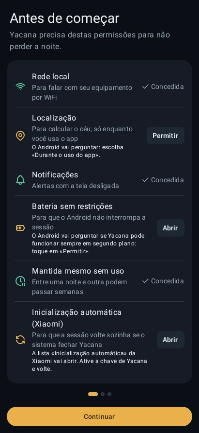 <b>Antes de começar.</b> As linhas concedidas mostram uma marca de verificação.</td>
</tr></table>

| Permissão | Para que serve | Sem ela |
| --- | --- | --- |
| **Rede local** | Falar com seu equipamento por WiFi. Pedida no Android 17 e posteriores. | O app não consegue encontrar nem controlar nenhum dispositivo Alpaca. |
| **Localização** | Calcular o céu no seu local, só enquanto você usa o app. Escolha **Durante o uso do app**. | Digite o local no perfil. |
| **Notificações** | A sessão e seus alertas com a tela desligada. Pedida no Android 13 e posteriores. | Você não verá a sessão nem seus alertas fora do app. |
| **Bateria sem restrições** | Para que o Android não interrompa a sessão. Toque em **Permitir** quando o Android perguntar. | O sistema pode interromper a sessão com a tela desligada. |
| **Mantida mesmo sem uso** | Entre uma noite e outra podem passar semanas. Desative **Pausar atividade no app se não for usado**. Android 11 e posteriores. | O Android pode remover as permissões do app após alguns meses sem uso. |
| **Inicialização automática (Xiaomi)** | Em celulares Xiaomi, Redmi e Poco, para que a sessão volte se o sistema fechar Yacana. Ative a chave ao lado de Yacana. | Se o sistema fechar Yacana durante a noite, a sessão não volta. |

Se você recusar alguma, nada quebra de imediato: o app explica o que deixa de funcionar e como ativá-la depois, em *Configurações › Permissões* ([capítulo 33](#permissions)). Toque em **Continuar** para seguir.

### 2 · Encontre seu equipamento

1. Ligue o equipamento e conecte o celular ao WiFi dele, ou coloque os dois no WiFi de casa.
2. Yacana procura sozinho dispositivos Alpaca na rede, em IPv4 e IPv6. Cada servidor encontrado aparece como um cartão com seus dispositivos. **Buscar de novo** repete a busca.
3. Em um Seestar, toque em **Teleobjetiva** ou **Grande angular**: ele carrega o perfil do Seestar para essa câmera, com sua óptica, campo e configurações recomendadas. Você pode criar os dois e trocar de um para o outro pelo cartão **Perfil** em Equipamento. Para outro equipamento, toque em **Adicionar**: o perfil pega o primeiro dispositivo de cada tipo nesse servidor.

Se um dispositivo não for encontrado, por exemplo em uma rede que bloqueia a descoberta, toque em **Adicionar por IP e porta** e digite o endereço, como `192.168.1.10:32323`. Se você já tem um perfil de outro celular, **Importar perfil** o carrega. **Agora não** pula esta página; você pode encontrar seu equipamento depois em Equipamento.

<table><tr>
<td valign="top" width="240">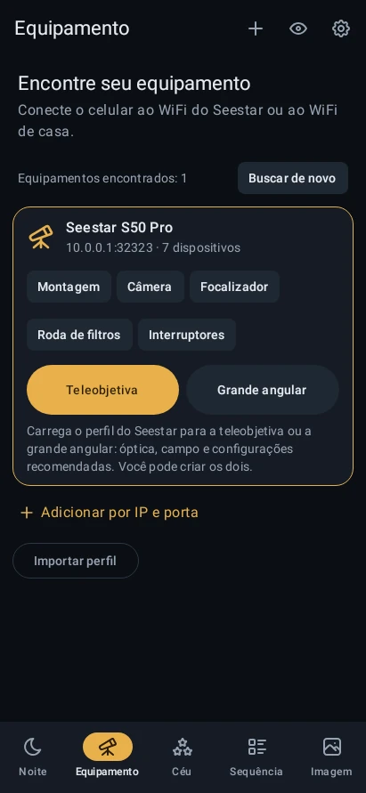 <b>Encontrado no WiFi.</b> Um Seestar com seus sete dispositivos.</td>
</tr></table>

### 3 · Pronto para o campo

Yacana funciona sem internet, mas duas coisas são grandes demais para vir dentro do app. Esta página mostra o que já está no celular e o que baixar enquanto você ainda tem WiFi:

- **Catálogo de objetos** e **Efemérides**: dentro do app, nada a fazer.
- **Base de estrelas**: a recomendada para o seu campo, D50 para um Seestar. Toque em **Baixar**.
- **Cache do céu do NINA**: as fotos para o atlas e o enquadramento. Toque em **Importar** se você já tem o ZIP dele; para baixá-lo dentro do app, use *Configurações › Mapa do céu* ([capítulo 6](#field)).

Os downloads continuam em segundo plano. Toque em **Começar** para abrir o app.

<table><tr>
<td valign="top" width="240">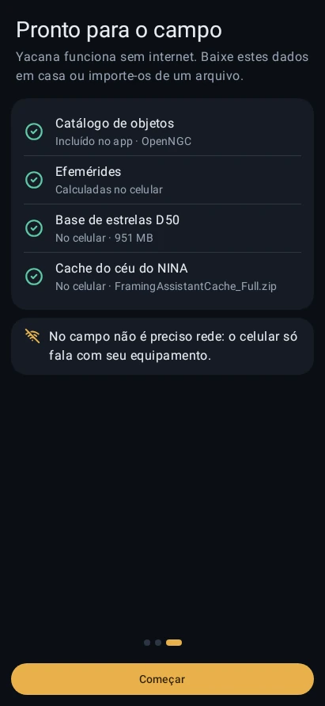 <b>Pronto para o campo.</b> Tudo no celular.</td>
</tr></table>

> [!TIP]
> **Bom saber**
>
> Os primeiros passos não podem ser abertos de novo. Suas partes continuam disponíveis: as permissões em *Configurações › Permissões*, a busca de equipamento em Equipamento, as bases de estrelas em *Configurações › Plate solving* e os caches do céu em *Configurações › Mapa do céu*.

## 4. Como se orientar

Yacana é organizado pelos momentos da noite, e não por painéis de dispositivos. Em cada momento, mostra o que você precisa e deixa o resto a um toque de distância.

### As cinco seções

A barra inferior tem cinco seções. Com o celular na horizontal, ela vira uma coluna à esquerda. Tocar na seção em que você está leva de volta à primeira tela dela.

| Seção | Para quê | Barra superior |
| --- | --- | --- |
| **Noite** | A escuridão e a Lua desta noite, a lista de preparação, a sessão em andamento, o resumo e o diário | Estado do equipamento, modo vermelho, Configurações |
| **Equipamento** | Perfis, conexão e controle manual de cada dispositivo | Adicionar dispositivo, modo vermelho, Configurações |
| **Céu** | Mapa do céu, Sky Atlas, fichas de objetos e enquadramento | Camadas do céu ou Filtros, modo vermelho |
| **Sequência** | Plano desta noite, sequências salvas, modelos, os editores simples e avançado | — |
| **Imagem** | Captura manual, estatísticas, histórico, empilhamento ao vivo e foto de referência | Modo vermelho, Mais opções |

### Controles comuns

- **Configurações:** A engrenagem em Noite e Equipamento, ou **Configurações** no fim de **Mais opções** de Imagem. A caixa de pesquisa encontra qualquer configuração por parte do nome.
- **Modo vermelho:** O ícone de olho em Noite, Equipamento, Céu, Imagem, na ficha do objeto, no enquadramento e nos assistentes. Deixa cada pixel vermelho ([capítulo 32](#display)).
- **Estado do equipamento:** Em Noite, um escudo quando o equipamento está conectado sem problemas, ou um triângulo de aviso enquanto o app reconecta ou para com segurança.
- **Voltar e fechar:** A seta no canto superior esquerdo volta. Os assistentes (alinhamento polar, autofoco e flats) mostram **✕** em vez dela, que os interrompe.
- **Folhas:** Muitas opções abrem em uma folha que sobe da parte inferior da tela. Deslize-a para baixo, ou toque fora dela, para fechá-la.
- **Números:** Horários, coordenadas e quantidades de imagens são inseridos com valores frequentes e o teclado numérico do próprio app, para que o teclado do sistema, que o modo vermelho não consegue colorir, nunca acenda à noite.
- **Manter pressionado:** Os botões arriscados se preenchem enquanto você os pressiona e agem após cerca de um segundo: estacionar, parar uma sequência, excluir um perfil, um cache, uma base ou uma sequência salva. Um toque curto não faz nada além de lembrar que é preciso manter pressionado.
- **Estados:** Cada estado é mostrado com um ícone e palavras, nunca só com cor, porque no modo vermelho o verde e o âmbar parecem iguais.

### A barra da sessão

Enquanto uma sequência está em andamento ou em pausa, uma barra em todas as telas, exceto Noite, mostra o alvo, o filtro, a exposição e a imagem, com seu progresso, como a barra “tocando agora” de um app de música. Toque nela para ver a sessão em Noite; o botão dela pausa ou retoma a sequência.

### Notificações

Enquanto o equipamento está conectado, uma notificação mostra a sessão, também na tela de bloqueio: o alvo, a imagem e o progresso, ou as imagens salvas. Toque nela para abrir o app. O botão **Desconectar** dela interrompe a captura e desconecta o equipamento. Os alertas que precisam de você, como uma conexão perdida ou uma parada segura, tocam som; eventos como um autofoco ou o fim da sequência chegam em silêncio. Cada tipo tem seu próprio canal de notificação (*Sessão da noite*, *Alertas da noite*, *Eventos da noite*), que você pode ajustar nas configurações do Android para o app.

<table><tr>
<td valign="top" width="330"> <b>A barra da sessão</b>, em andamento e em pausa.</td>
</tr></table>

## 5. Seu perfil de equipamento

Um perfil é um conjunto de equipamento e a forma como você o usa: seus dispositivos, óptica, local, limites e opções. Tudo o que Yacana calcula para você, como o campo, a escala do plate solving ou a base de estrelas recomendada, vem dele. Plate solving, autofoco, segurança, nomes de arquivos e empilhamento ao vivo também são guardados por perfil.

Abra-o em *Configurações › Perfil e localização*, ou toque no cartão **Perfil** em Equipamento e depois em **Abrir o perfil**. Os perfis, os dispositivos e a exclusão do perfil só podem ser alterados com o equipamento desconectado.

### Nome e óptica

- **Nome:** toque para editá-lo ali mesmo.
- **Distância focal:** em milímetros, de 10 a 10.000, a do telescópio com o redutor, se tiver um. Define a escala do plate solving e o campo que o mapa do céu desenha.
- **Abertura:** o diâmetro da objetiva, de 5 a 2.000 mm. A razão focal aparece ao lado.
- **Sensor da câmera** e **Tamanho do pixel:** os pixels em largura e em altura (a altura é pedida depois da largura) e o tamanho deles em µm, como nas especificações da câmera; um Seestar S50 Pro tem 2160 × 3840 px de 2,9 µm. A câmera os preenche ao se conectar; digitados, o campo é conhecido sem conectar nada, para o mapa do céu e o enquadramento.

Depois que a câmera se conectar, o cartão mostra a escala e o campo, como *2,25″/px · campo 1,35° × 2,40°*.

### Localização

O local define a escuridão desta noite, todas as alturas e o polo para o alinhamento polar.

- **Usar a localização do celular** a lê do celular ao ativá-la, sempre que o app abre e ao conectar; na primeira vez, o Android pede a permissão. Se ela não chegar, a linha diz por quê, e tocar nela tenta de novo. Desligado, você a digita: latitude norte ou sul (0 a 90°), longitude leste ou oeste (0 a 180°) e altitude em metros (0 a 9.000).
- **Enviar a hora e o local para a montagem** passa à montagem a hora UTC do celular e o local ao conectar.

### Limites

- **Limite de altura**, de 0 a 60°: nenhum GoTo desce abaixo dele nem abaixo do horizonte. Um GoTo abaixo dele é recusado e a montagem não se move; um movimento com o controle direcional para sozinho no limite.
- **Horizonte:** plano, ou o seu, com árvores e prédios. **Importar** lê um arquivo de horizonte do N.I.N.A.: um ponto por linha, azimute e altura em graus, separados por espaços ou tabulações, com `#` para comentários. **Deixar plano** o remove. As fichas dos objetos o desenham no gráfico de altura.

<table><tr>
<td valign="top" width="240">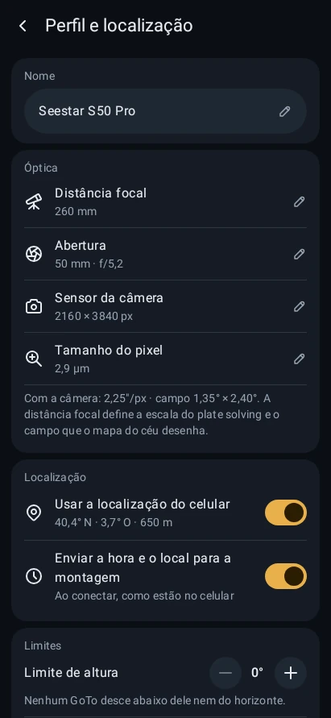 <b>Perfil e localização.</b> O perfil do Seestar.</td>
<td valign="top" width="240">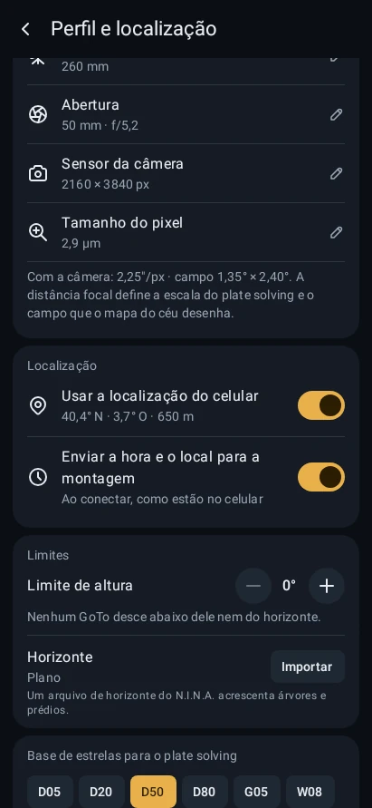 <b>Base de estrelas</b> para o plate solving, escolhida por perfil.</td>
</tr></table>

### Base de estrelas

Os botões escolhem a base do perfil para o plate solving. O app indica qual combina com o seu campo. Se você escolher uma que não está no celular, aparecem o tamanho dela e um botão **Baixar**: ela entra em uso quando o download terminar e, até lá, a anterior continua.

### Mais de um perfil

- **Trocar:** toque no cartão **Perfil** em Equipamento e escolha outro, ou toque em **Usar** ao lado dele em **Outros perfis**.
- **Novo:** **Novo perfil**, em **Outros perfis**, procura na rede; o equipamento que você escolher vira um novo perfil, em uso.
- **Copiar para outro celular:** em **Cópia do perfil**, **Exportar** salva o perfil como um arquivo JSON onde você escolher, e **Importar** lê um e o coloca em uso. O arquivo inclui as coordenadas do local.
- **Excluir:** **Excluir perfil** *(segure)*, no fim da tela.

## 6. Pronto para o campo

No campo, o celular só fala com seu equipamento. Antes da primeira noite, enquanto você tem WiFi em casa, coloque duas coisas no celular: uma base de estrelas para o plate solving e as fotos do céu. As duas também podem ser importadas de um arquivo, por exemplo copiado de um PC ou de um cartão de memória.

### Bases de estrelas

Em *Configurações › Plate solving*, em **Base de estrelas**. O app marca a **recomendada** para o seu campo e mostra o tamanho do campo. Várias podem estar no celular ao mesmo tempo; o perfil usa uma, marcada como **Em uso**.

<table><tr>
<td valign="top" width="240">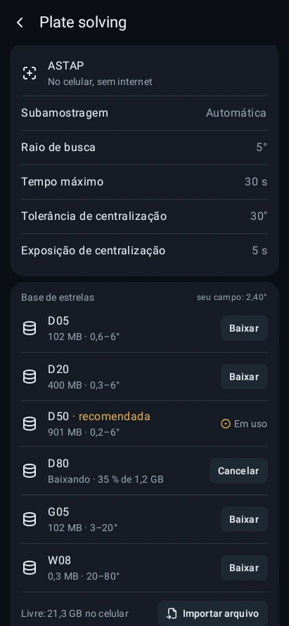 <b>As bases de estrelas.</b> D50 em uso, D80 baixando.</td>
</tr></table>

| Base | Tamanho | Para campos de | Observações |
| --- | ---: | --- | --- |
| **D05** | 102 MB | 0,6° a 6° | A opção leve |
| **D20** | 400 MB | 0,3° a 6° |  |
| **D50** | 901 MB | 0,2° a 6° | Recomendada para o Seestar |
| **D80** | 1,2 GB | 0,15° a 6° | A mais densa |
| **G05** | 102 MB | 3° a 20° | Campos amplos, lentes de câmera |
| **W08** | 0,3 MB | 20° a 80° | Campos muito amplos |

- **Baixar** a obtém do site do ASTAP só com WiFi, mesmo com o app fechado, e retoma se o download for interrompido. Entra em uso ao terminar. O espaço livre no celular aparece abaixo da lista.
- **Importar arquivo** a instala a partir do ZIP ou do arquivo `.deb` do próprio ASTAP, por exemplo de um cartão de memória.
- Mantenha pressionada uma base instalada para excluí-la com **Excluir base** *(segure)*. A que está em uso não pode ser excluída: coloque outra em uso primeiro.
- **Testar com a última imagem** resolve a última imagem de Imagem com as configurações atuais, para verificá-las.

### As fotos do céu: os caches do N.I.N.A.

O mapa do céu, o Sky Atlas, as fichas dos objetos, o enquadramento e a referência de Imagem usam as fotos dos caches de enquadramento do N.I.N.A. Yacana as lê como o N.I.N.A. as publica, direto do ZIP, sem descompactá-lo, então um cache ocupa o mesmo que seu ZIP e nada mais. Abra *Configurações › Mapa do céu*, ou o ícone de camadas no mapa do céu.

- **Cache completo (DSS):** o céu inteiro em 2.131 fotos coloridas de 5° do Digitized Sky Survey, 3,5 GB. É este que você deve baixar.
- **NSNS com estrelas** (1,4 GB) e **NSNS sem estrelas** (471 MB): o Northern Sky Narrowband Survey, emissão de hidrogênio e oxigênio até cerca de −17° de declinação. São desenhados como uma segunda camada.
- **Fotos online:** as fotos mais nítidas que o mapa busca quando você amplia bastante com internet, guardadas no celular.

<table><tr>
<td valign="top" width="240">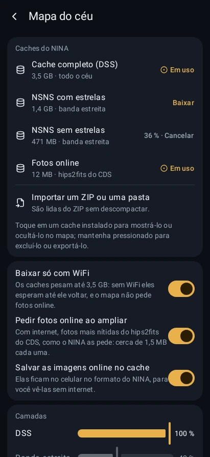 <b>Configurações › Mapa do céu.</b> O cache completo em uso, um de banda estreita chegando.</td>
</tr></table>

#### Obter um cache

- **Baixar** o obtém do site do N.I.N.A. pelo gerenciador de downloads do Android. Retoma se for interrompido e verifica antes o espaço livre. Com **Baixar só com WiFi** ativado (o padrão), espera pelo WiFi.
- **Importar um ZIP ou uma pasta**: **Escolher um ZIP** aceita um dos ZIPs do N.I.N.A., como os do site dele; **Escolher uma pasta** aceita a pasta do cache que o N.I.N.A. tem em um PC (`FramingAssistantCache`), copiada para o celular ou em um cartão. Eles são copiados para o app.

#### Usar

- Toque em um cache instalado para mostrá-lo ou ocultá-lo no mapa: **Em uso** ou **Instalado**.
- **Camadas:** a opacidade da camada DSS (100 % por padrão) e da de banda estreita (40 %), para misturá-las.
- **Pedir fotos online ao ampliar** (ativado por padrão): com internet, ao ampliar o mapa, o app pede fotos mais nítidas ao hips2fits do CDS, como o N.I.N.A. faz, de cerca de 1,5 MB cada uma. Desative para guardar os dados móveis para outras coisas; com **Baixar só com WiFi** ativado, o mapa também não as pede com dados móveis.
- **Salvar as imagens online no cache**: quando ativado, elas ficam no celular no formato do N.I.N.A., para vê-las de novo sem internet.

#### Excluir ou exportar

Mantenha pressionado um cache instalado. A folha diz quanto espaço ele libera; **Excluir cache** *(segure)* o remove. Um cache de pasta, como as fotos online, também oferece **Exportar ZIP**, para abri-lo no N.I.N.A. em um PC.

<table><tr>
<td valign="top" width="240">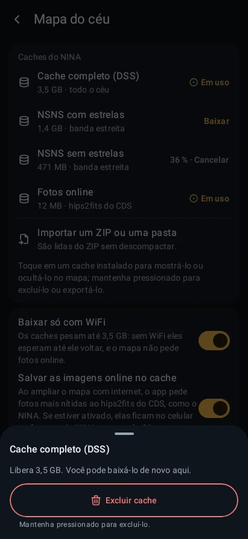 <b>Mantendo um cache pressionado.</b> O que ele libera, e o botão a manter pressionado.</td>
</tr></table>

> [!TIP]
> **Créditos**
>
> As fotos não fazem parte do app: você as baixa do site do N.I.N.A. ou as importa. O DSS é do STScI, que permite ao N.I.N.A. distribuí-lo, e o NSNS está sob CC BY-NC-SA 4.0. O mapa mostra *DSS: STScI · NSNS: CC BY-NC-SA 4.0*.

---

# Equipamento

## 7. Conectar seu equipamento

A seção Equipamento contém o perfil em uso, o conecta e dá a você o controle manual de cada dispositivo.

1. Confira o cartão **Perfil**: o nome do perfil e de onde vem o local, como *Localização por GPS · 40,4° N · 3,7° O · 650 m*. Toque nele para trocar de perfil.
2. Toque em **Conectar**. A linha diz *Conectando…* e depois quantos dispositivos responderam, como *5 de 5 conectados*, ou por que algum não conseguiu se conectar.
3. Cada dispositivo tem uma linha com seu estado ao vivo: a montagem rastreando e sua altura, a câmera ociosa e a temperatura do sensor, a posição do focalizador, o filtro em uso, o aquecedor antiorvalho ligado. As linhas se atualizam a cada um ou dois segundos.
4. Toque em um dispositivo conectado para abrir a tela dele. **Desconectar tudo** encerra a conexão.

Se a conexão cair, Yacana reconecta sozinho. Durante uma sequência, primeiro faz uma pausa segura ([capítulo 28](#safety)).

<table><tr>
<td valign="top" width="240">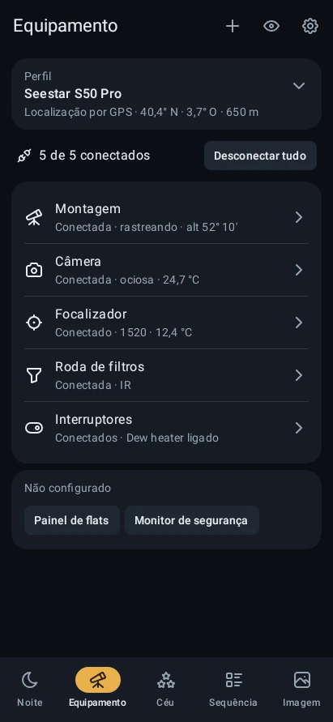 <b>Equipamento.</b> Cinco dispositivos conectados; o painel de flats e o monitor de segurança não configurados.</td>
</tr></table>

### Adicionar um dispositivo

O **+** no topo abre *Adicionar dispositivo*, que procura na rede de novo. Cada servidor mostra os dispositivos que seu perfil ainda não tem, cada um com **Adicionar**; **Adicionar por IP e porta** aceita um endereço. O cartão **Não configurado**, no fim da lista, tem um botão para cada dispositivo opcional, o painel de flats e o monitor de segurança, que abre a mesma busca. Os dispositivos só são adicionados com o equipamento desconectado.

### Sem perfil

Se você pulou os primeiros passos, Equipamento começa com **Encontre seu equipamento**, a mesma busca do [capítulo 3](#first-steps), e um botão **Importar perfil**.

## 8. A montagem

A tela da montagem mostra para onde ela aponta e a move manualmente, com GoTo, sincronização, estacionamento e rastreamento.

### Para onde aponta

O cartão superior mostra seu estado, como *Rastreando · sideral*, *Em movimento*, *Sem rastreamento* ou *Estacionada*, e sua AR, Dec, altura e azimute. Enquanto centraliza um alvo, o cartão mostra a tentativa e o passo atual, com **Parar**.

### Mover manualmente

Mantenha pressionada uma seta (N, S, L, O) para mover a montagem; ela para quando você solta. O botão vermelho no meio a para na hora. Os botões abaixo definem a velocidade: **1×**, **8×** (o padrão) ou **64×** a velocidade sideral, ou **Máx**, a mais rápida da montagem. Um movimento para sozinho no limite de altura do perfil.

### Os botões

- **Ir para…:** Abre uma folha para digitar a AR e a Dec com o teclado numérico do app (veja abaixo).
- **Sincronizar:** Informa à montagem que ela aponta para as coordenadas que você digitar. Com uma imagem resolvida, use em vez disso **Sincronizar a montagem** de Imagem ([capítulo 18](#solving)). Só aparece se a montagem puder sincronizar.
- **Estacionar:** Mantenha-o pressionado para enviar a montagem à posição de repouso. Um toque curto só lembra que é preciso manter pressionado. Com a montagem estacionada, o botão diz **Desestacionar**, e um toque a desestaciona.
- **Rastreamento:** Liga ou desliga o rastreamento.
- **Alinhamento polar:** Abre o assistente de alinhamento polar ([capítulo 17](#polar)).

O menu **⋮** no topo contém o resto: a **Velocidade de rastreamento** (sideral, lunar, solar ou King, as que a montagem suportar), **Desestacionar** quando ela está estacionada e **Posição inicial** se a montagem tiver.

<table><tr>
<td valign="top" width="240">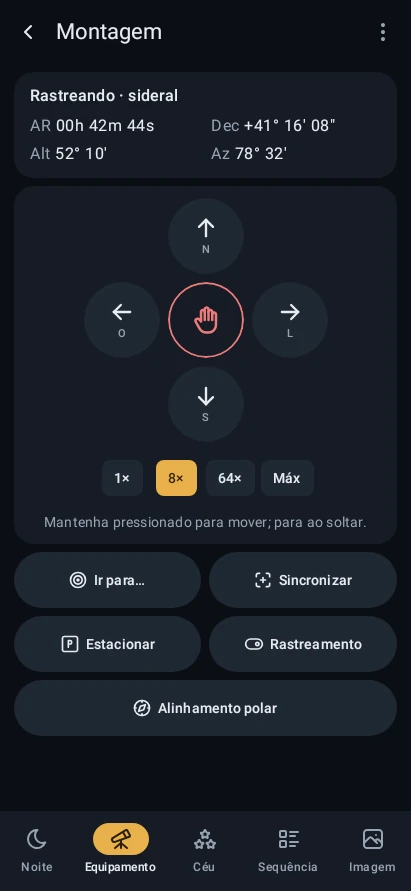 <b>Montagem.</b> Mantenha pressionada uma seta para mover; toque na velocidade.</td>
<td valign="top" width="240">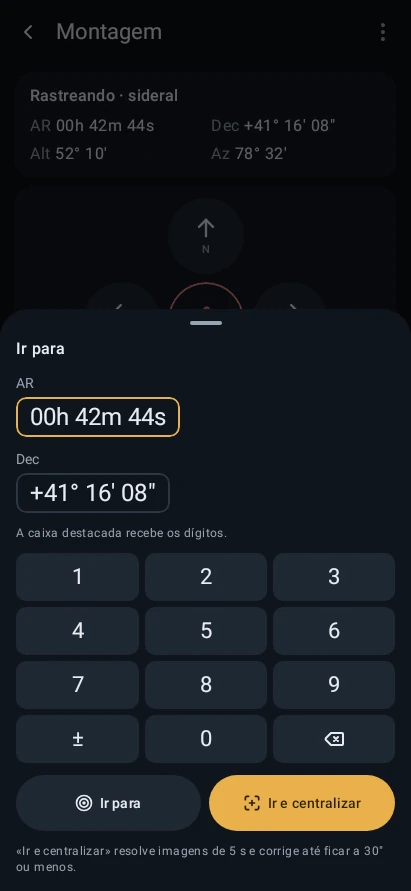 <b>Ir para.</b> A caixa destacada recebe os dígitos.</td>
</tr></table>

### Ir para coordenadas

1. Toque em **Ir para…**. A folha mostra a AR e a Dec atuais da montagem.
2. Toque na caixa da AR ou da Dec para destacá-la e digite os dígitos no teclado numérico. **±** inverte o sinal da declinação.
3. Toque em **Ir para** para ir até lá, ou em **Ir e centralizar** para ir e depois ajustar com plate solving até o alvo ficar dentro da tolerância (30″ por padrão).

> [!CAUTION]
> **Abaixo do limite**
>
> Um GoTo para um alvo abaixo do limite de altura do perfil, ou abaixo do horizonte dele, é recusado. A tela diz onde o alvo está e que a montagem não se moveu. Espere o alvo subir, ou altere o limite no perfil ([capítulo 5](#profile)).

## 9. Câmera e roda de filtros

### Câmera

A tela da câmera mostra seu estado, como *Ociosa · −10 °C*, e o que ela informa: o tamanho do sensor, o tamanho do pixel, o padrão Bayer, as faixas de ganho e offset e a exposição mais longa. As imagens são capturadas em Imagem; **Ir para Imagem** leva você até lá ([capítulo 20](#imaging)).

Yacana usa cada câmera como ela se descreve pelo Alpaca: ganho, offset, binning, região de interesse e temperatura do sensor, quando a câmera os tiver. As imagens são baixadas direto para a memória nativa do celular enquanto a próxima exposição começa, por isso até câmeras de 61 MP cabem.

### Roda de filtros

A tela da roda de filtros lista seus filtros, com uma marca de verificação no que está em uso. Toque em um filtro para usá-lo. Em Imagem, o filtro também é um botão abaixo da imagem.

Um filtro chamado **Dark**, como no Seestar, é usado como obturador para darks e bias, então não é preciso tampar nada. Sem ele, o app pede que você tampe o telescópio quando fizer darks.

## 10. O focalizador

- **Posição** e **Temperatura**, em tamanho grande, com a hora e a temperatura do último autofoco.
- **Mover:** **−100**, **−10**, **+10** e **+100** passos, e **Ir para a posição…**, que abre o teclado numérico com a faixa do focalizador. **Parar** aparece enquanto ele se move.
- **Última curva:** a curva em V do último autofoco, com o melhor HFR e a posição.
- **Offset de foco por filtro**, com uma roda de filtros: toque em um filtro para definir o offset dele em passos, em relação aos outros. Ao trocar de filtro, o focalizador se move a diferença entre o offset do novo filtro e o do anterior, de modo que cada filtro continua em foco sem um novo autofoco.
- **Autofoco** executa o autofoco na hora ([capítulo 19](#autofocus)).

<table><tr>
<td valign="top" width="240">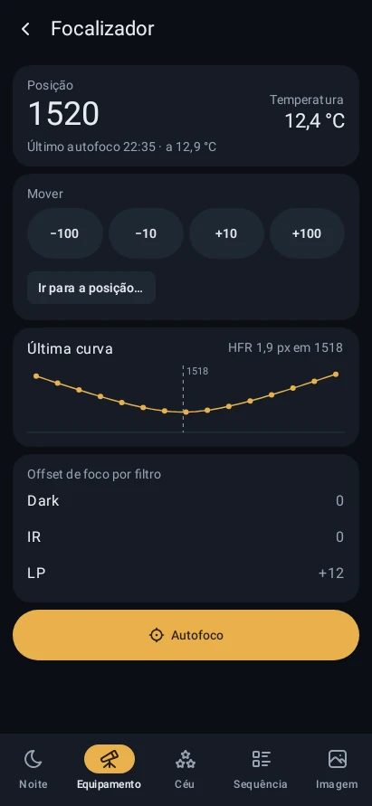 <b>Focalizador.</b> O filtro LP foca 12 passos mais para fora.</td>
</tr></table>

## 11. Interruptores, painel de flats e monitor de segurança

### Interruptores

Cada interruptor aparece como o dispositivo o declara: uma chave para ligar e desligar, um controle deslizante com − e + para um valor como a potência de um aquecedor (com sua faixa e passo; o valor é enviado quando você solta), ou uma leitura para os de somente leitura. O mais comum é um aquecedor antiorvalho, que a sequência pode ligar no início e desligar no fim.

### Painel de flats

Para um painel de flats com tampa (um CoverCalibrator Alpaca):

- **Tampa:** seu estado, com **Abrir** e **Fechar**, e **Parar** enquanto ela se move. Abra-a para a noite e feche-a para os darks.
- **Luz:** acesa ou apagada, e seu **Brilho** com um controle deslizante ou − e +.

Para os flats, o assistente de flats fecha a tampa, acende a luz e encontra a exposição sozinho ([capítulo 23](#calibration)).

### Monitor de segurança

Mostra **Seguro** ou **Inseguro**, lido a cada segundo, por exemplo de um sensor de nuvens ou de chuva. O app o mostra, mas ainda não age com base nele: se passar para **Inseguro**, pare a sequência em Noite.

<table><tr>
<td valign="top" width="240">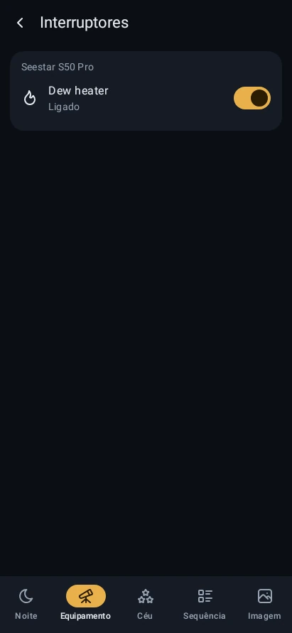 <b>Interruptores.</b> O aquecedor antiorvalho do Seestar.</td>
<td valign="top" width="240"> <b>Painel de flats.</b> Tampa aberta, luz a 40 %.</td>
<td valign="top" width="240">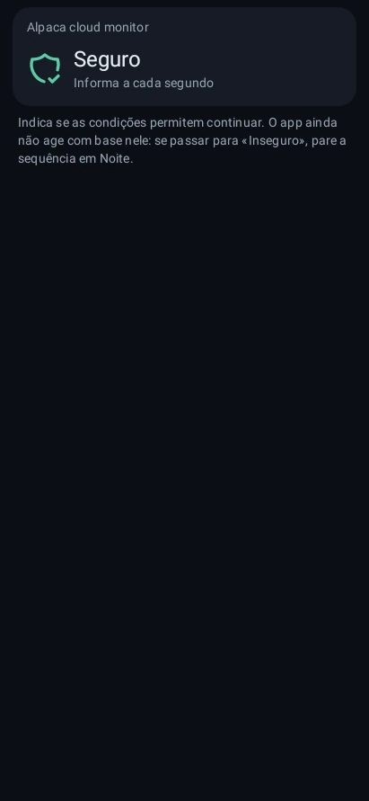 <b>Monitor de segurança.</b> Lido a cada segundo.</td>
</tr></table>

---

# Planejando a noite

## 12. Esta noite, de relance

É em Noite que a noite começa. A seção mostra a escuridão e a Lua desta noite, uma lista para se preparar, a sessão enquanto está em andamento e o resumo de manhã.

### O cartão desta noite

Calculado no celular para o local do perfil:

- A data e a iluminação da Lua, como *Lua 34 %*.
- A melhor janela escura: *Escuro e sem Lua*, ou *Escuro, com a Lua no céu* quando a Lua fica no céu durante toda a noite astronômica, com início, fim e duração.
- O pôr e o nascer do Sol, e uma linha do tempo do anoitecer à manhã: crepúsculo, noite astronômica e as horas em que a Lua está no céu, com a melhor janela destacada.

Perto do solstício de verão, em latitudes altas, pode aparecer *Sem noite astronômica*: o Sol não desce 18° abaixo do horizonte. Sem local, o cartão diz como definir um: permita a localização em *Configurações › Permissões* e ative a do celular, ou digite-o no perfil.

### Outra noite

Toque no ícone de calendário para ver qualquer outra noite. A grade do mês marca esta noite com um contorno e a noite que você escolher preenchida; as setas mudam o mês. **Voltar para esta noite** retorna.

<table><tr>
<td valign="top" width="240">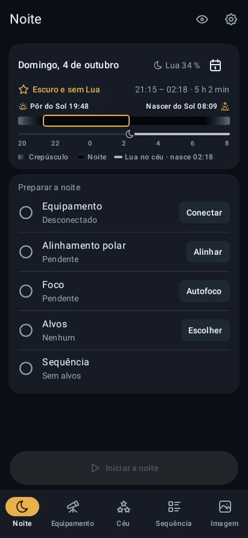 <b>Noite.</b> 5 h 2 min de céu escuro antes de a Lua nascer.</td>
<td valign="top" width="240">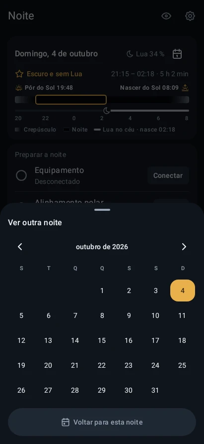 <b>Ver outra noite.</b></td>
</tr></table>

### Preparar a noite

Uma lista sem passos obrigatórios: faça o que sua noite precisar, na ordem que quiser. Cada linha mostra seu estado e um botão que leva você até lá.

| Linha | Mostra | Botão |
| --- | --- | --- |
| **Equipamento** | O perfil e seus dispositivos depois de conectados | **Conectar** |
| **Alinhamento polar** | *Pendente*, ou o último erro total e há quanto tempo | **Alinhar**, depois **Refinar** |
| **Foco** | *Pendente*, ou o último HFR e há quanto tempo (com focalizador) | **Autofoco** |
| **Alvos** | *Nenhum*, ou os alvos desta noite | **Escolher**, que abre Céu |
| **Sequência** | Se o plano cabe antes do amanhecer, e sua duração | **Ajustar** quando não cabe |

Quando o equipamento está conectado e o plano tem exposições, **Iniciar a noite** inicia a sequência ([capítulo 27](#running)). As marcas das linhas são ícones, além de cores, por isso são lidas da mesma forma no modo vermelho.

<table><tr>
<td valign="top" width="240">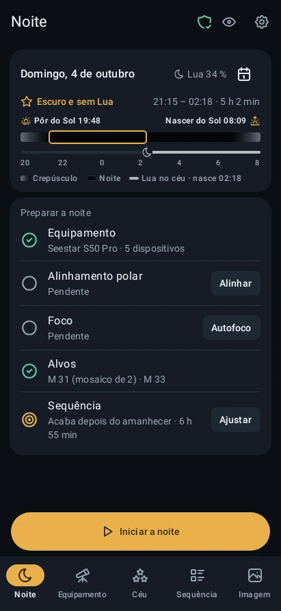 <b>Pronto para iniciar.</b> O plano acaba depois do amanhecer: <i>Ajustar</i> o encurta.</td>
</tr></table>

## 13. O mapa do céu

A seção Céu abre em um mapa do céu real, desenhado com as fotos do cache do N.I.N.A., sem internet. O mapa fica onde você o deixou, mesmo depois de fechar o app. Arraste-o com um dedo, use dois dedos para dar zoom desde uma vista ampla até menos que o campo da sua câmera, e toque em um objeto para selecioná-lo.

O mapa está orientado como você vê o céu do local do perfil neste momento, com o zênite para cima; sem local, o norte fica para cima. Uma barra de escala mostra o tamanho de um grau, e as coordenadas do centro ficam no canto inferior direito.

### O que mostra

- **Fotos:** o rótulo no topo diz de onde elas vêm, como *DSS · cache do NINA*. Com internet, ampliar busca fotos mais nítidas da região; enquanto uma chega, uma rodinha gira no rótulo. Sem cache, o rótulo diz como instalar um; toque nele para abrir as configurações do mapa do céu.
- **Seu campo:** um retângulo tracejado no centro, do tamanho do campo da sua câmera, com o nome do perfil.
- **Objetos:** contornos e nomes dos objetos do catálogo.
- **Horizonte:** uma linha nítida onde fica o horizonte da localização do perfil, que segue o próprio horizonte do perfil se ele tiver um, com **N**, **L**, **S** e **O** sobre ela.

### Selecionar um objeto

Toque em um objeto: o mapa se centra nele e um cartão mostra o nome, o tamanho, a altura e o melhor horário, com **Enquadrar**. Toque no cartão para abrir a ficha do objeto. Toque no céu vazio para desmarcar.

Para enquadrar uma área sem objeto do catálogo, centralize-a no mapa, dentro do retângulo do seu campo, e toque em **Enquadrar aqui**, o botão redondo dourado abaixo do zoom: o enquadramento abre ali, e a área entra na sequência com as coordenadas como nome, como *03h 47m +24° 07′*.

### Botões

- **+ e −:** ampliar e reduzir.
- **Enquadrar aqui:** o dourado, abaixo, enquadra o centro do mapa.
- **Camadas** (barra superior): as configurações do mapa do céu, com os caches e a opacidade das camadas ([capítulo 6](#field)).

<table><tr>
<td valign="top" width="240">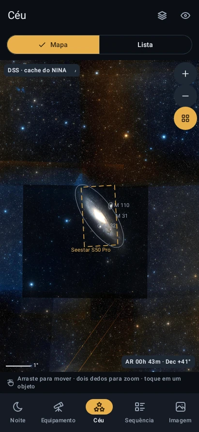 <b>O mapa.</b> M 31 sobre as fotos DSS, com o campo do Seestar.</td>
</tr></table>

### A montagem no mapa

Com a montagem conectada, o mapa mostra dois retângulos do campo da sua câmera. Eles se diferenciam pela linha, para que também possam ser distinguidos no modo vermelho:

- **Enquadramento:** tracejado, no centro do mapa. É para onde você quer ir.
- **Telescópio:** contínuo, onde o telescópio aponta agora, movendo-se à medida que é lido a cada segundo.

Arraste o mapa para colocar o alvo no retângulo do enquadramento, ou toque em um objeto para centralizá-lo, e depois:

- **Ir e centralizar** leva o telescópio ao enquadramento e o ajusta com plate solving até a tolerância do perfil. Um cartão mostra cada passo e quanto falta, com **Parar**, que para a montagem e a imagem.
- **Só ir** faz o GoTo sem centralizar.

Quando a montagem está estacionada ou sem rastreamento, o rótulo **Telescópio** o indica, e tocar nele desestaciona a montagem ou ativa o rastreamento.

<table><tr>
<td valign="top" width="240">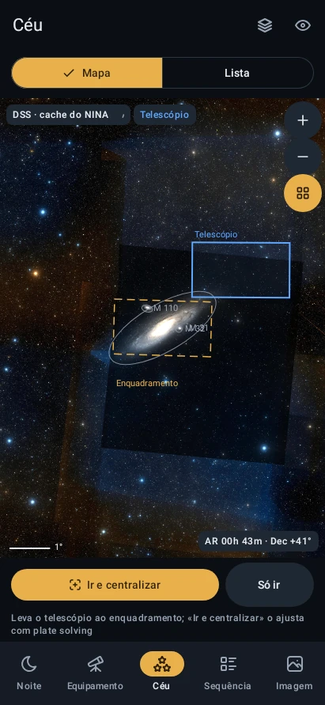 <b>Telescópio e enquadramento.</b> O retângulo contínuo é para onde ele aponta.</td>
<td valign="top" width="240">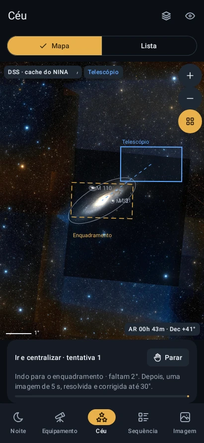 <b>Ir e centralizar.</b> Faltam 2°; depois, uma imagem de 5 s, resolvida e corrigida.</td>
</tr></table>

## 14. Sky Atlas e pesquisa

Mude a seção Céu para **Lista** para ver o Sky Atlas: 13.371 objetos de céu profundo do OpenNGC (NGC, IC, Messier, Caldwell e outros) no celular, cada um com sua foto do cache, classificados para esta noite.

### O melhor desta noite

Com **Esta noite** ativado (o padrão), a lista mostra o que está bem posicionado esta noite a partir do local do perfil, ordenado pelo melhor horário. Cada linha tem uma miniatura, o nome, o número de catálogo e o tamanho, se *cabe* no seu campo ou precisa de um *mosaico de N*, e uma pequena curva de altura com o melhor horário. Toque em uma linha para abrir a ficha do objeto.

Acima da lista, **Esta noite** e **Favoritos**, os objetos que você marcou com a estrela na ficha deles, ligam e desligam com um toque. Ao lado aparece cada filtro ativo, como *Até mag 8* ou *A partir de 1°*: o ✕ dele o remove e o texto dele abre os filtros. O ícone de controles deslizantes diz quantos são, e a nota quantos objetos sobram e em que ordem. Os filtros e o lugar na lista continuam quando você abre um objeto, muda de seção ou fecha o app.

<table><tr>
<td valign="top" width="240">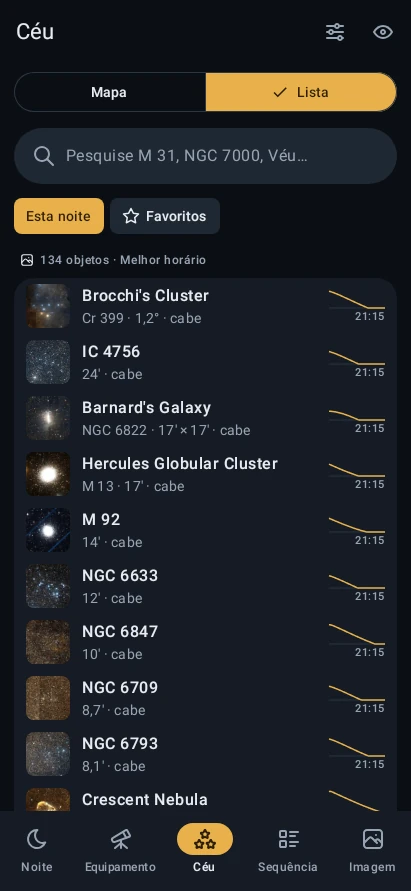 <b>Esta noite.</b> Miniaturas do cache, sem internet.</td>
<td valign="top" width="240">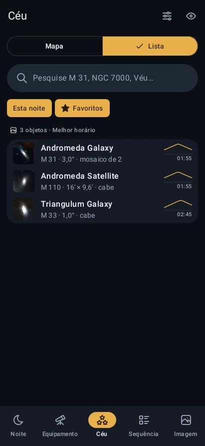 <b>Favoritos.</b> M 31 precisa de um mosaico de 2.</td>
<td valign="top" width="240">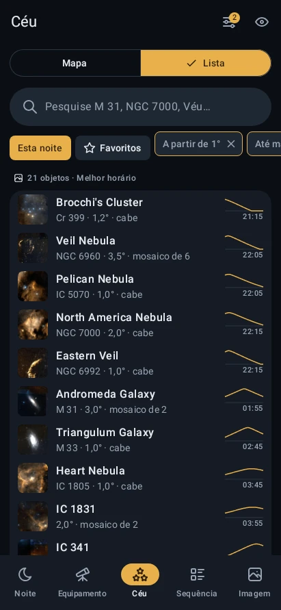 <b>Filtros ativos.</b> Até mag 8 e a partir de 1°.</td>
</tr></table>

### Filtros

O ícone de controles deslizantes no topo, ou o texto de um filtro ativo, abre os filtros. A lista muda enquanto você escolhe e o cabeçalho diz quantos objetos sobram; **Redefinir** deixa os filtros como no início, e **Concluído**, deslizar para baixo, tocar fora ou voltar os fecham. Na horizontal eles abrem ao lado, com a lista à vista.

- **Ordenar por:** Melhor horário (padrão), Altura máxima, Horas visíveis, Tamanho ou Brilho, cada um no seu sentido natural: primeiro o mais cedo, o que mais sobe, o que passa mais tempo acima da sua altura, o maior ou o mais brilhante. A nota acima da lista indica a ordem.
- **Tipo:** Galáxias, nebulosas, aglomerados, outros.
- **Tamanho:** Qualquer, para seu campo (o tamanho dele aparece), ou a partir de 15′, 30′ ou 1°.
- **Magnitude:** Qualquer, ou até 8, 10 ou 12.
- **Só:** Favoritos, e os que cabem no campo.
- **Esta noite:** ligado (padrão), só o que está bem posicionado esta noite; a altura e as horas são as da noite escura desta noite na localização do perfil. Desligado, os três seguintes não contam.
- **Acima de:** 20°, 30° ou 45°.
- **Durante pelo menos:** 1, 2 ou 4 horas.
- **Longe da Lua:** Qualquer, ou pelo menos 30°, 60° ou 90°.

Se nada corresponder, a lista avisa, com **Redefinir** para recomeçar.

<table><tr>
<td valign="top" width="240">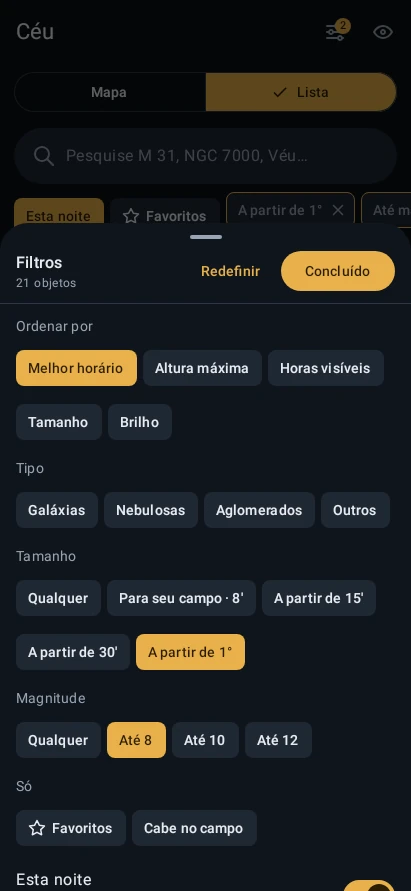 <b>Filtros.</b></td>
</tr></table>

### Pesquisa

Digite na caixa de pesquisa: um número Messier, NGC, IC, Caldwell ou Sharpless, ou um nome, como *M 31*, *NGC 7000* ou *Véu*. Os resultados aparecem enquanto você digita, em milissegundos, sem internet. No modo vermelho, a caixa de pesquisa abre o teclado do próprio app, vermelho como todo o resto, em vez do teclado do celular; ⌄ ou voltar o oculta.

Para qualquer outra coisa, a última linha oferece **Pesquisar «…» no SIMBAD**. Com internet, consulta o SIMBAD do CDS, que conhece mais de 20 milhões de objetos, do quasar TON 618 às estrelas de uma constelação. O que encontrar fica no celular, para encontrá-lo de novo offline. Se não houver correspondência exata, lista os objetos com nomes parecidos, os mais brilhantes primeiro.

<table><tr>
<td valign="top" width="240">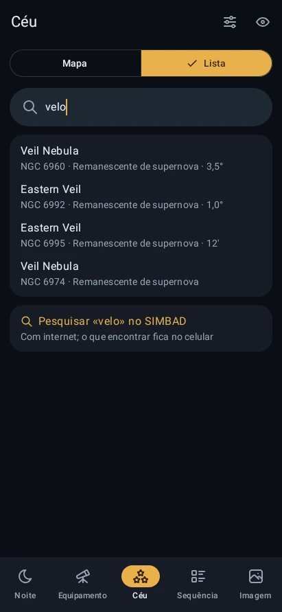 <b>Pesquisa offline.</b> “velo” encontra o Véu.</td>
<td valign="top" width="240">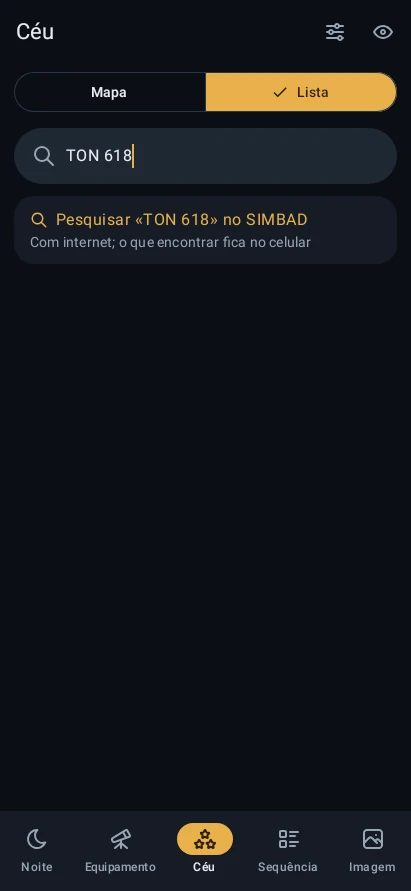 <b>Além do catálogo:</b> SIMBAD, com internet.</td>
</tr></table>

## 15. A ficha de um objeto

Tudo o que você precisa para decidir sobre um alvo: sua foto com o seu campo por cima, o que ele é, que altura alcança esta noite e quão perto está a Lua.

- **Foto:** do cache, com o campo da sua câmera desenhado sobre ela. Toque nela, ou no botão **Mapa**, para ver o objeto enquadrado no mapa do céu; só o mapa se move, não o telescópio.
- **Sobre:** nome, tipo, magnitude e tamanho; seus outros nomes e designações, como *Também Triangulum Galaxy · Triangulum Pinwheel · NGC 598*; *Cabe no campo* ou *Mosaico de N painéis*; e a distância e a fase da Lua, como *Lua a 87° · 34 %*.
- **Altura esta noite:** a curva do objeto do anoitecer ao amanhecer, com o crepúsculo sombreado nas duas pontas, a linha de 30°, seu próprio horizonte tracejado se o perfil tiver um, e uma linha para o momento atual. Abaixo, as horas em que fica acima de 30° e seu ponto mais alto, ou que fica baixo ou não nasce.

A estrela no topo o marca como favorito. **Enquadrar** abre o enquadramento ([capítulo 16](#framing)). **Ir e centralizar**, com a montagem conectada, leva o telescópio até lá e o centraliza, na tela da montagem.

<table><tr>
<td valign="top" width="240">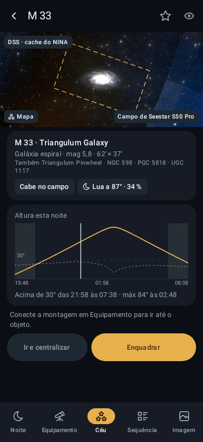 <b>M 33.</b> Cabe no campo do Seestar; a linha tracejada é o horizonte do local.</td>
<td valign="top" width="240">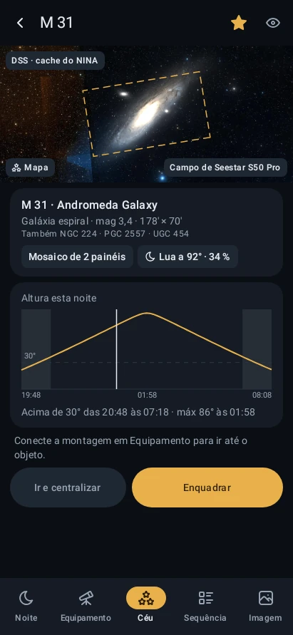 <b>M 31.</b> Uma favorita que precisa de um mosaico de 2 painéis.</td>
</tr></table>

## 16. Enquadramento e mosaicos

O enquadramento mostra como a foto vai ficar: o campo real da sua câmera sobre o céu, que você arrasta até a composição ficar certa, e mosaicos para alvos maiores que o campo.

1. Abra-o com **Enquadrar** na ficha de um objeto ou no cartão do objeto no mapa.
2. Arraste o céu para colocar o alvo no campo; use dois dedos para dar zoom. O tamanho do campo aparece no canto superior direito.
3. Para um mosaico, defina **Colunas** e **Linhas** com − e +, e a **Sobreposição** entre painéis, de 5 a 50 % (15 % por padrão). Os painéis são numerados na ordem em que serão capturados.
4. Confira a linha abaixo: as horas em que fica acima de 30° esta noite.
5. Toque em **Adicionar à sequência**. O app confirma que o alvo está na sequência desta noite, com **Escolher outro alvo** e **Ver os desta noite**.

Um alvo novo vem com 60 imagens de 60 s com o primeiro filtro que não seja o escuro, com dithering a cada 3 imagens; ajuste-as no editor ([capítulo 25](#simple)). Depois do modelo **Um alvo a noite toda**, em vez disso o alvo ocupa a noite até o amanhecer.

**Ir e centralizar**, com a montagem conectada, leva o telescópio ao enquadramento.

<table><tr>
<td valign="top" width="240">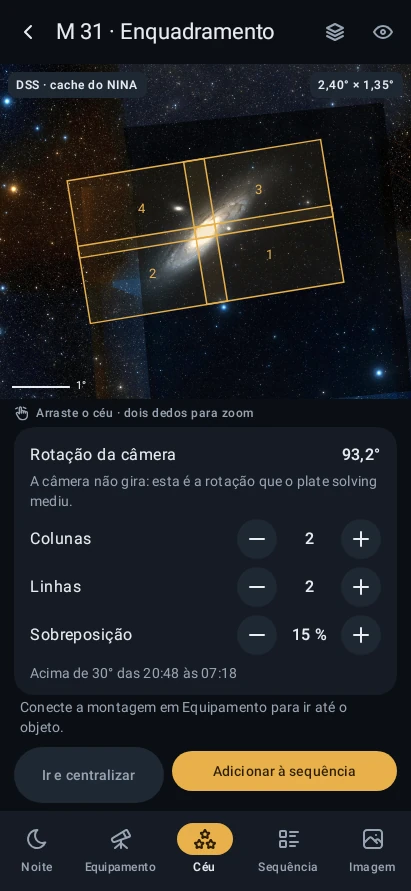 <b>M 31 · Enquadramento.</b> Um mosaico 2 × 2, girado como a câmera.</td>
</tr></table>

### A rotação da câmera

Sem rotador, a câmera não gira, então o enquadramento não gira o campo manualmente: a **Rotação da câmera** é o ângulo que o plate solving mediu, e o campo e os painéis são desenhados com ele. Até o primeiro plate solving, é 0°, ou 93,2° para um Seestar no modo EQ. Resolva uma imagem em Imagem depois de montar a câmera, e o enquadramento passa a coincidir com ela ([capítulo 18](#solving)).

> [!TIP]
> **Precisa do campo**
>
> O enquadramento precisa do campo do perfil: a distância focal e o sensor da câmera (*Configurações › Perfil e localização › Óptica*), digitados ou guardados da última conexão da câmera. Não é preciso conectar nada; a tela tem um botão para o perfil.

---

# No telescópio

## 17. Alinhamento polar de três pontos

O assistente de alinhamento polar mede quanto o eixo da montagem está afastado do polo celeste e depois guia você, ao vivo, enquanto você gira os parafusos da cunha. É uma adaptação do plugin Three Point Polar Alignment do N.I.N.A. e dá o mesmo resultado, com diferença de até 0,4″, com as mesmas medições.

Funciona com qualquer montagem que consiga girar o eixo de ascensão reta sob comando. Precisa da montagem e da câmera conectadas, de uma base de estrelas no celular e do local do perfil, que define onde fica o polo.

### Abrir o assistente

Toque em **Alinhar** na linha **Alinhamento polar** da lista de Noite (**Refinar** depois de medido), ou em **Alinhamento polar** na tela da montagem. O assistente ocupa a tela e a mantém ligada enquanto funciona; o **✕** no canto superior esquerdo o interrompe e volta.

### Antes de começar

A primeira página explica o que vai acontecer e para onde apontar: uma região desimpedida do céu, longe do polo e do horizonte, na direção em que o eixo vai girar. Mostra quatro opções; cada uma fica guardada no perfil.

- **Rotação entre pontos:** Quanto o eixo de AR gira entre as três imagens, e para que lado: 10°, 15°, 20° ou 30°, para oeste ou para leste. 15° para oeste é o padrão. Deixe espaço para a rotação, para que a montagem não encontre nenhum obstáculo.
- **Exposição:** 1, 2, 3 ou 5 s, com binning 1×1 ou 2×2, com o ganho de Imagem. Imagens curtas atualizam o erro mais rápido enquanto você gira os parafusos. 1 s em 2×2 é o padrão.
- **Tolerância:** Desligada, 0,5′, 1′, 2′ ou 5′. Quando o erro total fica abaixo dela, o celular vibra. Nunca esconde as setas. Desligada por padrão, como no plugin.
- **Resolver só com pista:** Para refinar um alinhamento que já está próximo: os três pontos só são resolvidos perto de onde a montagem aponta, nunca às cegas.

<table><tr>
<td valign="top" width="240">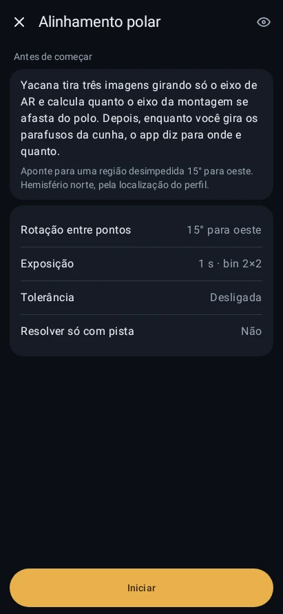 <b>Antes de começar.</b> As opções, com os padrões do Seestar.</td>
</tr></table>

### Medir os três pontos

1. Aponte o telescópio para uma região desimpedida, como diz a primeira página, e toque em **Iniciar**.
2. Yacana captura a primeira imagem e a resolve, gira o eixo de AR, captura e resolve a segunda, gira de novo e captura a terceira. Cada ponto mostra *Girando o eixo de AR…*, *Capturando a imagem*, *Resolvendo com o ASTAP* e depois quanto tempo levou a resolução.
3. **Não toque na montagem durante a medição.** Os três centros traçam um círculo cujo centro é o eixo real da montagem. A distância dele até o polo, corrigida de precessão, nutação e refração no seu local e horário, é o erro.

Se um ponto não for resolvido, o assistente diz qual e por quê, e oferece **Começar de novo**.

<table><tr>
<td valign="top" width="240">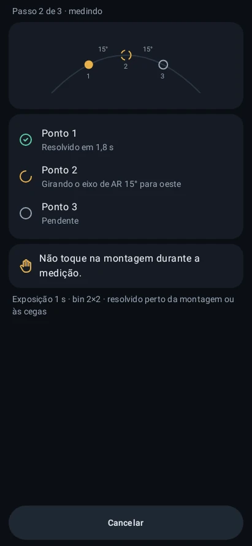 <b>Medindo.</b> Ponto 1 resolvido em 1,8 s, o eixo girando para o ponto 2.</td>
</tr></table>

### Girar os parafusos da cunha

Agora o assistente continua capturando imagens, resolve cada uma perto da última posição e atualiza o erro a cada poucos segundos. Cada eixo tem seu próprio cartão:

- **Altura:** uma seta e *Para cima* ou *Para baixo*, ou *um pouco* quando está perto.
- **Azimute:** uma seta e *Gire para oeste* ou *para leste*, ou *um pouco* quando está perto.
- O erro com sinal em graus, minutos e segundos, grande o bastante para ler a um metro de distância, e o **Erro total** abaixo.

Gire um parafuso de cada vez e veja o número dele cair. Abaixo deles, um alvo mostra a posição do polo com anéis de 30″, 1′ e 5′. Quando você chega perto, ele se amplia sozinho para a *escala de segundos*, com anéis de 10″ e 30″, para você fazer o ajuste fino segundo a segundo.

**Nada é dado como bom cedo demais.** Um eixo mantém sua seta até que o erro, arredondado ao segundo, seja 00° 00′ 00″; então mostra *Centralizado*. Não há marca verde ao passar de um limiar: você decide quando está bom o suficiente. Se você definir uma tolerância, o celular vibra quando o total fica abaixo dela, e as setas continuam.

Se a última imagem não foi resolvida, a tela avisa e continua tentando. **Medir de novo** repete os três pontos a partir de onde a montagem está, por exemplo depois de uma correção grande. **Terminar** fecha o assistente, e a lista de Noite mostra o resultado e quando foi medido.

<table><tr>
<td valign="top" width="240">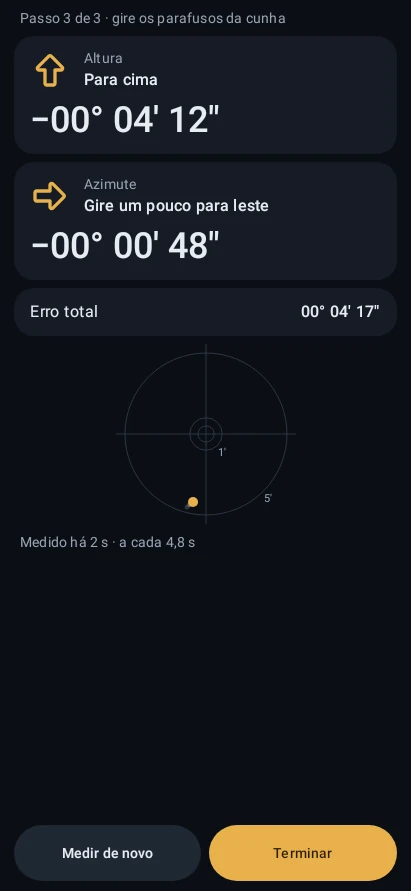 <b>Minutos de erro.</b> Para cima, e um pouco para leste.</td>
<td valign="top" width="240">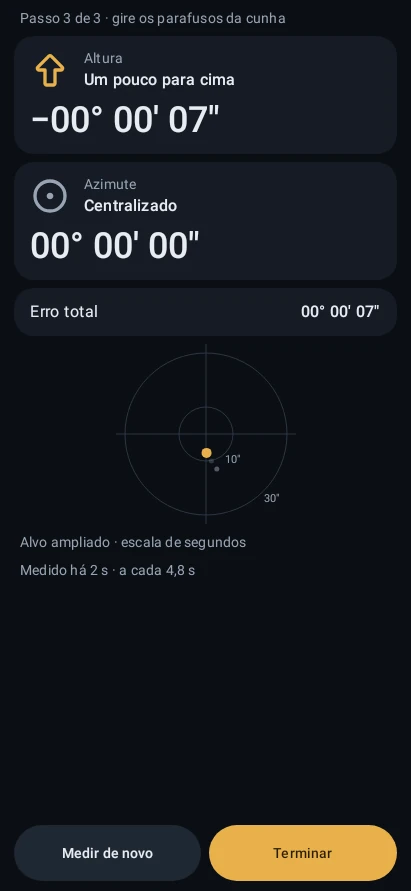 <b>Segundos de erro.</b> O alvo ampliado; azimute centralizado.</td>
</tr></table>

<table><tr>
<td valign="top" width="470">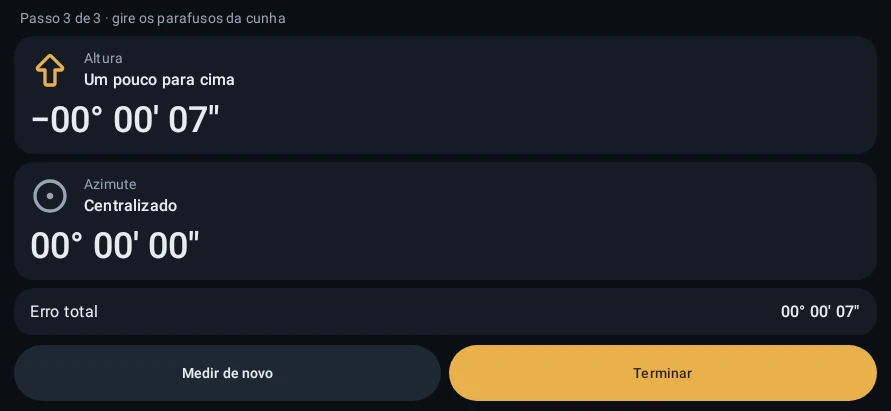 <b>Na horizontal</b>, os cartões usam a largura; os números continuam grandes.</td>
</tr></table>

> [!TIP]
> **Seestar**
>
> Em uma cunha, a altura é ajustada com a inclinação da cunha e o azimute girando a base dela. O Alpaca do Seestar consegue girar o eixo de AR, que é tudo de que o assistente precisa.

## 18. Plate solving e centralização

O plate solving calcula para onde uma imagem aponta, sua escala e sua rotação, a partir do padrão das estrelas. Yacana executa o ASTAP, o conhecido programa de plate solving, no próprio celular, sem internet: cerca de 0,4 s com a posição da montagem como pista e cerca de 7 s às cegas em um celular intermediário com imagens do Seestar.

### Resolver uma imagem

Em Imagem, capture uma imagem e toque em **Resolver**. Yacana procura primeiro perto de onde a montagem diz que aponta, e depois às cegas, se for preciso. O resultado mostra:

- **AR e Dec** do centro da imagem, em J2000;
- a **rotação** da câmera;
- a **escala** em segundos de arco por pixel e o campo em graus;
- quanto tempo levou, se foi perto da montagem ou às cegas, e a base de estrelas usada.

Toque em **Sincronizar a montagem** para informar à montagem que ela aponta para lá, de modo que os próximos GoTo cheguem mais perto. A rotação resolvida passa a ser a rotação da câmera para o enquadramento e os mosaicos ([capítulo 16](#framing)).

### Ir e centralizar

**Ir e centralizar** aparece onde quer que você possa mandar o telescópio para algum lugar: no mapa do céu, na ficha de um objeto, na tela de enquadramento e na folha **Ir para…** da montagem. Ele move a montagem, captura uma imagem com a exposição de centralização, a resolve, corrige a montagem e repete até que o centro da imagem fique dentro da tolerância, 30″ por padrão. O progresso mostra cada passo, a que distância estava a última imagem e a tentativa; **Parar** para a montagem e a imagem. As imagens de centralização não são salvas.

<table><tr>
<td valign="top" width="240">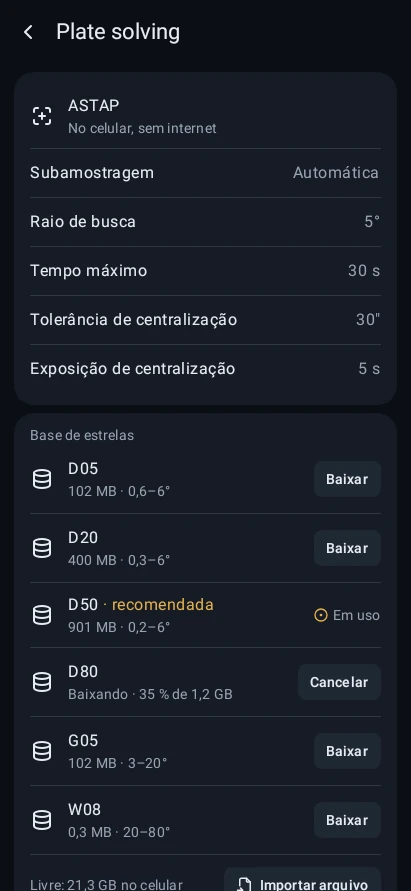 <b>Configurações › Plate solving.</b> As opções do ASTAP e as bases de estrelas.</td>
</tr></table>

### Configurações de plate solving

Em *Configurações › Plate solving*, guardadas em cada perfil:

| Configuração | Padrão | O que faz |
| --- | --- | --- |
| **Subamostragem** | Automática | O ASTAP agrupa os pixels da imagem antes de procurar estrelas. Automática escolhe o fator pelo tamanho da imagem. |
| **Raio de busca** | 5° | Até onde procurar ao redor da posição da montagem, de 1 a 180°. Se não houver solução ali, procura em todo o céu. |
| **Tempo máximo** | 30 s | Para resolver perto da montagem e depois às cegas, de 5 a 600 s. |
| **Tolerância de centralização** | 30″ | A centralização termina quando o centro da imagem está tão perto assim do alvo, de 5 a 600″. |
| **Exposição de centralização** | 5 s | As imagens que a centralização resolve, com o ganho de Imagem; de 1 a 60 s. Não são salvas. |

As bases de estrelas estão na mesma tela; o [capítulo 6](#field) explica como escolhê-las, baixá-las e importá-las.

> [!TIP]
> **Quando uma imagem não é resolvida**
>
> Confira se a imagem tem estrelas, se a distância focal do perfil está certa (o ASTAP procura essa escala) e se a base combina com o seu campo. Nuvens, orvalho ou uma imagem muito fora de foco são as causas habituais.

## 19. Autofoco

O autofoco move o focalizador através do foco, mede o HFR das estrelas em cada ponto e ajusta uma curva em V para encontrar a melhor posição. É uma adaptação do autofoco do N.I.N.A., com seus cinco ajustes de curva, compensação de folga e offsets de foco por filtro.

Precisa de um focalizador absoluto (que vai para posições em passos) e de uma câmera, apontada para um campo com estrelas. Abra-o com **Autofoco** na lista de Noite, na tela do focalizador ou em Imagem: a execução começa na hora, com as opções de *Configurações › Autofoco*.

### Como funciona uma execução

1. O focalizador se afasta alguns passos para fora e depois captura um ponto a cada passo para dentro: uma imagem, suas estrelas e o HFR delas.
2. Acrescenta pontos até haver de cada lado do melhor tantos quantos havia no início. O gráfico vai se preenchendo, com o ponto atual, sua exposição e filtro.
3. Depois do último ponto, ajusta a curva, move o focalizador para o melhor foco e o verifica. O resultado mostra a posição, o HFR, a temperatura, o R² do ajuste e onde o focalizador estava antes.

Toque em **Terminar** para fechá-lo. **Cancelar** durante uma execução devolve o focalizador para onde estava. Se a execução falhar, a tela diz por quê, o focalizador volta e **Tentar de novo** recomeça.

O resultado fica guardado: a tela do focalizador mostra o último autofoco e sua curva, a lista de Noite mostra o HFR e há quanto tempo, e o diário o registra.

<table><tr>
<td valign="top" width="240">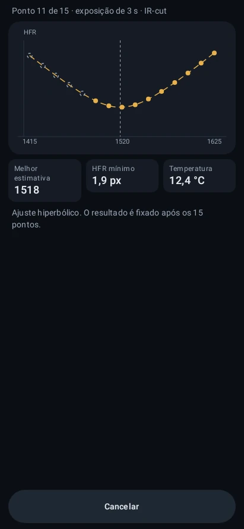 <b>Em andamento.</b> Ponto 11 de 15, uma exposição de 3 s com o filtro IR-cut.</td>
<td valign="top" width="240">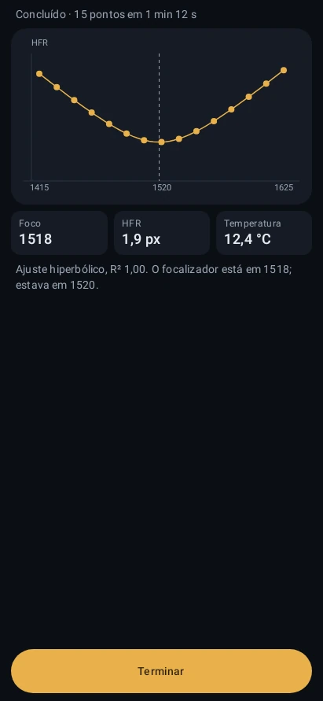 <b>Concluído.</b> 15 pontos em 1 min 12 s; o focalizador passou de 1520 para 1518.</td>
</tr></table>

### Configurações de autofoco

Em *Configurações › Autofoco*, guardadas em cada perfil, com os padrões do N.I.N.A.:

- **Passo:** Passos do focalizador entre pontos (50; 15 para o Seestar). Pequeno demais e a curva fica plana; grande demais e há poucos pontos perto do foco.
- **Pontos:** Quantos pontos ele captura: começa com metade deles para fora (9 pontos, 4 de cada lado; 15 para o Seestar).
- **Exposição:** 1 a 8 s, com binning 1×1 ou 2×2, com o ganho de Imagem. As imagens não são salvas. 4 s (3 s para o Seestar).
- **Imagens por ponto:** 1, 2 ou 3. Mais imagens fazem a média do seeing e demoram mais.
- **Ajuste:** Como o melhor foco é encontrado a partir dos pontos: por tendências, parabólico, por tendências e parábola, hiperbólico (padrão) ou por tendências e hipérbole.
- **Folga para dentro, para fora:** Passos que o focalizador perde ao mudar de sentido; ele passa desse tanto do ponto e volta.
- **R² mínimo:** Quanto a curva deve se ajustar (0,7). Sem mínimo, o resultado é mantido a menos que seja 15 % pior do que antes.
- **Tentativas:** Quantas vezes ele recomeça se uma execução falhar (1).
- **Espera após mover:** Segundos que o focalizador descansa após cada movimento antes da imagem (0).

<table><tr>
<td valign="top" width="240">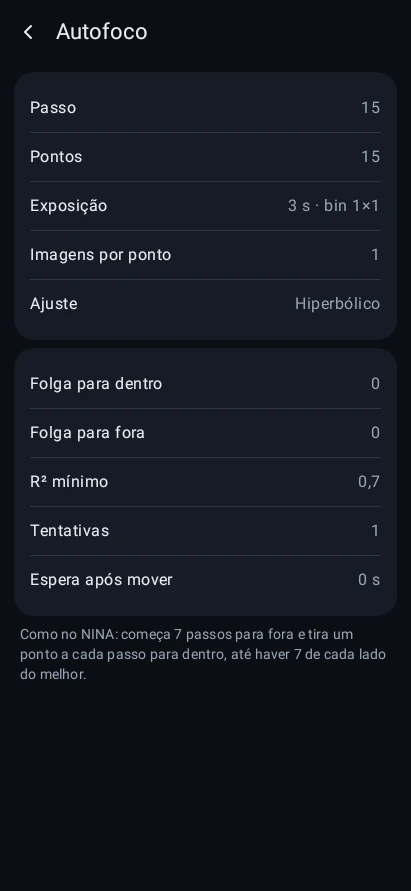 <b>Configurações › Autofoco.</b> Os valores do Seestar.</td>
</tr></table>

### Quando falha

| O app diz | O que fazer |
| --- | --- |
| **O HFR não mudou o suficiente em nenhum dos lados** | Use um passo maior. |
| **A curva explica pouco os pontos** | O seeing ou as nuvens estragaram os pontos: mais imagens por ponto, uma exposição mais longa, ou tente mais tarde. |
| **O melhor foco fica fora dos pontos medidos** | Comece mais perto do foco: mova o focalizador manualmente e execute de novo. |
| **No melhor foco o HFR é pior do que antes** | O resultado não foi mantido e o focalizador voltou. Verifique as condições e tente de novo. |
| **Este focalizador não tem posições para onde ir** | O autofoco precisa de um focalizador absoluto. |

### Refocagem automática durante a noite

Em uma sequência, as regras de autofoco iniciam uma execução antes de uma imagem de luz quando a temperatura muda, o filtro muda, o HFR piora ou depois de um tempo. Elas são definidas nas regras do editor simples ([capítulo 25](#simple)) ou como gatilhos no editor avançado ([capítulo 26](#advanced)). Se uma execução falhar durante a noite, o focalizador volta e as regras esperam as exposições seguintes.

Os offsets de foco por filtro são definidos na tela do focalizador ([capítulo 10](#focuser)): ao trocar de filtro, o focalizador se move a diferença.

---

# Captura

## 20. Imagem

A seção Imagem captura imagens manualmente: imagens avulsas para verificar o foco e o enquadramento, ou um ciclo que salva todas as imagens. Cada imagem aparece cerca de um segundo depois de baixada, com stretch, com as estrelas contadas e medidas.

### Capturar uma imagem

1. Defina a exposição, o ganho, o binning e o filtro com os botões abaixo da imagem (veja abaixo).
2. Toque no botão redondo. A tela mostra *Expondo · 12 de 20 s* e depois *Baixando a imagem…*. Toque nele de novo durante a exposição para abortar.
3. A imagem aparece com seu **HFR** e seu número de **estrelas** no canto superior esquerdo. Toque neles para ver os detalhes da última imagem.

**Ciclo** captura imagens uma após a outra e salva todas, como o Loop do N.I.N.A.; ele se torna **Parar**, que termina após a imagem em andamento. As imagens avulsas só são salvas se **Salvar imagens avulsas (o ciclo sempre salva)** estiver ativado nas opções. Se uma imagem falhar enquanto o equipamento não responde, ou a conexão cair, o ciclo espera e continua com a imagem seguinte assim que o equipamento voltar a responder.

### As configurações da imagem

- **Exposição:** 10, 20, 30, 60 ou 300 s, as que a câmera permitir, ou **Outra** no teclado numérico, dentro da faixa da câmera.
- **Ganho:** No teclado numérico, dentro da faixa da câmera, ou os ganhos com nome da câmera. Começa em 200 se a câmera aceitar, como faz o app do próprio Seestar, e as capturas da sequência sem ganho próprio usam este.
- **Binning:** 1×1, 2×2… só se a câmera fizer binning.
- **Filtro:** Com uma roda de filtros: o filtro em uso e os outros para trocar. As capturas para resolver, centralizar, alinhar ou focar nunca passam por **Dark**: antes a roda passa para IR. Com Dark, a captura não mostra HFR nem estrelas, que seriam ruído.

<table><tr>
<td valign="top" width="240">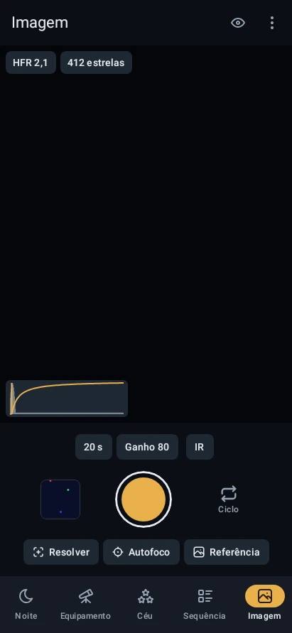 <b>Imagem.</b> HFR 2,1 px e 412 estrelas.</td>
</tr></table>

### Examinar a imagem

- **Zoom:** use dois dedos, e arraste para se mover pela imagem. Um toque duplo alterna entre a imagem inteira e pixels 1:1.
- **Histograma:** no canto inferior esquerdo, com a curva de stretch.
- **Última imagem:** toque no HFR e nas estrelas no canto superior esquerdo para ver o histograma, a média, a mediana e o desvio em ADU, o HFR com sua dispersão, o FWHM em pixels e em segundos de arco (um perfil de Moffat, como no Hocus Focus) e onde a imagem foi salva.

### Opções de captura

O **⋮** no topo as abre:

- **Tipo de imagem:** Light, dark, flat ou bias. Vai para o nome do arquivo e para o cabeçalho FITS.
- **Alvo, para o nome do arquivo:** O nome da pasta e dos arquivos, como *M 31*. Sem ele, as imagens se chamam *Snapshot*.
- **Salvar imagens avulsas:** O ciclo sempre salva.
- **Dithering em ciclos de lights, a cada:** *Não*, *3* (de início), *5* ou *10* imagens. Entre as imagens a montagem recebe um pequeno empurrão, como o guiamento direto do N.I.N.A. dá: o campo se move alguns pixels (5 por padrão) em torno de onde o ciclo começou, para que o padrão do sensor não se acumule em listras no empilhamento. Darks, flats e bias nunca fazem dithering. Com um Seestar, cujos pulsos de guiamento não vão para onde são enviados, ela salta em vez disso com pequenos GoTos entre os 9 pontos de uma grade separados por 27″.
- **Offset:** Se a câmera tiver.
- **Stretch automático:** Ativado por padrão, como no N.I.N.A. Desligado, dois controles deslizantes definem as **Sombras** e os **Tons médios**.
- **Marcar as estrelas:** Desenha uma caixa e o HFR nas estrelas mais brilhantes, como o N.I.N.A. faz; **Quantas**, de 10 a 500.
- **Empilhamento ao vivo:** **Empilhar ao vivo as imagens de luz** e **Equilibrar a cor do empilhamento** ([capítulo 22](#stacking)).
- **Configurações:** As configurações do app.

<table><tr>
<td valign="top" width="240">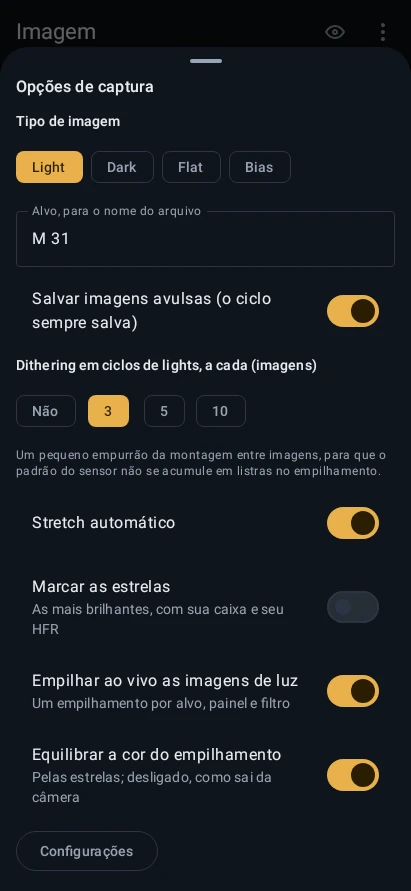 <b>Opções de captura.</b></td>
</tr></table>

### Os botões abaixo da imagem

- **Resolver:** Resolve a última imagem com o ASTAP e mostra para onde ela aponta, com **Sincronizar a montagem** ([capítulo 18](#solving)).
- **Autofoco:** Com um focalizador, executa o autofoco ([capítulo 19](#autofocus)).
- **Referência:** Coloca a foto do cache do mesmo campo sobre a imagem, com sua rotação, escala e zoom, para você compará-las: aquela mancha tênue é a galáxia? Se a imagem não estiver resolvida, resolve-a primeiro. Toque de novo para voltar à imagem.
- **A miniatura:** À esquerda do botão redondo: abre o histórico da sessão ([capítulo 21](#history)).

<table><tr>
<td valign="top" width="240"> <b>Referência.</b> A foto do cache do campo da imagem.</td>
</tr></table>

<table><tr>
<td valign="top" width="470">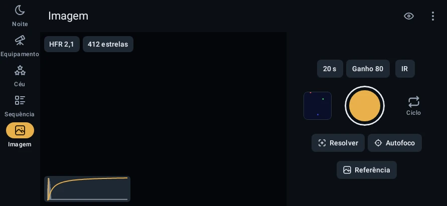 <b>Na horizontal</b>, a imagem ocupa a largura e os controles vão para o lado.</td>
</tr></table>

## 21. Histórico e qualidade das imagens

O histórico lista cada imagem salva nesta sessão com sua qualidade e marca as estragadas por nuvens ou luz, para que fiquem fora do empilhamento.

- **O gráfico:** o HFR de cada imagem como uma linha e suas estrelas como barras, com **AF** onde houve um autofoco.
- **A lista,** da mais recente para a mais antiga: número, hora, filtro e exposição, HFR e estrelas.
- **As imagens descartadas** têm muito menos estrelas ou um fundo muito mais claro que a mediana da sessão, e dizem por quê: *nuvens*, *poucas estrelas* ou *fundo claro*. Elas continuam salvas no disco; só o empilhamento e o resumo as deixam de fora.

O ícone de filtro no topo mostra só as imagens descartadas. Abra o histórico pela miniatura ao lado do botão redondo de Imagem.

<table><tr>
<td valign="top" width="240">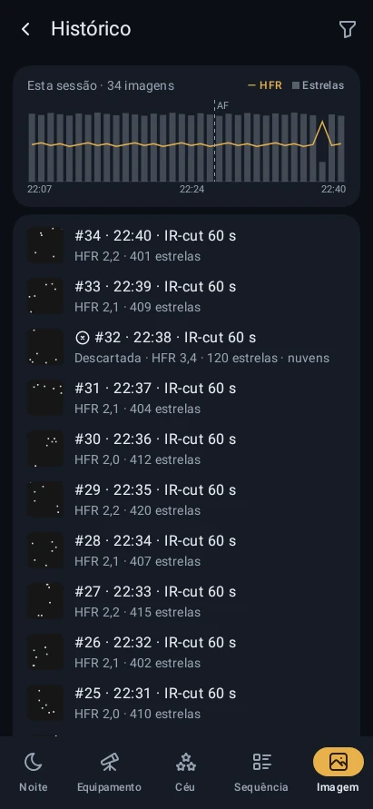 <b>Histórico.</b> Imagem 32 descartada: nuvens.</td>
</tr></table>

## 22. Empilhamento ao vivo

O empilhamento ao vivo soma cada imagem de luz boa a um empilhamento em curso enquanto a noite avança, para você ver o alvo surgir do ruído. Fica desligado até você querer, porque usa memória e bateria.

### Ativar

Nas opções de Imagem, ative **Empilhar ao vivo as imagens de luz**. A partir daí, cada imagem de luz salva entra no empilhamento, seja de um ciclo, de uma sequência ou uma imagem avulsa. As imagens continuam sendo salvas uma a uma, como sempre.

Os flats são reunidos mesmo com o empilhamento ao vivo desligado: quando a série de um filtro fica completa, eles viram o flat mestre dele, guardado como `FLATS/MasterFlat_IR.fits` (um por filtro) na pasta das suas imagens para as próximas noites, um FITS de 32 bits que o Siril e o PixInsight também leem. Um flat seu colocado ali com esse nome vale igual. Os darks também são guardados para o empilhamento mesmo que você o ative depois de fazê-los, como quando uma sequência começa com seus darks.

### Como empilha

- **Um empilhamento por alvo, painel e filtro,** e por exposição, ganho e binning. Uma imagem de outro tipo salva o empilhamento anterior e começa o seu.
- **Alinhado pelas estrelas:** deslocamento, rotação e escala, sobre a primeira imagem do empilhamento.
- **Satélites e aviões removidos** com rejeição a 3 sigma.
- **Calibrado durante o processo:** com o dark mestre da noite de mesma exposição, ganho, offset e binning na temperatura do sensor mais próxima, e o flat mestre do filtro da pasta FLATS.
- **Cor equilibrada pelas próprias estrelas,** com **Equilibrar a cor do empilhamento** ativado; desligado, como sai da câmera.
- **As imagens descartadas ficam de fora,** assim como as imagens cujas estrelas não correspondem.

<table><tr>
<td valign="top" width="240">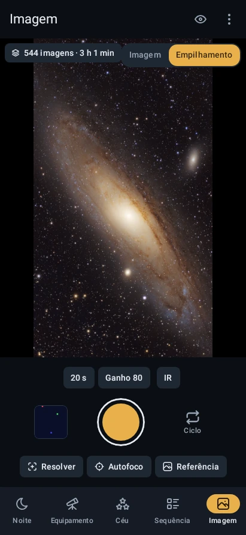 <b>O empilhamento.</b> M 31 com 544 imagens de 20 s com um Seestar, processado depois.</td>
</tr></table>

### Um mosaico

Em um mosaico a sequência faz cada painel inteiro e depois o seguinte, e cada painel tem seu próprio empilhamento, calibrado com seus darks e seus flats. Com **Empilhamento**, Imagem mostra o mosaico inteiro enquanto ele é montado: cada painel no seu lugar do céu, como a centralização dele o resolveu, com o fundo igualado ao dos vizinhos onde se sobrepõem e as emendas fundidas, e um só estiramento e um só balanço de cor para tudo. O painel que está sendo empilhado tem a borda dourada e cresce a cada imagem; os que faltam ficam tracejados. É uma visualização a um quarto do tamanho, ou menor em um mosaico grande para caber na memória do celular, e é salva como JPG, como *2026-10-14/M 31/STACK/…_STACK_MOSAIC.jpg*, depois de cada painel e ao terminar a sequência. O mosaico final é montado com os empilhamentos dos painéis no Siril ou no PixInsight.

<table><tr>
<td valign="top" width="240">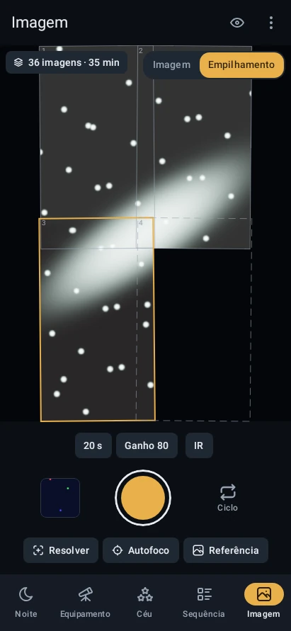 <b>Um mosaico.</b> O terceiro painel de quatro, crescendo.</td>
</tr></table>

### Acompanhar

Quando existe um empilhamento, uma chave **Imagem** | **Empilhamento** no canto superior direito de Imagem alterna entre a última imagem e o empilhamento. Toque no rótulo do empilhamento, como *544 imagens · 3 h 1 min*, para abrir a folha dele:

- **Empilhadas:** Imagens nele, das que chegaram.
- **Descartadas:** Quantas ficaram de fora e por quê.
- **Tempo:** Integração total e as imagens.
- **Alinhamento:** Pelas estrelas, e quanto a última girou.
- **Cor:** Equilibrada pelas estrelas, ou como sai da câmera.
- **Dark** e **Flat:** o dark e o flat mestre em uso, como *MasterFlat_IR.fits de 11 de outubro*, ou quais faltam.

Em Noite, enquanto uma sequência está em andamento com o empilhamento ativado, o cartão da última imagem mostra o empilhamento; toque nele para abri-lo em Imagem.

### Salvar

O empilhamento se salva sozinho a cada 10 minutos enquanto cresce, e quando o ciclo ou a sequência termina: um FITS linear de 32 bits para processamento e um JPG do jeito que a tela o mostra, na pasta das imagens, com `STACK` como tipo. **Salvar** o salva agora. Se o app for fechado, o empilhamento continua com a próxima imagem do mesmo alvo e filtro.

**Fazer 10 darks de 20 s** (com a exposição das imagens) faz darks para o empilhamento agora. Com um filtro escuro, é automático; sem ele, o app pede que você tampe o telescópio primeiro. **Mantenha pressionado para recomeçar** esvazia o empilhamento.

<table><tr>
<td valign="top" width="240">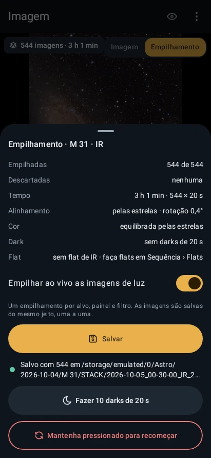 <b>A folha do empilhamento.</b> Ainda sem darks nem flat para este filtro.</td>
</tr></table>

## 23. Flats, darks e bias

As imagens de calibração removem o que o sensor e a óptica acrescentam. Yacana faz os flats com um assistente e os darks e bias com as regras da sequência, e o empilhamento ao vivo usa todos eles.

### O assistente de flats

Abra-o com o modelo **Flats** em Sequência. Ele calcula a exposição sozinho e faz os flats de cada filtro com um brilho alvo. A luz é este celular, ou o painel de flats se houver um conectado.

1. Confira o **ADU alvo**, 30.000 ± 5 % por padrão, com o máximo da câmera indicado. Defina o **Brilho do painel** se usar um.
2. Escolha **Imagens por filtro** (20, 30 ou 50) e os **Filtros**.
3. Toque em **Iniciar os flats**. Com este celular como luz, você tem 30 s para colocá-lo virado para baixo sobre o telescópio, com a tela cobrindo a objetiva e uma folha de papel branco no meio. Um bipe começa os flats e a tela fica branca no brilho máximo, também no modo vermelho; outro bipe os termina. Para pausá-los, toque duas vezes na tela branca; **Retomar** dá outros 30 s.
4. Cada filtro mostra *procurando a exposição…*, depois sua exposição e quantos estão feitos, com a média da última imagem em ADU. **Pausar** e **Mantenha pressionado para parar** ficam na parte inferior. No fim, com o filtro Dark do Seestar, faz 10 bias: o nível deles fica em cada flat mestre, para que o empilhamento ao vivo divida por ele mesmo sem darks.

Se houver luz demais mesmo com a exposição mais curta, ou pouca luz com a mais longa, o assistente para e diz o que mudar: mais ou menos papel sobre a tela do celular, ou o brilho do painel.

<table><tr>
<td valign="top" width="240">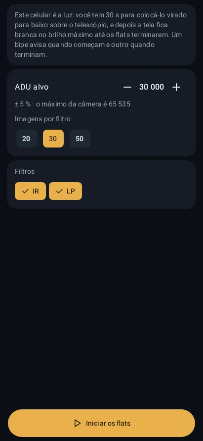 <b>Configurando.</b> Este celular como luz, dois filtros.</td>
<td valign="top" width="240">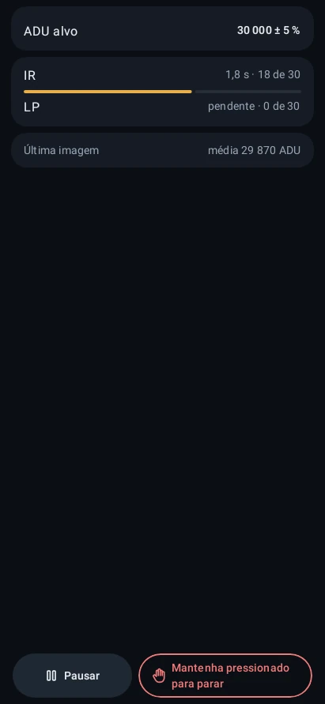 <b>Em andamento.</b> Os flats do IR a 1,8 s, média de 29.870 ADU.</td>
</tr></table>

### Darks e bias na sequência

No editor simples, o botão **Darks** em **Regras** define quando os darks são feitos, com a exposição, o ganho e o binning de cada imagem de luz e o filtro escuro:

- **Ao começar** a noite.
- **Se a temperatura do sensor mudar** 2, 3 ou 5 °C, para que o empilhamento ao vivo use a série da temperatura mais próxima.
- **No fim, com o bias** (ativado por padrão).
- **Imagens por série:** 5, 10 ou 20. A folha diz quanto tempo cada série leva sem imagens de luz.

Sem filtro escuro, não é possível fazer darks ao começar nem por temperatura; no fim, o app pede que você tampe o telescópio. Os darks e os bias do início e do fim vão para a pasta do alvo, ao lado de LIGHT: os do início para a do primeiro alvo, os do fim para a do último.

<table><tr>
<td valign="top" width="240">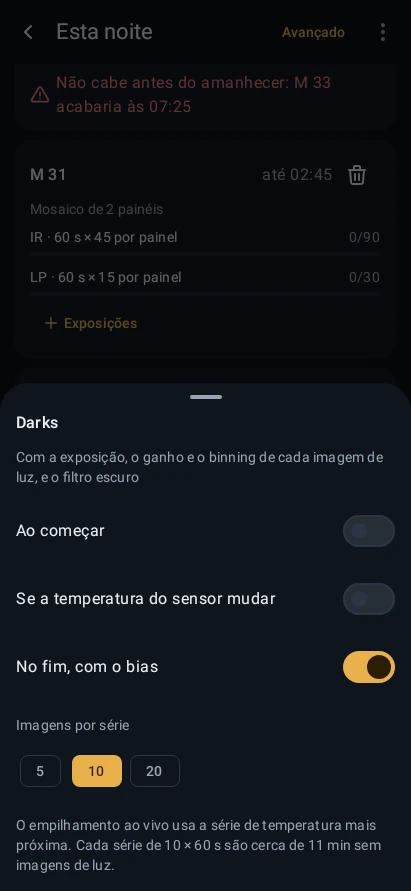 <b>Darks.</b> 10 imagens de 60 s levam cerca de 11 min.</td>
</tr></table>

### Manualmente

Em Imagem, defina o **Tipo de imagem** como dark, flat ou bias nas opções e capture como de costume: as imagens vão para sua própria pasta por tipo.

---

# Sequências

## 24. A seção Sequência

Uma sequência é o plano da noite: quais alvos, com quais exposições e o que fazer em torno deles. Yacana tem dois editores para o mesmo plano: um simples, que coloca a noite em uma linha do tempo, e um avançado, com os contêineres, gatilhos e condições do N.I.N.A. Você pode alternar entre eles sem perder nada.

- **Esta noite:** O plano que a noite vai executar, com seus alvos e horários. Toque nele para abrir o editor. Enquanto está em andamento, ele avisa.
- **Salvas:** Suas sequências salvas, com seus alvos e duração. Toque em uma para carregá-la como plano desta noite; **Desfazer** traz de volta o plano que você tinha. Mantenha uma linha pressionada por um momento para excluí-la com **Mantenha pressionado para excluir**. Para salvar o plano desta noite, use o menu **⋮** do editor.
- **Modelos:** Pontos de partida para um plano novo (abaixo).
- **Nova:** Um plano vazio, no editor.

### Modelos

- **Um alvo a noite toda:** começa um plano vazio e abre Céu. O alvo que você adicionar em seguida ocupa a noite até o amanhecer.
- **Vários alvos** e **Mosaico:** começam um plano vazio e abrem Céu, para enquadrar os alvos ou o mosaico.
- **Flats:** abre o assistente de flats ([capítulo 23](#calibration)).

O que havia antes de um modelo volta com **Desfazer**.

<table><tr>
<td valign="top" width="240">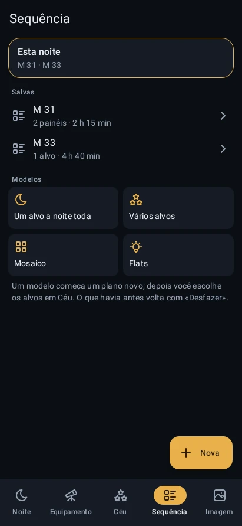 <b>Sequência.</b> Esta noite, sequências salvas e modelos.</td>
</tr></table>

## 25. O editor simples

O editor simples mostra o plano desta noite como uma linha do tempo e um cartão por alvo. Ele avisa, com um ícone e palavras, quando o plano não cabe antes do amanhecer.

### Adicionar alvos

Os alvos vêm de Céu: enquadre um e toque em **Adicionar à sequência** ([capítulo 16](#framing)). **Adicionar alvo**, no fim da lista, leva você até lá. Um mosaico chega como um alvo com seus painéis.

### Plano desta noite

A linha do tempo mostra cada alvo do início ao fim, e o amanhecer. Se o plano passar do amanhecer astronômico, ele diz qual alvo terminaria quando, e o horário de fim desse alvo fica na cor de aviso. **Desfazer** desfaz a última alteração, até 50 alterações para trás.

### O cartão de um alvo

- Seu nome, quando termina e o ícone de lixeira para removê-lo.
- Para um mosaico, seu número de painéis; as exposições valem para cada painel.
- Uma linha por filtro e exposição, como *IR · 60 s × 45 por painel*, com as imagens feitas e o total. Toque em uma linha para alterá-la; **Exposições** acrescenta outro filtro.

<table><tr>
<td valign="top" width="240">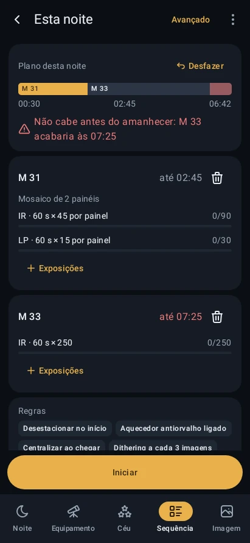 <b>Esta noite.</b> M 33 terminaria às 07:25, depois do amanhecer.</td>
<td valign="top" width="240"> <b>Exposições.</b> O teclado numérico mostra quanto tempo levam e até quando.</td>
</tr></table>

### Exposições

A folha define uma linha das exposições de um alvo: o **Filtro**, o **Tempo** (10, 30, 60 ou 120 s, ou **Outra**) e o **Número de imagens** no teclado numérico. Enquanto você digita, ela mostra quanto tempo levam e até quando, ou que terminariam depois do amanhecer. **Salvar** a guarda; **Remover estas exposições** exclui a linha quando o alvo tem mais de uma.

### Regras

O cartão **Regras** lista o que a noite faz além das imagens. Um plano novo vem com:

- **Desestacionar no início**, e **Aquecedor antiorvalho ligado** se o equipamento tiver um interruptor de aquecedor.
- **Centralizar ao chegar:** cada alvo, e cada painel de um mosaico, é centralizado com plate solving antes das suas imagens.
- **Dithering a cada 3 imagens**, sem guiador.
- **Autofoco se ΔT > 1 °C**, com um focalizador.
- **Recentralizar se desviar > 1′:** antes de cada light, a anterior é resolvida; se o campo se desviou mais de 1′ do alvo, ele é recentralizado. Substitui o guiamento.
- **Darks e bias no fim**: 10 de cada, para cada exposição, ganho, offset e binning dos lights.
- **Estacionar no fim**, e o aquecedor desligado.

Os botões abaixo as alteram:

- **Autofoco:** Antes de cada imagem de luz, um autofoco é executado se alguma destas se cumprir, como os gatilhos do N.I.N.A.:
  - **Quando a temperatura muda** 0,5, 1, 2 ou 5 °C;
  - **Ao trocar de filtro;**
  - **Quando o HFR piora** 5, 10 ou 20 %;
  - **De tempos em tempos:** 15, 30, 60 ou 120 min, ou outro tempo.

  Se um autofoco falhar, elas esperam as exposições seguintes.
- **Darks:** Ao começar, quando a temperatura do sensor muda, no fim com o bias, e quantos a cada vez ([capítulo 23](#calibration)).
- **Recentralização:** ativada ou não, e quanto o campo pode se desviar: 1′, 2′, 5′ ou 10′, cada um também em pixels da câmera conectada. Nunca recentraliza por menos de 20 px, o que um dithering pode mover; com uma câmera grande angular isso é mais do que qualquer opção, e a folha avisa. Com um bom alinhamento polar, recentraliza uma ou duas vezes por hora.
- **Dithering:** ativado ou não, e a cada 1, 3, 5 ou 10 imagens, para os lights de todos os alvos. Cada dithering espera a montagem estabilizar. Com um Seestar, ou uma montagem sem pulsos de guiamento, cada dithering parte da resolução da última imagem e vai ao alvo mais o seu ponto da grade, então também desfaz o desvio, como faz o próprio app do Seestar.
- **Aquecedor antiorvalho**, se o equipamento conectado tiver um: ligado ou não durante a noite, e sua potência se for regulável. Gasta bateria: desligue em noites secas e amenas.

Para outras regras, como esperar um alvo subir ou repetir até um horário, abra o plano no editor avançado.

### Salvar e iniciar

O menu **⋮** tem **Salvar nas minhas sequências**. **Iniciar**, na parte inferior, inicia a noite assim que o equipamento estiver conectado; durante a execução, o botão vira **Mantenha pressionado para parar**. Você ainda pode editar o plano durante a execução: as alterações valem para o que ainda está por vir.

<table><tr>
<td valign="top" width="240"> <b>Regras de autofoco.</b></td>
<td valign="top" width="240"> <b>Recentralização.</b> A menos de 1′ do alvo.</td>
<td valign="top" width="240"> <b>Dithering.</b> A cada 3 imagens.</td>
</tr></table>

## 26. O editor avançado

O editor avançado é o sequenciador avançado do N.I.N.A. transformado em uma lista para toque: contêineres em que você entra, instruções, gatilhos e condições, reordenados arrastando, com desfazer e uma revisão da noite antes de começar.

Abra-o com **Avançado** no topo do editor simples. Ele abre o plano desta noite por inteiro. Se você acrescentar o que o editor simples não consegue mostrar, como uma condição ou um contêiner paralelo, a partir daí esta noite só é editada no editor avançado: o editor simples mostra **Esta noite é editada em Avançado** com **Abrir em Avançado** e a lista de alvos.

### A estrutura da noite

- **Noite,** o nível superior, com os **gatilhos para a noite toda**, e três áreas:
- **Início:** o que acontece primeiro, antes dos alvos, como desestacionar ou resfriar a câmera. O que aponta para um alvo não vai aqui.
- **Alvos:** um após o outro, nesta ordem. Cada alvo contém suas instruções.
- **Fim:** depois dos alvos: darks, estacionar e desligar.

Uma trilha de navegação no topo mostra onde você está, como *Noite › Alvos › M 33*. O cartão de cada nível diz como ele é executado: uma vez, ou repetido por suas condições, que são verificadas após cada instrução.

<table><tr>
<td valign="top" width="240"> <b>Noite.</b> Um gatilho de autofoco e as três áreas.</td>
<td valign="top" width="240"> <b>Um alvo.</b> Repetido até as 02:00.</td>
</tr></table>

### Trabalhar com os itens

- **Entre** em um contêiner tocando nele; toque em uma instrução para alterar suas configurações.
- **Adicione** com o botão na parte inferior, **Adicionar a …**, que abre o catálogo. **Condição** e **Gatilho**, no cartão do nível, o abrem nesse tipo.
- **Reordene** arrastando a alça de um item, ou com o menu **⋮** dele.
- **O menu ⋮** de um item: *Entrar*, *Trocar o alvo*, *Renomear*, *Configurações*, *Mover para cima*, *Mover para baixo*, *Mover para…*, *Duplicar*, *Salvar como modelo* e *Excluir*.
- **Desfazer** fica no topo.

Enquanto a noite está em andamento, os itens terminados são marcados como concluídos e o que está em andamento fica destacado. Os dois ficam bloqueados; o resto ainda pode ser alterado.

### O catálogo

O catálogo tem uma caixa de pesquisa e botões por tipo: câmera, montagem, foco, filtros, utilidades, contêineres, gatilhos, condições e modelos. O que não pode ir onde você está aparece acinzentado, com o motivo, como *Só dentro de um Alvo*.

<table><tr>
<td valign="top" width="240"> <b>O catálogo.</b> O que aponta para um alvo fica acinzentado em Início.</td>
</tr></table>

| Tipo | Item | O que faz |
| --- | --- | --- |
| **Câmera** | Exposições | Lights, darks ou bias: filtro, tempo, número de imagens e dithering |
| **Câmera** | Resfriar câmera · Aquecer câmera | Até uma temperatura, pouco a pouco, ou de volta devagar antes de desligá-la |
| **Montagem** | Desestacionar · Estacionar | Sai da posição de repouso ou volta a ela |
| **Montagem** | Ir e centralizar | GoTo ao alvo e plate solving, até 1′; só dentro de um Alvo |
| **Montagem** | Ir para o alvo | GoTo ao alvo sem centralizar; só dentro de um Alvo |
| **Montagem** | Parar o rastreamento | A montagem fica parada |
| **Foco** | Autofoco · Mover o focalizador | Uma execução com curva em V, ou para uma posição |
| **Filtros** | Trocar de filtro | A roda coloca outro filtro |
| **Utilidades** | Definir um interruptor | Como o aquecedor antiorvalho, ligado ou desligado |
| **Utilidades** | Esperar até um horário · Esperar um pouco · Esperar subir | Continua em um horário desta noite, após alguns minutos, ou quando o alvo alcança uma altura |
| **Utilidades** | Nota | Uma nota no diário da noite |
| **Contêiner** | Alvo | Um alvo de Céu, com seu enquadramento; vem com «Ir e centralizar» |
| **Contêiner** | Sequencial · Paralelo | Suas instruções uma após a outra, ou ao mesmo tempo, como esperar um horário enquanto a câmera resfria |
| **Gatilho** | Autofoco se a temperatura mudar · de tempos em tempos · ao trocar de filtro · se o HFR subir | Um autofoco antes da próxima imagem quando sua condição se cumpre |
| **Gatilho** | Recentralizar se desviar | Resolve e corrige quando o alvo se desvia mais de 1′ a 10′ (no mínimo 20 px) |
| **Gatilho** | Darks se a temperatura mudar | Darks com o filtro escuro quando o sensor muda 2, 3 ou 5 °C, para o empilhamento ao vivo |
| **Condição** | Repetir N vezes · Repetir até um horário · Repetir enquanto estiver alto | Repete o contêiner inteiro |
| **Modelo** | Alvo com autofoco · os seus | Um alvo de Céu com ir e centralizar, autofoco e exposições; ou qualquer bloco que você salvou como modelo |

### Revisar a noite

O editor verifica o plano enquanto você o monta. Quando algo daria errado esta noite, um selo no topo conta os avisos; toque nele para abrir **Revisar a noite**, e toque em um aviso para ir até ele. Os avisos nunca impedem salvar ou iniciar. Eles incluem:

- uma instrução que precisa de um alvo fora de um Alvo, ou lights sem alvo;
- um estacionamento antes de imagens, de foco ou de um GoTo sem um *Desestacionar* antes;
- lights sem um *Ir e centralizar* antes, ou com o rastreamento parado;
- um filtro que a roda não tem, ou resfriar uma câmera que não resfria;
- darks feitos enquanto a câmera aquece;
- dois itens paralelos usando o mesmo dispositivo ao mesmo tempo.

### Voltar ao plano simples

O cartão do editor simples, ou o menu **⋮** do editor avançado, tem **Mantenha pressionado para voltar ao plano simples**. Ele remove o que só o editor avançado conhece e mantém os alvos com suas exposições. O mesmo menu tem **Salvar nas Minhas sequências**.

<table><tr>
<td valign="top" width="240"> <b>Editada em Avançado.</b> O editor simples mostra os alvos.</td>
</tr></table>

> [!NOTE]
> **Para usuários do N.I.N.A.**
>
> O editor avançado segue o sequenciador do N.I.N.A.: os mesmos tipos de contêineres, gatilhos e condições, executados na mesma ordem. Os arquivos de sequência do próprio N.I.N.A. não são importados, e as instruções que dependem do Windows ou de guiagem não estão disponíveis.

## 27. A noite em andamento

Inicie a noite com **Iniciar a noite**, em Noite, ou com **Iniciar**, no editor. A partir daí, a sessão roda dentro de um serviço em primeiro plano: você pode desligar a tela e guardar o celular.

### Noite durante a execução

Tudo o que você precisa cabe em uma tela, sem rolar:

- **O alvo:** seu nome, painel e filtro, e sua altura com uma seta indicando se sobe ou desce.
- **A imagem:** um anel com os segundos restantes, *Imagem 35 de 120*, o filtro e o ganho.
- **Progresso:** a porcentagem da sequência e quando termina, em relação ao amanhecer astronômico.
- **Última imagem:** sua miniatura, se foi boa ou descartada, seu HFR e estrelas, e a curva de HFR da noite. Com o empilhamento ao vivo ativado, mostra o empilhamento: toque nele para abri-lo em Imagem.
- **Próximo:** o que vem, como o próximo autofoco, a mudança para o próximo alvo e o estacionamento, com seus horários.

**Pausar** para na hora, deixando de fora a imagem em andamento, e o rastreamento continua; ele vira **Retomar**, que continua a partir da mesma instrução com as imagens que já capturou. **Mantenha pressionado para parar** encerra a sequência.

<table><tr>
<td valign="top" width="240"> <b>Em andamento.</b> Termina às 06:56, depois do amanhecer das 06:44.</td>
<td valign="top" width="240"> <b>Com o empilhamento ao vivo,</b> o empilhamento no cartão.</td>
</tr></table>

### No resto do app

A barra da sessão em todas as outras telas mostra a imagem e permite pausar ([capítulo 4](#tour)), e a notificação mostra o progresso na tela de bloqueio. A sequência e Imagem compartilham a câmera: pare um ciclo em Imagem antes de iniciar a noite.

### Com a tela desligada

Yacana mantém o processador e o WiFi do celular ativos enquanto a sessão roda, e vincula o tráfego do equipamento ao WiFi dele mesmo que esse WiFi não tenha internet. No teste de referência, rodou 8,5 horas durante a noite com um Seestar, 503 imagens completas, sem nenhum reinício e sem nenhuma interrupção maior que 6 s, usando 1,7 % da bateria por hora. Conceda antes as permissões de bateria ([capítulo 33](#permissions)).

Enquanto Yacana está na tela, a tela continua ligada e o celular não bloqueia. Com a tela ligada, o Android mantém o WiFi na velocidade máxima e, se ele cair, volta a se conectar ao WiFi do equipamento em segundos; com a tela desligada, pode não fazer isso até você ligá-la. Aperte o botão liga/desliga para desligá-la como sempre: a sessão continua. Para uma noite inteira com a tela ligada, use o modo vermelho com pouco brilho e uma bateria externa.

### Se o app ou o celular reiniciar

Se o Android fechar o app ou o celular reiniciar, a sessão é retomada sozinha em até um minuto; após um reinício, assim que você desbloquear o celular pela primeira vez. No máximo se perde a imagem em andamento; as imagens já salvas nunca são danificadas, porque cada uma é gravada em um arquivo temporário e renomeada. O diário registra *O app fechou e retomou a sequência*.

## 28. Alertas e paradas seguras

Uma noite sem supervisão termina bem ou para com segurança. Cada alerta diz o que aconteceu, o que o app está fazendo e o que você pode fazer.

### Quando a conexão cai

Se o equipamento parar de responder, a sequência entra em **pausa segura**: a exposição para e o rastreamento continua ativo. O alerta, em Noite e como notificação com som, mostra as tentativas e o tempo que falta para uma parada segura. O app tenta de novo a cada 10 s.

- **Tentar agora** tenta de novo na hora.
- **Detalhes** abre Equipamento.
- **Mantenha pressionado para parar** encerra a sequência.

Confirme que o celular continua no WiFi do equipamento e que o equipamento tem energia. Quando a conexão volta, a sequência continua, e o diário registra quanto tempo ela ficou perdida.

### Parada segura

Uma parada segura encerra a sessão quando:

- a conexão não volta no tempo definido (2 min por padrão);
- a sequência falha de um modo do qual não consegue se recuperar;
- a bateria do celular fica abaixo do nível definido (20 % por padrão), e sempre abaixo de 10 %, a menos que esteja carregando.

A exposição para e a montagem estaciona ou para o rastreamento, conforme o perfil. Se a conexão caiu, isso acontece assim que ela voltar. O alerta então diz o que foi feito; **Entendi** o fecha.

<table><tr>
<td valign="top" width="240"> <b>Pausa segura.</b> Uma parada segura em 1 min 18 s se a conexão não voltar.</td>
<td valign="top" width="240"> <b>Parada segura.</b> A montagem estacionada.</td>
</tr></table>

### Configurações de segurança

Em *Configurações › Segurança*, por perfil:

- **Parada segura:** **Estaciona a montagem** ou **Para o rastreamento**. O Seestar vem com estacionar, que recolhe o braço.
- **Se a conexão cair:** Quanto tempo a pausa segura espera: 1, 2, 5 ou 10 min.
- **Bateria do celular fraca:** 15, 20 ou 30 %. Abaixo de 10 % sempre para; nunca enquanto carrega.

<table><tr>
<td valign="top" width="240"> <b>Configurações › Segurança.</b></td>
</tr></table>

## 29. Na manhã seguinte

Quando a sequência termina, Noite mostra o resumo da noite até você fechá-lo.

- Como terminou e quando: concluída, parada manualmente, uma parada segura ou uma falha, e se a montagem estacionou.
- **Integração útil:** o tempo de exposição das imagens mantidas.
- **Imagens** e **Descartadas**, e o **HFR mediano**.
- **Por alvo:** imagens e exposição por alvo e filtro.
- **Incidentes:** reconexões, autofocos extras, imagens com nuvens, com seus horários.

**Ver diário** abre o diário da noite. **Exportar** salva um ZIP do registro do app, com o perfil e as versões, para guardar ou anexar a um relato de erro. O **✕** fecha o resumo.

### O diário da noite

Uma lista legível do que aconteceu, separada do registro técnico: cada evento com seu horário e motivo, como *Autofoco extra · A temperatura mudou 1,3 °C*, *M 31 Painel 1 centralizado · a 8″ · 2 tentativas* ou *Conexão recuperada · 51 s · 5 tentativas*. O ícone dele no topo salva o mesmo ZIP que **Exportar**.

<table><tr>
<td valign="top" width="240"> <b>Resumo.</b> 34 imagens, uma com nuvens.</td>
<td valign="top" width="240"> <b>Diário da noite.</b></td>
</tr></table>

Suas imagens e empilhamentos ficam na pasta das imagens, uma pasta por noite e alvo ([capítulo 30](#files)). Para copiá-los, conecte o celular a um computador com um cabo USB e escolha transferência de arquivos no celular; a pasta aparece como qualquer outra no armazenamento do celular.

---

# Configurações e arquivos

## 30. Imagens e arquivos

Yacana salva cada imagem como um arquivo FITS de 16 bits com os cabeçalhos do N.I.N.A., que abre no Siril, no PixInsight e em qualquer programa de astronomia, em uma pasta por noite e alvo.

### A pasta

Em *Configurações › Imagens e arquivos*, **Pasta** mostra para onde vão as imagens. Por padrão é a pasta do próprio app, `Android/data/app.yacana/files/Yacana` no armazenamento do celular, que o Android remove se você desinstalar o app.

**Trocar de pasta** abre o seletor de pastas do Android: escolha ou crie uma pasta no armazenamento do celular (como `Astro`), em um cartão SD ou em um pen drive USB. Yacana mantém a permissão de gravar ali entre reinícios. Escolha uma antes da primeira noite, para que suas imagens sejam fáceis de encontrar e sobrevivam a uma reinstalação.

### Nomes dos arquivos

O nome de cada imagem vem de um padrão com as etiquetas do N.I.N.A. Uma barra cria uma pasta. Toque em uma etiqueta para adicioná-la; a tela mostra como a próxima imagem vai se chamar. **Voltar ao padrão** restaura:

`$$DATEMINUS12$$/$$TARGETNAME$$/$$IMAGETYPE$$/$$DATETIME$$_$$FILTER$$_$$EXPOSURETIME$$s_$$FRAMENR$$`

o que dá, por exemplo, `2026-10-04/M 31/LIGHT/2026-10-05_00-30-00_LP_20.00s_0001.fits`: uma pasta para a noite, uma para o alvo e uma para o tipo de imagem.

<table><tr>
<td valign="top" width="240"> <b>Configurações › Imagens e arquivos.</b></td>
</tr></table>

| Etiqueta | Vira | Exemplo |
| --- | --- | --- |
| **`DATEMINUS12`** | A data da noite: a data de 12 horas antes, para que as imagens depois da meia-noite mantenham a data do anoitecer | `2026-10-04` |
| **`DATE`** | A data local | `2026-10-05` |
| **`DATETIME`** | A data e a hora locais | `2026-10-05_00-30-00` |
| **`TIME`** | A hora local | `00-30-00` |
| **`TARGETNAME`** | O alvo, ou *Snapshot* sem alvo | `M 31` |
| **`IMAGETYPE`** | O tipo de imagem | `LIGHT`, `DARK`, `FLAT`, `BIAS` |
| **`FILTER`** | O filtro, ou *NoFilter* | `LP` |
| **`EXPOSURETIME`** | A exposição em segundos | `20.00` |
| **`FRAMENR`** | O número da imagem na sessão, com 4 dígitos | `0001` |
| **`GAIN`, `OFFSET`** | O ganho e o offset da câmera | `80` |
| **`BINNING`** | O binning | `1x1` |
| **`SENSORTEMP`** | A temperatura do sensor | `-10.0` |

### O que há em cada arquivo

- **Imagens:** FITS de 16 bits com os mesmos pixels dos arquivos do próprio Seestar, e as palavras-chave de cabeçalho do N.I.N.A.: o tipo de imagem, exposição, ganho, offset, binning e temperatura do sensor; o filtro; o alvo e suas coordenadas, com sua altura e azimute; o telescópio, a câmera, a distância focal e o tamanho do pixel; a posição e a temperatura do focalizador; o local; o padrão Bayer e seus deslocamentos, para que o Siril faça o debayer corretamente.
- **Empilhamentos ao vivo:** o mesmo caminho com `STACK` como tipo e número: um FITS linear de 32 bits, com o número de imagens e a exposição total no cabeçalho, e um JPG do jeito que a tela o mostra, regravados à medida que o empilhamento cresce.
- **Segurança:** cada arquivo é gravado com um nome temporário e renomeado quando completo, então uma falha ou um corte de energia nunca deixa uma imagem corrompida.

O diário da noite e o registro do app ficam dentro do app; exporte-os como ZIP pelo resumo ou por *Configurações › Exportar o registro*.

## 31. Referência das configurações

Configurações abre pela engrenagem em Noite e Equipamento, ou com **Configurações** nas opções de Imagem. A caixa de pesquisa no topo encontra qualquer configuração por parte do nome, dentro de todas as telas, com ou sem acentos.

Cada opção diz o que faz. As configurações marcadas como *por perfil* ficam guardadas no perfil de equipamento, para que cada conjunto de equipamento tenha as suas.

<table><tr>
<td valign="top" width="240"> <b>Configurações.</b></td>
</tr></table>

| Linha | O que contém | Capítulo |
| --- | --- | --- |
| **Perfil e localização** | Nome, óptica, local, limites, horizonte, base de estrelas, outros perfis, exportação e importação | [5](#profile) |
| **Imagens e arquivos** | A pasta e o padrão de nomes de arquivo (por perfil) | [30](#files) |
| **Plate solving** | Opções do ASTAP, centralização e as bases de estrelas (por perfil) | [18](#solving), [6](#field) |
| **Autofoco** | Passo, pontos, exposição, ajuste, folga, R², tentativas (por perfil) | [19](#autofocus) |
| **Segurança** | Parada segura, a espera quando a conexão cai, bateria fraca (por perfil) | [28](#safety) |
| **Mapa do céu** | Caches do N.I.N.A., só com WiFi, fotos online e camadas | [6](#field) |
| **Tela** | Modo noturno vermelho e seu brilho | [32](#display) |
| **Idioma** | O idioma do app | [32](#display) |
| **Permissões** | Para que serve cada permissão, e seu estado | [33](#permissions) |
| **Exportar o registro** | Salva um ZIP dos últimos 14 dias do registro | [36](#troubleshooting) |
| **Sobre** | A versão, o motor de pixels e as licenças | [39](#credits) |

O empilhamento ao vivo e seu equilíbrio de cor são definidos nas opções de Imagem, e também ficam guardados por perfil.

## 32. Modo vermelho e idioma

### Modo noturno vermelho

A luz vermelha mantém seus olhos adaptados ao escuro. O modo vermelho desenha cada pixel do app em vermelho puro sobre preto, fotos e imagens incluídas, e nenhum pixel tem verde ou azul: isso é verificado em todas as telas.

- Ative-o com o ícone de olho no topo de Noite, Equipamento, Céu, Imagem, das fichas dos objetos, do enquadramento e dos assistentes, ou com **Modo noturno vermelho** em *Configurações › Tela*.
- As barras do sistema ficam ocultas; deslize a partir da borda para vê-las por um momento.
- O app define o próprio brilho da tela, que pode ficar abaixo do mínimo do sistema: **Brilho no modo vermelho**, de 1 a 100 %, 10 % por padrão.
- O app se lembra dele e abre em vermelho se você o deixou em vermelho.

As caixas de diálogo do próprio Android e o teclado do sistema não podem ficar vermelhos. É por isso que, à noite, os números são inseridos com o teclado numérico do próprio app. O ponto verde que o Android acende no alto enquanto um app lê a localização também não pode ficar vermelho. O Yacana só a lê ao abrir, ao ativar **Usar a localização do celular** e ao conectar, nunca ao reconectar, então o ponto aparece por alguns segundos.

<table><tr>
<td valign="top" width="240"> <b>Noite em vermelho.</b></td>
<td valign="top" width="240"> <b>O céu em vermelho.</b> As fotos também.</td>
</tr></table>

### Idioma

Yacana fala inglês, espanhol, catalão, basco, galego, alemão, francês, italiano e o português de Portugal e do Brasil. Em *Configurações › Idioma*, **Como o sistema** segue o celular, ou o inglês se o idioma do celular não for um desses; ou escolha um. Muda na hora. No Android 13 e posteriores, você também pode escolhê-lo nas configurações do sistema para o app. As datas e os números seguem o idioma, com vírgula decimal em todos, menos no inglês.

<table><tr>
<td valign="top" width="240"> <b>Configurações › Idioma.</b></td>
<td valign="top" width="240"> <b>Configurações › Tela.</b></td>
</tr></table>

## 33. Permissões e bateria

O Android não foi feito para uma tarefa de oito horas com a tela desligada. As permissões em *Configurações › Permissões* são o que permite a Yacana conduzir a noite mesmo assim.

A tela é a mesma dos primeiros passos ([capítulo 3](#first-steps)): cada linha diz para que serve, o que deixa de funcionar sem ela, e mostra **Permitir**, **Abrir** ou uma marca de verificação quando concedida. As linhas que não se aplicam ao seu celular não aparecem: a rede local antes do Android 17, as notificações antes do Android 13, manter o app quando não usado antes do Android 11 e a inicialização automática em celulares que não sejam Xiaomi, Redmi e Poco.

### Se o Android não pergunta mais

Depois que você recusa uma permissão duas vezes, o Android para de perguntar. A linha então avisa: abra as configurações de Yacana no Android, abra Permissões, ative-a e volte.

### Economizadores de bateria

- **Bateria sem restrições** é a mais importante para uma noite. Sem ela, o sistema pode interromper a sessão com a tela desligada.
- Alguns fabricantes acrescentam seus próprios economizadores além dos do Android. Em celulares Xiaomi, a **Inicialização automática** permite que a sessão volte se o sistema fechar o app. Em outras marcas, procure Yacana nas configurações de bateria do celular e permita que ele funcione em segundo plano.
- Em celulares Xiaomi, a economia de bateria nas informações de Yacana deve dizer **Sem restrições**: é o que **Bateria sem restrições** define. Bloqueie também Yacana nos apps recentes (mantenha o cartão pressionado e toque no cadeado), para que limpá-los não feche Yacana.
- Os modos de economia de bateria podem interromper o trabalho em segundo plano: deixe-os desligados durante uma sessão.

### O que o app nunca precisa

Yacana não precisa de conta, nem de acesso às suas fotos, contatos ou arquivos além das pastas que você escolher, nem de localização em segundo plano.

---

# Referência

## 34. Usar um Seestar S50 Pro

O ZWO Seestar S50 Pro tem ASCOM Alpaca no firmware, então Yacana o controla diretamente pelo WiFi dele. É o dispositivo de referência: todos os recursos foram construídos e medidos com ele, e ele preenche seu próprio perfil.

### Antes da primeira noite

1. **Configure-o com o app da ZWO.** Yacana não o substitui na configuração do próprio dispositivo: ativá-lo, atualizar o firmware, passá-lo para o modo equatorial e configurar o WiFi são feitos no app da ZWO.
2. **Coloque-o em uma cunha equatorial, no modo EQ.** Em uma cunha, ele rastreia em um eixo e permite exposições longas sem rotação de campo. O modo altazimutal dele não é um objetivo deste app.
3. **Entre no WiFi dele, ou coloque os dois no WiFi de casa.** Os dois modos de rede funcionam: o próprio ponto de acesso, onde ele responde em `10.0.0.1`, porta `32323`, e o modo estação no seu roteador. Uma noite de 8,5 horas rodou no modo ponto de acesso e 2 horas no modo estação, sem quedas longas.
4. **Encontre-o em Yacana** e toque em **Teleobjetiva** ([capítulo 3](#first-steps)). O perfil do Seestar é carregado sozinho; **Grande angular** cria o da câmera grande-angular, mais abaixo.

### O que o perfil dele define

| Item | Valor | Por quê |
| --- | --- | --- |
| **Óptica** | 260 mm de distância focal, 50 mm de abertura, f/5,2 | Seu refrator apocromático de 4 elementos |
| **Sensor** | 2160 × 3840 px, 2,9 µm, colorido (Bayer GRBG) | A câmera teleobjetiva, salva em retrato como o app da ZWO faz |
| **Escala e campo** | 2,25″ por pixel · 2,40° × 1,35° | Medidos com o ASTAP em imagens reais |
| **Rotação da câmera** | 93,2° até que o primeiro plate solving a meça | Um S50 Pro no modo EQ, com o lado maior quase de norte a sul |
| **Base de estrelas** | D50 | Resolve suas imagens com margem para noites piores; D05 é a opção leve |
| **Autofoco** | 15 passos entre pontos, imagens de 3 s | Seu focalizador vai de 0 a 2.600 passos |
| **Parada segura** | **Estaciona a montagem** | Estacionar recolhe o braço |
| **Dispositivos usados** | Montagem, câmera teleobjetiva e seu focalizador, roda de filtros, interruptores | A câmera grande-angular e seu focalizador têm um perfil próprio, mais abaixo |

### A câmera grande-angular

**Grande angular** no cartão do Seestar, nos primeiros passos ou em **Novo perfil**, cria um segundo perfil, *Seestar S50 Pro grande angular*, para a câmera grande-angular: todo um pedaço de céu, para a Via Láctea e paisagens noturnas. Suas exposições duram até 60 s.

| Item | Valor | Por quê |
| --- | --- | --- |
| **Óptica** | 5,95 mm de distância focal, 3,4 mm de abertura, f/1,75 | A objetiva publicada, 63° na diagonal |
| **Campo** | Cerca de 33° × 59°, 55″ por pixel | Seu sensor de 2160 × 3840 px de 1,6 µm |
| **Base de estrelas** | W08, menos de 1 MB | A do ASTAP para campos de 20° a 80°: baixe-a em *Configurações › Plate solving* |
| **Autofoco** | 10 passos entre pontos, 15 pontos, imagens de 3 s | Seu focalizador vai de 0 a 1.023 passos: valores iniciais, para ajustar sob o céu |
| **Dispositivos usados** | Montagem, câmera grande-angular e seu focalizador, interruptores | A roda de filtros fica só na frente da teleobjetiva |

### Bom saber

- **Darks sem tampá-lo.** Sua roda de filtros tem uma posição **Dark**, que Yacana usa como obturador: os darks e bias são feitos sem nada no telescópio.
- **O aquecedor antiorvalho é só ligado ou desligado.** Ele aparece como um interruptor em *Equipamento › Interruptores*. O servidor Alpaca dele (1.3.1-1) não permite ajustar a potência.
- **Sem binning.** A câmera dele não faz binning, então uma configuração 2×2, como a do alinhamento polar, é capturada em tamanho completo. Uma imagem tem cerca de 8,3 MP, 16 MB a 16 bits, baixada em 1,7 a 2,3 s pelo WiFi dele.
- **Sem inversão de meridiano.** Em uma cunha, ele se comporta como um garfo de braço único. Mantenha os alvos longe de onde o braço poderia encontrar a cunha, perto do polo e do zênite.
- **As trocas de filtro podem ser lentas.** Alguns usuários relatam que uma troca demora a aparecer; as esperas do app levam isso em conta.
- **Energia.** Para uma noite longa, alimente o Seestar e o celular com energia externa, sobretudo com o aquecedor ligado.
- **O app dele ao mesmo tempo.** Usar o app da ZWO em outro celular enquanto Yacana controla o Seestar não foi testado; feche-o durante uma sessão.

Os testes foram feitos com o firmware 9.31 e o servidor Alpaca 1.3.1-1.

## 35. O que precisa de internet

Uma noite não precisa de internet nenhuma. No campo, o celular só fala com seu equipamento, e tudo o que a noite usa fica no celular.

| Recurso | Sem internet | Com internet |
| --- | --- | --- |
| **Catálogo de objetos** | 13.371 objetos de céu profundo do OpenNGC, dentro do app | Igual |
| **Efemérides** | Sol, Lua e crepúsculos calculados no celular | Igual |
| **Plate solving** | ASTAP no celular, com uma base de estrelas no celular | Igual |
| **Fotos do céu** | Dos caches do N.I.N.A. no celular | Fotos mais nítidas da região quando você amplia bastante, do hips2fits do CDS |
| **Pesquisa** | Messier, NGC, IC, Caldwell, Sharpless e nomes comuns | Também o SIMBAD: qualquer objeto que ele conheça, guardado no celular depois de encontrado |
| **Bases de estrelas e caches do céu** | Importados de um arquivo ou de um cartão | Baixados dentro do app, só com WiFi por padrão |

Quando o celular está no WiFi do equipamento, que não tem internet, Yacana mantém todo o tráfego do equipamento nessa rede, para que o Android não o envie pelos dados móveis. Os downloads que você inicia usam a conexão normal do celular.

## 36. Solução de problemas

Cada alerta de Yacana diz o que aconteceu, o que o app está fazendo e o que você pode fazer. Este capítulo reúne as causas habituais por trás deles.

### Conexão

- **Nenhum equipamento Alpaca respondeu:** O celular e o equipamento não estão no mesmo WiFi, ou o equipamento ainda está ligando. Entre na rede dele, espere um minuto e toque em **Buscar de novo**. Se a sua rede bloqueia a descoberta, use **Adicionar por IP e porta** com o endereço que o dispositivo mostra, como `10.0.0.1:32323` para um Seestar no próprio ponto de acesso.
- **Nada é encontrado:** Confira se **Rede local** está concedida em *Configurações › Permissões*. Sem ela, o Android bloqueia toda descoberta e todo comando.
- **Não foi possível conectar:** O dispositivo respondeu à busca, mas recusou a conexão. Confira se nenhum outro programa o está usando, reinicie-o e conecte de novo.
- **Desconecte para trocar de perfil:** Os perfis, os dispositivos e a exclusão do perfil só podem ser alterados com nada conectado. Toque primeiro em **Desconectar tudo**.

### Durante a noite

- **Sem conexão com o equipamento:** O WiFi caiu ou o equipamento ficou sem energia. A sequência espera em pausa segura e o app tenta de novo a cada 10 s; se a conexão não voltar dentro do tempo definido em *Configurações › Segurança*, ele para com segurança assim que ela voltar. Confirme que o celular continua no WiFi do equipamento e que o equipamento tem bateria ([capítulo 28](#safety)).
- **A sessão parou com a tela desligada:** O Android fechou o app para economizar bateria. Conceda **Bateria sem restrições**, **Mantida mesmo sem uso** e, em celulares Xiaomi, **Inicialização automática** em *Configurações › Permissões* ([capítulo 33](#permissions)).
- **Não cabe antes do amanhecer:** O plano termina depois do amanhecer astronômico. Diminua o número de imagens de um alvo, ou remova um alvo, até o aviso sumir ([capítulo 25](#simple)).
- **O alvo está abaixo do limite:** O GoTo desceria abaixo do limite de altura do perfil ou do horizonte dele, e a montagem não se moveu. Espere o alvo subir, ou confira o limite no perfil.

### Plate solving e centralização

- **Sem solução com a base:** A imagem tem poucas estrelas (nuvens, orvalho, exposição curta, foco ruim) ou a distância focal do perfil está errada, então o ASTAP procura a escala errada. Confira a distância focal em *Configurações › Perfil e localização › Óptica*, foque e tente uma exposição mais longa.
- **A base de estrelas não está no celular:** Baixe-a ou importe-a em *Configurações › Plate solving* ([capítulo 6](#field)).
- **Não centralizado após várias tentativas:** A montagem não chega perto o bastante. Sincronize-a uma vez com uma imagem resolvida e centralize de novo; confira se o rastreamento está ativado e se a montagem não está escorregando.

### Alinhamento polar e autofoco

- **Esta montagem não consegue girar sozinha o eixo de AR:** O alinhamento de três pontos precisa de uma montagem que consiga mover um eixo sob comando (MoveAxis). Sem isso, alinhe a montagem de outra forma.
- **O perfil não tem local:** A posição do polo depende do local e da hora. Ative **Usar a localização do celular** no perfil, ou digite o local.
- **O HFR não mudou o suficiente em nenhum dos lados:** O passo do autofoco é pequeno demais para a sua óptica. Aumente o **Passo** em *Configurações › Autofoco*.
- **A curva explica pouco os pontos:** O seeing ou as nuvens estragaram os pontos. Tente de novo, use mais imagens por ponto ou uma exposição mais longa.
- **O melhor foco fica fora dos pontos:** O focalizador começou longe demais do foco. Aproxime-o manualmente em *Equipamento › Focalizador* e execute de novo.
- **Este focalizador não tem posições para onde ir:** O autofoco precisa de um focalizador absoluto, que informe e vá para posições em passos.

### Quando você precisar de ajuda

Toque em *Configurações › Exportar o registro* e escolha onde salvar o arquivo. É um ZIP com os últimos 14 dias do registro do app, o perfil em uso e as versões do app, do Android e do celular, pronto para anexar a um relato de erro no rastreador de problemas do projeto. Nada é enviado sozinho. O **Exportar** do resumo da noite e o ícone de exportação do diário salvam o mesmo ZIP.

## 37. Para usuários do N.I.N.A.

Se você conhece o N.I.N.A., já conhece a maior parte de Yacana. Ele mantém os conceitos do N.I.N.A. e muitos de seus algoritmos, organizados para uma tela de toque e para o escuro.

| No N.I.N.A. | Em Yacana |
| --- | --- |
| **Aba Equipment** | Seção Equipamento: perfil, conexão e controle manual de cada dispositivo |
| **Sky Atlas e Framing Assistant** | Seção Céu: mapa, lista, fichas de objetos e enquadramento |
| **Cache de enquadramento (FramingAssistantCache)** | Os mesmos caches, lidos direto do ZIP; as fotos online podem ser exportadas de volta para o N.I.N.A. |
| **Aba Imaging** | Seção Imagem: captura, estatísticas, histórico e a foto de referência do cache |
| **Simple e Advanced Sequencer** | Editores simples e avançado sobre um mesmo modelo: você pode alternar nos dois sentidos sem perder nada |
| **Plugin Three Point Polar Alignment** | Assistente de alinhamento polar integrado, adaptado do plugin |
| **Autofocus, o FWHM do Hocus Focus** | Autofoco integrado com os mesmos cinco ajustes, e um FWHM de Moffat |
| **Flat Wizard** | Assistente de flats |
| **Options** | Configurações, com uma caixa de pesquisa |
| **Etiquetas do padrão de arquivos** | As mesmas etiquetas, como `$$TARGETNAME$$` |
| **Arquivo de horizonte** | O mesmo arquivo, importado no perfil |
| **Cabeçalhos FITS** | As mesmas 36 palavras-chave |

### Diferenças que vale a pena conhecer

- **Sem guiagem.** O dithering é feito sem guiador, como faz o Direct Guider do N.I.N.A.
- **Layout centrado na noite.** Uma seção Noite, que o N.I.N.A. não tem, prepara a noite com uma lista, acompanha a sessão de relance e entrega um resumo e um diário legível de manhã.
- **As sequências do N.I.N.A. não são importadas,** e os plugins não rodam. Monte a sequência no editor simples ou avançado; suas instruções, gatilhos e condições seguem os do N.I.N.A.
- **O empilhamento ao vivo é integrado,** calibrado com os darks da noite e o flat do filtro.
- **Os caches vão nos dois sentidos.** Os caches do N.I.N.A., como ZIP ou como a pasta `FramingAssistantCache` do seu PC, são importados em *Configurações › Mapa do céu*. As fotos online que Yacana salva também estão no formato do N.I.N.A.: mantenha **Fotos online** pressionado ali e toque em **Exportar ZIP**, descompacte-o no PC e escolha a pasta dele em *Options › General › Sky Survey Cache Directory* do N.I.N.A.

## 38. Glossário

- **ADU:** Unidades analógico-digitais (analog-to-digital units): o valor bruto de brilho de um pixel. Os flats buscam cerca de metade do máximo da câmera.
- **Alpaca (ASCOM Alpaca):** O padrão aberto de rede para equipamentos de astronomia. Os dispositivos respondem a requisições web simples por WiFi ou Ethernet, e uma busca na rede os encontra.
- **ASTAP:** O programa de plate solving que Yacana executa no celular, de Han Kleijn, com suas bases de estrelas.
- **Base de estrelas (star database):** O catálogo de posições de estrelas do ASTAP. As bases mais densas resolvem campos menores.
- **Bias:** Uma imagem com a exposição mais curta e sem luz, que registra o nível base do sensor.
- **Binning:** Somar pixels, 2×2 por exemplo, para obter imagens mais rápidas, mais sensíveis e menores.
- **Centralização:** Capturar uma imagem, resolvê-la, corrigir a montagem e repetir até o alvo ficar dentro da tolerância.
- **Condição:** No editor avançado, o que faz um contêiner se repetir: um número de vezes, até um horário, ou enquanto o alvo estiver alto.
- **Contêiner:** Um bloco de instruções. Os contêineres sequenciais as executam uma após a outra; os paralelos, ao mesmo tempo.
- **Cunha (wedge):** Uma cunha equatorial: inclina uma montagem altazimutal para que um eixo aponte para o polo celeste.
- **Dark:** Uma imagem com a mesma exposição, ganho e temperatura que os lights, sem luz, que registra o sinal térmico do sensor.
- **Dec, AR:** Declinação e ascensão reta: a latitude e a longitude do céu. Yacana as mostra em graus, minutos e segundos, e em horas, minutos e segundos.
- **Dithering:** Um pequeno movimento aleatório da montagem entre imagens, para que os defeitos do sensor não se alinhem quando as imagens são empilhadas.
- **DSS:** O Digitized Sky Survey, o levantamento fotográfico do céu inteiro por trás do cache completo do N.I.N.A.
- **Empilhamento ao vivo (live stacking):** Somar cada nova imagem de luz a um empilhamento em curso, alinhada pelas estrelas, enquanto a noite avança.
- **Enquadramento (framing):** Posicionar o campo da câmera no céu para ver como a foto vai ficar.
- **Estacionar (park):** Enviar a montagem à posição de repouso e pará-la. Um Seestar recolhe o braço.
- **FITS:** O formato de arquivo padrão da astronomia. Yacana salva imagens FITS de 16 bits e empilhamentos FITS de 32 bits.
- **Flat:** Uma imagem de uma fonte de luz uniforme, que registra a vinheta e a poeira para que possam ser removidas.
- **FWHM:** Largura total à meia altura (full width at half maximum): o tamanho de uma estrela, a partir de um perfil de Moffat, em pixels ou segundos de arco.
- **Gatilho (trigger):** Em uma sequência, algo que é executado quando uma condição se cumpre, como um autofoco quando a temperatura muda.
- **GoTo:** Um deslocamento da montagem até coordenadas dadas.
- **HFR:** Raio de meio fluxo (half-flux radius): o raio que contém metade da luz de uma estrela, em pixels. Quanto menor, mais nítida; é o que o autofoco minimiza.
- **hips2fits:** O serviço do CDS que recorta imagens do céu de qualquer região. O N.I.N.A. e Yacana o usam para as fotos online.
- **Imagem de luz (light frame):** Uma imagem do próprio alvo.
- **Mosaico:** Um alvo maior que o campo, coberto por vários painéis que se sobrepõem.
- **Noite astronômica:** O período em que o Sol está mais de 18° abaixo do horizonte: o céu está totalmente escuro. O crepúsculo vem antes e depois dela.
- **NSNS:** O Northern Sky Narrowband Survey, cujos caches acrescentam ao mapa a emissão de hidrogênio e oxigênio.
- **Padrão Bayer:** A disposição dos filtros de cor em um sensor colorido, como GRBG. O debayer o transforma em uma imagem colorida.
- **Parada segura:** O fim de uma sessão diante de uma falha grave: a exposição para e a montagem estaciona ou para o rastreamento.
- **Pausa segura:** A espera da sequência enquanto a conexão com o equipamento está perdida: exposição parada, rastreamento ativo.
- **Plate solving:** Calcular para onde uma imagem aponta, sua escala e sua rotação, a partir do padrão das estrelas.
- **R²:** Quanto a curva do autofoco se ajusta aos seus pontos, de 0 a 1.
- **SIMBAD, Sesame:** A base de dados do CDS com mais de 20 milhões de objetos e seu resolvedor de nomes, usados na pesquisa online.
- **Sincronizar (sync):** Informar à montagem para onde ela realmente aponta, a partir de uma imagem resolvida, para que os GoTo seguintes cheguem mais perto.
- **TPPA:** Alinhamento polar de três pontos (Three Point Polar Alignment): três imagens resolvidas girando o eixo de AR dão o eixo real da montagem e seu erro em relação ao polo.
- **Velocidade de rastreamento (tracking rate):** A velocidade com que a montagem acompanha o céu: sideral para as estrelas, lunar, solar, ou King, que leva em conta a refração.

## 39. Privacidade, licenças e créditos

### Privacidade

Yacana não tem conta, publicidade, análises nem telemetria. Nada sai do celular, exceto o que você mesmo inicia: os downloads de bases de estrelas e caches do céu, as fotos online e as pesquisas no SIMBAD, e o ZIP do registro, se você decidir compartilhá-lo. Sua localização é usada só para calcular o céu, só enquanto você usa o app, e fica no perfil, no celular. Um perfil que você exporta inclui as coordenadas do local, então compartilhe-o com cuidado.

### Licença

Yacana é livre e de código aberto, sob a [Mozilla Public License 2.0](https://mozilla.org/MPL/2.0/). É um projeto independente, sem vínculo com a ZWO, a ASCOM Initiative ou o projeto N.I.N.A.

### Com base em

*Configurações › Sobre* lista as licenças do que o app inclui ou adapta:

| Obra | Usada para | Licença |
| --- | --- | --- |
| **ASTAP, de Han Kleijn** | Plate solving, no celular | MPL-2.0 |
| **N.I.N.A.** | Detecção de estrelas, HFR e stretch, adaptados | MPL-2.0 |
| **Plugin Three Point Polar Alignment** | O alinhamento polar, adaptado | MPL-2.0 |
| **Plugin Hocus Focus** | O FWHM, adaptado | MPL-2.0 |
| **Astronomy Engine, de Don Cross** | Efemérides | MIT |
| **ERFA** | Refração | BSD-3-Clause |
| **OpenNGC** | O catálogo de objetos | CC BY-SA 4.0 |
| **SIMBAD e Sesame, CDS Strasbourg** | Pesquisa online | CDS |
| **jpeg-encoder** | O JPG do empilhamento; baseado em parte no trabalho do Independent JPEG Group | MIT · IJG |
| **Tabler Icons** | Ícones | MIT |

No fim de *Configurações › Sobre*, **Licenças de código aberto** mostra tudo o que o app contém, das bibliotecas do Android e do Kotlin às de Rust do motor, e os dados que usa, cada um com o texto completo da sua licença. O catálogo de objetos, feito a partir do OpenNGC, compartilha sua licença CC BY-SA 4.0.

### Dados do céu

As fotos do céu não fazem parte do app. Você as baixa do site do N.I.N.A. ou as importa: o Digitized Sky Survey (STScI), que o STScI permite ao N.I.N.A. distribuir, e o Northern Sky Narrowband Survey, sob CC BY-NC-SA 4.0. O mapa mostra os créditos deles: *DSS: STScI · NSNS: CC BY-NC-SA 4.0*. As fotos online vêm do hips2fits do CDS. As bases de estrelas do ASTAP, também baixadas ou importadas, são feitas com os dados da missão Gaia da ESA (ESA/Gaia/DPAC), sob CC BY-NC 3.0 IGO.

*Yacana é a lhama celeste dos incas, uma constelação escura da Via Láctea. Seus olhos são Alfa e Beta Centauri.*

---

Manual do usuário de Yacana, para a versão 1.0.1. As telas são as capturas de referência do próprio app; as fotos do céu nelas são do cache DSS do N.I.N.A., e o empilhamento de M 31 tem 544 imagens de 20 s capturadas com um Seestar S50 Pro e processadas depois.

Encontrou algo errado ou faltando? Abra um relato no [rastreador de problemas do projeto](https://github.com/yacana-app/yacana/issues).
