

**Manual do utilizador · versão 1.0.1**

# A noite inteira, a partir do telemóvel

Tudo o que Yacana faz e como o usar, ecrã a ecrã: do primeiro arranque ao resumo da manhã, com os ecrãs reais da app.

`Android 10+ · ARM64` · `ASCOM Alpaca por WiFi` · `Funciona sem internet` · `10 idiomas` · `MPL-2.0`

[English](../README.md) · [Español](../es/README.md) · [Català](../ca/README.md) · [Euskara](../eu/README.md) · [Galego](../gl/README.md) · [Deutsch](../de/README.md) · [Français](../fr/README.md) · [Italiano](../it/README.md) · **Português (Portugal)** · [Português (Brasil)](../pt-BR/README.md)

## Índice

**Para começar**

1. [Bem-vindo a Yacana](#welcome)
2. [Instalar e atualizar](#install)
3. [Primeiros passos](#first-steps)
4. [Orientar-se na app](#tour)
5. [O perfil do seu equipamento](#profile)
6. [Pronto para o campo](#field)

**Equipamento**

7. [Ligar o seu equipamento](#equipment)
8. [A montagem](#mount)
9. [Câmara e roda de filtros](#camera)
10. [O focador](#focuser)
11. [Interruptores, painel de flats, monitor de segurança](#accessories)

**Planear a noite**

12. [Esta noite num relance](#night)
13. [O mapa do céu](#sky-map)
14. [Sky Atlas e pesquisa](#atlas)
15. [A ficha de um objeto](#object)
16. [Enquadramento e mosaicos](#framing)

**Ao telescópio**

17. [Alinhamento polar](#polar)
18. [Plate solving e centragem](#solving)
19. [Autofoco](#autofocus)

**Capturar**

20. [Imagem](#imaging)
21. [Histórico e qualidade das imagens](#history)
22. [Empilhamento ao vivo](#stacking)
23. [Flats, darks e bias](#calibration)

**Sequências**

24. [A secção Sequência](#sequence)
25. [O editor simples](#simple)
26. [O editor avançado](#advanced)
27. [Executar a noite](#running)
28. [Alertas e paragens seguras](#safety)
29. [A manhã seguinte](#morning)

**Definições e ficheiros**

30. [Imagens e ficheiros](#files)
31. [Referência das definições](#settings)
32. [Modo vermelho e idioma](#display)
33. [Permissões e bateria](#permissions)

**Referência**

34. [Usar um Seestar S50 Pro](#seestar)
35. [O que precisa de internet](#internet)
36. [Resolução de problemas](#troubleshooting)
37. [Para utilizadores do N.I.N.A.](#for-nina-users)
38. [Glossário](#glossary)
39. [Privacidade, licenças, créditos](#credits)

---

# Para começar

## 1. Bem-vindo a Yacana

Yacana conduz uma noite inteira de astrofotografia a partir de um telemóvel Android. Fala diretamente com o seu equipamento por WiFi através do ASCOM Alpaca, planeia a noite, enquadra e centra os alvos, faz o alinhamento polar da montagem, foca, captura, empilha e continua a trabalhar com o ecrã desligado. De manhã, diz-lhe o que aconteceu.

Não há portátil, mini-PC nem serviço na nuvem pelo meio: o telemóvel é o computador do observatório. A sua referência funcional é o N.I.N.A., o conjunto gratuito de programas de captura para Windows. Yacana segue as suas formas de trabalhar e adapta algumas das suas ferramentas, como o alinhamento polar de três pontos, o autofoco e a deteção de estrelas, para que os resultados coincidam.

### O que precisa

- **Um telemóvel** com Android 10 ou posterior e um processador ARM de 64 bits, como quase todos os telemóveis vendidos desde 2019. A app ocupa cerca de 8 MB.
- **Equipamento que fale ASCOM Alpaca** pela rede: uma montagem e uma câmara e, se os tiver, um focador, uma roda de filtros, interruptores (como uma resistência anti-orvalho), um painel de flats e um monitor de segurança. O ZWO Seestar S50 Pro traz o Alpaca integrado e é o dispositivo de referência.
- **WiFi entre o telemóvel e o equipamento:** o ponto de acesso do próprio equipamento, ou a mesma rede de casa.
- **Espaço livre para os dados sem ligação,** transferidos uma vez em casa: uma base de estrelas para o plate solving (cerca de 900 MB a recomendada) e, para as fotos do céu, a cache do céu do N.I.N.A. (3,5 GB).

### O que Yacana faz

| Momento da noite | Onde na app | Capítulo |
| --- | --- | --- |
| Ver a escuridão e a Lua desta noite, e preparar-se com uma lista | Noite | [12](#night) |
| Ligar cada dispositivo e controlá-lo à mão | Equipamento | [7–11](#equipment) |
| Encontrar alvos, vê-los no céu, enquadrá-los, planear mosaicos | Céu | [13–16](#sky-map) |
| Fazer o alinhamento polar da montagem ao segundo de arco | Assistente de alinhamento polar | [17](#polar) |
| Resolver imagens e centrar o alvo | Imagem, Céu, Montagem | [18](#solving) |
| Focar com uma curva em V | Assistente de autofoco | [19](#autofocus) |
| Tirar imagens, verificar a sua qualidade, empilhá-las ao vivo | Imagem | [20–22](#imaging) |
| Fazer flats, darks e bias | Assistente de flats, regras da sequência | [23](#calibration) |
| Planear a noite e executá-la sem vigilância | Sequência, Noite | [24–28](#sequence) |
| Ler o resumo e o diário de manhã | Noite | [29](#morning) |

### O que não faz

Yacana deixa de fora algumas coisas de propósito. Conheça-as antes de uma noite depender delas:

- **Guiagem.** Não há câmara de guiagem nem PHD2. O dithering funciona sem guiador, com impulsos curtos ou pequenos movimentos da montagem.
- **Dispositivos USB e drivers dos fabricantes.** Tudo passa pelo Alpaca através da rede. O equipamento INDI só funciona através de uma ponte Alpaca.
- **Rotadores, cúpulas e inversões de meridiano.** A rotação da câmara é medida pelo plate solving e usada tal como está.
- **Ligações a planetários** (Stellarium, Cartes du Ciel) e plugins do N.I.N.A.
- **Disposições para tablet.** A app funciona num tablet com a disposição do telemóvel.

### A sua primeira noite, em resumo

1. [Instalar o APK](#install) — A partir da página de versões do projeto.
2. [Conceder as permissões](#first-steps) — Rede local, localização, notificações, bateria.
3. [Encontrar o seu equipamento](#equipment) — Um Seestar preenche o seu próprio perfil.
4. [Transferir os dados sem ligação em casa](#field) — Uma base de estrelas e a cache do céu do N.I.N.A.
5. [Ver esta noite](#night) — A escuridão, a Lua e a lista de preparação.
6. [Fazer o alinhamento polar](#polar) — Três pontos e depois rodar os parafusos da cunha.
7. [Focar](#autofocus) — Uma curva em V com o focador.
8. [Enquadrar os alvos](#framing) — Campo, rotação e mosaicos no mapa do céu.
9. [Planear as exposições](#simple) — Filtros, imagens e regras, antes do amanhecer.
10. [Iniciar a noite](#running) — Depois, guarde o telemóvel.

### Como ler este manual

Cada capítulo mostra os ecrãs reais da app com os passos que os usam. As palavras a negrito, como **Ir e centrar**, são o que a app mostra nos seus botões e linhas. Um botão marcado «manter premido», como **Estacionar** *(manter premido)*, prime-se e mantém-se premido: tudo o que lhe possa custar a noite, como estacionar, parar ou eliminar, pede que mantenha premido em vez de um simples toque. Os ecrãs usam um Seestar S50 Pro como exemplo; com outro equipamento, mostram os seus próprios dispositivos e valores.

O manual também está nos outros nove idiomas da app: escolha o seu no topo.

## 2. Instalar e atualizar

Yacana instala-se a partir do seu ficheiro APK, publicado com cada versão na página de versões do projeto.

1. No telemóvel, abra a [versão mais recente](https://github.com/yacana-app/yacana/releases/latest) e transfira `yacana-<version>.apk`.
2. Abra o ficheiro transferido. Da primeira vez, o Android pede para permitir a instalação de apps a partir do seu navegador ou gestor de ficheiros: permita-a, volte atrás e toque em **Instalar**.
3. Abra Yacana. Os primeiros passos começam sozinhos ([capítulo 3](#first-steps)).

### Atualizar

Uma nova versão instala-se por cima da anterior da mesma forma, e mantém os seus perfis, sequências, definições, bases de estrelas e caches do céu. Cada APK é assinado com a mesma chave, e é assim que o Android sabe que se trata de uma atualização da mesma app.

### Desinstalar

Desinstalar remove a app com os seus perfis, definições, bases de estrelas e caches do céu. As imagens guardadas numa pasta que escolheu com **Mudar de pasta** ficam, mas as imagens da pasta predefinida, que está dentro do armazenamento da própria app, são removidas com ela ([capítulo 30](#files)). Copie-as primeiro, e exporte os seus perfis se os quiser manter ([capítulo 5](#profile)).

## 3. Primeiros passos

Da primeira vez que abre Yacana, três páginas preparam-na para uma noite: as permissões, o seu equipamento e os dados para trabalhar sem internet. Só aparecem até as concluir; tudo o que definem pode ser mudado mais tarde em Definições e em Equipamento.

### 1 · Antes de começar

O Android interrompe as apps que trabalham com o ecrã desligado, por isso Yacana pede primeiro algumas permissões e definições. Cada linha diz para que serve. Toque no seu botão e a linha diz o que o Android vai mostrar e em que tocar aí.

<table><tr>
<td valign="top" width="240">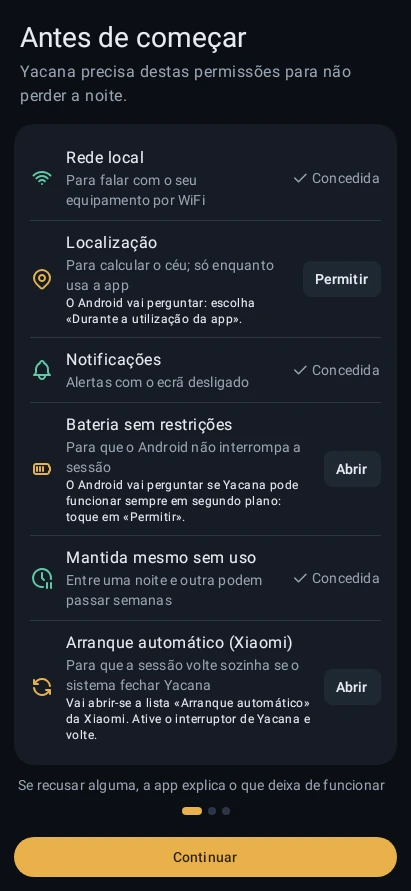 <b>Antes de começar.</b> As linhas concedidas mostram um visto.</td>
</tr></table>

| Permissão | Para que serve | Sem ela |
| --- | --- | --- |
| **Rede local** | Falar com o seu equipamento por WiFi. Pedida no Android 17 e posteriores. | A app não consegue encontrar nem controlar nenhum dispositivo Alpaca. |
| **Localização** | Calcular o céu no seu local, só enquanto usa a app. Escolha **Durante a utilização da app**. | Em alternativa, escreva o local no perfil. |
| **Notificações** | A sessão e os seus alertas com o ecrã desligado. Pedida no Android 13 e posteriores. | Não vê a sessão nem os seus alertas fora da app. |
| **Bateria sem restrições** | Para que o Android não interrompa a sessão. Toque em **Permitir** quando o Android perguntar. | O sistema pode interromper a sessão com o ecrã desligado. |
| **Mantida mesmo sem uso** | Entre uma noite e outra podem passar semanas. Desative **Pausar atividade da app se não for utilizada**. Android 11 e posteriores. | O Android pode retirar as permissões da app após alguns meses sem uso. |
| **Arranque automático (Xiaomi)** | Nos telemóveis Xiaomi, Redmi e Poco, para que a sessão volte sozinha se o sistema fechar Yacana. Ative o interruptor de Yacana. | Se o sistema fechar Yacana durante a noite, a sessão não volta sozinha. |

Se recusar alguma, nada se estraga de imediato: a app explica o que deixa de funcionar e como a ativar depois, em *Definições › Permissões* ([capítulo 33](#permissions)). Toque em **Continuar** para seguir.

### 2 · Encontre o seu equipamento

1. Ligue o equipamento e ligue o telemóvel ao WiFi dele, ou ponha ambos no WiFi de casa.
2. Yacana procura sozinha dispositivos Alpaca na rede, em IPv4 e IPv6. Cada servidor que encontra aparece como um cartão com os seus dispositivos. **Pesquisar de novo** repete a pesquisa.
3. Num Seestar, toque em **Teleobjetiva** ou **Grande angular**: carrega o perfil do Seestar para essa câmara, com a sua ótica, campo e definições recomendadas. Pode criar os dois e mudar de um para o outro a partir do cartão **Perfil** em Equipamento. Para outro equipamento, toque em **Adicionar**: o perfil fica com o primeiro dispositivo de cada tipo desse servidor.

Se um dispositivo não for encontrado, por exemplo numa rede que bloqueia a deteção, toque em **Adicionar por IP e porta** e escreva o seu endereço, como `192.168.1.10:32323`. Se já tiver um perfil de outro telemóvel, **Importar perfil** carrega-o. **Agora não** salta esta página; pode encontrar o seu equipamento mais tarde em Equipamento.

<table><tr>
<td valign="top" width="240">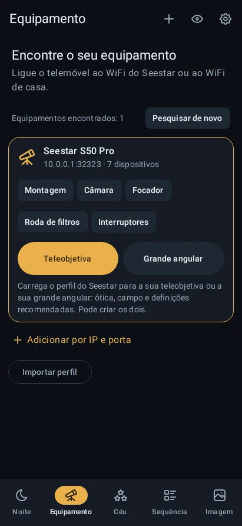 <b>Encontrado no WiFi.</b> Um Seestar com os seus sete dispositivos.</td>
</tr></table>

### 3 · Pronto para o campo

Yacana funciona sem internet, mas há duas coisas demasiado grandes para virem dentro da app. Esta página mostra o que já está no telemóvel e o que deve obter enquanto ainda tem WiFi:

- **Catálogo de objetos** e **Efemérides**: incluídos na app, nada a fazer.
- **Base de estrelas**: a recomendada para o seu campo, D50 para um Seestar. Toque em **Transferir**.
- **Cache do céu do NINA**: as fotos para o atlas e o enquadramento. Toque em **Importar** se já tiver o seu ZIP; para a transferir dentro da app, use *Definições › Mapa do céu* ([capítulo 6](#field)).

As transferências continuam em segundo plano. Toque em **Começar** para abrir a app.

<table><tr>
<td valign="top" width="240">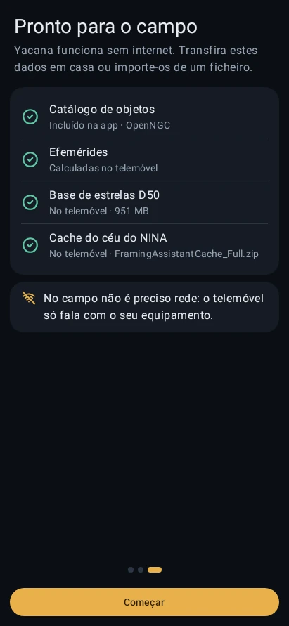 <b>Pronto para o campo.</b> Tudo no telemóvel.</td>
</tr></table>

> [!TIP]
> **Convém saber**
>
> Os primeiros passos não podem voltar a abrir-se. As suas partes continuam disponíveis: as permissões em *Definições › Permissões*, a pesquisa de equipamento em Equipamento, as bases de estrelas em *Definições › Plate solving* e as caches do céu em *Definições › Mapa do céu*.

## 4. Orientar-se na app

Yacana organiza-se pelos momentos da noite e não por painéis de dispositivos. Em cada momento, mostra o que precisa e deixa o resto à distância de um toque.

### As cinco secções

A barra inferior tem cinco secções. Com o telemóvel na horizontal, passa a ser uma barra lateral à esquerda. Tocar na secção em que está leva-o de volta ao seu primeiro ecrã.

| Secção | Para quê | Barra superior |
| --- | --- | --- |
| **Noite** | A escuridão e a Lua desta noite, a lista de preparação, a sessão em curso, o resumo e o diário | Estado do equipamento, modo vermelho, Definições |
| **Equipamento** | Perfis, ligação e controlo manual de cada dispositivo | Adicionar dispositivo, modo vermelho, Definições |
| **Céu** | Mapa do céu, Sky Atlas, fichas dos objetos e enquadramento | Camadas do céu ou Filtros, modo vermelho |
| **Sequência** | Plano desta noite, sequências guardadas, modelos, os editores simples e avançado | — |
| **Imagem** | Captura manual, estatísticas, histórico, empilhamento ao vivo e foto de referência | Modo vermelho, Mais opções |

### Controlos comuns

- **Definições:** A roda dentada em Noite e Equipamento, ou **Definições** no fim de **Mais opções** de Imagem. A sua caixa de pesquisa encontra qualquer definição por parte do nome.
- **Modo vermelho:** O ícone do olho em Noite, Equipamento, Céu, Imagem, na ficha do objeto, no enquadramento e nos assistentes. Põe cada píxel a vermelho ([capítulo 32](#display)).
- **Estado do equipamento:** Em Noite, um escudo quando o equipamento está ligado sem problemas, ou um triângulo de aviso enquanto a app volta a ligar ou para em segurança.
- **Voltar e fechar:** A seta no canto superior esquerdo volta atrás. Os assistentes (alinhamento polar, autofoco e flats) mostram **✕** em vez dela, o que os interrompe.
- **Folhas:** Muitas opções abrem-se numa folha que sobe da parte inferior do ecrã. Deslize-a para baixo, ou toque fora dela, para a fechar.
- **Números:** Horas, coordenadas e números de imagens introduzem-se com valores frequentes e com o teclado numérico da própria app, para que o teclado do sistema, que o modo vermelho não consegue colorir, nunca se acenda de noite.
- **Manter premido:** Os botões arriscados vão-se enchendo enquanto os prime e atuam após cerca de um segundo: estacionar, parar uma sequência, eliminar um perfil, uma cache, uma base ou uma sequência guardada. Um toque curto não faz nada além de lembrar que deve manter premido.
- **Estados:** Cada estado mostra-se com um ícone e palavras, nunca só com cor, porque no modo vermelho o verde e o âmbar parecem iguais.

### A barra da sessão

Enquanto uma sequência decorre ou está em pausa, uma barra em todos os ecrãs exceto Noite mostra o alvo, o filtro, a exposição e a imagem, com o seu progresso, como a barra «a tocar» de uma app de música. Toque nela para ver a sessão em Noite; o seu botão pausa ou retoma a sequência.

### Notificações

Enquanto o equipamento está ligado, uma notificação mostra a sessão, também no ecrã de bloqueio: o alvo, a imagem e o progresso, ou as imagens guardadas. Toque nela para abrir a app. O seu botão **Desligar** para a captura e desliga o equipamento. Os alertas que precisam de si, como uma ligação perdida ou uma paragem segura, tocam com som; eventos como um autofoco ou o fim da sequência chegam em silêncio. Cada tipo tem o seu próprio canal de notificações (*Sessão da noite*, *Alertas da noite*, *Eventos da noite*), que pode ajustar nas definições do Android para a app.

<table><tr>
<td valign="top" width="330">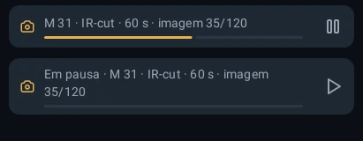 <b>A barra da sessão</b>, em curso e em pausa.</td>
</tr></table>

## 5. O perfil do seu equipamento

Um perfil é um conjunto de equipamento e a forma como o usa: os seus dispositivos, ótica, local, limites e opções. Tudo o que Yacana calcula por si, como o campo, a escala do plate solving ou a base de estrelas recomendada, vem dele. O plate solving, o autofoco, a segurança, os nomes dos ficheiros e o empilhamento ao vivo também se guardam por perfil.

Abra-o com *Definições › Perfil e localização*, ou toque no cartão **Perfil** em Equipamento e depois em **Abrir o perfil**. Os perfis, os dispositivos e a eliminação do perfil só mudam com o equipamento desligado.

### Nome e ótica

- **Nome:** toque para o editar no próprio sítio.
- **Distância focal:** em milímetros, de 10 a 10 000, a do telescópio com o redutor, se o tiver. Define a escala do plate solving e o campo que o mapa do céu desenha.
- **Abertura:** o diâmetro da objetiva, de 5 a 2 000 mm. A razão focal mostra-se ao lado.
- **Sensor da câmara** e **Tamanho do píxel:** os seus píxeis em largura e em altura (a altura é pedida depois da largura) e o seu tamanho em µm, como nas especificações da câmara; um Seestar S50 Pro tem 2160 × 3840 px de 2,9 µm. A câmara preenche-os ao ligar-se; escritos, o campo é conhecido sem ligar nada, para o mapa do céu e o enquadramento.

Depois de a câmara se ligar, o cartão mostra a escala e o campo, como *2,25″/px · campo 1,35° × 2,40°*.

### Localização

O local define a escuridão desta noite, todas as alturas e o polo para o alinhamento polar.

- **Usar a localização do telemóvel** lê-a do telemóvel ao ativá-la, sempre que a app abre e ao ligar; da primeira vez, o Android pede a permissão. Se não chegar, a linha diz porquê, e tocar-lhe tenta de novo. Desligado, introduz-a à mão: latitude norte ou sul (0 a 90°), longitude este ou oeste (0 a 180°) e altitude em metros (0 a 9 000).
- **Enviar a hora e o local à montagem** dá à montagem a hora UTC e o local do telemóvel ao ligar.

### Limites

- **Limite de altura**, 0 a 60°: nenhum GoTo desce abaixo dele nem do horizonte. Um GoTo abaixo dele é recusado e a montagem não se move; um movimento com o comando direcional para sozinho no limite.
- **Horizonte:** plano, ou o seu, com árvores e edifícios. **Importar** lê um ficheiro de horizonte do N.I.N.A.: um ponto por linha, azimute e altura em graus, separados por espaços ou tabulações, com `#` para comentários. **Torná-lo plano** remove-o. As fichas dos objetos desenham-no no seu gráfico de altura.

<table><tr>
<td valign="top" width="240">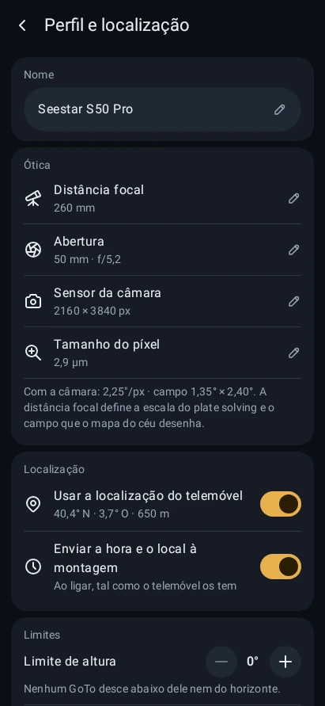 <b>Perfil e localização.</b> O perfil do Seestar.</td>
<td valign="top" width="240">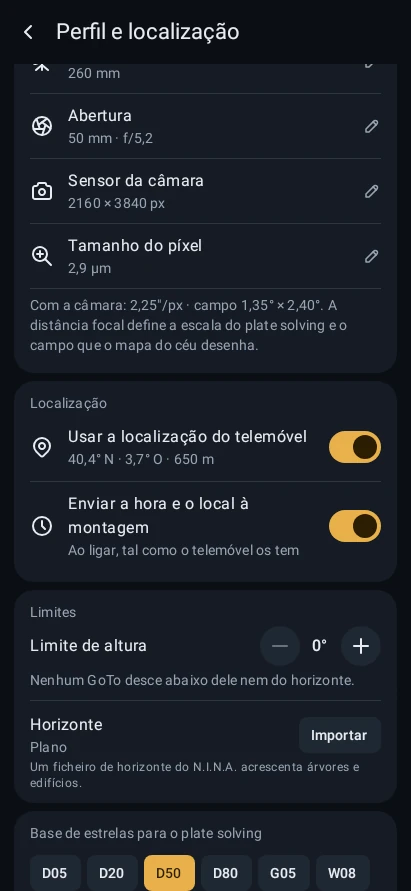 <b>Base de estrelas</b> para o plate solving, escolhida por perfil.</td>
</tr></table>

### Base de estrelas

Os botões escolhem a base do perfil para o plate solving. A app diz qual é a adequada para o seu campo. Se escolher uma que não está no telemóvel, aparecem o seu tamanho e um botão **Transferir**: entra em uso quando a transferência terminar e, até lá, mantém-se a anterior.

### Mais de um perfil

- **Mudar:** toque no cartão **Perfil** em Equipamento e escolha outro, ou toque em **Usar** ao lado dele em **Outros perfis**.
- **Novo:** **Novo perfil**, em **Outros perfis**, pesquisa a rede; o equipamento que escolher torna-se um novo perfil, em uso.
- **Copiar para outro telemóvel:** em **Cópia do perfil**, **Exportar** guarda o perfil como ficheiro JSON onde escolher, e **Importar** lê um e põe-no em uso. O ficheiro inclui as coordenadas do local.
- **Eliminar:** **Eliminar perfil** *(manter premido)*, no fim do ecrã.

## 6. Pronto para o campo

No campo, o telemóvel só fala com o seu equipamento. Antes da primeira noite, enquanto tem WiFi em casa, ponha duas coisas no telemóvel: uma base de estrelas para o plate solving e as fotos do céu. Ambas também se podem importar de um ficheiro, por exemplo copiado de um PC ou de um cartão de memória.

### Bases de estrelas

Em *Definições › Plate solving*, em **Base de estrelas**. A app assinala a **recomendada** para o seu campo e mostra o tamanho do campo. Pode haver várias no telemóvel ao mesmo tempo; o perfil usa uma, assinalada como **Em uso**.

<table><tr>
<td valign="top" width="240">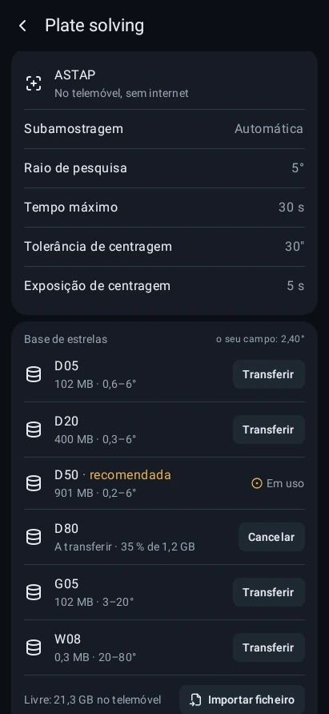 <b>As bases de estrelas.</b> D50 em uso, D80 a transferir.</td>
</tr></table>

| Base | Tamanho | Para campos de | Notas |
| --- | ---: | --- | --- |
| **D05** | 102 MB | 0,6° a 6° | A opção leve |
| **D20** | 400 MB | 0,3° a 6° |  |
| **D50** | 901 MB | 0,2° a 6° | Recomendada para o Seestar |
| **D80** | 1,2 GB | 0,15° a 6° | A mais densa |
| **G05** | 102 MB | 3° a 20° | Campos largos, objetivas fotográficas |
| **W08** | 0,3 MB | 20° a 80° | Campos muito largos |

- **Transferir** obtém-na do site do ASTAP só com WiFi, mesmo com a app fechada, e retoma se for interrompida. Fica em uso ao terminar. O espaço livre no telemóvel mostra-se por baixo da lista.
- **Importar ficheiro** instala-a a partir do ZIP ou do ficheiro `.deb` do próprio ASTAP, por exemplo a partir de um cartão de memória.
- Mantenha premida uma base instalada para a eliminar com **Eliminar base** *(manter premido)*. A que está em uso não pode ser eliminada: ponha outra em uso primeiro.
- **Experimentar com a última imagem** resolve a última imagem de Imagem com as definições atuais, para as verificar.

### As fotos do céu: as caches do N.I.N.A.

O mapa do céu, o Sky Atlas, as fichas dos objetos, o enquadramento e a referência de Imagem usam todos as fotos das caches de enquadramento do N.I.N.A. Yacana lê-as tal como o N.I.N.A. as publica, diretamente do seu ZIP sem o descomprimir, por isso uma cache ocupa o mesmo que o seu ZIP e nada mais. Abra *Definições › Mapa do céu*, ou o ícone das camadas no mapa do céu.

- **Cache completa (DSS):** todo o céu em 2 131 fotos a cores de 5° do Digitized Sky Survey, 3,5 GB. É a que deve obter.
- **NSNS com estrelas** (1,4 GB) e **NSNS sem estrelas** (471 MB): o Northern Sky Narrowband Survey, emissão de hidrogénio e oxigénio até cerca de −17° de declinação. Desenham-se como uma segunda camada.
- **Fotos online:** as fotos mais nítidas que o mapa obtém quando amplia muito com internet, guardadas no telemóvel.

<table><tr>
<td valign="top" width="240">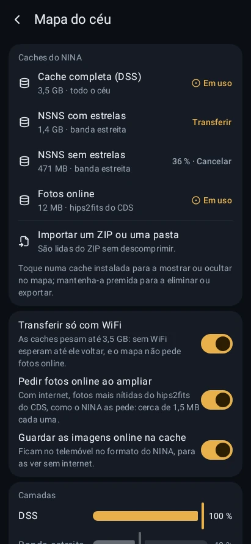 <b>Definições › Mapa do céu.</b> A cache completa em uso, uma de banda estreita a chegar.</td>
</tr></table>

#### Obter uma cache

- **Transferir** obtém-na do site do N.I.N.A. através do gestor de transferências do Android. Retoma se for interrompida e verifica primeiro o espaço livre. Com **Transferir só com WiFi** ativado (o predefinido), espera pelo WiFi.
- **Importar um ZIP ou uma pasta**: **Escolher um ZIP** aceita um dos ZIP do N.I.N.A., como os do seu site; **Escolher uma pasta** aceita a pasta da cache que o N.I.N.A. tem num PC (`FramingAssistantCache`), copiada para o telemóvel ou num cartão. São copiados para a app.

#### Usá-la

- Toque numa cache instalada para a mostrar ou ocultar no mapa: **Em uso** ou **Instalada**.
- **Camadas:** a opacidade da camada DSS (100 % por predefinição) e da de banda estreita (40 %), para as misturar.
- **Pedir fotos online ao ampliar** (ativado por predefinição): com internet, ao ampliar o mapa, a app pede fotos mais nítidas ao hips2fits do CDS, como faz o N.I.N.A., de cerca de 1,5 MB cada uma. Desative-o para guardar os dados móveis para outras coisas; com **Transferir só com WiFi** ativado, o mapa também não as pede com dados móveis.
- **Guardar as imagens online na cache**: se estiver ativado, ficam no telemóvel no formato do N.I.N.A., para as voltar a ver sem internet.

#### Eliminá-la ou exportá-la

Mantenha premida uma cache instalada. A folha diz quanto espaço liberta; **Eliminar cache** *(manter premido)* remove-a. Uma cache em pasta, como as fotos online, oferece também **Exportar ZIP**, para a abrir no N.I.N.A. num PC.

<table><tr>
<td valign="top" width="240">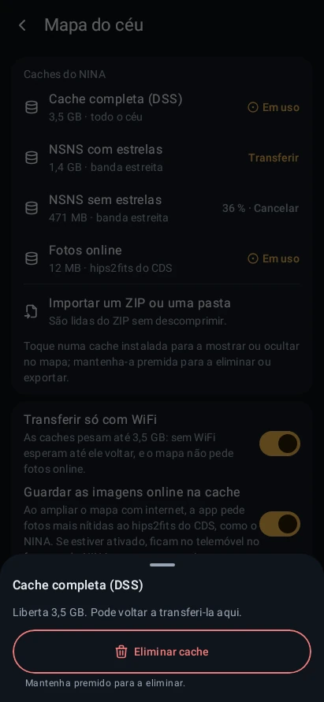 <b>Manter premida uma cache.</b> O que liberta e o botão a manter premido.</td>
</tr></table>

> [!TIP]
> **Créditos**
>
> As fotos não fazem parte da app: transfere-as do site do N.I.N.A. ou importa-as. O DSS é do STScI, que permite ao N.I.N.A. distribuí-lo, e o NSNS está sob CC BY-NC-SA 4.0. O mapa mostra *DSS: STScI · NSNS: CC BY-NC-SA 4.0*.

---

# Equipamento

## 7. Ligar o seu equipamento

A secção Equipamento contém o perfil em uso, liga-o e dá-lhe controlo manual de cada dispositivo.

1. Verifique o cartão **Perfil**: o nome do perfil e de onde vem o seu local, como *Localização por GPS · 40,4° N · 3,7° O · 650 m*. Toque nele para mudar para outro perfil.
2. Toque em **Ligar**. A linha diz *A ligar…* e depois quantos dispositivos responderam, como *5 de 5 ligados*, ou porque é que algum não se conseguiu ligar.
3. Cada dispositivo tem uma linha com o seu estado ao vivo: a montagem em seguimento e a sua altura, a câmara em repouso e a temperatura do seu sensor, a posição do focador, o filtro colocado, a resistência anti-orvalho ligada. Atualizam-se a cada um ou dois segundos.
4. Toque num dispositivo ligado para abrir o seu ecrã. **Desligar tudo** termina a ligação.

Se a ligação cair, Yacana volta a ligar sozinha. Durante uma sequência, primeiro faz uma pausa segura ([capítulo 28](#safety)).

<table><tr>
<td valign="top" width="240">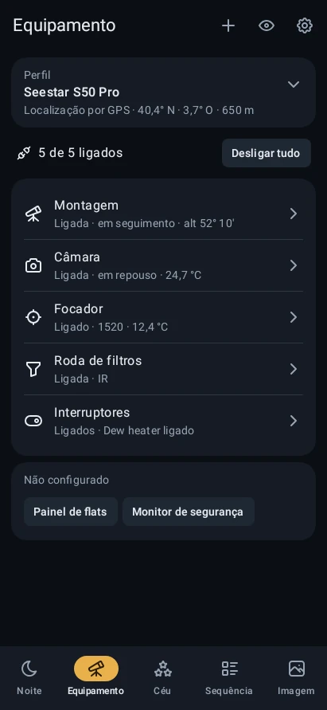 <b>Equipamento.</b> Cinco dispositivos ligados; o painel de flats e o monitor de segurança não configurados.</td>
</tr></table>

### Adicionar um dispositivo

O **+** no topo abre *Adicionar dispositivo*, que volta a pesquisar a rede. Cada servidor mostra os dispositivos que o seu perfil ainda não tem, cada um com **Adicionar**; **Adicionar por IP e porta** aceita um endereço. O cartão **Não configurado**, no fim da lista, tem um botão para cada dispositivo opcional, o painel de flats e o monitor de segurança, que abre a mesma pesquisa. Os dispositivos só se adicionam com o equipamento desligado.

### Sem perfil

Se saltou os primeiros passos, Equipamento começa com **Encontre o seu equipamento**, a mesma pesquisa do [capítulo 3](#first-steps), e um botão **Importar perfil**.

## 8. A montagem

O ecrã da montagem mostra para onde ela aponta e move-a à mão, com GoTo, sincronização, estacionamento e seguimento.

### Para onde aponta

O cartão de cima mostra o seu estado, como *Em seguimento · sideral*, *Em movimento*, *Sem seguimento* ou *Estacionada*, e a sua AR, Dec, altura e azimute. Enquanto centra um alvo, o cartão mostra a tentativa e o passo atual, com **Parar**.

### Movê-la à mão

Mantenha premida uma seta (N, S, E, O) para mover a montagem; para ao soltar. O botão vermelho do meio para-a de imediato. Os botões por baixo definem a velocidade: **1×**, **8×** (a predefinida) ou **64×** a velocidade sideral, ou **Máx**, a mais rápida da montagem. Um movimento para sozinho no limite de altura do perfil.

### Os botões

- **Ir para…:** Abre uma folha para escrever a AR e a Dec com o teclado numérico da app (ver abaixo).
- **Sincronizar:** Diz à montagem que aponta para as coordenadas que escrever. Com uma imagem resolvida, use antes **Sincronizar a montagem** de Imagem ([capítulo 18](#solving)). Só aparece se a montagem puder sincronizar.
- **Estacionar:** Mantenha-o premido para enviar a montagem para a sua posição de repouso. Um toque curto só lembra que deve manter premido. Com a montagem estacionada, o botão diz **Desestacionar**, e um toque desestaciona-a.
- **Seguimento:** Ativa ou desativa o seguimento.
- **Alinhamento polar:** Abre o assistente de alinhamento polar ([capítulo 17](#polar)).

O menu **⋮** no topo tem o resto: a **Velocidade de seguimento** (sideral, lunar, solar ou King, as que a montagem suportar), **Desestacionar** quando está estacionada, e **Ir para casa** se a montagem o tiver.

<table><tr>
<td valign="top" width="240">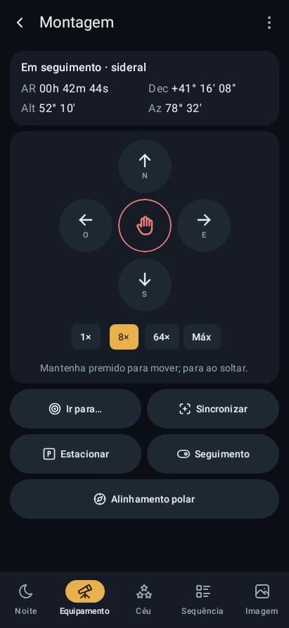 <b>Montagem.</b> Mantenha premida uma seta para mover; toque na velocidade.</td>
<td valign="top" width="240">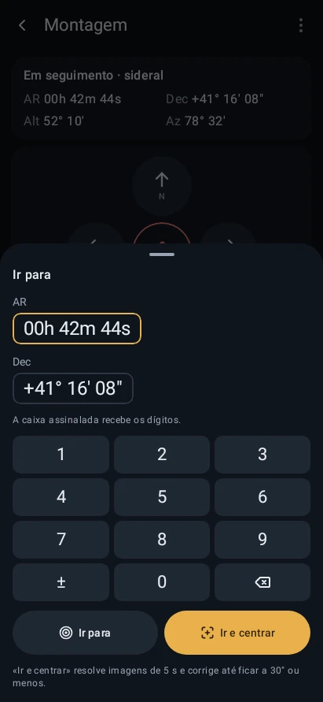 <b>Ir para.</b> A caixa assinalada recebe os dígitos.</td>
</tr></table>

### Ir para coordenadas

1. Toque em **Ir para…**. A folha mostra a AR e a Dec atuais da montagem.
2. Toque na caixa da AR ou da Dec para a assinalar e escreva os dígitos no teclado numérico. **±** inverte o sinal da declinação.
3. Toque em **Ir para** para se deslocar até lá, ou em **Ir e centrar** para se deslocar e depois afinar com plate solving até o alvo estar dentro da tolerância (30″ por predefinição).

> [!CAUTION]
> **Abaixo do limite**
>
> Um GoTo para um alvo abaixo do limite de altura do perfil, ou abaixo do seu horizonte, é recusado. O ecrã diz onde está o alvo e que a montagem não se moveu. Espere que suba, ou mude o limite no perfil ([capítulo 5](#profile)).

## 9. Câmara e roda de filtros

### Câmara

O ecrã da câmara mostra o seu estado, como *Em repouso · −10 °C*, e o que ela indica: o tamanho do sensor, o tamanho do píxel, o padrão de Bayer, os intervalos de ganho e offset, e a exposição mais longa. As imagens tiram-se em Imagem; **Ir para Imagem** leva-o lá ([capítulo 20](#imaging)).

Yacana usa cada câmara tal como ela se descreve pelo Alpaca: ganho, offset, binning, região de interesse e temperatura do sensor, quando a câmara os tem. As imagens transferem-se diretamente para a memória nativa do telemóvel enquanto começa a exposição seguinte, por isso até as câmaras de 61 MP cabem.

### Roda de filtros

O ecrã da roda de filtros lista os seus filtros, com um visto no que está colocado. Toque num filtro para o usar. Em Imagem, o filtro também é um botão por baixo da imagem.

Um filtro chamado **Dark**, como no Seestar, usa-se como obturador para darks e bias, por isso não é preciso tapar nada. Sem ele, a app pede-lhe que tape o telescópio quando faz darks.

## 10. O focador

- **Posição** e **Temperatura**, em grande, com a hora e a temperatura do último autofoco.
- **Mover:** **−100**, **−10**, **+10** e **+100** passos, e **Ir para a posição…**, que abre o teclado numérico com o intervalo do focador. **Parar** aparece enquanto se move.
- **Última curva:** a curva em V do último autofoco, com o seu melhor HFR e a sua posição.
- **Offset de focagem por filtro**, com uma roda de filtros: toque num filtro para definir o seu offset em passos, em relação aos outros. Ao mudar de filtro, o focador move-se a diferença entre o offset do novo filtro e o do anterior, para que cada filtro se mantenha focado sem um novo autofoco.
- **Autofoco** executa o autofoco de imediato ([capítulo 19](#autofocus)).

<table><tr>
<td valign="top" width="240">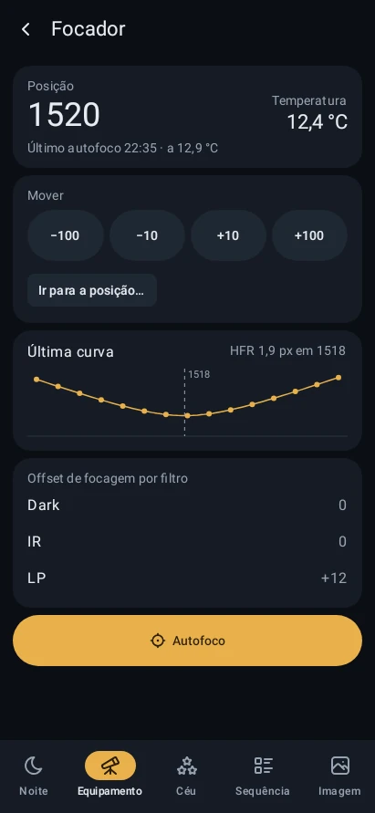 <b>Focador.</b> O filtro LP foca 12 passos mais para fora.</td>
</tr></table>

## 11. Interruptores, painel de flats e monitor de segurança

### Interruptores

Cada interruptor aparece tal como o dispositivo o declara: um interruptor para ligar e desligar, um controlo deslizante com − e + para um valor como a potência de uma resistência (com o seu intervalo e passo; o valor envia-se ao soltar), ou uma leitura para os que são só de leitura. O mais comum é uma resistência anti-orvalho, que a sequência pode ligar no início e desligar no fim.

### Painel de flats

Para um painel de flats com tampa (um CoverCalibrator Alpaca):

- **Tampa:** o seu estado, com **Abrir** e **Fechar**, e **Parar** enquanto se move. Abra-a para a noite e feche-a para os darks.
- **Luz:** acesa ou apagada, e o seu **Brilho** com um controlo deslizante ou com − e +.

Para os flats, o assistente de flats fecha a tampa, acende a luz e procura a exposição sozinho ([capítulo 23](#calibration)).

### Monitor de segurança

Mostra **Seguro** ou **Inseguro**, lido a cada segundo, por exemplo de um sensor de nuvens ou de chuva. A app mostra-o, mas ainda não age com base nele: se passar a **Inseguro**, pare a sequência a partir de Noite.

<table><tr>
<td valign="top" width="240"> <b>Interruptores.</b> A resistência anti-orvalho do Seestar.</td>
<td valign="top" width="240">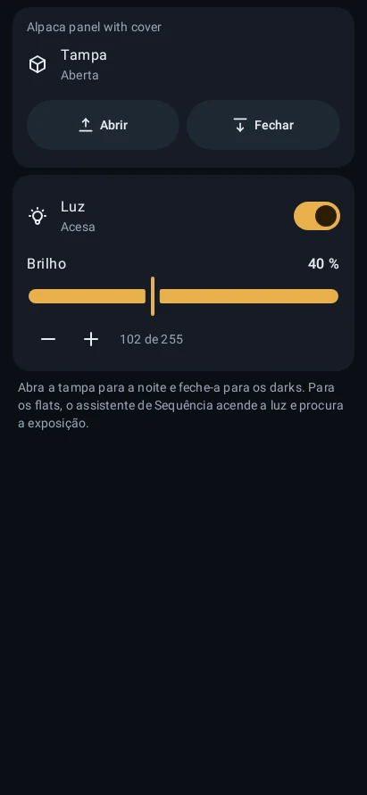 <b>Painel de flats.</b> Tampa aberta, luz a 40 %.</td>
<td valign="top" width="240">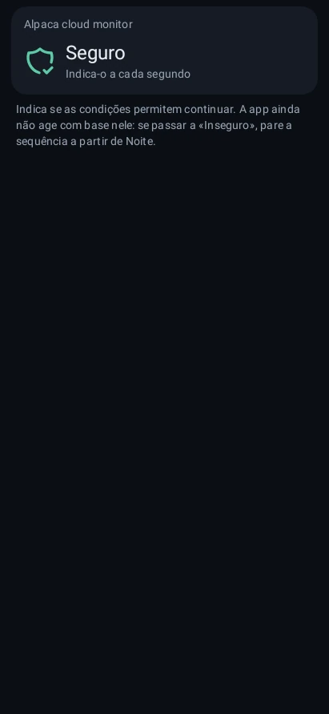 <b>Monitor de segurança.</b> Lido a cada segundo.</td>
</tr></table>

---

# Planear a noite

## 12. Esta noite num relance

Noite é onde começa o serão. Mostra a escuridão e a Lua desta noite, uma lista para se preparar, a sessão enquanto decorre e o resumo de manhã.

### O cartão desta noite

Calculado no telemóvel para o local do perfil:

- A data e a iluminação da Lua, como *Lua 34 %*.
- A melhor janela escura: *Escuro e sem Lua*, ou *Escuro, com a Lua no céu* quando a Lua está no céu durante toda a noite astronómica, com o seu início, fim e duração.
- O pôr e o nascer do Sol, e uma linha temporal do fim da tarde à manhã: crepúsculo, noite astronómica e as horas em que a Lua está no céu, com a melhor janela contornada.

Perto do solstício de verão, em latitudes altas, pode dizer *Sem noite astronómica*: o Sol não desce 18° abaixo do horizonte. Sem local, o cartão diz como definir um: permita a localização em *Definições › Permissões* e ative a do telemóvel, ou introduza-o no perfil.

### Outra noite

Toque no ícone do calendário para ver qualquer outra noite. A grelha do mês assinala esta noite com um contorno e a noite que escolher preenchida; as setas mudam de mês. **Voltar a esta noite** regressa.

<table><tr>
<td valign="top" width="240">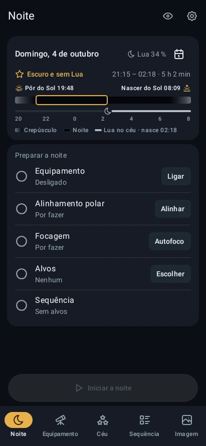 <b>Noite.</b> 5 h 2 min de céu escuro antes de a Lua nascer.</td>
<td valign="top" width="240">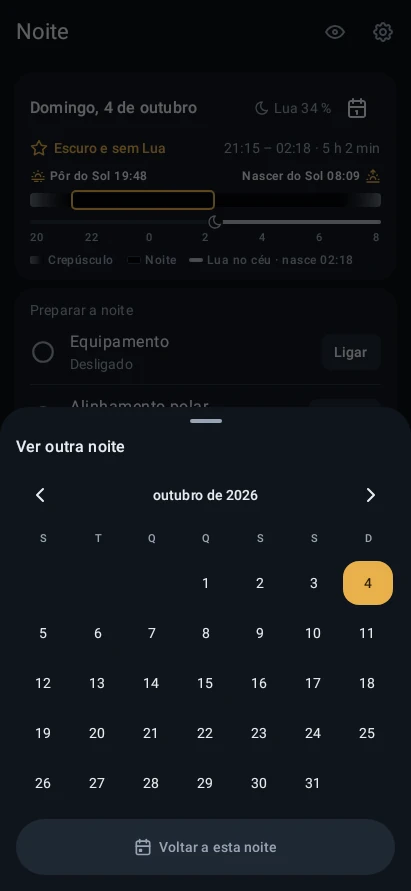 <b>Ver outra noite.</b></td>
</tr></table>

### Preparar a noite

Uma lista sem passos obrigatórios: faça o que a sua noite precisar, pela ordem que quiser. Cada linha mostra o seu estado e um botão que o leva lá.

| Linha | Mostra | Botão |
| --- | --- | --- |
| **Equipamento** | O perfil e os seus dispositivos, depois de ligados | **Ligar** |
| **Alinhamento polar** | *Por fazer*, ou o último erro total e há quanto tempo | **Alinhar**, depois **Afinar** |
| **Focagem** | *Por fazer*, ou o último HFR e há quanto tempo (com um focador) | **Autofoco** |
| **Alvos** | *Nenhum*, ou os alvos desta noite | **Escolher**, que abre Céu |
| **Sequência** | Se o plano cabe antes do amanhecer, e a sua duração | **Ajustar** quando não cabe |

Quando o equipamento está ligado e o plano tem exposições, **Iniciar a noite** inicia a sequência ([capítulo 27](#running)). As marcas das linhas são ícones, além de cores, para se lerem da mesma forma no modo vermelho.

<table><tr>
<td valign="top" width="240">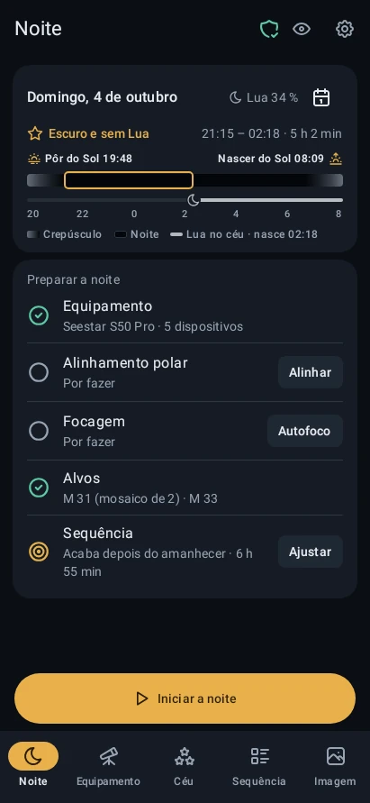 <b>Pronto para começar.</b> O plano acaba depois do amanhecer: <i>Ajustar</i> encurta-o.</td>
</tr></table>

## 13. O mapa do céu

A secção Céu abre num mapa do céu real, desenhado com as fotos da cache do N.I.N.A., sem internet. O mapa fica onde o deixou, mesmo depois de fechar a app. Arraste-o com um dedo, use dois dedos para ampliar de uma vista larga até menos do que o campo da sua câmara, e toque num objeto para o selecionar.

O mapa está orientado tal como vê o céu a partir do local do perfil neste momento, com o zénite para cima; sem local, o norte fica para cima. Uma barra de escala mostra o tamanho de um grau, e as coordenadas do centro estão no canto inferior direito.

### O que mostra

- **Fotos:** o rótulo no topo diz de onde vêm, como *DSS · cache do NINA*. Com internet, ampliar obtém fotos mais nítidas da zona; enquanto chega uma, uma pequena roda gira no rótulo. Sem cache, o rótulo diz como instalar uma; toque nele para abrir as definições do mapa do céu.
- **O seu campo:** uma caixa tracejada no centro, do tamanho do campo da sua câmara, com o nome do perfil.
- **Objetos:** contornos e nomes dos objetos do catálogo.
- **Horizonte:** uma linha nítida onde fica o horizonte da localização do perfil, que segue o seu próprio horizonte se o perfil tiver um, com **N**, **E**, **S** e **O** sobre ela.

### Selecionar um objeto

Toque num objeto: o mapa centra-se nele e um cartão mostra o seu nome, tamanho, altura e melhor hora, com **Enquadrar**. Toque no cartão para abrir a ficha do objeto. Toque no céu vazio para desmarcar.

Para enquadrar uma área sem objeto do catálogo, centre-a no mapa, dentro do retângulo do seu campo, e toque em **Enquadrar aqui**, o botão redondo dourado por baixo do zoom: o enquadramento abre-se aí, e a área entra na sequência com as suas coordenadas como nome, como *03h 47m +24° 07′*.

### Botões

- **+ e −:** ampliar e reduzir.
- **Enquadrar aqui:** o dourado, por baixo, enquadra o centro do mapa.
- **Camadas** (barra superior): as definições do mapa do céu, com as caches e a opacidade das camadas ([capítulo 6](#field)).

<table><tr>
<td valign="top" width="240">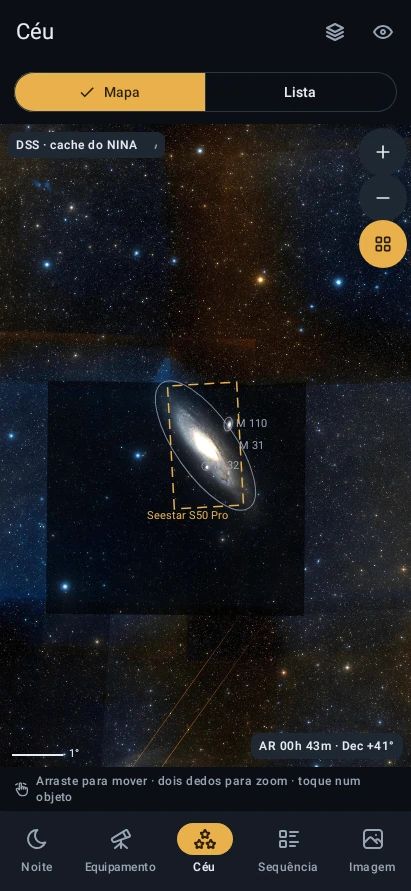 <b>O mapa.</b> M 31 sobre as fotos DSS, com o campo do Seestar.</td>
</tr></table>

### A montagem no mapa

Com a montagem ligada, o mapa mostra duas caixas do campo da sua câmara. Diferem na linha, para se poderem distinguir também no modo vermelho:

- **Enquadramento:** tracejada, no centro do mapa. É para onde quer ir.
- **Telescópio:** contínua, onde o telescópio aponta agora, a mover-se à medida que é lida a cada segundo.

Arraste o mapa para pôr o alvo na caixa do enquadramento, ou toque num objeto para o centrar, e depois:

- **Ir e centrar** leva o telescópio ao enquadramento e afina-o com plate solving até à tolerância do perfil. Um cartão mostra cada passo e quanto falta, com **Parar**, que para a montagem e a imagem.
- **Só ir** faz o GoTo sem centrar.

Quando a montagem está estacionada ou sem seguimento, o rótulo **Telescópio** indica-o, e tocar nele desestaciona a montagem ou ativa o seguimento.

<table><tr>
<td valign="top" width="240">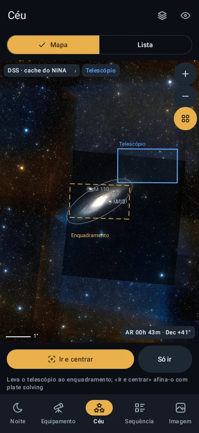 <b>Telescópio e enquadramento.</b> A caixa contínua é para onde aponta.</td>
<td valign="top" width="240">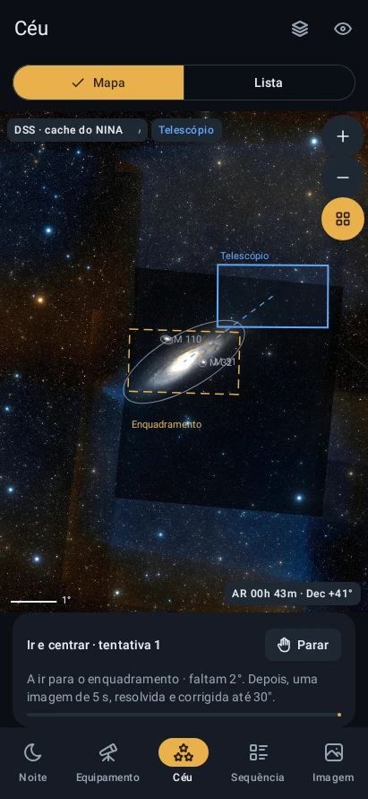 <b>Ir e centrar.</b> Faltam 2°; depois, uma imagem de 5 s, resolvida e corrigida.</td>
</tr></table>

## 14. Sky Atlas e pesquisa

Mude a secção Céu para **Lista** para ver o Sky Atlas: 13 371 objetos do céu profundo do OpenNGC (NGC, IC, Messier, Caldwell e outros) no telemóvel, cada um com a sua foto da cache, ordenados para esta noite.

### O melhor desta noite

Com **Esta noite** ativado (o predefinido), a lista mostra o que está bem colocado esta noite a partir do local do perfil, ordenado pela sua melhor hora. Cada linha tem uma miniatura, o nome, o número de catálogo e o tamanho, se *cabe* no seu campo ou precisa de um *mosaico de N*, e uma pequena curva de altura com a sua melhor hora. Toque numa linha para abrir a ficha do objeto.

Acima da lista, **Esta noite** e **Favoritos**, os objetos que marcou com a estrela na sua ficha, ligam-se e desligam-se com um toque. Ao lado aparece cada filtro ativo, como *Até mag 8* ou *A partir de 1°*: o seu ✕ retira-o e o seu texto abre os filtros. O ícone dos controlos deslizantes diz quantos são, e a nota quantos objetos restam e por que ordem. Os filtros e o lugar na lista mantêm-se quando abre um objeto, muda de secção ou fecha a app.

<table><tr>
<td valign="top" width="240">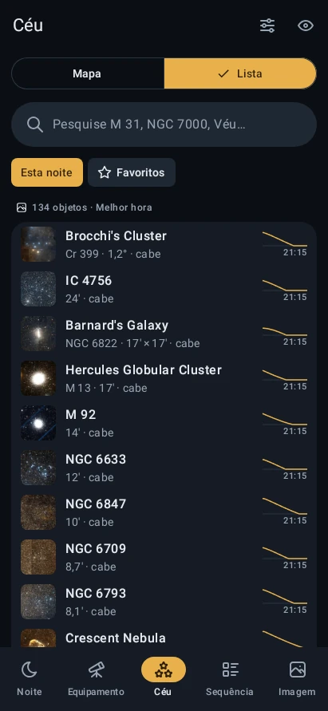 <b>Esta noite.</b> Miniaturas da cache, sem internet.</td>
<td valign="top" width="240">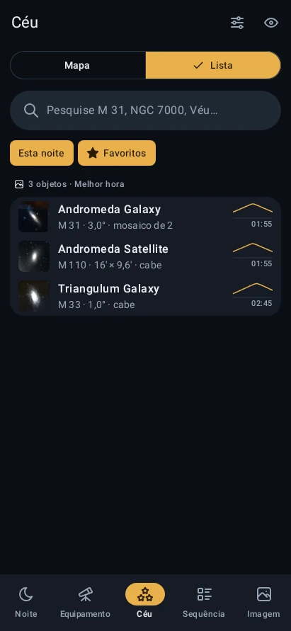 <b>Favoritos.</b> M 31 precisa de um mosaico de 2.</td>
<td valign="top" width="240">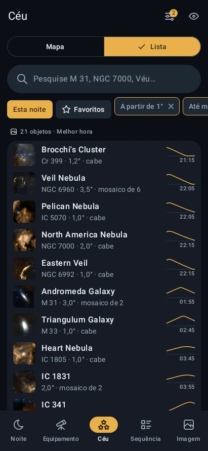 <b>Filtros ativos.</b> Até mag 8 e a partir de 1°.</td>
</tr></table>

### Filtros

O ícone dos controlos deslizantes no topo, ou o texto de um filtro ativo, abre os filtros. A lista muda enquanto escolhe e o cabeçalho diz quantos objetos restam; **Repor** deixa os filtros como no início, e **Concluído**, deslizar para baixo, tocar fora ou voltar fecham-nos. Na horizontal abrem-se ao lado, com a lista à vista.

- **Ordenar por:** Melhor hora (predefinição), Altura máxima, Horas visíveis, Tamanho ou Brilho, cada um no seu sentido natural: primeiro o mais cedo, o que mais sobe, o que passa mais tempo acima da sua altura, o maior ou o mais brilhante. A nota acima da lista indica a ordem.
- **Tipo:** Galáxias, nebulosas, enxames, outros.
- **Tamanho:** Qualquer, para o seu campo (mostra-se o seu tamanho), ou a partir de 15′, 30′ ou 1°.
- **Magnitude:** Qualquer, ou até 8, 10 ou 12.
- **Só:** Favoritos, e os que cabem no campo.
- **Esta noite:** ligado (predefinição), só o que está bem situado esta noite; a altura e as horas são as da noite escura desta noite na localização do perfil. Desligado, os três seguintes não contam.
- **Acima de:** 20°, 30° ou 45°.
- **Durante pelo menos:** 1, 2 ou 4 horas.
- **Longe da Lua:** Qualquer, ou pelo menos 30°, 60° ou 90°.

Se nada corresponder, a lista indica-o, com **Repor** para recomeçar.

<table><tr>
<td valign="top" width="240">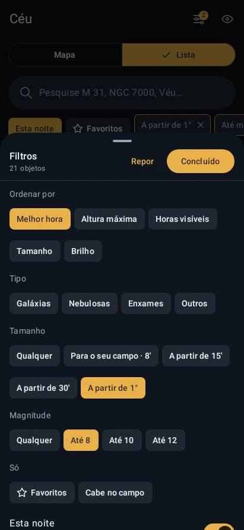 <b>Filtros.</b></td>
</tr></table>

### Pesquisa

Escreva na caixa de pesquisa: um número Messier, NGC, IC, Caldwell ou Sharpless, ou um nome, como *M 31*, *NGC 7000* ou *Véu*. Os resultados aparecem enquanto escreve, em milissegundos, sem internet. No modo vermelho, a caixa de pesquisa abre o teclado da própria app, vermelho como tudo o resto, em vez do do telemóvel; ⌄ ou voltar oculta-o.

Para tudo o resto, a última linha oferece **Pesquisar «…» no SIMBAD**. Com internet, consulta o SIMBAD do CDS, que conhece mais de 20 milhões de objetos, do quasar TON 618 às estrelas de uma constelação. O que encontrar fica no telemóvel, para o voltar a encontrar sem ligação. Se não houver uma correspondência exata, lista os objetos com nomes parecidos, os mais brilhantes primeiro.

<table><tr>
<td valign="top" width="240">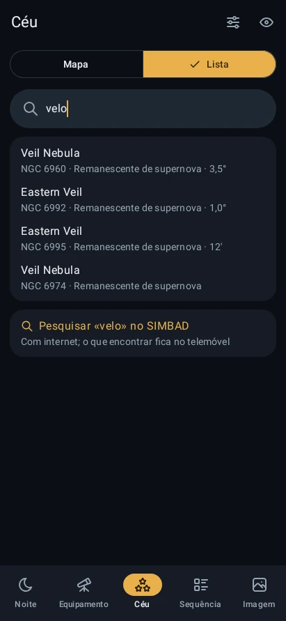 <b>Pesquisa sem ligação.</b> «velo» encontra o Véu.</td>
<td valign="top" width="240">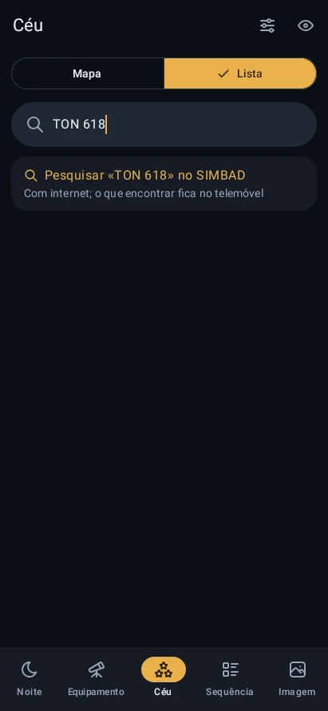 <b>Para além do catálogo:</b> o SIMBAD, com internet.</td>
</tr></table>

## 15. A ficha de um objeto

Tudo o que precisa para decidir sobre um alvo: a sua foto com o seu campo por cima, o que é, quão alto sobe esta noite e quão perto está a Lua.

- **Foto:** da cache, com o campo da sua câmara desenhado por cima. Toque nela, ou no seu botão **Mapa**, para ver o objeto enquadrado no mapa do céu; só o mapa se move, não o telescópio.
- **Sobre o objeto:** nome, tipo, magnitude e tamanho; os seus outros nomes e designações, como *Também Triangulum Galaxy · Triangulum Pinwheel · NGC 598*; *Cabe no campo* ou *Mosaico de N painéis*; e a distância e a fase da Lua, como *Lua a 87° · 34 %*.
- **Altura esta noite:** a curva do objeto do anoitecer ao amanhecer, com o crepúsculo sombreado nas duas pontas, a linha dos 30°, o seu próprio horizonte tracejado se o perfil tiver um, e uma linha para o momento atual. Por baixo, as horas em que está acima de 30° e o seu ponto mais alto, ou que fica baixo ou não nasce.

A estrela no topo marca-o como favorito. **Enquadrar** abre o enquadramento ([capítulo 16](#framing)). **Ir e centrar**, com a montagem ligada, leva o telescópio até lá e centra-o, no ecrã da montagem.

<table><tr>
<td valign="top" width="240">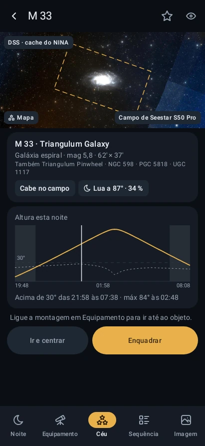 <b>M 33.</b> Cabe no campo do Seestar; a linha tracejada é o horizonte do local.</td>
<td valign="top" width="240">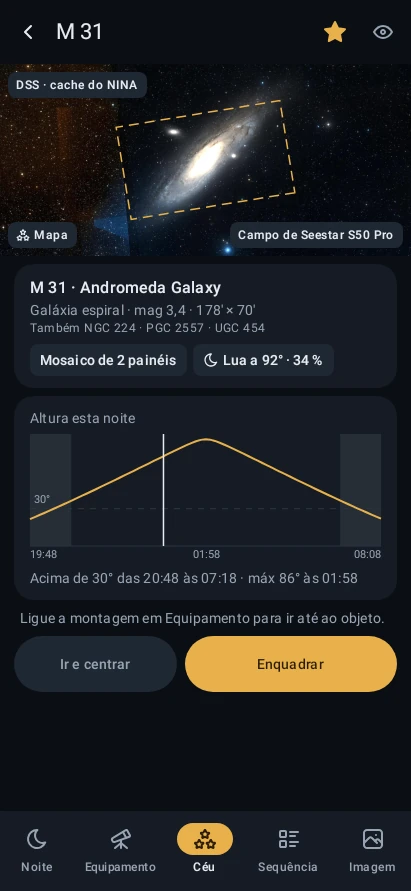 <b>M 31.</b> Uma favorita que precisa de um mosaico de 2 painéis.</td>
</tr></table>

## 16. Enquadramento e mosaicos

O enquadramento mostra como vai ficar a foto: o campo real da sua câmara sobre o céu, que arrasta até a composição estar certa, e mosaicos para alvos maiores do que o campo.

1. Abra-o com **Enquadrar** na ficha de um objeto ou no cartão do objeto no mapa.
2. Arraste o céu para colocar o alvo no campo; use dois dedos para ampliar. O tamanho do campo mostra-se no canto superior direito.
3. Para um mosaico, defina as **Colunas** e as **Linhas** com − e +, e a **Sobreposição** entre painéis, de 5 a 50 % (15 % por predefinição). Os painéis estão numerados pela ordem em que serão tirados.
4. Verifique a linha por baixo: as horas em que está acima de 30° esta noite.
5. Toque em **Adicionar à sequência**. A app confirma que o alvo está na sequência desta noite, com **Escolher outro alvo** e **Ver os desta noite**.

Um alvo novo vem com 60 imagens de 60 s com o primeiro filtro que não seja o escuro, com dithering a cada 3 imagens; ajuste-as no editor ([capítulo 25](#simple)). Depois do modelo **Um alvo toda a noite**, o alvo preenche antes a noite até ao amanhecer.

**Ir e centrar**, com a montagem ligada, leva o telescópio ao enquadramento.

<table><tr>
<td valign="top" width="240">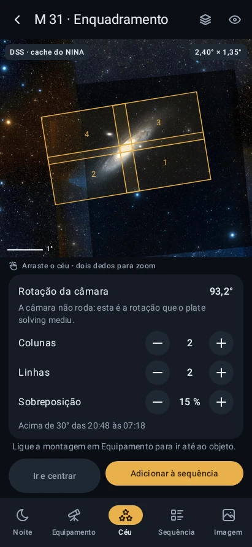 <b>M 31 · Enquadramento.</b> Um mosaico de 2 × 2, rodado tal como está a câmara.</td>
</tr></table>

### A rotação da câmara

Sem rotador, a câmara não roda, por isso o enquadramento não roda o campo à mão: a **Rotação da câmara** é o ângulo que o plate solving mediu, e o campo e os painéis desenham-se com ele. Até à primeira resolução é 0°, ou 93,2° para um Seestar em modo EQ. Resolva uma imagem em Imagem depois de montar a câmara, e o enquadramento passa a coincidir com ela ([capítulo 18](#solving)).

> [!TIP]
> **Precisa do campo**
>
> O enquadramento precisa do campo do perfil: a distância focal e o sensor da câmara (*Definições › Perfil e localização › Ótica*), escritos ou guardados da última ligação da câmara. Não é preciso ligar nada; o ecrã tem um botão para o perfil.

---

# Ao telescópio

## 17. Alinhamento polar de três pontos

O assistente de alinhamento polar mede quanto o eixo da montagem se afasta do polo celeste e depois guia-o, ao vivo, enquanto roda os parafusos da cunha. É uma adaptação do plugin Three Point Polar Alignment do N.I.N.A. e dá o mesmo resultado, com uma diferença inferior a 0,4″, sobre as mesmas medições.

Funciona com qualquer montagem que consiga rodar o seu eixo de ascensão reta por comando. Precisa da montagem e da câmara ligadas, de uma base de estrelas no telemóvel e do local do perfil, que define onde está o polo.

### Abrir o assistente

Toque em **Alinhar** na linha **Alinhamento polar** da lista de Noite (**Afinar** depois de ter sido medido), ou em **Alinhamento polar** no ecrã da montagem. O assistente ocupa o ecrã e mantém-no ligado enquanto decorre; o **✕** no canto superior esquerdo interrompe-o e volta atrás.

### Antes de começar

A primeira página explica o que vai acontecer e para onde apontar: uma zona desimpedida do céu, longe do polo e do horizonte, na direção em que o eixo vai rodar. Mostra quatro opções; cada uma guarda-se no perfil.

- **Rotação entre pontos:** Quanto roda o eixo de AR entre as três imagens, e para que lado: 10°, 15°, 20° ou 30°, para oeste ou para este. 15° para oeste é o predefinido. Deixe espaço para a rotação, para que a montagem não encontre nenhum obstáculo.
- **Exposição:** 1, 2, 3 ou 5 s, com binning 1×1 ou 2×2, com o ganho de Imagem. Imagens curtas atualizam o erro mais depressa enquanto roda os parafusos. 1 s a 2×2 é o predefinido.
- **Tolerância:** Desligada, 0,5′, 1′, 2′ ou 5′. Quando o erro total descer abaixo dela, o telemóvel vibra. Nunca esconde as setas. Desligada por predefinição, como no plugin.
- **Resolver só com pista:** Para afinar um alinhamento que já está perto: os três pontos só se resolvem perto de onde a montagem aponta, nunca às cegas.

<table><tr>
<td valign="top" width="240">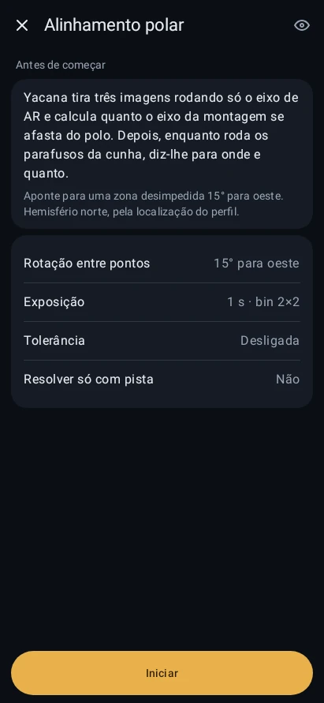 <b>Antes de começar.</b> As opções, com os valores predefinidos do Seestar.</td>
</tr></table>

### Medir os três pontos

1. Aponte o telescópio para uma zona desimpedida, como diz a primeira página, e toque em **Iniciar**.
2. Yacana tira a primeira imagem e resolve-a, roda o eixo de AR, tira e resolve a segunda, roda de novo e tira a terceira. Cada ponto mostra *A rodar o eixo de AR…*, *A tirar a imagem*, *A resolver com o ASTAP* e depois quanto tempo demorou a resolução.
3. **Não toque na montagem enquanto mede.** Os três centros traçam um círculo cujo centro é o eixo real da montagem. A sua distância ao polo, corrigida da precessão, da nutação e da refração para o seu local e hora, é o erro.

Se um ponto não se resolver, o assistente diz qual e porquê, e oferece **Começar de novo**.

<table><tr>
<td valign="top" width="240">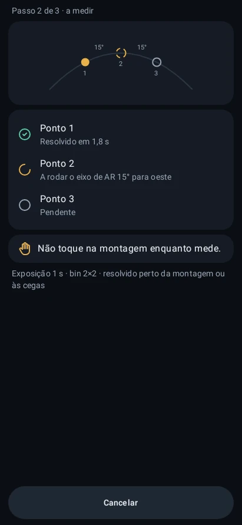 <b>A medir.</b> Ponto 1 resolvido em 1,8 s, o eixo a rodar para o ponto 2.</td>
</tr></table>

### Rodar os parafusos da cunha

Agora o assistente continua a tirar imagens, resolve cada uma perto da última posição e atualiza o erro a cada poucos segundos. Cada eixo tem o seu próprio cartão:

- **Altura:** uma seta e *Para cima* ou *Para baixo*, com *Um pouco* à frente quando está perto.
- **Azimute:** uma seta e *Rode para oeste* ou *para este*, com *um pouco* pelo meio quando está perto.
- O erro com sinal em graus, minutos e segundos, grande o suficiente para se ler a um metro de distância, e o **Erro total** por baixo.

Rode um parafuso de cada vez e veja o seu número descer. Por baixo deles, um alvo mostra a posição do polo com anéis a 30″, 1′ e 5′. Quando se aproxima, amplia-se sozinho para a *escala de segundos*, com anéis a 10″ e 30″, para poder afinar segundo a segundo.

**Nada é dado como bom cedo demais.** Um eixo mantém a sua seta até o seu erro, arredondado ao segundo, ser 00° 00′ 00″; então mostra *Centrado*. Não há nenhum visto verde a partir de um limiar: a decisão de quando está bom o suficiente é sua. Se definir uma tolerância, o telemóvel vibra quando o total descer abaixo dela, e as setas ficam.

Se a última imagem não se resolveu, o ecrã indica-o e continua a tentar. **Medir de novo** repete os três pontos a partir de onde está a montagem, por exemplo após uma grande correção. **Terminar** fecha o assistente, e a lista de Noite mostra o resultado e quando foi medido.

<table><tr>
<td valign="top" width="240">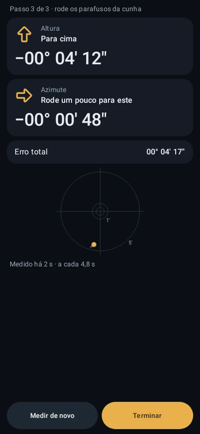 <b>Minutos de erro.</b> Para cima, e um pouco para este.</td>
<td valign="top" width="240">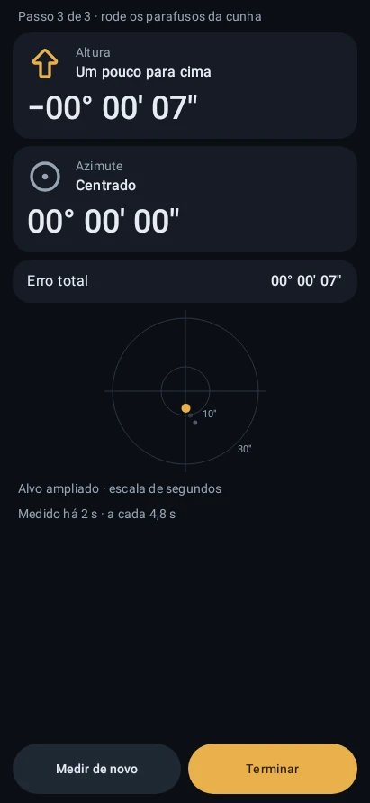 <b>Segundos de erro.</b> O alvo ampliado; azimute centrado.</td>
</tr></table>

<table><tr>
<td valign="top" width="470">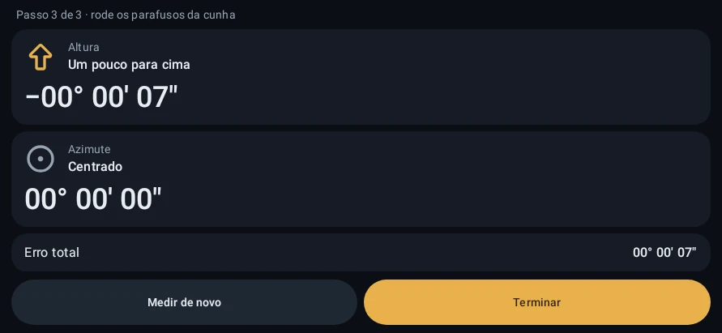 <b>Na horizontal</b>, os cartões usam a largura; os números continuam grandes.</td>
</tr></table>

> [!TIP]
> **Seestar**
>
> Numa cunha, a altura ajusta-se com a inclinação da cunha e o azimute rodando a sua base. O Alpaca do Seestar consegue rodar o eixo de AR, que é tudo o que o assistente precisa.

## 18. Plate solving e centragem

O plate solving calcula para onde aponta uma imagem, a sua escala e a sua rotação, a partir do padrão das suas estrelas. Yacana executa o ASTAP, o conhecido programa de resolução, no próprio telemóvel, sem internet: cerca de 0,4 s com a posição da montagem como pista e cerca de 7 s às cegas, num telemóvel de gama média com imagens do Seestar.

### Resolver uma imagem

Em Imagem, tire uma imagem e toque em **Resolver**. Yacana procura primeiro perto de onde a montagem diz que aponta e depois às cegas, se for preciso. O resultado mostra:

- **AR e Dec** do centro da imagem, em J2000;
- a **rotação** da câmara;
- a **escala** em segundos de arco por píxel e o campo em graus;
- quanto tempo demorou, se foi perto da montagem ou às cegas, e a base de estrelas usada.

Toque em **Sincronizar a montagem** para dizer à montagem que aponta para ali, para que os próximos GoTo cheguem mais perto. A rotação resolvida passa a ser a rotação da câmara para o enquadramento e os mosaicos ([capítulo 16](#framing)).

### Ir e centrar

**Ir e centrar** aparece onde quer que possa enviar o telescópio para algum lado: no mapa do céu, na ficha de um objeto, no ecrã de enquadramento e na folha **Ir para…** da montagem. Desloca a montagem, tira uma imagem com a exposição de centragem, resolve-a, corrige a montagem e repete até o centro da imagem estar dentro da tolerância, 30″ por predefinição. O progresso mostra cada passo, a que distância estava a última imagem e a tentativa; **Parar** para a montagem e a imagem. As imagens de centragem não são guardadas.

<table><tr>
<td valign="top" width="240">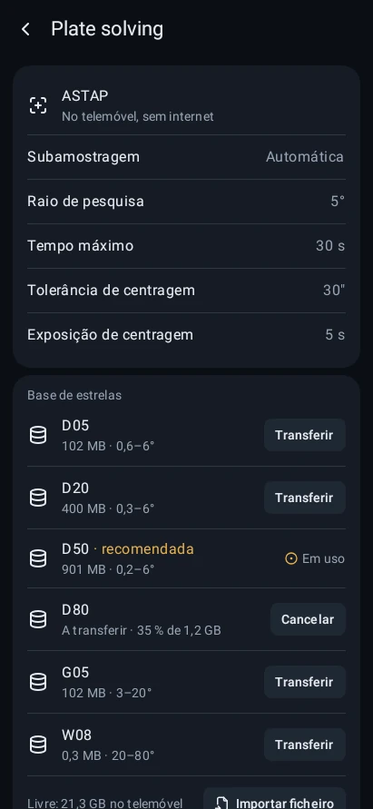 <b>Definições › Plate solving.</b> As opções do ASTAP e as bases de estrelas.</td>
</tr></table>

### Definições de plate solving

Em *Definições › Plate solving*, guardadas em cada perfil:

| Definição | Predefinido | O que faz |
| --- | --- | --- |
| **Subamostragem** | Automática | O ASTAP agrupa os píxeis da imagem antes de procurar estrelas. Em automática, escolhe o fator pelo tamanho da imagem. |
| **Raio de pesquisa** | 5° | A que distância da posição da montagem procurar, de 1 a 180°. Se aí não resolver, procura em todo o céu. |
| **Tempo máximo** | 30 s | Para resolver perto da montagem e depois às cegas, de 5 a 600 s. |
| **Tolerância de centragem** | 30″ | A centragem termina quando o centro da imagem está assim tão perto do alvo, de 5 a 600″. |
| **Exposição de centragem** | 5 s | As imagens que a centragem resolve, com o ganho de Imagem; de 1 a 60 s. Não são guardadas. |

As bases de estrelas estão no mesmo ecrã; o [capítulo 6](#field) explica como as escolher, transferir e importar.

> [!TIP]
> **Quando uma imagem não se resolve**
>
> Confirme que a imagem tem estrelas, que a distância focal do perfil está certa (o ASTAP procura essa escala) e que a base é adequada ao seu campo. Nuvens, orvalho ou uma imagem muito desfocada são as causas habituais.

## 19. Autofoco

O autofoco move o focador através do foco, mede o HFR das estrelas em cada ponto e ajusta uma curva em V para encontrar a melhor posição. É uma adaptação do autofoco do N.I.N.A., com os seus cinco ajustes de curva, a compensação da folga e os offsets de focagem por filtro.

Precisa de um focador absoluto (um que vai para posições em passos) e de uma câmara, apontada para um campo com estrelas. Abra-o com **Autofoco** na lista de Noite, no ecrã do focador ou em Imagem: a execução começa de imediato, com as opções de *Definições › Autofoco*.

### Como decorre uma execução

1. O focador afasta-se um certo número de passos para fora e depois tira um ponto em cada passo para dentro: uma imagem, as suas estrelas e o seu HFR.
2. Acrescenta pontos até haver, de cada lado do melhor, tantos como aqueles com que começou. O gráfico vai-se preenchendo, com o ponto atual, a sua exposição e o filtro.
3. Após o último ponto, ajusta a curva, move o focador para a melhor focagem e verifica-a. O resultado mostra a posição, o HFR, a temperatura, o R² do ajuste e onde estava o focador antes.

Toque em **Terminar** para o fechar. **Cancelar** durante uma execução devolve o focador para onde estava. Se a execução falhar, o ecrã diz porquê, o focador volta para trás e **Tentar de novo** recomeça-a.

O resultado fica guardado: o ecrã do focador mostra o último autofoco e a sua curva, a lista de Noite mostra o HFR e há quanto tempo, e o diário regista-o.

<table><tr>
<td valign="top" width="240">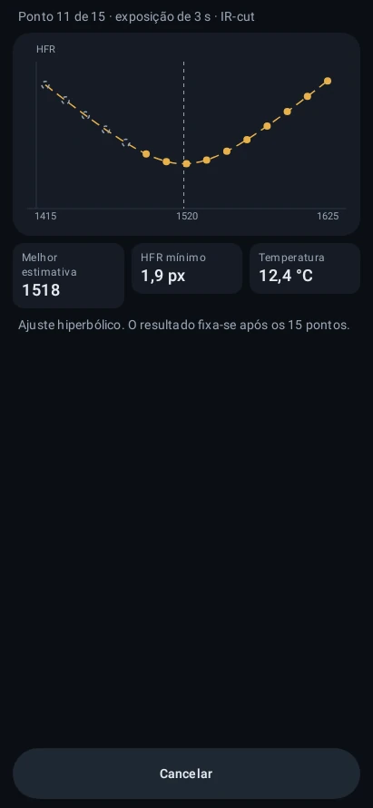 <b>Em curso.</b> Ponto 11 de 15, uma exposição de 3 s com o filtro IR-cut.</td>
<td valign="top" width="240">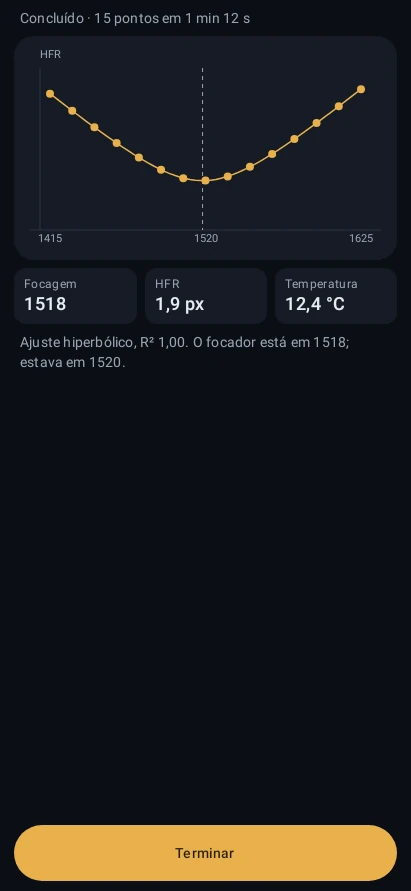 <b>Concluído.</b> 15 pontos em 1 min 12 s; o focador passou de 1520 para 1518.</td>
</tr></table>

### Definições de autofoco

Em *Definições › Autofoco*, guardadas em cada perfil, com os valores predefinidos do N.I.N.A.:

- **Passo:** Passos do focador entre pontos (50; 15 para o Seestar). Pequeno demais e a curva fica plana; grande demais e há poucos pontos perto do foco.
- **Pontos:** Quantos pontos tira: começa com metade deles para fora (9 pontos, 4 de cada lado; 15 para o Seestar).
- **Exposição:** 1 a 8 s, com binning 1×1 ou 2×2, com o ganho de Imagem. Não se guarda. 4 s (3 s para o Seestar).
- **Imagens por ponto:** 1, 2 ou 3. Mais imagens fazem a média do seeing e demoram mais.
- **Ajuste:** Como se encontra a melhor focagem a partir dos pontos: tendências, parabólico, tendências e parábola, hiperbólico (predefinido) ou tendências e hipérbole.
- **Folga para dentro, para fora:** Passos que o focador perde ao mudar de sentido; passa além esses passos e volta.
- **R² mínimo:** Quanto a curva se deve ajustar (0,7). Sem mínimo, o resultado mantém-se a menos que seja 15 % pior do que antes.
- **Tentativas:** Quantas vezes recomeça se uma execução falhar (1).
- **Espera após mover:** Segundos que o focador repousa após cada movimento antes da imagem (0).

<table><tr>
<td valign="top" width="240">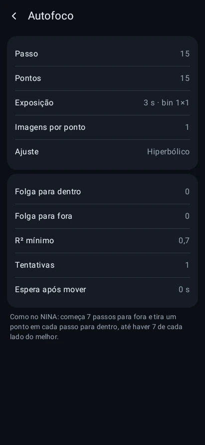 <b>Definições › Autofoco.</b> Os valores do Seestar.</td>
</tr></table>

### Quando falha

| A app diz | O que fazer |
| --- | --- |
| **O HFR não mudou o suficiente em nenhum dos lados** | Use um passo maior. |
| **A curva explica pouco os pontos** | O seeing ou as nuvens estragaram os pontos: mais imagens por ponto, uma exposição mais longa, ou tente mais tarde. |
| **A melhor focagem fica fora dos pontos medidos** | Comece mais perto do foco: mova o focador à mão e execute-o de novo. |
| **Na melhor focagem o HFR é pior do que antes** | O resultado não foi mantido e o focador voltou para trás. Verifique as condições e tente de novo. |
| **Este focador não tem posições para onde ir** | O autofoco precisa de um focador absoluto. |

### Refocagem automática durante a noite

Numa sequência, as regras de autofoco iniciam uma execução antes de uma imagem de luz quando a temperatura muda, o filtro muda, o HFR piora, ou ao fim de um certo tempo. Definem-se nas regras do editor simples ([capítulo 25](#simple)) ou como gatilhos no editor avançado ([capítulo 26](#advanced)). Se uma execução falhar durante a noite, o focador volta para trás e as regras esperam pelas exposições seguintes.

Os offsets de focagem por filtro definem-se no ecrã do focador ([capítulo 10](#focuser)): ao mudar de filtro, o focador move-se a diferença.

---

# Capturar

## 20. Imagem

Imagem tira imagens à mão: imagens avulsas para verificar a focagem e o enquadramento, ou um ciclo que guarda todas as imagens. Cada imagem aparece cerca de um segundo depois de transferida, com stretch e com as suas estrelas contadas e medidas.

### Tirar uma imagem

1. Defina a exposição, o ganho, o binning e o filtro com os botões por baixo da imagem (ver abaixo).
2. Toque no botão redondo. O ecrã mostra *A expor · 12 de 20 s* e depois *A transferir a imagem…*. Toque nele de novo durante a exposição para abortar.
3. A imagem aparece com o seu **HFR** e o seu número de **estrelas** no canto superior esquerdo. Toque neles para ver os detalhes da última imagem.

**Ciclo** tira imagens umas atrás das outras e guarda-as todas, como o Loop do N.I.N.A.; passa a **Parar**, que termina depois da imagem em curso. As imagens avulsas só se guardam se **Guardar imagens avulsas (o ciclo guarda sempre)** estiver ativado nas opções. Se uma imagem falhar enquanto o equipamento não responde, ou a ligação se perder, o ciclo espera e continua com a imagem seguinte assim que o equipamento voltar a responder.

### As definições da imagem

- **Exposição:** 10, 20, 30, 60 ou 300 s, as que a câmara permitir, ou **Outra** no teclado numérico, dentro do intervalo da câmara.
- **Ganho:** No teclado numérico, dentro do intervalo da câmara, ou os ganhos com nome da câmara. Começa em 200 se a câmara o aceitar, como faz a app do próprio Seestar, e as capturas da sequência sem ganho próprio usam este.
- **Binning:** 1×1, 2×2… só se a câmara fizer binning.
- **Filtro:** Com uma roda de filtros: o filtro colocado e os outros para onde mudar. As capturas para resolver, centrar, alinear ou focar nunca passam por **Dark**: antes a roda passa para IR. Com Dark, a captura não mostra HFR nem estrelas, que seriam ruído.

<table><tr>
<td valign="top" width="240"> <b>Imagem.</b> HFR 2,1 px e 412 estrelas.</td>
</tr></table>

### Observar a imagem

- **Zoom:** use dois dedos, e arraste para se deslocar. Um duplo toque alterna entre a imagem inteira e os píxeis a 1:1.
- **Histograma:** no canto inferior esquerdo, com a curva de stretch.
- **Última imagem:** toque no HFR e nas estrelas no canto superior esquerdo para ver o histograma, a média, a mediana e o desvio em ADU, o HFR com a sua dispersão, o FWHM em píxeis e em segundos de arco (um perfil de Moffat, como no Hocus Focus) e onde a imagem foi guardada.

### Opções de captura

O **⋮** no topo abre-as:

- **Tipo de imagem:** Light, dark, flat ou bias. Vai para o nome do ficheiro e para o cabeçalho FITS.
- **Alvo, para o nome do ficheiro:** O nome da pasta e dos ficheiros, como *M 31*. Sem ele, as imagens chamam-se *Snapshot*.
- **Guardar imagens avulsas:** O ciclo guarda sempre.
- **Dithering em ciclos de lights, a cada:** *Não*, *3* (de início), *5* ou *10* imagens. Entre imagens a montagem recebe um pequeno empurrão, como o dá o guiamento direto do N.I.N.A.: o campo move-se alguns píxeis (5 por omissão) em torno de onde o ciclo começou, para que o padrão do sensor não se acumule em riscas no empilhamento. Darks, flats e bias nunca fazem dithering. Com um Seestar, cujos impulsos de guiagem não vão para onde são enviados, salta antes com pequenos GoTo entre os 9 pontos de uma grelha afastados 27″.
- **Offset:** Se a câmara o tiver.
- **Stretch automático:** Ativado por predefinição, como o do N.I.N.A. Desativado, dois controlos deslizantes definem as **Sombras** e os **Tons médios**.
- **Marcar as estrelas:** Desenha uma caixa e o HFR nas estrelas mais brilhantes, como faz o N.I.N.A.; **Quantas**, de 10 a 500.
- **Empilhamento ao vivo:** **Empilhar ao vivo as imagens de luz** e **Equilibrar a cor do empilhamento** ([capítulo 22](#stacking)).
- **Definições:** As definições da app.

<table><tr>
<td valign="top" width="240">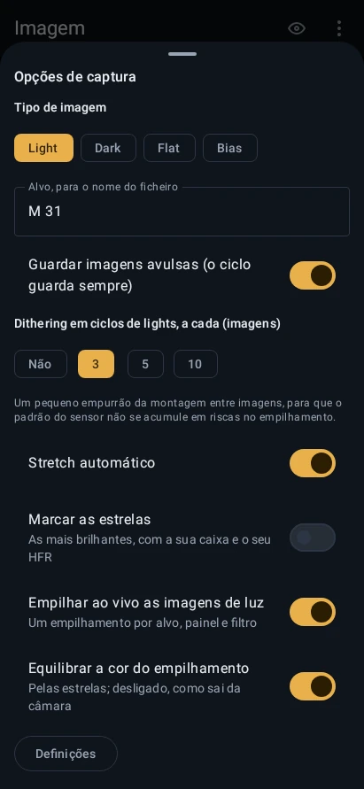 <b>Opções de captura.</b></td>
</tr></table>

### Os botões por baixo da imagem

- **Resolver:** Resolve a última imagem com o ASTAP e mostra para onde aponta, com **Sincronizar a montagem** ([capítulo 18](#solving)).
- **Autofoco:** Com um focador, executa o autofoco ([capítulo 19](#autofocus)).
- **Referência:** Põe a foto da cache do mesmo campo sobre a imagem, com a sua rotação, escala e zoom, para as poder comparar: aquela mancha ténue é a galáxia? Se a imagem não estiver resolvida, resolve-a primeiro. Toque de novo para voltar à imagem.
- **A miniatura:** À esquerda do botão redondo: abre o histórico da sessão ([capítulo 21](#history)).

<table><tr>
<td valign="top" width="240">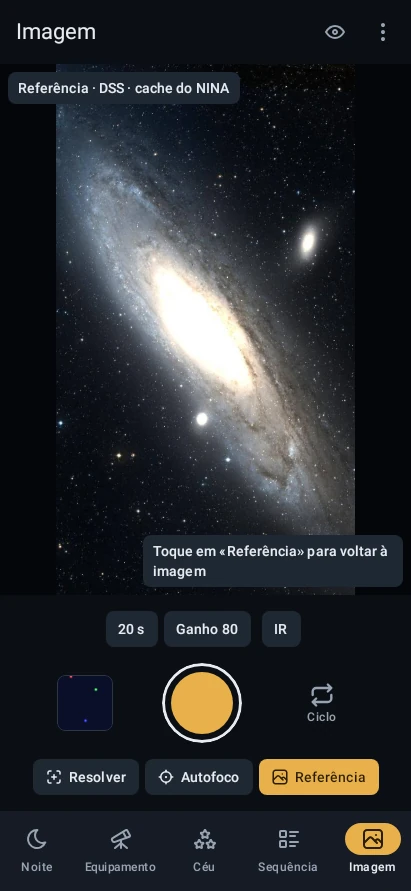 <b>Referência.</b> A foto da cache do campo da imagem.</td>
</tr></table>

<table><tr>
<td valign="top" width="470"> <b>Na horizontal</b>, a imagem ocupa a largura e os controlos passam para o lado.</td>
</tr></table>

## 21. Histórico e qualidade das imagens

O histórico lista todas as imagens guardadas nesta sessão com a sua qualidade, e assinala as estragadas por nuvens ou luz, para que fiquem fora do empilhamento.

- **O gráfico:** o HFR de cada imagem como uma linha e as suas estrelas como barras, com **AF** onde houve um autofoco.
- **A lista,** com as mais recentes primeiro: número, hora, filtro e exposição, HFR e estrelas.
- **As imagens descartadas** têm muito menos estrelas ou um fundo muito mais claro do que a mediana da sessão, e dizem porquê: *nuvens*, *poucas estrelas* ou *fundo claro*. Continuam guardadas no disco; só o empilhamento e o resumo as deixam de fora.

O ícone do filtro no topo mostra só as imagens descartadas. Abra o histórico a partir da miniatura ao lado do botão redondo de Imagem.

<table><tr>
<td valign="top" width="240"> <b>Histórico.</b> Imagem 32 descartada: nuvens.</td>
</tr></table>

## 22. Empilhamento ao vivo

O empilhamento ao vivo junta cada imagem de luz boa a um empilhamento contínuo enquanto a noite decorre, para que veja o alvo a sair do ruído. Está desativado até o querer, porque usa memória e bateria.

### Ativá-lo

Nas opções de Imagem, ative **Empilhar ao vivo as imagens de luz**. A partir daí, cada imagem de luz guardada entra no empilhamento, venha de um ciclo, de uma sequência ou de uma imagem avulsa. As imagens continuam a guardar-se uma a uma, como sempre.

Os flats recolhem-se mesmo com o empilhamento ao vivo desativado: quando a série de um filtro está completa, tornam-se o seu flat mestre, guardado como `FLATS/MasterFlat_IR.fits` (um por filtro) na pasta das suas imagens para as noites seguintes, um FITS de 32 bits que o Siril e o PixInsight também leem. Um flat seu posto aí com esse nome vale igual. Também os darks se guardam para o empilhamento mesmo que o ative depois de os fazer, como quando uma sequência começa com os seus darks.

### Como empilha

- **Um empilhamento por alvo, painel e filtro,** e por exposição, ganho e binning. Uma imagem de outro tipo guarda o empilhamento anterior e começa o seu.
- **Alinhado pelas estrelas:** deslocamento, rotação e escala, sobre a primeira imagem do empilhamento.
- **Satélites e aviões removidos** com rejeição a 3 sigma.
- **Calibrado à medida que avança:** com o dark mestre da noite da mesma exposição, ganho, offset e binning à temperatura do sensor mais próxima, e o flat mestre do seu filtro da pasta FLATS.
- **Cor equilibrada pelas suas próprias estrelas,** com **Equilibrar a cor do empilhamento** ativado; desativado, tal como sai da câmara.
- **As imagens descartadas ficam de fora,** tal como as imagens cujas estrelas não coincidem.

<table><tr>
<td valign="top" width="240"> <b>O empilhamento.</b> M 31 com 544 imagens de 20 s com um Seestar, processado depois.</td>
</tr></table>

### Um mosaico

Num mosaico a sequência faz cada painel inteiro e depois o seguinte, e cada painel tem o seu próprio empilhamento, calibrado com os seus darks e os seus flats. Com **Empilhamento**, Imagem mostra o mosaico inteiro enquanto se constrói: cada painel no seu lugar do céu, tal como a sua centragem o resolveu, com o fundo igualado ao dos vizinhos onde se sobrepõem e as junções fundidas, e um só estiramento e um só equilíbrio de cor para tudo. O painel que está a ser empilhado tem a borda dourada e cresce com cada imagem; os que faltam ficam tracejados. É uma vista a um quarto do tamanho, ou menor num mosaico grande para caber na memória do telemóvel, e é guardada como JPG, como *2026-10-14/M 31/STACK/…_STACK_MOSAIC.jpg*, depois de cada painel e ao acabar a sequência. O mosaico final monta-se com os empilhamentos dos painéis no Siril ou no PixInsight.

<table><tr>
<td valign="top" width="240"> <b>Um mosaico.</b> O terceiro painel de quatro, a crescer.</td>
</tr></table>

### Acompanhá-lo

Quando existe um empilhamento, um seletor **Imagem** | **Empilhamento** no canto superior direito de Imagem alterna entre a última imagem e o empilhamento. Toque no rótulo do empilhamento, como *544 imagens · 3 h 1 min*, para abrir a sua folha:

- **Empilhadas:** As imagens que contém, das que chegaram.
- **Descartadas:** Quantas ficaram de fora, e porquê.
- **Tempo:** A integração total e as imagens.
- **Alinhamento:** Pelas estrelas, e quanto rodou a última.
- **Cor:** Equilibrada pelas estrelas, ou tal como sai da câmara.
- **Dark** e **Flat:** o dark e o flat mestre em uso, como *MasterFlat_IR.fits de 11 de outubro*, ou quais faltam.

Em Noite, enquanto decorre uma sequência com o empilhamento ativado, o cartão da última imagem mostra o empilhamento; toque nele para o abrir em Imagem.

### Guardá-lo

O empilhamento guarda-se sozinho a cada 10 minutos enquanto cresce, e quando o ciclo ou a sequência terminam: um FITS linear de 32 bits para processar, e um JPG tal como o ecrã o mostra, na pasta das imagens com `STACK` como tipo. **Guardar** guarda-o agora. Se a app for fechada, o empilhamento continua com a imagem seguinte do mesmo alvo e filtro.

**Fazer 10 darks de 20 s** (com a exposição das imagens) faz agora darks para o empilhamento. Com um filtro escuro é automático; sem ele, a app pede-lhe que tape primeiro o telescópio. **Mantenha para recomeçar** esvazia o empilhamento.

<table><tr>
<td valign="top" width="240">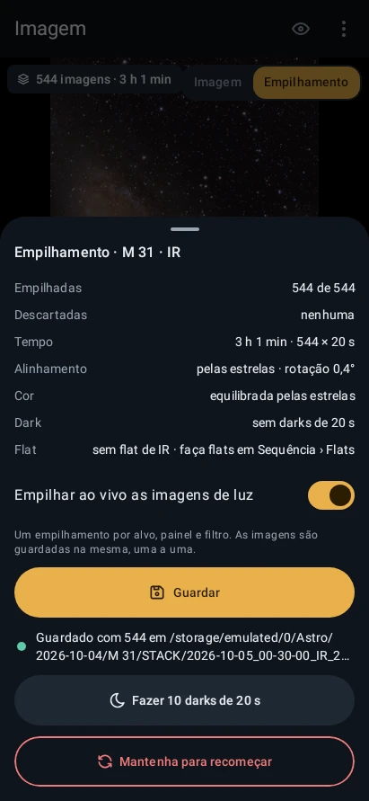 <b>A folha do empilhamento.</b> Ainda sem darks nem flat para este filtro.</td>
</tr></table>

## 23. Flats, darks e bias

As imagens de calibração removem o que o sensor e a ótica acrescentam. Yacana faz os flats com um assistente e os darks e os bias com as regras da sequência, e o empilhamento ao vivo usa-os todos.

### O assistente de flats

Abra-o com o modelo **Flats** em Sequência. Calcula a exposição sozinho e faz os flats de cada filtro com um brilho alvo. A luz é este telemóvel, ou o painel de flats se houver um ligado.

1. Verifique o **ADU alvo**, 30 000 ± 5 % por predefinição, com o máximo da câmara indicado. Defina o **Brilho do painel** se usar um.
2. Escolha as **Imagens por filtro** (20, 30 ou 50) e os **Filtros**.
3. Toque em **Iniciar os flats**. Com este telemóvel como luz, tem 30 s para o pousar virado para baixo sobre o telescópio, com o ecrã a tapar a objetiva e uma folha de papel branco no meio. Um bip começa os flats e o ecrã fica branco no brilho máximo, também no modo vermelho; outro bip termina-os. Para os pausar, toque duas vezes no ecrã branco; **Retomar** deixa outros 30 s.
4. Cada filtro mostra *a procurar a exposição…* e depois a sua exposição e quantos estão feitos, com a média da última imagem em ADU. **Pausar** e **Mantenha premido para parar** estão em baixo. No fim, com o filtro Dark do Seestar, faz 10 bias: o seu nível fica em cada flat mestre, para que o empilhamento ao vivo divida por ele mesmo sem darks.

Se houver luz a mais mesmo com a exposição mais curta, ou pouca luz com a mais longa, o assistente para e diz o que mudar: mais ou menos papel sobre o ecrã do telemóvel, ou o brilho do painel.

<table><tr>
<td valign="top" width="240">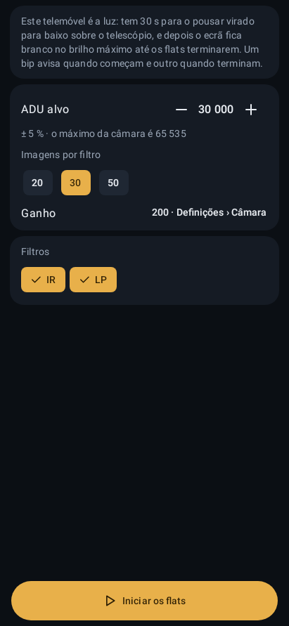 <b>Preparação.</b> Este telemóvel como luz, dois filtros.</td>
<td valign="top" width="240">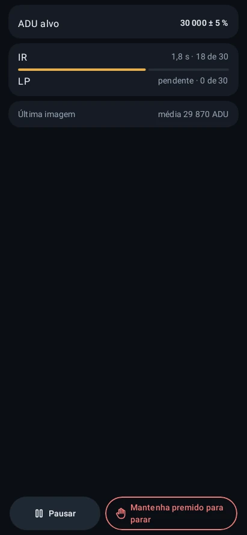 <b>Em curso.</b> Os flats IR a 1,8 s, média de 29 870 ADU.</td>
</tr></table>

### Darks e bias na sequência

No editor simples, o botão **Darks** em **Regras** define quando se fazem darks, com a exposição, o ganho e o binning de cada imagem de luz e o filtro escuro:

- **Ao começar** a noite.
- **Se a temperatura do sensor mudar** 2, 3 ou 5 °C, para o empilhamento ao vivo usar a série da temperatura mais próxima.
- **No fim, com o bias** (ativado por predefinição).
- **Imagens por série:** 5, 10 ou 20. A folha diz quanto demora cada série sem imagens de luz.

Sem um filtro escuro, não é possível fazer darks ao começar nem por temperatura; no fim, a app pede-lhe que tape o telescópio. Os darks e os bias do início e do fim vão para a pasta do alvo, ao lado de LIGHT: os do início para a do primeiro alvo, os do fim para a do último.

<table><tr>
<td valign="top" width="240"> <b>Darks.</b> 10 imagens de 60 s demoram cerca de 11 min.</td>
</tr></table>

### À mão

Em Imagem, defina o **Tipo de imagem** como dark, flat ou bias nas opções e capture como habitualmente: as imagens vão para a sua própria pasta, por tipo.

---

# Sequências

## 24. A secção Sequência

Uma sequência é o plano da noite: que alvos, com que exposições e o que fazer à volta deles. Yacana tem dois editores sobre o mesmo plano: um simples, que põe a noite numa linha temporal, e um avançado, com os contentores, gatilhos e condições do N.I.N.A. Pode alternar entre eles sem perder nada.

- **Esta noite:** O plano que a noite vai executar, com os seus alvos e horas. Toque nele para abrir o editor. Enquanto decorre, indica-o.
- **Guardadas:** As suas sequências guardadas, com os seus alvos e duração. Toque numa para a carregar como plano desta noite; **Anular** traz de volta o plano que tinha. Prima uma linha durante um momento para a eliminar com **Mantenha premido para eliminar**. Para guardar o plano desta noite, use o menu **⋮** do editor.
- **Modelos:** Pontos de partida para um plano novo (ver abaixo).
- **Nova:** Um plano vazio, no editor.

### Modelos

- **Um alvo toda a noite:** começa um plano vazio e abre Céu. O alvo que adicionar a seguir preenche a noite até ao amanhecer.
- **Vários alvos** e **Mosaico:** começam um plano vazio e abrem Céu, para enquadrar os alvos ou o mosaico.
- **Flats:** abre o assistente de flats ([capítulo 23](#calibration)).

O que havia antes de um modelo volta com **Anular**.

<table><tr>
<td valign="top" width="240">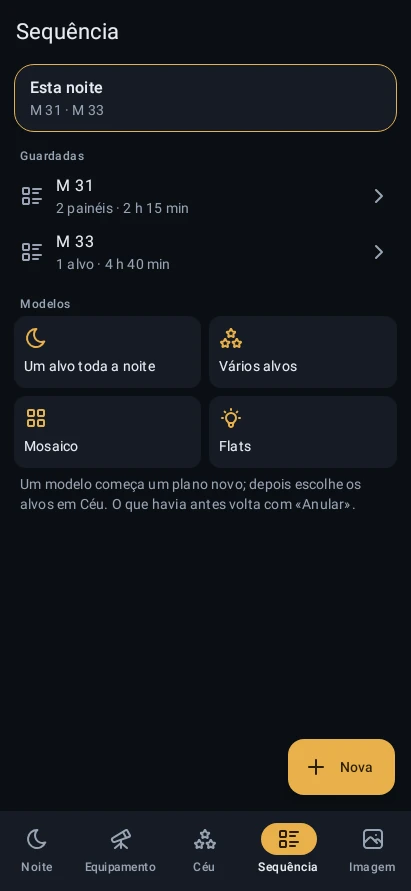 <b>Sequência.</b> Esta noite, sequências guardadas e modelos.</td>
</tr></table>

## 25. O editor simples

O editor simples mostra o plano desta noite como uma linha temporal e um cartão por alvo. Avisa, com um ícone e palavras, quando o plano não cabe antes do amanhecer.

### Adicionar alvos

Os alvos vêm de Céu: enquadre um e toque em **Adicionar à sequência** ([capítulo 16](#framing)). **Adicionar alvo**, no fim da lista, leva-o lá. Um mosaico chega como um só alvo com os seus painéis.

### Plano desta noite

A linha temporal mostra cada alvo do seu início ao seu fim, e o amanhecer. Se o plano passar do amanhecer astronómico, diz que alvo acabaria e quando, e a hora de fim desse alvo passa para a cor de aviso. **Anular** desfaz a última alteração, até 50 alterações para trás.

### O cartão de um alvo

- O seu nome, quando acaba, e o ícone do caixote do lixo para o remover.
- Para um mosaico, o seu número de painéis; as exposições aplicam-se a cada painel.
- Uma linha por filtro e exposição, como *IR · 60 s × 45 por painel*, com as imagens feitas e o total. Toque numa linha para a mudar; **Exposições** adiciona outro filtro.

<table><tr>
<td valign="top" width="240">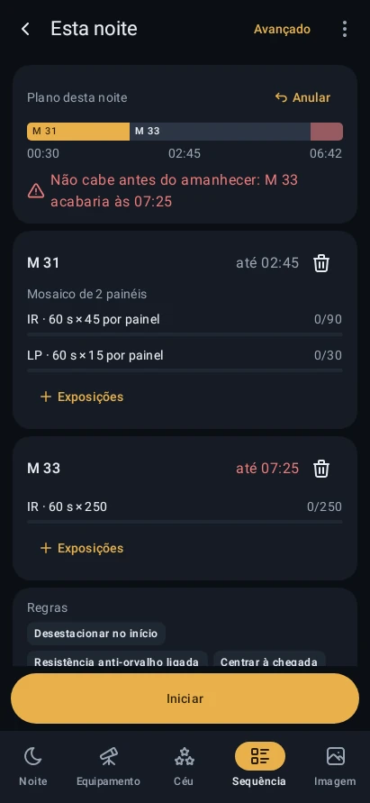 <b>Esta noite.</b> M 33 acabaria às 07:25, depois do amanhecer.</td>
<td valign="top" width="240">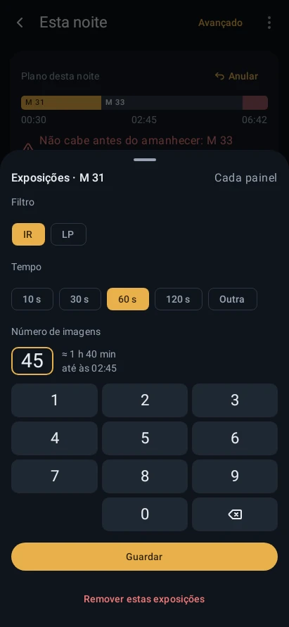 <b>Exposições.</b> O teclado numérico mostra quanto tempo demoram e até quando.</td>
</tr></table>

### Exposições

A folha define uma linha das exposições de um alvo: o **Filtro**, o **Tempo** (10, 30, 60 ou 120 s, ou **Outra**) e o **Número de imagens** no teclado numérico. Enquanto escreve, mostra quanto tempo demoram e até quando, ou que acabariam depois do amanhecer. **Guardar** guarda-a; **Remover estas exposições** elimina a linha quando o alvo tem mais do que uma.

### Regras

O cartão **Regras** lista o que a noite faz além das imagens. Um plano novo vem com:

- **Desestacionar no início** e **Resistência anti-orvalho ligada**, se o equipamento tiver um interruptor de resistência.
- **Centrar à chegada:** cada alvo, e cada painel de um mosaico, é centrado com plate solving antes das suas imagens.
- **Dithering a cada 3 imagens**, sem guiador.
- **Autofoco se ΔT > 1 °C**, com um focador.
- **Recentrar se se desviar > 1′:** antes de cada light resolve-se a anterior; se o campo se desviou mais de 1′ do alvo, volta a ser centrado. Substitui a guiagem.
- **Darks e bias no fim**: 10 de cada, para cada exposição, ganho, offset e binning dos lights.
- **Estacionar no fim**, e a resistência desligada.

Os botões por baixo alteram-nas:

- **Autofoco:** Antes de cada imagem de luz, executa-se um autofoco se se cumprir alguma destas condições, como os gatilhos do N.I.N.A.:
  - **Quando a temperatura muda** 0,5, 1, 2 ou 5 °C;
  - **Ao mudar de filtro;**
  - **Quando o HFR piora** 5, 10 ou 20 %;
  - **De tempos a tempos:** 15, 30, 60 ou 120 min, ou outro tempo.

  Se um autofoco falhar, esperam pelas exposições seguintes.
- **Darks:** Ao começar, quando a temperatura do sensor muda, no fim com o bias, e quantos de cada vez ([capítulo 23](#calibration)).
- **Recentragem:** ativada ou não, e quanto o campo se pode desviar: 1′, 2′, 5′ ou 10′, cada um também em píxeis da câmara ligada. Nunca recentra por menos de 20 px, o que um dithering pode mover; com uma câmara grande angular isso é mais do que qualquer opção, e a folha avisa. Com um bom alinhamento polar, recentra uma ou duas vezes por hora.
- **Dithering:** ativado ou não, e a cada 1, 3, 5 ou 10 imagens, para os lights de todos os alvos. Cada dithering espera que a montagem estabilize.
- **Resistência anti-orvalho**, se o equipamento ligado tiver uma: ligada ou não durante a noite, e a sua potência se for regulável. Gasta bateria: desliga-a em noites secas e amenas.

Para outras regras, como esperar que um alvo suba ou repetir até uma hora, abre o plano no editor avançado.

### Guardar e iniciar

O menu **⋮** tem **Guardar nas minhas sequências**. **Iniciar**, em baixo, inicia a noite depois de o equipamento estar ligado; enquanto decorre, o botão passa a **Mantenha premido para parar**. Pode continuar a editar o plano enquanto decorre: as alterações aplicam-se ao que ainda está para vir.

<table><tr>
<td valign="top" width="240">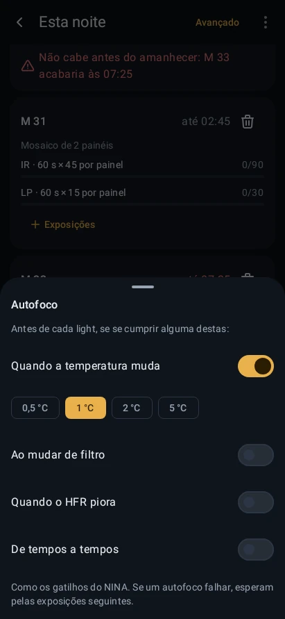 <b>Regras de autofoco.</b></td>
<td valign="top" width="240">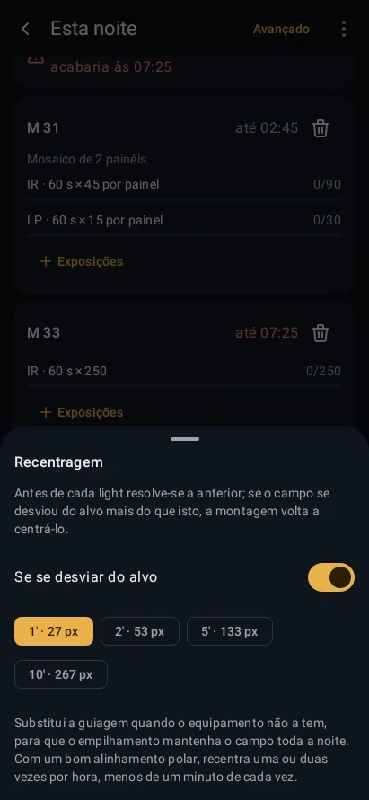 <b>Recentragem.</b> A menos de 1′ do alvo.</td>
<td valign="top" width="240">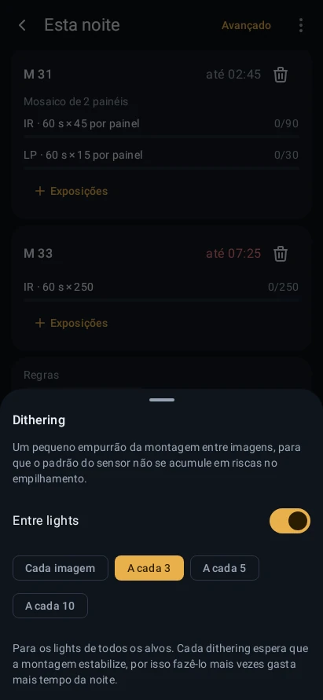 <b>Dithering.</b> A cada 3 imagens.</td>
</tr></table>

## 26. O editor avançado

O editor avançado é o sequenciador avançado do N.I.N.A. transformado numa lista tátil: contentores em que se entra, instruções, gatilhos e condições, reordenados arrastando, com anulação e uma revisão da noite antes de começar.

Abra-o com **Avançado**, no topo do editor simples. Abre o plano desta noite por inteiro. Se acrescentar o que o editor simples não consegue mostrar, como uma condição ou um contentor paralelo, a partir daí esta noite edita-se só no editor avançado: o editor simples mostra **Esta noite edita-se em Avançado**, com **Abrir em Avançado** e a lista de alvos.

### A estrutura da noite

- **Noite,** o nível superior, com os **gatilhos para toda a noite**, e três áreas:
- **Início:** o que acontece primeiro, antes dos alvos, como desestacionar ou arrefecer a câmara. O que aponta para um alvo não vai aqui.
- **Alvos:** um após outro, por esta ordem. Cada alvo contém as suas instruções.
- **Fim:** depois dos alvos: os darks, estacionar e desligar.

O trilho de navegação no topo mostra onde está, como *Noite › Alvos › M 33*. O cartão de cada nível diz como é executado: uma vez, ou repetido pelas suas condições, que se verificam após cada instrução.

<table><tr>
<td valign="top" width="240"> <b>Noite.</b> Um gatilho de autofoco e as três áreas.</td>
<td valign="top" width="240"> <b>Um alvo.</b> Repetido até às 02:00.</td>
</tr></table>

### Trabalhar com os itens

- **Entre** num contentor tocando nele; toque numa instrução para mudar as suas definições.
- **Adicione** com o botão em baixo, **Adicionar a …**, que abre o catálogo. **Condição** e **Gatilho**, no cartão do nível, abrem-no nesse tipo.
- **Reordene** arrastando a pega de um item, ou com o seu menu **⋮**.
- **O menu ⋮** de um item: *Entrar*, *Mudar o alvo*, *Mudar o nome*, *Definições*, *Mover para cima*, *Mover para baixo*, *Mover para…*, *Duplicar*, *Guardar como modelo* e *Eliminar*.
- **Anular** está no topo.

Enquanto a noite decorre, os itens terminados ficam marcados como concluídos e o que está em curso fica destacado. Ambos ficam bloqueados; o resto ainda pode ser alterado.

### O catálogo

O catálogo tem uma caixa de pesquisa e botões por tipo: câmara, montagem, focagem, filtros, utilidades, contentores, gatilhos, condições e modelos. O que não pode ir para onde está aparece a cinzento, com o motivo, como *Só dentro de um Alvo*.

<table><tr>
<td valign="top" width="240"> <b>O catálogo.</b> O que aponta para um alvo aparece a cinzento em Início.</td>
</tr></table>

| Tipo | Item | O que faz |
| --- | --- | --- |
| **Câmara** | Exposições | Lights, darks ou bias: filtro, tempo, número de imagens e dithering |
| **Câmara** | Arrefecer câmara · Aquecer câmara | Até uma temperatura, pouco a pouco, ou devagar de volta antes de a desligar |
| **Montagem** | Desestacionar · Estacionar | Sai da posição de repouso ou volta a ela |
| **Montagem** | Ir e centrar | GoTo ao alvo e plate solving, até 1′; só dentro de um Alvo |
| **Montagem** | Ir para o alvo | GoTo ao alvo sem centrar; só dentro de um Alvo |
| **Montagem** | Parar o seguimento | A montagem fica parada |
| **Focagem** | Autofoco · Mover o focador | Uma execução da curva em V, ou para uma posição |
| **Filtros** | Mudar de filtro | A roda põe outro filtro |
| **Utilidades** | Definir um interruptor | Como a resistência anti-orvalho, ligado ou desligado |
| **Utilidades** | Esperar até uma hora · Esperar um pouco · Esperar que suba | Continua a uma hora desta noite, após alguns minutos, ou quando o alvo chega a uma altura |
| **Utilidades** | Nota | Uma nota no diário da noite |
| **Contentor** | Alvo | Um alvo de Céu, com o seu enquadramento; vem com «Ir e centrar» |
| **Contentor** | Sequencial · Paralelo | As suas instruções uma após outra, ou ao mesmo tempo, como esperar por uma hora enquanto a câmara arrefece |
| **Gatilho** | Autofoco se a temperatura mudar · de tempos a tempos · ao mudar de filtro · se o HFR subir | Um autofoco antes da imagem seguinte quando a sua condição se cumpre |
| **Gatilho** | Recentrar se se desviar | Resolve e corrige quando o alvo se desvia mais de 1′ a 10′ (20 px no mínimo) |
| **Gatilho** | Darks se a temperatura mudar | Darks com o filtro escuro quando o sensor muda 2, 3 ou 5 °C, para o empilhamento ao vivo |
| **Condição** | Repetir N vezes · Repetir até uma hora · Repetir enquanto estiver alto | Repete o contentor inteiro |
| **Modelo** | Alvo com autofoco · os seus | Um alvo de Céu com ir e centrar, autofoco e exposições; ou qualquer bloco que tenha guardado como modelo |

### Rever a noite

O editor verifica o plano enquanto o constrói. Quando algo correria mal esta noite, um indicador no topo conta os avisos; toque nele para abrir **Rever a noite**, e toque num aviso para ir até ele. Os avisos nunca o impedem de guardar ou iniciar. Incluem:

- uma instrução que precisa de um alvo fora de um Alvo, ou lights sem alvo;
- um estacionamento antes de imagens, focagem ou um GoTo sem *Desestacionar* antes;
- lights sem *Ir e centrar* antes, ou com o seguimento parado;
- um filtro que a roda não tem, ou arrefecer uma câmara que não arrefece;
- darks feitos enquanto a câmara aquece;
- dois itens paralelos a usar o mesmo dispositivo ao mesmo tempo.

### Voltar ao plano simples

O cartão do editor simples, ou o menu **⋮** do editor avançado, tem **Mantenha premido para voltar ao plano simples**. Remove o que só o editor avançado conhece e mantém os alvos com as suas exposições. O mesmo menu tem **Guardar nas Minhas sequências**.

<table><tr>
<td valign="top" width="240"> <b>Editada em Avançado.</b> O editor simples mostra os alvos.</td>
</tr></table>

> [!NOTE]
> **Para utilizadores do N.I.N.A.**
>
> O editor avançado segue o sequenciador do N.I.N.A.: os mesmos tipos de contentores, gatilhos e condições, executados pela mesma ordem. Os ficheiros de sequência do próprio N.I.N.A. não se importam, e as instruções que dependem do Windows ou da guiagem não existem.

## 27. Executar a noite

Inicie a noite com **Iniciar a noite**, em Noite, ou com **Iniciar**, no editor. A partir daí, a sessão decorre dentro de um serviço em primeiro plano: pode desligar o ecrã e guardar o telemóvel.

### Noite durante a execução

Tudo o que precisa cabe num só ecrã, sem deslizar:

- **O alvo:** o seu nome, painel e filtro, e a sua altura com uma seta que indica se sobe ou desce.
- **A imagem:** um anel com os segundos que faltam, *Imagem 35 de 120*, o filtro e o ganho.
- **Progresso:** a percentagem da sequência e quando acaba, face ao amanhecer astronómico.
- **Última imagem:** a sua miniatura, se foi boa ou descartada, o seu HFR e estrelas, e a curva de HFR da noite. Com o empilhamento ao vivo ativado, mostra o empilhamento: toque nele para o abrir em Imagem.
- **Seguinte:** o que vem a seguir, como o próximo autofoco, a mudança para o alvo seguinte e o estacionamento, com as suas horas.

**Pausar** para de imediato, deixando de fora a imagem em curso, e o seguimento continua; passa a **Retomar**, que continua a partir da mesma instrução com as imagens que já tirou. **Mantenha premido para parar** termina a sequência.

<table><tr>
<td valign="top" width="240"> <b>Em curso.</b> Acaba às 06:56, depois do amanhecer das 06:44.</td>
<td valign="top" width="240"> <b>Com empilhamento ao vivo,</b> o empilhamento no cartão.</td>
</tr></table>

### No resto da app

A barra da sessão, em todos os outros ecrãs, mostra a imagem e permite pausar ([capítulo 4](#tour)), e a notificação mostra o progresso no ecrã de bloqueio. A sequência e Imagem partilham a câmara: pare um ciclo em Imagem antes de iniciar a noite.

### Com o ecrã desligado

Yacana mantém o processador e o WiFi do telemóvel acordados enquanto a sessão decorre, e associa o tráfego do equipamento ao WiFi dele, mesmo que este não tenha internet. No teste de referência funcionou 8,5 horas durante a noite com um Seestar, 503 imagens completas, sem nenhum reinício e sem nenhuma falha de mais de 6 s, gastando 1,7 % da bateria por hora. Conceda primeiro as permissões de bateria ([capítulo 33](#permissions)).

Enquanto Yacana está no ecrã, o ecrã continua ligado e o telemóvel não bloqueia. Com o ecrã ligado, o Android mantém o WiFi à velocidade máxima e, se cair, volta a ligar-se ao WiFi do equipamento em segundos; com o ecrã desligado, pode não o fazer até o ligar. Prima o botão de ligar para o desligar como sempre: a sessão continua. Para uma noite inteira com o ecrã ligado, use o modo vermelho com pouco brilho e uma bateria externa.

### Se a app ou o telemóvel reiniciar

Se o Android fechar a app ou o telemóvel reiniciar, a sessão retoma sozinha em menos de um minuto; após um reinício, depois de desbloquear o telemóvel pela primeira vez. No máximo perde-se a imagem em curso; as imagens já guardadas nunca se danificam, porque cada uma é escrita num ficheiro temporário e depois mudada de nome. O diário regista *A app fechou-se e retomou a sequência*.

## 28. Alertas e paragens seguras

Uma noite sem vigilância termina bem ou para em segurança. Cada alerta diz o que aconteceu, o que a app está a fazer e o que pode fazer.

### Quando a ligação se perde

Se o equipamento deixar de responder, a sequência entra em **pausa segura**: a exposição para e o seguimento continua ativo. O alerta, em Noite e como notificação com som, mostra as tentativas e o tempo que falta até uma paragem segura. A app tenta de novo a cada 10 s.

- **Tentar agora** tenta de novo de imediato.
- **Detalhes** abre Equipamento.
- **Mantenha premido para parar** termina a sequência.

Confirme que o telemóvel continua no WiFi do equipamento e que o equipamento tem alimentação. Quando a ligação volta, a sequência continua, e o diário regista quanto tempo esteve perdida.

### Paragem segura

Uma paragem segura termina a sessão quando:

- a ligação não volta no tempo definido (2 min por predefinição);
- a sequência falha de uma forma da qual não consegue recuperar;
- a bateria do telemóvel desce abaixo do nível definido (20 % por predefinição), e sempre abaixo de 10 %, a menos que esteja a carregar.

A exposição para e a montagem estaciona ou para o seguimento, conforme diz o perfil. Se a ligação se perdeu, isso acontece logo que volte. O alerta diz então o que foi feito; **Entendido** fecha-o.

<table><tr>
<td valign="top" width="240"> <b>Pausa segura.</b> Uma paragem segura dentro de 1 min 18 s se a ligação não voltar.</td>
<td valign="top" width="240"> <b>Paragem segura.</b> A montagem estacionada.</td>
</tr></table>

### Definições de segurança

Em *Definições › Segurança*, por perfil:

- **Paragem segura:** **Estaciona a montagem** ou **Para o seguimento**. O Seestar vem com o estacionamento, que recolhe o seu braço.
- **Se a ligação se perder:** Quanto tempo espera a pausa segura: 1, 2, 5 ou 10 min.
- **Bateria do telemóvel fraca:** 15, 20 ou 30 %. Abaixo de 10 % para sempre; nunca enquanto carrega.

<table><tr>
<td valign="top" width="240"> <b>Definições › Segurança.</b></td>
</tr></table>

## 29. A manhã seguinte

Quando a sequência termina, Noite mostra o resumo da noite até o fechar.

- Como terminou e quando: concluída, parada à mão, uma paragem segura ou uma falha, e se a montagem estacionou.
- **Integração útil:** o tempo de exposição das imagens mantidas.
- **Imagens** e **Descartadas**, e o **HFR mediano**.
- **Por alvo:** imagens e exposição por alvo e filtro.
- **Incidentes:** religações, autofocos extra, imagens com nuvens, com as suas horas.

**Ver diário** abre o diário da noite. **Exportar** guarda um ZIP do registo da app, com o perfil e as versões, para guardar ou anexar a um relatório de erro. O **✕** fecha o resumo.

### O diário da noite

Uma lista legível do que aconteceu, separada do registo técnico: cada evento com a sua hora e o porquê, como *Autofoco extra · A temperatura mudou 1,3 °C*, *M 31 Painel 1 centrado · a 8″ · 2 tentativas* ou *Ligação recuperada · 51 s · 5 tentativas*. O seu ícone no topo guarda o mesmo ZIP que **Exportar**.

<table><tr>
<td valign="top" width="240"> <b>Resumo.</b> 34 imagens, uma com nuvens.</td>
<td valign="top" width="240"> <b>Diário da noite.</b></td>
</tr></table>

As suas imagens e empilhamentos estão na pasta das imagens, uma pasta por noite e alvo ([capítulo 30](#files)). Para os copiar, ligue o telemóvel a um computador com um cabo USB e escolha a transferência de ficheiros no telemóvel; a pasta aparece como qualquer outra no armazenamento do telemóvel.

---

# Definições e ficheiros

## 30. Imagens e ficheiros

Yacana guarda cada imagem como um ficheiro FITS de 16 bits com os cabeçalhos do N.I.N.A., que abre no Siril, no PixInsight e em qualquer programa de astronomia, numa pasta por noite e alvo.

### A pasta

Em *Definições › Imagens e ficheiros*, **Pasta** mostra para onde vão as imagens. Por predefinição é a pasta da própria app, `Android/data/app.yacana/files/Yacana` no armazenamento do telemóvel, que o Android remove se desinstalar a app.

**Mudar de pasta** abre o seletor de pastas do Android: escolha ou crie uma pasta no armazenamento do telemóvel (como `Astro`), num cartão SD ou numa unidade USB. Yacana mantém a permissão de escrever aí de um reinício para o outro. Escolha uma antes da primeira noite, para que as suas imagens sejam fáceis de encontrar e sobrevivam a uma reinstalação.

### Nomes dos ficheiros

O nome de cada imagem vem de um padrão com as etiquetas do N.I.N.A. Uma barra cria uma pasta. Toque numa etiqueta para a adicionar; o ecrã mostra como se vai chamar a próxima imagem. **Voltar ao predefinido** repõe:

`$$DATEMINUS12$$/$$TARGETNAME$$/$$IMAGETYPE$$/$$DATETIME$$_$$FILTER$$_$$EXPOSURETIME$$s_$$FRAMENR$$`

o que dá, por exemplo, `2026-10-04/M 31/LIGHT/2026-10-05_00-30-00_LP_20.00s_0001.fits`: uma pasta para a noite, uma para o alvo e uma para o tipo de imagem.

<table><tr>
<td valign="top" width="240"> <b>Definições › Imagens e ficheiros.</b></td>
</tr></table>

| Etiqueta | Passa a | Exemplo |
| --- | --- | --- |
| **`DATEMINUS12`** | A data da noite: a data de 12 horas antes, para que as imagens depois da meia-noite mantenham a data do início da noite | `2026-10-04` |
| **`DATE`** | A data local | `2026-10-05` |
| **`DATETIME`** | A data e a hora locais | `2026-10-05_00-30-00` |
| **`TIME`** | A hora local | `00-30-00` |
| **`TARGETNAME`** | O alvo, ou *Snapshot* sem alvo | `M 31` |
| **`IMAGETYPE`** | O tipo de imagem | `LIGHT`, `DARK`, `FLAT`, `BIAS` |
| **`FILTER`** | O filtro, ou *NoFilter* | `LP` |
| **`EXPOSURETIME`** | A exposição em segundos | `20.00` |
| **`FRAMENR`** | O número da imagem na sessão, com 4 dígitos | `0001` |
| **`GAIN`, `OFFSET`** | O ganho e o offset da câmara | `80` |
| **`BINNING`** | O binning | `1x1` |
| **`SENSORTEMP`** | A temperatura do sensor | `-10.0` |

### O que há em cada ficheiro

- **Imagens:** FITS de 16 bits com os mesmos píxeis que os ficheiros do próprio Seestar, e as palavras-chave de cabeçalho do N.I.N.A.: o tipo de imagem, a exposição, o ganho, o offset, o binning e a temperatura do sensor; o filtro; o alvo e as suas coordenadas, com a sua altura e azimute; o telescópio, a câmara, a distância focal e o tamanho do píxel; a posição e a temperatura do focador; o local; o padrão de Bayer e os seus desvios, para que o Siril faça o debayer corretamente.
- **Empilhamentos ao vivo:** o mesmo caminho com `STACK` como tipo e número: um FITS linear de 32 bits, com o número de imagens e a exposição total no cabeçalho, e um JPG tal como o ecrã o mostra, regravados à medida que o empilhamento cresce.
- **Segurança:** cada ficheiro é escrito com um nome temporário e mudado de nome quando está completo, por isso uma falha ou um corte de energia nunca deixa uma imagem estragada.

O diário da noite e o registo da app ficam dentro da app; exporte-os como ZIP a partir do resumo ou de *Definições › Exportar o registo*.

## 31. Referência das definições

As Definições abrem-se a partir da roda dentada em Noite e Equipamento, ou com **Definições** nas opções de Imagem. A caixa de pesquisa no topo encontra qualquer definição por parte do nome, dentro de todos os ecrãs, com ou sem acentos.

Cada opção diz o que faz. As definições marcadas *por perfil* guardam-se no perfil do equipamento, para que cada conjunto de equipamento tenha as suas.

<table><tr>
<td valign="top" width="240"> <b>Definições.</b></td>
</tr></table>

| Linha | O que contém | Capítulo |
| --- | --- | --- |
| **Perfil e localização** | Nome, ótica, local, limites, horizonte, base de estrelas, outros perfis, exportar e importar | [5](#profile) |
| **Imagens e ficheiros** | A pasta e o padrão dos nomes dos ficheiros (por perfil) | [30](#files) |
| **Plate solving** | Opções do ASTAP, centragem e as bases de estrelas (por perfil) | [18](#solving), [6](#field) |
| **Autofoco** | Passo, pontos, exposição, ajuste, folga, R², tentativas (por perfil) | [19](#autofocus) |
| **Segurança** | Paragem segura, a espera quando a ligação se perde, bateria fraca (por perfil) | [28](#safety) |
| **Mapa do céu** | Caches do N.I.N.A., só com WiFi, fotos online e camadas | [6](#field) |
| **Ecrã** | Modo noturno vermelho e o seu brilho | [32](#display) |
| **Idioma** | O idioma da app | [32](#display) |
| **Permissões** | Para que serve cada permissão, e o seu estado | [33](#permissions) |
| **Exportar o registo** | Guarda um ZIP dos últimos 14 dias do registo | [36](#troubleshooting) |
| **Acerca de** | A versão, o motor de píxeis e as licenças | [39](#credits) |

O empilhamento ao vivo e o seu equilíbrio de cor definem-se nas opções de Imagem, e também se guardam por perfil.

## 32. Modo vermelho e idioma

### Modo noturno vermelho

A luz vermelha mantém os seus olhos adaptados ao escuro. O modo vermelho desenha cada píxel da app em vermelho puro sobre preto, fotos e imagens incluídas, e nenhum píxel tem verde nem azul: isto é verificado em todos os ecrãs.

- Ative-o com o ícone do olho no topo de Noite, Equipamento, Céu, Imagem, das fichas dos objetos, do enquadramento e dos assistentes, ou com **Modo noturno vermelho** em *Definições › Ecrã*.
- As barras do sistema ocultam-se; deslize a partir da margem para as ver durante um momento.
- A app define o seu próprio brilho do ecrã, que pode descer abaixo do mínimo do sistema: **Brilho no modo vermelho**, de 1 a 100 %, 10 % por predefinição.
- A app lembra-se dele e abre a vermelho se o deixou a vermelho.

As caixas de diálogo do próprio Android e o teclado do sistema não podem ficar vermelhos. É por isso que, à noite, os números se introduzem com o teclado numérico da própria app. O ponto verde que o Android acende em cima enquanto uma app lê a localização também não pode ficar vermelho. O Yacana só a lê ao abrir, ao ativar **Usar a localização do telemóvel** e ao ligar, nunca ao voltar a ligar, por isso o ponto vê-se durante alguns segundos.

<table><tr>
<td valign="top" width="240"> <b>Noite a vermelho.</b></td>
<td valign="top" width="240"> <b>O céu a vermelho.</b> As fotos também.</td>
</tr></table>

### Idioma

Yacana fala inglês, espanhol, catalão, basco, galego, alemão, francês, italiano, e o português de Portugal e do Brasil. Em *Definições › Idioma*, **Como o sistema** segue o telemóvel, ou o inglês se o idioma do telemóvel não for um destes; ou escolha um. Muda de imediato. No Android 13 e posteriores, também o pode escolher nas definições do sistema para a app. As datas e os números seguem o idioma, com vírgula decimal em todos menos no inglês.

<table><tr>
<td valign="top" width="240"> <b>Definições › Idioma.</b></td>
<td valign="top" width="240"> <b>Definições › Ecrã.</b></td>
</tr></table>

## 33. Permissões e bateria

O Android não foi pensado para uma tarefa de oito horas com o ecrã desligado. As permissões em *Definições › Permissões* são o que permite a Yacana conduzir a noite mesmo assim.

O ecrã é o mesmo dos primeiros passos ([capítulo 3](#first-steps)): cada linha diz para que serve, o que deixa de funcionar sem ela, e mostra **Permitir**, **Abrir** ou um visto quando concedida. As linhas que não se aplicam ao seu telemóvel não aparecem: a rede local antes do Android 17, as notificações antes do Android 13, manter a app sem uso antes do Android 11, e o arranque automático em telemóveis que não sejam Xiaomi, Redmi ou Poco.

### Se o Android já não perguntar

Depois de recusar uma permissão duas vezes, o Android deixa de perguntar. A linha indica-o: abra as definições de Yacana no Android, abra Permissões, ative-a e volte.

### Poupança de bateria

- **Bateria sem restrições** é a mais importante para uma noite. Sem ela, o sistema pode interromper a sessão com o ecrã desligado.
- Alguns fabricantes acrescentam os seus próprios sistemas de poupança por cima dos do Android. Nos telemóveis Xiaomi, o **Arranque automático** permite que a sessão volte se o sistema fechar a app. Noutras marcas, procure Yacana nas definições de bateria do telemóvel e permita que funcione em segundo plano.
- Nos telemóveis Xiaomi, a poupança de bateria nas informações de Yacana deve indicar **Sem restrições**: é o que **Bateria sem restrições** define. Bloqueie também Yacana nas apps recentes (mantenha premido o cartão e toque no cadeado), para que limpá-las não feche Yacana.
- Os modos de poupança de bateria podem interromper o trabalho em segundo plano: mantenha-os desativados durante uma sessão.

### O que a app nunca precisa

Yacana não precisa de conta, nem de acesso às suas fotos, contactos ou ficheiros para além das pastas que escolher, nem da localização em segundo plano.

---

# Referência

## 34. Usar um Seestar S50 Pro

O ZWO Seestar S50 Pro tem ASCOM Alpaca no seu firmware, por isso Yacana controla-o diretamente através do seu WiFi. É o dispositivo de referência: todas as funcionalidades foram construídas e medidas com ele, e preenche o seu próprio perfil.

### Antes da primeira noite

1. **Configure-o com a app da ZWO.** Yacana não a substitui na configuração do próprio dispositivo: ativá-lo, atualizar o seu firmware, passá-lo para o modo equatorial e configurar o seu WiFi fazem-se na app da ZWO.
2. **Ponha-o numa cunha equatorial, em modo EQ.** Numa cunha, faz o seguimento num só eixo e permite exposições longas sem rotação de campo. O seu modo altazimutal não é um objetivo desta app.
3. **Ligue-se ao seu WiFi, ou ponha ambos no WiFi de casa.** Os seus dois modos de rede funcionam: o seu próprio ponto de acesso, onde responde em `10.0.0.1`, porta `32323`, e o modo estação no seu router. Uma noite de 8,5 horas decorreu em modo ponto de acesso, e 2 horas em modo estação, sem quebras longas.
4. **Encontre-o em Yacana** e toque em **Teleobjetiva** ([capítulo 3](#first-steps)). O perfil do Seestar carrega-se sozinho; **Grande angular** cria o da sua câmara grande-angular, mais abaixo.

### O que o seu perfil define

| Item | Valor | Porquê |
| --- | --- | --- |
| **Ótica** | 260 mm de distância focal, 50 mm de abertura, f/5,2 | O seu refrator apocromático de 4 elementos |
| **Sensor** | 2160 × 3840 px, 2,9 µm, a cores (Bayer GRBG) | A câmara teleobjetiva, guardada na vertical como faz a app da ZWO |
| **Escala e campo** | 2,25″ por píxel · 2,40° × 1,35° | Medidos com o ASTAP em imagens reais |
| **Rotação da câmara** | 93,2° até o primeiro plate solving a medir | Um S50 Pro em modo EQ, com o lado longo quase de norte a sul |
| **Base de estrelas** | D50 | Resolve as suas imagens com margem para noites piores; D05 é a opção leve |
| **Autofoco** | 15 passos entre pontos, imagens de 3 s | O seu focador vai de 0 a 2 600 passos |
| **Paragem segura** | **Estaciona a montagem** | Estacionar recolhe o seu braço |
| **Dispositivos usados** | Montagem, câmara teleobjetiva e o seu focador, roda de filtros, interruptores | A câmara grande-angular e o seu focador têm o seu próprio perfil, mais abaixo |

### A sua câmara grande-angular

**Grande angular** no cartão do Seestar, nos primeiros passos ou em **Novo perfil**, cria um segundo perfil, *Seestar S50 Pro grande angular*, para a sua câmara grande-angular: todo um pedaço de céu, para a Via Láctea e paisagens noturnas. As suas exposições duram até 60 s.

| Item | Valor | Porquê |
| --- | --- | --- |
| **Ótica** | 5,95 mm de distância focal, 3,4 mm de abertura, f/1,75 | A sua objetiva publicada, 63° na diagonal |
| **Campo** | Cerca de 33° × 59°, 55″ por píxel | O seu sensor de 2160 × 3840 px de 1,6 µm |
| **Base de estrelas** | W08, menos de 1 MB | A do ASTAP para campos de 20° a 80°: descarregue-a em *Definições › Plate solving* |
| **Autofoco** | 10 passos entre pontos, 15 pontos, imagens de 3 s | O seu focador vai de 0 a 1 023 passos: valores de partida, a ajustar sob o céu |
| **Dispositivos usados** | Montagem, câmara grande-angular e o seu focador, interruptores | A roda de filtros está só à frente da teleobjetiva |

### Convém saber

- **Darks sem o tapar.** A sua roda de filtros tem uma posição **Dark**, que Yacana usa como obturador: os darks e os bias fazem-se sem nada no telescópio.
- **A resistência anti-orvalho só liga ou desliga.** Aparece como interruptor em *Equipamento › Interruptores*. O seu servidor Alpaca (1.3.1-1) não permite definir a sua potência.
- **Sem binning.** A sua câmara não faz binning, por isso uma definição de 2×2, como a do alinhamento polar, é tirada em tamanho completo. Uma imagem tem cerca de 8,3 MP, 16 MB a 16 bits, e transfere-se em 1,7 a 2,3 s pelo seu WiFi.
- **Sem inversão de meridiano.** Numa cunha, comporta-se como uma forquilha de um só braço. Mantenha os alvos longe de onde o braço possa tocar na cunha, perto do polo e do zénite.
- **As mudanças de filtro podem ser lentas.** Alguns utilizadores indicam que uma mudança demora a aparecer; as esperas da app têm isso em conta.
- **Alimentação.** Para uma noite longa, alimente o Seestar e o telemóvel com energia externa, sobretudo com a resistência ligada.
- **A sua própria app ao mesmo tempo.** Usar a app da ZWO noutro telemóvel enquanto Yacana controla o Seestar não foi testado; feche-a durante uma sessão.

Os testes foram feitos com o firmware 9.31 e o servidor Alpaca 1.3.1-1.

## 35. O que precisa de internet

Uma noite não precisa de internet nenhuma. No campo, o telemóvel só fala com o seu equipamento, e tudo o que a noite usa está no telemóvel.

| Funcionalidade | Sem internet | Com internet |
| --- | --- | --- |
| **Catálogo de objetos** | 13 371 objetos do céu profundo do OpenNGC, incluídos na app | Igual |
| **Efemérides** | Sol, Lua e crepúsculos calculados no telemóvel | Igual |
| **Plate solving** | ASTAP no telemóvel, com uma base de estrelas no telemóvel | Igual |
| **Fotos do céu** | Das caches do N.I.N.A. no telemóvel | Fotos mais nítidas da zona quando amplia muito, do hips2fits do CDS |
| **Pesquisa** | Messier, NGC, IC, Caldwell, Sharpless e nomes comuns | Também o SIMBAD: qualquer objeto que conheça, guardado no telemóvel depois de encontrado |
| **Bases de estrelas e caches do céu** | Importadas de um ficheiro ou de um cartão | Transferidas dentro da app, só com WiFi por predefinição |

Quando o telemóvel está no WiFi do equipamento, que não tem internet, Yacana mantém todo o tráfego do equipamento nessa rede, para que o Android não o envie pelos dados móveis. As transferências que iniciar usam a ligação normal do telemóvel.

## 36. Resolução de problemas

Cada alerta de Yacana diz o que aconteceu, o que a app está a fazer e o que pode fazer. Este capítulo reúne as causas habituais por trás deles.

### Ligação

- **Nenhum equipamento Alpaca respondeu:** O telemóvel e o equipamento não estão no mesmo WiFi, ou o equipamento ainda está a arrancar. Ligue-se à sua rede, espere um minuto e toque em **Pesquisar de novo**. Se a sua rede bloquear a deteção, use **Adicionar por IP e porta** com o endereço que o dispositivo indica, como `10.0.0.1:32323` para um Seestar no seu próprio ponto de acesso.
- **Não se encontra nada:** Confirme que a **Rede local** está concedida em *Definições › Permissões*. Sem ela, o Android bloqueia toda a deteção e todos os comandos.
- **Não foi possível ligar:** O dispositivo respondeu à pesquisa, mas recusou a ligação. Confirme que nenhum outro programa o está a usar, reinicie-o e ligue de novo.
- **Desligue para mudar de perfil:** Os perfis, os dispositivos e a eliminação do perfil só podem ser alterados com nada ligado. Toque primeiro em **Desligar tudo**.

### Durante a noite

- **Sem ligação com o equipamento:** O WiFi caiu ou o equipamento ficou sem alimentação. A sequência espera em pausa segura e a app tenta de novo a cada 10 s; se a ligação não voltar dentro do tempo definido em *Definições › Segurança*, para em segurança logo que volte. Confirme que o telemóvel continua no WiFi do equipamento e que o equipamento tem bateria ([capítulo 28](#safety)).
- **A sessão parou com o ecrã desligado:** O Android fechou a app para poupar bateria. Conceda **Bateria sem restrições**, **Mantida mesmo sem uso** e, nos telemóveis Xiaomi, **Arranque automático** em *Definições › Permissões* ([capítulo 33](#permissions)).
- **Não cabe antes do amanhecer:** O plano acaba depois do amanhecer astronómico. Baixe o número de imagens de um alvo, ou remova um alvo, até o aviso desaparecer ([capítulo 25](#simple)).
- **O alvo está abaixo do limite:** O GoTo desceria abaixo do limite de altura do perfil ou do seu horizonte, e a montagem não se moveu. Espere que o alvo suba, ou verifique o limite no perfil.

### Plate solving e centragem

- **Sem solução com a base:** A imagem tem poucas estrelas (nuvens, orvalho, uma exposição curta, má focagem) ou a distância focal do perfil está errada, e o ASTAP procura a escala errada. Verifique a distância focal em *Definições › Perfil e localização › Ótica*, foque, e experimente uma exposição mais longa.
- **A base de estrelas não está no telemóvel:** Transfira-a ou importe-a em *Definições › Plate solving* ([capítulo 6](#field)).
- **Não centrado após várias tentativas:** A montagem não chega suficientemente perto. Sincronize-a uma vez com uma imagem resolvida e depois centre de novo; confirme que o seguimento está ativo e que a montagem não escorrega.

### Alinhamento polar e autofoco

- **Esta montagem não consegue rodar sozinha o eixo de AR:** O alinhamento de três pontos precisa de uma montagem que consiga mover um eixo por comando (MoveAxis). Sem isso, alinhe a montagem de outra forma.
- **O perfil não tem local:** A posição do polo depende do local e da hora. Ative **Usar a localização do telemóvel** no perfil, ou introduza o local à mão.
- **O HFR não mudou o suficiente em nenhum dos lados:** O passo do autofoco é pequeno demais para a sua ótica. Aumente o **Passo** em *Definições › Autofoco*.
- **A curva explica pouco os pontos:** O seeing ou as nuvens estragaram os pontos. Tente de novo, use mais imagens por ponto ou uma exposição mais longa.
- **A melhor focagem fica fora dos pontos:** O focador começou demasiado longe do foco. Aproxime-o à mão em *Equipamento › Focador* e execute-o de novo.
- **Este focador não tem posições para onde ir:** O autofoco precisa de um focador absoluto, um que indique e vá para posições em passos.

### Quando precisar de ajuda

Toque em *Definições › Exportar o registo* e escolha onde guardar o ficheiro. É um ZIP com os últimos 14 dias do registo da app, o perfil em uso e as versões da app, do Android e do telemóvel, pronto a anexar a um relatório de erro no registo de problemas do projeto. Nada é enviado sozinho. O **Exportar** do resumo da noite e o ícone de exportação do diário guardam o mesmo ZIP.

## 37. Para utilizadores do N.I.N.A.

Se conhece o N.I.N.A., já conhece a maior parte de Yacana. Mantém os conceitos do N.I.N.A. e muitos dos seus algoritmos, organizados para um ecrã tátil e para o escuro.

| No N.I.N.A. | Em Yacana |
| --- | --- |
| **Separador Equipment** | Secção Equipamento: perfil, ligação e controlo manual de cada dispositivo |
| **Sky Atlas e Framing Assistant** | Secção Céu: mapa, lista, fichas dos objetos e enquadramento |
| **Cache de enquadramento (FramingAssistantCache)** | As mesmas caches, lidas diretamente do seu ZIP; as fotos online podem ser exportadas de volta para o N.I.N.A. |
| **Separador Imaging** | Secção Imagem: captura, estatísticas, histórico e a foto de referência da cache |
| **Simple e Advanced Sequencer** | Editores simples e avançado sobre um só modelo: pode alternar nos dois sentidos sem perder nada |
| **Plugin Three Point Polar Alignment** | Assistente de alinhamento polar integrado, adaptado do plugin |
| **Autofocus, FWHM do Hocus Focus** | Autofoco integrado com os mesmos cinco ajustes, e um FWHM de Moffat |
| **Flat Wizard** | Assistente de flats |
| **Options** | Definições, com uma caixa de pesquisa |
| **Etiquetas do padrão de ficheiros** | As mesmas etiquetas, como `$$TARGETNAME$$` |
| **Ficheiro de horizonte** | O mesmo ficheiro, importado no perfil |
| **Cabeçalhos FITS** | As mesmas 36 palavras-chave |

### Diferenças a conhecer

- **Sem guiagem.** O dithering faz-se sem guiador, como faz o direct guider do N.I.N.A.
- **Organização centrada na noite.** Uma secção Noite, que o N.I.N.A. não tem, prepara a noite com uma lista, acompanha a sessão num relance e dá um resumo e um diário legível de manhã.
- **As sequências do N.I.N.A. não se importam,** e os plugins não funcionam. Construa a sequência no editor simples ou avançado; as suas instruções, gatilhos e condições seguem os do N.I.N.A.
- **O empilhamento ao vivo é integrado,** calibrado com os darks da noite e o flat do filtro.
- **As caches funcionam nos dois sentidos.** As caches do N.I.N.A., como ZIP ou como a pasta `FramingAssistantCache` do seu PC, importam-se em *Definições › Mapa do céu*. As fotos online que Yacana guarda também estão no formato do N.I.N.A.: mantenha premida **Fotos online** aí e toque em **Exportar ZIP**, descomprima-o no PC e escolha a sua pasta em *Options › General › Sky Survey Cache Directory* do N.I.N.A.

## 38. Glossário

- **ADU:** Unidades analógico-digitais: o valor bruto de brilho de um píxel. Os flats procuram cerca de metade do máximo da câmara.
- **Alpaca (ASCOM Alpaca):** A norma aberta de rede para equipamento de astronomia. Os dispositivos respondem a pedidos web simples por WiFi ou Ethernet, e uma pesquisa na rede encontra-os.
- **ASTAP:** O programa de plate solving que Yacana executa no telemóvel, de Han Kleijn, com as suas bases de estrelas.
- **Base de estrelas:** O catálogo de posições de estrelas do ASTAP. As bases mais densas resolvem campos mais pequenos.
- **Bias:** Uma imagem com a exposição mais curta e sem luz, que regista o nível base do sensor.
- **Binning:** Juntar píxeis, 2×2 por exemplo, para imagens mais rápidas, mais sensíveis e mais pequenas.
- **Centragem:** Tirar uma imagem, resolvê-la, corrigir a montagem e repetir até o alvo estar dentro da tolerância.
- **Condição:** No editor avançado, o que faz um contentor repetir-se: um número de vezes, até uma hora, ou enquanto o alvo estiver alto.
- **Contentor (container):** Um bloco de instruções. Os contentores sequenciais executam-nas uma após outra; os paralelos, ao mesmo tempo.
- **Cunha:** Uma cunha equatorial: inclina uma montagem altazimutal para que um eixo aponte para o polo celeste.
- **Dark:** Uma imagem com a mesma exposição, ganho e temperatura que os lights, sem luz, que regista o sinal térmico do sensor.
- **Dec, AR (RA):** Declinação e ascensão reta: a latitude e a longitude do céu. Yacana mostra-as em graus, minutos e segundos, e em horas, minutos e segundos.
- **Dithering:** Um pequeno movimento aleatório da montagem entre imagens, para que os defeitos do sensor não se alinhem quando as imagens são empilhadas.
- **DSS:** O Digitized Sky Survey, o levantamento fotográfico de todo o céu por trás da cache completa do N.I.N.A.
- **Empilhamento ao vivo (live stacking):** Juntar cada nova imagem de luz a um empilhamento contínuo, alinhado pelas suas estrelas, enquanto a noite decorre.
- **Enquadramento:** Colocar o campo da câmara sobre o céu para ver como vai ficar a foto.
- **Estacionar:** Enviar a montagem para a sua posição de repouso e pará-la. Um Seestar recolhe o seu braço.
- **FITS:** O formato de ficheiro padrão da astronomia. Yacana guarda imagens FITS de 16 bits e empilhamentos FITS de 32 bits.
- **Flat:** Uma imagem de uma fonte de luz uniforme, que regista a vinhetagem e o pó para que possam ser removidos.
- **FWHM:** Largura total a meia altura (full width at half maximum): o tamanho de uma estrela, a partir de um perfil de Moffat, em píxeis ou segundos de arco.
- **Gatilho (trigger):** Numa sequência, algo que é executado quando se cumpre uma condição, como um autofoco quando a temperatura muda.
- **GoTo:** Um movimento da montagem para coordenadas dadas.
- **HFR:** Raio de meio fluxo (half-flux radius): o raio que contém metade da luz de uma estrela, em píxeis. Quanto menor, mais nítida; é o que o autofoco minimiza.
- **hips2fits:** O serviço do CDS que recorta imagens do céu de qualquer zona. O N.I.N.A. e Yacana usam-no para as fotos online.
- **Imagem de luz (light frame):** Uma imagem do próprio alvo.
- **Mosaico:** Um alvo maior do que o campo, coberto por vários painéis que se sobrepõem.
- **Noite astronómica:** O tempo em que o Sol está mais de 18° abaixo do horizonte: o céu está completamente escuro. O crepúsculo fica antes e depois dela.
- **NSNS:** O Northern Sky Narrowband Survey, cujas caches acrescentam ao mapa a emissão de hidrogénio e oxigénio.
- **Padrão de Bayer:** A disposição dos filtros de cor num sensor a cores, como GRBG. O debayer transforma-o numa imagem a cores.
- **Paragem segura:** O fim de uma sessão perante uma falha grave: a exposição para e a montagem estaciona ou para o seguimento.
- **Pausa segura:** A espera da sequência enquanto a ligação com o equipamento está perdida: exposição parada, seguimento ativo.
- **Plate solving:** Calcular para onde aponta uma imagem, a sua escala e a sua rotação, a partir do padrão das suas estrelas.
- **R²:** Quão bem a curva do autofoco se ajusta aos seus pontos, de 0 a 1.
- **SIMBAD, Sesame:** A base de dados do CDS com mais de 20 milhões de objetos e o seu resolvedor de nomes, usados para a pesquisa online.
- **Sincronizar:** Dizer à montagem para onde aponta realmente, a partir de uma imagem resolvida, para que os GoTo seguintes cheguem mais perto.
- **TPPA:** Alinhamento polar de três pontos (three-point polar alignment): três imagens resolvidas, a rodar o eixo de AR, dão o eixo real da montagem e o seu erro em relação ao polo.
- **Velocidade de seguimento:** A velocidade a que a montagem acompanha o céu: sideral para as estrelas, lunar, solar, ou King, que tem em conta a refração.

## 39. Privacidade, licenças e créditos

### Privacidade

Yacana não tem conta, publicidade, análises nem telemetria. Nada sai do telemóvel exceto o que o próprio utilizador iniciar: as transferências de bases de estrelas e de caches do céu, as fotos online e as pesquisas no SIMBAD, e o ZIP do registo, se decidir partilhá-lo. A sua localização é usada só para calcular o céu, só enquanto usa a app, e fica no perfil, no telemóvel. Um perfil que exporte inclui as coordenadas do local, por isso partilhe-o com cuidado.

### Licença

Yacana é livre e de código aberto, sob a [Mozilla Public License 2.0](https://mozilla.org/MPL/2.0/). É um projeto independente, sem ligação à ZWO, à ASCOM Initiative nem ao projeto N.I.N.A.

### Construída sobre

*Definições › Acerca de* lista as licenças do que a app inclui ou adapta:

| Obra | Usada para | Licença |
| --- | --- | --- |
| **ASTAP, de Han Kleijn** | Plate solving, no telemóvel | MPL-2.0 |
| **N.I.N.A.** | Deteção de estrelas, HFR e stretch, adaptados | MPL-2.0 |
| **Plugin Three Point Polar Alignment** | O alinhamento polar, adaptado | MPL-2.0 |
| **Plugin Hocus Focus** | O FWHM, adaptado | MPL-2.0 |
| **Astronomy Engine, de Don Cross** | Efemérides | MIT |
| **ERFA** | Refração | BSD-3-Clause |
| **OpenNGC** | O catálogo de objetos | CC BY-SA 4.0 |
| **SIMBAD e Sesame, CDS Strasbourg** | Pesquisa online | CDS |
| **jpeg-encoder** | O JPG do empilhamento; baseado em parte no trabalho do Independent JPEG Group | MIT · IJG |
| **Tabler Icons** | Ícones | MIT |

No fim de *Definições › Acerca de*, **Licenças de código aberto** mostra tudo o que a app contém, desde as bibliotecas do Android e do Kotlin até às de Rust do motor, e os dados que usa, cada um com o texto completo da sua licença. O catálogo de objetos, feito a partir do OpenNGC, partilha a sua licença CC BY-SA 4.0.

### Dados do céu

As fotos do céu não fazem parte da app. Transfere-as do site do N.I.N.A. ou importa-as: o Digitized Sky Survey (STScI), que o STScI permite ao N.I.N.A. distribuir, e o Northern Sky Narrowband Survey, sob CC BY-NC-SA 4.0. O mapa mostra os seus créditos: *DSS: STScI · NSNS: CC BY-NC-SA 4.0*. As fotos online vêm do hips2fits do CDS. As bases de estrelas do ASTAP, também descarregadas ou importadas, são feitas com os dados da missão Gaia da ESA (ESA/Gaia/DPAC), sob CC BY-NC 3.0 IGO.

*Yacana é a lhama celeste dos incas, uma constelação escura da Via Láctea. Os seus olhos são Alfa e Beta Centauri.*

---

Manual do utilizador de Yacana, para a versão 1.0.1. Os ecrãs são as capturas de referência da própria app; as fotos do céu que mostram vêm da cache DSS do N.I.N.A., e o empilhamento de M 31 são 544 imagens de 20 s tiradas com um Seestar S50 Pro e processadas depois.

Encontrou algo errado ou em falta? Comunique-o no [registo de problemas do projeto](https://github.com/yacana-app/yacana/issues).
